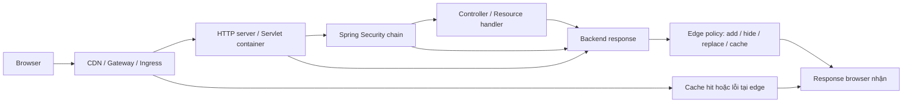

# Tránh header lặp và chính sách mâu thuẫn giữa các lớp

## 1. Mục tiêu: một response, một chính sách nhất quán

Trong chương **Kiến trúc HTTP header** của module `SPRING_SECURITY_HTTP_PROTECTION`, ứng dụng bảo vệ HTTP và trình duyệt bằng nhiều cơ chế: CSRF, CORS, security headers, CSP, HSTS, HTTP firewall và quản lý session. Các cơ chế này có thể được cấu hình ở **controller**, **Spring Security**, **Servlet container / Reactive server**, **reverse proxy**, **API gateway** và **CDN**.

Vấn đề xuất hiện khi nhiều lớp cùng ghi HTTP response header nhưng không thống nhất trách nhiệm. Ví dụ:

```http
HTTP/1.1 200 OK
X-Frame-Options: SAMEORIGIN
X-Frame-Options: DENY
Content-Security-Policy: frame-ancestors 'self'
Content-Security-Policy: frame-ancestors 'none'
Cache-Control: public, max-age=3600
Cache-Control: no-store
```

Đây không phải “phòng vệ gấp đôi” một cách tự động. Browser có thể vẫn chặn iframe cùng origin bởi CSP `frame-ancestors 'none'`; cache gặp các chỉ thị trái nhau; và giá trị `X-Frame-Options` lặp không có một quy tắc “dòng cuối thắng” bảo đảm trên mọi trình duyệt.

Bài học giải quyết ba câu hỏi:

1. **Ai sở hữu header nào?** Ứng dụng hay hạ tầng public edge có quyền quyết định giá trị?
2. **Khi một tên header xuất hiện nhiều lần, browser/cache sẽ xử lý như thế nào?** Không thể áp một quy tắc chung cho CSP, HSTS, CORS và cookie.
3. **Làm thế nào ngăn xung đột mà vẫn giữ các lớp phòng vệ khác?** Dùng writer chuyên biệt, hợp đồng chính sách và kiểm thử response cuối qua toàn bộ đường truyền.

Kết thúc bài, người học có thể nhận diện header lặp và chính sách mâu thuẫn trên Servlet/Reactive, phân biệt đa giá trị hợp lệ, sửa đúng tầng phát header, và kiểm thử những tình huống tấn công hoặc tích hợp bị ảnh hưởng.

## 2. Phân loại vấn đề trước khi sửa

| Loại vấn đề | Ví dụ | Vì sao cần xử lý khác nhau? |
| --- | --- | --- |
| **Trùng tên, mâu thuẫn giá trị** | Hai `X-Frame-Options` lần lượt `DENY` và `SAMEORIGIN` | Cần chọn chính sách và nguồn phát thống nhất. |
| **Khác tên, cùng kiểm soát hành vi** | XFO `SAMEORIGIN` và CSP `frame-ancestors 'none'` | Không thể chỉ loại header trùng; phải đồng bộ ý nghĩa policy. |
| **Trùng tên, bổ sung hạn chế** | Hai `Content-Security-Policy` cưỡng chế | Browser có thể thực thi đồng thời cả hai, khiến policy nghiêm hơn. |
| **Đa field hợp lệ** | Hai `Set-Cookie` của hai cookie khác nhau | Xóa “field trùng” một cách máy móc có thể phá vỡ session. |
| **Đa chỉ thị cần hợp nhất** | `Vary: Origin` và `Vary: Accept-Encoding` | Các chiều biến thể cache đều có thể cần được giữ. |
| **Giá trị khác qua từng hop** | Backend phát CSP A, gateway phát CSP B | Chỉ response cuối đến browser mới phản ánh thực tế triển khai. |
| **Giá trị khác nhưng đúng có chủ đích** | HTML cá nhân `no-store`, asset fingerprint `public, max-age` | Không nên ép tất cả response có cùng cache policy. |

Một dấu hiệu quan trọng: **header trùng tên không nhất thiết là lỗi**, và **header không trùng tên không có nghĩa không có xung đột**.

### 2.1. “Dòng cuối thắng” không phải quy tắc HTTP

Trên Servlet, `response.setHeader(name, value)` thường thay các giá trị trong response object có cùng tên; `response.addHeader(...)` thêm giá trị. Với WebFlux, `HttpHeaders.set` và `HttpHeaders.add` cũng có ngữ nghĩa tương ứng. Tuy nhiên, sau đó container và proxy còn có thể thay đổi response.

Quan trọng hơn, **quy tắc xử lý thuộc về từng HTTP header**. Browser có thể áp dụng nhiều CSP cùng lúc; các cookie khác nhau cần nhiều `Set-Cookie`; CORS không chấp nhận danh sách origin theo cách ghép bừa bãi. Vì vậy đừng viết một bộ lọc chung “chọn dòng cuối theo mọi tên header”.

## 3. Các nguồn phát header trong kiến trúc thực tế



Sơ đồ mô tả **các điểm có khả năng ghi header**; thứ tự gọi filter và thời điểm commit thực tế còn tùy stack. Spring Security Servlet dùng `HeaderWriterFilter` phối hợp `HeaderWriter`; Spring Security WebFlux dùng `HttpHeaderWriterWebFilter` phối hợp `ServerHttpHeadersWriter`.

| Lớp | Nguồn header thường gặp | Rủi ro xung đột |
| --- | --- | --- |
| Controller/resource handler | `Content-Type`, `Content-Disposition`, `Cache-Control`, `Location` | Tự ghi CSP/cache khác policy trong chain; redirect sai scheme. |
| Spring Security Servlet | `HttpSecurity.headers(...)` và `HeaderWriterFilter` | Thêm static writer trùng tên writer mặc định. |
| Spring Security Reactive | `ServerHttpSecurity.headers(...)` và `HttpHeaderWriterWebFilter` | Writer bất đồng bộ ghi sau commit hoặc policy khác chain. |
| Servlet container/Reactive server | Một số metadata giao thức, compression, error response | Response lỗi được tạo trước khi security chain chạy. |
| Proxy/CDN | HSTS, CSP, frame policy, CORS, cache, error/redirect | Thêm CSP/XFO thứ hai, ghi đè CORS, cache policy cũ. |

Một `302` do login handler phát, một `403` do CSRF, một `500` của ứng dụng và `502` do gateway phát **không nhất thiết đi qua cùng các thành phần**. Do đó luôn chẩn đoán bằng **URL + method + status + scheme + đường đi request**.

### 3.1. Bảng phân quyền sở hữu đề xuất

Bảng dưới là **kiến trúc minh họa**, không phải bộ mặc định của Spring Security:

| Header/policy | Chủ sở hữu được chọn | Quy tắc cho các lớp khác |
| --- | --- | --- |
| CSP cho HTML | Backend Spring Security | CDN/Ingress không phát thêm CSP cưỡng chế không đồng bộ. |
| XFO trên HTML | Backend chain WEB | Gateway không tự chèn `DENY` vào trang cho phép nhúng same-origin. |
| HSTS public | Gateway terminate TLS | Backend không tạo giá trị HSTS thứ hai mâu thuẫn. |
| CORS của `/api/**` | Bộ xử lý CORS của backend | Proxy không phản chiếu Origin hoặc thêm wildcard tùy ý. |
| Cache dữ liệu tài khoản | Application + CDN thống nhất `no-store` | CDN không override thành `public`. |
| Cache asset fingerprint | Resource handler/CDN | Không để rule chống cache của HTML phá hiệu năng asset. |
| `Set-Cookie` | Session/auth framework | Proxy giữ nguyên các field cookie, không gộp/xóa bớt. |

Có thể chọn backend làm chủ sở hữu HSTS hoặc edge làm chủ sở hữu CSP nếu phù hợp hệ thống. **Điều bắt buộc là rõ trách nhiệm và có bằng chứng response cuối**, không phải mọi ứng dụng đều dùng cùng mô hình trên.

## 4. CSP: thêm policy mới có thể làm hạn chế chặt hơn

Một backend phát:

```http
Content-Security-Policy: default-src 'self'; script-src 'self'; connect-src 'none'
```

Gateway thêm:

```http
Content-Security-Policy: default-src 'self'; connect-src https://api.example.test
```

Dù policy thứ hai cho phép API, browser **vẫn có thể chặn** vì nhiều CSP cưỡng chế cùng được áp dụng. Chính sách `connect-src 'none'` ở backend chưa được sửa.

**Cách xử lý đúng:** xác định policy đang chặn trong DevTools Console; sửa hoặc loại bỏ nguồn phát policy đó theo quy trình phê duyệt. Không thử “nới CSP” bằng cách thêm một CSP khác rộng hơn.

### 4.1. Phân biệt CSP cưỡng chế với Report-Only

| Header | Hành vi |
| --- | --- |
| `Content-Security-Policy` | Browser cưỡng chế các directive được hỗ trợ. |
| `Content-Security-Policy-Report-Only` | Dùng để quan sát/báo cáo vi phạm, **không cưỡng chế** theo policy Report-Only đó. |

Thêm `Content-Security-Policy-Report-Only` không làm nới `Content-Security-Policy` đang tồn tại. Khi thử nghiệm policy mới, kiểm tra browser và điểm thu thập báo cáo để phân biệt vi phạm được **chặn** với vi phạm chỉ **được báo cáo**.

### 4.2. Không ghép CSP bằng cách nối chuỗi không kiểm soát

CSP có nhiều directive như `default-src`, `script-src`, `style-src`, `connect-src`, `img-src`, `frame-ancestors` và `object-src`. Hai chính sách có thể cùng tồn tại nhưng không có nghĩa các nguồn được **hợp nhất theo phép OR**. Trong một ứng dụng dùng script nonce, tạo CSP có nonce cố định tại proxy còn có thể phá mục tiêu của nonce theo response.

Nếu ứng dụng cần nonce, backend biết giá trị nonce mà template HTML đang dùng; nên quản lý CSP tại tầng có quyền tạo nonce tương ứng, thay vì áp một CSP tĩnh chồng lên ở edge.

## 5. X-Frame-Options và CSP frame-ancestors: xung đột khác tên

Ví dụ:

```http
X-Frame-Options: SAMEORIGIN
Content-Security-Policy: frame-ancestors 'none'
```

`SAMEORIGIN` cho phép trang được nhúng trong giới hạn same-origin theo XFO, nhưng CSP `frame-ancestors 'none'` chặn việc nhúng trên browser hỗ trợ. Như vậy không hề có header trùng tên nhưng chức năng iframe vẫn hỏng.

| Yêu cầu nhúng | X-Frame-Options | CSP frame-ancestors |
| --- | --- | --- |
| Cấm mọi nguồn | `DENY` | `'none'` |
| Chỉ cho same-origin | `SAMEORIGIN` | `'self'` |
| Cho phép một số origin ngoài | XFO không có allowlist đa origin hiện đại đáng tin cậy | Ví dụ `'self' https://portal.example.test`; đánh giá browser cũ và XFO còn tồn tại. |

Không nhầm `frame-ancestors` (ai được phép nhúng **trang hiện tại**) với `frame-src` (trang hiện tại được phép nhúng iframe từ đâu). Chỉ thị lịch sử `X-Frame-Options: ALLOW-FROM` không phải giải pháp thay thế CSP hiện đại.

Nếu backend đã thiết kế `SAMEORIGIN` mà gateway tự thêm `DENY`, hãy loại bỏ cấu hình trái mục đích tại tầng tương ứng. Không cần tắt toàn bộ nhóm security headers để sửa một lỗi iframe.

## 6. HSTS: tránh hai chính sách khác nhau trên HTTPS

```http
Strict-Transport-Security: max-age=86400
Strict-Transport-Security: max-age=31536000; includeSubDomains
```

Đây là trạng thái cần khắc phục. **RFC 6797 yêu cầu server không gửi nhiều STS header fields**, và user agent xử lý field đầu tiên khi gặp nhiều field. Bởi vậy “field cuối thắng” đặc biệt sai đối với HSTS.

HSTS có hiệu lực khi browser nhận qua **HTTPS hợp lệ**. Nếu reverse proxy terminate HTTPS nhưng gọi backend HTTP nội bộ, backend Spring Security có thể không phát HSTS theo điều kiện secure request; điều đó chưa chắc là lỗi. Hãy nhìn **public HTTPS response**.

Những quyết định phải thống nhất:

- Ai sở hữu HSTS: ứng dụng hay tầng HTTPS edge?
- `max-age` được áp trong bao lâu và có kế hoạch rollout/rollback?
- Có dùng `includeSubDomains` không? Các subdomain liên quan đã sẵn sàng TLS chưa?
- Có nhu cầu `preload` và đáp ứng điều kiện liên quan không?
- Trusted forwarded headers được xử lý ở ranh giới proxy như thế nào?

HSTS không thay chứng chỉ TLS, không giải quyết một request HTTP đầu tiên chưa được HSTS/preload bảo vệ và không nên được thêm lên HTTP nội bộ chỉ để “đủ bộ header”.

## 7. CORS: response không được chứa danh sách Origin ghép tùy tiện

Ví dụ:

```http
Access-Control-Allow-Origin: https://portal.example.test
Access-Control-Allow-Origin: https://shop.example.test
Access-Control-Allow-Credentials: true
```

Không phải cách cho phép hai frontend. `Access-Control-Allow-Origin` không hỗ trợ danh sách origin bằng nhiều dòng hoặc chuỗi dấu phẩy theo kiểu tự ghép. Trình duyệt cần giá trị hợp lệ cho **Origin cụ thể của request**. Với credentials, `Access-Control-Allow-Origin: *` cũng không được dùng để cho phép đọc response có credential.

**Cách xử lý:** chỉ một tầng sở hữu CORS processing; cấu hình allowlist, method, request headers, credentials và xử lý `OPTIONS` preflight. Nếu response thay đổi theo `Origin`, `Vary: Origin` có thể cần để cache không trả nhầm biến thể. Preflight có thể cần `Vary` thêm các request headers ảnh hưởng policy tương ứng.

CORS không phải authentication và không thay CSRF. Nếu POST thiếu CSRF token trả `403`, thêm `Access-Control-Allow-Origin` không làm token hợp lệ. Không tắt CSRF chỉ để tránh thông báo CORS trên frontend khi nguyên nhân thực là preflight/credentials.

## 8. Cache-Control, Set-Cookie và Vary: không phải mọi đa giá trị đều sai

### 8.1. Cache-Control trái nhau

```http
Cache-Control: public, max-age=3600
Cache-Control: no-store
```

Đôi khi nhiều Cache-Control field hợp lệ về cú pháp, nhưng **ý định cache đang mâu thuẫn**. Không dựa vào vị trí một dòng để suy chính sách cuối. Hãy chọn caching theo loại response.

| Response | Chính sách minh họa |
| --- | --- |
| HTML sau đăng nhập, dữ liệu cá nhân, token | `Cache-Control: no-store` hoặc chính sách tương đương đã duyệt |
| Asset public fingerprint theo filename hash | `Cache-Control: public, max-age=31536000, immutable` nếu quy trình versioning bảo đảm |
| Tài nguyên public cần revalidate | `Cache-Control` và `ETag`/`Last-Modified` tùy thiết kế |
| HTML khác nhau theo tài khoản | Không để shared CDN cache nhầm giữa người dùng |

Spring Security có cache headers mặc định trong nhiều phiên bản, nhưng controller/resource handler có thể chủ động đặt caching riêng. Điều đó không phải lý do tắt `nosniff`, XFO hay HSTS cho toàn bộ ứng dụng.

### 8.2. Set-Cookie nhiều field là bình thường

```http
Set-Cookie: SESSION=opaque-example; Path=/; Secure; HttpOnly; SameSite=Lax
Set-Cookie: language=vi; Path=/; Secure; SameSite=Lax
```

Hai dòng `Set-Cookie` này có thể hợp lệ. **Không gộp bằng dấu phẩy** hoặc deduplicate theo tên field rồi giữ một dòng. Proxy làm như vậy có thể phá đăng nhập, logout hay chức năng cookie khác.

Nếu hai cookie cùng tên, Domain, Path nhưng khác giá trị được phát bởi nhiều lớp, cần chẩn đoán cụ thể policy session và thứ tự cập nhật. `Set-Cookie` cũng không được expose trực tiếp qua `fetch(...).headers.get("Set-Cookie")` trong browser; hãy kiểm tra DevTools Network/Application.

### 8.3. Vary cần giữ đủ các chiều biến thể

```http
Vary: Accept-Encoding, Origin
```

Có thể hợp lệ vì nội dung/nén khác theo `Accept-Encoding`, còn CORS response khác theo `Origin`. Nếu proxy ghi đè chỉ giữ `Vary: Accept-Encoding`, cache có thể trả response cho Origin không tương ứng.

Không áp chung rule “xóa duplicate” cho `Vary`. Đồng thời, `Vary` không thay `private`/`no-store` cho response nhạy cảm theo session hoặc identity.

### 8.4. Những header liên quan khác

| Header | Mối nguy nếu các lớp không nhất quán |
| --- | --- |
| `Referrer-Policy` | Mức chia sẻ URL nguồn khác nhau; cần xác định policy và thứ tự fallback nếu có. |
| `Permissions-Policy` | Tính năng camera/micro bị cấm tại document dù trang có nhu cầu hợp lệ. |
| `Cross-Origin-Resource-Policy` | `same-origin` trên font/ảnh public có thể chặn tích hợp liên origin. |
| `Content-Type` cùng `nosniff` | JS/CSS trả sai MIME bị browser chặn; sửa MIME thay vì tắt `nosniff`. |
| `Location` | Gateway đổi redirect thành HTTP hoặc host không mong muốn. |
| `Content-Disposition` | Proxy thay `attachment` thành `inline` có thể đổi hành vi tải file. |

## 9. Servlet: cấu hình đúng một frame policy và một CSP có chủ đích

Spring Security Servlet cung cấp `HttpSecurity` và `HeaderWriterFilter`. Trong ứng dụng có trang được phép nhúng **cùng origin**, ví dụ:

```java
import org.springframework.context.annotation.Bean;
import org.springframework.context.annotation.Configuration;
import org.springframework.security.config.annotation.web.builders.HttpSecurity;
import org.springframework.security.web.SecurityFilterChain;

@Configuration
class ServletHeaderPolicyConfig {

    @Bean
    SecurityFilterChain webChain(HttpSecurity http) throws Exception {
        http
            .authorizeHttpRequests(auth -> auth
                .requestMatchers("/health").permitAll()
                .anyRequest().authenticated())
            .headers(headers -> headers
                .frameOptions(frame -> frame.sameOrigin())
                .contentSecurityPolicy(csp -> csp.policyDirectives(
                    "default-src 'self'; " +
                    "object-src 'none'; " +
                    "base-uri 'self'; " +
                    "frame-ancestors 'self'")));
        return http.build();
    }
}
```

Đây là **cấu hình minh họa Spring Security 6.x**. CSP có thể không phù hợp ứng dụng dùng CDN, script/style inline hoặc API ngoài origin; cần kiểm kê nguồn và thử Report-Only trước khi cưỡng chế. Không sao chép cả chain để thay thế production configuration có authentication, CSRF, CORS và session riêng.

Điểm chính là dùng **DSL chuyên biệt** `frameOptions` để thay `X-Frame-Options`, không thêm một writer tĩnh cùng tên.

### Anti-pattern: bổ sung writer gây trùng XFO

```java
import org.springframework.security.web.header.writers.StaticHeadersWriter;

// Không dùng để "ghi đè" XFO đã có writer mặc định.
http.headers(headers -> headers
    .addHeaderWriter(new StaticHeadersWriter(
        "X-Frame-Options", "SAMEORIGIN")));
```

Nếu chain vẫn có writer `X-Frame-Options: DENY`, kết quả có thể phụ thuộc thứ tự/implementation, gây lặp hoặc ghi đè. Sửa chính sách bằng `.frameOptions(frame -> frame.sameOrigin())`. Nếu CSP còn `frame-ancestors 'none'`, phải điều chỉnh CSP theo nhu cầu hợp lệ chứ không chỉ thay XFO.

### Nhiều chain và những đường dẫn bị bỏ qua

Một ứng dụng có thể có chain `/api/**` và `/**`. Chỉ chain được chọn theo thứ tự/matcher mới áp header writers của nó; Spring Security **không gộp tất cả writers từ nhiều chain**. Một route được `permitAll` vẫn đi qua chain, trong khi route bị bỏ qua bằng cơ chế phù hợp có thể không nhận header Spring Security.

Do vậy nếu chỉ một route bị header lặp hoặc thiếu, kiểm tra matcher, `@Order`, rewrite path và chain được chọn **trước khi sửa CDN**.

## 10. Reactive/WebFlux: cùng chính sách nhưng dùng API khác

WebFlux dùng `ServerHttpSecurity` và `SecurityWebFilterChain`; header được điều phối qua `HttpHeaderWriterWebFilter`. Ví dụ tương đương:

```java
import org.springframework.context.annotation.Bean;
import org.springframework.context.annotation.Configuration;
import org.springframework.security.config.annotation.web.reactive.EnableWebFluxSecurity;
import org.springframework.security.config.web.server.ServerHttpSecurity;
import org.springframework.security.web.server.SecurityWebFilterChain;
import org.springframework.security.web.server.header.XFrameOptionsServerHttpHeadersWriter;

@Configuration
@EnableWebFluxSecurity
class ReactiveHeaderPolicyConfig {

    @Bean
    SecurityWebFilterChain webChain(ServerHttpSecurity http) {
        return http
            .authorizeExchange(auth -> auth
                .pathMatchers("/health").permitAll()
                .anyExchange().authenticated())
            .headers(headers -> headers
                .frameOptions(frame -> frame.mode(
                    XFrameOptionsServerHttpHeadersWriter.Mode.SAMEORIGIN))
                .contentSecurityPolicy(csp -> csp.policyDirectives(
                    "default-src 'self'; " +
                    "object-src 'none'; " +
                    "base-uri 'self'; " +
                    "frame-ancestors 'self'")))
            .build();
    }
}
```

Ví dụ theo DSL Reactive trong nhiều bản Spring Security 6.x; hãy kiểm tra chữ ký `ServerHttpSecurity.HeaderSpec.FrameOptionsSpec` của phiên bản dự án. Đừng dùng `StaticHeadersWriter` Servlet trong WebFlux hoặc tự `subscribe()` một writer reactive rồi mong header được ghi trước response commit.

Nếu ứng dụng streaming/SSE, việc sửa header ở `doFinally(...)` có thể quá muộn. Dùng cơ chế header writer/before-commit phù hợp thay vì chạy một callback tách khỏi pipeline.

## 11. Proxy/CDN: chọn một owner cho HSTS và kiểm tra response lỗi

Nếu team đã quyết định **reverse proxy HTTPS sở hữu HSTS**, fragment NGINX dưới minh họa cách tránh chuyển HSTS từ upstream đồng thời phát một policy ở edge:

```nginx
# Fragment nằm trong server/location HTTPS được cấu hình đúng.
location / {
    proxy_pass http://app_backend;
    proxy_hide_header Strict-Transport-Security;
    add_header Strict-Transport-Security "max-age=31536000" always;
}
```

Cần xác minh TLS certificate, hostname, cấu hình reverse proxy và toàn bộ route; **không** thêm HSTS ở HTTP public không mã hóa. `always` giúp `add_header` áp với nhiều status, kể cả một số response lỗi do NGINX trả. Kế thừa `add_header` giữa các scope `http`/`server`/`location` phụ thuộc version và cấu hình, nên thêm một `add_header` tại scope con có thể làm mất những header được kế thừa trước đó.

`proxy_hide_header` xử lý **response header từ upstream**. `proxy_set_header` lại xử lý **request header gửi về upstream**, không dùng thay cho thao tác viết response header.

Nếu backend là owner HSTS, cách đúng có thể là **không thêm HSTS tại proxy**. Nếu backend là owner CSP, tránh `add_header Content-Security-Policy` tại edge mà không hiểu rằng CSP thêm vào có thể cùng được browser cưỡng chế.

Gateway còn có thể tự trả `502`/`503`, redirect HTTP→HTTPS hoặc response cache-hit mà không đi đến Spring Security. Chính sách header trên các đường đi này phải được kiểm tra tại **edge**.

## 12. Kiểm thử Servlet: phát hiện trùng giá trị khi đã chọn một owner

Giả sử ứng dụng Servlet có `GET /health` trả `200` và dùng `ServletHeaderPolicyConfig` ở mục 9. Test có thể xác nhận **theo hợp đồng của ứng dụng này** rằng XFO/CSP chỉ có một giá trị, đồng thời vẫn có `nosniff`:

```java
import org.junit.jupiter.api.Test;
import org.springframework.beans.factory.annotation.Autowired;
import org.springframework.boot.test.autoconfigure.web.servlet.AutoConfigureMockMvc;
import org.springframework.boot.test.context.SpringBootTest;
import org.springframework.test.web.servlet.MockMvc;

import static org.junit.jupiter.api.Assertions.assertEquals;
import static org.junit.jupiter.api.Assertions.assertTrue;
import static org.springframework.test.web.servlet.request.MockMvcRequestBuilders.get;
import static org.springframework.test.web.servlet.result.MockMvcResultMatchers.status;

@SpringBootTest
@AutoConfigureMockMvc
class ServletHeaderCollisionTest {

    @Autowired MockMvc mvc;

    @Test
    void headerPolicyIsConsistentOnSecureRequest() throws Exception {
        var result = mvc.perform(get("/health").secure(true))
            .andExpect(status().isOk())
            .andReturn();

        var response = result.getResponse();
        var frames = response.getHeaders("X-Frame-Options");
        var policies = response.getHeaders("Content-Security-Policy");

        assertEquals(1, frames.size());
        assertEquals("SAMEORIGIN", frames.iterator().next());
        assertEquals(1, policies.size());
        assertTrue(policies.iterator().next()
            .contains("frame-ancestors 'self'"));
        assertEquals("nosniff",
            response.getHeader("X-Content-Type-Options"));
    }
}
```

**Phạm vi của assertion:** ở hệ thống này team đã quyết định chỉ phát một CSP cưỡng chế. Có những ứng dụng chủ đích dùng nhiều CSP; khi đó phải kiểm tra **tất cả chính sách** thay vì ép luôn `size() == 1`. Với `Set-Cookie`, assertion chỉ một field là **sai**.

`secure(true)` mô phỏng HTTPS trong MockMvc nhưng không kiểm tra certificate, TLS hay response proxy thực. Package test có thể khác theo phiên bản Spring Boot; đối chiếu dependency runtime và test.

## 13. Kiểm thử WebFlux: kiểm tra header được chọn và mặc định còn lại

Với `ReactiveHeaderPolicyConfig` và một endpoint `/health` trả `200`:

```java
import org.junit.jupiter.api.Test;
import org.springframework.beans.factory.annotation.Autowired;
import org.springframework.boot.test.autoconfigure.web.reactive.AutoConfigureWebTestClient;
import org.springframework.boot.test.context.SpringBootTest;
import org.springframework.test.web.reactive.server.WebTestClient;

import static org.junit.jupiter.api.Assertions.assertEquals;
import static org.junit.jupiter.api.Assertions.assertTrue;

@SpringBootTest
@AutoConfigureWebTestClient
class ReactiveHeaderCollisionTest {

    @Autowired WebTestClient client;

    @Test
    void frameAndCspDoNotConflict() {
        var result = client.get().uri("/health").exchange()
            .expectStatus().isOk()
            .expectBody().returnResult();

        var headers = result.getResponseHeaders();
        var frame = headers.get("X-Frame-Options");
        var csp = headers.get("Content-Security-Policy");

        assertEquals(1, frame == null ? 0 : frame.size());
        assertEquals("SAMEORIGIN", frame.get(0));
        assertEquals(1, csp == null ? 0 : csp.size());
        assertTrue(csp.get(0).contains("frame-ancestors 'self'"));
        assertEquals("nosniff",
            headers.getFirst("X-Content-Type-Options"));
    }
}
```

`WebTestClient` kiểm tra response từ WebFlux test context; không xác minh rằng CDN hoặc reverse proxy không phát thêm XFO/CSP. HSTS cần kiểm tra riêng trên HTTPS public vì mock HTTP không mô phỏng TLS và forwarding đầy đủ.

## 14. So sánh response backend và response cuối cùng

```bash
# Truy cập URL public qua CDN/gateway.
curl -sS -D - -o /dev/null https://app.example.test/health

# Chỉ khi có quyền truy cập backend trực tiếp.
curl -sS -D - -o /dev/null http://127.0.0.1:8080/health
```

Trên Windows PowerShell dùng `curl.exe` và `-o NUL`. Đổi domain/URL minh họa thành môi trường thật. Không đưa cookie/token thật vào lệnh hoặc ảnh chụp được chia sẻ.

Khi so sánh, cần giữ nhất quán **URL/path, method, status, host, authentication, thời điểm triển khai và cache hit/miss**. Nếu một bên dùng HTTP còn bên kia dùng HTTPS, sự khác biệt HSTS có thể xuất phát từ điều kiện secure request — không tự động là proxy đã xóa header.

Đọc **tất cả field cùng tên**, không chỉ `getFirst(...)`. HTTP header names không phân biệt hoa/thường; trong HTTP/2 tên thường viết chữ thường. Nếu redirect, xem **từng response** thay vì chỉ URL đích.

### 14.1. DevTools Network và Console

- **Network / Response Headers**: browser nhận header nào, bao gồm các policy khác nhau và cache status.
- **Console**: browser báo CSP/iframe violation, nguồn bị chặn, CORS error hoặc Permissions-Policy violation.
- **Application / Cookies**: cookie session có được lưu với `Secure`, `HttpOnly`, `SameSite`, `Domain`, `Path` phù hợp không.

Network cho biết header đã được gửi; nó không thay thế thử nghiệm hành vi browser. Một CSP có thể xuất hiện đúng trong `curl` nhưng vẫn chặn trang vì directive chưa tính nguồn CDN/iframe.

### 14.2. Ma trận kiểm thử tối thiểu

| Ca | Kiểm tra |
| --- | --- |
| HTML `200` HTTPS | CSP, XFO, HSTS, `nosniff` có policy nhất quán. |
| `302`/`401` chưa đăng nhập | Header trên redirect và response đích; có chain khác không. |
| `403` do CSRF/authorization | Header phù hợp; không suy CSRF lỗi từ CSP. |
| `404`/`500` application | Error handler có đi qua security chain không. |
| `502`/`503` từ edge | Gateway có policy cho lỗi do chính nó tạo không. |
| HTTP và HTTPS | HSTS trên HTTPS hợp lệ, hiểu sự khác biệt của backend HTTP. |
| Asset public | Cache policy hợp loại tài nguyên, không mất `nosniff`. |
| Nội dung tài khoản | Không bị shared CDN cache công khai. |
| Origin trong CORS allowlist/không trong allowlist | Preflight và actual request cho kết quả đúng. |
| Iframe same-origin/khác-origin | Browser tuân thủ cả XFO và CSP. |
| Response có nhiều cookie | `Set-Cookie` từng field còn nguyên. |
| Streaming/SSE | Security headers được ghi trước khi response commit. |

## 15. Bảng chẩn đoán nhanh

| Triệu chứng | Nguyên nhân khả dĩ | Cách giải quyết |
| --- | --- | --- |
| Iframe cùng origin vẫn bị chặn | `X-Frame-Options: DENY` từ proxy hoặc CSP `frame-ancestors 'none'` | Đọc cả hai policy, thống nhất owner, kiểm thử iframe thật. |
| Gateway thêm CSP nhưng script vẫn bị chặn | Backend CSP cưỡng chế vẫn nghiêm hơn | Sửa chính policy hạn chế; không thêm CSP thứ hai để “nới”. |
| HSTS khác nhau giữa backend và public HTTPS | TLS termination hoặc hai nguồn HSTS | Chọn một owner, kiểm tra public HTTPS, chứng chỉ và subdomain. |
| CORS error dù `nosniff`/CSP đúng | Preflight, allowlist hoặc credentials không hợp lệ | Cấu hình CORS processor, không sửa CSP để chữa CORS. |
| Cookie biến mất sau deploy gateway | `Set-Cookie` bị gộp/xóa/rewritten | Kiểm tra từng field, cookie attributes và browser storage. |
| `Cache-Control: public` trên dữ liệu session | CDN hoặc controller override `no-store` | Sửa cache policy theo loại dữ liệu, kiểm tra cache-hit. |
| `Vary: Origin` bị mất | Proxy thay `Vary` khi thêm `Accept-Encoding` | Giữ đủ các chiều biến thể cache hợp lệ. |
| Header chỉ thiếu trên static asset | Tài nguyên do CDN/server khác phục vụ | Áp policy ở tầng thực sự phát asset. |
| Header chỉ thiếu trên `503` | Edge tạo lỗi, header rule không áp status | Cấu hình edge error response và kiểm thử `always`/scope nếu NGINX. |
| CSP chỉ có trong backend, không thấy public | Proxy ẩn/ghi đè, CDN cache cũ | So response từng hop, clear/invalidate cache có kiểm soát. |
| POST `403` có mọi security headers | CSRF token hoặc quyền không hợp lệ | Kiểm tra CSRF/auth/session; không vô hiệu security headers. |
| Header biến mất khi streaming | Header được ghi sau commit | Dùng security writer hoặc cơ chế trước commit đúng stack. |
| Hai chain trả policy khác nhau | Chain matcher/order khác hoặc cấu hình có chủ đích | Xác nhận chain được chọn và hợp đồng policy từng route. |

### Quy trình xử lý bảy bước

1. Ghi lại URL, method, status, scheme, auth context và thời điểm của response gặp lỗi.
2. Thu thập **toàn bộ raw response headers** và các policy khác tên nhưng cùng tác động đến hành vi.
3. So kết quả từ test ứng dụng, backend trực tiếp, proxy/CDN và browser.
4. Xác định đúng `SecurityFilterChain`/`SecurityWebFilterChain`, controller và edge rules tạo header.
5. Tra quy tắc cụ thể của header: CSP, HSTS, CORS, Cache-Control, Set-Cookie và Vary **không có cùng ngữ nghĩa lặp**.
6. Chọn source of truth, loại cấu hình chồng lấn, nhưng bảo toàn security headers và các cơ chế CSRF/CORS/session không liên quan.
7. Test lại response thành công, redirect, error, asset, HTTPS, streaming và tình huống browser được phép/bị chặn.

## 16. Bài tập tình huống

**Bài A — XFO và CSP mâu thuẫn.** Backend phát `X-Frame-Options: SAMEORIGIN` và CSP `frame-ancestors 'self'`; ingress thêm `X-Frame-Options: DENY`. Hãy xác định nơi sửa và cách xác nhận iframe cùng origin được nhúng, origin khác bị chặn.

**Bài B — “Nới” CSP bằng proxy.** Backend có `connect-src 'none'`, proxy thêm CSP `connect-src https://api.example.test`. Vì sao frontend vẫn bị chặn? Nhiều policy cưỡng chế cùng tác động; cần sửa policy đang chặn.

**Bài C — Cookie session bị mất.** Backend phát hai `Set-Cookie` hợp lệ, proxy deduplicate theo tên field rồi chỉ giữ một. Hãy giải thích tại sao không áp quy tắc “một tên một dòng” cho cookie.

**Bài D — CORS đa frontend.** Gateway thêm `Access-Control-Allow-Origin: *` còn backend phản hồi origin cụ thể với credentials. Vì sao browser có thể từ chối? Thiết kế một CORS processor và kiểm thử preflight.

**Bài E — HSTS qua HTTPS edge.** Public HTTPS có một HSTS từ gateway, backend HTTP không có. Có nhất thiết là lỗi? Không; cần xem HTTPS public, certificate và owner được chọn.

**Bài F — CDN cache dữ liệu cá nhân.** Backend phát `no-store` nhưng CDN cache `/user/**` vì rule `public`. Nêu rủi ro và cách kiểm chứng bằng tài khoản thử nghiệm khác nhau.

**Bài G — Vary bị thay.** Backend có `Vary: Origin` nhưng gateway chỉ giữ `Vary: Accept-Encoding`. Shared cache có thể trả biến thể CORS sai; thiết kế hợp nhất đúng các chiều.

**Bài H — CSP Report-Only.** Backend phát CSP cưỡng chế, edge thêm Report-Only rộng hơn. Browser vẫn chặn. Tại sao? Report-Only chỉ báo cáo, không nới CSP cưỡng chế.

**Bài I — MIME sai và nosniff.** File JS trả `Content-Type: text/plain` và `X-Content-Type-Options: nosniff`. Hãy sửa MIME ở resource server thay vì tắt `nosniff`.

**Bài J — Lỗi gateway.** Backend luôn có security headers trên `200`; `503` do CDN tạo thiếu chúng. Hãy xác định tầng tạo response và nơi cần sửa policy lỗi.

## 17. Checklist triển khai production

1. **Có bảng ownership** cho CSP, XFO, HSTS, CORS, cache và cookie theo từng nhóm URL/response.
2. **Không phát hai chính sách mâu thuẫn** tại controller, Spring Security và edge; các chính sách khác tên như XFO/CSP cũng phải nhất quán.
3. **Không xóa đa field hợp lệ**: giữ riêng `Set-Cookie`, giữ `Vary` đúng biến thể và kiểm tra toàn bộ CSP.
4. **Dùng đúng DSL/writer**: Servlet `HttpSecurity`/`HeaderWriterFilter`, Reactive `ServerHttpSecurity`/`HttpHeaderWriterWebFilter`.
5. **Tránh static writer trùng header mặc định**; sửa qua builder chuyên biệt khi có thể.
6. **Tôn trọng thời điểm commit** trên Servlet và WebFlux, nhất là redirect/streaming.
7. **HSTS chỉ đánh giá trên HTTPS hợp lệ**, chọn owner và kiểm tra `max-age`/subdomain.
8. **CORS, CSRF, session, HTTP firewall và authorization là lớp riêng**, không thể thay bằng response header bất kỳ.
9. **Kiểm chứng từng hop**, bao gồm cache hit và response lỗi do edge sinh ra.
10. **Test giá trị và hành vi thực tế trên browser**, không chỉ sự có mặt của một tên header.

### Tài liệu tham khảo

- [Spring Security Reference — Servlet HTTP Response Headers](https://docs.spring.io/spring-security/reference/servlet/exploits/headers.html)
- [Spring Security Reference — Reactive HTTP Response Headers](https://docs.spring.io/spring-security/reference/reactive/exploits/headers.html)
- [Spring Security Reference — Servlet Security Architecture](https://docs.spring.io/spring-security/reference/servlet/architecture.html)
- [MDN — Content-Security-Policy](https://developer.mozilla.org/en-US/docs/Web/HTTP/Reference/Headers/Content-Security-Policy)
- [MDN — X-Frame-Options](https://developer.mozilla.org/en-US/docs/Web/HTTP/Reference/Headers/X-Frame-Options)
- [RFC 6797 — HTTP Strict Transport Security, Section 8](https://www.rfc-editor.org/rfc/rfc6797#section-8)
- [MDN — Access-Control-Allow-Origin](https://developer.mozilla.org/en-US/docs/Web/HTTP/Reference/Headers/Access-Control-Allow-Origin)
- [MDN — Set-Cookie](https://developer.mozilla.org/en-US/docs/Web/HTTP/Reference/Headers/Set-Cookie)
- [MDN — Cache-Control](https://developer.mozilla.org/en-US/docs/Web/HTTP/Reference/Headers/Cache-Control)
- [MDN — Vary](https://developer.mozilla.org/en-US/docs/Web/HTTP/Reference/Headers/Vary)
- [NGINX — ngx_http_headers_module](https://nginx.org/en/docs/http/ngx_http_headers_module.html)
- [NGINX — ngx_http_proxy_module](https://nginx.org/en/docs/http/ngx_http_proxy_module.html)

