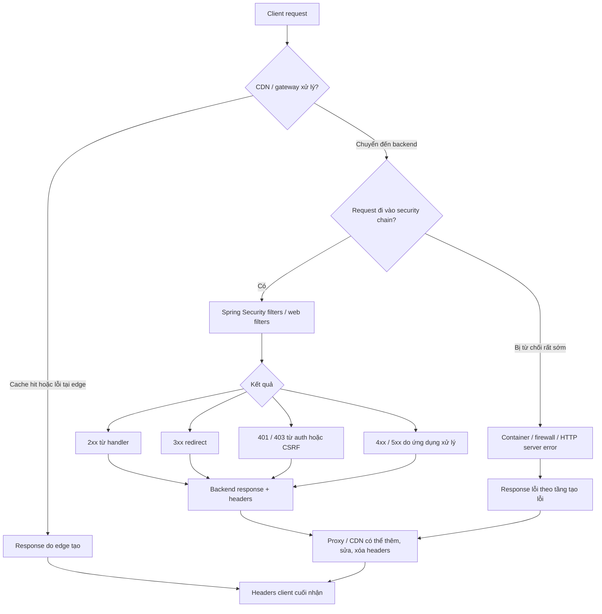
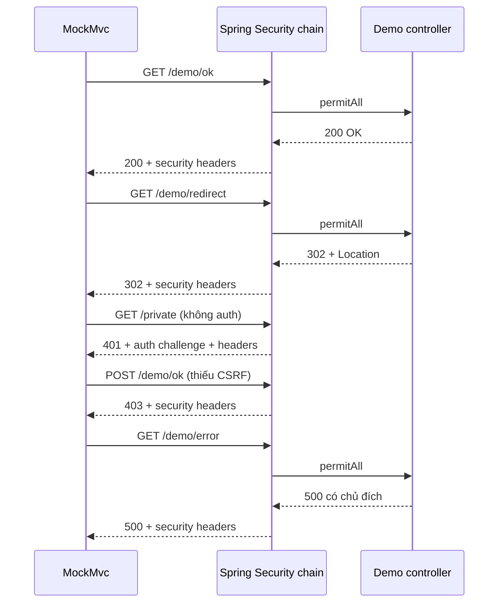
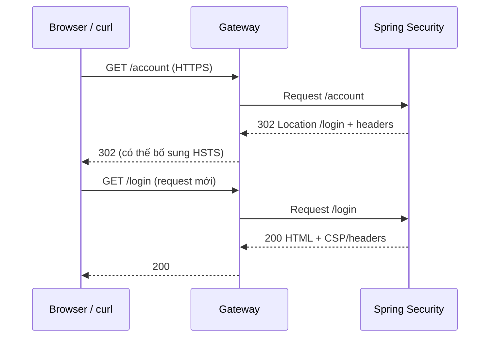

# Kiểm tra header trên phản hồi thành công, redirect và lỗi

## 1. Vì sao chỉ kiểm tra HTTP 200 là chưa đủ?

Trong chương **Kiến trúc HTTP header** của module `SPRING_SECURITY_HTTP_PROTECTION`, các chính sách bảo vệ trình duyệt được gửi trong **HTTP response headers**. Spring Security kết hợp security headers với những cơ chế độc lập khác như CSRF, CORS, Content Security Policy (CSP), HTTP Strict Transport Security (HSTS), HTTP firewall, xác thực và bảo vệ session.

Một bài kiểm thử đơn giản thường chỉ gọi `GET /health`, thấy `200 OK` kèm `X-Content-Type-Options: nosniff` rồi kết luận “mọi phản hồi đều an toàn”. Kết luận này không đủ. Người dùng và trình duyệt thực tế còn nhận:

- **2xx**: trang HTML, API JSON, file download, `201 Created`, `204 No Content`.
- **3xx**: chuyển hướng đăng nhập, chuyển URL, HTTP→HTTPS, `304 Not Modified`.
- **4xx**: `401 Unauthorized`, `403 Forbidden` do CSRF hoặc phân quyền, `404 Not Found`, `429 Too Many Requests`.
- **5xx**: `500 Internal Server Error` của ứng dụng, `502 Bad Gateway` hoặc `503 Service Unavailable` do proxy phát.

Một response `302` có thể chứa trang HTML hoặc thông tin điều hướng, một error page `500` có thể hiển thị nội dung do server tạo, còn response `401`/`403` có thể cần ngăn caching dữ liệu nhạy cảm. **Không có gì bảo đảm chúng được tạo bởi cùng một tầng** hoặc đều đi qua cùng security filter chain.

Ví dụ chuỗi điều hướng:

```http
HTTP/1.1 302 Found
Location: /login
X-Content-Type-Options: nosniff
Cache-Control: no-store
```

Sau đó trình duyệt gửi một request **mới** đến `/login`:

```http
HTTP/1.1 200 OK
Content-Type: text/html
X-Content-Type-Options: nosniff
Content-Security-Policy: default-src 'self'; object-src 'none'
```

Đây là **hai response khác nhau**. Việc response thứ hai có CSP không chứng minh response thứ nhất cũng có CSP, và ngược lại.

### Mục tiêu học tập

Sau bài học, bạn có thể:

1. Thiết kế một **ma trận kiểm thử HTTP response header theo status, route và tầng tạo response**.
2. Dùng **MockMvc** để xác minh header trên Servlet `200`, `302`, `401`, `403`, `500`.
3. Dùng **WebTestClient** để kiểm tra các trường hợp tương ứng trên Reactive/WebFlux.
4. Phân biệt lỗi do Spring Security, controller, HTTP server/container, firewall và gateway/CDN tạo.
5. Xác minh HSTS đúng điều kiện HTTPS, CSP/X-Frame-Options nhất quán, caching phù hợp và CORS preflight không bị hiểu sai.
6. Đọc response thực bằng `curl`, DevTools Network/Console, nhận diện header bị thêm, mất hoặc lặp qua proxy.

## 2. Mô hình tư duy: request được xử lý ở tầng nào?

Trên Servlet, `FilterChainProxy` chọn `SecurityFilterChain`. Nếu request đi qua chain có `HeaderWriterFilter`, những `HeaderWriter` đã được cấu hình có cơ hội ghi header trước khi response commit. Trên Reactive, `WebFilterChainProxy` chọn `SecurityWebFilterChain`; `HttpHeaderWriterWebFilter` phối hợp các `ServerHttpHeadersWriter`.

Tuy nhiên, không phải mọi response đều do Spring MVC/WebFlux controller trả về.



Sơ đồ này trình bày **nguồn gốc và cơ hội được bảo vệ**, không phải thứ tự gọi filter tuyệt đối. Có những lỗi được xử lý thông qua error dispatch hoặc exception handler và có những lỗi xảy ra **trước khi HTTP response hợp lệ tồn tại** (ví dụ TLS handshake thất bại). Vì vậy test không nên ép một “tập header tuyệt đối” cho mọi trường hợp mà không xét tầng tạo response.

### 2.1. Ba lớp kiểm thử bổ sung cho nhau

| Lớp | Công cụ | Điều có thể chứng minh | Giới hạn |
| --- | --- | --- | --- |
| **Cấu hình writer/filter** | Unit test writer, matcher | Writer ghi giá trị mong muốn với mock request. | Chưa chứng minh request thật đi qua đúng chain. |
| **Ứng dụng tích hợp** | MockMvc hoặc WebTestClient | Status và header từ security chain + handler trong test context. | Không kiểm chứng TLS, reverse proxy hoặc CDN thật. |
| **HTTP public và trình duyệt** | `curl`, DevTools, kiểm thử browser | Headers cuối client nhận, sự khác biệt qua redirect, edge và một số hành vi CSP/HSTS/CORS. | Không tự chỉ ra ngay class backend nào tạo header. |

Một bài kiểm thử tốt dùng cả ba lớp khi hệ thống có reverse proxy, HTTPS hoặc nhiều security chain.

## 3. Chọn header cần kiểm tra theo loại response

Không phải tất cả header đều có cùng ý nghĩa trên mọi status. `Content-Security-Policy` về script/iframe chủ yếu quan trọng với **document HTML được trình duyệt xử lý**. `Strict-Transport-Security` liên quan host HTTPS, không phải riêng một trang HTML. `Cache-Control` cần được xem xét theo tính nhạy cảm của dữ liệu và cách response được lưu.

| Header / nhóm | Kiểm tra gì? | Điểm dễ nhầm |
| --- | --- | --- |
| `X-Content-Type-Options` | Có `nosniff` trên response cần bảo vệ, MIME của JS/CSS đúng. | `nosniff` không sửa `Content-Type` sai do server tạo. |
| `X-Frame-Options` | `DENY` hoặc `SAMEORIGIN` đúng policy; không lặp giá trị trái nhau. | Có thể còn bị hạn chế bởi CSP `frame-ancestors`. |
| CSP | Các directive được phê duyệt trên **document HTML thực**, không có policy trùng mâu thuẫn. | CSP Report-Only không cưỡng chế; nhiều CSP cưỡng chế có thể cùng áp. |
| HSTS | Có một policy thích hợp trên **HTTPS hợp lệ**, `max-age` và subdomain đúng. | Không thấy trên HTTP localhost không nhất thiết là lỗi. |
| `Cache-Control` / `Pragma` / `Expires` | `no-store` với dữ liệu nhạy cảm; caching hợp lý với asset công khai. | `204` hoặc redirect cũng có thể cần policy riêng. |
| `Referrer-Policy` | Hạn chế thông tin URL nguồn theo thiết kế. | Không thay việc loại token ra khỏi URL. |
| `Permissions-Policy` | Trên document cần kiểm soát camera/micro/geolocation. | Header ở API JSON không tự thay policy của SPA document đã tải. |
| `Access-Control-Allow-*` | Origin, methods, credentials và preflight phù hợp. | CORS error không đồng nghĩa thiếu CSP. |
| `Set-Cookie` | Cookie session/CSRF đúng `Secure`, `HttpOnly`, `SameSite`, Domain/Path. | Có thể có **nhiều** Set-Cookie hợp lệ; không deduplicate mù quáng. |
| `Location` | Redirect đúng scheme và host, không có open redirect. | `302` và URL đích là hai response khác nhau. |
| `WWW-Authenticate` | Challenge đúng nếu `401` từ HTTP Basic/Bearer. | `403` thường không có cùng nghĩa với `401`. |

### 3.1. Tập mặc định thay đổi theo phiên bản

Trong nhiều phiên bản Spring Security 6.x, khi headers mặc định đang bật, thường thấy:

```http
Cache-Control: no-cache, no-store, max-age=0, must-revalidate
Pragma: no-cache
Expires: 0
X-Content-Type-Options: nosniff
X-Frame-Options: DENY
Strict-Transport-Security: max-age=31536000; includeSubDomains
```

Đây là **baseline tham khảo có điều kiện**: HSTS thường được viết khi request được Spring Security nhận diện là HTTPS/secure. Một số phiên bản cũng phát `X-XSS-Protection: 0`; header này mang tính lịch sử. CSP **không** được mặc định bật với một allowlist thích hợp cho mọi ứng dụng.

Để tạo assertion đúng, hãy xác định phiên bản Spring Security được nạp lúc chạy và chính sách đã được duyệt, **không hardcode một danh sách tưởng tượng cho mọi version và chain**.

## 4. Ma trận trạng thái và nguồn tạo response

| Nhóm | Tình huống cụ thể | Tầng thường tạo | Cần chú ý khi kiểm tra |
| --- | --- | --- | --- |
| `200 OK` | HTML, JSON, tài nguyên tĩnh | Controller/resource server | Security chain, CSP trên HTML, MIME và cache. |
| `201 Created` | POST tạo tài nguyên | Handler/API | `Location` nếu có, caching/auth; CSRF với session cookie. |
| `204 No Content` | DELETE/OPTIONS hoặc endpoint không có body | Handler/CORS | Header có thể có dù response không có body. |
| `206 Partial Content` | Range request download file | HTTP server/resource handler/CDN | `Content-Range`, cache, security policy trên partial response. |
| `301/302/303` | Chuyển URL, login redirect | Controller/security/gateway | `Location`, headers của chính redirect và host đích. |
| `307/308` | Redirect giữ method theo semantics HTTP | Gateway/controller | Không dùng redirect để vô tình gửi POST nhạy cảm sang host lạ. |
| `304 Not Modified` | Conditional GET | Resource handler/proxy/cache | Không có body; metadata có thể khác `200`; kiểm tra cache behavior. |
| `401 Unauthorized` | Chưa xác thực | Authentication entry point | `WWW-Authenticate` nếu thích hợp, headers và cache. |
| `403 Forbidden` | CSRF hoặc authorization | Security filters/handler | Phân biệt token CSRF với quyền và CORS. |
| `404 Not Found` | Handler không tìm thấy URL | Framework/container/gateway | Có thể là trang lỗi riêng, mapping/dispatch khác. |
| `429 Too Many Requests` | Rate limiter ở app/edge | Ứng dụng/gateway | `Retry-After` nếu có, tránh cache dữ liệu cá nhân. |
| `500 Internal Server Error` | Exception hoặc status do app trả | Handler/error handling | Phân biệt **chủ động trả 500** với **exception chưa được xử lý**. |
| `502/503` | Upstream lỗi, bảo trì | Proxy/CDN/HTTP server | Có thể không đi qua Spring Security backend. |

Cần kiểm tra **phạm vi chính sách** thay vì ép tất cả response giống nhau. Ví dụ `304` không phải phản hồi thông thường có body; `204` không cần `Content-Type: text/html`. Mặt khác, một error page HTML chứa nội dung render trong browser vẫn đáng được kiểm tra CSP nếu kiến trúc yêu cầu.

## 5. Servlet: dựng môi trường mẫu với các status có kiểm soát

Mục tiêu phần này là có một ví dụ hoàn chỉnh để test được nhiều status **mà không phải cố tình làm hỏng server**. Đoạn code minh họa theo Spring Security 6.x / Spring Boot 3.x dùng Jakarta Servlet. Tên annotation/package kiểm thử có thể khác ở những phiên bản mới; cần đối chiếu dependency thực tế.

### 5.1. Cấu hình security chain

```java
import org.springframework.context.annotation.Bean;
import org.springframework.context.annotation.Configuration;
import org.springframework.security.config.Customizer;
import org.springframework.security.config.annotation.web.builders.HttpSecurity;
import org.springframework.security.config.annotation.web.configuration.EnableWebSecurity;
import org.springframework.security.web.SecurityFilterChain;

@Configuration
@EnableWebSecurity
class ServletStatusSecurityConfig {

    @Bean
    SecurityFilterChain webChain(HttpSecurity http) throws Exception {
        http
            .authorizeHttpRequests(auth -> auth
                .requestMatchers("/demo/**").permitAll()
                .anyRequest().authenticated())
            .httpBasic(Customizer.withDefaults())
            .headers(headers -> headers
                .contentSecurityPolicy(csp -> csp.policyDirectives(
                    "default-src 'self'; " +
                    "object-src 'none'; " +
                    "frame-ancestors 'none'")));

        // Không tắt CSRF để bài test có thể kiểm tra POST thiếu token.
        return http.build();
    }
}
```

Điểm quan trọng:

- `/demo/**` được `permitAll` nên không cần đăng nhập, **nhưng vẫn đi qua security chain** và nhận headers từ writer nếu match.
- `/private` yêu cầu xác thực; với HTTP Basic đã bật, request chưa có credentials thường nhận `401` cùng challenge phù hợp.
- CSRF vẫn mặc định được áp dụng cho các request nguy hiểm theo cấu hình; một POST không có CSRF token có thể bị chặn bằng `403`.
- CSP ở đây là **policy minh họa**, không tự động phù hợp ứng dụng SPA sử dụng CDN/inline script hoặc API liên origin.

Đây là cấu hình dành cho môi trường học tập. Nếu ứng dụng đã có chain production, **không tạo thêm một chain mới chồng lấn** chỉ để thử headers: hãy đưa các assertion vào test của chain đã tồn tại.

### 5.2. Controller tạo 200, 302 và 500 một cách chủ động

```java
import java.net.URI;

import org.springframework.http.HttpStatus;
import org.springframework.http.ResponseEntity;
import org.springframework.web.bind.annotation.GetMapping;
import org.springframework.web.bind.annotation.RestController;

@RestController
class ServletStatusDemoController {

    @GetMapping("/demo/ok")
    ResponseEntity<String> ok() {
        return ResponseEntity.ok("ok");
    }

    @GetMapping("/demo/redirect")
    ResponseEntity<Void> redirect() {
        return ResponseEntity.status(HttpStatus.FOUND)
            .location(URI.create("/demo/ok"))
            .build();
    }

    @GetMapping("/demo/error")
    ResponseEntity<String> controlledError() {
        return ResponseEntity.status(HttpStatus.INTERNAL_SERVER_ERROR)
            .body("synthetic test error");
    }
}
```

**Phân biệt rõ:** `/demo/error` chủ động trả status `500`; nó **không mô phỏng đầy đủ exception không được xử lý**, trang lỗi mặc định của Servlet container hoặc response `502` do gateway phát. Điều này giúp test cơ chế header trên **response do controller tạo** trước khi mở rộng sang các loại lỗi khác.

Sơ đồ những đường thử:



Cách thực thi cụ thể và header trên error path còn phụ thuộc phiên bản/filter chain; ma trận này là **kỳ vọng cần xác minh trong môi trường mẫu đã cấu hình**, không phải cam kết cho mọi server lỗi.

## 6. Servlet: kiểm thử MockMvc theo từng nhóm status

### 6.1. Success 200 và HTTPS/HSTS

```java
import org.junit.jupiter.api.Test;
import org.springframework.beans.factory.annotation.Autowired;
import org.springframework.boot.test.autoconfigure.web.servlet.AutoConfigureMockMvc;
import org.springframework.boot.test.context.SpringBootTest;
import org.springframework.test.web.servlet.MockMvc;

import static org.hamcrest.Matchers.containsString;
import static org.springframework.test.web.servlet.request.MockMvcRequestBuilders.get;
import static org.springframework.test.web.servlet.result.MockMvcResultMatchers.header;
import static org.springframework.test.web.servlet.result.MockMvcResultMatchers.status;

@SpringBootTest
@AutoConfigureMockMvc
class ServletResponseHeaderMatrixTest {

    @Autowired
    MockMvc mvc;

    @Test
    void successResponseHasBaselineAndCsp() throws Exception {
        mvc.perform(get("/demo/ok").secure(true))
            .andExpect(status().isOk())
            .andExpect(header().string("X-Content-Type-Options", "nosniff"))
            .andExpect(header().string("X-Frame-Options", "DENY"))
            .andExpect(header().string("Content-Security-Policy",
                containsString("frame-ancestors 'none'")))
            .andExpect(header().string("Cache-Control",
                containsString("no-store")))
            .andExpect(header().string("Strict-Transport-Security",
                containsString("max-age=")));
    }
}
```

`secure(true)` khiến `MockHttpServletRequest` được xem là secure. Nó giúp test điều kiện writer HSTS trong Spring Security; **không xác minh certificate, TLS handshake, trusted forwarded headers hoặc gateway thực tế**.

### 6.2. Redirect 302 phải được kiểm tra riêng

Thêm test method vào cùng class:

```java
@Test
void redirectHasItsOwnHeaders() throws Exception {
    mvc.perform(get("/demo/redirect").secure(true))
        .andExpect(status().isFound())
        .andExpect(header().string("Location", "/demo/ok"))
        .andExpect(header().string("X-Content-Type-Options", "nosniff"))
        .andExpect(header().string("Content-Security-Policy",
            containsString("frame-ancestors 'none'")));
}
```

Trong MockMvc, test kiểm tra `302` do controller tạo **mà không tự động follow redirect**. Đây là lựa chọn hữu ích: nếu chỉ kiểm tra response `200` cuối cùng sau redirect, ta sẽ bỏ sót header trên `302`.

`Location` là header nghiệp vụ liên quan đến điều hướng. Kiểm tra nó giúp phát hiện redirect sang HTTP khi yêu cầu HTTPS hoặc sang host lạ (open redirect), nhưng `X-Content-Type-Options`/CSP **không tự** ngăn redirect sai host. Cần bảo vệ logic xây dựng redirect riêng.

### 6.3. Unauthorized 401 từ authentication entry point

Trong môi trường mẫu, request `GET /private` chưa có credentials:

```java
@Test
void unauthorizedResponseStillHasSecurityHeaders() throws Exception {
    mvc.perform(get("/private").secure(true))
        .andExpect(status().isUnauthorized())
        .andExpect(header().exists("WWW-Authenticate"))
        .andExpect(header().string("X-Content-Type-Options", "nosniff"))
        .andExpect(header().string("Content-Security-Policy",
            containsString("frame-ancestors 'none'")));
}
```

Với HTTP Basic, `401` thường có `WWW-Authenticate`. Trong ứng dụng dùng form login, request chưa xác thực có thể nhận `302` đến trang login, không phải `401`. Với Bearer token, challenge cũng khác. **Test phải theo entry point của ứng dụng**, không ép mọi security configuration trả cùng status.

### 6.4. Forbidden 403 do CSRF không giống 403 do phân quyền

Vì `/demo/**` cho phép truy cập nhưng CSRF vẫn bật, POST thiếu token có thể bị chặn trước khi controller được chọn:

```java
import static org.springframework.test.web.servlet.request.MockMvcRequestBuilders.post;

@Test
void missingCsrfTokenReturns403WithHeaders() throws Exception {
    mvc.perform(post("/demo/ok").secure(true))
        .andExpect(status().isForbidden())
        .andExpect(header().string("X-Content-Type-Options", "nosniff"))
        .andExpect(header().string("Content-Security-Policy",
            containsString("frame-ancestors 'none'")));
}
```

Mặc dù controller chỉ có `GET /demo/ok`, trong ví dụ này `CsrfFilter` có cơ hội từ chối POST **trước khi MVC trả `405 Method Not Allowed`**. Nếu bạn đã tắt CSRF, không dùng session cookie hoặc thay CSRF matcher, kết quả có thể khác; hãy kiểm tra cấu hình thực tế.

Để test **403 do thiếu quyền**, cần route với rule authorization và người dùng đã được xác thực nhưng không có quyền tương ứng. Đừng dùng test POST thiếu CSRF token rồi kết luận authorization hoạt động đúng.

### 6.5. Status 500 chủ động tạo qua controller

```java
@Test
void controllerGenerated500HasSecurityHeaders() throws Exception {
    mvc.perform(get("/demo/error").secure(true))
        .andExpect(status().isInternalServerError())
        .andExpect(header().string("X-Content-Type-Options", "nosniff"))
        .andExpect(header().string("Content-Security-Policy",
            containsString("frame-ancestors 'none'")));
}
```

Đây là test xác minh một **response `500` được ứng dụng chủ động xây dựng**. Không suy rằng mọi exception không được xử lý, container error page hoặc `502` từ gateway đều phát header giống hệt.

### 6.6. HTTP thông thường không phát HSTS mặc định

```java
@Test
void ordinaryHttpRequestDoesNotReceiveHstsByDefault() throws Exception {
    mvc.perform(get("/demo/ok").secure(false))
        .andExpect(status().isOk())
        .andExpect(header().doesNotExist("Strict-Transport-Security"))
        .andExpect(header().string("X-Content-Type-Options", "nosniff"));
}
```

Test giả định writer HSTS mặc định chưa bị tùy biến để áp trên request không secure. `Strict-Transport-Security` chỉ có ý nghĩa được trình duyệt ghi nhớ từ **HTTPS đáng tin cậy**. Nếu gateway public là nơi phát HSTS, mock/backend HTTP có thể không có header đó trong khi response HTTPS public vẫn đúng.

### 6.7. Viết helper để tránh assertion thiếu nhất quán

Với nhiều URL và status, có thể tạo helper kiểm tra những header **bắt buộc với tất cả response do security chain tạo**:

```java
import org.springframework.test.web.servlet.ResultActions;
import static org.springframework.test.web.servlet.result.MockMvcResultMatchers.header;
import static org.hamcrest.Matchers.containsString;

// Một helper trong test class; không áp dụng máy móc cho response edge.
private void expectCoreHeaders(ResultActions actions) throws Exception {
    actions
        .andExpect(header().string("X-Content-Type-Options", "nosniff"))
        .andExpect(header().string("Content-Security-Policy",
            containsString("frame-ancestors 'none'")));
}
```

Chỉ đưa vào helper những chính sách **thực sự được yêu cầu trên tất cả route đã chọn**. CSP của tài liệu HTML không nhất thiết cần cùng policy với JSON API, và cache của asset public có thể khác response tài khoản. Test quá rộng có thể ép ứng dụng vào một chính sách sai.

## 7. Reactive/WebFlux: xây cùng ma trận bằng ServerHttpSecurity

WebFlux dùng `ServerHttpSecurity`, `SecurityWebFilterChain` và `HttpHeaderWriterWebFilter`; không dùng `HeaderWriterFilter` Servlet. Ví dụ Reactive Spring Security 6.x dưới đây tương đương về ý định với cấu hình Servlet:

```java
import org.springframework.context.annotation.Bean;
import org.springframework.context.annotation.Configuration;
import org.springframework.security.config.Customizer;
import org.springframework.security.config.annotation.web.reactive.EnableWebFluxSecurity;
import org.springframework.security.config.web.server.ServerHttpSecurity;
import org.springframework.security.web.server.SecurityWebFilterChain;

@Configuration
@EnableWebFluxSecurity
class ReactiveStatusSecurityConfig {

    @Bean
    SecurityWebFilterChain reactiveChain(ServerHttpSecurity http) {
        return http
            .authorizeExchange(auth -> auth
                .pathMatchers("/demo/**").permitAll()
                .anyExchange().authenticated())
            .httpBasic(Customizer.withDefaults())
            .headers(headers -> headers
                .contentSecurityPolicy(csp -> csp.policyDirectives(
                    "default-src 'self'; " +
                    "object-src 'none'; " +
                    "frame-ancestors 'none'")))
            .build();
    }
}
```

Trong một ứng dụng đã có nhiều `SecurityWebFilterChain`, chỉ mở rộng chain đang quản lý route cần kiểm thử, không tạo một chain mới chồng lấn để “ép” headers.

### 7.1. Controller Reactive với 200, 302, 500

```java
import java.net.URI;

import org.springframework.http.HttpStatus;
import org.springframework.http.ResponseEntity;
import org.springframework.web.bind.annotation.GetMapping;
import org.springframework.web.bind.annotation.RestController;
import reactor.core.publisher.Mono;

@RestController
class ReactiveStatusDemoController {

    @GetMapping("/demo/ok")
    Mono<ResponseEntity<String>> ok() {
        return Mono.just(ResponseEntity.ok("ok"));
    }

    @GetMapping("/demo/redirect")
    Mono<ResponseEntity<Void>> redirect() {
        return Mono.just(ResponseEntity.status(HttpStatus.FOUND)
            .location(URI.create("/demo/ok"))
            .build());
    }

    @GetMapping("/demo/error")
    Mono<ResponseEntity<String>> controlledError() {
        return Mono.just(ResponseEntity
            .status(HttpStatus.INTERNAL_SERVER_ERROR)
            .body("synthetic test error"));
    }
}
```

Đây cũng là **500 có chủ đích**, không mô phỏng toàn bộ behavior của exception handler, WebFlux error handler, Netty HTTP parser hoặc gateway.

### 7.2. WebTestClient: 200 và 302

```java
import org.junit.jupiter.api.Test;
import org.springframework.beans.factory.annotation.Autowired;
import org.springframework.boot.test.autoconfigure.web.reactive.AutoConfigureWebTestClient;
import org.springframework.boot.test.context.SpringBootTest;
import org.springframework.test.web.reactive.server.WebTestClient;

@SpringBootTest
@AutoConfigureWebTestClient
class ReactiveResponseHeaderMatrixTest {

    @Autowired
    WebTestClient client;

    @Test
    void successHasBaselineAndCsp() {
        client.get().uri("/demo/ok").exchange()
            .expectStatus().isOk()
            .expectHeader().valueEquals("X-Content-Type-Options", "nosniff")
            .expectHeader().valueMatches(
                "Content-Security-Policy", ".*frame-ancestors 'none'.*");
    }

    @Test
    void redirectHasItsOwnHeaders() {
        client.get().uri("/demo/redirect").exchange()
            .expectStatus().isEqualTo(302)
            .expectHeader().valueEquals("Location", "/demo/ok")
            .expectHeader().valueEquals("X-Content-Type-Options", "nosniff");
    }
}
```

`WebTestClient` ở ví dụ không tự động follow redirect; response `302` được kiểm tra trực tiếp. Để kiểm tra trang đích, gửi một request thứ hai đến `/demo/ok`.

### 7.3. WebTestClient: 401, 403 và 500

Thêm các test method vào cùng class:

```java
@Test
void unauthorizedStillHasHeaders() {
    client.get().uri("/private").exchange()
        .expectStatus().isUnauthorized()
        .expectHeader().exists("WWW-Authenticate")
        .expectHeader().valueEquals(
            "X-Content-Type-Options", "nosniff");
}

@Test
void missingCsrfTokenReturns403() {
    client.post().uri("/demo/ok").exchange()
        .expectStatus().isForbidden()
        .expectHeader().valueEquals(
            "X-Content-Type-Options", "nosniff");
}

@Test
void controlled500StillHasHeaders() {
    client.get().uri("/demo/error").exchange()
        .expectStatus().is5xxServerError()
        .expectHeader().valueEquals(
            "X-Content-Type-Options", "nosniff");
}
```

Các test này giả định CSRF mặc định đang bật, HTTP Basic là authentication entry point và security headers chưa bị tắt. Nếu ứng dụng dùng bearer token, form login, cấu hình CSRF hoặc handler khác, expected status/headers phải được điều chỉnh theo hợp đồng thực tế.

**Giới hạn:** test chỉ chứng minh WebFlux test context nhận các header. Nó không mô phỏng đầy đủ TLS và HTTP reverse proxy. Để kiểm tra HSTS phải dùng request được nhận diện HTTPS một cách đúng đắn hoặc kiểm tra public HTTPS thực.

### 7.4. Response commit và streaming

Trong Reactive, `ServerHttpResponse.beforeCommit(...)` cho phép đăng ký công việc chạy trước khi response commit; Spring Security quản lý các `ServerHttpHeadersWriter` theo lifecycle này. Một custom writer viết header trong `doFinally(...)` hoặc tự gọi `subscribe()` có thể chạy quá muộn.

Đặc biệt với SSE, body có thể tiếp tục gửi nhiều phút hoặc giờ. **Header phải được phát trước event đầu tiên**, không thể đợi reactive stream hoàn tất rồi mới chỉnh CSP hoặc HSTS. Cần test streaming ở tầng integration/on-wire nếu ứng dụng có endpoint loại này.

## 8. Lỗi 500 do ứng dụng chủ động tạo khác exception chưa được xử lý

Đây là một phân biệt quan trọng khi đọc kết quả kiểm thử.

### 8.1. 500 từ controller

```java
@GetMapping("/demo/error")
ResponseEntity<String> controlledError() {
    return ResponseEntity.status(500).body("synthetic error");
}
```

Response này đi theo vòng xử lý controller thông thường và có cơ hội được security chain thêm header theo cấu hình.

### 8.2. Exception xảy ra trước khi response commit

```java
@GetMapping("/demo/throws")
String throwsException() {
    throw new IllegalStateException("synthetic failure");
}
```

Đây là ví dụ **chỉ dùng trong môi trường test**. Hành vi cuối phụ thuộc `@ControllerAdvice`, `HandlerExceptionResolver`, Spring Boot `/error` mapping, Servlet error dispatch hoặc WebFlux error handling. Không tự động giả định nó có cùng header với response 500 do controller trả.

Nếu muốn kiểm thử error page thực sự, hãy cấu hình exception handler và dùng test theo đúng error path của ứng dụng. Với Servlet, `MockMvc` có thể ném exception trực tiếp trong một số cấu hình test thay vì trả một `500` đóng gói; **đó là đặc điểm cần phân biệt**, không nên sửa assertion bằng cách bỏ qua exception.

### 8.3. Exception xảy ra sau khi response commit

Một handler streaming đã gửi status `200` và chunk đầu tiên, sau đó xảy ra lỗi. Ở thời điểm đó server **không thể đổi status đã gửi thành `500`**. Tùy giao thức/container, kết nối có thể bị đóng hoặc stream kết thúc bất thường.

Do đó test “lỗi sau commit” cần quan sát status/header **đã gửi**, trạng thái kết nối và logging; không mong luôn nhận body error JSON cùng status 500 mới.

### 8.4. Container/firewall/proxy từ chối rất sớm

Những ví dụ không nhất thiết đi qua Spring Security header writers:

- HTTP request-line hoặc header malformed bị HTTP server từ chối.
- Request bị HTTP firewall từ chối trước khi filter chain xử lý bình thường.
- Giới hạn request header/body của container.
- `502/503` do ingress hoặc CDN tạo khi upstream không sẵn sàng.
- TLS handshake lỗi, nơi chưa có HTTP response hợp lệ.

Một request `GET /demo/ok` hợp lệ có CSP trong khi một malformed request trả `400` không có CSP **không chứng minh Spring Security writer bị hỏng**. Hãy xác định tầng tạo response, chính sách lỗi ở tầng đó và mức kiểm soát khả thi.

## 9. Redirect: kiểm tra cả chính response 3xx lẫn URL đích

### 9.1. Không chỉ kiểm tra response cuối



Nếu `curl` tự động follow redirect bằng `-L`, output có thể chứa **nhiều khối status và header**. Cần tách riêng từng khối khi đánh giá chính sách.

### 9.2. Các dạng redirect cần thử

| Loại | Điều cần kiểm tra |
| --- | --- |
| `301/308` HTTP→HTTPS | Host, scheme, canonical URL, HSTS trên HTTPS response. |
| `302` login | URL đích, headers ở response 302 và trang login, cookie/session. |
| `303` sau POST | `Location` đúng; browser sẽ dùng GET cho redirect theo semantics của 303. |
| `307/308` | Client giữ method khi redirect; tránh điều hướng request nhạy cảm đến host không tin cậy. |
| Redirect sang IdP ngoài domain | Chính sách của response nội bộ **không đảm bảo** headers từ IdP; kiểm thử luồng thật. |
| Redirect vòng lặp | Kiểm tra reverse proxy scheme, forwarded headers và cấu hình authentication. |

`Content-Security-Policy` không phải biện pháp duy nhất chống open redirect; server phải xây dựng `Location` từ đích được phép. Tương tự, HSTS chỉ là một lớp bổ sung cho HTTPS/TLS đúng.

## 10. 401, 403 và CORS preflight: đừng chẩn đoán nhầm cơ chế

### 10.1. 401 khác 403

- **401 Unauthorized**: request chưa đáp ứng yêu cầu xác thực; với HTTP Basic/Bearer thường có `WWW-Authenticate` thích hợp.
- **403 Forbidden**: server từ chối dù request đã được hiểu, có thể do thiếu quyền hoặc token CSRF không hợp lệ.

Một `403` có đầy đủ CSP, HSTS và `nosniff` vẫn có thể là kết quả **chính xác** của `CsrfFilter`/`CsrfWebFilter`. Không dùng việc thiếu CSRF token để đánh giá authorization, và không tắt CSRF chỉ để làm POST test trả 200.

### 10.2. CORS preflight là một request riêng

Một trình duyệt có thể gửi:

```http
OPTIONS /api/orders HTTP/1.1
Origin: https://portal.example.test
Access-Control-Request-Method: POST
Access-Control-Request-Headers: content-type
```

Response preflight phải được xử lý bằng chính sách CORS phù hợp với origin/method/request headers/credentials. Nếu `OPTIONS` bị authentication layer trả `401` trước khi CORS xử lý, browser có thể báo CORS error dù response vẫn có `X-Content-Type-Options`.

Các kiểm thử nên tách:

1. `OPTIONS` preflight cho origin được phép.
2. `OPTIONS` preflight cho origin không được phép.
3. Actual `POST` với CSRF/session/authorization phù hợp.
4. Response lỗi `401`/`403` có hay không có `Access-Control-Allow-*` theo chính sách dự kiến.

Không viết một static writer `Access-Control-Allow-Origin: *` để giải quyết ứng dụng dùng credentials; wildcard với credentialed CORS không được browser chấp nhận.

## 11. HTTP 204, 304 và cache: những ca ngoại lệ đáng thử

### 11.1. 204 No Content

`204` không có response body. Tuy nhiên, server vẫn có thể phát một số response headers có ý nghĩa. Một test chỉ kiểm tra `Content-Type: application/json` trên mọi `2xx` có thể sai với `204`. Khi chọn assertion, hãy xét header nào thực sự áp dụng cho status và resource.

### 11.2. 304 Not Modified

`304` là kết quả của conditional request, thường liên quan `ETag` hoặc `Last-Modified` và caching. Nó không có body như `200`; HTTP server hoặc CDN có thể xử lý riêng. Không suy `304` phải có **từng byte của header set giống `200`**.

Hãy test `ETag`, `Cache-Control` và các header metadata cần thiết theo chính sách caching đã chọn; kiểm tra browser/CDN có cập nhật cached representation đúng không. Với asset công khai, cache dài hạn có thể phù hợp. Với HTML cá nhân, cần tránh shared caching sai dù response 304 có ít metadata hơn.

### 11.3. HEAD

`HEAD` thường chỉ trả status và headers mà không có body, nhưng trong ứng dụng thực controller/router/proxy có thể xử lý khác `GET`. Không chỉ dùng `curl -I` để khẳng định header trên `GET`; test cả hai nếu có logic theo method.

## 12. HSTS và HTTPS: kiểm tra ở đúng nơi trình duyệt nhận

Một cấu hình phổ biến:

```text
Browser --HTTPS--> Reverse proxy / CDN --HTTP nội bộ--> Spring backend
```

Nếu backend nhìn thấy request là HTTP, writer HSTS có thể không phát HSTS, trong khi proxy HTTPS tự phát một `Strict-Transport-Security` cho public response. Ngược lại, nếu backend nhận forwarding scheme từ proxy tin cậy và HSTS được phát tại backend, cần bảo đảm **không có hai HSTS policy mâu thuẫn** trên response public.

| Điểm thử | Kết quả HSTS cần hiểu |
| --- | --- |
| MockMvc `secure(true)` | Kiểm tra logic Spring Security theo request giả lập secure. |
| MockMvc `secure(false)` | Thường không có HSTS mặc định. |
| WebTestClient mock HTTP | Không mô phỏng TLS public; HSTS có thể vắng mặt. |
| Backend HTTP nội bộ | Không nhất thiết phát HSTS. |
| Public HTTPS có certificate hợp lệ | Nơi quan trọng nhất để xác minh HSTS browser nhận. |
| Public HTTP redirect sang HTTPS | HSTS trên HTTP không được browser tin; xem response HTTPS tiếp theo. |

Khi kiểm tra HSTS, không chỉ tìm tên header; phải kiểm tra `max-age`, `includeSubDomains`/`preload` nếu có và **điều kiện sẵn sàng HTTPS của toàn bộ host/subdomain liên quan**. Tránh bật preload chỉ để có điểm số scanner.

## 13. Thực hành với HTTP client: đọc từng phản hồi

### 13.1. Đọc status và headers của một request

```bash
# Đổi host ví dụ thành môi trường của bạn.
curl -sS -D - -o /dev/null https://app.example.test/demo/ok
curl -sS -D - -o /dev/null https://app.example.test/demo/redirect
curl -sS -D - -o /dev/null https://app.example.test/demo/error
```

Trên Windows PowerShell, gọi `curl.exe` và dùng `-o NUL` thay cho `/dev/null`. Nếu route yêu cầu đăng nhập, dùng tài khoản **thử nghiệm được cấp quyền**; không đưa cookie/token thật vào command được chia sẻ.

### 13.2. Redirect: đừng che mất response 302

Không có `-L`, `curl` quan sát trực tiếp `302` và `Location`. Có `-L`, `curl` có thể theo redirect và in nhiều khối response headers:

```bash
# Quan sát riêng response 302:
curl -sS -D - -o /dev/null https://app.example.test/demo/redirect

# Xem tất cả khối header trên chuỗi redirect:
curl -sS -L -D - -o /dev/null https://app.example.test/demo/redirect
```

Khi phân tích output `-L`, tách các khối theo status line; không trộn header của `302` với `200` đích. Đừng tự động đi theo redirect ra host không tin cậy cùng credential nhạy cảm trong một bài test tùy tiện.

### 13.3. Truy nguồn từng hop

```bash
# Response public, qua HTTPS edge:
curl -sS -D - -o /dev/null https://app.example.test/demo/ok

# Chỉ dùng nếu có quyền và backend lắng nghe trực tiếp:
curl -sS -D - -o /dev/null http://127.0.0.1:8080/demo/ok
```

Cần so sánh cùng route/backend mapping, method, status và thời điểm. HSTS có thể khác nhau theo scheme; CDN có thể trả cache hit, 404 hoặc 503 không đi qua backend.

### 13.4. Preflight CORS

Trong môi trường test, một preflight không chứa thông tin nhạy cảm có thể được mô phỏng bằng:

```bash
curl -sS -D - -o /dev/null -X OPTIONS \
  -H 'Origin: https://portal.example.test' \
  -H 'Access-Control-Request-Method: POST' \
  -H 'Access-Control-Request-Headers: content-type' \
  https://app.example.test/api/orders
```

Lệnh mẫu theo cú pháp shell POSIX; trên PowerShell cần điều chỉnh cách xuống dòng, quote và đường dẫn null device. Response chỉ đúng nếu `https://portal.example.test` là origin được chính sách cho phép; đừng “sửa” kết quả bằng cách phản chiếu origin bất kỳ.

### 13.5. Browser DevTools: Network khác Console

- **Network → Response Headers:** những header browser đã nhận, status, redirect chain, cache hit/miss, cookie metadata.
- **Console:** lỗi CSP, iframe, MIME sniffing hoặc CORS do browser thực thi/chặn.
- **Application → Cookies:** cookie session/CSRF có thực sự được lưu với các thuộc tính phù hợp không.

Đối với CSP, chỉ thấy `Content-Security-Policy` trong Network không đủ: hãy thử nguồn script/iframe được phép và bị chặn. Đối với lỗi CORS, kiểm tra preflight `OPTIONS` và actual request. Đối với redirect, xem từng network entry.

## 14. Tránh header lặp và policy mâu thuẫn trong từng status

Một proxy hoặc controller có thể thêm một header cùng tên với Spring Security. Test phải kiểm tra **giá trị cuối và số lượng policy** khi điều đó có ý nghĩa bảo mật.

| Trường hợp | Điều cần tránh | Cách kiểm tra |
| --- | --- | --- |
| CSP từ backend và CDN | Hai policy cưỡng chế mâu thuẫn; policy nới hơn không hủy policy chặt hơn. | Đọc **tất cả** CSP và thử trong browser. |
| XFO `DENY` từ gateway, `SAMEORIGIN` từ Spring | Iframe bị chặn hoặc kết quả không nhất quán. | Truy nguồn XFO, đồng bộ `frame-ancestors`. |
| HSTS từ proxy và backend | Hai giá trị `max-age`/subdomain khác nhau. | Public HTTPS chỉ có policy được duyệt, không dựa vào “dòng cuối thắng”. |
| CORS do hai tầng phát | Nhiều `Access-Control-Allow-Origin` hoặc wildcard kèm credentials. | Test preflight và response với Origin cụ thể. |
| Cache controller `public`, proxy `no-store` | Ý định caching mâu thuẫn. | Đánh giá theo dữ liệu và tầng cache thực. |
| `Set-Cookie` nhiều field | Proxy gộp/xóa cookie hợp lệ. | Kiểm tra **từng** field Set-Cookie; nhiều cookie có thể là đúng. |
| `Vary` bị ghi đè | Mất `Origin` hoặc `Accept-Encoding` trong cache key. | Kiểm tra các chiều response thay đổi theo request. |

Trong MockMvc có thể dùng `MockHttpServletResponse.getHeaders(name)` để xem nhiều giá trị cùng tên. Trong WebTestClient, `getResponseHeaders().get(name)` trả danh sách các giá trị đã nhận. Tuy nhiên, HTTP có thể biểu diễn field đa giá trị theo nhiều cách; để xác minh proxy thực, hãy đọc raw response và ngữ nghĩa riêng từng header.

## 15. Tổ chức kiểm thử theo rủi ro và ownership

### 15.1. Bảng chuẩn bị trước khi triển khai

| Quyết định | Ví dụ |
| --- | --- |
| URL/nhóm response | HTML `/app/**`, API `/api/**`, asset `/static/**` |
| Stack | Servlet hay Reactive/WebFlux |
| Security chain | Chain HTML, API hoặc public |
| Owner CSP | Spring Security/backend |
| Owner HSTS | Gateway HTTPS hoặc backend nhận diện secure đúng |
| Owner CORS | Backend CORS processor cho `/api/**` |
| Error pages | App `500`, container `400`, gateway `502/503` |
| Caching | Private HTML `no-store`, asset public theo fingerprint |
| Bằng chứng | Test trong CI + response public + browser behavior |

### 15.2. Kiểm thử mỗi lần thay đổi

Ví dụ thay CSP trong Spring Security:

1. Test `200` trên HTML đích.
2. Test `302` khi người dùng chưa đăng nhập.
3. Test `401`/`403` theo entry point/CSRF thực tế.
4. Test `500` chủ động tạo và đường exception handler riêng.
5. Test CSP không bị ingress/CDN thêm policy mâu thuẫn.
6. Thử trong browser để xác minh trang hoạt động và các nguồn ngoài allowlist bị chặn.
7. Kiểm tra `X-Content-Type-Options`, HSTS, caching và những header khác không bị vô tình mất.

Ví dụ thay gateway HSTS:

1. Test public HTTPS thành công và redirect.
2. Test error response do gateway tạo (kể cả `502/503` trong môi trường mô phỏng).
3. Test không có HSTS mâu thuẫn từ upstream.
4. Kiểm tra HTTPS của các subdomain, certificate và kế hoạch rollout.
5. Không dùng HTTP localhost thiếu HSTS làm lý do duy nhất để ghi đè policy.

### 15.3. Điều không được làm

- Không tắt `http.headers(...)` hoặc `serverHttpSecurity.headers(...)` toàn bộ chỉ để “cứu” một redirect hay iframe.
- Không cố ý tạo lỗi production, tăng traffic độc hại hoặc phá TLS để thử header.
- Không coi một `500` controller tự trả là đại diện cho tất cả error handlers, container và proxy.
- Không dùng `HEAD` thay thế mọi `GET` khi đường đi server khác nhau.
- Không dùng `curl -k` làm bằng chứng browser chấp nhận HSTS.
- Không ghi session token/cookie thật vào log, screenshot hay bài viết test.
- Không giả định mọi header có thể/đáng xuất hiện trên `204` hoặc `304` giống hệt `200`.

## 16. Tình huống thực hành

**Bài A — login redirect:** `GET /account` nhận `302 Location: /login`, sau đó `/login` trả `200`. Một QA chỉ test response cuối và nói CSP đã ổn. Hãy chỉ ra còn thiếu việc kiểm tra **chính `302`**, HSTS HTTPS và chain/login host.

**Bài B — Basic 401:** API không có credentials trả `401` với `WWW-Authenticate` và `nosniff`. Có phải `401` tự chứng minh CSRF được bảo vệ? Không; xác thực và CSRF là các cơ chế khác, cần bài test phù hợp.

**Bài C — CSRF 403:** POST thiếu CSRF token nhận `403` nhưng CSP vẫn có. Giải thích vì sao đây có thể là hành vi đúng của cả `CsrfFilter` lẫn `HeaderWriterFilter`, thay vì xung đột.

**Bài D — 500 có chủ đích và exception thật:** Controller dùng `ResponseEntity.status(500)`; test pass header. Sau đó một exception chưa xử lý tạo error page không có CSP. Cần xác định exception handler, error dispatch và tầng phát response, không suy từ test đầu.

**Bài E — 503 tại gateway:** Spring Security backend có CSP, nhưng upstream downtime khiến gateway tự trả `503` thiếu HSTS. Hãy nêu vị trí phải cấu hình policy nếu error page public HTTPS cũng phải có HSTS.

**Bài F — HSTS sau reverse proxy:** WebTestClient HTTP không thấy HSTS, nhưng URL public HTTPS thấy. Kết luận “HSTS writer bị lỗi” có hợp lý không? Không; cần xem scheme được backend nhận diện và ai sở hữu HSTS.

**Bài G — CSP ở redirect và HTML:** `302` có CSP A, HTML `200` có CSP B. Có phải CSP A tự được chuyển sang áp cho document của response B? Không. Mỗi HTTP response có bộ header riêng; browser áp policy cho resource/document liên quan theo semantics của nó.

**Bài H — cache 304:** Một asset public có `ETag` và trả `304` khi conditional GET. Tại sao không thể đòi toàn bộ header/body như `200`? Vì `304` không có body, tham gia quy trình revalidation/caching có semantics riêng.

**Bài I — CORS preflight:** Response `OPTIONS` trả `401` có `X-Frame-Options: DENY`, frontend báo CORS error. Tại sao security header không chữa được lỗi này? Vì CORS processor/preflight và authentication order cần kiểm tra riêng.

**Bài J — headers trùng qua proxy:** Backend `X-Frame-Options: SAMEORIGIN`, gateway `DENY`. MockMvc pass nhưng browser không nhúng được iframe. Bước tiếp theo là xem raw response public và cấu hình gateway, đồng thời đối chiếu CSP `frame-ancestors`.

## 17. Checklist tổng kết

1. **Test theo status và tầng tạo response**, không dừng ở `200 OK`.
2. **Đọc riêng response redirect** và URL đích, kiểm tra `Location` cùng những headers tương ứng.
3. **Phân biệt `401`, `403` CSRF và `403` authorization**; đừng sửa headers để che lỗi của filter khác.
4. **Tách `500` do controller tạo, exception chưa xử lý và `502/503` do proxy**.
5. **Kiểm tra HSTS trên HTTPS hợp lệ**, không kết luận chỉ từ request HTTP mock.
6. **CSP, XFO, CORS và cache cần policy nhất quán**, không phát nhiều header mâu thuẫn giữa backend và edge.
7. **Servlet dùng MockMvc, Reactive dùng WebTestClient**, nhưng cả hai cần kiểm thử HTTP public/browser khi có proxy hoặc CDN.
8. **Bảo toàn những mặc định khác** khi tùy chỉnh một header: `nosniff`, frame protection, cache và HSTS theo điều kiện.
9. **Với `204`, `304`, `HEAD` và streaming**, assertion phải theo semantics thực của HTTP.
10. **Ghi nhận ownership và regression tests trong CI** để phát hiện headers mất hoặc đổi sau khi nâng Spring Security, container hay ingress.

### Tài liệu tham khảo

- [Spring Security Reference — Servlet Security HTTP Response Headers](https://docs.spring.io/spring-security/reference/servlet/exploits/headers.html)
- [Spring Security Reference — Reactive Security HTTP Response Headers](https://docs.spring.io/spring-security/reference/reactive/exploits/headers.html)
- [Spring Security Reference — Servlet Security Architecture](https://docs.spring.io/spring-security/reference/servlet/architecture.html)
- [Spring Security Reference — CSRF Protection (Servlet)](https://docs.spring.io/spring-security/reference/servlet/exploits/csrf.html)
- [Spring Security Reference — CSRF Protection (Reactive)](https://docs.spring.io/spring-security/reference/reactive/exploits/csrf.html)
- [Spring Framework Reference — MockMvc](https://docs.spring.io/spring-framework/reference/testing/spring-mvc-test-framework.html)
- [Spring Framework Reference — WebTestClient](https://docs.spring.io/spring-framework/reference/testing/webtestclient.html)
- [MDN — HTTP Response Status Codes](https://developer.mozilla.org/en-US/docs/Web/HTTP/Reference/Status)
- [MDN — Content-Security-Policy](https://developer.mozilla.org/en-US/docs/Web/HTTP/Reference/Headers/Content-Security-Policy)
- [MDN — Strict-Transport-Security](https://developer.mozilla.org/en-US/docs/Web/HTTP/Reference/Headers/Strict-Transport-Security)
- [MDN — Cache-Control](https://developer.mozilla.org/en-US/docs/Web/HTTP/Reference/Headers/Cache-Control)

