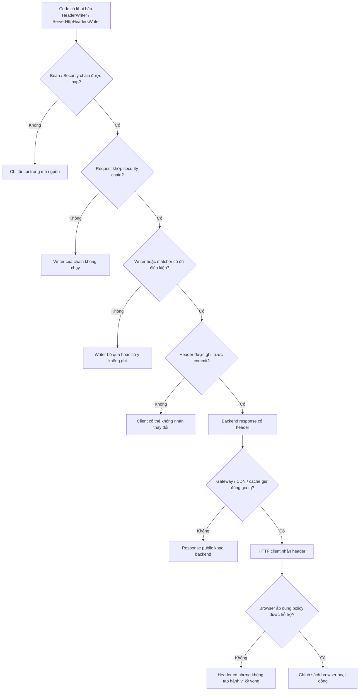
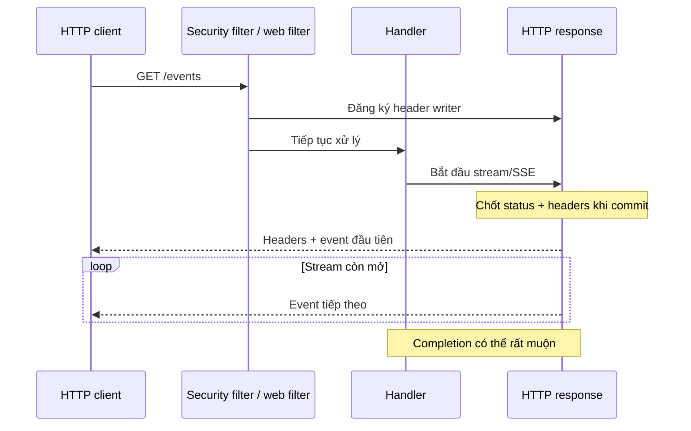

# Phân biệt có cấu hình writer với thực sự có header trên đường truyền

## 1. Vấn đề: nhìn thấy code cấu hình chưa phải là bằng chứng client nhận header

Trong chương **Kiến trúc HTTP header** thuộc module `SPRING_SECURITY_HTTP_PROTECTION`, Spring Security hỗ trợ phòng vệ HTTP và trình duyệt qua nhiều cơ chế: CSRF, CORS, security headers, CSP, HSTS, HTTP firewall và bảo vệ session. Một phần trong đó được triển khai bằng **response security headers** do ứng dụng hoặc hạ tầng gửi để trình duyệt diễn giải.

Giả sử dự án có đoạn Java:

```java
http.headers(headers -> headers
    .addHeaderWriter(new StaticHeadersWriter(
        "X-Header-Lab", "configured")));
```

Nhóm phát triển mở file, thấy writer đã được thêm và kết luận `X-Header-Lab` chắc chắn xuất hiện trên mọi HTTP response. Kết luận đó **không được chứng minh**. Có nhiều khả năng:

- Code nằm trong một `SecurityFilterChain` **không khớp** request đang thử.
- Một cấu hình khác được nạp trong môi trường production; bean cấu hình ví dụ không được kích hoạt.
- Header writer có điều kiện nhưng request **không thỏa điều kiện**.
- Controller/filter đã trả response theo một đường đi đặc biệt, hoặc request bị từ chối trước security chain.
- Response đã commit trước một thao tác ghi header tự chế chạy quá muộn.
- Controller, writer khác, container hoặc proxy **thay, xóa hoặc thêm giá trị** sau đó.
- CDN trả response từ cache, không có request nào đi tới backend vừa sửa.
- HTTP client hoặc trình duyệt đang xem **response khác** (redirect đích, tài nguyên khác, request khác origin) với response được cấu hình.

Cần phân biệt **bốn câu nói**:

1. “Trong source code có tạo writer.”
2. “Trong security chain đang chạy có đăng ký writer.”
3. “Writer đã ghi một giá trị vào response object trước commit.”
4. “HTTP client nhận được header với giá trị dự kiến trong response thực.”

Chỉ câu **4** là bằng chứng trực tiếp về header **được quan sát tại client**. Nếu thêm yêu cầu “trình duyệt đã áp chính sách bảo mật”, còn cần kiểm tra hành vi CSP, HSTS, CORS, cookie hoặc policy tương ứng.

### Mục tiêu học tập

Sau bài này, bạn có thể:

- Mô tả các **cửa kiểm soát** từ Java configuration đến response được client nhận.
- Kiểm chứng đúng chain, matcher và điều kiện đặc thù của header writer trên Servlet lẫn Reactive/WebFlux.
- Giải thích vì sao `HstsHeaderWriter` không nhất thiết phát header trên HTTP, và vì sao CSP không tự xuất hiện nếu chưa được khai báo.
- Phân biệt việc header **có trong mock**, **có trên backend**, **có sau gateway/CDN**, và **được browser thực thi**.
- Xây dựng unit test, MockMvc/WebTestClient integration test và phép đo HTTPS public để tránh kết luận sai.
- Chẩn đoán đường response thành công, redirect, authentication/CSRF error, container/proxy error, streaming và cache.

## 2. Chuỗi bằng chứng: cấu hình → filter chain → commit → client

Một HTTP security header có thể phải vượt qua nhiều điểm kiểm soát:



Hãy dùng mô hình này để đặt câu hỏi chính xác. Ví dụ khi `Strict-Transport-Security` vắng mặt ở HTTP localhost, có thể request không thỏa điều kiện **secure** của writer HSTS (cửa D), chứ không phải Spring Security “chưa nạp cấu hình” (cửa B).

### 2.1. Các mức bằng chứng và điều được phép kết luận

| Bằng chứng nhìn thấy | Chứng minh điều gì? | **Chưa** chứng minh điều gì? |
| --- | --- | --- |
| Đoạn cấu hình `http.headers(...)` trong repository | Có dự định thêm writer. | Bean ấy có được dùng ở runtime, có đúng chain và đúng URL không. |
| Bean `SecurityFilterChain` tồn tại trong test context | Cấu hình chain được dựng trong test. | Request cụ thể có khớp chain và writer có chạy không. |
| Unit test gọi `writer.writeHeaders(...)` | Writer có thể đặt header trên mock response khi được gọi. | Spring Security có tự gọi writer trên HTTP request thật không. |
| MockMvc/WebTestClient thấy header | Header đi qua ứng dụng trong môi trường integration test. | Gateway, CDN và HTTPS public có giữ header không. |
| HTTP client gọi trực tiếp backend thấy header | Response backend có header ở endpoint được đo. | Response ngoài Internet/client public có cùng giá trị không. |
| `curl -D -` trên URL public thấy header | Client HTTP thấy response header đã được diễn giải từ kết nối. | Browser có hỗ trợ và áp policy không; các URL khác có giống không. |
| DevTools Network thấy header | Browser nhận policy trên response được chọn. | Policy thực thi đúng mong muốn hay CSP có xung đột với header khác. |
| DevTools Console + hành vi test phù hợp | Có bằng chứng về việc browser thực thi một số policy. | Những browser/version khác hoặc mọi tình huống tải trang đều giống nhau. |

Cụm từ **“trên đường truyền”** trong bài nên hiểu là **header hiện diện trong response HTTP mà client thực sự nhận**. Với HTTPS, dữ liệu trên đường dây được mã hóa; với HTTP/2, HTTP/3, header còn có framing/nén HPACK hoặc QPACK. Công cụ như `curl -D -` hiển thị **các HTTP headers đã được client giải mã/diễn giải**, không phải bản dump nguyên từng byte TLS packet. Muốn nghiên cứu byte-level phải có công cụ và quyền quan sát giao thức thích hợp; điều đó không cần thiết cho phần lớn bài kiểm thử security headers.

## 3. Một security chain được cấu hình không có nghĩa nó khớp mọi request

Trong Spring Security Servlet, `FilterChainProxy` chọn một `SecurityFilterChain` phù hợp. Reactive/WebFlux tương tự với `WebFilterChainProxy` và `SecurityWebFilterChain`. Nếu ứng dụng có nhiều chain, request được xử lý theo chain phù hợp được lựa chọn, không nhận tổng hợp writers từ tất cả chain.

Ví dụ logic:

```text
/api/**  --> Chain API: authentication token, headers cho API
/**      --> Chain WEB: session, headers cho HTML
```

Nếu bạn thêm CSP writer vào chain WEB, việc test `GET /api/orders` rồi không thấy CSP **chưa chứng minh writer WEB bị lỗi**. Request API có thể thuộc chain API.

### 3.1. `permitAll` vẫn ở trong chain

Ví dụ Servlet:

```java
http.authorizeHttpRequests(auth -> auth
    .requestMatchers("/health").permitAll()
    .anyRequest().authenticated());
```

`/health` vẫn đi qua security chain nếu URL khớp chain, dù endpoint không yêu cầu đăng nhập. Nó có thể nhận các security headers mặc định và tùy chỉnh.

Điều này **khác** việc một request không đi qua Spring Security chain, ví dụ:

- Static resource do NGINX/CDN phục vụ hoàn toàn, không gọi backend.
- Một URL bị loại khỏi Spring Security filter chain trên Servlet bằng cơ chế phù hợp.
- Ứng dụng có nhiều chain nhưng không chain nào khớp request.
- Request bị HTTP server/container từ chối trước khi đi vào lớp Spring Security.

**Đừng dùng việc thiếu header trên CDN-hosted asset để suy Spring Security writer trên backend chưa cấu hình đúng.**

### 3.2. Matcher của writer là một lớp quyết định riêng

Ngay cả khi security chain khớp, writer có thể chỉ áp trên một route:

```java
import org.springframework.security.web.header.HeaderWriter;
import org.springframework.security.web.header.writers.DelegatingRequestMatcherHeaderWriter;
import org.springframework.security.web.header.writers.StaticHeadersWriter;
import org.springframework.security.web.util.matcher.AntPathRequestMatcher;

// Chèn vào đoạn cấu hình HttpSecurity của chain hiện tại:
HeaderWriter reportsOnly = new DelegatingRequestMatcherHeaderWriter(
    new AntPathRequestMatcher("/reports/**"),
    new StaticHeadersWriter(
        "Cross-Origin-Resource-Policy", "same-origin")
);

http.headers(headers -> headers.addHeaderWriter(reportsOnly));
```

Đoạn này chỉ minh họa Spring Security Servlet 6.x; `AntPathRequestMatcher` bị deprecated ở một số phiên bản mới. Dùng matcher được hỗ trợ trong version thực của dự án.

Nếu `GET /reports/annual.pdf` nhận CORP nhưng `GET /public/logo.svg` không có, đó có thể là **thiết kế đúng**. Phải kiểm thử cả **ca khớp** và **ca không khớp**. Khi gateway rewrite path, matcher ở backend nhìn đường dẫn mà backend thực sự nhận, không nhất thiết là public URL.

## 4. Servlet: đăng ký writer qua đúng `HttpSecurity`

### 4.1. Cấu hình tối thiểu có thể quan sát

Ví dụ dùng một **header chẩn đoán không mang ý nghĩa bảo mật** để tách lỗi wiring khỏi các điều kiện đặc biệt của HSTS/CSP:

```java
import org.springframework.context.annotation.Bean;
import org.springframework.context.annotation.Configuration;
import org.springframework.security.config.annotation.web.builders.HttpSecurity;
import org.springframework.security.web.SecurityFilterChain;
import org.springframework.security.web.header.writers.StaticHeadersWriter;

@Configuration
class ServletHeaderProofConfig {

    @Bean
    SecurityFilterChain webChain(HttpSecurity http) throws Exception {
        http
            .authorizeHttpRequests(auth -> auth
                .requestMatchers("/demo/**").permitAll()
                .anyRequest().authenticated())
            .headers(headers -> headers
                .addHeaderWriter(new StaticHeadersWriter(
                    "X-Lab-Writer", "servlet-chain")));

        return http.build();
    }
}
```

`X-Lab-Writer` chỉ dùng để đo sự hiện diện của writer trong môi trường học tập; **không** phải HTTP security header tiêu chuẩn và nên bỏ trước production trừ khi có một nhu cầu vận hành được kiểm soát. Các security writers mặc định khác đang bật vẫn hoạt động theo cấu hình chain/version.

Một controller đơn giản:

```java
import org.springframework.web.bind.annotation.GetMapping;
import org.springframework.web.bind.annotation.RestController;

@RestController
class DemoPingController {
    @GetMapping("/demo/ping")
    String ping() {
        return "ok";
    }
}
```

Khi request `GET /demo/ping` đi qua chain và không có tầng nào khác xóa header, kết quả kỳ vọng:

```http
HTTP/1.1 200 OK
X-Lab-Writer: servlet-chain
X-Content-Type-Options: nosniff
```

Không cần bật CSP hoặc tắt CSRF để kiểm tra marker. Nếu dự án đã có chain production, hãy **thêm phần headers vào đúng chain hiện hữu**, không tạo một chain cùng matcher chồng lấn làm thay đổi authentication/authorization.

### 4.2. Writer được tạo nhưng không đăng ký: một lỗi dễ bỏ sót

```java
// Anti-pattern: tạo object rồi bỏ đó; Spring Security không tự gọi writer này.
StaticHeadersWriter writer =
    new StaticHeadersWriter("X-Lab-Writer", "servlet-chain");
```

Writer chỉ tồn tại trong memory. Nếu nó không được đưa vào `HttpSecurity.headers(...)` hoặc một cơ chế quản lý writer khác, `HeaderWriterFilter` sẽ không tự phát hiện biến local này.

Lỗi tương tự xảy ra khi tạo một `HeaderWriter` dưới dạng bean nhưng không thêm vào cấu hình writer phù hợp. **Bean tồn tại** không đồng nghĩa **filter chain đang dùng bean**.

### 4.3. HeaderWriterFilter và thời điểm response commit

`HeaderWriterFilter` điều phối các `HeaderWriter` trong Servlet security chain. Writer thông thường sửa `HttpServletResponse` trước khi response commit.

Một filter tự chế kiểu này không đáng tin:

```java
// Anti-pattern: cố thêm header sau khi handler có thể đã commit response.
@Override
public void doFilter(ServletRequest request,
                     ServletResponse response,
                     FilterChain chain)
        throws IOException, ServletException {

    chain.doFilter(request, response);

    ((HttpServletResponse) response)
        .setHeader("Content-Security-Policy", "default-src 'self'");
}
```

Nếu handler đã `flushBuffer()`, `sendRedirect()`, gửi file lớn hoặc bắt đầu streaming, header có thể bị đặt **sau mốc commit**. Test trên response nhỏ còn buffered có thể tình cờ pass và che giấu bug. Hãy dùng cơ chế `HttpSecurity.headers(...)`/writer và kiểm thử các response có đường đi khác.

### 4.4. Lỗi khi security chain được chọn khác dự kiến

Tình huống thường gặp: config marker ở chain thứ hai, nhưng chain thứ nhất với matcher rộng hơn đã nhận request. Cần kiểm tra thứ tự `@Order`, `securityMatcher` và mapping thực tế. Không sửa thứ tự chain tùy tiện vì điều đó có thể thay đổi **cả xác thực và phân quyền**, không chỉ HTTP headers.

## 5. Reactive/WebFlux: writer phải trả công việc về cho pipeline

Trong Reactive, Spring Security dùng `ServerHttpSecurity`, `SecurityWebFilterChain` và `HttpHeaderWriterWebFilter`. Giao diện writer là `ServerHttpHeadersWriter` với phương thức `Mono<Void> writeHttpHeaders(ServerWebExchange exchange)`.

### 5.1. Cấu hình marker header trong WebFlux

```java
import org.springframework.context.annotation.Bean;
import org.springframework.context.annotation.Configuration;
import org.springframework.security.config.annotation.web.reactive.EnableWebFluxSecurity;
import org.springframework.security.config.web.server.ServerHttpSecurity;
import org.springframework.security.web.server.SecurityWebFilterChain;
import org.springframework.security.web.server.header.ServerHttpHeadersWriter;
import reactor.core.publisher.Mono;

@Configuration
@EnableWebFluxSecurity
class ReactiveHeaderProofConfig {

    @Bean
    SecurityWebFilterChain reactiveChain(ServerHttpSecurity http) {
        ServerHttpHeadersWriter marker = exchange ->
            Mono.fromRunnable(() -> exchange.getResponse()
                .getHeaders().set("X-Lab-Writer", "webflux-chain"));

        return http
            .authorizeExchange(auth -> auth
                .pathMatchers("/demo/**").permitAll()
                .anyExchange().authenticated())
            .headers(headers -> headers.addHeaderWriter(marker))
            .build();
    }
}
```

`X-Lab-Writer` vẫn chỉ là header chẩn đoán, không phải cơ chế ngăn CSRF/CORS/XSS. Đặt writer trong `ServerHttpSecurity.headers(...)` giúp Spring Security tích hợp việc ghi vào vòng đời response. Không tự tạo thêm `HttpHeaderWriterWebFilter` ngoài chain chỉ để gọi lại marker.

Controller Reactive tương ứng:

```java
import org.springframework.web.bind.annotation.GetMapping;
import org.springframework.web.bind.annotation.RestController;
import reactor.core.publisher.Mono;

@RestController
class ReactiveDemoPingController {
    @GetMapping("/demo/ping")
    Mono<String> ping() {
        return Mono.just("ok");
    }
}
```

Ví dụ là **cấu hình riêng cho ứng dụng WebFlux**, không dùng đồng thời với Servlet configuration class ở mục trước trong cùng một application test context.

### 5.2. `subscribe()` tự phát không chứng minh writer chạy đúng

Một writer Reactive tự gọi `subscribe()` cho một publisher rồi trả `Mono.empty()` có thể tạo race condition với response commit:

```java
// Anti-pattern: side effect chạy ngoài pipeline mà framework đang chờ.
@Override
public Mono<Void> writeHttpHeaders(ServerWebExchange exchange) {
    someAsyncWork(exchange).subscribe();
    return Mono.empty();
}
```

Nếu `someAsyncWork` đặt header sau khi response đã commit, client không thấy dù log ghi “đã xử lý”. Giải pháp là **trả lại publisher** đại diện cho công việc cần hoàn tất:

```java
@Override
public Mono<Void> writeHttpHeaders(ServerWebExchange exchange) {
    return Mono.fromRunnable(() -> exchange.getResponse()
        .getHeaders().set("X-Lab-Writer", "webflux-chain"));
}
```

Không gọi `block()` trong event loop để ép writer chạy; điều đó có thể gây lỗi hoặc suy giảm khả năng phục vụ. Nếu writer chỉ sửa header map, thông thường không cần network call hoặc công việc bất đồng bộ nặng.

### 5.3. `beforeCommit` không có nghĩa “có thể ghi sau commit”

`ServerHttpResponse.beforeCommit(...)` cho phép đăng ký thao tác chạy **trước** mốc commit. Một filter minh họa:

```java
import org.springframework.web.server.ServerWebExchange;
import org.springframework.web.server.WebFilter;
import org.springframework.web.server.WebFilterChain;
import reactor.core.publisher.Mono;

final class DemoBeforeCommitFilter implements WebFilter {
    @Override
    public Mono<Void> filter(ServerWebExchange exchange, WebFilterChain chain) {
        exchange.getResponse().beforeCommit(() ->
            Mono.fromRunnable(() ->
                exchange.getResponse().getHeaders()
                    .set("X-Lab-Before-Commit", "yes")));

        return chain.filter(exchange);
    }
}
```

Đây là **minh họa lifecycle**, không phải mã nguồn nội bộ của `HttpHeaderWriterWebFilter`. Không tự đăng ký filter này vào production nếu header chuẩn đã được Spring Security quản lý. Callback phải được đăng ký khi response **chưa commit**; gọi `beforeCommit` sau khi body stream đã bắt đầu không phải cách sửa header đã gửi.

Một controller SSE có thể truyền event liên tục hàng giờ. Khi event đầu tiên bắt đầu gửi, các response headers ban đầu đã được chốt; writer tự chế chạy trong `doFinally(...)` lúc stream kết thúc **quá muộn**.

## 6. Header writer có điều kiện: thiếu header đôi khi là đúng

Không phải mọi writer đều luôn ghi cùng một giá trị cho mọi request. Khi kiểm tra, cần phân biệt **writer không được gọi** với **writer được gọi nhưng quyết định không đặt header**.

### 6.1. HSTS phụ thuộc HTTPS

`Strict-Transport-Security` thường chỉ được Spring Security thêm khi request được nhận diện là **secure/HTTPS**. Hai phép thử có thể cho kết quả khác:

```http
# Request backend HTTP nội bộ
HTTP/1.1 200 OK
X-Content-Type-Options: nosniff
```

```http
# Response public HTTPS sau gateway
HTTP/1.1 200 OK
Strict-Transport-Security: max-age=31536000; includeSubDomains
X-Content-Type-Options: nosniff
```

Sự khác nhau có thể **hoàn toàn đúng**: gateway terminate TLS và là nơi phát HSTS, hoặc backend chỉ phát trên secure request. Đừng ép ứng dụng ghi HSTS trên HTTP chỉ để một test localhost pass. Browser chỉ chấp nhận HSTS được nhận qua HTTPS hợp lệ.

Nếu dùng forwarded headers để backend xác định public scheme, chỉ tin các header forwarding do **proxy đáng tin** quản lý. `X-Forwarded-Proto` từ một client không được tin trực tiếp có thể dẫn đến phân loại request sai.

### 6.2. CSP không phải một policy mặc định có thể đoán được

Spring Security có hỗ trợ `Content-Security-Policy`, nhưng **không tự suy ra allowlist script/font/API đúng** cho từng ứng dụng. Nếu `X-Content-Type-Options: nosniff` có mặt nhưng CSP vắng mặt, cần hỏi:

- Có cấu hình `contentSecurityPolicy(...)` trong chain xử lý document đó không?
- CSP được phát ở backend hay gateway, và có áp trên response HTML thực không?
- Header đang là `Content-Security-Policy-Report-Only` thay vì CSP cưỡng chế?
- Có nhiều CSP gây xung đột, hoặc response bị cache từ policy cũ không?

Chỉ thấy chuỗi `Content-Security-Policy` trong Java config của chain khác chưa chứng minh document hiện tại nhận nó.

### 6.3. Cache headers có thể nhường cho controller

Spring Security thường có cache headers mặc định giúp tránh cache nội dung nhạy cảm. Nhưng một resource handler/controller có thể chủ động đặt `Cache-Control` cho asset công khai. Do đó kết quả không phải lúc nào cũng đúng một chuỗi no-store mặc định.

Ví dụ:

```http
# Dữ liệu tài khoản / session
Cache-Control: no-store
```

```http
# Asset public có fingerprint
Cache-Control: public, max-age=31536000, immutable
```

Cả hai có thể hợp lý khi áp đúng dữ liệu. **Cần kiểm tra policy thực** chứ không suy rằng một header khác mặc định là writer “không chạy”.

### 6.4. Header bị bỏ qua vì đã tồn tại

Một số writer có thể có logic không ghi đè khi header đã được đặt bởi ứng dụng/container. Khi điều tra, cần kiểm tra implementation/version cụ thể và xem controller hoặc proxy có đặt header trùng không.

Không dựa vào giả định `setHeader` hoặc `addHeader` của một writer bất kỳ luôn thắng. Với HSTS, CSP, `X-Frame-Options`, CORS hoặc `Set-Cookie`, nhiều giá trị có thể có ngữ nghĩa rất khác nhau và cần được xử lý theo từng trường.

## 7. Unit test: chứng minh writer có thể viết, nhưng không kết luận về on-wire

### 7.1. Servlet unit test

```java
import org.junit.jupiter.api.Test;
import org.springframework.mock.web.MockHttpServletRequest;
import org.springframework.mock.web.MockHttpServletResponse;
import org.springframework.security.web.header.HeaderWriter;
import org.springframework.security.web.header.writers.StaticHeadersWriter;

import static org.junit.jupiter.api.Assertions.assertEquals;

class ServletHeaderWriterUnitTest {

    @Test
    void writerPlacesValueOnMockResponse() {
        HeaderWriter writer = new StaticHeadersWriter(
            "X-Lab-Writer", "servlet-chain");

        var request = new MockHttpServletRequest("GET", "/demo/ping");
        var response = new MockHttpServletResponse();

        writer.writeHeaders(request, response);

        assertEquals("servlet-chain",
            response.getHeader("X-Lab-Writer"));
    }
}
```

Test này xác minh `StaticHeadersWriter` có thể ghi trên `MockHttpServletResponse` **khi được gọi trực tiếp**. Nếu ứng dụng thiếu `.addHeaderWriter(...)`, unit test vẫn có thể pass. Đây là giới hạn chủ ý của unit test.

### 7.2. Reactive unit test

```java
import org.junit.jupiter.api.Test;
import org.springframework.mock.http.server.reactive.MockServerHttpRequest;
import org.springframework.mock.web.server.MockServerWebExchange;
import org.springframework.security.web.server.header.ServerHttpHeadersWriter;
import reactor.core.publisher.Mono;
import reactor.test.StepVerifier;

import static org.junit.jupiter.api.Assertions.assertEquals;

class ReactiveHeaderWriterUnitTest {

    @Test
    void writerCompletesAndPlacesValue() {
        var exchange = MockServerWebExchange.from(
            MockServerHttpRequest.get("/demo/ping").build());

        ServerHttpHeadersWriter writer = request ->
            Mono.fromRunnable(() -> request.getResponse().getHeaders()
                .set("X-Lab-Writer", "webflux-chain"));

        StepVerifier.create(writer.writeHttpHeaders(exchange))
            .verifyComplete();

        assertEquals("webflux-chain", exchange.getResponse()
            .getHeaders().getFirst("X-Lab-Writer"));
    }
}
```

`StepVerifier` đến từ `reactor-test`. Nếu ai đó chỉ tạo publisher mà **không subscribe** trong unit test, thao tác `Mono.fromRunnable` chưa chạy; kiểm tra header ngay trước `verifyComplete()` có thể thấy vắng mặt dù code writer đúng. Nhưng cũng không được dùng việc unit test đã subscribe để chứng minh HTTP filter chain production tự gọi writer.

### 7.3. Dùng unit test cho điều kiện HSTS/matcher

Một bộ unit test có giá trị nên thử cả **nhánh dương** và **nhánh âm**. Ví dụ, kiểm tra custom matcher chỉ ghi header cho `/reports/**`, không ghi trên `/public/**`. Với HSTS, xác minh điều kiện secure request theo version. Không cố ép mọi input đều sinh cùng header nếu policy định nghĩa có điều kiện.

## 8. MockMvc: chứng minh Servlet security chain thực sự ghi header

Khi cấu hình `ServletHeaderProofConfig` và `DemoPingController` được nạp trong test context:

```java
import org.junit.jupiter.api.Test;
import org.springframework.beans.factory.annotation.Autowired;
import org.springframework.boot.test.autoconfigure.web.servlet.AutoConfigureMockMvc;
import org.springframework.boot.test.context.SpringBootTest;
import org.springframework.test.web.servlet.MockMvc;

import static org.springframework.test.web.servlet.request.MockMvcRequestBuilders.get;
import static org.springframework.test.web.servlet.result.MockMvcResultMatchers.header;
import static org.springframework.test.web.servlet.result.MockMvcResultMatchers.status;

@SpringBootTest
@AutoConfigureMockMvc
class ServletHeaderIntegrationTest {

    @Autowired
    MockMvc mvc;

    @Test
    void chainAddsLabHeaderAndRetainsNosniff() throws Exception {
        mvc.perform(get("/demo/ping"))
            .andExpect(status().isOk())
            .andExpect(header().string(
                "X-Lab-Writer", "servlet-chain"))
            .andExpect(header().string(
                "X-Content-Type-Options", "nosniff"));
    }
}
```

Đây là bước tiến lớn so với unit test: nếu bean security config không được nạp hoặc request không đi qua chain chứa marker, assertion sẽ thất bại. Tuy nhiên, **MockMvc không gửi một HTTP response thực qua socket đến public client**, không mô phỏng CDN/NGINX/TLS production. Nó chứng minh cấu hình app đang chạy trong **test context**, không phải toàn bộ đường truyền.

### 8.1. Test có thể pass nhưng request production vẫn khác

Những khác biệt điển hình:

| Test | Production |
| --- | --- |
| Một security chain do test auto-config chọn | Nhiều chain với `@Order` và matcher riêng. |
| Request trực tiếp `/demo/ping` | Gateway rewrite từ `/portal/demo/ping`. |
| Không có proxy/CDN | Proxy thêm/ẩn header hoặc trả cache hit. |
| `secure(true)` được test gán thủ công | Backend có thể nhận HTTP do TLS termination. |
| Test profile/bean được nạp | Deployment có profile/config khác. |
| Controller trả status bình thường | Gateway hoặc container phát lỗi trước khi vào chain. |

Muốn kết luận production đúng, phải kiểm tra runtime/deployment và response public thật.

### 8.2. Test HSTS có điều kiện

Giả định Spring Security HSTS writer mặc định đang bật và chưa bị tùy biến:

```java
import static org.hamcrest.Matchers.containsString;

@Test
void secureRequestMayReceiveHsts() throws Exception {
    mvc.perform(get("/demo/ping").secure(true))
        .andExpect(status().isOk())
        .andExpect(header().string(
            "Strict-Transport-Security",
            containsString("max-age=")));
}

@Test
void plainHttpHasNoHstsFromDefaultWriter() throws Exception {
    mvc.perform(get("/demo/ping").secure(false))
        .andExpect(status().isOk())
        .andExpect(header().doesNotExist("Strict-Transport-Security"));
}
```

Đây là các **test methods bổ sung vào class** đã có imports tương ứng. Nếu ứng dụng cố ý thay HSTS writer hoặc test response được một tầng khác thêm HSTS, expected values phải theo chính sách thật. Test `secure(true)` chỉ kiểm tra logic secure flag của Servlet mock, không chứng minh chứng chỉ HTTPS hợp lệ.

## 9. WebTestClient: kiểm tra Reactive security chain, không chỉ Mono của writer

Với `ReactiveHeaderProofConfig` và `ReactiveDemoPingController`:

```java
import org.junit.jupiter.api.Test;
import org.springframework.beans.factory.annotation.Autowired;
import org.springframework.boot.test.autoconfigure.web.reactive.AutoConfigureWebTestClient;
import org.springframework.boot.test.context.SpringBootTest;
import org.springframework.test.web.reactive.server.WebTestClient;

@SpringBootTest
@AutoConfigureWebTestClient
class ReactiveHeaderIntegrationTest {

    @Autowired
    WebTestClient client;

    @Test
    void chainAddsLabHeaderAndKeepsNosniff() {
        client.get().uri("/demo/ping")
            .exchange()
            .expectStatus().isOk()
            .expectHeader().valueEquals(
                "X-Lab-Writer", "webflux-chain")
            .expectHeader().valueEquals(
                "X-Content-Type-Options", "nosniff");
    }
}
```

Nếu test này pass, có bằng chứng writer được Spring Security WebFlux điều phối **trong test context**. Nhưng nó chưa chứng minh header vẫn tồn tại khi chạy qua public gateway hoặc CDN.

### 9.1. Reactive race condition có thể chỉ xuất hiện khi streaming

Nếu một custom writer trả `Mono.empty()` rồi âm thầm tự subscribe một tác vụ ghi header, test response nhỏ có thể pass ngẫu nhiên. Với `Flux<ServerSentEvent<?>>`, việc commit thường diễn ra trước khi stream hoàn tất; header đến muộn không thể thay response đã gửi. Hãy thiết kế test trên endpoint streaming và phân biệt **header tới trước event đầu tiên** với **publisher kết thúc**.

### 9.2. Không suy HSTS từ request mock HTTP

`WebTestClient` có thể chạy trên mock exchange chưa có TLS. HSTS vắng mặt trong test đó **không đủ** để kết luận writer HSTS hoặc cấu hình HTTPS public sai. Để xác minh, dùng server thực qua HTTPS hoặc test exchange/request được thiết kế mô phỏng secure scheme đúng với phiên bản framework.

## 10. Ghi header trước commit: ranh giới không thể bỏ qua

Có ba mốc quan trọng:

1. **Header được đặt trong response object**: vẫn có thể sửa khi response chưa commit.
2. **Response commit**: status và headers được chốt để bắt đầu gửi theo giao thức.
3. **Body hoàn tất**: có thể đến rất lâu sau commit, hoặc không có body đối với `HEAD`/`204`.



Ở thời điểm đã gửi event đầu tiên, dù `doFinally` hoặc Servlet `finally` có log “set header thành công”, client không thể nhận lại một phần header đầu response đã hoàn tất gửi. Nếu ứng dụng tự kiểm tra `isCommitted()`, coi đó là **tín hiệu chẩn đoán**, không phải cách sửa bằng cách ép ghi sau commit.

### 10.1. Redirect, error và flush sớm

Servlet `sendRedirect(...)`, `sendError(...)`, `flushBuffer()` hoặc handler ghi đủ body có thể làm response commit. Reactive `ServerHttpResponse.beforeCommit(...)` phải được đăng ký sớm.

Một writer được cấu hình đúng thông qua Spring Security có khả năng phối hợp vòng đời response hơn một filter tự chế ghi trong `finally`. Tuy nhiên, **response do HTTP server hoặc gateway tạo trước security chain** không thể được Spring Security backend bổ sung header sau đó.

## 11. Từ backend đến public client: reverse proxy và CDN

Một response thực có thể đi theo đường:

```text
Browser --HTTPS--> CDN / gateway --HTTP nội bộ--> Spring application
```

Sau khi backend phát `X-Lab-Writer`, những tình huống sau có thể xảy ra:

- Gateway dùng một rule chỉ forward allowlist headers và **loại** `X-Lab-Writer`.
- Reverse proxy thêm `X-Frame-Options: DENY` trong khi backend phát `SAMEORIGIN`.
- CDN trả một response đã cache **trước khi marker mới được deploy**.
- Proxy trả `502/503` vì upstream lỗi: backend không hề được gọi.
- Gateway terminate TLS và phát HSTS, trong khi backend HTTP không có HSTS.
- Một redirect đưa client đến hostname khác; response đích thuộc ứng dụng khác.

### 11.1. Không nhầm header request với header response

Trong NGINX:

```nginx
# Minh họa cú pháp NGINX, không phải một cấu hình production hoàn chỉnh.
location / {
    proxy_pass http://app_backend;

    # Header gửi trong HTTP response đến client:
    add_header Referrer-Policy "strict-origin-when-cross-origin" always;

    # Header gửi trong request chuyển tiếp đến backend (mục đích khác):
    proxy_set_header X-Forwarded-Proto $scheme;
}
```

`add_header` điều chỉnh response; `proxy_set_header` điều chỉnh request đến upstream. Đừng sửa `proxy_set_header` rồi kết luận mình đã bảo đảm response có CSP/HSTS.

Nếu NGINX dùng `proxy_hide_header`, một header upstream có thể không được chuyển đến client. `add_header` có quy tắc status và kế thừa giữa các scope, `always` mở rộng các trạng thái được áp dụng. Đọc cấu hình hiệu lực ở môi trường tương ứng và test `200`, redirect, lỗi — không chỉ một route.

### 11.2. HTTP client public là bằng chứng mạnh hơn log backend

Khi backend log “HeaderWriter called” nhưng `curl` tới public URL không thấy header, ta đã biết ít nhất rằng một trong các điều sau phải đúng:

- Request đo không đi vào **cùng instance/path** với nơi phát log.
- Header bị đổi/xóa ở hạ tầng sau backend.
- Client nhận response từ cache hoặc edge.
- Header không được ghi trước commit mặc dù writer được gọi.

Tiếp theo cần đo tại **backend trực tiếp**, dùng cùng route, host, method, status và ngữ cảnh xác thực. Nếu backend direct có header mà public không có, tập trung điều tra proxy/CDN/cache. Nếu backend direct cũng thiếu, quay lại chain/matcher/commit và điều kiện writer.

Không nên gửi `Authorization`, cookie session thật hoặc token vào các lệnh được chia sẻ công khai. Dùng tài khoản và môi trường thử nghiệm có quyền truy cập phù hợp.

## 12. Quy trình đo HTTP header bằng curl

### 12.1. Quan sát response cuối trên HTTPS public

```bash
# Domain minh họa: thay bằng endpoint thử nghiệm thực tế.
curl -sS -D - -o /dev/null https://app.example.test/demo/ping
```

Trong PowerShell, gọi `curl.exe` và thay `/dev/null` bằng `NUL`:

```powershell
curl.exe -sS -D - -o NUL https://app.example.test/demo/ping
```

Các lệnh hiển thị status line và **HTTP response headers như client diễn giải chúng**. Chúng không tự xác minh browser đã cưỡng chế CSP hoặc giữ HSTS. Với HTTP/2/TLS, đây là representation do client xuất ra, không phải gói tin TLS thô.

### 12.2. So sánh backend với public

```bash
# Public HTTPS qua edge:
curl -sS -D - -o /dev/null https://app.example.test/demo/ping

# Backend HTTP nội bộ, chỉ khi được phép:
curl -sS -D - -o /dev/null http://127.0.0.1:8080/demo/ping
```

Khi có virtual host hoặc path rewrite, hai lệnh có thể **không đại diện cùng route**; phải xác nhận Host, context path, ingress rewrite và security chain thực được chọn. HSTS cũng khác do secure scheme. Không suy proxy “đã xóa HSTS” chỉ từ so sánh HTTPS public với HTTP backend.

### 12.3. Redirect: mỗi lần chuyển hướng là một response riêng

```bash
# Xem chính 302 (không tự theo redirect):
curl -sS -D - -o /dev/null https://app.example.test/account

# Xem nhiều khối status/headers trên redirect chain:
curl -sS -L -D - -o /dev/null https://app.example.test/account
```

Đối với `-L`, tách từng khối response: `302 Location: /login` không đồng nhất với `200` của trang login. Nếu redirect sang hostname khác, security headers ở response đầu **không tự bảo đảm** chính sách trên hostname đích.

Không tự theo redirect tới host ngoài không tin cậy khi đang dùng credential nhạy cảm cho phép thử.

### 12.4. Kiểm tra response lỗi và cache

Test `401`, `403` hoặc `500` trên endpoint thử nghiệm đã thiết kế để tạo lỗi một cách an toàn. Đừng cố gửi request malformed hoặc gây quá tải production chỉ để tạo `502/503`. Khi CDN có cache, ghi nhận thời điểm deploy và các header cache metadata nếu nhà cung cấp phát, nhưng không coi `Age`/`Via` luôn tồn tại hay luôn đủ để kết luận cache hit.

Đừng sử dụng `curl -I`/`HEAD` như bằng chứng duy nhất cho `GET`; server hoặc CDN có thể xử lý hai method khác nhau.

### 12.5. Trình duyệt cần hai loại bằng chứng

- **DevTools Network → Response Headers**: browser đã nhận header nào trên **request/document cụ thể**? Có redirect, cache hit hoặc service worker tham gia không?
- **DevTools Console + hành vi thực tế**: CSP chặn hay cho phép script/iframe? CORS preflight thành công? Permissions-Policy có chặn tính năng? `nosniff` làm lộ lỗi MIME?

Ví dụ, một SPA tải document thật từ `/index.html` rồi gọi `/api/admin/**`. CSP hoặc Permissions-Policy trên API JSON **không tự trở thành policy của document `/index.html`**. Nếu kiểm tra sai request trong Network, bạn có thể kết luận sai rằng CSP HTML đã triển khai.

## 13. Ma trận kiểm thử: cùng writer, nhiều kiểu response

| Tình huống | Header nên được kiểm tra | Bằng chứng và cách diễn giải |
| --- | --- | --- |
| `GET 200` trang HTML | CSP, XFO, `nosniff`, HSTS trên HTTPS, cache | Đúng chain và document thực; kiểm tra browser. |
| `GET 200` API JSON | `nosniff`, cache, CORS nếu áp dụng | CSP HTML có thể không thuộc phạm vi API. |
| `204 No Content` | Những header hợp lệ theo policy | Không đòi body hoặc `Content-Type` như `200`. |
| `302` chuyển login | `Location`, `nosniff`, HSTS HTTPS, cache | Response chuyển hướng và URL đích phải được đo riêng. |
| `401` chưa xác thực | `WWW-Authenticate` khi phù hợp, security headers | Entry point Basic/Bearer khác form login. |
| `403` thiếu CSRF token | Security headers và status | `403` có thể là hành vi đúng của CSRF, không chứng minh writer sai. |
| `404` app không có route | Header theo error handling thực | Có thể qua container/error mapping khác. |
| `500` controller tự trả | Header trong chain ứng dụng | Khác exception chưa xử lý hoặc lỗi container. |
| `502/503` do gateway | Security headers tại edge | Spring Security backend có thể chưa hề chạy. |
| Asset static CDN | `nosniff`, cache, CORP nếu phù hợp | Không kỳ vọng writer backend nếu CDN trả trực tiếp. |
| SSE / streaming | Headers trước chunk/event đầu | Ghi sau body commit không còn tác dụng. |
| Request HTTP nội bộ | HSTS có thể vắng mặt | Không đồng nhất với browser HTTPS public. |
| CORS preflight `OPTIONS` | `Access-Control-Allow-*` hợp lệ | CORS processor khác header writers thông thường. |

### 13.1. CSRF và CORS là những nguồn dễ gây hiểu lầm

Một response `403` do CSRF vẫn có thể có `X-Content-Type-Options` và CSP. Điều này chỉ chứng minh response đã được bảo vệ bằng headers **và** token CSRF bị từ chối; không có mâu thuẫn.

Một response `OPTIONS` bị `401` trước khi CORS xử lý có thể gây CORS error trên browser, dù `X-Frame-Options`/`nosniff` tồn tại. Không giải quyết bằng cách thêm static `Access-Control-Allow-Origin: *` trên mọi response nếu có cookies/credentials; phải cấu hình CORS và preflight đúng.

### 13.2. Auth/session không được suy từ header bảo mật

Có `X-Frame-Options: DENY` không chứng minh người dùng đã đăng nhập. Có `Strict-Transport-Security` không chứng minh cookie mang `Secure`/`HttpOnly`/`SameSite` phù hợp. Có CSP không chứng minh endpoint từ chối HTTP method nguy hiểm hoặc HTTP firewall hoạt động.

Muốn chứng minh CSRF, session fixation, CORS, firewall và authorization, phải có test riêng của từng cơ chế, đồng thời xác minh headers khi response được gửi.

## 14. Bộ kiểm tra “writer có chạy không?” dành cho chẩn đoán tạm thời

Trong môi trường test/staging, một marker writer đơn giản giúp trả lời **“chain này thực sự ghi header tới backend response hay chưa?”**. Nó không chứng minh policy browser, nên chỉ sử dụng để định vị lớp lỗi.

### 14.1. Quy trình debug có kiểm soát

1. Thêm `X-Lab-Writer` bằng static writer ở **chain đang nghi ngờ**.
2. Gửi request đại diện đúng URL/method đến môi trường test.
3. Kiểm tra marker bằng MockMvc/WebTestClient.
4. Kiểm tra marker qua backend direct HTTP client.
5. Kiểm tra marker qua public HTTPS client.
6. Nếu marker đến public nhưng HSTS vắng, điều tra **điều kiện HSTS/HTTPS**, không quay lại sửa chain một cách mù quáng.
7. Nếu marker xuất hiện backend nhưng biến mất public, điều tra **proxy/CDN/cache/path routing**.
8. Khi đã tìm nguyên nhân, **gỡ marker header** và thay bằng regression test cho policy thật.

**Không ghi session token, username, CSRF token, nonce CSP hay các dữ liệu nhạy cảm vào marker hoặc log**. Không để marker hiển thị topology nội bộ trên production nếu không có yêu cầu bảo mật/giám sát rõ ràng.

### 14.2. Đừng tin một dòng log “writeHeaders called” là xong

Một logger đặt đầu `writeHeaders` chỉ chứng minh method được gọi. Nếu code sau đó ném exception, response commit sớm, hoặc proxy xóa header, client vẫn không nhận policy dự kiến.

Nếu cần tracing, dùng correlation ID nội bộ và log tối thiểu như request path đã chuẩn hóa, security chain/matcher, scheme do server xác nhận, trạng thái commit, kết quả writer và status cuối — tuân thủ chính sách bảo vệ log. **Tránh log raw Cookie, Authorization hoặc toàn bộ header chứa dữ liệu cá nhân.**

## 15. Các tình huống chẩn đoán điển hình

| Triệu chứng | Bằng chứng cần thêm | Nguyên nhân khả dĩ và hướng xử lý |
| --- | --- | --- |
| Source code có writer nhưng unit test endpoint thiếu | Bean/chain active, matcher, DSL | Writer tạo nhưng chưa đăng ký; thêm vào đúng chain. |
| Unit test writer pass, MockMvc thiếu header | Integration config/chain/matcher | Unit test gọi tay; chain runtime không gọi writer. |
| MockMvc pass, public URL thiếu | Backend direct, proxy, cache | Header bị edge xóa/replace hoặc response khác được phục vụ. |
| Header marker xuất hiện nhưng HSTS thiếu | HTTP/HTTPS scheme, HSTS config | Writer HSTS có điều kiện secure; kiểm tra HTTPS public. |
| Marker có trên API nhưng không thấy CSP HTML | Chain và response document | CSP không cấu hình ở chain HTML hoặc test sai URL document. |
| Header chỉ có với `200`, mất trên `302` | Redirect response riêng, auth entry point | Đọc chain/handler của chính `302`. |
| Header thiếu trên `502` | Edge response | Backend không xử lý request; cấu hình lỗi tại gateway. |
| Header có trong code nhưng thiếu khi streaming | Commit timing, side effects | Writer custom ghi muộn; dùng security writer/lifecycle. |
| `X-Frame-Options` hai giá trị | Backend/edge raw headers | Dùng static writer trùng built-in hoặc proxy thêm; thống nhất owner. |
| CSP tồn tại nhưng script vẫn bị chặn | Toàn bộ CSP fields và Console | Policy khác chặt hơn; chỉnh đúng nguồn phát. |
| CORS vẫn lỗi dù `nosniff` có | Preflight `OPTIONS`, Origin, credentials | CORS và HTTP security header là hai cơ chế khác. |
| `Cache-Control` khác baseline | Controller/asset/resource cache policy | Có thể là thay đổi có chủ đích; test theo dữ liệu. |
| HSTS chỉ có sau proxy | TLS termination, trusted forwarding | Có thể đúng nếu gateway sở hữu HSTS. |
| Cookie session không lưu | `Set-Cookie` trên public response/browser | Proxy làm mất cookie hoặc attributes không hợp lệ. |
| Hai chain có bộ header khác nhau | Chain matcher/order, environment | Có thể thiết kế khác nhau; xác minh owner và policy. |
| Test trên HTTP/2 thấy tên chữ thường | Protocol semantics | Header names không phân biệt hoa/thường; không phải header bị mất. |

### 15.1. Quy trình điều tra ngắn gọn nhưng đầy đủ

**Bước 1 — Xác định request:** URL đầy đủ, method, status, scheme, hostname, môi trường và có redirect/cache hay không.

**Bước 2 — Tìm chain đang xử lý:** Servlet `SecurityFilterChain` hoặc Reactive `SecurityWebFilterChain`, thứ tự, matcher, ứng dụng có bypass security chain không.

**Bước 3 — Tìm điều kiện writer:** HSTS cần HTTPS, matcher theo path/method, CSP được cấu hình chưa, header có tồn tại trước đó không.

**Bước 4 — Kiểm tra thời điểm:** response đã commit? Có redirect/sendError/flush/streaming hay custom reactive `subscribe()` chạy ngoài pipeline không?

**Bước 5 — Kiểm tra ứng dụng:** unit writer → MockMvc/WebTestClient → backend direct.

**Bước 6 — Kiểm tra public client:** cùng endpoint qua gateway/CDN/HTTPS; so header cuối, status và cache.

**Bước 7 — Kiểm tra browser policy:** Network và Console cho CSP/XFO/CORS; HTTPS và HSTS; cookie/session theo chính sách.

**Bước 8 — Sửa đúng nguyên nhân**, gỡ marker và thêm regression test trên các status/route đại diện.

## 16. Bài tập thực hành có đáp án định hướng

### Bài 1 — Có writer trong code, không có header trên endpoint

Một developer tạo `new StaticHeadersWriter("X-Lab-Writer", "demo")` ở một method Java, nhưng không gọi `addHeaderWriter(...)`. Unit test gọi trực tiếp writer pass, HTTP response thiếu header.

**Đáp án định hướng:** object tồn tại không có nghĩa Spring Security dùng nó. Đăng ký vào `HttpSecurity.headers(...)` của chain thực sự xử lý URL, rồi test với MockMvc.

### Bài 2 — Header chỉ thiếu với path `/api/**`

Ứng dụng có hai security chains, WEB và API. Marker chỉ được thêm trong WEB chain; `GET /home` có marker nhưng `GET /api/users` không.

**Đáp án:** request đi qua chain khác. Xác định policy mong muốn của API trước khi thêm writer, không cho rằng framework phải hợp nhất writers từ mọi chain.

### Bài 3 — Marker có, HSTS không có trên HTTP localhost

`curl http://localhost:8080/demo/ping` thấy `X-Lab-Writer` nhưng không thấy `Strict-Transport-Security`. HTTPS public có HSTS.

**Đáp án:** writer marker không có điều kiện secure, HSTS có. Test public HTTPS và nơi terminate TLS; không ép HSTS xuất hiện trên HTTP để “sửa test”.

### Bài 4 — Reactive writer tự subscribe

Writer gọi `Mono.fromRunnable(...setHeader...).subscribe()` rồi trả `Mono.empty()`. Với response nhỏ có header; với SSE header mất ngẫu nhiên.

**Đáp án:** side effect chạy ngoài reactive pipeline; phải trả publisher cho Spring Security điều phối trước commit, không tự subscribe hoặc block.

### Bài 5 — MockMvc pass nhưng browser thiếu header

MockMvc kiểm tra `X-Lab-Writer` thành công; browser public thấy response `503` không có marker vì gateway tự tạo lỗi.

**Đáp án:** test backend chỉ chứng minh ứng dụng. Response gateway không đi qua Spring Security, nên chính sách lỗi nếu cần phải được cấu hình ở gateway.

### Bài 6 — CORS error dù security headers đầy đủ

API trả `X-Content-Type-Options: nosniff`, CSP và XFO, nhưng frontend khác origin bị browser báo CORS error.

**Đáp án:** kiểm tra preflight, `Origin`, `Access-Control-Allow-*`, credentials, CSRF/auth và `Vary`. Không dùng security headers khác để suy CORS hợp lệ.

### Bài 7 — CSP nằm ở response nào?

SPA tải HTML từ `/index.html` và gọi API `/api/data`. CSP được phát ở JSON API nhưng không ở HTML document.

**Đáp án:** CSP browser cần được đánh giá trên response của document/resource thích hợp. Header có ở API không tự thiết lập policy document đã tải từ `/index.html`. Kiểm tra đúng Network request.

### Bài 8 — Sau deployment, response public vẫn có policy cũ

Backend mới gửi CSP A; public CDN vẫn trả CSP B ở tài nguyên cache-hit.

**Đáp án:** so backend direct với public; kiểm tra cache key, cache invalidation, rolling deploy và chủ sở hữu CSP. Không chỉnh mã Java lần nữa nếu backend đã đúng.

### Bài 9 — Hai XFO, một CSP

Backend phát `X-Frame-Options: SAMEORIGIN` và CSP `frame-ancestors 'self'`, gateway thêm XFO `DENY`. Iframe cùng origin bị chặn.

**Đáp án:** chọn một owner, loại XFO mâu thuẫn ở gateway hoặc sửa policy theo kiến trúc; kiểm tra cả XFO và CSP trên response HTML thực.

### Bài 10 — Response 204 và 304

Một QA đòi `Content-Type: text/html` và body trên mọi `2xx/3xx` rồi kết luận header writer lỗi khi `204`/`304` không có chúng.

**Đáp án:** những status này có semantics riêng về body/cache. Test phải bám theo header thực sự phù hợp, không ép cùng shape như `200`.

## 17. Checklist cuối cùng trước khi công bố “header đã có trên đường truyền”

1. **Xác nhận runtime configuration:** writer được đăng ký vào đúng chain và bean active trong môi trường mục tiêu.
2. **Xác nhận matcher và điều kiện:** path/method, HSTS secure scheme, CSP config và writer có thể bỏ qua giá trị đã tồn tại.
3. **Xác nhận lifecycle:** header được ghi trước commit, kể cả redirect, error, streaming/SSE.
4. **Xác nhận bằng integration test:** Servlet dùng MockMvc, Reactive/WebFlux dùng WebTestClient; đừng coi unit test gọi writer trực tiếp là đủ.
5. **Xác nhận backend direct:** dùng HTTP client tới endpoint backend tương ứng nếu được phép.
6. **Xác nhận public response:** đo HTTPS qua gateway/CDN, xét cache-hit và error response.
7. **Xem đúng request:** HTML document, API, redirect, static asset hoặc SSE có URL và chính sách riêng.
8. **Không bỏ qua policy liên quan:** CSP/XFO, HSTS/TLS, CORS/preflight, Cache-Control/session và cookie attributes.
9. **Phân biệt sự có mặt và sự thực thi:** Network/header là bằng chứng nhận được; Console/hành vi browser giúp chứng minh policy được áp.
10. **Viết regression tests và loại bỏ marker debug**, giữ security headers mặc định hữu ích không liên quan đến lỗi đã sửa.

### Tài liệu tham khảo

- [Spring Security Reference — Servlet Security HTTP Response Headers](https://docs.spring.io/spring-security/reference/servlet/exploits/headers.html)
- [Spring Security Reference — Reactive Security HTTP Response Headers](https://docs.spring.io/spring-security/reference/reactive/exploits/headers.html)
- [Spring Security Reference — Servlet Security Architecture](https://docs.spring.io/spring-security/reference/servlet/architecture.html)
- [Spring Security API — HeaderWriterFilter](https://docs.spring.io/spring-security/site/docs/current/api/org/springframework/security/web/header/HeaderWriterFilter.html)
- [Spring Security API — HttpHeaderWriterWebFilter](https://docs.spring.io/spring-security/site/docs/current/api/org/springframework/security/web/server/header/HttpHeaderWriterWebFilter.html)
- [Spring Security API — ServerHttpHeadersWriter](https://docs.spring.io/spring-security/site/docs/current/api/org/springframework/security/web/server/header/ServerHttpHeadersWriter.html)
- [Spring Framework Reference — MockMvc](https://docs.spring.io/spring-framework/reference/testing/spring-mvc-test-framework.html)
- [Spring Framework Reference — WebTestClient](https://docs.spring.io/spring-framework/reference/testing/webtestclient.html)
- [Spring Framework API — ServerHttpResponse](https://docs.spring.io/spring-framework/docs/current/javadoc-api/org/springframework/http/server/reactive/ServerHttpResponse.html)
- [MDN — HTTP response headers](https://developer.mozilla.org/en-US/docs/Web/HTTP/Reference/Headers)
- [MDN — HTTP Strict Transport Security](https://developer.mozilla.org/en-US/docs/Web/HTTP/Reference/Headers/Strict-Transport-Security)
- [MDN — Content Security Policy](https://developer.mozilla.org/en-US/docs/Web/HTTP/Guides/CSP)
- [NGINX — HTTP headers module](https://nginx.org/en/docs/http/ngx_http_headers_module.html)

