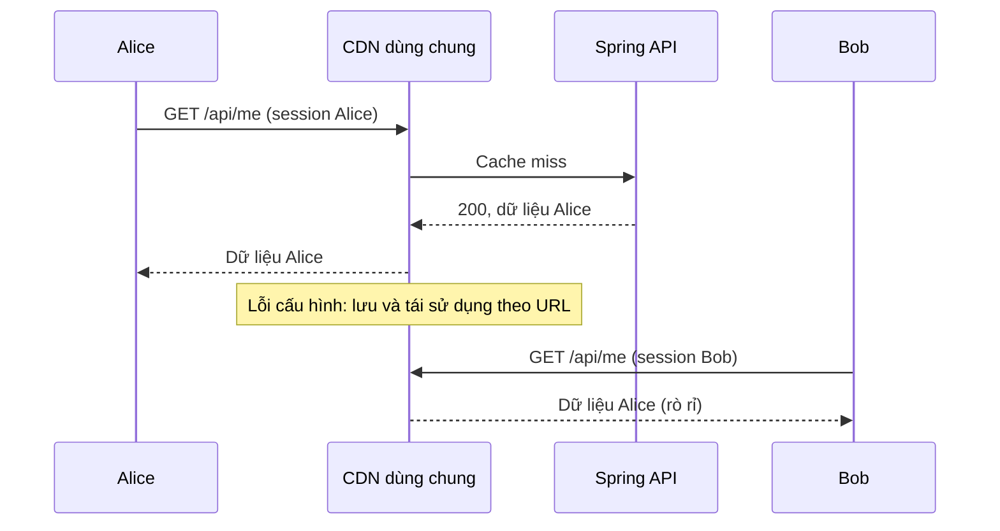

# Cache-Control cho dữ liệu gắn với người dùng

Trong một ứng dụng có đăng nhập, hai yêu cầu `GET /api/me` có thể có cùng URL nhưng phải trả về hai nội dung khác nhau cho hai tài khoản. Nếu trình duyệt, proxy hoặc CDN lưu và phát lại nhầm phản hồi, dữ liệu của người A có thể xuất hiện trong phiên của người B. Đây là lý do **chính sách HTTP cache phải được thiết kế theo mức độ nhạy cảm và phạm vi người được phép xem dữ liệu**, đồng thời phối hợp với xác thực, phân quyền và quản lý session của Spring Security.

Bài này thuộc chương **Bộ nhớ đệm và MIME** của mô-đun **SPRING_SECURITY_HTTP_PROTECTION**. Trọng tâm là bảo vệ nội dung được cá nhân hóa bằng `Cache-Control` trong cả Spring MVC (Servlet) và Spring WebFlux (Reactive), nhận biết cấu hình sai tại ứng dụng hoặc CDN, rồi kiểm tra bằng HTTP và các công cụ kiểm thử Spring. MIME và `X-Content-Type-Options: nosniff` xử lý một lớp rủi ro khác: chúng không thay thế chính sách cache.

## 1. Kết quả cần đạt

Sau bài này, bạn có thể:

- Phân biệt cache riêng của trình duyệt với cache dùng chung ở proxy/CDN và giải thích nguy cơ rò rỉ dữ liệu khi phản hồi phụ thuộc vào người dùng.
- Chọn đúng giữa `no-store`, `private`, `no-cache`, `max-age` và các chỉ thị liên quan; hiểu vì sao `no-cache` **không đồng nghĩa** với cấm lưu.
- Hiểu các header chống cache mặc định của Spring Security và chủ động đặt chính sách cho endpoint nhạy cảm trong Servlet/WebFlux.
- Kiểm tra luồng đăng nhập, chuyển tài khoản, đăng xuất và phản hồi có điều kiện `304 Not Modified` mà không dựa vào một header như biện pháp bảo mật duy nhất.
- Tìm nguyên nhân khi cache tại ứng dụng, trình duyệt và CDN đưa ra hành vi khác nhau.

## 2. Dữ liệu cá nhân hóa đi qua những loại cache nào?

Xét trang quản lý tài khoản:

```http
GET /api/me HTTP/1.1
Host: app.example.com
Cookie: JSESSIONID=...
```

```http
HTTP/1.1 200 OK
Content-Type: application/json

{"user":"alice","email":"alice@example.com"}
```

Nếu một cache dùng chung lưu phản hồi theo URL mà không tách biệt người dùng, yêu cầu cùng đường dẫn từ Bob có nguy cơ nhận dữ liệu của Alice. Quyền truy cập mà ứng dụng đã kiểm tra ở lần tạo phản hồi không tự động được thực thi lại khi cache phát lại bản lưu.

| Loại bộ nhớ đệm | Nơi hoạt động | Điểm cần cảnh giác |
| --- | --- | --- |
| **Private cache** | Trình duyệt hoặc cache chỉ phục vụ một người dùng | Dữ liệu có thể còn trong cùng trình duyệt sau khi đăng xuất/chuyển tài khoản. |
| **Shared cache** | Reverse proxy, gateway, CDN hoặc proxy dùng chung | Có thể phục vụ một bản lưu cho nhiều người dùng nếu quy tắc cache sai. |
| **Cache của ứng dụng** | Spring Cache, Redis, bộ nhớ nội bộ | `Cache-Control` không điều khiển các cache này; khóa cache và kiểm tra quyền phải được thiết kế riêng. |

Với HTTP caching, khóa tra cứu thường bao gồm phương thức, URI và có thể thêm các header nêu trong `Vary`. Nhưng một URL có dữ liệu theo session **không thể coi là tài nguyên công khai chỉ vì phương thức là GET**.



Lỗi ở sơ đồ là **tình huống cần ngăn chặn**, không phải hành vi mặc định của một CDN tuân thủ HTTP. Một hệ thống an toàn cần có chính sách từ máy chủ và cấu hình tương ứng tại mọi lớp trung gian.

## 3. Hiểu chính xác các chỉ thị Cache-Control

`Cache-Control` là header HTTP dùng để quy định cách lưu và tái sử dụng phản hồi. Bảng dưới mô tả các **chỉ thị trong response**; không nên nhầm với `Cache-Control` do client gửi trong request.

| Chỉ thị response | Ý nghĩa quan trọng | Phù hợp với dữ liệu người dùng? |
| --- | --- | --- |
| `no-store` | Cache tuân thủ chuẩn không được lưu nội dung phản hồi; áp dụng cho cache riêng và dùng chung. | **Ưu tiên** cho dữ liệu nhạy cảm hoặc có nguy cơ lộ sau logout. |
| `private` | Cache dùng chung không được lưu; cache riêng vẫn có thể lưu. | Có thể dùng cho dữ liệu cá nhân hóa ít nhạy cảm, khi chấp nhận lưu trên thiết bị. |
| `no-cache` | Có thể lưu nhưng **phải xác thực lại với origin** trước khi tái sử dụng. | Có thể kết hợp với `private` khi cần lưu và tái kiểm tra; **không thay** `no-store`. |
| `max-age=N` | Cho biết phản hồi còn tươi trong N giây. | Chỉ cân nhắc cùng `private` cho nội dung cá nhân hóa có rủi ro thấp. |
| `public` | Cho phép cache dùng chung lưu nếu các điều kiện khác được thỏa. | **Không** dùng cho phản hồi chứa thông tin cá nhân hoặc session. |
| `s-maxage=N` | Quy định thời gian tươi trong cache dùng chung. | Tránh dùng cho nội dung thuộc từng người. |
| `must-revalidate` | Khi phản hồi đã cũ, cache không được tái sử dụng trước khi xác thực thành công. | Không tự nó cấm cache; không xem như hàng rào bảo vệ dữ liệu cá nhân. |

Ba chính sách dễ nhầm:

```http
Cache-Control: no-store
```

Không lưu phản hồi mới trong HTTP cache tuân thủ chuẩn; phù hợp cho số dư, hồ sơ, hóa đơn, token, dữ liệu y tế và các kết quả API riêng tư.

```http
Cache-Control: private, no-cache
```

Trình duyệt được lưu nhưng phải xác thực lại trước khi dùng; proxy/CDN không được lưu. Chỉ chọn khi việc dữ liệu còn ở browser cache đã được cân nhắc và cơ chế xác thực lại kiểm tra đúng quyền hiện tại.

```http
Cache-Control: private, max-age=60
```

Trình duyệt có thể dùng lại tối đa 60 giây mà không gọi server. Điều này có thể có ích cho một số tùy chọn giao diện ít nhạy cảm nhưng **không phù hợp** cho dữ liệu mà thay đổi tài khoản, thu hồi quyền hoặc logout cần có hiệu lực ngay trên phần hiển thị.

**Hai điểm về an toàn:** `no-store` không xóa những bản sao đã được lưu từ trước, cũng không bảo vệ dữ liệu đã lưu trong `localStorage`, bộ nhớ JavaScript, ảnh chụp màn hình hoặc cache tự quản lý của service worker. Hành vi nút Back/Forward và bộ nhớ trang của trình duyệt còn phụ thuộc cách triển khai; luôn kiểm tra lại quyền và dọn dữ liệu phía client khi đăng xuất. Ngược lại, chỉ gửi `max-age=0` hoặc `no-cache` không đủ để khẳng định phản hồi chưa từng được lưu.

## 4. Chọn chính sách cho từng endpoint

| Endpoint / tài nguyên | Chính sách gợi ý | Lý do |
| --- | --- | --- |
| `/api/me`, `/api/account/balance`, `/api/invoices/{id}` | `Cache-Control: no-store` | Nội dung thuộc người dùng; hạn chế lưu ở browser và trung gian. |
| HTML trang tài khoản, kết quả tìm kiếm nội bộ có dữ liệu riêng | `no-store` | Dữ liệu có thể còn trên thiết bị dùng chung sau logout. |
| Dữ liệu cá nhân hóa **ít nhạy cảm**, cho phép tái xác thực | `private, no-cache` | Browser có thể lưu, shared cache không; dùng lại cần xác thực. |
| Tùy chọn UI riêng, không nhạy cảm và chấp nhận độ trễ | `private, max-age=60` *(ví dụ)* | Cân bằng hiệu năng; giá trị 60 giây chỉ là quyết định sản phẩm. |
| CSS/JS/ảnh tĩnh có tên chứa hash nội dung | `public, max-age=31536000, immutable` | An toàn để dùng chung khi tên file đổi mỗi lần nội dung đổi. |
| Tài liệu công khai thay đổi thường xuyên | `public, max-age=300` *(ví dụ)* | Dùng chung được và có thời hạn rõ ràng. |

Trong thực tế, một endpoint phản hồi phụ thuộc `Cookie` thường rủi ro hơn tài nguyên chỉ phụ thuộc nội dung công khai. Đừng cho rằng có `Set-Cookie`, `Vary: Cookie` hoặc CORS là tự động cấm cache dùng chung. `Vary` chỉ hỗ trợ lựa chọn biến thể theo header của request, **không thay cho** `private`/`no-store`, không thay cho phân quyền và dễ gây khó kiểm soát khi có nhiều cookie. Đối với request có `Authorization`, RFC 9111 hạn chế shared cache theo mặc định, nhưng có những chỉ thị response như `public`, `s-maxage`, `must-revalidate` mở ngoại lệ; không dựa riêng vào sự có mặt của bearer token để bảo vệ cache.

## 5. Spring Security đã làm gì theo mặc định?

Khi tính năng security headers mặc định được bật, Spring Security cung cấp:

```http
Cache-Control: no-cache, no-store, max-age=0, must-revalidate
Pragma: no-cache
Expires: 0
```

`Cache-Control` là chính sách chính cho HTTP hiện đại; `Pragma` và `Expires` giúp tương thích với các thành phần cũ. Cấu hình mặc định này nhằm tránh lưu trang đã xác thực khi người dùng đăng xuất. **Nếu ứng dụng tự đặt header `Cache-Control` cho một phản hồi, Spring Security nhường quyền cho chính sách đó**. Vì vậy, một controller hoặc cấu hình tài nguyên tĩnh có thể làm thay đổi mặc định an toàn.

Với Spring MVC và WebFlux, thường **giữ security headers mặc định** rồi chọn chính sách rõ ràng cho endpoint đặc biệt; không cần vô hiệu hóa toàn bộ security headers để cache CSS/JS.

Nếu có yêu cầu phải tự quản lý toàn bộ chính sách cache, API tắt riêng writer được cung cấp như sau. Hai đoạn này là **ví dụ lựa chọn cấu hình**, không nên áp dụng chỉ để giải quyết một endpoint cá nhân hóa:

```java
// Servlet: bên trong cấu hình HttpSecurity
http.headers(headers -> headers
    .cacheControl(cache -> cache.disable())
);
```

```java
// Reactive: bên trong cấu hình ServerHttpSecurity
http.headers(headers -> headers
    .cache(cache -> cache.disable())
);
```

Khi tắt riêng cache writer, ứng dụng phải tự bảo đảm có header an toàn cho **mọi** phản hồi cần bảo vệ, kể cả lỗi, redirect, HTML và nội dung do các nhánh xử lý khác tạo ra. Hai DSL có tên khác nhau: Servlet là `cacheControl`, Reactive là `cache`.

## 6. Triển khai với Spring MVC (Servlet)

Giả sử `/api/me` chỉ dành cho người đã xác thực. Security filter chain sẽ kiểm soát quyền, còn controller đặt chính sách cache ngay trên phản hồi chứa dữ liệu tài khoản:

```java
import java.util.Map;
import org.springframework.context.annotation.Bean;
import org.springframework.context.annotation.Configuration;
import org.springframework.http.CacheControl;
import org.springframework.http.ResponseEntity;
import org.springframework.security.core.Authentication;
import org.springframework.security.config.annotation.web.builders.HttpSecurity;
import org.springframework.security.web.SecurityFilterChain;
import org.springframework.web.bind.annotation.GetMapping;
import org.springframework.web.bind.annotation.RestController;

@Configuration
class ServletSecurityConfig {
    @Bean
    SecurityFilterChain filterChain(HttpSecurity http) throws Exception {
        http.authorizeHttpRequests(auth -> auth
            .requestMatchers("/api/me").authenticated()
            .anyRequest().permitAll());
        // Giữ mặc định security headers, CSRF và session theo nhu cầu ứng dụng.
        return http.build();
    }
}

@RestController
class ServletMeController {
    @GetMapping("/api/me")
    ResponseEntity<Map<String, String>> me(Authentication authentication) {
        return ResponseEntity.ok()
            .cacheControl(CacheControl.noStore())
            .body(Map.of("user", authentication.getName()));
    }
}
```

Điểm chính là `ResponseEntity.ok().cacheControl(CacheControl.noStore())`. Spring Framework sinh `Cache-Control: no-store`, dù Spring Security có các header mặc định riêng. Dữ liệu `user` ở ví dụ là tối giản; trong hệ thống thật, controller gọi service chỉ trả về trường mà người đang đăng nhập được phép xem. `Authentication` phải được kiểm soát bởi quy tắc `.authenticated()` trước khi dùng.

Với file tĩnh có tên gắn hash (ví dụ `app.a1b2c3.js`), MVC có thể đặt cache dài hạn trên một đường dẫn riêng:

```java
import java.time.Duration;
import org.springframework.context.annotation.Configuration;
import org.springframework.http.CacheControl;
import org.springframework.web.servlet.config.annotation.ResourceHandlerRegistry;
import org.springframework.web.servlet.config.annotation.WebMvcConfigurer;

@Configuration
class StaticAssetMvcConfig implements WebMvcConfigurer {
    @Override
    public void addResourceHandlers(ResourceHandlerRegistry registry) {
        registry.addResourceHandler("/assets/**")
            .addResourceLocations("classpath:/static/assets/")
            .setCacheControl(CacheControl.maxAge(Duration.ofDays(365)).cachePublic());
    }
}
```

Ví dụ trên tạo `public, max-age=31536000` (cú pháp/thứ tự chỉ thị có thể khác). Chỉ dùng cho asset bất biến được phát hành với tên file mới khi cập nhật nội dung; đừng dùng cùng quy tắc cho HTML trang đã đăng nhập hoặc JSON riêng tư. Nếu muốn `immutable`, hãy cấu hình thêm chỉ thị đó theo hạ tầng hiện có và chỉ với asset thực sự được định danh theo nội dung.

## 7. Triển khai với Spring WebFlux (Reactive)

WebFlux cũng mặc định có cache headers qua Spring Security. Có thể đặt chính sách cho response theo cách tương tự, trong khi việc truy xuất `Principal` dùng luồng reactive:

```java
import java.security.Principal;
import java.util.Map;
import reactor.core.publisher.Mono;
import org.springframework.context.annotation.Bean;
import org.springframework.context.annotation.Configuration;
import org.springframework.http.CacheControl;
import org.springframework.http.ResponseEntity;
import org.springframework.security.config.annotation.web.reactive.EnableWebFluxSecurity;
import org.springframework.security.config.web.server.ServerHttpSecurity;
import org.springframework.security.web.server.SecurityWebFilterChain;
import org.springframework.web.bind.annotation.GetMapping;
import org.springframework.web.bind.annotation.RestController;

@Configuration
@EnableWebFluxSecurity
class ReactiveSecurityConfig {
    @Bean
    SecurityWebFilterChain reactiveFilterChain(ServerHttpSecurity http) {
        return http.authorizeExchange(auth -> auth
                .pathMatchers("/api/me").authenticated()
                .anyExchange().permitAll())
            .build();
    }
}

@RestController
class ReactiveMeController {
    @GetMapping("/api/me")
    Mono<ResponseEntity<Map<String, String>>> me(Mono<Principal> principal) {
        return principal.map(p -> ResponseEntity.ok()
            .cacheControl(CacheControl.noStore())
            .body(Map.of("user", p.getName())));
    }
}
```

Đây là **phương án WebFlux thay thế phương án MVC**, không phải hai lớp controller cùng đăng ký một endpoint. Nếu dùng functional endpoint, có thể đặt header trên `ServerResponse` thay vì `ResponseEntity`; nếu tự thao tác với `ServerHttpResponse`, phải đặt header trước khi response được commit. Việc chọn `Mono` hay `Flux` không làm thay đổi quy tắc an toàn của HTTP cache.

## 8. ETag, 304 và các trường hợp dễ bị bỏ sót

Khi dùng `private, no-cache`, trình duyệt có thể gửi `If-None-Match` hoặc `If-Modified-Since` để xác thực lại bản đã lưu. Máy chủ có thể trả `304 Not Modified` (không có body) nếu biểu diễn vẫn còn hợp lệ. Điều này tiết kiệm băng thông, **nhưng 304 không miễn bước kiểm tra xác thực/phân quyền**.

```http
GET /api/preferences HTTP/1.1
Cookie: JSESSIONID=...
If-None-Match: "user-alice-rev-7"
```

```http
HTTP/1.1 304 Not Modified
Cache-Control: private, no-cache
ETag: "user-alice-rev-7"
```

Ví dụ chỉ hợp lệ sau khi server xác nhận người gọi vẫn có quyền đối với dữ liệu đó và validator tương ứng với **đúng biểu diễn được phép xem**. Không sinh cùng một ETag từ nội dung chung rồi bỏ qua phân quyền; không để lớp cache toàn cục trả 304 trước security filter. Với dữ liệu có độ nhạy cao đã chọn `no-store`, thường không có lý do để xây luồng tái sử dụng từ cache bằng ETag cho chính phản hồi đó.

Những điểm khác cần xem xét:

- **Login/logout và chuyển tài khoản:** vô hiệu hóa session hoặc token ở server, xóa trạng thái nhạy cảm ở client, rồi thử Back/Forward và đổi tài khoản trên cùng trình duyệt. `Cache-Control` không thay thế logout đúng cách.
- **401, 403 và redirect:** kiểm tra header của cả phản hồi thành công và thất bại/điều hướng, nhất là khi body hoặc URL tiết lộ thông tin người dùng. Đừng mặc định mọi nhánh đều đi qua cùng controller.
- **CDN/reverse proxy:** thiết lập bypass cache cho endpoint cần xác thực, kiểm tra các luật bắt cache hoặc bỏ qua header origin; không tin rằng cấu hình Spring sẽ thắng mọi quy tắc ở edge.
- **CORS, CSRF, MIME:** CORS điều khiển truy cập phản hồi theo trình duyệt; CSRF bảo vệ thao tác dựa vào phiên; `nosniff` hạn chế diễn giải MIME. Không tính năng nào tự ngăn một shared cache phát lại dữ liệu của tài khoản khác.
- **Service worker và cache API:** nếu ứng dụng PWA tự lưu response, phải có chính sách riêng để không đưa dữ liệu nhạy cảm vào `CacheStorage` hay giữ bản cũ qua các phiên đăng nhập.

## 9. Kiểm thử việc không lưu và không phát lại dữ liệu người dùng

### 9.1. Kiểm tra HTTP thật

Dùng request **GET thật** để xem header mà client nhận sau khi đi qua proxy/CDN (kiểm tra `HEAD` không phải lúc nào cũng phản ánh đúng nhánh GET):

```bash
# Thay địa chỉ và token bằng thông tin môi trường kiểm thử.
curl -sS -D - -o /dev/null \
  -H 'Authorization: Bearer <token-of-alice>' \
  'https://app.example.com/api/me'
```

Kỳ vọng ở endpoint riêng tư là `Cache-Control: no-store` (hoặc mặc định Spring Security chứa `no-store`), không có `public` hay thời gian cache dùng chung được cấu hình trái chủ đích. Có thể có thêm `Pragma`/`Expires` nếu hệ thống dùng chính sách mặc định của Spring Security. Với session cookie, thay header `Authorization` bằng `Cookie` trong **môi trường thử nghiệm**, không đưa token/cookie thật vào log, tài liệu hay công cụ chia sẻ.

Thử cùng URL với Alice và Bob qua **chính đường mạng production sử dụng** (origin trực tiếp và CDN nếu có). Body Bob phải đúng dữ liệu Bob, không được chứa thông tin Alice; không có việc cache trả response cá nhân hóa khác người. Lặp lại sau logout, chuyển tài khoản, tải lại trang, quay lại trang trước và thay đổi quyền truy cập. Quan sát `Age`, `Via`, `X-Cache` hoặc header tương đương nếu proxy/CDN cung cấp; các tên header này phụ thuộc nhà cung cấp và không thay thế kiểm tra nội dung.

### 9.2. Kiểm thử tích hợp với Servlet

Ví dụ dưới dùng `spring-security-test`, Spring Boot Test và MockMvc. Nó tạo MockMvc với filter chain bảo mật của ứng dụng để kiểm tra chính sách trên endpoint ở mục 6:

```java
import static org.hamcrest.Matchers.containsString;
import static org.springframework.security.test.web.servlet.setup.SecurityMockMvcConfigurers.springSecurity;
import static org.springframework.security.test.web.servlet.request.SecurityMockMvcRequestPostProcessors.user;
import static org.springframework.test.web.servlet.request.MockMvcRequestBuilders.get;
import static org.springframework.test.web.servlet.result.MockMvcResultMatchers.*;

import org.junit.jupiter.api.BeforeEach;
import org.junit.jupiter.api.Test;
import org.springframework.beans.factory.annotation.Autowired;
import org.springframework.boot.test.context.SpringBootTest;
import org.springframework.http.HttpHeaders;
import org.springframework.test.web.servlet.setup.MockMvcBuilders;
import org.springframework.test.web.servlet.MockMvc;
import org.springframework.web.context.WebApplicationContext;

@SpringBootTest
class ServletCacheHeadersTest {
    @Autowired WebApplicationContext context;
    MockMvc mvc;

    @BeforeEach
    void setup() {
        mvc = MockMvcBuilders.webAppContextSetup(context)
            .apply(springSecurity()).build();
    }

    @Test
    void personalResponseMustNotBeStored() throws Exception {
        mvc.perform(get("/api/me").with(user("alice")))
            .andExpect(status().isOk())
            .andExpect(header().string(HttpHeaders.CACHE_CONTROL, containsString("no-store")))
            .andExpect(jsonPath("$.user").value("alice"));
    }
}
```

Test xác nhận controller đặt `no-store` và trả đúng tài khoản được giả lập. Nó **không mô phỏng CDN**; cần thêm kiểm thử HTTP thực tế ở mục 9.1 để phát hiện cấu hình sai trên đường đi.

### 9.3. Kiểm thử tích hợp với Reactive

Với ứng dụng WebFlux có `WebTestClient` và `spring-security-test`, bind test client vào application context để `mockUser` tác động đúng lên bộ lọc bảo mật:

```java
import static org.springframework.security.test.web.reactive.server.SecurityMockServerConfigurers.mockUser;
import static org.springframework.security.test.web.reactive.server.SecurityMockServerConfigurers.springSecurity;

import org.junit.jupiter.api.BeforeEach;
import org.junit.jupiter.api.Test;
import org.springframework.beans.factory.annotation.Autowired;
import org.springframework.boot.test.context.SpringBootTest;
import org.springframework.context.ApplicationContext;
import org.springframework.http.HttpHeaders;
import org.springframework.test.web.reactive.server.WebTestClient;

@SpringBootTest
class ReactiveCacheHeadersTest {
    @Autowired ApplicationContext context;
    WebTestClient client;

    @BeforeEach
    void setup() {
        client = WebTestClient.bindToApplicationContext(context)
            .apply(springSecurity())
            .configureClient().build();
    }

    @Test
    void personalResponseMustNotBeStored() {
        client.mutateWith(mockUser("alice"))
            .get().uri("/api/me")
            .exchange()
            .expectStatus().isOk()
            .expectHeader().valueMatches(HttpHeaders.CACHE_CONTROL, ".*no-store.*")
            .expectBody().jsonPath("$.user").isEqualTo("alice");
    }
}
```

Thử nghiệm nội dung giữa hai danh tính nên bổ sung kiểm tra riêng với hai context bảo mật khác nhau. Test ở đây mô tả **mục tiêu của header**, không được xem như chứng cứ đầy đủ rằng CDN hoặc browser ngoài đời không lưu.

## 10. Chẩn đoán cấu hình xung đột

| Triệu chứng | Nguyên nhân cần kiểm tra | Hướng xử lý |
| --- | --- | --- |
| `/api/me` trả `public, max-age=...` | `ResponseEntity`, filter, gateway hoặc CDN đã tự đặt/ghi đè header. | Đưa endpoint riêng về `no-store`, kiểm tra header sau từng lớp trung gian. |
| Đã đăng xuất nhưng nút Back vẫn thấy nội dung cũ | HTML cache cũ, back/forward page cache, state SPA hoặc service worker. | Xác thực lại quyền, xóa state nhạy cảm, dùng `no-store` cho phản hồi phù hợp và kiểm tra hành vi từng trình duyệt. |
| CDN trả dữ liệu Alice cho Bob | Edge cache lưu theo URL mà thiếu chính sách bypass/tách riêng. | Ngừng cache nội dung cá nhân hóa, vô hiệu hóa bản lưu bị ảnh hưởng, kiểm thử lại với hai tài khoản. |
| Đã đặt `Cache-Control` trong controller nhưng response cuối khác | Filter, reverse proxy hoặc cấu hình CDN can thiệp thứ tự/giá trị header. | So header tại origin và edge; tìm cấu hình nào ghi đè hoặc hợp nhất chỉ thị. |
| Asset JS/CSS bị tải lại liên tục | Dùng mặc định `no-store` cho tài nguyên tĩnh. | Chọn chính sách cache công khai cho asset có tên hash, giữ riêng endpoint cá nhân hóa. |
| Thấy `304` nhưng quyền tài khoản đã thay đổi | Xử lý validator trước khi kiểm tra quyền, hoặc validator không gắn với biểu diễn được phép xem. | Đưa phân quyền trước xử lý điều kiện và kiểm tra ETag/Last-Modified theo đúng tài nguyên/người dùng. |

Quy trình điều tra hiệu quả là lấy một request mẫu, ghi lại **URL, danh tính thử nghiệm, status, `Cache-Control`, `Vary`, `ETag`, `Age` và đường đi origin → gateway → CDN → browser**, rồi so sánh ở từng điểm. `Cache-Control` là chính sách cho các HTTP cache tuân thủ chuẩn; bảo vệ thực tế còn phụ thuộc việc cấu hình các lớp trung gian đúng và chặn được dữ liệu nhạy cảm ngay từ application.

## 11. Bài thực hành

Một hệ thống quản lý khách hàng có ba tài nguyên: `GET /api/customer/me` trả hồ sơ riêng, `GET /api/ui/theme` trả giao diện ưa thích ít nhạy cảm, còn `GET /assets/app.9c21a.js` là file JS có hash nội dung. Trước đây toàn hệ thống dùng `public, max-age=600` để giảm tải CDN.

1. Đề xuất lại `Cache-Control` cho từng endpoint và giải thích khả năng hiển thị dữ liệu cũ sau khi đổi tài khoản.
2. Thêm `.cacheControl(CacheControl.noStore())` vào response của `/api/customer/me` trong Servlet hoặc Reactive. Giữ security headers mặc định.
3. Tạo hai tài khoản kiểm thử; truy cập cùng URL qua CDN trước/sau chuyển tài khoản, quan sát header và nội dung.
4. Nếu ứng dụng có ETag cho `/api/ui/theme`, kiểm tra quyền hiện tại **trước khi** trả `304`.

**Định hướng đáp án:** Hồ sơ dùng `no-store`; theme có thể dùng `private, no-cache` nếu chấp nhận lưu riêng trong browser và luôn tái xác thực, hoặc `no-store` nếu không muốn giữ trên máy; JS có tên hash dùng `public` với thời gian cache dài. Quy tắc CDN phải loại `/api/customer/me` khỏi shared cache. Test endpoint chỉ xác nhận một lớp; bài hoàn thành khi cùng URL không thể phát lại nội dung của tài khoản khác sau mọi lớp trung gian được sử dụng thực tế.

## Tài liệu tham khảo

- [Spring Security — Security HTTP Response Headers](https://docs.spring.io/spring-security/reference/features/exploits/headers.html): mặc định cache và nguyên tắc không ghi đè header riêng của ứng dụng.
- [Spring Security — Servlet Security HTTP Response Headers](https://docs.spring.io/spring-security/reference/servlet/exploits/headers.html): tùy chỉnh cache ở Servlet.
- [Spring Security — Reactive Security HTTP Response Headers](https://docs.spring.io/spring-security/reference/reactive/exploits/headers.html): tùy chỉnh cache ở WebFlux.
- [Spring Framework — HTTP Caching (Spring MVC)](https://docs.spring.io/spring-framework/reference/web/webmvc/mvc-caching.html): `CacheControl`, `ResponseEntity`, ETag và tài nguyên tĩnh.
- [RFC 9111 — HTTP Caching](https://www.rfc-editor.org/rfc/rfc9111.html): định nghĩa chuẩn của shared/private cache, `no-store`, `no-cache`, `private` và phản hồi có xác thực.
