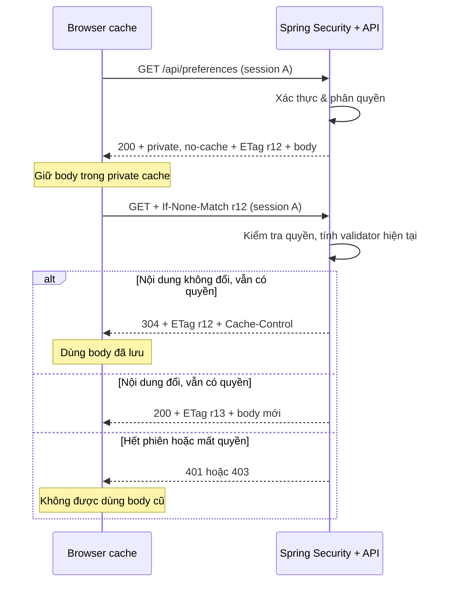

# Ý nghĩa của no-store, no-cache và chính sách xác thực lại

## Bối cảnh và mục tiêu

Trong ứng dụng Spring Security, một HTTP response có thể đi qua trình duyệt, reverse proxy, CDN và ứng dụng trước khi đến người dùng. Một phần trong số đó có khả năng **lưu phản hồi rồi sử dụng lại**. Với CSS công khai, đây là cách tăng hiệu năng hữu ích; với hồ sơ tài khoản, hóa đơn hoặc dữ liệu theo phiên đăng nhập, một quy tắc cache sai có thể làm người dùng nhìn thấy thông tin cũ hoặc thông tin của tài khoản khác.

Bài học thuộc chương **Bộ nhớ đệm và MIME** của mô-đun **SPRING_SECURITY_HTTP_PROTECTION**. Phạm vi chính là hiểu đúng `no-store`, `no-cache` và việc **revalidation** (xác thực lại bản lưu với origin server) theo HTTP; sau đó áp dụng vào hệ thống Spring Security trên **Servlet** và **Reactive**, kiểm thử kịch bản bảo mật trình duyệt và chẩn đoán xung đột giữa ứng dụng với các lớp trung gian. CORS, CSRF, CSP, HSTS, MIME protection và HTTP firewall bảo vệ những khía cạnh khác; chúng không thay thế chính sách cache.

Sau bài này, người học có thể:

- Giải thích vì sao **`no-cache` không có nghĩa là “không được lưu”** và vì sao `no-store` phù hợp hơn với dữ liệu nhạy cảm.
- Phân biệt việc **lưu**, **dùng lại khi còn tươi** và **xác thực lại** một HTTP response.
- Đọc đúng `If-None-Match`, `If-Modified-Since`, `ETag`, `Last-Modified` và phản hồi `304 Not Modified`.
- Chọn chính sách theo rủi ro dữ liệu, phiên đăng nhập, người dùng và loại HTTP cache.
- Áp dụng `CacheControl` trong Spring MVC/WebFlux và kiểm tra hành vi HTTP thực tế.

## 1. Ba thao tác khác nhau: lưu, dùng lại và xác thực lại

Một HTTP cache là thành phần có thể giữ response để phục vụ request tiếp theo. **Private cache** thường chỉ phục vụ một người dùng (ví dụ browser cache); **shared cache** phục vụ nhiều người dùng (ví dụ CDN hoặc reverse proxy). Đây là khái niệm của HTTP caching: cache của Redis, Spring Cache, `localStorage` hoặc `CacheStorage` do ứng dụng tự quản lý là các cơ chế khác.

Phân biệt ba giai đoạn:

1. **Store:** nhận một HTTP response và giữ lại nội dung/metadata nếu quy tắc cho phép.
2. **Reuse:** dùng bản đã lưu để đáp ứng request mới; trong một số trường hợp cache không cần gửi request đến origin.
3. **Revalidate:** gửi request đến origin để hỏi bản lưu còn dùng được không. Nếu hợp lệ, origin có thể trả `304`; nếu nội dung đã đổi, origin trả response đầy đủ, thường là `200`.

Ví dụ: hai lượt `GET /api/preferences` có thể sử dụng URL giống nhau nhưng đại diện cho hai tài khoản khác nhau. Server luôn phải kiểm tra người gọi và xác định biểu diễn được phép xem; **ETag hoặc mã `304` không phải cơ chế phân quyền**.

| Header ở response | Cache có thể lưu? | Có thể dùng lại mà không hỏi origin? | Mục đích thường gặp |
| --- | --- | --- | --- |
| `Cache-Control: no-store` | **Không**, với HTTP cache tuân thủ chuẩn | Không, vì không được lưu phản hồi đó | Dữ liệu bí mật, riêng tư, có rủi ro sau logout |
| `Cache-Control: no-cache` | **Có thể** | **Không**, phải xác thực lại thành công | Muốn giữ bản lưu nhưng luôn xác minh trước khi dùng |
| `Cache-Control: private, no-cache` | Browser/private cache có thể; shared cache **không** | Phải xác thực lại | Cá nhân hóa ít nhạy cảm; chấp nhận lưu trên thiết bị |
| `Cache-Control: private, max-age=60` | Private cache có thể | **Có**, trong khoảng còn tươi | Cá nhân hóa ít nhạy cảm, chấp nhận dữ liệu trễ tối đa khoảng 60 giây |
| `Cache-Control: public, max-age=3600` | Private và shared cache có thể | **Có**, khi còn tươi | Nội dung công khai |
| `Cache-Control: max-age=0, must-revalidate` | **Có thể** | Thường phải xác thực lại vì bản lưu hết độ tươi ngay | Chính sách dùng lại có điều kiện, **không cấm lưu** |

Các cột phản ánh hành vi của HTTP cache tuân thủ RFC 9111, còn những điều kiện tổng quát khác như status, phương thức, `Vary` và `Authorization` vẫn được áp dụng. Bản thân việc có thể lưu không có nghĩa mọi cache sẽ chọn lưu.

## 2. `no-store`: yêu cầu không lưu phản hồi

`no-store` trên **response** yêu cầu HTTP cache tuân thủ chuẩn **không lưu bất kỳ phần nào của response đó** để sử dụng lại. Chính sách áp dụng cho cả private lẫn shared cache:

```http
HTTP/1.1 200 OK
Content-Type: application/json
Cache-Control: no-store

{"accountId":"a-17","balance":125000}
```

Một lần tải tiếp theo không thể được phục vụ từ *bản response này* trong HTTP cache tuân thủ chuẩn. Đó là lựa chọn phù hợp cho:

- Thông tin danh tính, tài khoản, thanh toán, hồ sơ cá nhân và kết quả tìm kiếm chứa dữ liệu riêng.
- HTML màn hình sau khi đăng nhập, nhất là trên thiết bị dùng chung.
- Response chứa token, thông tin xác thực tạm thời hoặc dữ liệu có thể thay đổi ngay khi quyền truy cập bị thu hồi.
- Những endpoint mà lợi ích tiết kiệm băng thông không đáng đánh đổi với nguy cơ dữ liệu tồn tại trong browser cache.

**Giới hạn cần hiểu đúng:**

- `no-store` trên response **không xóa** những bản sao đã lưu trước khi chính sách được áp dụng. Muốn xử lý dữ liệu cũ cần xem xét cả cấu hình phân phối và thao tác vô hiệu hóa cache tại các tầng liên quan.
- Nó **không đảm bảo xóa mọi dấu vết khỏi bộ nhớ hoặc thiết bị**: JavaScript state, service worker tự lưu, `localStorage`, bản tải về, ảnh chụp màn hình hoặc lịch sử điều hướng nằm ngoài phạm vi của HTTP response cache thông thường.
- Hành vi Back/Forward, bộ nhớ trang và back/forward cache (bfcache) tùy trình duyệt, phiên bản và chính sách riêng. Cần kiểm thử và xóa state nhạy cảm khi logout; `no-store` không thay thế việc kết thúc session.
- HTTP cache không phải đối thủ độc hại: cache bị lỗi, cấu hình sai hoặc chủ động bỏ qua chuẩn vẫn có thể làm lộ nội dung. Vì vậy, `no-store` phải đi cùng HTTPS, phân quyền và cấu hình CDN/gateway.

### Request `no-store` khác response `no-store`

Client cũng có thể gửi:

```http
GET /api/account HTTP/1.1
Cache-Control: no-store
```

Theo RFC 9111, request `no-store` yêu cầu cache **không lưu phần nào của request đó hoặc response tương ứng**. Đây là chỉ thị của request hiện tại; **nó không thay thế** việc server phát `Cache-Control: no-store` ở response để áp dụng chính sách nhất quán với mọi client.

## 3. `no-cache`: được lưu, nhưng phải xác thực lại trước khi dùng

Tên `no-cache` dễ gây hiểu nhầm. Đối với **response**, chỉ thị này **không cấm lưu**; nó quy định rằng cache không được dùng bản đã lưu cho request tiếp theo **cho đến khi đã xác thực lại thành công với origin server**. Quy tắc vẫn áp dụng dù cache nghĩ phản hồi còn tươi.

```http
HTTP/1.1 200 OK
Content-Type: application/json
Cache-Control: private, no-cache
ETag: "prefs-rev-12"

{"theme":"dark","language":"vi"}
```

Ở đây:

- `private` ngăn shared cache lưu response; browser/private cache vẫn có thể lưu.
- `no-cache` yêu cầu private cache liên hệ lại origin trước khi dùng response.
- `ETag` là validator để origin nhận biết bản lưu có còn hợp lệ; giá trị `"prefs-rev-12"` chỉ minh họa, trong hệ thống thật phải tương ứng đúng với nội dung và quyền truy cập của biểu diễn đó.

**Không nên dùng `no-cache` cho phản hồi rất nhạy cảm** với lập luận rằng “đã phải hỏi server thì an toàn”. Body vẫn có thể được lưu trên thiết bị, và một cơ chế xác thực lại bị cài đặt sai có thể khiến nội dung cũ được tái sử dụng. Khi muốn ngăn HTTP cache giữ body, hãy chọn `no-store`.

### `no-cache` trong request

```http
GET /api/preferences HTTP/1.1
Cache-Control: no-cache
```

Khi **client** gửi `no-cache`, client yêu cầu cache không dùng bản lưu để trả request này nếu chưa xác thực lại thành công. Đây là cách một client yêu cầu kiểm tra dữ liệu mới, nhưng **không tự cấm** cache giữ response. Hãy luôn phân biệt request directive và response directive khi đọc log.

## 4. Revalidation hoạt động qua `ETag` và `304` như thế nào?

`no-cache` có thể tăng độ tin cậy của dữ liệu mà vẫn tránh tải lại toàn bộ body. Để làm được điều đó, origin cung cấp **validator**:

- `ETag`: định danh phiên bản biểu diễn, ví dụ `ETag: "pref-r3"`. Có strong ETag (`"..."`) và weak ETag (`W/"..."`); weak validator dùng để xác định tương đương về ngữ nghĩa, không dùng cho mọi mục đích đòi hỏi so khớp byte.
- `Last-Modified`: thời gian biểu diễn được sửa gần nhất; client có thể dùng `If-Modified-Since`. Độ chính xác thời gian thường thấp hơn ETag.
- `If-None-Match` / `If-Modified-Since`: header điều kiện ở request. Nếu cả hai xuất hiện, quy tắc HTTP ưu tiên xử lý `If-None-Match` theo ngữ nghĩa tương ứng.

### 4.1. Luồng khi dữ liệu chưa đổi

Lượt đầu:

```http
GET /api/preferences HTTP/1.1
Cookie: JSESSIONID=<session-A>
```

```http
HTTP/1.1 200 OK
Cache-Control: private, no-cache
ETag: "opaque-rev-12"
Content-Type: application/json

{"theme":"dark"}
```

Lượt sau (browser **đã lưu** body nhưng phải revalidate):

```http
GET /api/preferences HTTP/1.1
Cookie: JSESSIONID=<session-A>
If-None-Match: "opaque-rev-12"
```

Origin kiểm tra session/quyền xem tài nguyên, nhận thấy biểu diễn hiện tại khớp validator và trả:

```http
HTTP/1.1 304 Not Modified
Cache-Control: private, no-cache
ETag: "opaque-rev-12"
```

`304` **không chứa body**. Cache cập nhật metadata của bản lưu theo phản hồi `304` và dùng body đã lưu **chỉ khi** các điều kiện HTTP caching hợp lệ, bao gồm việc xác thực lại và lựa chọn đúng biến thể. Trình duyệt có thể hiển thị giao diện giống nhận `200` dù Network panel cho thấy `304`.

### 4.2. Luồng khi dữ liệu đã thay đổi

```http
GET /api/preferences HTTP/1.1
Cookie: JSESSIONID=<session-A>
If-None-Match: "opaque-rev-12"
```

```http
HTTP/1.1 200 OK
Cache-Control: private, no-cache
ETag: "opaque-rev-13"
Content-Type: application/json

{"theme":"light"}
```

Origin trả representation mới với validator mới. Cache có thể thay bản cũ theo quy tắc lưu hiện hành; yêu cầu tiếp theo vẫn phải xác thực lại vì `no-cache`.

### 4.3. Luồng khi quyền truy cập không còn

Nếu Alice đã đăng xuất, session hết hạn hoặc quyền bị thu hồi, origin **phải xử lý xác thực/phân quyền theo request hiện tại**, trước khi quyết định trả `304`. Ví dụ đáp án đúng có thể là `401 Unauthorized` cho session không còn đăng nhập hoặc `403 Forbidden` cho người đã xác thực nhưng không còn quyền xem.

**Sai lầm nghiêm trọng:** middleware chỉ so `If-None-Match` với ETag, trả `304` trước khi kiểm tra danh tính. Browser có thể dùng lại body cũ dù người hiện tại không còn quyền. Validator là dữ liệu phục vụ điều kiện HTTP, không phải vé truy cập.



### 4.4. Những điều kiện quan trọng khi tạo `304`

- `304 Not Modified` chỉ có ý nghĩa cho request điều kiện `GET`/`HEAD`; không tạo `304` cho cập nhật `PUT`/`POST`. Với các precondition cho thao tác thay đổi, có thể dùng `412 Precondition Failed` theo ngữ nghĩa HTTP tương ứng.
- Theo RFC 9110, response `304` phải bao gồm các header thuộc nhóm `Cache-Control`, `Content-Location`, `Date`, `ETag`, `Expires`, `Vary` **nếu chúng đáng lẽ được gửi trong response `200` tương ứng**; không phát body.
- ETag phải mô tả **biểu diễn được phép xem**. Nếu body được chọn theo người dùng/quyền, phiên bản dùng để xác thực phải gắn với chính biểu diễn đó. Tránh tạo validator chung rồi dùng cho các body khác nhau.
- `Vary` giúp cache phân biệt những biến thể phản hồi tùy request header; không phải kiểm soát truy cập. `Vary: Cookie` hoặc `Vary: Authorization` **không thay** `private`/`no-store` và kiểm tra quyền.
- Dùng validator dạng opaque, không nhúng email, token, số tài khoản hoặc dữ liệu nhạy cảm vào ETag. ETag bền vững theo người dùng cũng có thể tạo rủi ro theo dõi khi thiết kế thiếu cẩn trọng.
- Nếu cache không có bản lưu hợp lệ hoặc server không có validator, client phải nhận dữ liệu theo luồng phù hợp (thường là `200` với body), không thể tự suy ra rằng `304` có nghĩa “response an toàn”.

## 5. `must-revalidate`, `max-age=0` và `private` khác `no-cache` ở đâu?

Đây là nhóm chỉ thị thường đi cùng `no-cache` nhưng có ý nghĩa khác nhau.

| Chỉ thị | Tác dụng thực tế | Điều **không** được suy diễn |
| --- | --- | --- |
| `must-revalidate` | **Sau khi bản lưu đã stale**, cache phải xác thực lại thành công trước khi dùng; khi không liên hệ được origin thì không được phát bản stale trái chỉ thị. | Không có nghĩa cache phải hỏi origin khi bản lưu còn fresh; không cấm lưu. |
| `max-age=0` | Độ tươi bằng 0 giây; bản lưu nhanh chóng bị coi là stale và cần cơ sở hợp lệ để dùng lại. | Không có nghĩa không được lưu; không đồng nghĩa `no-store`. |
| `private` | Ngăn **shared cache** lưu response; private cache vẫn có thể lưu. | Không đảm bảo browser sẽ xóa response khi logout. |
| `public` | Cho phép cache dùng chung lưu trong các điều kiện HTTP thích hợp. | Không thích hợp cho dữ liệu gắn với từng người. |
| `s-maxage=N` | Quy định freshness cho **shared cache**, với một số hiệu ứng bổ sung theo RFC. | Không sử dụng như cách kiểm soát quyền tài khoản. |
| `no-cache` | Yêu cầu xác thực lại **trước mỗi lần tái sử dụng** bản lưu. | Không cấm lưu, kể cả khi đi cùng `max-age=0`. |
| `no-store` | Yêu cầu HTTP cache **không lưu** response. | Không dọn sạch toàn bộ state/bản sao ngoài HTTP cache. |

Hai ví dụ dễ nhầm:

```http
Cache-Control: private, max-age=300, must-revalidate
```

Browser có thể dùng nội dung trong khoảng còn fresh (khoảng 5 phút, xét đầy đủ tuổi response); **chỉ khi stale** mới buộc xác thực lại. Nếu quyền truy cập bị thu hồi giữa khoảng này, policy đó có thể khiến giao diện còn hiển thị nội dung cũ. Chỉ dùng khi hành vi này đã được chấp nhận.

```http
Cache-Control: private, no-cache, must-revalidate
```

Cache riêng có thể lưu; vì `no-cache`, mỗi lần muốn dùng lại đều phải xác thực thành công. `must-revalidate` không biến chính sách này thành `no-store` và thường không làm thay đổi mục tiêu xác thực lại mà `no-cache` đã áp dụng.

**Lưu ý bảo mật ít được biết:** Theo RFC 9111, `must-revalidate` là một trong các chỉ thị có thể cho phép **shared cache** lưu/tái sử dụng response của request chứa `Authorization` theo các điều kiện của chuẩn, tương tự một số trường hợp dùng `public` hay `s-maxage`. Vì vậy đừng nghĩ “có bearer token” hoặc “có `must-revalidate`” là tự động ngăn shared cache. Dữ liệu theo tài khoản cần có `private` hoặc `no-store` phù hợp, cộng với kiểm tra quy tắc CDN.

## 6. Chọn chính sách trong hệ thống Spring Security

| Loại response | Chính sách ưu tiên | Cách xử lý khi quyền hoặc dữ liệu thay đổi |
| --- | --- | --- |
| `/api/me`, số dư, hóa đơn, thông tin định danh, trang nội bộ nhạy cảm | `no-store` | Luôn gọi server khi tải dữ liệu; không giữ body ở HTTP cache. |
| Cài đặt giao diện theo người dùng, **ít nhạy cảm**, chấp nhận lưu cục bộ | `private, no-cache` | Mỗi lần dùng lại phải revalidate và **kiểm tra quyền trước `304`**. |
| Tùy chọn cá nhân ít nhạy cảm, được phép chậm cập nhật | `private, max-age=60` *(ví dụ)* | Cho phép dùng bản fresh trong 60 giây; phải có quyết định sản phẩm rõ ràng. |
| HTML đăng nhập/đăng xuất, phản hồi chứa token hoặc mã một lần | `no-store` | Tránh lưu nội dung và trạng thái nhạy cảm trên thiết bị. |
| JS/CSS có tên hash nội dung, phát hành công khai | `public, max-age=31536000, immutable` | Đổi tên file khi nội dung đổi; không chứa dữ liệu gắn với người dùng. |
| Dữ liệu danh mục công khai thay đổi định kỳ | `public, max-age=300` *(ví dụ)*, có thể kèm validator | Có thể dùng shared cache, revalidate theo chính sách freshness. |

Không có một giá trị `Cache-Control` phù hợp cho mọi endpoint. Hãy bắt đầu từ câu hỏi: *response chứa thông tin gì, có thể lưu ở đâu, ai được xem và bao lâu có thể chấp nhận dữ liệu cũ?*

### Cùng URL không đồng nghĩa cùng người dùng

Với `GET /api/me`, đường dẫn của Alice và Bob giống nhau nhưng representation không giống nhau. Nếu reverse proxy tự cấu hình cache theo URL mà không tuân thủ chính sách, Bob có nguy cơ nhận response của Alice **mà request không đi qua security filter của origin**. Không dựa vào `Cookie` hoặc `Vary` như tuyến phòng vệ duy nhất. Đối với response cá nhân hóa, cấu hình proxy/CDN phải bảo toàn hoặc thực thi chính sách tránh lưu dùng chung.

### Revalidation không phải xác thực người dùng

Từ “xác thực lại” trong bài này nghĩa là **revalidation bản lưu theo HTTP**, không phải đăng nhập lại hay xác thực lại danh tính. Hai quá trình có thể cùng xảy ra trong một request:

1. Spring Security xác định người gọi và kiểm tra quyền.
2. Ứng dụng xác định representation hiện tại mà người đó được phép xem.
3. Nếu có validator hợp lệ và request đáp ứng điều kiện, ứng dụng trả `304`; nếu không, trả `200` với body hoặc trạng thái lỗi thích hợp.

Đừng đảo thứ tự chỉ để tiết kiệm truy vấn phân quyền. `304` không mang body nhưng **cho phép cache tiếp tục dùng body cũ**, nên việc trả `304` sai có hậu quả thực tế.

## 7. Mặc định của Spring Security trên Servlet và Reactive

Khi các HTTP security headers mặc định được bật, Spring Security gửi các header chống HTTP caching:

```http
Cache-Control: no-cache, no-store, max-age=0, must-revalidate
Pragma: no-cache
Expires: 0
```

Trong nhóm này, **`no-store` mới là chỉ thị cấm lưu**. `no-cache` đòi hỏi xác thực lại, `max-age=0` khiến response nhanh stale và `must-revalidate` ràng buộc việc tái sử dụng response đã stale. `Pragma: no-cache` và `Expires: 0` được giữ để hỗ trợ thành phần cũ.

Spring Security mặc định bảo vệ nội dung khi người dùng rời phiên; nhưng **nếu ứng dụng đã chủ động cung cấp header Cache-Control của riêng mình, Spring Security không ghi đè header đó**. Điều này giúp cache tài nguyên tĩnh, đồng thời có nghĩa là mọi `ResponseEntity`, interceptor, filter hoặc reverse proxy sửa header đều cần được xem xét.

Không cần tắt toàn bộ security headers để cache một endpoint công khai. Nếu nhất thiết phải tắt **riêng cache header writer**, hai DSL tương ứng là:

```java
// Servlet - HttpSecurity
http.headers(headers -> headers.cacheControl(cache -> cache.disable()));

// Reactive - ServerHttpSecurity
http.headers(headers -> headers.cache(cache -> cache.disable()));
```

Đây chỉ là cơ chế để biết khi đọc cấu hình; **không phải thiết lập khuyến nghị cho bài thực hành**. Khi tắt, ứng dụng phải chịu trách nhiệm cấp header phù hợp cho cả response thành công, redirect, lỗi và các luồng sinh response khác.

## 8. Áp dụng trong Spring MVC (Servlet)

Trong Servlet, để tránh lưu response tài khoản, sử dụng `ResponseEntity` với `CacheControl.noStore()`. Ví dụ controller tối giản:

```java
import java.util.Map;

import org.springframework.http.CacheControl;
import org.springframework.http.ResponseEntity;
import org.springframework.security.core.Authentication;
import org.springframework.web.bind.annotation.GetMapping;
import org.springframework.web.bind.annotation.RestController;

@RestController
class AccountController {

    @GetMapping("/api/account")
    ResponseEntity<Map<String, String>> account(Authentication auth) {
        return ResponseEntity.ok()
            .cacheControl(CacheControl.noStore())
            .body(Map.of("user", auth.getName()));
    }
}
```

Security filter chain phải bảo vệ URL trước khi controller dùng `Authentication`:

```java
import org.springframework.context.annotation.Bean;
import org.springframework.context.annotation.Configuration;
import org.springframework.security.config.annotation.web.builders.HttpSecurity;
import org.springframework.security.web.SecurityFilterChain;

@Configuration
class AppSecurityConfig {

    @Bean
    SecurityFilterChain securityFilterChain(HttpSecurity http)
            throws Exception {
        return http.authorizeHttpRequests(auth -> auth
                .requestMatchers("/api/**").authenticated()
                .anyRequest().permitAll())
            .build();
    }
}
```

Đoạn này giữ mặc định security headers. Cấu hình session, CSRF, method security hoặc cơ chế bearer token thực tế tùy ứng dụng và được thiết kế riêng.

Nếu một endpoint ít nhạy cảm **được phép** lưu ở private cache nhưng phải kiểm tra lại, Spring MVC có thể dùng:

```java
// Bên trong handler đã xác thực và phân quyền:
return ResponseEntity.ok()
    .cacheControl(CacheControl.noCache().cachePrivate())
    .eTag(opaqueRevisionForThisAuthorizedRepresentation)
    .body(preferences);
```

`preferences` là dữ liệu thuộc người gọi đã được phép xem; `opaqueRevisionForThisAuthorizedRepresentation` là revision ổn định, không chứa dữ liệu bí mật và thay đổi khi biểu diễn thay đổi. Ví dụ này là **trích đoạn handler**, cần service/DTO của ứng dụng. Với `ResponseEntity` có ETag, Spring MVC có thể xử lý conditional GET và trả `304` khi validator khớp, sau khi controller/security xác định đúng biểu diễn. Không để bộ lọc ETag hoặc cache trung gian bỏ qua bước kiểm tra quyền.

### Ví dụ ngắn về hiệu năng và bảo mật

- Controller `/api/account` đặt `no-store` để không giữ dữ liệu tài khoản.
- Controller `/api/preferences` đặt `private, no-cache` chỉ nếu dữ liệu đủ ít nhạy cảm và thiết bị được phép giữ bản lưu.
- `/assets/app.<hash>.js` có thể được cấu hình cache lâu vì tên file thay khi nội dung đổi.
- Nội dung trang đăng nhập và trang sau đăng nhập không được dùng chung chính sách với asset tĩnh.

## 9. Áp dụng trong Spring WebFlux (Reactive)

Trong WebFlux, response vẫn tuân thủ cùng tiêu chuẩn HTTP. Sự khác biệt nằm ở cách xử lý bất đồng bộ và cấu hình bảo mật. Ví dụ bảo vệ endpoint và đặt `no-store`:

```java
import java.security.Principal;
import java.util.Map;

import reactor.core.publisher.Mono;

import org.springframework.context.annotation.Bean;
import org.springframework.context.annotation.Configuration;
import org.springframework.http.CacheControl;
import org.springframework.http.ResponseEntity;
import org.springframework.security.config.annotation.web.reactive.EnableWebFluxSecurity;
import org.springframework.security.config.web.server.ServerHttpSecurity;
import org.springframework.security.web.server.SecurityWebFilterChain;
import org.springframework.web.bind.annotation.GetMapping;
import org.springframework.web.bind.annotation.RestController;

@Configuration
@EnableWebFluxSecurity
class ReactiveSecurityConfig {

    @Bean
    SecurityWebFilterChain securityWebFilterChain(ServerHttpSecurity http) {
        return http.authorizeExchange(auth -> auth
                .pathMatchers("/api/**").authenticated()
                .anyExchange().permitAll())
            .build();
    }
}

@RestController
class ReactiveAccountController {

    @GetMapping("/api/account")
    Mono<ResponseEntity<Map<String, String>>> account(Mono<Principal> principal) {
        return principal.map(p -> ResponseEntity.ok()
            .cacheControl(CacheControl.noStore())
            .body(Map.of("user", p.getName())));
    }
}
```

Đây là cấu hình **thay thế** ví dụ Servlet, không chạy cùng một endpoint ở cả hai stack trong một ứng dụng. Với response của WebFlux, có thể dùng `ResponseEntity` như trên hoặc đặt header trên `ServerHttpResponse` trước khi response được commit.

Nếu chọn `private, no-cache` cho dữ liệu ít nhạy cảm, cú pháp vẫn là:

```java
CacheControl.noCache().cachePrivate()
```

Cách dùng validator và `304` không đổi về mặt HTTP; dù dùng `Mono`/`Flux`, ứng dụng vẫn phải phân quyền trước khi quyết định sử dụng bản biểu diễn đã cache.

## 10. Kiểm thử chính sách, validator và phân quyền

### 10.1. Kiểm tra từ HTTP client

Ví dụ request đến endpoint nhạy cảm với phiên thử nghiệm:

```bash
curl -i \
  -H 'Cookie: JSESSIONID=<session-test>' \
  'https://app.example.com/api/account'
```

Kỳ vọng: response phù hợp có header chứa `no-store`, không được bất ngờ bị CDN đổi sang `public, max-age=...`. Dùng session/token của **môi trường thử nghiệm**, không chia sẻ credential thật.

Với endpoint dùng `private, no-cache`, chạy hai lượt:

```bash
# Lượt đầu: xem ETag, Cache-Control và body.
curl -i \
  -H 'Cookie: JSESSIONID=<session-test>' \
  'https://app.example.com/api/preferences'

# Lượt sau: thử revalidate với ETag nhận ở lượt đầu.
curl -i \
  -H 'Cookie: JSESSIONID=<session-test>' \
  -H 'If-None-Match: "opaque-rev-12"' \
  'https://app.example.com/api/preferences'
```

Nếu phiên bản không đổi và vẫn có quyền, `304` là hợp lệ; nếu thay đổi, có thể nhận `200` với body mới. Sau logout hoặc thu hồi quyền, request không được trả `304` chỉ vì ETag khớp; phải thực thi chính sách xác thực/phân quyền hiện tại.

**Lưu ý:** lệnh `curl` tự nó không mô phỏng browser cache. Việc thêm `If-None-Match` chỉ kiểm tra phản hồi có điều kiện từ server. Cần trình duyệt hoặc một cache HTTP thực sự để quan sát đầy đủ khả năng lưu và tái sử dụng.

### 10.2. Các trường hợp nên tự động hóa

| Kịch bản | Gửi request | Kết quả cần xác nhận |
| --- | --- | --- |
| Tài khoản nhạy cảm | Alice gọi `GET /api/account` | Response chứa `no-store`; body thuộc Alice. |
| Quy tắc cá nhân hóa | Alice gọi `GET /api/preferences` | Có `private, no-cache` nếu endpoint cho phép lưu riêng. |
| Dữ liệu không đổi | Alice gửi `If-None-Match` với ETag đang đúng | `304` không có body; header cache/validator tương ứng. |
| Dữ liệu đã sửa | Alice gửi ETag cũ | `200` với body/version mới. |
| Logout/hết phiên | Gửi ETag cũ nhưng không còn xác thực | Không có `304` hợp lệ; có status xác thực phù hợp (ví dụ `401` hoặc redirect đến login). |
| Đổi tài khoản | Bob gọi cùng URL, cố gửi ETag của Alice | Tuyệt đối không dùng body Alice; xác định biểu diễn Bob và status thích hợp. |
| CDN/proxy | Thực hiện lại các lượt qua domain thật | Không có cache hit dùng chung cho response cá nhân hóa nhạy cảm. |
| Mất kết nối origin | Cache có bản lưu `must-revalidate` đã stale | Không phát bản stale trái chỉ thị. |

Trong MockMvc, có thể kiểm tra chính sách của controller Servlet:

```java
// MockMvc đã được thiết lập cùng Spring Security test filters.
mvc.perform(get("/api/account").with(user("alice")))
   .andExpect(status().isOk())
   .andExpect(header().string(
       HttpHeaders.CACHE_CONTROL, containsString("no-store")))
   .andExpect(jsonPath("$.user").value("alice"));
```

Các hàm `get`, `user`, `status`, `header`, `jsonPath` và `containsString` là static imports từ `spring-test`, `spring-security-test` và Hamcrest; đây là **trích đoạn kiểm thử**, cần setup `MockMvc`, security filter và test dependencies phù hợp.

Với WebFlux, có thể kiểm tra tương tự bằng `WebTestClient` đã được gắn Spring Security test support:

```java
client.mutateWith(mockUser("alice"))
    .get().uri("/api/account")
    .exchange()
    .expectStatus().isOk()
    .expectHeader().valueMatches(
        HttpHeaders.CACHE_CONTROL, ".*no-store.*")
    .expectBody().jsonPath("$.user").isEqualTo("alice");
```

Chỉ kết luận được rằng HTTP headers/body ở **lớp ứng dụng** đúng. Kiểm thử qua reverse proxy/CDN và trình duyệt là cần thiết để xác nhận toàn bộ đường đi.

### 10.3. Kiểm thử riêng trình duyệt

Dùng Developer Tools > Network để xem request/response headers, status, các lượt `200`/`304` và trạng thái cache; tránh bật tùy chọn **Disable cache** khi muốn nghiên cứu cách browser cache hoạt động bình thường. Thử đăng xuất, nhấn Back/Forward, tải lại, chuyển tài khoản, thay đổi quyền và dùng tab khác. Nếu ứng dụng là SPA/PWA, phải kiểm tra thêm dữ liệu trong in-memory state, service worker và `CacheStorage`.

## 11. Chẩn đoán các hiện tượng dễ hiểu sai

| Hiện tượng | Phân tích | Cách khắc phục |
| --- | --- | --- |
| Header có `no-cache` nhưng DevTools vẫn thấy bản lưu | Đúng ngữ nghĩa: cho phép lưu, yêu cầu revalidate. | Chuyển sang `no-store` nếu mục tiêu là không lưu dữ liệu. |
| Có `304` và browser vẫn hiển thị body | `304` yêu cầu dùng body hợp lệ đã lưu. | Kiểm tra validator, phân quyền và chính sách lưu theo người dùng. |
| Sau logout vẫn thấy trang cũ khi Back | Có thể do SPA state, bfcache, service worker hoặc bản lưu cũ. | Xử lý session + state client, đặt `no-store` phù hợp và kiểm thử trình duyệt. |
| Origin trả `private, no-cache` nhưng CDN vẫn lưu | Quy tắc edge ghi đè, bỏ qua hoặc không áp dụng header. | Kiểm tra cấu hình bypass, cache key, header ở cả origin và edge. |
| Gửi `must-revalidate` vẫn bị cache khi response còn fresh | Đúng ngữ nghĩa: chỉ bắt buộc revalidate khi stale. | Dùng `no-cache` hoặc `no-store` tùy mục tiêu. |
| Gửi `max-age=0` nhưng cache vẫn giữ response | `max-age=0` làm stale, không cấm lưu. | Chọn `no-store` để ngăn lưu. |
| ETag không đổi nhưng user đã mất quyền và nhận `304` | Revalidation sai thứ tự hoặc không kiểm tra danh tính. | Chuyển kiểm tra quyền trước điều kiện, sửa cách tạo ETag theo representation. |
| Khi bật Security, CSS/JS tải lại quá nhiều | Header chống cache mặc định cũng tác động tới tài nguyên tĩnh. | Chỉ định cache có kiểm soát cho asset công khai có hash tên file. |

Khi điều tra, thu thập request path, status, danh tính **thử nghiệm**, `Cache-Control`, `ETag`, `Last-Modified`, `Vary`, `Age` và các header cache của proxy ở **origin lẫn edge**. Không đưa cookie, bearer token hoặc dữ liệu khách hàng thật vào báo cáo.

## 12. Bài tập tình huống

Ứng dụng có ba endpoint:

- `GET /api/billing/summary`: trả thông tin thanh toán theo tài khoản.
- `GET /api/preferences`: trả theme và ngôn ngữ của người dùng, chấp nhận lưu trong private cache.
- `GET /assets/main.84adf.js`: file JS công khai có hash nội dung.

**Yêu cầu:**

1. Đặt `Cache-Control` cho ba endpoint, giải thích lựa chọn.
2. Mô tả hai lượt request đến `/api/preferences` khi dữ liệu chưa đổi, bao gồm `ETag`, `If-None-Match`, `200` và `304`.
3. Giải thích điều gì phải xảy ra nếu session của Alice bị hủy nhưng client vẫn gửi `If-None-Match` cũ.
4. Nêu cách kiểm thử khi CDN vô tình lưu mọi đường dẫn `GET` theo URL.

**Gợi ý đáp án:** `billing/summary` dùng `no-store`; `preferences` có thể dùng `private, no-cache` với validator gắn đúng biểu diễn đã được cấp quyền; asset có hash dùng `public, max-age` dài và đổi tên khi cập nhật. Lượt đầu nhận `200` + body + ETag; lượt sau được trả `304` nếu dữ liệu không đổi **và** quyền vẫn hợp lệ. Khi session mất hiệu lực, server trả trạng thái xác thực thích hợp, không `304` dựa đơn thuần trên ETag. Tại CDN, không lưu phát lại response nhạy cảm giữa các tài khoản; kiểm thử cùng URL với hai người dùng và đối chiếu body/header ở origin lẫn edge.

## Tài liệu tham khảo

- [RFC 9111 — HTTP Caching](https://www.rfc-editor.org/rfc/rfc9111.html): định nghĩa `no-store`, `no-cache`, `private`, `must-revalidate`, việc xác thực lại và shared cache.
- [RFC 9110 — HTTP Semantics](https://www.rfc-editor.org/rfc/rfc9110.html): request điều kiện, `304 Not Modified` và validator.
- [Spring Security — Security HTTP Response Headers](https://docs.spring.io/spring-security/reference/features/exploits/headers.html): cache headers mặc định của Spring Security.
- [Spring Security — Servlet HTTP Response Headers](https://docs.spring.io/spring-security/reference/servlet/exploits/headers.html): cách tùy chỉnh cache trên Servlet.
- [Spring Security — Reactive HTTP Response Headers](https://docs.spring.io/spring-security/reference/reactive/exploits/headers.html): cách tùy chỉnh cache trên WebFlux.
- [Spring Framework — HTTP Caching, Spring MVC](https://docs.spring.io/spring-framework/reference/web/webmvc/mvc-caching.html): `CacheControl`, `ResponseEntity` và xử lý ETag/`304`.
