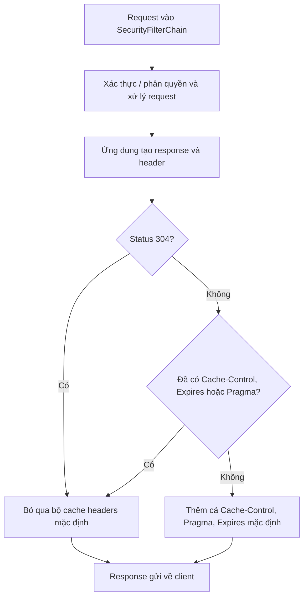

# CacheControlHeadersWriter và header do ứng dụng đã đặt

## Bối cảnh: Spring Security có ghi đè chính sách cache của ứng dụng không?

Một API trong Spring Security có thể trả hồ sơ cá nhân qua `GET /api/me`. Trong khi đó, cùng ứng dụng phục vụ tệp `/assets/app.1a2b.js`, có thể cache lâu vì tên tệp đã gắn dấu vân tay nội dung. Nếu áp một chính sách HTTP cache cho mọi URL, hoặc để nhiều lớp tự thay đổi header, kết quả có thể vừa làm giảm hiệu năng vừa tạo nguy cơ lưu và phát lại dữ liệu nhạy cảm.

Spring Security mặc định bổ sung bộ header chống cache nhằm bảo vệ nội dung người dùng. Tuy nhiên, **ứng dụng được phép chủ động đặt chính sách cache của chính mình**. Trong Servlet, thành phần đảm nhiệm quy tắc này là `CacheControlHeadersWriter`; trong Reactive, thành phần tương ứng là `CacheControlServerHttpHeadersWriter`.

Bài thuộc chương **Bộ nhớ đệm và MIME** của mô-đun **SPRING_SECURITY_HTTP_PROTECTION**, nơi người học cấu hình phòng vệ HTTP và trình duyệt cho cả Servlet/WebFlux, kiểm thử các đường truy cập và chẩn đoán xung đột khi triển khai. Trọng tâm ở đây là **quyền ưu tiên giữa header mặc định của Spring Security và header response đã có**, không phải thay thế các lớp bảo vệ CSRF, CORS, CSP, HSTS, firewall, session hoặc kiểm tra MIME.

Sau bài này, bạn có thể:

- Giải thích chức năng của `CacheControlHeadersWriter` và bộ header mà Spring Security cung cấp mặc định.
- Xác định chính xác khi nào **Servlet writer thêm header** và khi nào **bỏ qua toàn bộ bộ header cache**.
- Hiểu hậu quả của việc ứng dụng chỉ đặt `Cache-Control`, `Pragma` hoặc `Expires`.
- Chọn chính sách phù hợp cho response nhạy cảm, nội dung cá nhân hóa và tài nguyên công khai; không nhầm cache policy với authorization.
- Cấu hình Servlet/WebFlux, kiểm thử bằng MockMvc/WebTestClient và đo lại header qua CDN/gateway.

## 1. Bộ header mặc định của Spring Security

Khi tính năng HTTP security headers mặc định được bật và response chưa có chính sách cache do ứng dụng đặt, Spring Security cung cấp:

```http
Cache-Control: no-cache, no-store, max-age=0, must-revalidate
Pragma: no-cache
Expires: 0
```

| Header/chỉ thị | Ý nghĩa chính | Giới hạn |
| --- | --- | --- |
| `Cache-Control: no-store` | HTTP cache tuân thủ chuẩn không được lưu response. | Không tự xóa state JavaScript, `localStorage`, PWA `CacheStorage` hoặc mọi bản sao trước đây. |
| `Cache-Control: no-cache` | Nếu được phép lưu, phải revalidate trước khi dùng lại bản đã lưu. | **Không đồng nghĩa** với cấm lưu. |
| `max-age=0` | Không cho khoảng freshness dương. | Response vẫn có thể được lưu nếu không bị `no-store` cấm. |
| `must-revalidate` | Khi bản lưu stale, phải xác thực lại thành công trước khi tái sử dụng. | Không thay thế `no-store`. |
| `Pragma: no-cache` | Tương thích với hành vi cache cũ. | Ngữ nghĩa chuẩn trong RFC 9111 chủ yếu áp dụng cho **request**; response `Pragma` không phải cơ chế chống lưu chính. |
| `Expires: 0` | Giá trị ngày không hợp lệ được xử lý như thời điểm quá khứ, khiến bản lưu stale. | Không tự cấm lưu body. |

Mục tiêu là tránh một phản hồi nhạy cảm bị browser cache giữ lại và hiển thị khi người khác dùng lại máy sau khi người đầu tiên đăng xuất. Các header này không loại bỏ nhu cầu xác thực, phân quyền, hủy session và xử lý trạng thái ở client.

**Lưu ý:** Các header bảo vệ khác (`X-Content-Type-Options`, HSTS, `X-Frame-Options`...) là những writer riêng. Việc tùy chỉnh **cache writer** không đồng nghĩa vô hiệu hóa mọi HTTP security header.

## 2. `CacheControlHeadersWriter` nằm ở đâu trong Servlet?

Tên đầy đủ của class:

```java
org.springframework.security.web.header.writers.CacheControlHeadersWriter
```

Nó thực thi giao diện `HeaderWriter` và được cấu hình trong cơ chế security header của `HttpSecurity`, thường qua `HeadersWriterFilter`. Về mặt thiết kế, response từ servlet/controller có thể đặt header trước; Spring Security xem phản hồi tại thời điểm header writer hoạt động và chỉ bổ sung bộ mặc định nếu chưa có dấu hiệu ứng dụng tự quản lý cache.



Sơ đồ mô tả **điều kiện quyết định** của `CacheControlHeadersWriter` (Servlet), không khẳng định mọi filter hay handler luôn chạy theo một trình tự tuyến tính. Trên thực tế, servlet response có thể được commit ở nhiều vị trí, nên thứ tự filter và thời điểm ghi header vẫn cần xem xét.

### 2.1. Điểm dễ bỏ sót: chỉ cần **một** trong ba header đã có

Ở mã nguồn `CacheControlHeadersWriter` của Spring Security hiện hành, writer sẽ **bỏ qua** việc chèn toàn bộ bộ header mặc định nếu **bất kỳ** điều kiện nào đúng:

- Response đã có `Cache-Control`.
- Response đã có `Expires`.
- Response đã có `Pragma`.
- Status response là `304 Not Modified`.

Đây là kiểm tra **sự hiện diện của header**, không phải kiểm tra header đó có **an toàn** hoặc **đầy đủ** hay không. Writer không xem `Cache-Control: public` là “nguy hiểm” rồi tự thay bằng `no-store`; ứng dụng đã đặt gì thì chính sách đó cần được ứng dụng chịu trách nhiệm.

Có thể hình dung logic Servlet ở dạng mã giả độc lập:

```java
// Minh họa quyết định, không phải mã sao chép từ thư viện:
if (status == 304 || has("Cache-Control")
        || has("Expires") || has("Pragma")) {
    return; // Không thêm cả bộ mặc định
}
writeDefaultCacheControlPragmaExpires();
```

Kết quả trong các trường hợp điển hình:

| Response **trước khi** cache writer xử lý | Cache writer Servlet làm gì? | Điều cần chú ý |
| --- | --- | --- |
| `200`, không có `Cache-Control`/`Expires`/`Pragma` | Thêm đủ **ba header mặc định**. | Dữ liệu được bảo vệ bằng `no-store` nếu không có tầng sau ghi đè. |
| `200`, đã có `Cache-Control: no-store` | Không thêm `Pragma` hay `Expires`. | `no-store` đủ cho HTTP cache hiện đại; muốn tương thích legacy thì tự đặt đủ header có chủ đích. |
| `200`, đã có `Cache-Control: public, max-age=3600` | Không thêm bộ chống cache. | Chỉ phù hợp với nội dung công khai, không dùng cho dữ liệu theo tài khoản. |
| `200`, chỉ có `Pragma: no-cache` | Không thêm `Cache-Control` hay `Expires`. | **Nguy cơ cấu hình thiếu:** response `Pragma` không có ngữ nghĩa cấm lưu chuẩn. |
| `200`, chỉ có `Expires: 0` | Không thêm `Cache-Control` hay `Pragma`. | Bản lưu có thể stale nhưng vẫn được lưu. |
| `200`, chỉ có `ETag` hoặc `Last-Modified` | Có thể thêm bộ cache mặc định. | Validator đơn lẻ **không** báo rằng ứng dụng đã đặt chính sách cache. |
| `304 Not Modified`, không có cả ba header | Không thêm bộ mặc định. | Kiểm tra chính sách của bản đã lưu và header trên luồng `200`/`304` tương ứng. |
| `200`, chỉ có `Content-Type`, `CSP` hoặc HSTS | Thêm bộ cache mặc định. | Các header khác không ảnh hưởng điều kiện này. |

Một hiểu lầm thường gặp là “Spring Security thấy `Expires: 0` sẽ chỉ bổ sung `Cache-Control` còn thiếu”. Với Servlet writer nêu trên, **nó bỏ qua cả bộ**, vì coi response đã do ứng dụng chủ động quản lý cache. Vì vậy, kiểm thử chỉ sự hiện diện của `Pragma` hoặc `Expires` là không đủ.

### 2.2. `304` là trường hợp đặc biệt

Với response `304 Not Modified`, `CacheControlHeadersWriter` của Servlet không tự thêm bộ chống cache mặc định. Điều này phù hợp với mục tiêu cho phép cơ chế **conditional GET** được thiết kế đúng phát huy tác dụng.

Nhưng **bỏ qua header writer không có nghĩa xóa các header đã tồn tại**: nếu ứng dụng đã đặt `Cache-Control` thì policy đó vẫn phải được xem xét. `304` không có body; một cache có thể dùng lại **body đã lưu trước đây** sau khi revalidation thành công. Với nội dung theo người dùng, origin phải **xác thực và phân quyền người gọi hiện tại trước khi trả `304`**, đồng thời giữ metadata cache hợp lệ cho biểu diễn tương ứng.

Ví dụ luồng hợp lệ cho tùy chọn giao diện ít nhạy cảm:

```http
HTTP/1.1 200 OK
Cache-Control: private, no-cache
ETag: "prefs-17"
Content-Type: application/json

{"theme":"dark"}
```

Ở lượt tiếp theo, nếu vẫn có quyền và dữ liệu không đổi:

```http
GET /api/preferences HTTP/1.1
If-None-Match: "prefs-17"
Cookie: JSESSIONID=<test-session>
```

```http
HTTP/1.1 304 Not Modified
Cache-Control: private, no-cache
ETag: "prefs-17"
```

Thực tế `304` có thêm các header được RFC 9110 quy định khi thích hợp. Không được trả `304` chỉ vì ETag trùng nếu session đã hết hạn, tài khoản đổi hoặc quyền xem đã bị thu hồi. Với dữ liệu bí mật dùng `no-store`, đừng dựa vào việc tái sử dụng bản lưu bằng ETag.

## 3. Header do ứng dụng đặt: `setHeader`, `addHeader` và `ResponseEntity`

### 3.1. Đặt chính sách cho một response

Trong Servlet, ứng dụng có thể dùng:

```java
response.setHeader("Cache-Control", "no-store");
```

Nếu câu lệnh này chạy trước lúc cache writer quyết định, writer nhận thấy response đã có `Cache-Control` và **không thêm** bộ mặc định. Sau đó response thường chỉ còn `Cache-Control: no-store` trong nhóm ba header cache, trừ khi lớp khác đã thêm chúng.

Tương tự, khi controller Spring MVC trả `ResponseEntity`:

```java
import org.springframework.http.CacheControl;
import org.springframework.http.ResponseEntity;

// Tại controller đã được bảo vệ bằng authentication/authorization:
return ResponseEntity.ok()
    .cacheControl(CacheControl.noStore())
    .body(accountDto);
```

`CacheControl.noStore()` tạo `Cache-Control: no-store`. Đây là cách chọn chính sách rõ ràng cho response nhạy cảm, không cần tắt cơ chế security headers mặc định. Đối với endpoint phục vụ file tĩnh, `CacheControl.maxAge(...)` có thể chỉ định cache công khai có thời hạn.

### 3.2. Đặt đủ bộ header nếu hệ thống cần tương thích cũ

Khi vẫn phải hỗ trợ proxy/client cũ và muốn cung cấp cả ba header, ứng dụng có thể chủ động phát:

```java
return ResponseEntity.ok()
    .header(HttpHeaders.CACHE_CONTROL,
            "no-cache, no-store, max-age=0, must-revalidate")
    .header(HttpHeaders.PRAGMA, "no-cache")
    .header(HttpHeaders.EXPIRES, "0")
    .body(accountDto);
```

`HttpHeaders` ở đây là `org.springframework.http.HttpHeaders`. Cách viết này minh họa chính sách đầy đủ; nếu Spring Security đã làm đúng việc và ứng dụng không ghi đè, không cần lặp lại ở mọi controller. Hãy dùng chính sách nhất quán và tập trung để tránh hai nguồn cùng quản lý header.

### 3.3. Không dùng `addHeader` để chồng chính sách mâu thuẫn

Hai phương thức servlet response khác nhau:

```java
response.setHeader("Cache-Control", "no-store");
response.addHeader("Cache-Control", "public, max-age=600");
```

`setHeader` **thay** những giá trị trước của header cùng tên; `addHeader` **bổ sung** giá trị. Kết quả có thể tạo nhiều giá trị `Cache-Control` mâu thuẫn. Các cache và proxy có thể kết hợp hoặc diễn giải các giá trị theo quy tắc riêng; đừng coi việc có chữ `no-store` trong một giá trị đồng nghĩa cấu hình cuối chắc chắn an toàn.

Nếu cần đổi policy do một filter khác đặt, phải xác định **thành phần sở hữu header cuối cùng** và dùng cơ chế thay thế nhất quán. Không viết filter “vá” bằng cách thêm `public` vào response đã có `no-store`. Cũng không viết filter “vá” bằng cách thêm `Pragma: no-cache` rồi tin writer sẽ tự điền phần còn lại.

### 3.4. Header ở application và header sau reverse proxy

Một response ở origin có thể là:

```http
Cache-Control: no-store
```

nhưng ở CDN lại thành:

```http
Cache-Control: public, max-age=600
```

Bộ header của Spring Security không bảo vệ response nếu một gateway/edge **sửa** header sau khi ứng dụng đã trả, hoặc tự buộc cache dữ liệu riêng theo URL. Luôn so sánh tại origin và đường truy cập ngoài Internet/corporate network, nhất là với `/api/me`, bảng lương, hóa đơn, token và HTML trang đăng nhập.

## 4. Quy tắc sở hữu header nên thiết kế thế nào?

Một chính sách phù hợp bắt đầu từ độ nhạy của dữ liệu và đối tượng được phép xem:

| Nhóm tài nguyên | `Cache-Control` gợi ý | Ai nên sở hữu chính sách? |
| --- | --- | --- |
| Hồ sơ, số dư, hóa đơn, trang tài khoản, response có token | `no-store` | Controller/filter chính sách chung; giữ mặc định Spring Security khi không cần ngoại lệ. |
| Tùy chọn giao diện riêng ít nhạy cảm, cho phép browser lưu | `private, no-cache` | Handler/service rõ ràng; revalidation phải đi sau kiểm tra quyền. |
| Cấu hình cá nhân ít nhạy cảm, chấp nhận cũ trong thời gian ngắn | `private, max-age=60` *(ví dụ)* | Nhóm API chịu trách nhiệm chấp nhận độ trễ sau thay đổi quyền. |
| CSS/JS/ảnh tĩnh có tên hash nội dung | `public, max-age=31536000` | Static resource handler hoặc gateway, không áp dụng cho HTML có đăng nhập. |
| API danh mục công khai | `public, max-age=300` *(ví dụ)* | Endpoint công khai và CDN có quy tắc tương ứng. |
| `304` của tài nguyên được phép cache | Theo policy `200` tương ứng | Controller/lớp xử lý conditional request, sau kiểm tra quyền. |

**Nguyên tắc bảo mật:** `Cache-Control` điều khiển khả năng lưu và dùng lại HTTP response. Nó **không** là authorization. Với shared cache, hãy bảo đảm proxy/CDN không trả một bản cache cá nhân hóa của người A cho người B. `Vary: Cookie` có thể phân biệt biến thể nhưng không thay `no-store`, `private` hay phân quyền. `Pragma: no-cache` và `Expires: 0` cũng không thay cho `no-store`.

## 5. Ví dụ đầy đủ trong Spring MVC (Servlet)

Một ứng dụng đơn giản cần chặn `/api/me` nếu chưa đăng nhập; controller đặt `no-store`. Tệp tĩnh đã hash được phép cache dài hạn.

### 5.1. Giữ cache writer mặc định

```java
import org.springframework.context.annotation.Bean;
import org.springframework.context.annotation.Configuration;
import org.springframework.security.config.annotation.web.builders.HttpSecurity;
import org.springframework.security.web.SecurityFilterChain;

@Configuration
class ServletSecurityConfig {

    @Bean
    SecurityFilterChain securityFilterChain(HttpSecurity http) throws Exception {
        http.authorizeHttpRequests(auth -> auth
            .requestMatchers("/api/me").authenticated()
            .anyRequest().permitAll());

        // Không disable cacheControl; giữ security headers mặc định.
        return http.build();
    }
}
```

Đây là cấu hình cho Spring Security sử dụng DSL `SecurityFilterChain` hiện đại. Trong ứng dụng thật, xác thực, CSRF, session, CORS và các chính sách khác phải được cấu hình theo nhu cầu. Bảo vệ URL là điều kiện bắt buộc trước khi controller sử dụng thông tin tài khoản.

### 5.2. Ghi `no-store` từ controller

```java
import java.util.Map;

import org.springframework.http.CacheControl;
import org.springframework.http.ResponseEntity;
import org.springframework.security.core.Authentication;
import org.springframework.web.bind.annotation.GetMapping;
import org.springframework.web.bind.annotation.RestController;

@RestController
class AccountServletController {

    @GetMapping("/api/me")
    ResponseEntity<Map<String, String>> me(Authentication authentication) {
        return ResponseEntity.ok()
            .cacheControl(CacheControl.noStore())
            .body(Map.of("user", authentication.getName()));
    }
}
```

Response thành công có `Cache-Control: no-store`. Đây là giá trị ứng dụng đã đặt, nên **không giả định** Spring Security còn thêm `Pragma`/`Expires`. Nếu controller không đặt nhóm header cache, bộ mặc định của Spring Security thường xuất hiện với đầy đủ ba header.

### 5.3. Cache có chủ đích cho tài nguyên tĩnh

```java
import java.time.Duration;

import org.springframework.context.annotation.Configuration;
import org.springframework.http.CacheControl;
import org.springframework.web.servlet.config.annotation.ResourceHandlerRegistry;
import org.springframework.web.servlet.config.annotation.WebMvcConfigurer;

@Configuration
class AssetsConfig implements WebMvcConfigurer {

    @Override
    public void addResourceHandlers(ResourceHandlerRegistry registry) {
        registry.addResourceHandler("/assets/**")
            .addResourceLocations("classpath:/static/assets/")
            .setCacheControl(
                CacheControl.maxAge(Duration.ofDays(365)).cachePublic());
    }
}
```

Chỉ dùng quy tắc dài hạn nếu **tên tệp thay đổi khi nội dung thay đổi** (ví dụ `app.82ad14.js`). Đừng cho phép file chứa thông tin cá nhân được phục vụ từ đường dẫn này. Mã trên đặt `Cache-Control` cho resource handler; nó **không tự bảo đảm** các gateway downstream tôn trọng policy và cũng không tự cấp mọi header tương thích HTTP cũ.

### 5.4. Khi nào cần disable `CacheControlHeadersWriter`?

Nếu một hệ thống chủ động quản lý **tất cả** chính sách cache bằng filter hoặc gateway đáng tin cậy, có thể tắt riêng writer của Spring Security:

```java
http.headers(headers -> headers
    .cacheControl(cache -> cache.disable()));
```

Điều này **khác** với:

```java
http.headers(headers -> headers.disable());
```

Dòng đầu tắt riêng writer cache mặc định. Dòng thứ hai tắt **toàn bộ cơ chế security headers qua config đó**, có thể ảnh hưởng các phòng vệ khác như `nosniff` hoặc HSTS. Không tắt toàn bộ chỉ để cache CSS/JS. Khi tắt riêng writer cache, phải chủ động bao phủ response thành công, lỗi, redirect và các route không đi qua controller thông thường.

## 6. Tương ứng trong Spring WebFlux (Reactive)

Ở Reactive, Spring Security sử dụng class:

```java
org.springframework.security.web.server.header.CacheControlServerHttpHeadersWriter
```

Class này thực thi `ServerHttpHeadersWriter` và cung cấp cùng **bộ header chống cache mặc định**. Tài liệu Spring Security cũng cho phép ứng dụng chủ động gắn header vào `ServerHttpResponse` để quản lý việc cache, chẳng hạn cho CSS/JS. Logic cụ thể khi phát hiện header có trước và thời điểm response commit nên được kiểm tra theo **phiên bản Spring Security đang triển khai**. Bảng điều kiện `Pragma`/`Expires`/`304` ở mục 2 là chi tiết đã xác nhận từ **Servlet** `CacheControlHeadersWriter`, không tự suy rộng nguyên xi cho mọi phiên bản WebFlux.

### 6.1. Giữ security header mặc định trong WebFlux

```java
import org.springframework.context.annotation.Bean;
import org.springframework.context.annotation.Configuration;
import org.springframework.security.config.annotation.web.reactive.EnableWebFluxSecurity;
import org.springframework.security.config.web.server.ServerHttpSecurity;
import org.springframework.security.web.server.SecurityWebFilterChain;

@Configuration
@EnableWebFluxSecurity
class ReactiveSecurityConfig {

    @Bean
    SecurityWebFilterChain filterChain(ServerHttpSecurity http) {
        return http.authorizeExchange(auth -> auth
                .pathMatchers("/api/me").authenticated()
                .anyExchange().permitAll())
            .build();
    }
}
```

### 6.2. Ứng dụng tự đặt Cache-Control trên reactive response

```java
import java.security.Principal;
import java.util.Map;

import reactor.core.publisher.Mono;

import org.springframework.http.CacheControl;
import org.springframework.http.ResponseEntity;
import org.springframework.web.bind.annotation.GetMapping;
import org.springframework.web.bind.annotation.RestController;

@RestController
class AccountReactiveController {

    @GetMapping("/api/me")
    Mono<ResponseEntity<Map<String, String>>> me(Mono<Principal> principal) {
        return principal.map(p -> ResponseEntity.ok()
            .cacheControl(CacheControl.noStore())
            .body(Map.of("user", p.getName())));
    }
}
```

Ví dụ này **thay thế** controller Servlet ở mục 5, không sử dụng đồng thời cả hai controller cho cùng endpoint. Với WebFlux, cũng có thể đặt header trên `ServerResponse` (functional endpoint) hoặc `ServerHttpResponse`; phải làm trước khi response commit. Đặt `CacheControl.noStore()` qua `ResponseEntity` giúp giữ cú pháp nhất quán giữa hai stack.

Để tắt **riêng** cache writer Reactive khi thật sự cần:

```java
http.headers(headers -> headers
    .cache(cache -> cache.disable()));
```

Đừng nhầm DSL: Servlet dùng `cacheControl(...)`, Reactive dùng `cache(...)`.

## 7. Kiểm thử trực tiếp `CacheControlHeadersWriter` (Servlet)

Kiểm thử nhỏ với `MockHttpServletResponse` giúp xác nhận **chính cơ chế writer**, không phụ thuộc controller, CDN hay cấu hình Spring Boot. Đoạn sau minh họa JUnit 5 và Spring Test:

```java
import static org.junit.jupiter.api.Assertions.*;

import org.junit.jupiter.api.Test;
import org.springframework.http.HttpHeaders;
import org.springframework.mock.web.MockHttpServletRequest;
import org.springframework.mock.web.MockHttpServletResponse;
import org.springframework.security.web.header.writers.CacheControlHeadersWriter;

class CacheControlHeadersWriterTest {

    private final CacheControlHeadersWriter writer =
        new CacheControlHeadersWriter();

    private MockHttpServletResponse apply(MockHttpServletResponse response) {
        writer.writeHeaders(new MockHttpServletRequest(), response);
        return response;
    }

    @Test
    void addsDefaultsWhenNoCacheHeadersExist() {
        MockHttpServletResponse result =
            apply(new MockHttpServletResponse());

        assertTrue(result.getHeader(HttpHeaders.CACHE_CONTROL)
            .contains("no-store"));
        assertEquals("no-cache", result.getHeader(HttpHeaders.PRAGMA));
        assertEquals("0", result.getHeader(HttpHeaders.EXPIRES));
    }

    @Test
    void preservesApplicationCacheControlWithoutAddingLegacyHeaders() {
        MockHttpServletResponse response = new MockHttpServletResponse();
        response.setHeader(HttpHeaders.CACHE_CONTROL, "private, max-age=60");

        MockHttpServletResponse result = apply(response);

        assertEquals("private, max-age=60",
            result.getHeader(HttpHeaders.CACHE_CONTROL));
        assertNull(result.getHeader(HttpHeaders.PRAGMA));
        assertNull(result.getHeader(HttpHeaders.EXPIRES));
    }

    @Test
    void presenceOfPragmaAloneSuppressesDefaultTrio() {
        MockHttpServletResponse response = new MockHttpServletResponse();
        response.setHeader(HttpHeaders.PRAGMA, "no-cache");

        MockHttpServletResponse result = apply(response);

        assertNull(result.getHeader(HttpHeaders.CACHE_CONTROL));
        assertNull(result.getHeader(HttpHeaders.EXPIRES));
        assertEquals("no-cache", result.getHeader(HttpHeaders.PRAGMA));
    }

    @Test
    void presenceOfExpiresAloneSuppressesDefaultTrio() {
        MockHttpServletResponse response = new MockHttpServletResponse();
        response.setHeader(HttpHeaders.EXPIRES, "0");

        MockHttpServletResponse result = apply(response);

        assertNull(result.getHeader(HttpHeaders.CACHE_CONTROL));
        assertNull(result.getHeader(HttpHeaders.PRAGMA));
        assertEquals("0", result.getHeader(HttpHeaders.EXPIRES));
    }

    @Test
    void notModifiedDoesNotGainDefaultHeaders() {
        MockHttpServletResponse response = new MockHttpServletResponse();
        response.setStatus(304);

        MockHttpServletResponse result = apply(response);

        assertNull(result.getHeader(HttpHeaders.CACHE_CONTROL));
        assertNull(result.getHeader(HttpHeaders.PRAGMA));
        assertNull(result.getHeader(HttpHeaders.EXPIRES));
    }
}
```

Đây là unit test cho hành vi của `CacheControlHeadersWriter` đã nêu; khi nâng cấp thư viện, có thể dùng nó như **kiểm thử hồi quy** cho ứng dụng phụ thuộc vào điều kiện bỏ qua. Test không xác nhận rằng browser/CDN có lưu dữ liệu hay không và không thay thế kiểm thử tích hợp filter chain.

Nếu dùng version khác và test không còn đúng, cần kiểm tra tài liệu/source code của **version đang chạy**, sau đó sửa chính sách ứng dụng theo hành vi thực tế; không vội tắt toàn bộ security headers để làm test xanh.

## 8. Kiểm thử tích hợp Servlet và Reactive

### 8.1. MockMvc: xác nhận header cuối của endpoint

Ví dụ trích đoạn trong test có `MockMvc` đã gắn Spring Security test support:

```java
import static org.hamcrest.Matchers.containsString;
import static org.springframework.security.test.web.servlet.request
    .SecurityMockMvcRequestPostProcessors.user;
import static org.springframework.test.web.servlet.request
    .MockMvcRequestBuilders.get;
import static org.springframework.test.web.servlet.result
    .MockMvcResultMatchers.*;

import org.springframework.http.HttpHeaders;

// Test /api/me được xác thực bằng mock user.
mvc.perform(get("/api/me").with(user("alice")))
    .andExpect(status().isOk())
    .andExpect(header().string(
        HttpHeaders.CACHE_CONTROL, containsString("no-store")))
    .andExpect(jsonPath("$.user").value("alice"));
```

Trên application có endpoint mặc định **không tự đặt header cache**, có thể bổ sung test kỳ vọng đủ ba header `Cache-Control`, `Pragma`, `Expires`; nếu endpoint **đã đặt** `Cache-Control` riêng thì test phải phản ánh chính sách đó, tránh kỳ vọng cả ba header một cách vô điều kiện.

### 8.2. WebTestClient: kiểm tra response WebFlux

Với test client đã bind application context và áp dụng `springSecurity()` từ `spring-security-test`:

```java
// mockUser import từ:
// SecurityMockServerConfigurers.mockUser

client.mutateWith(mockUser("alice"))
    .get().uri("/api/me")
    .exchange()
    .expectStatus().isOk()
    .expectHeader().valueMatches(
        "Cache-Control", ".*no-store.*")
    .expectBody().jsonPath("$.user").isEqualTo("alice");
```

Test phản ánh policy do controller/WebFlux security pipeline cuối cùng trả, thay vì giả định chi tiết Servlet writer. Cần thiết lập `WebTestClient.bindToApplicationContext(context).apply(springSecurity()).configureClient().build()` hoặc cơ chế tương ứng với stack đang dùng.

### 8.3. Kiểm thử HTTP thực qua proxy/CDN

Dùng credential của môi trường thử nghiệm và yêu cầu GET thật:

```bash
curl -sS -D - -o /dev/null \
  -H 'Authorization: Bearer <test-token>' \
  'https://app.example.com/api/me'
```

Xem `Cache-Control`, `Pragma`, `Expires`, `Age` và các header của proxy/CDN như `Via`, `X-Cache` nếu được cung cấp. So sánh **cùng request** ở origin và ở edge. `curl` không tự mô phỏng đầy đủ browser cache.

Các kiểm thử nên bao gồm:

1. Alice gọi `GET /api/me` rồi Bob gọi **cùng URL** qua CDN: tuyệt đối không thấy dữ liệu Alice ở response của Bob.
2. Đăng xuất, đổi tài khoản, Back/Forward, mở tab khác và thử lại trên cùng thiết bị.
3. Tạo response có **chỉ `Pragma`** hoặc **chỉ `Expires`** ở môi trường kiểm thử để phát hiện ứng dụng vô tình bỏ qua `Cache-Control` an toàn.
4. Kiểm tra endpoint cho cache công khai có `Cache-Control: public, max-age=...` sau security filter và gateway.
5. Với endpoint dùng ETag, thử `304` sau khi quyền truy cập bị thu hồi; server phải áp dụng xác thực/phân quyền trước khi chấp thuận dùng bản lưu.

Chỉ khi đo trên đường đi thật mới có cơ sở xác nhận cấu hình edge không làm mất tác dụng của chính sách tại origin.

## 9. Chẩn đoán lỗi thực tế

| Triệu chứng | Lý do có thể | Hướng xử lý |
| --- | --- | --- |
| Chỉ thấy `Pragma: no-cache`, không có `Cache-Control` | Ứng dụng hoặc filter đã đặt `Pragma`, Servlet writer bỏ qua cả bộ. | Đặt `Cache-Control: no-store` cho endpoint nhạy cảm, sửa nơi phát `Pragma` đơn lẻ. |
| Chỉ thấy `Expires: 0`, không có `no-store` | `Expires` có sẵn khiến Servlet writer bỏ qua mặc định. | Cấu hình bộ header đúng từ nguồn sở hữu chính sách. |
| Header `Cache-Control: public` tồn tại trên API riêng | Controller, resource handler hoặc proxy đã phát policy không phù hợp. | Chuyển API riêng về `no-store`; kiểm tra edge bypass. |
| Thấy `Cache-Control: no-store` nhưng thiếu `Pragma`/`Expires` | Ứng dụng đặt một header riêng, writer không thêm phần còn lại. | Không phải lỗi với HTTP cache hiện đại; chỉ thêm legacy headers nếu thật sự cần và có chính sách rõ. |
| Tài nguyên tĩnh không được cache dù đã cấu hình MVC | Resource handler chưa thực sự xử lý URL, filter/gateway ghi đè hoặc asset bị trả từ nhánh khác. | Kiểm tra handler mapping, header tại origin/edge và đường dẫn tài nguyên. |
| Response có nhiều giá trị `Cache-Control` mâu thuẫn | Nhiều tầng dùng `addHeader` hoặc thêm header trùng. | Xác định tầng sở hữu; thay thế policy một lần, tránh chồng giá trị. |
| `304` không có bộ header chống cache mặc định | Servlet writer chủ động bỏ qua status `304`. | Đọc luồng `200` và `304` cùng tài nguyên, kiểm tra validator và phân quyền. |
| Header khi test MockMvc khác browser | Security filter chưa được gắn trong test hoặc reverse proxy đổi header ở production. | Test với Spring Security filter chain, sau đó so origin và edge. |
| Chỉ disable cache writer nhưng response vẫn có `Cache-Control` | Controller, resource handler hoặc proxy tự đặt. | Tìm nguồn phát header còn lại; disable writer không xóa header đã có. |
| Sau logout vẫn xem được dữ liệu cũ qua Back | HTTP cache cũ, bfcache, state SPA, service worker hoặc lỗi hủy session. | Kiểm tra quyền, xóa state nhạy cảm, áp dụng `no-store` và kiểm thử trình duyệt thực. |

Một cách điều tra thực dụng là theo dõi một response từ **controller → Spring Security writer → gateway → CDN → browser**. Ghi lại status, các header cache, danh tính thử nghiệm và response body phù hợp. Khi hai điểm khác nhau, truy ngược cấu hình filter, interceptor hoặc edge rule được áp dụng tại điểm đó.

## 10. Bài thực hành

Ứng dụng Spring Security đang có ba endpoint:

- `GET /api/account/me` trả hồ sơ theo người dùng.
- `GET /api/preferences` trả giao diện ưa thích, không chứa dữ liệu nhạy cảm, chấp nhận lưu ở private cache.
- `GET /assets/main.28af3d.js` trả JS công khai có tên hash.

Một filter cũ đã viết:

```java
response.setHeader("Pragma", "no-cache");
```

trên mọi response. Nhóm phát triển cho rằng Spring Security sẽ tự bổ sung `Cache-Control: no-store` vào các response còn lại.

**Yêu cầu thực hành:**

1. Dựa vào điều kiện của `CacheControlHeadersWriter` Servlet, giải thích giả định trên đúng hay sai và vì sao.
2. Đề xuất chính sách cho cả ba endpoint, làm rõ endpoint nào cần `no-store`, endpoint nào có thể `private, no-cache`, endpoint nào có thể `public, max-age`.
3. Viết hoặc sửa MockMvc test để xác nhận trường hợp **chỉ có `Pragma`** khiến writer bỏ qua cả bộ mặc định.
4. Kiểm tra response `304` của `/api/preferences` có validator đúng biểu diễn và việc kiểm tra quyền được thực hiện trước khi tái sử dụng nội dung đã lưu.
5. Thực hiện GET với hai tài khoản qua CDN; so sánh header/body với origin và xác định điểm ghi đè nếu có.

**Định hướng đáp án:** Giả định sai vì sự hiện diện của `Pragma` cũng khiến Servlet writer bỏ qua. Hồ sơ dùng `Cache-Control: no-store`; preferences có thể dùng `private, no-cache` nếu phù hợp rủi ro và luôn xác thực lại trước khi dùng; JS có hash dùng `public` với thời gian cache dài. Loại filter legacy hoặc sửa nó thành nơi phát policy hoàn chỉnh theo loại tài nguyên, đồng thời bảo đảm header của endpoint cá nhân hóa không bị gateway/CDN ghi đè. Kiểm thử unit writer xác định hành vi code; kiểm thử end-to-end xác định dữ liệu không bị phát lại sang tài khoản khác.

## Tài liệu tham khảo

- [Spring Security — HTTP Response Headers](https://docs.spring.io/spring-security/reference/features/exploits/headers.html): bộ cache headers mặc định, nguyên tắc ưu tiên header do ứng dụng đặt.
- [Spring Security — Servlet HTTP Response Headers](https://docs.spring.io/spring-security/reference/servlet/exploits/headers.html): sử dụng `HttpServletResponse.setHeader` và tùy chỉnh `cacheControl`.
- [Spring Security — Reactive HTTP Response Headers](https://docs.spring.io/spring-security/reference/reactive/exploits/headers.html): writer tương ứng và cấu hình `cache` trong `ServerHttpSecurity`.
- [Javadoc — CacheControlHeadersWriter](https://docs.spring.io/spring-security/reference/api/java/org/springframework/security/web/header/writers/CacheControlHeadersWriter.html): class, giao diện `HeaderWriter`, bộ header được thêm.
- [Mã nguồn CacheControlHeadersWriter — Spring Security](https://github.com/spring-projects/spring-security/blob/main/web/src/main/java/org/springframework/security/web/header/writers/CacheControlHeadersWriter.java): điều kiện kiểm tra `Cache-Control`, `Expires`, `Pragma` và status `304` (xác minh thêm với phiên bản đang sử dụng).
- [Javadoc — CacheControlServerHttpHeadersWriter](https://docs.spring.io/spring-security/reference/api/java/org/springframework/security/web/server/header/CacheControlServerHttpHeadersWriter.html): writer cache cho Reactive.
- [Spring Framework — HTTP Caching in MVC](https://docs.spring.io/spring-framework/reference/web/webmvc/mvc-caching.html): `CacheControl`, `ResponseEntity`, ETag và tài nguyên tĩnh.
- [RFC 9111 — HTTP Caching](https://www.rfc-editor.org/rfc/rfc9111.html): cơ chế store/reuse, `no-store`, `no-cache`, shared/private cache.
- [RFC 9110 — HTTP Semantics](https://www.rfc-editor.org/rfc/rfc9110.html): `304 Not Modified` và validator.
