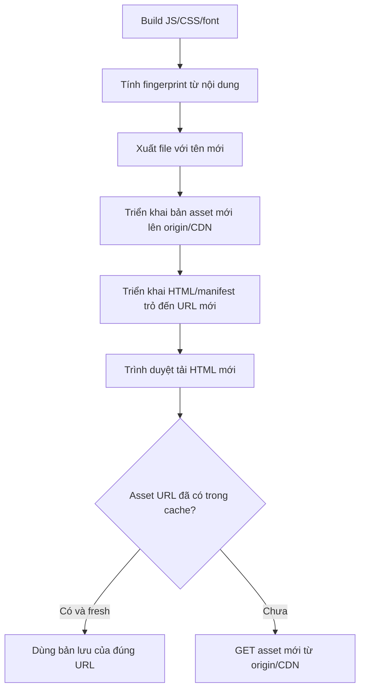
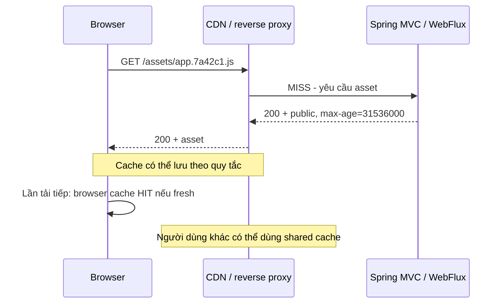

# Tài nguyên tĩnh được cache với chính sách riêng

## Bối cảnh và mục tiêu

Một ứng dụng Spring Security có thể trả về hai loại nội dung hoàn toàn khác nhau:

- `GET /api/account/me` trả tên, địa chỉ và trạng thái tài khoản của người đang đăng nhập.
- `GET /assets/app.7a42c1.js` trả file JavaScript công khai, có tên chứa dấu vân tay của nội dung.

Cả hai đều là HTTP response, nhưng **không nên dùng cùng chính sách cache**. Với dữ liệu tài khoản, ưu tiên tránh lưu và phát lại ngoài ý muốn; với JavaScript/CSS/ảnh đã công khai và có thể xác định phiên bản, cache dài hạn giúp giảm độ trễ, tiết kiệm băng thông, giảm tải máy chủ.

Spring Security có cơ chế mặc định nhằm ngăn cache những phản hồi nhạy cảm. Spring Framework đồng thời cho phép ứng dụng **đặt `Cache-Control` riêng cho tài nguyên tĩnh**, trên cả Spring MVC (Servlet) và Spring WebFlux (Reactive). Việc kết hợp đúng hai tính năng là chủ đề của bài này.

Bài thuộc chương **Bộ nhớ đệm và MIME**, mô-đun **SPRING_SECURITY_HTTP_PROTECTION**. Mô-đun nghiên cứu các lớp phòng vệ HTTP và trình duyệt trong Spring Security, gồm CSRF, CORS, security headers, CSP, HSTS, HTTP firewall và quản lý session. Ở đây, trọng tâm là **cache tài nguyên tĩnh công khai nhưng vẫn bảo vệ dữ liệu theo người dùng**, kiểm thử qua browser/CDN và đảm bảo MIME chính xác để các lớp phòng vệ hoạt động đúng.

Sau bài này, bạn có thể:

1. Phân biệt tài nguyên tĩnh **công khai, bất biến** với tài nguyên có URL ổn định nhưng nội dung thay đổi và với nội dung riêng tư.
2. Thiết kế hai chiến lược: **file có tên chứa hash + cache dài hạn** và **URL không đổi + cache ngắn hạn hoặc revalidation**.
3. Cấu hình resource handler cho Spring MVC/WebFlux mà vẫn giữ các security headers mặc định của Spring Security.
4. Hiểu URL versioning, `ETag`, `Last-Modified`, `304`, tác động của CDN và điều kiện an toàn của `public`.
5. Kiểm thử header, status, MIME và nguy cơ áp sai policy cho các endpoint cần xác thực.

## 1. “Tài nguyên tĩnh” không tự động đồng nghĩa “được cache công khai”

Trong ứng dụng web, static resources thường là file được phục vụ trực tiếp thay vì tính toán nội dung cho mỗi request: JavaScript, CSS, font, icon, logo, ảnh thiết kế, tài liệu công khai hoặc file trong `classpath:/static`. Tuy nhiên, chữ *tĩnh* chỉ mô tả cách lưu và phục vụ file, **không phải phân loại bảo mật**.

Ví dụ:

| URL | Bản chất | Có thể cache dùng chung? |
| --- | --- | --- |
| `/assets/app.a4b91e.js` | Bundle JS công khai; thay đổi tên khi bytes thay đổi | **Có**, cache dài hạn khi đã xác thực đúng cách phát hành |
| `/assets/theme.8cfe92.css` | CSS công khai và có hash | **Có**, cache dài hạn |
| `/assets/logo.svg` | Logo công khai, đường dẫn cố định | Có, nhưng cần thời hạn phù hợp vì URL có thể giữ nguyên khi logo đổi |
| `/public/help.html` | Hướng dẫn công khai, cập nhật bằng URL cũ | Có, thường cache ngắn hoặc phải revalidate |
| `/private/customer/42/report.pdf` | File đã tạo sẵn nhưng chỉ một khách hàng được phép xem | **Không** nên cache công khai; thường `no-store` |
| `/avatars/me.jpg` | Ảnh có URL chung, phụ thuộc danh tính đang đăng nhập | Không dùng shared cache theo URL; cân nhắc `no-store` hoặc `private` theo rủi ro |
| `/dashboard` | HTML trang đã đăng nhập | Thường `no-store`, ngay cả khi HTML được tạo từ template |
| `/index.html` | HTML entry point công khai của SPA | Có thể cache, nhưng thường revalidate hoặc TTL ngắn để nhận manifest/asset mới |

**Quy tắc ra quyết định:** Trước khi dùng `Cache-Control: public`, phải trả lời được: “Nếu người chưa đăng nhập, hoặc người dùng hoàn toàn khác, nhận chính xác bytes này thì có an toàn không?” Nếu không, đừng xếp response vào nhóm asset công khai.

Ngay cả file nằm trong thư mục `static` cũng có thể làm lộ dữ liệu khi bị đóng gói nhầm: ví dụ file cấu hình chứa secret, bản dump JSON của người dùng hoặc tài liệu nội bộ. Cache policy **không sửa được sai sót xuất bản dữ liệu**; cần loại file nhạy cảm khỏi gói phát hành.

## 2. Đọc đúng chỉ thị `Cache-Control` cho asset

`Cache-Control` là header chính để điều khiển HTTP caching. Cache riêng thường nằm trong trình duyệt; cache dùng chung là reverse proxy, CDN hoặc proxy phục vụ nhiều người dùng.

| Chỉ thị trong **response** | Ý nghĩa | Tình huống sử dụng |
| --- | --- | --- |
| `public` | Cho phép cache dùng chung lưu response nếu các điều kiện khác thỏa | JS/CSS/ảnh công khai |
| `max-age=31536000` | Response còn fresh tối đa một năm tính theo giây, có xét tuổi response | Asset có URL version hóa ổn định theo nội dung |
| `immutable` | Cho biết biểu diễn sẽ không thay đổi trong vòng đời freshness; client hỗ trợ có thể bỏ qua một số revalidation không cần thiết | Asset được phát hành với URL chứa hash nội dung |
| `max-age=300` | Fresh tối đa khoảng năm phút | File công khai cập nhật tại URL cố định |
| `no-cache` | Có thể lưu nhưng phải xác thực lại thành công trước khi dùng bản lưu | HTML công khai hoặc manifest cần kiểm tra thường xuyên |
| `private` | Chỉ cho private cache lưu; shared cache không được lưu | Một số tùy chọn theo người dùng **ít nhạy cảm** |
| `no-store` | HTTP cache tuân thủ chuẩn không được lưu response | Dữ liệu tài khoản, token, hóa đơn và nội dung riêng tư |
| `s-maxage=600` | Điều chỉnh thời hạn freshness ở shared cache | Chỉ cân nhắc cho response thực sự công khai có cơ chế edge rõ ràng |

Hai policy tiêu biểu:

```http
# Bundle có URL gắn với nội dung:
Cache-Control: public, max-age=31536000, immutable
```

```http
# File công khai có thể thay đổi nội dung ở cùng URL:
Cache-Control: public, max-age=300
```

`immutable` **không** có nghĩa cache bất biến mãi mãi. Nó chỉ hợp lý khi server bảo đảm **cùng một URL luôn trả cùng nội dung** trong thời gian được phép cache; khi thay đổi nội dung, phải xuất bản URL khác.

Ngược lại:

```http
# Dữ liệu theo tài khoản:
Cache-Control: no-store
```

Không dùng `public` hay `s-maxage` cho response chứa hồ sơ, token hoặc dữ liệu mà người dùng khác không được xem. `no-cache` không đồng nghĩa “không lưu”; với dữ liệu nhạy cảm, ưu tiên `no-store`.

## 3. Vì sao nên gắn hash vào tên file?

Giả sử ứng dụng phát hành asset tại đường dẫn cố định:

```text
/assets/app.js
```

Nếu response có `Cache-Control: public, max-age=31536000`, client có thể giữ bản JavaScript cũ rất lâu. Khi deploy bản mới nhưng **không đổi URL**, người dùng vẫn có thể chạy code cũ, gây xung đột với backend hoặc API mới.

Giải pháp phổ biến là **content fingerprinting**: sinh URL mới mỗi khi nội dung đổi.

```text
Bản phát hành A:
  /assets/app.7a42c1.js
  /assets/styles.19f0c2.css

Bản phát hành B (nội dung JS thay đổi):
  /assets/app.e8b930.js
  /assets/styles.19f0c2.css
```

Phần `7a42c1`/`e8b930` chỉ minh họa. Trong thực tế, hệ thống build (ví dụ bundler) có thể tạo hash đủ dài, manifest ánh xạ từ tên logic sang tên file hoặc URL có phiên bản từ `VersionResourceResolver` của Spring.

Khi file JS thay đổi, URL mới khiến trình duyệt tải bản mới; URL cũ vẫn có thể được cache hợp lệ vì nó trỏ tới bytes cũ. File CSS không đổi vẫn dùng lại cùng URL và bản cache.

### 3.1. Dòng phát hành đúng



Thứ tự triển khai cần lưu ý:

- **Đưa asset mới lên trước**, sau đó mới cập nhật HTML/manifest trỏ đến asset đó. Tránh HTML mới tham chiếu file chưa hiện diện.
- Giữ asset phiên bản cũ một khoảng thời gian phù hợp với các trang vẫn mở và các bản HTML có thể còn được sử dụng. Xóa ngay file cũ sau deploy có thể tạo lỗi `404` cho tab chưa tải lại.
- Không dùng lại một tên chứa hash cho bytes khác. Nếu thay đổi nội dung nhưng giữ nguyên hash/URL, lời hứa `immutable` không còn đúng.
- Trang HTML/manifest dùng để **chọn URL asset mới** không nên được giữ fresh quá lâu nếu cần người dùng nhận bản mới nhanh.
- Nếu phải xử lý sự cố bảo mật trong JS đã phát hành, chỉ cache busting cho bản mới có thể chưa đủ: cần tính cả HTML cũ, cache CDN, service worker, tab đang mở và kế hoạch thu hồi asset.

**Phân biệt:** Hash dùng để *versioning/cache busting* không tự động xác thực nguồn gốc hay chống sửa mã. Nếu cần phát hiện file CDN bị thay đổi, xem xét **Subresource Integrity (SRI)** cùng CSP và quy tắc phân phối phù hợp.

### 3.2. Versioning URL trong Spring và bundler

Có hai hướng thường gặp:

1. **Build tạo file tên chứa hash:** bundler xuất `app.7a42c1.js` và manifest. Spring chỉ cần phục vụ đúng các file đó qua resource handler. Đây là lựa chọn trực tiếp khi frontend build tách biệt.
2. **Spring `VersionResourceResolver`:** resource tồn tại với tên gốc, Spring có thể xác định và giải quyết URL có phiên bản dựa trên nội dung. Nếu server render HTML, cần **`ResourceUrlProvider` hoặc cơ chế tích hợp template** để sinh link đã version hóa.

Không bật cả hai cơ chế chỉ vì “càng nhiều hash càng tốt”. Chọn một nguồn tạo URL và kiểm tra asset mà browser thực sự yêu cầu.

## 4. Chia nhóm tài nguyên và chính sách thực tế

Một ứng dụng thường cần ít nhất ba nhóm:

| Nhóm | Ví dụ | Policy gợi ý | Tại sao |
| --- | --- | --- | --- |
| Asset công khai có tên hash | `/assets/main.7a42c1.js`, `/assets/fonts.1b9b.woff2` | `public, max-age=31536000, immutable` | URL mới khi bytes thay đổi; cache dài hạn không làm trì hoãn bản mới |
| Asset công khai URL cố định | `/images/logo.png`, `/public/catalog.json` | `public, max-age=300` hoặc `public, no-cache` | Bản mới vẫn có thể xuất hiện ở cùng URL, cần giới hạn độ cũ |
| HTML public SPA entry | `/index.html`, `/` | `no-cache` hoặc TTL ngắn | HTML phải tìm được tên asset mới sau deploy |
| HTML cá nhân sau đăng nhập | `/dashboard` | `no-store` | Không muốn browser/shared cache giữ body theo người dùng |
| JSON cá nhân, tài liệu riêng | `/api/me`, `/invoices/2026-11.pdf` | `no-store` | Không lưu/phát lại body nhạy cảm |
| Preferences cá nhân ít nhạy cảm | `/api/ui/preferences` | `private, no-cache` nếu chấp nhận lưu | Browser có thể giữ nhưng phải revalidate; CDN không được lưu |

Các con số 300 giây hoặc 365 ngày chỉ là **ví dụ vận hành**, không phải quy tắc bắt buộc của Spring. Điều quan trọng là policy khớp với cách URL thay đổi và hậu quả khi người dùng nhìn thấy bản cũ.

Đối với URL **không chứa hash**, nếu yêu cầu gần như luôn kiểm tra bản mới nhưng vẫn tiết kiệm body khi không đổi, dùng:

```http
Cache-Control: no-cache
ETag: "public-catalog-rev-17"
```

Client có thể lưu và gửi `If-None-Match`; origin trả `304 Not Modified` nếu nội dung không đổi. Nếu muốn cấm cache giữ bản lưu, dùng `no-store` thay vì `no-cache`.

## 5. Spring Security mặc định và quyền ưu tiên cho asset

Khi tính năng HTTP security headers mặc định được bật, Spring Security gửi:

```http
Cache-Control: no-cache, no-store, max-age=0, must-revalidate
Pragma: no-cache
Expires: 0
```

Bộ header này bảo vệ nội dung người dùng, nhưng nếu áp cho JS/CSS công khai, browser thường phải tải lại hoặc không thể dùng cache hiệu quả.

Spring Security **cho phép ứng dụng tự đặt chính sách cache cho một số response**. Khi response đã được ứng dụng gắn header cache, Spring Security không cưỡng ép thay toàn bộ bằng mặc định. Với Spring MVC, cách phổ biến là cấu hình trong `WebMvcConfigurer.addResourceHandlers`; với WebFlux, trong `WebFluxConfigurer.addResourceHandlers`. Đây là đường hướng dẫn chính thức cho CSS, JS và ảnh.

Điều cần hiểu:

- **Giữ security headers mặc định** cho ứng dụng; xác định ngoại lệ ở resource handler cho các URL công khai.
- Chỉ định `Cache-Control` riêng cho **asset**. Không vô hiệu hóa `http.headers()` trên toàn ứng dụng chỉ để tăng tốc JS/CSS.
- `Cache-Control` không quyết định ai có quyền xem file. Với asset công khai, security rule có thể `permitAll()`. Với tài liệu riêng, security rule vẫn phải xác thực và phân quyền, đồng thời áp policy cache phù hợp.
- Security headers khác như `X-Content-Type-Options: nosniff`, CSP hoặc HSTS vẫn có giá trị với asset đã cache.

Về mặt triển khai, trong Servlet `CacheControlHeadersWriter` kiểm tra sự hiện diện của `Cache-Control`, `Pragma` hoặc `Expires` (và trường hợp `304`) trước khi tự thêm bộ cache headers mặc định. Vì vậy, **đừng chỉ đặt `Pragma` hoặc `Expires` rồi kỳ vọng writer tự điền `Cache-Control` còn thiếu**. Với WebFlux, nên kiểm tra **response cuối cùng** theo phiên bản thư viện đang sử dụng thay vì suy diễn chi tiết điều kiện của Servlet.

## 6. Cấu hình Spring MVC (Servlet)

### 6.1. Chỉ rõ đường dẫn public và protected

```java
import org.springframework.context.annotation.Bean;
import org.springframework.context.annotation.Configuration;
import org.springframework.security.config.annotation.web.builders.HttpSecurity;
import org.springframework.security.web.SecurityFilterChain;

@Configuration
class ServletSecurityConfig {

    @Bean
    SecurityFilterChain securityFilterChain(HttpSecurity http) throws Exception {
        http.authorizeHttpRequests(auth -> auth
            .requestMatchers("/assets/**", "/public-docs/**").permitAll()
            .requestMatchers("/api/account/**").authenticated()
            .anyRequest().authenticated());
        // Giữ nguyên cấu hình security headers mặc định.
        return http.build();
    }
}
```

Hai đường dẫn `/assets/**` và `/public-docs/**` **chỉ được `permitAll` khi thực sự chứa nội dung công khai**. Không xếp file upload tùy người dùng vào cùng vị trí public chỉ vì file là ảnh hoặc PDF. Các route còn lại ở ví dụ phải được xác thực; ứng dụng thực tế có thể bổ sung form login, session policy, CSRF và rule chi tiết.

### 6.2. Resource handler với hai chính sách riêng

```java
import java.time.Duration;

import org.springframework.context.annotation.Configuration;
import org.springframework.http.CacheControl;
import org.springframework.web.servlet.config.annotation.ResourceHandlerRegistry;
import org.springframework.web.servlet.config.annotation.WebMvcConfigurer;

@Configuration
class StaticResourcesMvcConfig implements WebMvcConfigurer {

    @Override
    public void addResourceHandlers(ResourceHandlerRegistry registry) {
        // Chỉ chứa asset công khai với tên file đã có content hash.
        registry.addResourceHandler("/assets/**")
            .addResourceLocations("classpath:/static/assets/")
            .setCacheControl(
                CacheControl.maxAge(Duration.ofDays(365)).cachePublic());

        // Tài liệu public tại URL có thể giữ nguyên khi nội dung đổi.
        registry.addResourceHandler("/public-docs/**")
            .addResourceLocations("classpath:/static/public-docs/")
            .setCacheControl(
                CacheControl.maxAge(Duration.ofMinutes(5)).cachePublic());
    }
}
```

Đoạn này sử dụng `ResourceHandlerRegistry` thuộc **Servlet** (`org.springframework.web.servlet.config`). Kết quả dự kiến cho file JS trong nhóm đầu là header `Cache-Control` có `public` và `max-age=31536000`, còn nhóm thứ hai có `max-age=300`.

**Hai lưu ý quan trọng:**

1. `CacheControl.maxAge(...).cachePublic()` **chưa tự sinh `immutable`** trong ví dụ này. Nếu muốn directive `immutable`, cấu hình thêm tại response/resource delivery hoặc CDN khi cơ chế đã được kiểm tra theo phiên bản Spring sử dụng; không giả định header đã có.
2. File cần tồn tại tại đúng vị trí: `/assets/app.7a42c1.js` ánh xạ đến `classpath:/static/assets/app.7a42c1.js`. Nếu build xuất file tại nơi khác, phải chỉnh resource location hoặc quy trình đóng gói.

Trong Spring Boot, chỉ cần cấu hình lớp `WebMvcConfigurer`; việc thêm `@EnableWebMvc` có thể thay đổi auto-configuration MVC mặc định. Không thêm `@EnableWebMvc` nếu mục tiêu chỉ là đăng ký resource handler.

### 6.3. Nếu muốn Spring tạo URL chứa phiên bản từ nội dung

Thay vì bundler tạo `app.<hash>.js` trên đĩa, có thể dùng `VersionResourceResolver` ở resource chain:

```java
import java.time.Duration;

import org.springframework.context.annotation.Configuration;
import org.springframework.http.CacheControl;
import org.springframework.web.servlet.config.annotation.ResourceHandlerRegistry;
import org.springframework.web.servlet.config.annotation.WebMvcConfigurer;
import org.springframework.web.servlet.resource.VersionResourceResolver;

@Configuration
class VersionedResourcesMvcConfig implements WebMvcConfigurer {

    @Override
    public void addResourceHandlers(ResourceHandlerRegistry registry) {
        registry.addResourceHandler("/versioned/**")
            .addResourceLocations("classpath:/static/versioned/")
            .setCacheControl(
                CacheControl.maxAge(Duration.ofDays(365)).cachePublic())
            .resourceChain(true)
            .addResolver(new VersionResourceResolver()
                .addContentVersionStrategy("/**"));
    }
}
```

Đây là **phương án thay thế** cho cách dùng file hash từ bundler; tránh đăng ký hai handler cho cùng một URL để khỏi xung đột. `VersionResourceResolver` của Spring sử dụng phiên bản dựa trên nội dung (content hash) theo chiến lược đã cấu hình, có các trường hợp đặc biệt đối với JavaScript sử dụng module loader cần kiểm tra.

**Chỉ cấu hình resolver chưa làm HTML tự sinh link mới.** Với server-rendered pages, dùng `ResourceUrlProvider` hoặc tích hợp view/template tương ứng để xuất đường dẫn có version. Một URL chưa được version hóa nhưng lại cache trong một năm sẽ không an toàn về mặt cập nhật nội dung.

### 6.4. Không áp cache public cho response tài khoản

Controller trả dữ liệu gắn với người dùng nên có chính sách rõ ràng:

```java
import java.util.Map;

import org.springframework.http.CacheControl;
import org.springframework.http.ResponseEntity;
import org.springframework.security.core.Authentication;
import org.springframework.web.bind.annotation.GetMapping;
import org.springframework.web.bind.annotation.RestController;

@RestController
class AccountController {

    @GetMapping("/api/account/me")
    ResponseEntity<Map<String, String>> me(Authentication authentication) {
        return ResponseEntity.ok()
            .cacheControl(CacheControl.noStore())
            .body(Map.of("user", authentication.getName()));
    }
}
```

Security rule ở mục 6.1 buộc endpoint này phải được xác thực. Ứng dụng thật cần kiểm tra phân quyền theo dữ liệu, giới hạn field trả về và xử lý session/logout đúng cách. `no-store` không thay thế authorization.

## 7. Cấu hình Spring WebFlux (Reactive)

WebFlux có API resource handler tương ứng nhưng nằm trong package khác. **Đây là phương án thay thế Servlet**, không đăng ký hai stack trùng đường dẫn trong cùng một ví dụ.

### 7.1. SecurityWebFilterChain

```java
import org.springframework.context.annotation.Bean;
import org.springframework.context.annotation.Configuration;
import org.springframework.security.config.annotation.web.reactive.EnableWebFluxSecurity;
import org.springframework.security.config.web.server.ServerHttpSecurity;
import org.springframework.security.web.server.SecurityWebFilterChain;

@Configuration
@EnableWebFluxSecurity
class ReactiveSecurityConfig {

    @Bean
    SecurityWebFilterChain securityWebFilterChain(ServerHttpSecurity http) {
        return http.authorizeExchange(auth -> auth
                .pathMatchers("/assets/**", "/public-docs/**").permitAll()
                .pathMatchers("/api/account/**").authenticated()
                .anyExchange().authenticated())
            .build();
    }
}
```

Ở Reactive, `ServerHttpSecurity` cũng cung cấp bộ security headers mặc định. Không cần tắt toàn bộ header chỉ để cache asset.

### 7.2. WebFluxConfigurer.addResourceHandlers

```java
import java.time.Duration;

import org.springframework.context.annotation.Configuration;
import org.springframework.http.CacheControl;
import org.springframework.web.reactive.config.ResourceHandlerRegistry;
import org.springframework.web.reactive.config.WebFluxConfigurer;

@Configuration
class StaticResourcesReactiveConfig implements WebFluxConfigurer {

    @Override
    public void addResourceHandlers(ResourceHandlerRegistry registry) {
        registry.addResourceHandler("/assets/**")
            .addResourceLocations("classpath:/static/assets/")
            .setCacheControl(
                CacheControl.maxAge(Duration.ofDays(365)).cachePublic());

        registry.addResourceHandler("/public-docs/**")
            .addResourceLocations("classpath:/static/public-docs/")
            .setCacheControl(
                CacheControl.maxAge(Duration.ofMinutes(5)).cachePublic());
    }
}
```

Đây là API **WebFlux** (`org.springframework.web.reactive.config`), không import nhầm từ `web.servlet`. Spring Framework hỗ trợ `Last-Modified` và conditional requests cho static resources khi metadata của resource cho phép.

Nếu sử dụng Spring Boot WebFlux, chỉ triển khai `WebFluxConfigurer` thường là đủ cho tùy chỉnh này; không thêm `@EnableWebFlux` khi chỉ muốn giữ nguyên auto-configuration của Boot.

### 7.3. Response riêng tư trong Reactive

```java
import java.security.Principal;
import java.util.Map;

import reactor.core.publisher.Mono;

import org.springframework.http.CacheControl;
import org.springframework.http.ResponseEntity;
import org.springframework.web.bind.annotation.GetMapping;
import org.springframework.web.bind.annotation.RestController;

@RestController
class ReactiveAccountController {

    @GetMapping("/api/account/me")
    Mono<ResponseEntity<Map<String, String>>> me(Mono<Principal> principal) {
        return principal.map(p -> ResponseEntity.ok()
            .cacheControl(CacheControl.noStore())
            .body(Map.of("user", p.getName())));
    }
}
```

`Mono` không thay đổi nguyên tắc HTTP caching. Header phải được đặt **trước khi response commit**; với functional endpoints có thể dùng `ServerResponse` tương ứng. Tên phương thức để tắt riêng cache writer trong Reactive, nếu thực sự phải tự quản lý toàn bộ policy, là `headers(headers -> headers.cache(cache -> cache.disable()))`; trong Servlet là `headers(headers -> headers.cacheControl(cache -> cache.disable()))`. Với bài toán tài nguyên tĩnh, **ưu tiên cấu hình từng resource handler và giữ mặc định**.

## 8. Conditional GET: revalidation cho file URL cố định

Cache lâu với filename hash giảm số request. Với file công khai URL cố định, một lựa chọn khác là **revalidation** để không tải lại body khi nội dung chưa đổi.

Ví dụ lần đầu:

```http
GET /public-docs/help.html HTTP/1.1
Host: app.example.com
```

```http
HTTP/1.1 200 OK
Cache-Control: public, no-cache
ETag: "help-rev-12"
Content-Type: text/html

<!doctype html><title>Hướng dẫn</title>
```

Lần sau browser vẫn có thể giữ body, nhưng phải hỏi origin trước khi dùng:

```http
GET /public-docs/help.html HTTP/1.1
Host: app.example.com
If-None-Match: "help-rev-12"
```

Nếu biểu diễn chưa đổi, server có thể trả:

```http
HTTP/1.1 304 Not Modified
Cache-Control: public, no-cache
ETag: "help-rev-12"
```

`304` không có body; cache hợp lệ có thể tái sử dụng body đã lưu. Nếu thay đổi, origin trả `200` cùng body/version mới.

`Last-Modified` và `If-Modified-Since` là cặp validator khác thường được dùng cho resource tĩnh. Spring Framework hỗ trợ conditional requests với `Last-Modified` dựa vào metadata file. **Không mặc định cho rằng mọi resource handler tự tạo `ETag`**: ETag cần có cơ chế phát sinh hoặc cấu hình của ứng dụng/proxy. Nếu response có `max-age=300` và còn fresh, cache có thể dùng lại mà **không gửi request revalidation** trước khi hết freshness.

Nhắc lại, `304` cho nội dung **riêng tư** chỉ được phát sau khi server đã xác thực và phân quyền người gọi hiện tại; không dùng validator như một cách bỏ qua security filter.

## 9. Cache tĩnh đi cùng bảo vệ MIME và trình duyệt

Trong chương **Bộ nhớ đệm và MIME**, không thể chỉ quan tâm hiệu năng. Nếu JS/CSS được phục vụ với loại nội dung sai, hoặc hạ tầng cho upload tùy ý thành script công khai, cache có thể làm lỗi tồn tại lâu hơn trên nhiều client.

Bộ response cho asset JS công khai nên có cấu trúc phù hợp:

```http
HTTP/1.1 200 OK
Content-Type: text/javascript
Cache-Control: public, max-age=31536000
X-Content-Type-Options: nosniff
```

Với CSS:

```http
HTTP/1.1 200 OK
Content-Type: text/css
Cache-Control: public, max-age=31536000
X-Content-Type-Options: nosniff
```

`X-Content-Type-Options: nosniff` là một header bảo vệ mặc định phổ biến của Spring Security. Nó giúp browser chặn một số nội dung script/stylesheet khi `Content-Type` không đúng với đích dùng. Vì vậy:

- Giữ `nosniff` trong khi cấu hình cache public cho CSS/JS.
- Bảo đảm server trả MIME thích hợp: JS thường dùng `text/javascript`, CSS dùng `text/css`, font WOFF2 dùng `font/woff2`, ảnh tùy định dạng.
- Không lấy file người dùng upload rồi phục vụ dưới đường dẫn script hoặc CSS công khai với MIME do người dùng tự chọn.
- Không đưa bí mật vào bundle JS: “file được cache công khai” nghĩa là **bất kỳ ai cũng có thể nhận và lưu bytes đó**.
- Nếu nhúng script từ CDN khác origin, xem xét CSP, CORS cần thiết và **SRI**. SRI bảo vệ tính toàn vẹn của nội dung theo hash đã công bố; cache hash trong filename không tự thay thế SRI.
- Nếu một tài nguyên phụ thuộc response header `Vary`, chẳng hạn `Accept-Encoding` khi phục vụ bản nén, CDN phải chọn đúng biến thể. `Vary` không phải cơ chế phân quyền cho dữ liệu theo tài khoản.

**Tình huống lỗi:** CDN cache một file JS được phục vụ sai `Content-Type: text/plain` trong thời gian dài, và browser có `nosniff` sẽ chặn thực thi. Cách xử lý là sửa MIME tại origin/gateway, phát hành URL asset mới hoặc invalidation bản cache lỗi, không tắt `nosniff` để che lỗi.

## 10. Nhiều lớp cache: browser, CDN và resource chain

Một URL có thể đi qua nhiều thành phần:



### 10.1. Phân biệt HTTP cache và cache của resource chain

`ResourceHandlerRegistry.resourceChain(true)` có thể cấu hình các resolver/transformer và cache các bước tra cứu tài nguyên trong ứng dụng. Điều này **khác** với browser cache hay CDN cache được điều khiển bởi `Cache-Control`. Việc cache kết quả tìm resource trên server không tự động làm response public và không thay thế version hóa URL.

### 10.2. Cấu hình CDN phù hợp

Với tài nguyên công khai:

- Cho phép shared cache sử dụng response có `public` và thời hạn thích hợp.
- Dùng content hash trong URL để tránh phải purge mọi bản JS/CSS khi deploy.
- Nếu CDN nén gzip/br, kiểm tra biến thể và `Vary: Accept-Encoding` theo cách hạ tầng hỗ trợ.
- Theo dõi `Age` và các header như `X-Cache`, `CF-Cache-Status` hoặc tương đương nếu nhà cung cấp có.
- Tránh tự ép `public` cho toàn bộ `GET /**`, vì **GET có thể chứa dữ liệu riêng**.

Với endpoint bảo mật:

- Giữ `no-store` cho dữ liệu nhạy cảm; cấu hình bypass ở edge nếu cần.
- Kiểm tra CDN không bỏ `Cookie`/`Authorization` hoặc phát lại response một người cho người khác.
- Không dùng `Vary: Cookie` như phương án duy nhất để bảo vệ dữ liệu theo tài khoản.

### 10.3. Triển khai và khả năng rollback

Cache policy dài hạn đặt ra yêu cầu vận hành:

- Khi rollback, HTML/manifest phải trỏ đến những asset phiên bản **còn tồn tại**.
- Dọn asset cũ sau khi đã xác định không còn được trang đang hoạt động tham chiếu; thời hạn có thể dài hơn thời gian cache trên browser.
- Các CDN có thể cache cả `404` theo chính sách; triển khai HTML trỏ asset chưa upload có thể khiến lỗi kéo dài.
- Khi xảy ra sự cố nghiêm trọng, cần phối hợp phát hành tên file mới, cập nhật HTML/manifest và vô hiệu hóa cache CDN nếu cần. Không coi `immutable` là cơ chế thu hồi từ xa.

## 11. Kiểm thử với Spring MVC và WebFlux

### 11.1. Kiểm tra HTTP response ở môi trường thật

Kiểm tra GET thực của asset:

```bash
curl -sS -D - -o /dev/null \
  'https://app.example.com/assets/app.7a42c1.js'
```

Đối với asset có hash, kỳ vọng có `Cache-Control` chứa `public` và `max-age=31536000` nếu cấu hình như ví dụ. Nếu dùng `immutable` theo policy vận hành, cần thấy directive đó **trên response cuối**. Kiểm tra `Content-Type` đúng loại file và `X-Content-Type-Options: nosniff` khi thuộc security filter chain.

Kiểm tra endpoint nhạy cảm với **credential thử nghiệm**:

```bash
curl -sS -D - -o /dev/null \
  -H 'Authorization: Bearer <test-token>' \
  'https://app.example.com/api/account/me'
```

Kỳ vọng có `no-store` và không có `public`/`s-maxage` trái chủ đích. Không dùng credential thật hoặc đưa token vào tài liệu chia sẻ.

Để xem `304` với file URL cố định, ghi lại `Last-Modified` ở lần GET đầu, rồi gửi lại:

```bash
curl -sS -D - -o /dev/null \
  -H 'If-Modified-Since: Thu, 26 Nov 2026 04:00:00 GMT' \
  'https://app.example.com/public-docs/help.html'
```

Thay ngày bằng **giá trị thực tế đã nhận**. Nếu tài nguyên không đổi và validator hợp lệ, có thể nhận `304`; nếu không, nhận `200` hoặc response phù hợp. `curl` không tự tạo browser cache; gửi header điều kiện chỉ kiểm tra xử lý ở origin/edge.

### 11.2. MockMvc kiểm tra asset và endpoint cá nhân

Dùng Spring Boot Test và `spring-security-test` cho ứng dụng Servlet. Ví dụ dưới giả sử fixture `classpath:/static/assets/app.7a42c1.js` thực sự có trong test runtime:

```java
import static org.hamcrest.Matchers.containsString;
import static org.springframework.test.web.servlet.request
    .MockMvcRequestBuilders.get;
import static org.springframework.test.web.servlet.result
    .MockMvcResultMatchers.*;

import org.junit.jupiter.api.Test;
import org.springframework.beans.factory.annotation.Autowired;
import org.springframework.boot.test.autoconfigure.web.servlet.AutoConfigureMockMvc;
import org.springframework.boot.test.context.SpringBootTest;
import org.springframework.http.HttpHeaders;
import org.springframework.test.web.servlet.MockMvc;

@SpringBootTest
@AutoConfigureMockMvc
class StaticResourceMvcTest {

    @Autowired MockMvc mvc;

    @Test
    void publicHashedJsCanBeCached() throws Exception {
        mvc.perform(get("/assets/app.7a42c1.js"))
            .andExpect(status().isOk())
            .andExpect(header().string(
                HttpHeaders.CACHE_CONTROL, containsString("public")))
            .andExpect(header().string(
                HttpHeaders.CACHE_CONTROL, containsString("max-age=31536000")))
            .andExpect(header().string(
                "X-Content-Type-Options", "nosniff"));
    }
}
```

Test bảo đảm **header tại ứng dụng** đúng đối với asset. Cần bổ sung kiểm tra MIME hợp lệ cho từng loại file và đảm bảo dữ liệu cá nhân không xuất hiện ở đường dẫn public.

Để kiểm tra `/api/account/me`, tạo request có mock user đã xác thực:

```java
// Trích đoạn dùng trong test với MockMvc và spring-security-test:
mvc.perform(get("/api/account/me").with(user("alice")))
   .andExpect(status().isOk())
   .andExpect(header().string(
       HttpHeaders.CACHE_CONTROL, containsString("no-store")))
   .andExpect(jsonPath("$.user").value("alice"));
```

`user` ở đây là static import từ `SecurityMockMvcRequestPostProcessors.user`; test phải chạy cùng filter chain Spring Security. Header assertion này không kiểm tra trực tiếp CDN.

### 11.3. WebTestClient trên WebFlux

Với WebFlux, có thể dùng test client bind vào application context và gắn security filter:

```java
// Với WebTestClient đã bind vào WebFlux ApplicationContext
// và apply(springSecurity()) từ spring-security-test:
client.get().uri("/assets/app.7a42c1.js")
    .exchange()
    .expectStatus().isOk()
    .expectHeader().valueMatches(
        "Cache-Control", ".*public.*")
    .expectHeader().valueMatches(
        "Cache-Control", ".*max-age=31536000.*")
    .expectHeader().valueEquals(
        "X-Content-Type-Options", "nosniff");
```

Đây là trích đoạn cần fixture và test setup tương ứng; chính sách `Cache-Control` phải được xác nhận trên URL thực sự do resource handler xử lý. Có thể dùng `mockUser("alice")` để kiểm tra endpoint có xác thực, với test support đã cấu hình đầy đủ.

### 11.4. Bảng kịch bản xác minh toàn bộ hệ thống

| Kịch bản | Hành động | Kết quả cần xác nhận |
| --- | --- | --- |
| Asset đã version hóa | GET cùng URL nhiều lần | Response có policy cache dài hạn, browser/CDN dùng lại đúng bytes |
| Phát hành phiên bản mới | Deploy JS có nội dung khác | HTML mới trỏ URL mới; không tiếp tục trỏ bundle cũ ngoài ý muốn |
| HTML entry point SPA | Sửa link đến JS mới | Client phải có cơ hội nhận HTML/manifest mới theo policy đã chọn |
| File URL cố định | Gửi `If-Modified-Since` hoặc `If-None-Match` hợp lệ | `304` khi không đổi; `200`/body mới khi đã đổi |
| JS sai MIME | Phục vụ JS dưới `text/plain` với `nosniff` | Phát hiện lỗi MIME; browser có thể chặn script |
| API tài khoản | Alice/Bob gọi cùng URL qua edge | Body đúng từng người, có `no-store`, không cache phát lại chéo |
| Logout và Back/Forward | Mở lại trang cá nhân | Không xem được dữ liệu nhạy cảm ngoài quyền hiện tại; kiểm tra cả state client |
| CDN override | So response origin và edge | Không xuất hiện `public` trên endpoint cá nhân; TTL asset phù hợp |
| Asset cũ sau deploy | Giữ tab chưa tải lại và refresh | File cũ còn truy cập đủ lâu; file mới xuất hiện đúng nơi |

## 12. Chẩn đoán các lỗi hay gặp

| Triệu chứng | Nguyên nhân cần tìm | Cách xử lý |
| --- | --- | --- |
| JS/CSS tải lại mỗi lần dù đã có Spring Security | Header chống cache mặc định vẫn áp vào static handler hoặc response chưa có policy riêng | Kiểm tra resource mapping, đặt `Cache-Control` cụ thể cho asset công khai |
| Đã đặt `max-age=31536000` nhưng người dùng chạy JS cũ | Giữ nguyên URL khi thay bytes | Dùng content hash thực sự, cập nhật HTML/manifest và đảm bảo không tái sử dụng URL |
| Sau deploy, HTML tải được nhưng JS 404 | HTML trỏ file chưa upload hoặc file phiên bản cũ đã bị xóa | Đưa asset lên trước HTML, giữ file cũ đủ lâu, kiểm tra cache 404 tại CDN |
| JS bị trình duyệt chặn | Sai `Content-Type` với `nosniff` | Sửa mapping MIME và phát hành URL mới hoặc xử lý cache lỗi |
| File cache lâu ở browser nhưng không ở CDN | `private`, CDN không thấy `public`, cache key/edge rules hoặc asset bypass | Kiểm tra header origin/edge và chính sách cache theo nhóm tài nguyên |
| API riêng bị CDN cache | Edge ép policy public cho mọi GET, sai bypass hoặc key cache | Bỏ cache shared cho API cá nhân, kiểm thử hai tài khoản |
| Dù chỉ định handler, policy cuối vẫn `no-store` | Request không đi qua handler mong muốn, filter khác ghi đè hoặc CDN thay header | Đo từng lớp và kiểm tra mapping/đường đi thực |
| Có `304` nhưng chỉ mong thấy `200` | Resource còn hợp lệ và client gửi conditional header | Đọc `If-Modified-Since`/`If-None-Match`, validator, status và chính sách response |
| Cấu hình `immutable` nhưng file phải cập nhật tại cùng URL | Chính sách và quy trình versioning mâu thuẫn | Đổi URL khi nội dung đổi hoặc dùng TTL ngắn/revalidation |
| Thêm `@EnableWebMvc`/`@EnableWebFlux` rồi static assets không còn giống trước | Đã thay đổi phần auto-configuration của Spring Boot | Chỉ dùng `WebMvcConfigurer`/`WebFluxConfigurer` nếu mục tiêu là tùy chỉnh nhỏ |

Khi chẩn đoán, thu thập `URL` thực tế, status, `Cache-Control`, `ETag`, `Last-Modified`, `Age`, `Vary`, `Content-Type`, `X-Content-Type-Options` và header edge nếu có. So sánh cùng URL tại **Spring origin**, **CDN** và **browser**. Chỉ dùng tài khoản/test token trong môi trường kiểm thử; tránh ghi credential vào log và tài liệu.

## 13. Bài thực hành tổng hợp

Một ứng dụng quản lý đơn hàng có:

- `GET /assets/main.js`: JS frontend được deploy cùng backend, hiện vẫn giữ nguyên tên khi code thay đổi.
- `GET /assets/logo.svg`: logo công khai, thay đổi không thường xuyên.
- `GET /api/orders/me`: lịch sử đơn hàng cá nhân.
- `GET /dashboard`: HTML trang sau khi đăng nhập.
- CDN đang cấu hình mặc định `public, max-age=86400` cho **mọi GET**.

**Yêu cầu thực hành:**

1. Thiết kế lại URL và `Cache-Control` cho cả bốn endpoint. Xác định nhóm nào cho phép shared cache.
2. Cấu hình Servlet `ResourceHandlerRegistry` hoặc Reactive `ResourceHandlerRegistry` để JS có tên hash được cache 365 ngày. Giữ các security headers của Spring Security.
3. Đề xuất chính sách cho `logo.svg` nếu logo được cập nhật tại URL cố định. Giải thích hệ quả nếu cho cache một năm.
4. Chỉ ra sai sót bảo mật của rule CDN cache mọi GET và viết cách kiểm thử với Alice/Bob.
5. Dùng `curl` và Developer Tools để xác nhận cache headers, nội dung, MIME, `nosniff` và hành vi sau deploy.
6. Mô tả cách xử lý rollback khi HTML đã tham chiếu bundle JS mới nhưng ứng dụng phải quay về phiên bản cũ.

**Gợi ý đáp án:** Đổi `main.js` thành `main.<hash>.js` rồi dùng `public, max-age=31536000` (thêm `immutable` khi đã bảo đảm URL bất biến); `logo.svg` URL cố định dùng TTL ngắn hoặc `no-cache` với validator nếu cần nhận sửa đổi sớm. `/api/orders/me` và `/dashboard` là nội dung theo người dùng, phù hợp với `no-store` và yêu cầu phân quyền. CDN phải bypass hai route cá nhân, chỉ shared-cache asset công khai. Khi triển khai/rollback, cập nhật HTML/manifest đúng thứ tự và giữ cả những phiên bản asset còn được tham chiếu.

## Tài liệu tham khảo

- [Spring Security — Security HTTP Response Headers](https://docs.spring.io/spring-security/reference/features/exploits/headers.html): cache headers mặc định và cơ chế cho ứng dụng chủ động đặt chính sách.
- [Spring Security — Servlet Security HTTP Response Headers](https://docs.spring.io/spring-security/reference/servlet/exploits/headers.html): cache riêng cho CSS/JavaScript/ảnh và `HttpSecurity`.
- [Spring Security — Reactive Security HTTP Response Headers](https://docs.spring.io/spring-security/reference/reactive/exploits/headers.html): cache riêng cho static resources trong WebFlux.
- [Spring Framework — Spring MVC Static Resources](https://docs.spring.io/spring-framework/reference/web/webmvc/mvc-config/static-resources.html): `ResourceHandlerRegistry`, `CacheControl`, `VersionResourceResolver` và `ResourceUrlProvider`.
- [Spring Framework — WebFlux Config, Static Resources](https://docs.spring.io/spring-framework/reference/web/webflux/config.html): cấu hình resource handlers và conditional requests.
- [Spring Framework — WebFlux HTTP Caching](https://docs.spring.io/spring-framework/reference/web/webflux/caching.html): `CacheControl`, `ETag` và `Last-Modified`.
- [RFC 9111 — HTTP Caching](https://www.rfc-editor.org/rfc/rfc9111.html): freshness, `public`, `private`, `no-cache`, `no-store` và shared cache.
- [RFC 8246 — HTTP Immutable Responses](https://www.rfc-editor.org/rfc/rfc8246.html): semantics của `immutable` đối với response freshness.
- [MDN — Subresource Integrity](https://developer.mozilla.org/en-US/docs/Web/Security/Subresource_Integrity): kiểm tra toàn vẹn file được nhúng từ nguồn ngoài.
