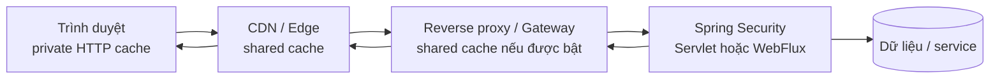
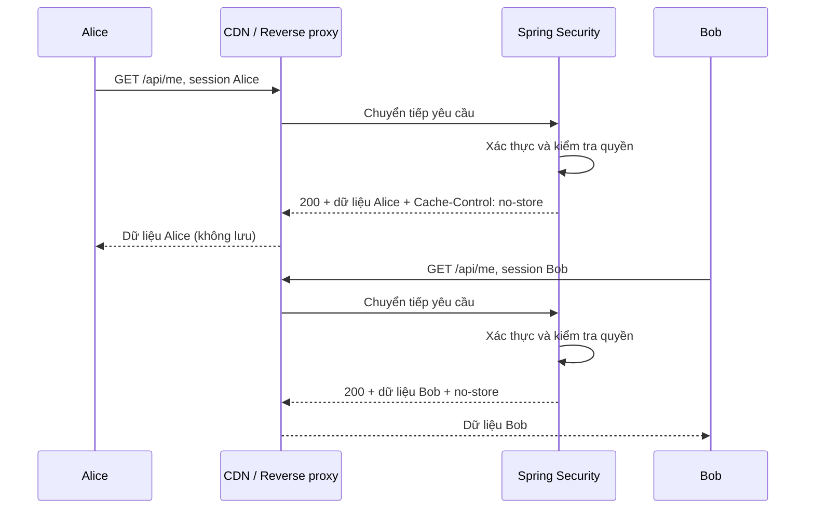
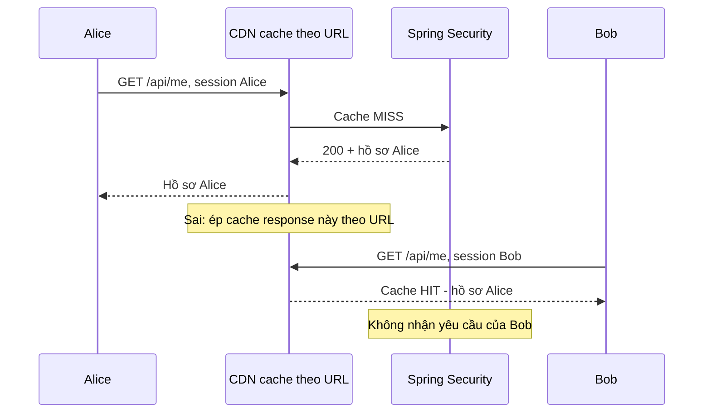

# Cache tại trình duyệt, reverse proxy và CDN

## 1. Bối cảnh: một HTTP response đi qua nhiều lớp cache

Giả sử Alice đăng nhập vào ứng dụng Spring Security, truy cập `GET /api/me` và nhận hồ sơ của mình. Một lát sau, Bob đăng nhập ở thiết bị khác và gọi đúng URL đó. Ở tầng ứng dụng, `SecurityFilterChain` hoặc `SecurityWebFilterChain` có thể xác thực từng yêu cầu và trả đúng dữ liệu theo danh tính. Tuy nhiên, nếu một **shared cache** tại reverse proxy hoặc CDN từng lưu response của Alice theo URL rồi phát lại cho Bob, yêu cầu của Bob có thể **không đến Spring Security**. Kết quả là dữ liệu riêng bị tiết lộ dù quy tắc phân quyền trong controller có vẻ đúng.

Cùng lúc, file công khai `/assets/app.74ea2d.js` có thể được phát lại an toàn cho hàng nghìn người dùng nếu nội dung của file không phụ thuộc người gọi. Cache ở browser, reverse proxy và CDN khi đó giúp giảm độ trễ, tải mạng và số lần ứng dụng phải phục vụ cùng một file.

Bài thuộc chương **Bộ nhớ đệm và MIME** của mô-đun **SPRING_SECURITY_HTTP_PROTECTION**. Phạm vi học là thiết kế và vận hành các lớp phòng vệ HTTP và trình duyệt của Spring Security, từ CSRF, CORS, security headers, CSP, HSTS đến firewall và session. Bài này tập trung vào **khác biệt giữa private cache và shared cache**, cơ chế hình thành cache key, sự tương tác giữa cache với xác thực/phân quyền trên **Servlet và Reactive**, cách kiểm thử kịch bản cache sai và chẩn đoán xung đột giữa origin, reverse proxy, CDN và trình duyệt.

Sau khi học, bạn có thể:

- Vẽ đường đi của một request qua browser cache, CDN, reverse proxy và Spring Security; giải thích vì sao **cache hit** có thể khiến origin không nhận request.
- Phân biệt cache HTTP riêng, cache HTTP dùng chung, cache của ứng dụng, service worker và bộ nhớ trạng thái giao diện.
- Đọc và chọn `Cache-Control`, `Vary`, `ETag`, `Age`, `Via` cùng các header chẩn đoán theo phạm vi dữ liệu.
- Nhận biết rủi ro cache trộn người dùng, cache poisoning, cache deception và cấu hình cache key thiếu thông tin.
- Đặt chính sách cache cho Servlet và Reactive, đối chiếu chính sách giữa ứng dụng và gateway/CDN.
- Xây dựng kiểm thử với hai tài khoản và kịch bản logout/chuyển quyền, đồng thời kiểm tra cache public hợp lệ.

## 2. Kiến trúc: browser, CDN, reverse proxy và origin

Một luồng phổ biến:



Không phải ứng dụng nào cũng có đầy đủ bốn tầng. Một số hệ thống đặt CDN trước load balancer rồi mới đến reverse proxy; một số không cache tại reverse proxy. Điều quan trọng là xác định **điểm nào có quyền lưu và phát lại HTTP response**.

| Lớp | Ai được hưởng bản lưu? | Dấu hiệu thường quan sát được | Rủi ro đáng chú ý |
| --- | --- | --- | --- |
| **Browser/private HTTP cache** | Một môi trường trình duyệt hoặc user agent; phạm vi chính xác tùy trình duyệt/profile | DevTools: `from memory cache`, `from disk cache`, `304`, kích thước truyền | Dữ liệu còn trên thiết bị dùng chung sau logout/chuyển tài khoản |
| **CDN/edge shared cache** | Nhiều người dùng ở một hoặc nhiều điểm biên | `Age`, `X-Cache`, `CF-Cache-Status` hoặc header riêng nhà cung cấp | Dùng sai cache key, cache response cá nhân hóa, phát lại body giữa tài khoản |
| **Reverse proxy shared cache** | Nhiều client đi qua cùng proxy/gateway | Log `HIT/MISS`, `Age`, `Via` hoặc header tự cấu hình | Cache động vì quy tắc đường dẫn, bỏ `Cookie`/`Authorization`, ghi đè chính sách origin |
| **Spring origin** | Xử lý request thật và quyết định response | Access log, Spring Security logs, response từ origin trực tiếp | Controller đặt sai `Cache-Control` hoặc trả nội dung trước kiểm tra quyền |
| **Cache trong ứng dụng** | Dữ liệu do ứng dụng lưu vào Redis/Caffeine/Spring Cache... | Log/hit metric ứng dụng | Cache key thiếu tenant/user; HTTP `Cache-Control` không điều khiển trực tiếp |

**Không nhầm lẫn:** `localStorage`, bộ nhớ JavaScript, back/forward cache (bfcache), service worker `CacheStorage` và HTTP cache là các cơ chế khác nhau. `Cache-Control: no-store` tác động tới HTTP cache tuân thủ chuẩn nhưng **không tự dọn** bộ nhớ giao diện, các bản lưu chủ động do service worker quản lý hoặc phiên đăng nhập ở máy chủ.

### 2.1. Cache hit có thể đi tắt qua Spring Security

Luồng bình thường khi `GET /api/me` không được cache dùng chung:



Luồng **cấu hình sai**:



Đây là **mô hình lỗi cần phòng ngừa**, không phải hành vi mặc định của mọi CDN. Theo chuẩn HTTP, nhiều điều kiện quyết định khả năng lưu/dùng lại; nhiều nhà cung cấp CDN còn có mặc định thận trọng với response chứa cookie hoặc Authorization. Lỗi thường xuất hiện khi có **quy tắc ép cache**, cache key thiếu dữ liệu phân biệt hoặc header origin bị bỏ qua.

## 3. Shared cache khác private cache ở điểm nào?

### 3.1. Private cache ở trình duyệt

Browser cache nhằm tránh tải lại response cho cùng người dùng/browser. Nó có thể lưu asset CSS, JS và ảnh công khai; trong một số trường hợp có thể lưu dữ liệu cá nhân hóa nếu response cho phép.

Ví dụ:

```http
HTTP/1.1 200 OK
Cache-Control: private, no-cache
ETag: "theme-revision-42"
Content-Type: application/json

{"theme":"dark"}
```

`private` ngăn shared cache lưu response, nhưng browser có thể lưu; `no-cache` yêu cầu **revalidate với origin trước khi dùng lại**. Trong ứng dụng có đăng nhập, origin phải kiểm tra người đang gọi trước khi trả `304 Not Modified`, vì `304` có thể cho phép browser dùng lại body đã lưu.

Với tài liệu thanh toán hoặc nội dung nhạy cảm, chính sách chặt hơn:

```http
Cache-Control: no-store
```

Một số browser có cơ chế bfcache riêng để quay lại trang rất nhanh, và SPA có thể giữ state sau khi gọi API. Vì vậy cần kiểm thử logout, Back/Forward, chuyển tài khoản và xóa dữ liệu nhạy cảm ở phía client; không suy rằng chỉ một header đã bảo đảm dữ liệu biến mất khỏi thiết bị.

### 3.2. Reverse proxy và CDN là shared cache

Reverse proxy có thể nằm ngay trước ứng dụng (Nginx, Varnish hoặc gateway khác). CDN thường phân phối nội dung qua nhiều điểm biên ở gần người dùng. **Cả hai là shared cache** khi bản lưu được dùng để phục vụ nhiều client.

Ví dụ `GET /assets/main.83b1f4.js` với policy:

```http
Cache-Control: public, max-age=31536000, immutable
```

Đây là trường hợp phù hợp: bất kỳ người dùng nào cũng có thể nhận chính xác cùng một bundle JavaScript. Nếu đã có bản fresh, edge có thể trả ngay mà không hỏi origin.

Ngược lại, `GET /api/account/me` trả dữ liệu theo session nên **không được để shared cache phục vụ cùng một body cho các danh tính khác nhau**. Dùng `Cache-Control: no-store` ở origin, đồng thời cấu hình bypass tại edge/proxy khi cần.

### 3.3. Chênh lệch chính sách giữa các tầng

Một số hạ tầng có cấu hình edge TTL, browser TTL, override response header hoặc chính sách riêng với response có cookie. Hãy phân biệt rõ:

- **Chính sách HTTP do origin phát:** ví dụ `Cache-Control: no-store`.
- **Quy tắc lưu trong reverse proxy/CDN:** quyết định route nào có thể cache, cache key là gì, có tuân thủ origin header không.
- **Header trả đến trình duyệt:** có thể được proxy giữ nguyên, sửa hoặc bổ sung.
- **Hành vi thực của browser:** phụ thuộc header cuối, bộ nhớ riêng và request điều kiện.

Một response thấy `Cache-Control: no-store` tại **origin** chưa đủ nếu edge đã ép cache và thay header. Ngược lại, thấy `public` ở một asset CDN không có nghĩa toàn hệ thống công khai dữ liệu; phải xét **đúng URL và nội dung**.

## 4. Cache key: tại sao cùng URL có thể nguy hiểm?

**Cache key** là tập thông tin mà cache dùng để chọn bản lưu phù hợp với một request. Khóa ban đầu thường liên quan đến phương thức, URI đích và một số thông tin phụ thuộc cách triển khai; sự phân biệt biến thể theo `Vary` cũng có vai trò. CDN và reverse proxy có thể cho phép cấu hình khóa khác nhau.

Ví dụ hai request:

```http
GET /api/me HTTP/1.1
Host: app.example.com
Cookie: SESSION=alice-session
```

```http
GET /api/me HTTP/1.1
Host: app.example.com
Cookie: SESSION=bob-session
```

Nếu một edge rule ép cache theo khóa chỉ gồm `GET + host + /api/me`, hai request có thể bị xem như giống nhau, mặc dù **nội dung phản hồi phụ thuộc cookie**. Thực tế, đơn giản hơn và an toàn hơn với dữ liệu riêng tư là **không dùng shared cache** thay vì cố đưa mọi session vào cache key.

### 4.1. Những yếu tố cần xác minh

| Thành phần của request | Hệ quả nếu cache bỏ qua hoặc xử lý sai |
| --- | --- |
| Scheme và host | Phát nhầm nội dung giữa hostname, tenant hoặc môi trường |
| Path và quy tắc chuẩn hóa URL | Trộn tài nguyên khác nhau; mở đường cho web cache deception |
| Query string | Trộn kết quả tìm kiếm/bộ lọc khác nhau nếu query quyết định body |
| `Accept-Encoding` | Dùng sai biến thể nén; cần xử lý biến thể/`Vary` phù hợp |
| `Accept-Language` | Phát sai ngôn ngữ nếu body thực sự phụ thuộc header này |
| `Origin` với response CORS động | Phát sai `Access-Control-Allow-Origin` nếu không xử lý biến thể phù hợp |
| `Authorization`/`Cookie` | Rò rỉ dữ liệu khi phản hồi phụ thuộc người gọi và bị cache dùng chung |
| Các header custom chứa tenant hoặc phiên bản | Sai nội dung nếu edge không nhận biết thuộc tính quyết định biểu diễn |

**Quy tắc an toàn:** Nếu nội dung cần xác thực, phân quyền hoặc phụ thuộc tenant/user, hãy hạn chế hoặc bỏ shared caching cho route đó. Đưa `Authorization`/cookie vào cache key chỉ là một giải pháp phức tạp với nguy cơ sai sót, key cardinality lớn và khó thu hồi; không xem đây là lựa chọn mặc định.

### 4.2. `Vary` giúp chọn biến thể, không thay thế phân quyền

Response:

```http
Vary: Accept-Language
Cache-Control: public, max-age=300
```

yêu cầu cache có hỗ trợ phù hợp phân biệt các bản lưu theo `Accept-Language`. Đây là trường hợp hợp lý cho trang công khai đa ngôn ngữ.

`Vary: Cookie` hoặc `Vary: Authorization` **không biến một API có dữ liệu riêng thành an toàn để cache dùng chung**. Chúng không kiểm tra quyền của người gọi và không chữa được proxy không tuân thủ `Vary` hoặc edge rule ghi đè. Với nội dung nhạy cảm, ưu tiên `no-store`.

### 4.3. Cookie và `Set-Cookie` không phải một chính sách cache

Không nên khẳng định “có `Cookie`/`Set-Cookie` thì chuẩn HTTP tự động cấm shared cache lưu”. Chúng **không phải** các directive tương đương `private` hoặc `no-store`. Một CDN có thể chọn không cache theo mặc định, nhưng quy tắc ép cache hoặc header cấu hình sai có thể thay đổi hành vi.

Request chứa `Authorization` chịu ràng buộc đặc biệt theo RFC 9111: shared cache thông thường không được dùng lại response nếu không có những chỉ thị response cho phép rõ ràng theo tiêu chuẩn, chẳng hạn `public`, `s-maxage` hoặc `must-revalidate`. Vì vậy cũng không nên coi bearer token là hàng rào tuyệt đối nếu origin/edge phát chính sách không phù hợp.

## 5. Chọn `Cache-Control` theo dữ liệu và tầng cache

| Loại response | `Cache-Control` gợi ý | Browser/private cache | Reverse proxy/CDN |
| --- | --- | --- | --- |
| Hồ sơ, đơn hàng, số dư, hóa đơn, API theo tài khoản | `no-store` | Không lưu qua HTTP cache tuân thủ chuẩn | Không lưu; cấu hình bypass nếu cần |
| HTML trang cá nhân sau đăng nhập | `no-store` | Không lưu body bằng HTTP cache tuân thủ chuẩn | Không lưu |
| Tùy chọn giao diện cá nhân ít nhạy cảm | `private, no-cache` | Có thể lưu nhưng phải revalidate trước khi dùng | Không được lưu |
| Dữ liệu cá nhân ít nhạy cảm và chấp nhận cũ ngắn hạn | `private, max-age=60` *(ví dụ)* | Có thể giữ và dùng khi fresh | Không được lưu |
| Tệp JS/CSS/font công khai có hash trong URL | `public, max-age=31536000, immutable` | Cache dài hạn | Cache dài hạn nếu hạ tầng cho phép |
| Logo hoặc tài liệu công khai URL cố định | `public, max-age=300` *(ví dụ)* | Có thể dùng 5 phút | Có thể cache 5 phút |
| HTML entry point SPA công khai đổi thường xuyên | `no-cache` hoặc TTL ngắn | Có thể lưu nhưng phải revalidate nếu `no-cache` | Có thể lưu, revalidate theo chính sách |
| API danh mục công khai không phụ thuộc user | `public, max-age=300` *(ví dụ)* | Có thể cache | Có thể cache theo URL/biến thể đúng |

Các TTL là **ví dụ**, phải dựa vào tốc độ cập nhật, rủi ro stale và nhu cầu sản phẩm.

**Phân biệt quan trọng:**

- `no-store` cấm HTTP cache lưu response; phù hợp với dữ liệu bí mật.
- `private` chỉ cấm shared cache lưu; browser vẫn có thể lưu.
- `no-cache` **không cấm lưu**, nhưng buộc revalidation thành công trước khi tái sử dụng bản lưu.
- `max-age` là thời gian freshness; không thay thế quyền truy cập.
- `public` cho phép shared caching theo các điều kiện HTTP; không dùng cho response chứa dữ liệu chỉ một người hoặc tenant được xem.
- `s-maxage` áp dụng cho shared cache; không dùng để “bảo vệ” API có đăng nhập.
- `stale-while-revalidate` hoặc `stale-if-error` cho phép một số hành vi phát bản cũ trong điều kiện nhất định; chỉ dùng khi có thể chấp nhận stale, **tránh cho nội dung cần thu hồi quyền ngay**.

Không tạo chính sách mâu thuẫn như `public, max-age=3600` trên cùng response hồ sơ đã xác thực. Khi cần cache dữ liệu ở máy chủ để giảm truy vấn, hãy thiết kế **application cache key có tenant/user và kiểm tra quyền**; đó là lớp độc lập với HTTP cache.

## 6. Browser cache, conditional GET và `304 Not Modified`

Khi browser có bản lưu nhưng phải revalidate, nó có thể gửi request điều kiện:

```http
GET /public/help.html HTTP/1.1
If-None-Match: "help-r6"
```

Nếu server xác định biểu diễn hiện tại vẫn giống bản đã lưu, có thể trả:

```http
HTTP/1.1 304 Not Modified
ETag: "help-r6"
Cache-Control: no-cache
```

`304` không có body; cache hợp lệ có thể tái sử dụng body từ response trước đó. Với tài nguyên công khai đây là cơ chế tiết kiệm băng thông.

### 6.1. Với response cá nhân hóa

Nếu endpoint trả `private, no-cache`, trình duyệt **có thể giữ body riêng** và revalidate bằng `ETag`. Nhưng việc trả `304` chỉ hợp lệ khi server đã:

1. Xác thực người đang gọi.
2. Kiểm tra quyền đối với tài nguyên/tenant hiện tại.
3. Xác định biểu diễn mà **chính người gọi** được phép xem.
4. Kiểm tra validator tương ứng với biểu diễn ấy; trả `304` nếu điều kiện HTTP thực sự thỏa.

Khi session đã bị thu hồi, không được trả `304` chỉ vì ETag trùng. Phản hồi phù hợp có thể là `401`, `403` hoặc redirect đăng nhập tùy cơ chế xác thực.

Với dữ liệu nhạy cảm dùng `no-store`, việc duy trì luồng revalidate bản đã lưu thường không cần thiết, vì mục tiêu là không giữ body trong HTTP cache.

### 6.2. Header chẩn đoán: `Age`, `Via` và `X-Cache`

| Header / dấu hiệu | Cách hiểu đúng |
| --- | --- |
| `Age: 120` | Ước lượng tuổi bản response đã được cache, tính bằng giây, theo cơ chế HTTP |
| `Via` | Có thể cho biết các trung gian đã xử lý/forward message; không phải mọi hạ tầng đều lộ đầy đủ |
| `X-Cache: HIT` | Header không chuẩn hóa, nhà cung cấp có thể dùng để báo cache hit |
| `CF-Cache-Status` hoặc header riêng nhà cung cấp | Trạng thái cache được hệ thống cụ thể định nghĩa |
| Browser DevTools: `from memory cache`/`from disk cache` | Trình duyệt có thể đang dùng bản lưu riêng |
| HTTP `304` | Revalidation thành công với validator; **không tự chứng minh CDN đã cache** |

`Age` hoặc `X-Cache` giúp điều tra, nhưng không thay thế việc kiểm tra **body đúng danh tính và header chính sách cuối**. Một cache hit công khai trên `/assets/*` là bình thường; cache hit chung trên `/api/me` cần được xem xét.

## 7. Cơ chế mặc định của Spring Security

Khi cấu hình security headers mặc định được bật, Spring Security cung cấp:

```http
Cache-Control: no-cache, no-store, max-age=0, must-revalidate
Pragma: no-cache
Expires: 0
```

Đây là bộ chống cache cho response nhạy cảm. Spring Security cho phép ứng dụng **tự đặt `Cache-Control` cho asset công khai**; khi response đã có chính sách ứng dụng, security header writer tương ứng không nhất thiết bổ sung bộ mặc định. Ở Servlet, `CacheControlHeadersWriter` có các điều kiện bỏ qua khi response đã có `Cache-Control`, `Pragma`, `Expires` hoặc status `304`. Với WebFlux, phải kiểm tra hành vi response cuối theo phiên bản thư viện sử dụng.

**Không cần vô hiệu hóa toàn bộ security headers** chỉ để cache JS, CSS hoặc ảnh. Các header như HSTS, CSP, `X-Content-Type-Options: nosniff` vẫn có chức năng phòng vệ riêng. CORS không cấm shared cache phát sai body, CSRF không thay chính sách cache, và MIME sniffing protection không thay việc đặt `Cache-Control`.

### 7.1. Vị trí trách nhiệm giữa các lớp

- **Spring Security / ứng dụng:** kiểm tra xác thực/phân quyền; trả `Cache-Control` đúng độ nhạy; bảo đảm cả lỗi/redirect nhạy cảm không cache trái chủ đích.
- **Reverse proxy:** giữ đúng response headers; giới hạn shared caching vào nhóm URL public đã xác định; không tạo cache key có thể trộn người dùng.
- **CDN:** áp quy tắc edge tương thích với origin; không ép TTL trên API nhạy cảm; kiểm tra query string và biến thể; hỗ trợ invalidation khi cần.
- **Browser/front-end:** tuân thủ chính sách response; khi logout xóa state riêng, token, service worker cache nhạy cảm nếu đã sử dụng sai; không giữ dữ liệu lâu hơn chính sách bảo mật.
- **Bộ đo kiểm:** phân biệt kiểm thử unit ở Spring với kiểm thử end-to-end qua toàn bộ proxy/CDN.

## 8. Cấu hình Spring MVC (Servlet)

Ví dụ ứng dụng có `/assets/**` là JS/CSS công khai, `/public/**` là nội dung công khai URL cố định và `/api/me` là dữ liệu riêng. Đây là mẫu minh họa, cần thay rule theo sơ đồ xác thực thật của sản phẩm.

### 8.1. Giữ Spring Security headers và kiểm soát quyền

```java
import org.springframework.context.annotation.Bean;
import org.springframework.context.annotation.Configuration;
import org.springframework.security.config.annotation.web.builders.HttpSecurity;
import org.springframework.security.web.SecurityFilterChain;

@Configuration
class ServletSecurityConfig {

    @Bean
    SecurityFilterChain filterChain(HttpSecurity http) throws Exception {
        http.authorizeHttpRequests(auth -> auth
            .requestMatchers("/assets/**", "/public/**").permitAll()
            .requestMatchers("/api/me").authenticated()
            .anyRequest().authenticated());

        // Không tắt security headers mặc định.
        return http.build();
    }
}
```

Với `GET /api/me`, ứng dụng có thể chủ động đặt `no-store` để policy không phụ thuộc việc header writer mặc định có được gọi hay không.

### 8.2. Controller Servlet trả dữ liệu người dùng

```java
import java.util.Map;
import org.springframework.http.CacheControl;
import org.springframework.http.ResponseEntity;
import org.springframework.security.core.Authentication;
import org.springframework.web.bind.annotation.GetMapping;
import org.springframework.web.bind.annotation.RestController;

@RestController
class MeServletController {

    @GetMapping("/api/me")
    ResponseEntity<Map<String, String>> me(Authentication authentication) {
        return ResponseEntity.ok()
            .cacheControl(CacheControl.noStore())
            .body(Map.of("user", authentication.getName()));
    }
}
```

Đoạn này dùng `authentication.getName()` để minh họa. Ứng dụng thật cần service/DTO lấy dữ liệu đã được phép xem, kiểm tra ownership theo tài nguyên và tránh trả field nhạy cảm dư thừa.

### 8.3. Resource handler MVC chỉ cache nội dung công khai

```java
import java.time.Duration;
import org.springframework.context.annotation.Configuration;
import org.springframework.http.CacheControl;
import org.springframework.web.servlet.config.annotation.ResourceHandlerRegistry;
import org.springframework.web.servlet.config.annotation.WebMvcConfigurer;

@Configuration
class StaticMvcConfig implements WebMvcConfigurer {

    @Override
    public void addResourceHandlers(ResourceHandlerRegistry registry) {
        registry.addResourceHandler("/assets/**")
            .addResourceLocations("classpath:/static/assets/")
            .setCacheControl(
                CacheControl.maxAge(Duration.ofDays(365)).cachePublic());

        registry.addResourceHandler("/public/**")
            .addResourceLocations("classpath:/static/public/")
            .setCacheControl(
                CacheControl.maxAge(Duration.ofMinutes(5)).cachePublic());
    }
}
```

Chỉ dùng TTL dài với **URL chứa content hash** và thay URL khi bytes thay đổi. `CacheControl.maxAge(...).cachePublic()` trong ví dụ không tự thêm `immutable`; nếu cần directive đó, cấu hình đúng cơ chế của phiên bản framework/edge và kiểm tra header thực. Không dùng resource handler public để phát tài liệu khách hàng.

Trong Spring Boot MVC, triển khai `WebMvcConfigurer` thường đủ để tùy chỉnh resource handler; không cần bật `@EnableWebMvc` nếu chỉ muốn thêm chính sách, vì có thể thay đổi auto-configuration.

## 9. Cấu hình Spring WebFlux (Reactive)

WebFlux có cùng quy tắc HTTP cache, nhưng dùng `SecurityWebFilterChain` và resource config trong `org.springframework.web.reactive.config`.

### 9.1. SecurityWebFilterChain

```java
import org.springframework.context.annotation.Bean;
import org.springframework.context.annotation.Configuration;
import org.springframework.security.config.annotation.web.reactive.EnableWebFluxSecurity;
import org.springframework.security.config.web.server.ServerHttpSecurity;
import org.springframework.security.web.server.SecurityWebFilterChain;

@Configuration
@EnableWebFluxSecurity
class ReactiveSecurityConfig {

    @Bean
    SecurityWebFilterChain filterChain(ServerHttpSecurity http) {
        return http.authorizeExchange(auth -> auth
                .pathMatchers("/assets/**", "/public/**").permitAll()
                .pathMatchers("/api/me").authenticated()
                .anyExchange().authenticated())
            .build();
    }
}
```

### 9.2. Resource handler WebFlux

```java
import java.time.Duration;
import org.springframework.context.annotation.Configuration;
import org.springframework.http.CacheControl;
import org.springframework.web.reactive.config.ResourceHandlerRegistry;
import org.springframework.web.reactive.config.WebFluxConfigurer;

@Configuration
class StaticWebFluxConfig implements WebFluxConfigurer {

    @Override
    public void addResourceHandlers(ResourceHandlerRegistry registry) {
        registry.addResourceHandler("/assets/**")
            .addResourceLocations("classpath:/static/assets/")
            .setCacheControl(
                CacheControl.maxAge(Duration.ofDays(365)).cachePublic());

        registry.addResourceHandler("/public/**")
            .addResourceLocations("classpath:/static/public/")
            .setCacheControl(
                CacheControl.maxAge(Duration.ofMinutes(5)).cachePublic());
    }
}
```

### 9.3. Response `no-store` trong Reactive

```java
import java.security.Principal;
import java.util.Map;
import reactor.core.publisher.Mono;
import org.springframework.http.CacheControl;
import org.springframework.http.ResponseEntity;
import org.springframework.web.bind.annotation.GetMapping;
import org.springframework.web.bind.annotation.RestController;

@RestController
class MeReactiveController {

    @GetMapping("/api/me")
    Mono<ResponseEntity<Map<String, String>>> me(Mono<Principal> principal) {
        return principal.map(p -> ResponseEntity.ok()
            .cacheControl(CacheControl.noStore())
            .body(Map.of("user", p.getName())));
    }
}
```

Đây là **phương án thay thế** Servlet ở mục 8, không đăng ký cả hai controller trùng đường dẫn trong cùng ứng dụng. Với functional endpoint có thể trả `ServerResponse` kèm header tương ứng. Với `ServerHttpResponse` phải đặt header trước khi response commit. Tính chất bất đồng bộ của `Mono`/`Flux` không làm thay đổi ngữ nghĩa `Cache-Control`.

## 10. Cấu hình shared cache tại reverse proxy và CDN

Không có một cấu hình cache chung phù hợp mọi nhà cung cấp. Hãy mô tả chính sách theo **đường dẫn và độ nhạy**, rồi chuyển thành cấu hình Nginx, gateway hoặc CDN cụ thể.

Ví dụ **pseudocode chính sách**, không phải cú pháp của một sản phẩm:

```text
ROUTE /assets/*:
    cache_class = SHARED_ALLOWED
    require_public_response = true
    use_origin_cache_control = true
    cache_key = host + full_path + relevant_query_and_variants

ROUTE /public/*:
    cache_class = SHARED_ALLOWED
    use_origin_cache_control = true
    cache_key = host + full_path + relevant_query_and_variants

ROUTE /api/me, /api/account/*, /dashboard, /auth/*:
    cache_class = BYPASS
    store_response = false
    forward_authentication_context = true

DEFAULT:
    cache_class = BYPASS
    # Mở rộng shared caching chỉ khi từng route được xác nhận là public
```

Chiến lược “allowlist các URL public” hạn chế khả năng CDN vô tình cache một API có đăng nhập. Những đường dẫn trên chỉ là ví dụ; SPA fallback, đường dẫn tài nguyên động, tenant/subdomain và quy tắc chuẩn hóa URL ở hạ tầng thật cần được kiểm tra.

### 10.1. Những điểm phải đối chiếu ở edge

1. **Cache rules:** có ép cache mọi GET/extension không? Có vô tình bao gồm `/account/avatar.css`, `/profile` hoặc JSON riêng tư không?
2. **Origin header:** edge có tôn trọng `no-store`/`private` hay đang ghi đè thành `public`?
3. **Cache key:** host, path, query, `Accept-Encoding`, ngôn ngữ và các biến thể public có được phân biệt đúng không? Tenant có bị trộn do host bị bỏ qua không?
4. **Cookie/Authorization:** request theo tài khoản có được bypass? Header xác thực có được forward đến Spring khi cần không?
5. **Error/redirect:** edge có cache `302` đến login, `401`, `403` hoặc `404` không? Một số cache cho phép lưu lỗi theo thời hạn, gây hiện tượng khó tái hiện.
6. **TTL và stale:** quy tắc edge có cho phép phục vụ stale khi origin lỗi? Chỉ dùng cho nội dung công khai chấp nhận lỗi thời.
7. **Purge/invalidation:** khi sửa rule, các bản lưu có nguy cơ đã lưu có được vô hiệu hóa? Đổi policy không bảo đảm xóa mọi bản cache cũ ngay lập tức.

### 10.2. Ví dụ khái niệm với Nginx

Nginx có thể cache response upstream qua `proxy_cache`. Để tránh ghép cấu hình thiếu ngữ cảnh, ví dụ sau chỉ diễn đạt **đường đi**, không phải tệp cấu hình đầy đủ:

```nginx
# Giả sử proxy_cache_path, upstream và server đã được khai báo.

location /assets/ {
    proxy_pass http://spring_origin;
    proxy_cache public_assets;
    # Tôn trọng header Cache-Control do origin phát.
    # Chỉ đường dẫn asset thực sự công khai mới vào đây.
}

location /api/ {
    proxy_pass http://spring_origin;
    proxy_cache off;
    # Chuyển tiếp ngữ cảnh xác thực theo cấu hình ứng dụng.
}
```

`proxy_cache off` ngăn Nginx dùng zone cache cho location đó; cấu hình còn phải xét các proxy khác phía trước. Nếu `/dashboard` không nằm trong `/api/` thì cần quy tắc bypass riêng. Đừng copy một rule `proxy_cache` cho toàn bộ `location /` mà chưa xác nhận tất cả GET là public.

Với CDN do nhà cung cấp quản lý, thường có khái niệm cache rule, bypass rule, cache key và edge TTL. Cần đọc cấu hình thực tế, vì **CDN có thể thực hiện quy tắc cache khác với Nginx và khác chính sách HTTP chuẩn nếu người vận hành chủ động ép**.

## 11. Hai kiểu lỗ hổng và một lỗi vận hành thường gặp

### 11.1. Cross-user caching: phát lại body giữa tài khoản

Điều kiện: endpoint `GET /api/me` trả khác nhau theo cookie, nhưng shared cache được cấu hình theo URL.

Hậu quả: người B có thể nhận thông tin người A mà origin không nhận request của B. Giải pháp là `no-store`, bypass shared cache, phân quyền ở origin khi request thật đến, và kiểm thử **nhiều danh tính trên cùng URL**.

### 11.2. Web cache deception

Một số hệ thống có đường dẫn động bị ứng dụng xử lý như tài nguyên cá nhân, nhưng CDN lại coi những URL **trông như file tĩnh** là cacheable. Ví dụ (minh họa rủi ro, phụ thuộc router):

```text
/account/profile.css
```

Nếu origin vẫn render HTML hồ sơ Alice cho URL này còn CDN ép cache vì đuôi `.css`, body riêng có thể được lưu như asset công khai. Cần:

- Đảm bảo router không trả HTML nhạy cảm cho những biến thể URL không được phép.
- Không dựa chỉ vào extension để quyết định shared caching; dùng allowlist route thực sự chứa static assets.
- Trả `no-store` cho response riêng tư ngay cả khi URL bị thêm suffix hoặc query bất thường.
- Kiểm thử đường dẫn biến thể trong môi trường được phép, không áp dụng vào hệ thống bên ngoài khi chưa được ủy quyền.

### 11.3. Cache poisoning và sai biến thể

**Cache poisoning** là tình huống một request có thuộc tính do người gọi kiểm soát ảnh hưởng response, rồi response đó được lưu và phát cho người khác dưới một khóa cache không đủ phân biệt. Ví dụ: public HTML bị thay đổi nội dung theo một header mà proxy bỏ qua trong cache key hoặc `Vary`.

Cách phòng tránh là xác định chính xác những thành phần request ảnh hưởng đến biểu diễn, kiểm soát đầu vào, đặt `Vary` phù hợp cho nội dung công khai, đồng bộ cache key với origin và không cache những response phụ thuộc danh tính. Không dùng `Vary` như phương án để “hợp thức hóa” cache hồ sơ theo người dùng.

### 11.4. Negative caching và bản cũ khó xóa

Một CDN có thể giữ `404` hoặc lỗi theo quy tắc riêng. Khi deploy HTML trước asset, lỗi `404` của asset chưa xuất hiện có thể bị lưu; sau khi file được upload, người dùng vẫn thấy lỗi đến khi cache hết hạn hoặc bị purge.

Tương tự, khi sửa một response private từng bị cache công khai, chỉ thay `Cache-Control` ở origin là chưa đủ để tin mọi bản cũ đã biến mất. Hãy kiểm tra chính sách purge/invalidation và hiệu lực ở các điểm biên.

## 12. Kiểm thử từng lớp bằng HTTP

### 12.1. So sánh origin và edge

Kiểm tra **GET thật**, không chỉ `HEAD` (vì handler hoặc proxy có thể xử lý hai phương thức khác nhau). Với tài nguyên công khai:

```bash
curl -sS -D - -o /dev/null \
  'https://app.example.com/assets/app.74ea2d.js'
```

Kỳ vọng: `Cache-Control` có `public` và TTL dài (nếu cấu hình như ví dụ), `Content-Type` đúng (JavaScript thường là `text/javascript`), `X-Content-Type-Options: nosniff` nếu Spring Security headers áp dụng, và header edge phản ánh cache hoạt động theo chính sách.

Với API riêng tư:

```bash
curl -sS -i \
  -H 'Authorization: Bearer <test-token-of-alice>' \
  'https://app.example.com/api/me'
```

Kỳ vọng: response chứa `Cache-Control: no-store`; body thuộc Alice. Dùng token thử nghiệm, tránh ghi cookie/bearer token thật vào báo cáo và log.

Để so sánh origin trực tiếp với edge, dùng **địa chỉ origin đã được cấp quyền truy cập và định tuyến đúng Host/TLS** trong môi trường thử nghiệm; không bỏ qua HTTPS hoặc kiểm tra certificate chỉ để đơn giản hóa bài test. So sánh các header `Cache-Control`, `Age`, `Vary`, status và body. Một số CDN chỉ trả header `X-Cache` hoặc `CF-Cache-Status` theo cấu hình của chính nó.

### 12.2. Bài thử hai tài khoản phải được thực hiện qua đường cache thật

| Lượt | Request | Kỳ vọng |
| --- | --- | --- |
| 1 | Alice `GET /api/me` qua CDN | `200`, dữ liệu Alice, `no-store` |
| 2 | Alice gửi lại cùng URL | Dữ liệu Alice đúng; không tái sử dụng bản dùng chung trái policy |
| 3 | Bob `GET /api/me` **cùng URL** qua CDN | Chỉ có dữ liệu Bob, không có dữ liệu Alice |
| 4 | Bob gửi `If-None-Match` của Alice (nếu endpoint có validator) | Không trả `304`/body Alice khi validator không áp dụng cho biểu diễn Bob |
| 5 | Alice logout rồi gọi lại với session đã hủy | Phản hồi chưa xác thực (`401`, redirect login...) theo cấu hình; không phát lại dữ liệu cũ |
| 6 | Người dùng chưa đăng nhập gọi URL cũ | Không có body của Alice hoặc Bob |
| 7 | Gọi asset công khai cùng URL từ hai người dùng | Shared cache được phép trả cùng bytes, có thể quan sát HIT nếu hệ thống hỗ trợ |

Đo body **cùng với danh tính** chứ không chỉ kiểm tra `status=200` hoặc header `Cache-Control`. Đảm bảo các tài khoản thử có dữ liệu khác nhau để phát hiện trộn kết quả.

### 12.3. Đừng để tùy chọn DevTools làm sai kết luận

Trong Chrome/Edge Developer Tools > Network, tùy chọn **Disable cache** thường làm ảnh hưởng đến khả năng sử dụng browser HTTP cache khi DevTools mở. Hãy thử cả trạng thái bật và tắt tùy mục tiêu, đồng thời kiểm tra hard reload, normal reload, Back/Forward và service worker. Một `304` có thể là revalidation bình thường, không phải dấu hiệu mất dữ liệu hay lỗ hổng.

Nếu ứng dụng là SPA/PWA, cần dọn in-memory state, client query cache và `CacheStorage` khi chuyển tài khoản. HTTP `no-store` không tự đảm bảo các lớp lưu do JavaScript chủ động tạo đã được xóa.

## 13. Tự động hóa kiểm thử Spring MVC và WebFlux

Các kiểm thử dưới đây xác nhận **header và hành vi ở application origin**. Chúng cần được bổ sung bằng bài thử qua CDN/reverse proxy, vì test in-process không giả lập shared cache phía trước.

### 13.1. Servlet với MockMvc

Ví dụ Spring Boot Test có `spring-security-test` và `MockMvc` được bật cùng Spring Security filters:

```java
import static org.hamcrest.Matchers.containsString;
import static org.springframework.security.test.web.servlet.request
    .SecurityMockMvcRequestPostProcessors.user;
import static org.springframework.test.web.servlet.request
    .MockMvcRequestBuilders.get;
import static org.springframework.test.web.servlet.result
    .MockMvcResultMatchers.*;

import org.junit.jupiter.api.Test;
import org.springframework.beans.factory.annotation.Autowired;
import org.springframework.boot.test.autoconfigure.web.servlet.AutoConfigureMockMvc;
import org.springframework.boot.test.context.SpringBootTest;
import org.springframework.http.HttpHeaders;
import org.springframework.test.web.servlet.MockMvc;

@SpringBootTest
@AutoConfigureMockMvc
class ServletCachePolicyTest {

    @Autowired MockMvc mvc;

    @Test
    void personalResponseMustNotBeStored() throws Exception {
        mvc.perform(get("/api/me").with(user("alice")))
            .andExpect(status().isOk())
            .andExpect(header().string(
                HttpHeaders.CACHE_CONTROL, containsString("no-store")))
            .andExpect(jsonPath("$.user").value("alice"));
    }

    @Test
    void accountResponseBelongsToCurrentUser() throws Exception {
        mvc.perform(get("/api/me").with(user("bob")))
            .andExpect(status().isOk())
            .andExpect(jsonPath("$.user").value("bob"));
    }
}
```

Đây là test dành cho ví dụ Servlet có controller `/api/me` ở mục 8. Nếu ứng dụng thực tế dùng bearer token, form login, session hoặc security config tùy chỉnh, cần dùng test setup tương ứng.

### 13.2. WebFlux với WebTestClient

Với `WebTestClient` gắn vào `ApplicationContext` và `springSecurity()` từ `spring-security-test`:

```java
import static org.springframework.security.test.web.reactive.server
    .SecurityMockServerConfigurers.mockUser;
import static org.springframework.security.test.web.reactive.server
    .SecurityMockServerConfigurers.springSecurity;

import org.junit.jupiter.api.BeforeEach;
import org.junit.jupiter.api.Test;
import org.springframework.beans.factory.annotation.Autowired;
import org.springframework.boot.test.context.SpringBootTest;
import org.springframework.context.ApplicationContext;
import org.springframework.test.web.reactive.server.WebTestClient;

@SpringBootTest
class ReactiveCachePolicyTest {

    @Autowired ApplicationContext context;
    WebTestClient client;

    @BeforeEach
    void setup() {
        client = WebTestClient.bindToApplicationContext(context)
            .apply(springSecurity())
            .configureClient().build();
    }

    @Test
    void personalResponseMustNotBeStored() {
        client.mutateWith(mockUser("alice"))
            .get().uri("/api/me")
            .exchange()
            .expectStatus().isOk()
            .expectHeader().valueMatches(
                "Cache-Control", ".*no-store.*")
            .expectBody().jsonPath("$.user").isEqualTo("alice");
    }
}
```

Bài test này xác nhận policy ở ứng dụng WebFlux và dữ liệu của Alice. Muốn chứng minh **không có rò rỉ giữa người dùng qua CDN**, phải thực hiện kịch bản nhiều phiên trên đường mạng đi qua shared cache ở mục 12.2.

### 13.3. Kiểm thử tài nguyên công khai

Ví dụ trích đoạn với MockMvc và fixture `/assets/app.74ea2d.js` được đóng gói đúng:

```java
mvc.perform(get("/assets/app.74ea2d.js"))
    .andExpect(status().isOk())
    .andExpect(header().string(
        HttpHeaders.CACHE_CONTROL, containsString("public")))
    .andExpect(header().string(
        HttpHeaders.CACHE_CONTROL, containsString("max-age=31536000")));
```

Nếu thử `nosniff`, cần xác nhận response đi qua Spring Security filter chain và có `X-Content-Type-Options: nosniff`. Test unit này không kiểm tra cache HIT tại proxy hay CDN.

## 14. Quy trình chẩn đoán khi cache xung đột với bảo mật

Khi một endpoint trả dữ liệu sai hoặc asset không cache được, hãy điều tra theo thứ tự:

1. **Phân loại response:** công khai hay cá nhân hóa? Có phụ thuộc session, tenant, cookie, `Authorization` hoặc header khác không?
2. **Quan sát Spring origin:** status, response body, `Cache-Control`, `Vary`, `ETag`, `Last-Modified` và security rule được áp dụng.
3. **Quan sát reverse proxy/CDN:** URL sau chuẩn hóa, cache key, rule TTL/bypass, header cuối, `Age` và trạng thái HIT/MISS nếu có.
4. **Quan sát browser:** request điều kiện, `304`, memory/disk cache, bfcache, service worker và state SPA.
5. **Tái hiện bằng hai tài khoản:** cùng URL, dữ liệu test khác nhau, thử sau logout và đổi quyền.
6. **Xử lý và xác minh lại:** sửa policy ở tầng sai, purge các bản cache có nguy cơ nếu cần, chạy lại kịch bản qua chính domain/hạ tầng đã gây lỗi.

| Triệu chứng | Nghi vấn chính | Hướng xử lý |
| --- | --- | --- |
| Bob nhìn thấy JSON của Alice | Shared cache nhầm khóa hoặc ép cache endpoint cá nhân | `no-store` + bypass + kiểm tra cache key + purge bản cũ |
| Origin trả `no-store` nhưng edge trả `public` | CDN/gateway đang ghi đè header | Sửa rule edge, đối chiếu response sau từng tầng |
| Browser vẫn hiển thị màn hình riêng sau logout | SPA state, bfcache, service worker hoặc cache cũ | Hủy session, dọn state, kiểm thử Back/Forward và trang riêng |
| JS được tải lại mỗi lần | Asset đang nhận bộ header chống cache mặc định | Đặt policy riêng cho asset công khai có hash, giữ default security headers cho API |
| JS cũ không cập nhật sau deploy | URL không đổi nhưng TTL quá dài | Đổi tên theo content hash, cập nhật HTML/manifest và quản lý asset cũ |
| HTML mới nhưng asset trả `404` kéo dài | Triển khai HTML trước asset hoặc CDN cache lỗi | Upload asset trước, điều chỉnh negative caching/purge |
| Cùng tài nguyên trả hai ngôn ngữ sai | Cache key hoặc `Vary: Accept-Language` không đúng | Đồng bộ variant handling giữa origin và edge |
| Có `304` dù người dùng vừa mất quyền | Origin/edge revalidate trước khi kiểm tra quyền | Kiểm tra quyền trước validator; dùng `no-store` cho nội dung nhạy cảm |
| `Age` lớn dù header `max-age` nhỏ | Edge TTL override, stale policy hoặc header từ lớp khác | Xem cấu hình edge và log; đừng suy từ một header đơn lẻ |
| Proxy lưu `302`/`404` ngoài ý muốn | Rule cache status/negative cache quá rộng | Giới hạn cache theo route, status, độ nhạy và TTL |

**Phân biệt nguyên nhân:** Có `X-Cache: HIT` trên JS công khai không phải lỗi; có HIT trên hồ sơ cá nhân là dấu hiệu cần xác minh ngay. Một HTTP header riêng lẻ không chứng minh được cả hệ thống tuân thủ cache policy.

## 15. Bài thực hành tổng hợp

Hệ thống quản lý đơn hàng có bốn đường dẫn:

- `GET /api/orders/me`: lịch sử đơn hàng theo người dùng.
- `GET /dashboard`: HTML trang đã đăng nhập.
- `GET /assets/app.89a07c.js`: bundle công khai có tên chứa hash.
- `GET /public/shipping-rules.json`: quy tắc giao hàng công khai, cập nhật tại URL cũ.

Spring Security đang gửi bộ header mặc định. CDN được cấu hình thử nghiệm để cache **mọi GET có status 200** trong mười phút theo key `Host + Path`, bỏ qua query string và cookie.

**Yêu cầu:**

1. Chỉ ra hai endpoint có nguy cơ rò rỉ dữ liệu và giải thích vì sao cache hit có thể bỏ qua Spring Security.
2. Đặt `Cache-Control` cho cả bốn đường dẫn; xác định đường nào được phép shared caching và vì sao.
3. Đề xuất các rule CDN theo allowlist public resources, xử lý `Cookie`/`Authorization`, query string và `Vary` phù hợp.
4. Viết kiểm thử mô phỏng Alice và Bob gọi **cùng URL** qua CDN; nêu body, header và status cần quan sát.
5. Đăng xuất Alice rồi nhấn Back/Forward: chỉ ra những cơ chế ngoài HTTP cache cần kiểm tra.
6. Nếu file `shipping-rules.json` được cập nhật ở URL cố định, giải thích `max-age=300` khác `no-cache` như thế nào.
7. Nếu CDN cache `404` của một bundle chưa kịp deploy, đề xuất thứ tự phát hành và cách xử lý bản lỗi đã lưu.

**Định hướng đáp án:**

- `/api/orders/me` và `/dashboard` chứa dữ liệu theo người dùng, dùng `no-store`; edge **bypass và không lưu**.
- `/assets/app.89a07c.js` là public, có thể dùng `public, max-age=31536000, immutable` nếu tên URL thực sự đổi khi bytes thay đổi và quy trình deploy bảo đảm asset tồn tại.
- `/public/shipping-rules.json` có thể dùng `public, max-age=300` nếu chấp nhận nội dung cũ tối đa khoảng năm phút; chọn `public, no-cache` nếu muốn cache body nhưng bắt buộc revalidate mỗi lần dùng lại.
- Sửa quy tắc “cache mọi GET”, chỉ allowlist asset/dữ liệu công khai; xử lý query và biến thể đúng; không cho API riêng vào shared cache.
- Kiểm thử Alice/Bob và logout qua domain thật; kiểm tra origin, CDN và browser. Dọn state SPA/service worker và quản lý session ở server.
- Deploy asset trước khi HTML trỏ tới nó, giữ các phiên bản cũ phù hợp, kiểm tra/purge negative cache nếu đã phát sinh.

## Tài liệu tham khảo

- [RFC 9111 — HTTP Caching](https://www.rfc-editor.org/rfc/rfc9111.html): private/shared cache, cache key, freshness, `Vary`, `Authorization`, response có điều kiện và quy tắc lưu.
- [RFC 9110 — HTTP Semantics](https://www.rfc-editor.org/rfc/rfc9110.html): `304 Not Modified`, validator và biểu diễn HTTP.
- [Spring Security — Security HTTP Response Headers](https://docs.spring.io/spring-security/reference/features/exploits/headers.html): header chống cache mặc định và quyền chủ động đặt chính sách trong ứng dụng.
- [Spring Security — Servlet HTTP Response Headers](https://docs.spring.io/spring-security/reference/servlet/exploits/headers.html): cấu hình Servlet security headers.
- [Spring Security — Reactive HTTP Response Headers](https://docs.spring.io/spring-security/reference/reactive/exploits/headers.html): cấu hình WebFlux security headers.
- [Spring Framework — MVC Static Resources](https://docs.spring.io/spring-framework/reference/web/webmvc/mvc-config/static-resources.html): `ResourceHandlerRegistry`, versioning và `CacheControl`.
- [Spring Framework — WebFlux Static Resources](https://docs.spring.io/spring-framework/reference/web/webflux/config.html): tài nguyên tĩnh trong WebFlux.
- [MDN — HTTP Caching](https://developer.mozilla.org/en-US/docs/Web/HTTP/Guides/Caching): browser cache, shared cache, `no-store`, `private` và revalidation.
- [OWASP — Web Cache Deception](https://owasp.org/www-community/attacks/Web_Cache_Deception): rủi ro URL động bị lưu như nội dung tĩnh.
