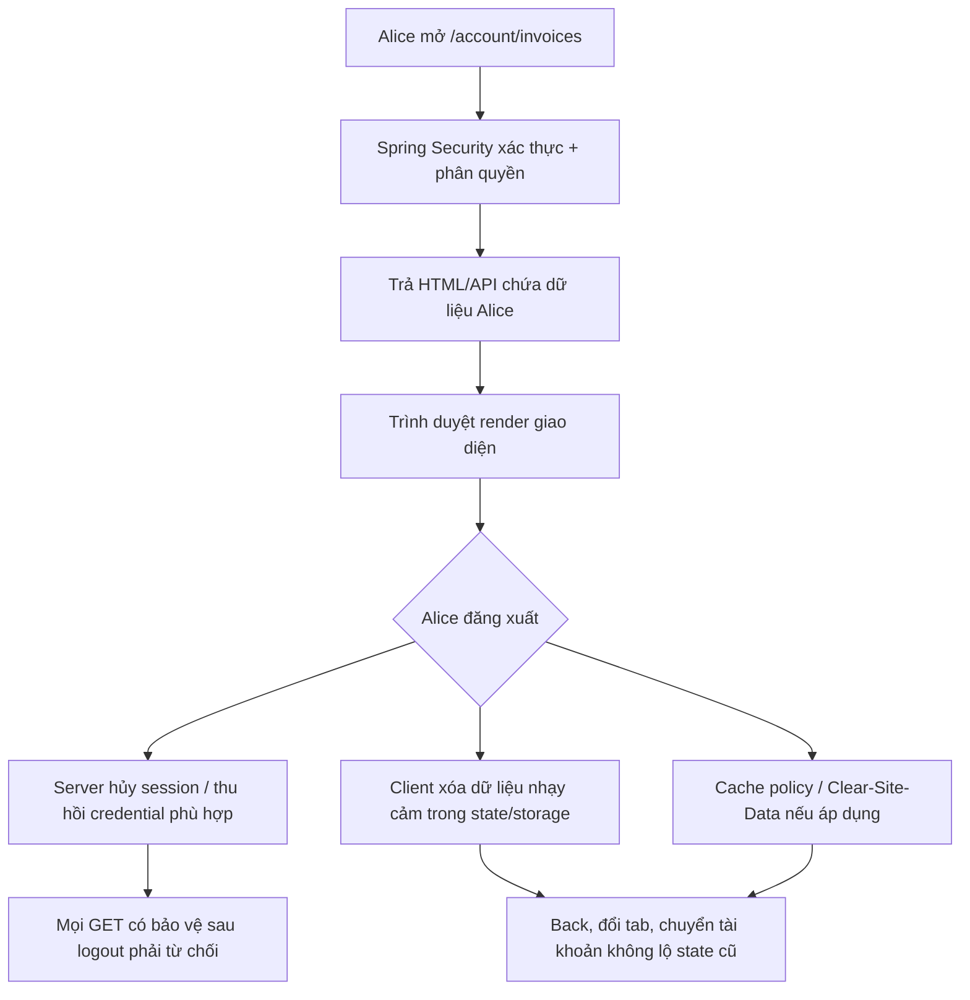
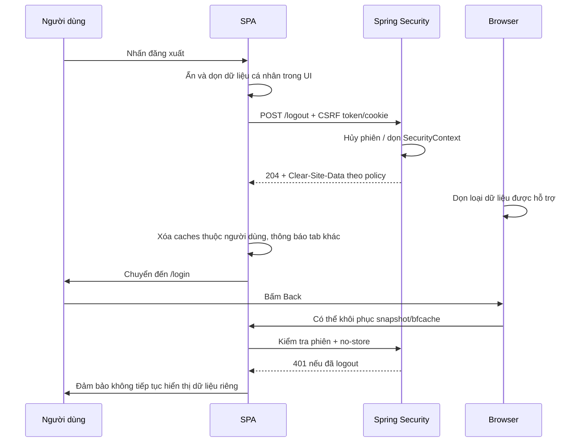

# Dữ liệu sau đăng xuất và giới hạn của chính sách cache

## 1. Vì sao đăng xuất rồi vẫn có thể nhìn thấy dữ liệu?

Một người dùng mở trang `/account`, xem thông tin cá nhân rồi nhấn **Đăng xuất**. Ứng dụng đã hủy session phía server, nhưng người tiếp theo dùng cùng trình duyệt nhấn **Back** và vẫn thấy tên, số dư hoặc đơn hàng của người trước. Tình huống này có thể xuất phát từ nhiều nơi: HTTP cache của trình duyệt, trạng thái SPA còn trong bộ nhớ JavaScript, back/forward cache (bfcache), dữ liệu trong `localStorage`/`IndexedDB`, cache do service worker chủ động tạo hoặc một reverse proxy/CDN đã lưu response sai chính sách.

**Logout thành công ở server không đồng nghĩa mọi bản sao dữ liệu đã biến mất khỏi thiết bị.** Ngược lại, việc giao diện vẫn hiển thị ảnh chụp trạng thái cũ cũng **không tự chứng minh** session còn hiệu lực. Phải kiểm tra độc lập hai câu hỏi:

1. **Quyền truy cập:** Sau logout, session/token cũ còn gọi được endpoint được bảo vệ không?
2. **Dữ liệu đã hiển thị hoặc lưu:** Trình duyệt/các lớp trung gian còn phát hoặc render dữ liệu nhạy cảm cũ không?

Bài thuộc chương **Bộ nhớ đệm và MIME** của mô-đun **SPRING_SECURITY_HTTP_PROTECTION**. Nội dung tập trung vào việc bảo vệ dữ liệu sau đăng xuất bằng Spring Security trên **Servlet và Reactive**, giải thích ranh giới của `Cache-Control`, phối hợp logout với bảo vệ session và thiết kế kiểm thử thực tế qua trình duyệt/CDN. Những lớp khác như CSRF, CORS, CSP, HSTS, HTTP firewall và `X-Content-Type-Options: nosniff` vẫn quan trọng nhưng không thay thế chính sách cache và vòng đời xác thực.

Sau bài học, bạn có thể:

- Phân biệt **HTTP cache**, **bfcache**, **SPA state**, **Web Storage**, **service worker** và **shared cache**; xác định cơ chế nào có thể giữ thông tin sau logout.
- Giải thích vì sao `Cache-Control: no-store` giúp ngăn HTTP cache lưu response nhạy cảm nhưng không bảo đảm xóa mọi dữ liệu đã hiện trên màn hình.
- Cấu hình và kiểm tra logout đúng cách trong Spring Security Servlet/WebFlux, bao gồm session, security context và dữ liệu phía client.
- Sử dụng `Clear-Site-Data` có cân nhắc phạm vi, hỗ trợ trình duyệt và ảnh hưởng tới các ứng dụng cùng site.
- Kiểm thử Back/Forward, nhiều tab, hết phiên, chuyển tài khoản, CDN và token bị thu hồi mà không nhầm response `304` với xác thực người dùng.
- Chẩn đoán theo từng tầng khi một trang cũ còn nhìn thấy sau logout.

## 2. Mô hình trạng thái cần bảo vệ khi logout

Giả sử Alice đã đăng nhập và trình duyệt đang hiển thị trang hóa đơn:



**Không một thao tác đơn lẻ nào giải quyết toàn bộ bài toán.** Ví dụ, chỉ gọi `session.invalidate()` không tự xóa một object JavaScript còn lưu trong tab; chỉ gọi `localStorage.clear()` không thu hồi session cookie đang được server chấp nhận; chỉ gửi `no-store` không buộc service worker do ứng dụng viết phải xóa `CacheStorage`.

### 2.1. Bảng các loại dữ liệu tồn tại

| Nơi giữ dữ liệu | Ví dụ | `Cache-Control: no-store` xử lý trực tiếp? | Việc cần làm khi logout |
| --- | --- | --- | --- |
| **HTTP cache riêng của browser** | Body response `GET /api/me` | **Có**, với cache tuân thủ chuẩn khi header đã có từ đầu | Gửi `no-store` trên response nhạy cảm; kiểm tra header cuối |
| **HTTP cache dùng chung** | Reverse proxy/CDN lưu HTML tài khoản | **Có** theo chuẩn, nếu proxy tuân thủ | `no-store` cộng bypass cache cho route có đăng nhập; purge bản cũ bị lưu sai |
| **Back/forward cache (bfcache)** | Snapshot toàn bộ trang, DOM và JS bị tạm dừng | **Không được bảo đảm** | Kiểm tra trạng thái khi `pageshow`, dọn nội dung nhạy cảm, thử Back/Forward |
| **State đang chạy của SPA** | Redux, Zustand, React Query, Angular service, JavaScript objects | **Không** | Xóa cache/store gắn với danh tính; thay layout bằng trang đăng nhập |
| **Web Storage** | `localStorage`, `sessionStorage`, `IndexedDB` | **Không** | Xóa các khóa và cơ sở dữ liệu chứa dữ liệu nhạy cảm theo thiết kế |
| **Service worker CacheStorage** | Runtime cache của `/api/account` do PWA tự ghi | **Không tự động** | Không đưa API riêng vào runtime cache; xóa bản cũ khi logout |
| **Cookie phiên** | `JSESSIONID`, cookie xác thực tùy chỉnh | **Không** | Vô hiệu phiên ở server; xóa cookie đúng Domain/Path/SameSite |
| **Access/refresh token** | Bearer token trong bộ nhớ/cookie/storage | **Không** | Xóa token phía client, thu hồi token/refresh token phía server khi thiết kế cho phép |
| **Tệp đã tải, bản sao chụp, logs** | PDF download, ảnh chụp, log proxy | **Không** | Chính sách kiểm soát tải xuống, vòng đời dữ liệu và truy cập độc lập |

Nếu dữ liệu nhạy cảm đã được lưu trước ngày ứng dụng bắt đầu trả `no-store`, **response header mới không xóa hồi tố** bản lưu đó. Khi sửa sự cố, cần xử lý cả cache đã tồn tại và các tab đang mở.

## 3. `no-store` làm được gì và không làm được gì?

Spring Security mặc định phát các header chống cache:

```http
Cache-Control: no-cache, no-store, max-age=0, must-revalidate
Pragma: no-cache
Expires: 0
```

Chỉ thị **`no-store`** yêu cầu HTTP cache tuân thủ RFC 9111 không lưu phần nào của response để tái sử dụng. `no-cache` có thể cho phép lưu nhưng yêu cầu revalidate; `max-age=0` khiến response không có độ tươi dương; `must-revalidate` áp điều kiện khi dùng bản stale. `Pragma` và `Expires` chủ yếu phục vụ tương thích với hệ thống cũ.

Với endpoint riêng tư, đặt một chính sách tường minh là cách làm dễ xác minh:

```http
HTTP/1.1 200 OK
Content-Type: application/json
Cache-Control: no-store

{"user":"alice","email":"alice@example.com"}
```

### 3.1. Ba giới hạn thiết yếu

**Giới hạn thứ nhất: dữ liệu đã render vẫn tồn tại.** Một ứng dụng SPA có thể giữ object chứa email trong bộ nhớ hoặc DOM sau khi logout. HTTP cache không tham gia vào việc các component React/Angular/Vue đang render thông tin đó.

**Giới hạn thứ hai: HTTP cache khác bfcache.** Back/forward cache có thể tạm giữ toàn bộ trang đang chạy để phục hồi khi điều hướng lịch sử. Chrome đã mở rộng khả năng dùng bfcache cho một số trang có `Cache-Control: no-store` nếu điều kiện an toàn cho phép; việc đổi cookie và một số tín hiệu xác thực có thể khiến trang bị loại khỏi bfcache theo cơ chế của trình duyệt, nhưng không nên xem đó là bảo đảm phổ quát trên mọi phiên bản/browser. Luôn kiểm thử và thiết kế giao diện khôi phục an toàn.

**Giới hạn thứ ba: các cache không tuân thủ hoặc nằm ngoài HTTP.** CDN có thể có quy tắc ép cache, còn service worker có thể chủ động `cache.put()` dù response nhạy cảm. `no-store` là chính sách cần thiết cho HTTP caching nhưng không phải cơ chế xóa mọi storage hoặc bù đắp cho cấu hình edge sai.

### 3.2. Không dùng `private` hoặc `no-cache` để thay thế `no-store` cho nội dung bí mật

```http
Cache-Control: private, no-cache
```

Chính sách này **vẫn cho phép browser lưu body**, miễn là phải xác thực lại khi dùng và shared cache không được lưu. Nó có thể phù hợp với cài đặt giao diện ít nhạy cảm; thường **không phù hợp** cho số dư, hóa đơn, danh sách khách hàng hoặc thông tin tài khoản mà người tiếp theo trên máy dùng chung không nên thấy.

```http
Cache-Control: private, max-age=60
```

Browser còn có thể dùng lại response fresh tối đa khoảng 60 giây mà không hỏi server. Nếu logout hay thu hồi quyền cần có hiệu lực tức thì với nội dung hiển thị, tránh áp thời hạn tươi cho dữ liệu đó.

### 3.3. `Clear-Site-Data` khác `no-store`

`no-store` điều khiển việc **có được lưu response mới** trong HTTP cache. `Clear-Site-Data` là **tín hiệu yêu cầu trình duyệt dọn dữ liệu đã lưu** thuộc phạm vi site/origin và loại dữ liệu được chỉ định, trên các trình duyệt hỗ trợ. Hai header có chức năng bổ sung nhau; `Clear-Site-Data` không thay thế việc vô hiệu phiên hoặc token ở server.

## 4. Logout thành công phải kết thúc quyền truy cập ở server

Trước khi xử lý màn hình cũ, cần chứng minh credential cũ không thể tiếp tục xem dữ liệu.

### 4.1. Logout dùng HTTP session trong Servlet

Với Spring Security Servlet và cấu hình logout mặc định phù hợp, yêu cầu `POST /logout` cùng CSRF token (khi CSRF được bật) sẽ chạy các `LogoutHandler`. Những tác vụ mặc định bao gồm hủy HTTP session, làm sạch `SecurityContext` và repository tương ứng, dọn thông tin remember-me/CSRF liên quan theo cấu hình, rồi redirect đến `/login?logout`.

`GET /logout` thường là trang xác nhận logout trong cấu hình có CSRF; **không nên thiết kế một link GET tự thay đổi trạng thái chỉ để tiện giao diện**. Sử dụng POST cùng CSRF token theo luồng đã cấu hình.

Sau logout, server phải từ chối request mới dùng session cũ:

```http
GET /api/account/me HTTP/1.1
Cookie: JSESSIONID=<old-session>
```

Kết quả tùy cơ chế xác thực: API có thể trả `401 Unauthorized`, còn ứng dụng dùng form login có thể redirect `302` về trang đăng nhập. Mục tiêu là **không còn trả body của Alice**. Một response từ browser cache không được dùng để suy rằng server đã từ chối hay chấp nhận credential: phải kiểm tra request thực đến origin.

### 4.2. Reactive logout và WebSession

Trong Spring Security WebFlux, mặc định logout làm sạch repository cho security context và CSRF token theo cấu hình. **Nếu ứng dụng dùng WebSession và muốn hủy WebSession khi logout**, tài liệu Spring Security hướng dẫn kết hợp thêm `WebSessionServerLogoutHandler`. Không suy đoán WebFlux tự động làm giống hệt việc invalidate `HttpSession` trong Servlet.

### 4.3. Token-based authentication và SSO

Với bearer JWT **tự chứa** và không có cơ chế tra cứu trạng thái, chỉ xóa JWT khỏi browser **không hủy hiệu lực mật mã của JWT đã bị sao chép**. Nếu yêu cầu thu hồi ngay, cần cơ chế phù hợp: hạn ngắn, denylist/revocation, khóa hoặc phiên bản session, opaque token qua introspection, và thu hồi refresh token. Cần xét độ trễ lan truyền tới các node và cache kiểm tra token.

Logout ở ứng dụng không nhất thiết logout khỏi mọi phiên tại Identity Provider (OIDC/SAML/SSO). Nếu cần single logout, phối hợp giao thức logout với IdP và xác nhận luồng trở về không tự đăng nhập lại ngoài ý muốn.

| Cơ chế đăng nhập | Việc phải xác minh sau logout |
| --- | --- |
| Form login + server session | Session bị vô hiệu, SecurityContext không còn, session cookie không cho truy cập |
| Remember-me cookie | Cookie/token remember-me bị loại bỏ/vô hiệu phù hợp |
| Stateless bearer JWT | Token/refresh token không còn được client dùng; nếu yêu cầu thu hồi tức thì thì backend có giải pháp thu hồi |
| OAuth2/OIDC SSO | Logout local và logout IdP nếu yêu cầu; xử lý redirect callback an toàn |
| WebFlux + WebSession | Security context/CSRF đã dọn; WebSession bị invalidate theo cấu hình mong muốn |

**Không được coi việc ẩn nút “Đăng xuất thành công” là kiểm chứng bảo mật.** Phải thử lại endpoint được bảo vệ bằng đúng credential cũ.

## 5. Dọn dữ liệu trình duyệt bằng `Clear-Site-Data`

`Clear-Site-Data` là response header cho phép website yêu cầu browser dọn một số loại dữ liệu trên trình duyệt hỗ trợ. Ví dụ:

```http
HTTP/1.1 204 No Content
Clear-Site-Data: "cache", "storage"
Cache-Control: no-store
```

Một số chỉ thị chính:

| Chỉ thị | Tác dụng yêu cầu | Cần cân nhắc |
| --- | --- | --- |
| `"cache"` | Dọn các cache cục bộ thuộc phạm vi áp dụng, gồm browser HTTP cache; một số loại bfcache/pre-render phụ thuộc trình duyệt | Không ảnh hưởng cache CDN/proxy |
| `"storage"` | Dọn DOM storage như `localStorage`, `sessionStorage`, `IndexedDB`, service worker registrations... theo hỗ trợ | Có thể làm mất dữ liệu offline, trạng thái chưa đồng bộ |
| `"cookies"` | Yêu cầu xóa cookie và một số credential HTTP liên quan; có thể ảnh hưởng phạm vi registered domain và subdomains | **Có thể logout các ứng dụng khác trên cùng site/domain** |
| `"executionContexts"` | Yêu cầu reload các browsing contexts phù hợp | Mức hỗ trợ và thời điểm reload tùy browser |
| `"*"` | Yêu cầu dọn mọi nhóm dữ liệu được hỗ trợ | Rộng nhất; chỉ dùng khi chính sách sản phẩm chấp nhận ảnh hưởng |

Các giá trị phải là **chuỗi có dấu nháy kép** đúng cú pháp, ví dụ `"cache"` chứ không phải `cache`. Header cần được gửi qua **HTTPS/secure context** và tính tương thích giữa trình duyệt có thể khác nhau. Browser có thể bỏ qua một phần directive không hỗ trợ; không coi header là bằng chứng duy nhất của việc đã xóa.

### 5.1. Chọn phạm vi dọn hợp lý

Với ứng dụng quản lý tài khoản chạy riêng tại `https://account.example.com`, có thể cân nhắc `"cache", "storage"` để dọn những bản lưu phía client mà ứng dụng không muốn giữ sau logout. Nếu muốn xóa cookie xác thực và ảnh hưởng tới hệ thống cùng registered domain đã được đánh giá, có thể thêm `"cookies"`.

**Cẩn trọng:** `"cookies"` có thể ảnh hưởng các subdomain khác của một registered domain. Tính năng này phải được đánh giá nếu `app.example.com` và `admin.example.com` dùng đăng nhập riêng; xóa mọi cookie của cả site có thể ảnh hưởng trải nghiệm hoặc phiên của các ứng dụng cùng nhóm domain.

Không bật `Clear-Site-Data: "*"` theo thói quen trên mọi response. Nó được thiết kế cho sự kiện như logout hoặc xóa dữ liệu có chủ đích; gửi trên API thông thường sẽ khiến browser liên tục dọn dữ liệu, làm hỏng trạng thái cần duy trì.

### 5.2. `Clear-Site-Data` không giải quyết mọi thứ

Ngay cả khi header được browser xử lý, hãy nhớ:

- Nó không thu hồi JWT đã lộ hoặc session chưa bị hủy tại server.
- Nó không purge bản lưu trên CDN/reverse proxy.
- Nó không xóa file người dùng đã lưu vào thư mục Downloads, ảnh chụp màn hình hoặc log của hệ thống khác.
- Nó không bảo đảm mọi trình duyệt/phiên bản sẽ xóa các loại dữ liệu giống nhau.
- Nếu logout chỉ xảy ra ở tab A, tab B có thể đang hiển thị UI cũ trong DOM/bộ nhớ; cần thiết kế cơ chế phối hợp tab và kiểm tra lại khi tab được khôi phục.
- Nếu frontend và API chạy ở **hai origin khác nhau**, header trên response của một origin không tự động xóa toàn bộ dữ liệu origin còn lại.

## 6. Spring Security Servlet: logout kèm dọn browser cache

Ví dụ Spring Security dùng session: `/api/account/me` cần đăng nhập; logout qua `POST /logout`; ứng dụng phát `Clear-Site-Data` trên phản hồi logout.

```java
import org.springframework.context.annotation.Bean;
import org.springframework.context.annotation.Configuration;
import org.springframework.security.config.annotation.web.builders.HttpSecurity;
import org.springframework.security.web.SecurityFilterChain;
import org.springframework.security.web.authentication.logout.HeaderWriterLogoutHandler;
import org.springframework.security.web.header.writers.ClearSiteDataHeaderWriter;
import org.springframework.security.web.header.writers.ClearSiteDataHeaderWriter.Directive;

@Configuration
class ServletSecurityConfig {

    @Bean
    SecurityFilterChain securityFilterChain(HttpSecurity http) throws Exception {
        var clearBrowserData = new HeaderWriterLogoutHandler(
            new ClearSiteDataHeaderWriter(Directive.CACHE, Directive.STORAGE));

        http
            .authorizeHttpRequests(auth -> auth
                .requestMatchers("/api/account/**", "/account/**")
                    .authenticated()
                .anyRequest().permitAll())
            .logout(logout -> logout
                .addLogoutHandler(clearBrowserData)
                .logoutSuccessUrl("/login?logout"));

        // Giữ CSRF và security headers mặc định.
        return http.build();
    }
}
```

Ví dụ sử dụng `ClearSiteDataHeaderWriter` từ Spring Security. Khi POST logout thành công, `HeaderWriterLogoutHandler` ghi header để client có thể xóa cache và storage. Tùy ứng dụng, có thể chọn `Directive.COOKIES` hoặc `Directive.ALL` sau khi đánh giá phạm vi. Với ứng dụng có trạng thái offline quan trọng, không xóa `STORAGE` một cách tùy tiện; có thể dùng cách dọn các khóa nhạy cảm ở frontend.

Security filter chain vẫn xử lý logout mặc định. **Không cần tự viết controller `@PostMapping("/logout")` chỉ để gọi `session.invalidate()`**, vì dễ bỏ sót làm sạch security context, remember-me hoặc CSRF.

### 6.1. Đặt `no-store` cho response tài khoản

Đảm bảo các response cá nhân có chính sách rõ ràng, kể cả khi ứng dụng đã tự đặt một số header cache khác:

```java
import java.util.Map;
import org.springframework.http.CacheControl;
import org.springframework.http.ResponseEntity;
import org.springframework.security.core.Authentication;
import org.springframework.web.bind.annotation.GetMapping;
import org.springframework.web.bind.annotation.RestController;

@RestController
class AccountController {

    @GetMapping("/api/account/me")
    ResponseEntity<Map<String, String>> me(Authentication authentication) {
        return ResponseEntity.ok()
            .cacheControl(CacheControl.noStore())
            .body(Map.of("user", authentication.getName()));
    }
}
```

`ResponseEntity.ok().cacheControl(CacheControl.noStore())` đặt `Cache-Control: no-store`. Trong Spring Security, khi ứng dụng đặt header cache riêng, writer mặc định không nhất thiết bổ sung `Pragma`/`Expires`. Đừng dựa vào việc thiếu `Pragma` để kết luận response không an toàn: **`no-store` là điều kiện chính cho HTTP cache hiện đại**.

Với nội dung HTML được render server-side, nên áp chính sách phù hợp cho cả response HTML riêng, không chỉ JSON mà trang gọi sau khi tải.

### 6.2. API trả 204 sau logout cho SPA

Nếu SPA muốn một status xác định thay vì nhận redirect, có thể dùng success handler của Spring Security:

```java
// Trong cấu hình http.logout(...):
.logout(logout -> logout
    .addLogoutHandler(clearBrowserData)
    .logoutSuccessHandler(
        new HttpStatusReturningLogoutSuccessHandler(HttpStatus.NO_CONTENT)))
```

Các class cần import là `org.springframework.security.web.authentication.logout.HttpStatusReturningLogoutSuccessHandler` và `org.springframework.http.HttpStatus`. Đây là **phương án thay thế** `logoutSuccessUrl(...)` ở cấu hình trước. Với CSRF mặc định, client vẫn phải gửi token hợp lệ trong POST logout.

**Lưu ý thứ tự:** Không viết một filter phía sau xóa mất `Clear-Site-Data` hoặc thay `Cache-Control` thành public trên phản hồi logout. Đo response cuối qua gateway/CDN, không chỉ nhìn code.

## 7. Spring WebFlux: logout và WebSession

Trong WebFlux, dùng `SecurityWebFilterChain`. Tài liệu Spring Security Reactive nêu rõ khi muốn hủy `WebSession` lúc logout, có thể kết hợp `SecurityContextServerLogoutHandler` và `WebSessionServerLogoutHandler` qua `DelegatingServerLogoutHandler`.

```java
import org.springframework.context.annotation.Bean;
import org.springframework.context.annotation.Configuration;
import org.springframework.http.HttpStatus;
import org.springframework.security.config.annotation.web.reactive.EnableWebFluxSecurity;
import org.springframework.security.config.web.server.ServerHttpSecurity;
import org.springframework.security.web.server.SecurityWebFilterChain;
import org.springframework.security.web.server.authentication.logout.DelegatingServerLogoutHandler;
import org.springframework.security.web.server.authentication.logout.SecurityContextServerLogoutHandler;
import org.springframework.security.web.server.authentication.logout.WebSessionServerLogoutHandler;

@Configuration
@EnableWebFluxSecurity
class ReactiveSecurityConfig {

    @Bean
    SecurityWebFilterChain securityWebFilterChain(ServerHttpSecurity http) {
        var logoutHandler = new DelegatingServerLogoutHandler(
            new SecurityContextServerLogoutHandler(),
            new WebSessionServerLogoutHandler());

        return http
            .authorizeExchange(auth -> auth
                .pathMatchers("/api/account/**", "/account/**")
                    .authenticated()
                .anyExchange().permitAll())
            .logout(logout -> logout
                .logoutHandler(logoutHandler)
                .logoutSuccessHandler((webFilterExchange, authentication) -> {
                    var response = webFilterExchange.getExchange().getResponse();
                    response.getHeaders().add(
                        "Clear-Site-Data", "\"cache\", \"storage\"");
                    response.setStatusCode(HttpStatus.NO_CONTENT);
                    return response.setComplete();
                }))
            .build();
    }
}
```

Đây là **phương án Reactive độc lập**, không chạy chung với filter chain và controller Servlet ở mục 6. Handler ở trên dùng `ServerLogoutSuccessHandler` dạng lambda để tạo response 204 và thêm header. `Clear-Site-Data` được đặt trước khi response commit. Chính sách ứng dụng thực có thể dùng cơ chế phân phát response khác và phải kiểm tra khả năng hỗ trợ header trên trình duyệt.

Với WebFlux, controller trả dữ liệu tài khoản có thể dùng `ResponseEntity` như Servlet:

```java
import java.security.Principal;
import java.util.Map;
import reactor.core.publisher.Mono;
import org.springframework.http.CacheControl;
import org.springframework.http.ResponseEntity;
import org.springframework.web.bind.annotation.GetMapping;
import org.springframework.web.bind.annotation.RestController;

@RestController
class ReactiveAccountController {

    @GetMapping("/api/account/me")
    Mono<ResponseEntity<Map<String, String>>> me(Mono<Principal> principal) {
        return principal.map(p -> ResponseEntity.ok()
            .cacheControl(CacheControl.noStore())
            .body(Map.of("user", p.getName())));
    }
}
```

API bảo vệ bằng `.authenticated()`. Nếu dữ liệu đến từ service, phải bổ sung phân quyền theo bản ghi, tenant và quyền hiện tại; cache header không thay thế việc đó.

## 8. SPA: dọn state, kiểm tra phiên khi trang được khôi phục

Một SPA có thể chứa dữ liệu đã render trong store dù logout endpoint thành công. Frontend nên xóa những trạng thái **gắn với người dùng** khi logout:

- Current user/profile, giỏ hàng riêng, danh sách giao dịch, cache dữ liệu của query client.
- Token nếu thiết kế còn lưu token ở client, thông tin người dùng trong `localStorage`/`sessionStorage`.
- Các object/cache IndexedDB hoặc service worker chứa dữ liệu riêng.
- Dữ liệu của tab khác: tùy kiến trúc, dùng `BroadcastChannel` hoặc `storage` event để thông báo logout giữa tab cùng origin.

**Không nên chạy `localStorage.clear()` một cách mù quáng** nếu cùng origin có dữ liệu cần giữ hoặc thuộc nhiều ứng dụng. Ưu tiên xóa các key có namespace và định rõ lifecycle; khi chủ động dùng `Clear-Site-Data: "storage"` thì phải chấp nhận việc xóa rộng hơn.

### 8.1. Kiểm tra khi trang trở về từ bfcache

Browser có thể khôi phục trang từ bfcache khi nhấn Back/Forward. Khi đó trang có thể xuất hiện với DOM/JS của thời điểm cũ mà không gửi request tải trang ngay. Event `pageshow` có thuộc tính `persisted` giúp phát hiện trường hợp browser phục hồi từ bfcache:

```javascript
window.addEventListener("pageshow", async (event) => {
  if (!event.persisted) return;

  // Endpoint này phải phản ánh phiên hiện tại, không cho HTTP cache lưu.
  try {
    const response = await fetch("/api/auth/session", {
      method: "GET",
      credentials: "include",
      cache: "no-store"
    });

    // Ví dụ API contract: 204 = còn phiên, 401 = hết phiên.
    if (response.status === 401) {
      clearSensitiveUserState();
      window.location.replace("/login");
    } else if (response.status === 204) {
      await refreshSensitiveUserState();
    } else {
      clearSensitiveUserState();
      window.location.replace("/login");
    }
  } catch {
    // Không tiếp tục hiển thị nội dung nhạy cảm chưa xác minh.
    clearSensitiveUserState();
    showSessionVerificationError();
  }
});
```

Các hàm `clearSensitiveUserState()`, `refreshSensitiveUserState()` và `showSessionVerificationError()` là **hàm ứng dụng cần tự triển khai**; đoạn mã mô tả kiến trúc, chưa phải chương trình độc lập chạy được. Route `/api/auth/session` cũng là endpoint do ứng dụng định nghĩa: phải trả `204` khi session hợp lệ, `401` khi không hợp lệ, không redirect sang trang HTML login. Tại origin, response phải có `Cache-Control: no-store` và yêu cầu được bảo vệ bằng policy thích hợp.

**Lưu ý về thời điểm hiển thị:** `pageshow` có thể chạy **sau khi snapshot DOM cũ đã xuất hiện**; muốn ngăn cả việc lóe nội dung, thiết kế giao diện bảo mật nên che/hide phần nhạy cảm trước khi điều hướng, dọn state ngay khi bắt đầu logout và kiểm tra phiên khi tab được foreground. Không phụ thuộc riêng event handler để bảo đảm không có khung hình dữ liệu cũ nào được vẽ.

### 8.2. Logout UI không được dựa vào một tín hiệu đơn lẻ

Luồng SPA có thể là:



Khi backend logout thất bại do mạng, không nên giả vờ rằng credential đã bị thu hồi hoàn toàn. UI có thể xóa dữ liệu nhạy cảm tạm thời, hiển thị trạng thái lỗi và thử lại theo quy tắc sản phẩm; để xác nhận logout thật sự phải kiểm tra trạng thái server và token.

### 8.3. Service worker và PWA

Nếu PWA sử dụng chiến lược `cache-first` hoặc `stale-while-revalidate` cho mọi GET, nó có thể vô tình lưu response API tài khoản vào `CacheStorage`. Đây là logic **do ứng dụng viết**, HTTP cache header không tự bảo đảm service worker tuân thủ `no-store`.

Cách làm an toàn là **chỉ allowlist asset public** cho runtime caching (JS/CSS/font/ảnh công khai). Không cache URL `/api/account/**`, `/api/me`, `/dashboard` có dữ liệu riêng. Nếu trước đây PWA đã lưu dữ liệu nhạy cảm, khi logout phải xóa các cache thuộc người dùng và kiểm tra tab khác; với `Clear-Site-Data: "storage"`, một số browser có thể unregister service worker và xóa storage rộng hơn nên cần kiểm thử quy trình offline.

## 9. Shared cache sau logout: vấn đề ở CDN và reverse proxy

Spring Security chỉ thực thi phân quyền khi request đến ứng dụng. Nếu reverse proxy/CDN phát lại một response cá nhân hóa đã lưu, request có thể không qua Spring Security. Do đó, an toàn sau logout đòi hỏi **không lưu response nhạy cảm ở shared cache ngay từ đầu**.

Ví dụ sai:

```text
Cache key = Host + Path
GET /api/me (Alice) -> origin -> 200 Alice -> CDN lưu
GET /api/me (Bob)   -> CDN HIT -> 200 Alice
```

Ví dụ chính sách đúng về ý tưởng:

```text
/assets/**, public immutable: cho phép CDN cache theo URL đã version hóa
/public/**, public resources: cache có TTL/biến thể phù hợp
/api/account/**, /api/me, /dashboard, /logout: BYPASS shared cache
DEFAULT: không tự động cache mọi GET
```

`Vary: Cookie` hoặc `Vary: Authorization` chỉ giúp chọn biến thể request trong các điều kiện HTTP, **không thay cho `private`/`no-store` hoặc phân quyền**. Cookie hoặc `Set-Cookie` cũng không phải một tuyên bố chuẩn rằng mọi shared cache đều bị cấm lưu. Hãy kiểm tra cấu hình edge thật, nhất là các rule “Cache Everything”, “Cache GET by extension” hay “Override Origin”.

### 9.1. Logout không xóa cache CDN

`Clear-Site-Data` chỉ hướng tới dữ liệu trên **trình duyệt** hỗ trợ. Nó **không** gửi lệnh purge đến CDN. Nếu proxy/CDN trước đây đã cache sai dữ liệu Alice, đổi header ở Spring không đủ để chắc chắn bản lưu cũ đã biến mất; cần sửa rule, vô hiệu hóa bản lưu liên quan và kiểm thử lại.

### 9.2. Cache key và đường dẫn khác thường

Kịch bản **web cache deception** xuất hiện khi ứng dụng trả nội dung riêng cho một URL nhưng CDN lại coi URL đó như file tĩnh và ép cache theo phần mở rộng, ví dụ đường dẫn động có hậu tố `.css`. Đừng dựa duy nhất vào đuôi file khi cho phép shared cache; dùng allowlist tài nguyên thực sự công khai và kiểm thử route bất thường trong môi trường được phép.

## 10. `304 Not Modified` sau logout có thể gây hiểu lầm

Với response `Cache-Control: private, no-cache`, browser **có thể lưu** body đã tải và gửi `If-None-Match` để revalidate. Origin trả `304 Not Modified` khi validator khớp, giúp browser tái sử dụng body đã lưu.

Ví dụ request:

```http
GET /api/preferences HTTP/1.1
If-None-Match: "alice-pref-r7"
Cookie: JSESSIONID=<old-session>
```

Sau logout, **không được trả 304 chỉ vì chuỗi ETag khớp**. Trước hết phải kiểm tra session/credential còn hiệu lực và người gọi có được phép xem biểu diễn hiện tại không. Với phiên đã hủy, API có thể trả `401`; với form login có thể redirect, nhưng tuyệt đối không dùng validator để bỏ qua authorization.

Một số nhầm lẫn thường gặp:

| Tình huống | Điều đúng |
| --- | --- |
| `304` không có body nên “an toàn tuyệt đối” | Sai: cache có thể dùng body lưu từ `200` trước đó |
| `no-cache` nghĩa là không lưu | Sai: vẫn có thể lưu và revalidate |
| `no-store` đảm bảo mọi snapshot cũ biến mất | Sai: không điều khiển toàn bộ bfcache, JS state, file tải xuống |
| ETag chung cho cùng URL giữa Alice và Bob | Nguy hiểm nếu không xác định đúng biểu diễn/người dùng và kiểm tra quyền |
| Response `401` sau logout nhưng UI vẫn thấy dữ liệu cũ | Backend có thể đã an toàn; cần kiểm tra client state, browser history và service worker |
| `private` tự động xóa browser cache khi logout | Sai: private cache vẫn có thể lưu cho đến khi bị loại bỏ theo cơ chế của nó |

Với dữ liệu rất nhạy cảm, **`no-store` thường dễ bảo vệ và kiểm chứng hơn việc giữ body trong cache rồi phụ thuộc revalidation**.

## 11. Kiểm thử sau đăng xuất trên Servlet và Reactive

### 11.1. Kiểm thử với HTTP client

Bài kiểm tra cần một tài khoản thử nghiệm và cookie/token phiên thử nghiệm được cấp hợp lệ. Với API có auth, tải dữ liệu trước logout:

```bash
curl -i \
  -H 'Cookie: JSESSIONID=<test-session>' \
  'https://app.example.com/api/account/me'
```

Kỳ vọng: `200` với body tài khoản thử và `Cache-Control` chứa `no-store`.

Gửi `POST /logout` **kèm CSRF token** nếu CSRF protection bật; cụ thể cách lấy token/cookie phụ thuộc flow ứng dụng. Với success handler trả 204, response ví dụ:

```http
HTTP/1.1 204 No Content
Clear-Site-Data: "cache", "storage"
Cache-Control: no-cache, no-store, max-age=0, must-revalidate
```

Sau đó dùng **cùng credential cũ** gọi lại `GET /api/account/me` qua đúng đường origin/edge. API phải từ chối hoặc chuyển về login theo cơ chế bảo mật; không trả body riêng cũ.

`curl` không tự quản lý browser HTTP cache, không tạo bfcache và không xử lý `Clear-Site-Data` như browser, vì vậy bài thử bằng `curl` chỉ kiểm tra **response, việc hết quyền truy cập và header truyền qua mạng**.

### 11.2. MockMvc: kiểm tra header logout và response riêng

Với Spring Boot Test, MockMvc và `spring-security-test` đã gắn Security filter chain:

```java
import static org.hamcrest.Matchers.containsString;
import static org.springframework.security.test.web.servlet.request
    .SecurityMockMvcRequestPostProcessors.csrf;
import static org.springframework.security.test.web.servlet.request
    .SecurityMockMvcRequestPostProcessors.user;
import static org.springframework.test.web.servlet.request
    .MockMvcRequestBuilders.get;
import static org.springframework.test.web.servlet.request
    .MockMvcRequestBuilders.post;
import static org.springframework.test.web.servlet.result
    .MockMvcResultMatchers.*;

import org.junit.jupiter.api.Test;
import org.springframework.beans.factory.annotation.Autowired;
import org.springframework.boot.test.autoconfigure.web.servlet.AutoConfigureMockMvc;
import org.springframework.boot.test.context.SpringBootTest;
import org.springframework.http.HttpHeaders;
import org.springframework.test.web.servlet.MockMvc;

@SpringBootTest
@AutoConfigureMockMvc
class ServletLogoutHeadersTest {

    @Autowired MockMvc mvc;

    @Test
    void personalApiMustNotBeStored() throws Exception {
        mvc.perform(get("/api/account/me").with(user("alice")))
            .andExpect(status().isOk())
            .andExpect(header().string(
                HttpHeaders.CACHE_CONTROL, containsString("no-store")))
            .andExpect(jsonPath("$.user").value("alice"));
    }

    @Test
    void logoutResponseAsksBrowserToClearSelectedData() throws Exception {
        mvc.perform(post("/logout").with(user("alice")).with(csrf()))
            .andExpect(status().is3xxRedirection())
            .andExpect(header().string(
                "Clear-Site-Data", containsString("\"cache\"")));
    }
}
```

Test trên dùng cấu hình `logoutSuccessUrl("/login?logout")` ở mục 6. Nếu đổi sang success handler 204 ở mục 6.2, phải sửa assertion status thành `isNoContent()`. Các test này **kiểm tra header trong application**, không chứng minh session thực tế đã bị hủy giữa hai request độc lập khi chỉ dùng `with(user(...))` để giả lập principal cho từng request.

Muốn kiểm tra tính hiệu lực logout ở server, hãy bổ sung **kiểm thử tích hợp theo chuỗi**: đăng nhập thật qua cơ chế test, lưu session/cookie do server cấp, POST logout, rồi gửi lại chính session/cookie đó và xác nhận không nhận được dữ liệu. Chỉ assert `Clear-Site-Data` là chưa đủ.

### 11.3. WebFlux: kiểm tra response và invalidation của WebSession

Trong WebFlux, có thể dùng `WebTestClient` đã gắn `springSecurity()` và `mockUser` để xác nhận policy của controller:

```java
client.mutateWith(mockUser("alice"))
    .get().uri("/api/account/me")
    .exchange()
    .expectStatus().isOk()
    .expectHeader().valueMatches("Cache-Control", ".*no-store.*")
    .expectBody().jsonPath("$.user").isEqualTo("alice");
```

Với logout handler tùy chỉnh ở mục 7, cần kiểm tra `POST /logout` có CSRF token/cơ chế test phù hợp và response `204` chứa `Clear-Site-Data`, rồi dùng WebSession thực từ flow đăng nhập để xác minh WebSession đã bị invalidate. `mockUser` trên một request không tự chứng minh vòng đời của WebSession qua nhiều request.

### 11.4. Ma trận kiểm thử trình duyệt và CDN

| Tình huống | Bước thử | Kỳ vọng bảo mật |
| --- | --- | --- |
| Logout thường | Alice xem hồ sơ → POST logout → GET hồ sơ | API từ chối credential cũ, không trả dữ liệu Alice |
| Back/Forward | Đăng xuất rồi Back/Forward đến trang riêng | Không tiếp tục để lộ nội dung riêng sau khi xác minh trạng thái; kiểm tra cả thời điểm render snapshot |
| Hai tab | Tab A logout, tab B đang mở dashboard | Tab B dọn hoặc che state và xác minh lại phiên trước khi cho thao tác/hiển thị tiếp |
| Chuyển tài khoản | Alice logout, Bob login cùng trình duyệt | Store/cache không trộn dữ liệu Alice với Bob |
| Session hết hạn tự nhiên | Để session expire khi tab vẫn mở | Gọi API tiếp theo bị từ chối, UI không giữ state như còn đăng nhập |
| Refresh token thu hồi | Logout rồi thử refresh token cũ | Backend không cấp credential mới trái thiết kế |
| PWA/offline | Bật offline, logout hoặc chuyển tài khoản | Không phát lại màn hình/API nhạy cảm do service worker cache |
| CDN | Alice/Bob gọi cùng URL qua edge | Không shared-cache body theo người dùng; `no-store` không bị override |
| ETag | Sau logout gửi validator cũ | Không trả `304` mà bỏ qua xác thực/phân quyền |
| Browser khác nhau | Chrome/Edge/Firefox/Safari, mobile nếu cần | Không suy từ một trình duyệt sang mọi trình duyệt |
| Download | Tải tài liệu cá nhân rồi logout | Phân biệt file đã tải với HTTP cache; giải thích chính sách tải xuống |

Khi quan sát browser, mở Network/Storage panels và kiểm tra `Cache-Control`, `Clear-Site-Data`, response status, `Age`, service worker và dữ liệu lưu. Thử với **Disable cache tắt** để thấy hành vi browser cache thật; nếu bật nó trong DevTools, kết luận về cache dễ bị sai.

## 12. Chẩn đoán các hiện tượng sau logout

| Triệu chứng | Nguyên nhân có thể | Cách xử lý |
| --- | --- | --- |
| Back hiển thị tên Alice dù API trả `401` | Bfcache, DOM snapshot, SPA state hoặc browser HTTP cache cũ | Dọn và che dữ liệu trước logout, dùng `no-store`, xử lý `pageshow`, kiểm tra state sau restore |
| GET hồ sơ với session cũ vẫn trả `200` từ origin | Logout chưa hủy session/security context; token vẫn hợp lệ; remember-me tự đăng nhập | Sửa logout handler, session/token revocation, kiểm tra các bước logout thực |
| API trả `401` ở origin nhưng edge vẫn phát `200` | CDN/reverse proxy đã cache sai body riêng | Bypass và `no-store`, purge bản lưu bị ảnh hưởng, kiểm thử hai tài khoản |
| `Clear-Site-Data` có nhưng `localStorage` chưa xóa | Browser không hỗ trợ directive, HTTP không secure, header sai cú pháp hoặc origin khác | Kiểm tra header quote/HTTPS/khả năng hỗ trợ, có kế hoạch dọn client theo ứng dụng |
| Logout ở một app làm app khác mất phiên | `"cookies"` dọn phạm vi rộng cùng registered domain | Thiết kế lại phạm vi header/cookie, tách origin/domain hoặc thu hẹp chỉ thị |
| Tab cũ vẫn chứa data sau khi tab khác logout | Không có cơ chế đồng bộ logout giữa tab; state vẫn trong JS | Broadcast logout, dọn state, kiểm tra phiên khi tab active |
| JWT vẫn gọi được API dù UI đã logout | Client xóa token nhưng server không có cơ chế thu hồi và JWT chưa hết hạn | Thiết kế revocation/TTL/introspection theo yêu cầu rủi ro |
| Trang chỉ có `no-cache` nhưng browser giữ response | `no-cache` cho phép lưu, chỉ buộc revalidation | Dùng `no-store` nếu phải ngăn lưu body |
| `304` xuất hiện sau khi quyền đổi | Xử lý validator trước kiểm tra quyền hoặc dùng ETag không đúng biểu diễn | Đặt authorization trước conditional response; thử nhiều người |
| Logout xóa service worker, chế độ offline ngừng hoạt động | `Clear-Site-Data: "storage"` có thể dọn SW registration | Thống nhất chính sách offline với bảo mật; re-register theo flow hoặc chỉ dọn key cần thiết |
| Response logout thiếu `Clear-Site-Data` sau CDN | Header không được ghi ở đúng nhánh hoặc bị proxy bỏ | Kiểm tra logout handler/status, trace origin tới edge, loại policy ghi đè |
| Browser hiện thông tin từ file Downloads | Dữ liệu nằm ngoài HTTP cache | Kiểm soát xuất file/tải xuống và hướng dẫn sử dụng thiết bị chung |

**Cách khoanh vùng:** Đầu tiên dùng một credential cũ gọi API qua **origin**; sau đó qua **edge**; cuối cùng xem browser/SPA. Nếu origin vẫn cho phép truy cập, lỗi ở logout/session/token. Nếu origin từ chối nhưng edge phát body cũ, lỗi ở shared cache. Nếu cả hai từ chối nhưng màn hình còn dữ liệu, tìm ở browser state/bfcache/storage hoặc file đã tải.

## 13. Bài tập tình huống

Một ứng dụng quản lý nhân sự dùng Spring Security và SPA. Alice xem phiếu lương tại `GET /api/payroll/me`. Sau khi nhấn logout, ứng dụng hiện trang login. Bob đăng nhập vào **cùng trình duyệt** rồi nhấn Back và thấy phần tử DOM có mức lương Alice. Đội phát triển kiểm tra Network thì thấy request mới tới API đã bị từ chối `401`. CDN hiện cấu hình “cache mọi GET trong 10 phút”; frontend có service worker dùng `cache-first` cho tất cả request `GET`.

**Yêu cầu thực hành:**

1. Nêu ít nhất ba nguồn dữ liệu có thể khiến mức lương cũ xuất hiện dù `401` cho thấy session cũ đã mất quyền ở origin.
2. Đặt policy `Cache-Control` cho HTML/JSON riêng tư và cho bundle JS công khai có hash.
3. Sửa quy tắc service worker và CDN để không lưu/phát lại API cá nhân.
4. Bổ sung quy trình logout an toàn trên Servlet hoặc Reactive, kiểm tra việc hủy phiên/credential và thử `Clear-Site-Data` với phạm vi đã đánh giá.
5. Thiết kế bài thử với hai tab và hai tài khoản; giải thích vì sao kiểm thử `POST /logout` thành công **không đủ**.
6. Giải thích khi nào `pageshow.persisted` có ích và vì sao không thể chỉ dựa vào nó để bảo đảm không có một khung hình dữ liệu cũ bị hiển thị.
7. Nếu ứng dụng dùng JWT tự chứa, xác định biện pháp cần bổ sung khi chính sách yêu cầu token cũ mất hiệu lực ngay.

**Định hướng đáp án:** HTTP cache cũ, DOM/SPA state, bfcache, `localStorage` và PWA `CacheStorage` đều là ứng viên. Dữ liệu lương cần `no-store`, shared cache bypass, service worker không cache API riêng. Logout phải thu hồi session hoặc token phù hợp; frontend dọn state nhạy cảm, đồng bộ giữa tab và kiểm tra phiên khi khôi phục. `Clear-Site-Data` là biện pháp bổ sung tùy trình duyệt và phạm vi. JWT phải có phương án thu hồi ở server nếu yêu cầu chặn ngay. Kiểm thử hoàn tất khi credential cũ không còn truy cập được API **và** Alice không còn bị lộ trong các ngữ cảnh giao diện của Bob.

## Tài liệu tham khảo

- [Spring Security — Default HTTP Response Headers](https://docs.spring.io/spring-security/reference/features/exploits/headers.html): `no-store` và các header bảo vệ cache mặc định.
- [Spring Security — Servlet Logout](https://docs.spring.io/spring-security/reference/servlet/authentication/logout.html): quy trình logout, session invalidation và `Clear-Site-Data` qua `HeaderWriterLogoutHandler`.
- [Spring Security — Reactive Logout](https://docs.spring.io/spring-security/reference/reactive/authentication/logout.html): `SecurityContextServerLogoutHandler`, `WebSessionServerLogoutHandler` và logout trong WebFlux.
- [Spring Security — Servlet Session Management](https://docs.spring.io/spring-security/reference/servlet/authentication/session-management.html): session invalidation và việc xóa cookie.
- [RFC 9111 — HTTP Caching](https://www.rfc-editor.org/rfc/rfc9111.html): `no-store`, `private`, `no-cache` và shared cache.
- [MDN — Clear-Site-Data](https://developer.mozilla.org/en-US/docs/Web/HTTP/Reference/Headers/Clear-Site-Data): các directive, HTTPS, phạm vi và khả năng hỗ trợ trình duyệt.
- [web.dev — Back/forward cache](https://web.dev/articles/bfcache): snapshot trang, `pageshow.persisted` và xử lý dữ liệu nhạy cảm khi khôi phục.
- [Chrome Developers — Enabling bfcache for Cache-Control: no-store](https://developer.chrome.com/docs/web-platform/bfcache-ccns): thay đổi cách Chrome áp dụng bfcache trên một số trang `no-store`.
- [MDN — HTTP Caching](https://developer.mozilla.org/en-US/docs/Web/HTTP/Guides/Caching): HTTP caching, revalidation và browser cache.
