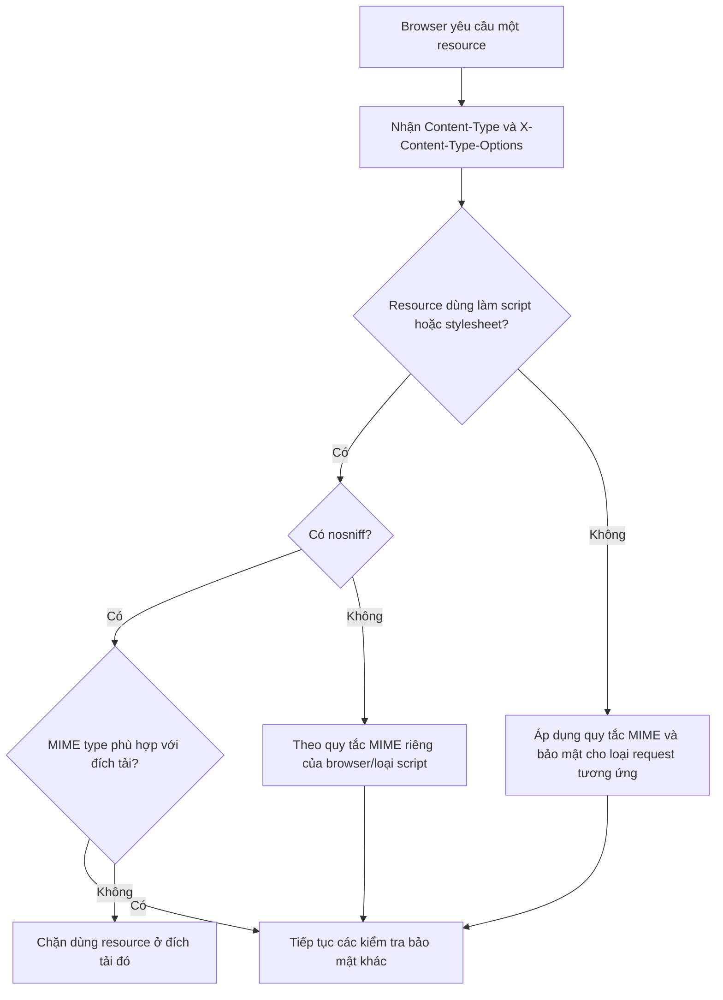
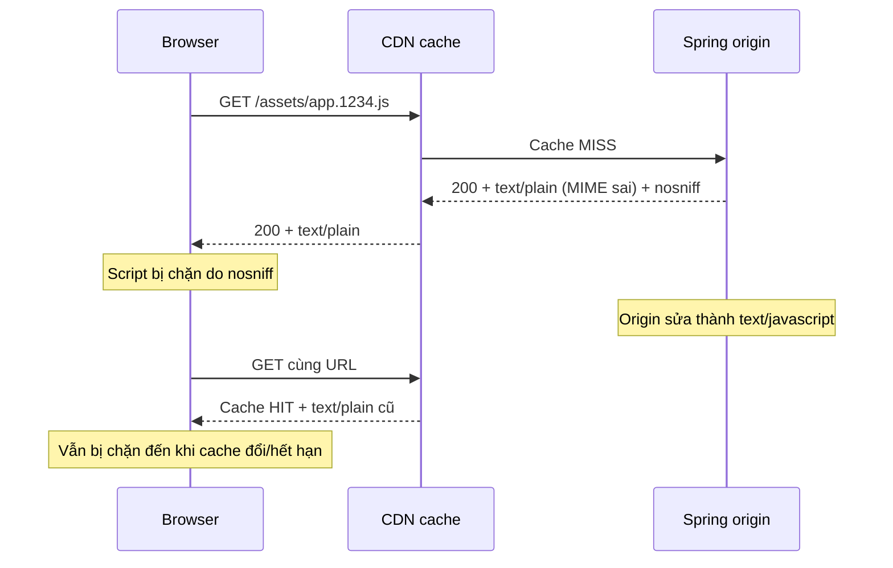

# X-Content-Type-Options và nosniff

## 1. Bối cảnh: cùng một response, trình duyệt có thể hiểu theo nhiều cách

Ứng dụng Spring Security phục vụ trang web thường gửi nhiều kiểu nội dung: HTML, JavaScript, CSS, JSON, ảnh, font và tài liệu tải xuống. Máy chủ dùng header **`Content-Type`** để cho biết kiểu dữ liệu của response (MIME type). Ví dụ:

```http
HTTP/1.1 200 OK
Content-Type: text/css

body { color: #16324f; }
```

Nếu `Content-Type` bị thiếu hoặc sai, một số trình duyệt có thể cố **đoán kiểu nội dung từ bytes** (*MIME sniffing*). Với resource có thể thực thi, đoán nhầm có thể mở ra các con đường thực thi mã không mong muốn. Để giảm rủi ro đó, Spring Security mặc định phát:

```http
X-Content-Type-Options: nosniff
```

Header này yêu cầu trình duyệt tôn trọng kiểu MIME đã khai báo trong các tình huống mà tiêu chuẩn quy định, thay vì tự diễn giải nội dung sai kiểu như script hoặc stylesheet.

Bài thuộc chương **Bộ nhớ đệm và MIME** của mô-đun **SPRING_SECURITY_HTTP_PROTECTION**. Phạm vi mô-đun là cấu hình các lớp phòng vệ HTTP và trình duyệt trong Spring Security, từ CSRF, CORS, CSP, HSTS, HTTP firewall đến bảo vệ session, cho cả **Servlet** lẫn **Reactive**. Trọng tâm ở đây là `X-Content-Type-Options`, nguy cơ MIME sniffing, quan hệ với tài nguyên được cache, cấu hình Spring MVC/WebFlux và cách chẩn đoán khi browser chặn script/CSS trong triển khai.

### Kết quả học tập

Sau bài này, bạn có thể:

1. Giải thích vai trò của `Content-Type`, MIME type, MIME sniffing và `X-Content-Type-Options: nosniff`.
2. Dự đoán phản ứng của trình duyệt khi **script** hoặc **stylesheet** được trả với MIME type sai.
3. Phân biệt cơ chế bảo vệ của `nosniff` với CSP, CORS, CORP, bảo vệ upload và kiểm soát truy cập.
4. Giữ hoặc cấu hình header mặc định của Spring Security trên Servlet/WebFlux, đồng thời thiết lập MIME type đúng cho nội dung được phục vụ.
5. Kiểm thử với MockMvc, WebTestClient, `curl` và trình duyệt thật; tìm điểm sai khi reverse proxy/CDN thay đổi header hoặc cache response cũ.
6. Đưa ra chính sách cho script/CSS công khai, JSON riêng tư và file người dùng tải lên mà không dựa vào một header duy nhất.

## 2. MIME type là gì?

MIME type mô tả loại dữ liệu của representation HTTP. Header `Content-Type` có cú pháp thường gặp:

```http
Content-Type: type/subtype
Content-Type: type/subtype; charset=UTF-8
```

Một vài ví dụ:

| Nội dung | MIME type thường dùng | Lưu ý |
| --- | --- | --- |
| HTML | `text/html; charset=UTF-8` | HTML được điều hướng như trang có thể chứa script, form và tài nguyên nhúng |
| CSS | `text/css` | Stylesheet phải được phục vụ đúng kiểu này |
| JavaScript | `text/javascript` | Kiểu JavaScript chuẩn được khuyến nghị cho trình duyệt hiện đại |
| JSON | `application/json` | Dữ liệu, không phải JavaScript module hoặc stylesheet |
| Plain text | `text/plain; charset=UTF-8` | Không tự động phải được thực thi như script |
| SVG | `image/svg+xml` | SVG có đặc tính nội dung chủ động trong một số ngữ cảnh; thận trọng với SVG không đáng tin |
| PNG | `image/png` | Không thể dựa vào tên `.png` nếu bytes không thực sự là PNG |
| JPEG | `image/jpeg` | Dùng MIME chính xác cho ảnh |
| WOFF2 font | `font/woff2` | Font là loại tài nguyên khác với script và stylesheet |
| PDF | `application/pdf` | Nếu là tài liệu riêng tư, thêm kiểm soát quyền và chính sách cache thích hợp |
| Download nhị phân chưa xác định | `application/octet-stream` | Có thể dùng cùng `Content-Disposition: attachment` để khuyến khích tải xuống |

**Tên file không phải nguồn sự thật duy nhất.** Đường dẫn `/assets/app.js` có thể trả HTML trang đăng nhập vì cấu hình gateway sai; ngược lại, `/uploads/payload.txt` có thể chứa bytes JavaScript. Trình duyệt nhìn vào **response thực nhận**, đặc biệt `Content-Type` và ngữ cảnh tải tài nguyên, chứ không chỉ phần mở rộng URL.

`Content-Type` trên request cũng có ý nghĩa, ví dụ body JSON gửi tới API phải có `Content-Type: application/json`. Nhưng `nosniff` là **response header định hướng hành vi xử lý tài nguyên tại trình duyệt**, không thay thế việc server kiểm tra request content type hoặc validate dữ liệu đầu vào.

## 3. MIME sniffing và nguy cơ bảo mật

*MIME sniffing* là quá trình user agent suy đoán loại nội dung bằng cách xem bytes hoặc áp dụng thuật toán phát hiện kiểu, thay vì chỉ tin vào MIME type đã khai báo. Việc suy đoán có thể cải thiện tương thích với website cũ, nhưng nếu có nội dung do người dùng không đáng tin cậy kiểm soát, nó cũng có thể dẫn đến thực thi nội dung ngoài dự kiến.

### 3.1. Kịch bản: file upload bị dùng như script

Giả sử website cho khách hàng tải lên file `notes.txt`, lưu cùng origin với ứng dụng:

```http
HTTP/1.1 200 OK
Content-Type: text/plain

console.log("Dữ liệu minh họa được tải như mã");
```

Nếu một trang HTML hoặc một đường tấn công có thể nhúng URL này làm script và một trình duyệt tự diễn giải `text/plain` như JavaScript, nội dung không đáng tin có nguy cơ được thực thi trong ngữ cảnh website. Với:

```http
X-Content-Type-Options: nosniff
```

trình duyệt tuân thủ cơ chế này phải từ chối dùng response `text/plain` làm **script** vì MIME type không phải JavaScript MIME type hợp lệ.

Đây là ví dụ đơn giản để hiểu **mục tiêu phòng vệ**, không phải khẳng định mọi trình duyệt ngày nay đều thực thi JavaScript sai MIME nếu không có `nosniff`. Nhiều chính sách MIME hiện đại đã chặt hơn, đặc biệt với JavaScript modules. `nosniff` vẫn có giá trị như một lớp bảo vệ bổ sung và khai báo rõ kỳ vọng của máy chủ.

### 3.2. Kịch bản: API JSON bị yêu cầu như script

Response từ API:

```http
HTTP/1.1 200 OK
Content-Type: application/json
X-Content-Type-Options: nosniff

{"name":"Alice","orders":3}
```

Đây là dữ liệu JSON, không phải JavaScript resource. Khi URL này được nhúng như một **script** thông thường, `nosniff` khiến browser áp dụng kiểm tra MIME cho script và không thực thi response với `application/json` như JavaScript.

Tuy vậy, `nosniff` **không phải phương án duy nhất để giữ bí mật JSON**. Nếu API có dữ liệu cá nhân, vẫn phải thực hiện authentication/authorization, sử dụng policy cache phù hợp (`no-store`), thiết kế CORS và xử lý cookie/token đúng cách. Với một request được phép đọc bằng `fetch()`, `nosniff` không cấm JavaScript đọc JSON chỉ vì resource không phải script: chính **same-origin policy/CORS, quyền của server và cơ chế fetch** mới quyết định.

### 3.3. Kịch bản: stylesheet bị trả sai MIME

Một file CSS được phục vụ như plain text:

```http
HTTP/1.1 200 OK
Content-Type: text/plain
X-Content-Type-Options: nosniff

main { display: grid; }
```

Khi được nhúng qua `<link rel="stylesheet" ...>`, browser sẽ từ chối dùng response đó như stylesheet trong trường hợp cần `text/css`. Kết quả có thể là website **mất định dạng**. Điều này thường bị nhầm là “Spring Security làm hỏng CSS”; nguyên nhân thực tế là **MIME type không đúng**, và `nosniff` đang làm đúng nhiệm vụ.

### 3.4. Sơ đồ quyết định ở browser



Sơ đồ giản lược để nhấn mạnh ngữ cảnh **script/style**. Kiểm tra MIME còn phụ thuộc loại script (classic/module), mode, CORS, CSP và quy tắc chuẩn khác; `nosniff` không biến mọi request thành “phải có đúng một MIME type duy nhất”.

## 4. Chính xác `X-Content-Type-Options: nosniff` làm gì?

Cú pháp chủ yếu được dùng trong thực tế:

```http
X-Content-Type-Options: nosniff
```

Tên header lịch sử có tiền tố `X-`, còn `nosniff` là giá trị được đặc tả và triển khai. Không đặt `X-Content-Type-Options: no-sniff` hoặc `X-Content-Type-Options: true` rồi mong browser hiểu như nhau.

### 4.1. Với script và stylesheet

Theo mô hình Fetch/MIME của trình duyệt hiện đại, giá trị `nosniff` có tác động rõ ràng khi request có đích tải là:

- **`script`:** Chặn response có MIME type không thuộc JavaScript MIME types được công nhận.
- **`style`:** Chặn response có MIME type không phải `text/css`.

Ví dụ đối chiếu:

| Resource được tải | `Content-Type` response | Có `nosniff` | Kết quả mong đợi khi dùng đúng ngữ cảnh |
| --- | --- | --- | --- |
| `<script src="/app.js">` | `text/javascript` | Có | MIME hợp lệ để xét thực thi script; CSP và các điều kiện khác vẫn áp dụng |
| `<script src="/app.js">` | `text/plain` | Có | **Bị chặn** do MIME sai |
| `<script src="/data.json">` | `application/json` | Có | **Bị chặn** khi dùng làm script |
| `<link rel="stylesheet" href="/app.css">` | `text/css` | Có | MIME hợp lệ để xét sử dụng stylesheet |
| `<link rel="stylesheet" href="/app.css">` | `text/html` | Có | **Bị chặn**; thường do route fallback trả HTML |
| Request `fetch("/api/data")` | `application/json` | Có | Không bị chặn chỉ vì JSON không phải script; quyền đọc còn tùy SOP/CORS |
| Điều hướng tới `/help.html` | `text/html` | Có | `nosniff` không chặn HTML được render trong ngữ cảnh navigation |

Không nên rút ra kết luận “`nosniff` chặn tất cả response không có `Content-Type`” một cách độc lập với ngữ cảnh. Nếu script/style thiếu MIME hợp lệ, tải tài nguyên có thể bị chặn, nhưng các loại tải khác có quy tắc riêng.

### 4.2. Tác động ngoài script/style: giảm một số cách đọc cross-origin

Ngoài các kiểm tra script/style, một số trình duyệt áp dụng hoặc đã áp dụng cơ chế **Cross-Origin Read Blocking (CORB)** và các cơ chế kế thừa như **Opaque Response Blocking (ORB)** để giảm nguy cơ lộ nội dung nhạy cảm cross-origin trong các request `no-cors`. Giá trị `nosniff` cùng `Content-Type` như HTML, JSON hoặc XML có thể ảnh hưởng cách phân loại/chặn response ở một số triển khai.

**Không nên coi đây là một quy tắc hỗ trợ đồng nhất trên mọi browser và mọi loại fetch.** Giải pháp kiểm soát quyền đọc tài nguyên cross-origin vẫn là chính sách cùng origin, CORS, CORP/COEP nếu kiến trúc cần và phân quyền tại origin. `nosniff` không tự cho phép hoặc từ chối cross-origin access theo ý ứng dụng.

### 4.3. `nosniff` **không** làm những việc sau

- **Không sửa `Content-Type` sai.** Nó có thể khiến lỗi MIME lộ ra rõ hơn thay vì che bằng sniffing.
- **Không biến HTML độc hại thành văn bản an toàn.** Nếu server chủ động trả `Content-Type: text/html` và cho browser điều hướng tới đó, `nosniff` không vô hiệu hóa script có sẵn trong HTML.
- **Không kiểm tra quyền truy cập** cho API hoặc file; server vẫn cần authentication/authorization.
- **Không chặn mọi XSS.** Script hợp lệ về MIME nhưng chứa lỗ hổng vẫn có thể thực thi; cần output encoding, validation, CSP và kiến trúc DOM an toàn.
- **Không phải antivirus** hoặc cơ chế kiểm tra file upload.
- **Không bảo đảm tải xuống thay vì hiển thị**. Dùng thêm `Content-Disposition: attachment` và chính sách cung cấp file phù hợp.
- **Không phải chính sách cache.** Nó không ngăn browser/CDN lưu dữ liệu; `Cache-Control` làm nhiệm vụ đó.
- **Không thay cho HTTPS/HSTS, CSRF, CORS hoặc HTTP firewall.** Đây là các lớp phòng vệ giải quyết mối đe dọa khác nhau.

## 5. Những lỗi MIME thường xuất hiện trong ứng dụng thực tế

### 5.1. URL JS nhận HTML của trang đăng nhập

Một SPA tải:

```html
<script src="/assets/app.8a71c4.js" defer></script>
```

Nhưng proxy định tuyến sai, Spring Security chuyển request sang trang đăng nhập, hoặc server cấu hình fallback SPA quá rộng:

```http
HTTP/1.1 200 OK
Content-Type: text/html
X-Content-Type-Options: nosniff

<!doctype html><html>...Login...</html>
```

Browser **từ chối** dùng HTML đó làm script. Console thường có thông báo từ chối thực thi do MIME type không hợp lệ.

Cần điều tra **vì sao đường dẫn asset nhận HTML**, không tắt `nosniff`. Những khả năng điển hình:

1. Security rule không cho phép truy cập asset công khai nên request bị redirect/forward đến trang login.
2. Resource handler không tìm thấy tệp nên fallback toàn cục trả `index.html`.
3. CDN lưu response HTML cho URL vốn phải trả JavaScript.
4. Proxy rewrites, context path hoặc cache key bị cấu hình sai.
5. Tên file có hash đã đổi nhưng HTML cũ vẫn tham chiếu file không còn tồn tại.

### 5.2. CSS trả `application/octet-stream`

CSS có MIME type `application/octet-stream` có thể bị browser chặn khi dùng làm stylesheet, nhất là với `nosniff`. Sửa cách cung cấp file để trả `text/css`. Đừng dùng `application/octet-stream` cho **mọi** asset chỉ vì chưa muốn cấu hình MIME mapping.

### 5.3. Tệp JavaScript trả sai từ object storage/CDN

Một hệ thống deploy lên object storage có thể upload file `app.js` nhưng gắn metadata:

```http
Content-Type: application/octet-stream
```

CDN giữ nguyên metadata đó trong bản cache dài hạn. Trên production, JS bị chặn dù file bytes đúng. Sửa metadata `Content-Type` tại nguồn, xóa hoặc version hóa bản lưu CDN và xác minh response cuối. Việc thay `X-Content-Type-Options` thành giá trị khác không phải giải pháp bảo mật đúng.

### 5.4. File upload bị phát công khai như nội dung chủ động

Một file người dùng tải lên có thể chứa HTML, SVG, JavaScript hoặc bytes bất thường dù tên đuôi `.txt`/`.png`. Nếu phục vụ từ cùng origin với ứng dụng và cho phép browser diễn giải như HTML, nội dung đó có thể chạy với quyền origin hoặc gây các rủi ro liên quan.

Biện pháp nhiều lớp:

- Kiểm tra quyền sở hữu và phân quyền với file riêng tư.
- Kiểm tra allowlist loại file, kích thước và chữ ký dữ liệu theo yêu cầu; không chỉ tin filename hoặc `Content-Type` của request upload.
- Lưu file ngoài web root công khai nếu không được phép phát trực tiếp.
- Trả MIME type cố định an toàn cho file không đáng tin và dùng `Content-Disposition: attachment` khi phù hợp.
- Cân nhắc phục vụ nội dung người dùng từ **origin tách biệt, không chia sẻ cookie xác thực** với ứng dụng chính.
- Với SVG/HTML cần hiển thị trực tiếp, phải có quy trình sanitize/sandbox/CSP chuyên biệt; `nosniff` không làm sạch nội dung.
- Đặt `Cache-Control: no-store` cho tài liệu riêng tư và bypass shared cache theo chính sách.

## 6. Header mặc định của Spring Security

Khi tính năng HTTP security headers mặc định được bật, Spring Security gửi:

```http
X-Content-Type-Options: nosniff
```

Spring Security cũng có các writer cho `X-Frame-Options`, security cache headers, HSTS và những header khác theo quy tắc và môi trường tương ứng. **Không phải mọi header bảo vệ đều luôn xuất hiện trên mọi response**: ví dụ HSTS gắn với ngữ cảnh HTTPS và cấu hình ứng dụng. Nhưng `nosniff` là một mặc định hữu ích cần giữ lại.

### 6.1. Servlet và Reactive đều có hỗ trợ tương ứng

- Trong **Servlet**, `HttpSecurity.headers(...)` cấu hình các HTTP response header writers. Thành phần liên quan có tên `ContentTypeOptionsHeaderWriter`.
- Trong **Reactive**, `ServerHttpSecurity.headers(...)` cấu hình header writers cho `ServerWebExchange`. Thành phần liên quan là `ContentTypeOptionsServerHttpHeadersWriter`.

Ví dụ cấu hình Spring Security Servlet giữ mặc định:

```java
import org.springframework.context.annotation.Bean;
import org.springframework.context.annotation.Configuration;
import org.springframework.security.config.annotation.web.builders.HttpSecurity;
import org.springframework.security.web.SecurityFilterChain;

@Configuration
class ServletSecurityConfig {

    @Bean
    SecurityFilterChain securityFilterChain(HttpSecurity http) throws Exception {
        http.authorizeHttpRequests(auth -> auth
            .requestMatchers("/assets/**").permitAll()
            .requestMatchers("/api/**").authenticated()
            .anyRequest().permitAll());

        // Không tắt http.headers(): giữ X-Content-Type-Options và các mặc định.
        return http.build();
    }
}
```

Ví dụ tương ứng trong WebFlux:

```java
import org.springframework.context.annotation.Bean;
import org.springframework.context.annotation.Configuration;
import org.springframework.security.config.annotation.web.reactive.EnableWebFluxSecurity;
import org.springframework.security.config.web.server.ServerHttpSecurity;
import org.springframework.security.web.server.SecurityWebFilterChain;

@Configuration
@EnableWebFluxSecurity
class ReactiveSecurityConfig {

    @Bean
    SecurityWebFilterChain securityWebFilterChain(ServerHttpSecurity http) {
        return http.authorizeExchange(auth -> auth
                .pathMatchers("/assets/**").permitAll()
                .pathMatchers("/api/**").authenticated()
                .anyExchange().permitAll())
            .build();
    }
}
```

Hai cấu hình này là **hai lựa chọn triển khai riêng**, không nên đăng ký đồng thời các filter chain và controller trùng URL để minh họa một ứng dụng duy nhất. Các chính sách CSRF, session, resource server, CORS và method security cần cấu hình thêm tùy ứng dụng thực.

### 6.2. Không tắt toàn bộ security headers để sửa lỗi MIME

Có thể bắt gặp cấu hình sau khi lập trình viên cố làm cho CSS/JS “chạy trở lại”:

```java
// Servlet: ví dụ cấu hình nên tránh chỉ để khắc phục lỗi MIME.
http.headers(headers -> headers.disable());
```

Lệnh này tắt **cơ chế security headers** của Spring Security qua DSL tương ứng, khiến mất nhiều lớp bảo vệ chứ không chỉ `nosniff`. Nó cũng không sửa nguyên nhân `Content-Type` sai.

Nếu một ứng dụng đặc biệt buộc phải thay đổi writer `contentTypeOptions`, phải xem xét tác động an ninh với phiên bản Spring Security đang chạy và kiểm thử đầy đủ. Đối với website thông thường, **giữ `nosniff` và sửa `Content-Type`/routing** là cách tiếp cận đúng.

### 6.3. Chính sách cache và MIME hoạt động độc lập

Spring Security thường phát nhóm chống cache:

```http
Cache-Control: no-cache, no-store, max-age=0, must-revalidate
Pragma: no-cache
Expires: 0
```

Nhóm này **không phải** `X-Content-Type-Options`. Khi ứng dụng đặt `Cache-Control` riêng cho asset public như `public, max-age=31536000`, không có lý do phải bỏ `nosniff`.

Response có thể đồng thời là:

```http
HTTP/1.1 200 OK
Content-Type: text/javascript
Cache-Control: public, max-age=31536000
X-Content-Type-Options: nosniff
```

Đây là cấu hình phù hợp cho bundle JS **công khai** có URL chứa fingerprint nội dung. Với dữ liệu cá nhân:

```http
HTTP/1.1 200 OK
Content-Type: application/json
Cache-Control: no-store
X-Content-Type-Options: nosniff
```

Hai header kiểm soát **hai vấn đề khác nhau**: MIME interpretation và HTTP caching. Cache policy không bảo vệ mã JS khỏi bị MIME sniffing, và `nosniff` không bảo vệ JSON khỏi bị CDN cache sai.

## 7. Cấu hình đúng MIME cho tài nguyên tĩnh trong Spring MVC (Servlet)

Spring MVC hỗ trợ phục vụ tài nguyên tĩnh qua `ResourceHandlerRegistry` và `WebMvcConfigurer`. Resource handler lựa chọn MIME dựa vào cơ chế xác định media type của Spring/container và metadata; ứng dụng phải kiểm tra **header thực tế được trả** trong môi trường triển khai.

### 7.1. Tài nguyên công khai được cache có kiểm soát

```java
import java.time.Duration;

import org.springframework.context.annotation.Configuration;
import org.springframework.http.CacheControl;
import org.springframework.web.servlet.config.annotation.ResourceHandlerRegistry;
import org.springframework.web.servlet.config.annotation.WebMvcConfigurer;

@Configuration
class PublicResourcesMvcConfig implements WebMvcConfigurer {

    @Override
    public void addResourceHandlers(ResourceHandlerRegistry registry) {
        registry.addResourceHandler("/assets/**")
            .addResourceLocations("classpath:/static/assets/")
            .setCacheControl(
                CacheControl.maxAge(Duration.ofDays(365)).cachePublic());
    }
}
```

Ví dụ giả định `/assets/app.a8c21f.js` và `/assets/site.16bdeb.css` là file công khai, được build cùng tên có hash nội dung. Khi file thay đổi, URL phải thay đổi; chỉ khi đó mới thích hợp dùng cache dài hạn.

**Lưu ý:** `setCacheControl(...)` cấu hình **Cache-Control**, không phải MIME type. Không suy rằng có `max-age` thì browser sẽ bỏ kiểm tra `Content-Type`. Với JS cần nhận `text/javascript` (hoặc JavaScript MIME hợp lệ theo trình duyệt), CSS cần `text/css`. `X-Content-Type-Options: nosniff` vẫn nên hiện diện.

Trong Spring Boot, triển khai `WebMvcConfigurer` thường đủ để thêm resource handler; thêm `@EnableWebMvc` không cần thiết cho trường hợp này và có thể thay đổi auto-configuration.

### 7.2. API JSON: khai báo representation đúng

```java
import java.util.Map;

import org.springframework.http.CacheControl;
import org.springframework.http.MediaType;
import org.springframework.http.ResponseEntity;
import org.springframework.security.core.Authentication;
import org.springframework.web.bind.annotation.GetMapping;
import org.springframework.web.bind.annotation.RestController;

@RestController
class AccountServletController {

    @GetMapping(value = "/api/account/me",
                produces = MediaType.APPLICATION_JSON_VALUE)
    ResponseEntity<Map<String, String>> me(Authentication authentication) {
        return ResponseEntity.ok()
            .contentType(MediaType.APPLICATION_JSON)
            .cacheControl(CacheControl.noStore())
            .body(Map.of("user", authentication.getName()));
    }
}
```

Trong cấu hình security ở mục 6, `/api/**` được yêu cầu xác thực. Đoạn này chỉ trả tên tài khoản để minh họa; một API thực tế phải kiểm tra quyền truy cập dữ liệu, giới hạn field trong DTO và tránh đưa thông tin bí mật không cần thiết vào response.

Header quan trọng gồm:

```http
Content-Type: application/json
Cache-Control: no-store
X-Content-Type-Options: nosniff
```

`produces` và `ResponseEntity.contentType` giúp xác định loại representation; `nosniff` bảo vệ việc browser diễn giải sai nó trong các ngữ cảnh bị kiểm tra; `no-store` bảo vệ về mặt HTTP cache. Ba việc này không thay thế lẫn nhau.

### 7.3. File download riêng tư: attachment thay vì inline

Với file do người dùng upload hoặc PDF cá nhân, một hướng an toàn là **buộc tải xuống** thay vì cho browser tự render nội dung không đáng tin dưới origin ứng dụng chính.

Ví dụ handler mang tính cấu trúc:

```java
import java.nio.charset.StandardCharsets;
import java.util.UUID;

import org.springframework.core.io.Resource;
import org.springframework.http.CacheControl;
import org.springframework.http.ContentDisposition;
import org.springframework.http.HttpHeaders;
import org.springframework.http.MediaType;
import org.springframework.http.ResponseEntity;
import org.springframework.security.core.Authentication;
import org.springframework.web.bind.annotation.GetMapping;
import org.springframework.web.bind.annotation.PathVariable;
import org.springframework.web.bind.annotation.RestController;

@RestController
class PrivateDocumentController {

    private final AuthorizedDocumentService documents;

    PrivateDocumentController(AuthorizedDocumentService documents) {
        this.documents = documents;
    }

    @GetMapping("/api/documents/{id}/download")
    ResponseEntity<Resource> download(
            @PathVariable UUID id, Authentication authentication) {

        var file = documents.loadAuthorized(id, authentication.getName());
        var disposition = ContentDisposition.attachment()
            .filename(file.safeDownloadName(), StandardCharsets.UTF_8)
            .build();

        return ResponseEntity.ok()
            .contentType(MediaType.APPLICATION_OCTET_STREAM)
            .header(HttpHeaders.CONTENT_DISPOSITION, disposition.toString())
            .cacheControl(CacheControl.noStore())
            .body(file.resource());
    }
}
```

**Đây là code mẫu cấu trúc, không phải lớp chạy độc lập**: `AuthorizedDocumentService` và metadata `file` phải do ứng dụng tự định nghĩa và thực thi **kiểm tra quyền sở hữu/tenant** trước khi lấy file, đồng thời chuẩn hóa tên file tải về. `application/octet-stream` kết hợp `Content-Disposition: attachment` phù hợp khi chủ đích là tải file chưa đáng tin thay vì hiển thị inline. Chính sách CSP/sandbox hoặc tách origin có thể cần thêm trong kiến trúc phục vụ tài liệu.

Đừng dùng `nosniff` để thay thế kiểm tra upload hoặc dựa vào `Content-Type` do người tải file lên tự khai báo. Đối với tài liệu chứa dữ liệu cá nhân, giữ `Cache-Control: no-store` và không để shared cache giữ file.

## 8. Cấu hình tương ứng trong Spring WebFlux (Reactive)

### 8.1. Resource handler Reactive

WebFlux có API resource handler gần giống MVC nhưng package khác:

```java
import java.time.Duration;

import org.springframework.context.annotation.Configuration;
import org.springframework.http.CacheControl;
import org.springframework.web.reactive.config.ResourceHandlerRegistry;
import org.springframework.web.reactive.config.WebFluxConfigurer;

@Configuration
class PublicResourcesWebFluxConfig implements WebFluxConfigurer {

    @Override
    public void addResourceHandlers(ResourceHandlerRegistry registry) {
        registry.addResourceHandler("/assets/**")
            .addResourceLocations("classpath:/static/assets/")
            .setCacheControl(
                CacheControl.maxAge(Duration.ofDays(365)).cachePublic());
    }
}
```

Lưu ý `ResourceHandlerRegistry` ở đây thuộc `org.springframework.web.reactive.config`, không phải package `web.servlet.config`.

Cũng như Servlet, đây là policy **cache** cho asset public, không phải cài đặt MIME. Kiểm tra loại MIME được xác định đúng ở response sau khi đi qua WebFlux, gateway và CDN. Spring Security Reactive mặc định có `X-Content-Type-Options: nosniff` nếu header writer liên quan không bị vô hiệu.

### 8.2. API Reactive trả JSON có MIME chính xác

```java
import java.security.Principal;
import java.util.Map;

import reactor.core.publisher.Mono;

import org.springframework.http.CacheControl;
import org.springframework.http.MediaType;
import org.springframework.http.ResponseEntity;
import org.springframework.web.bind.annotation.GetMapping;
import org.springframework.web.bind.annotation.RestController;

@RestController
class AccountReactiveController {

    @GetMapping(value = "/api/account/me",
                produces = MediaType.APPLICATION_JSON_VALUE)
    Mono<ResponseEntity<Map<String, String>>> me(Mono<Principal> principal) {
        return principal.map(p -> ResponseEntity.ok()
            .contentType(MediaType.APPLICATION_JSON)
            .cacheControl(CacheControl.noStore())
            .body(Map.of("user", p.getName())));
    }
}
```

Đây là phương án **thay thế** Controller Servlet ở mục 7. Spring WebFlux reactive không làm thay đổi ý nghĩa HTTP của `Content-Type`, `Cache-Control` hay `X-Content-Type-Options`. Nếu code chủ động sửa header trên `ServerHttpResponse`, phải làm trước khi response commit.

### 8.3. Các điều kiện cần xét riêng trong hệ thống Reactive

- Static resource mapping và security route matcher phải trùng đường dẫn thật; đừng để request JS rơi vào login redirect hoặc fallback HTML.
- Streaming responses (`Flux`, SSE, file streaming) có cơ chế commit và MIME riêng; cấu hình đúng content type trước khi bắt đầu ghi body.
- JSON cá nhân hóa vẫn cần authentication/authorization và chính sách `no-store`, bất kể dùng `Mono`/`Flux`.
- Nếu một gateway phía trước tự sửa `Content-Type`, cả WebFlux lẫn Servlet đều có thể bị ảnh hưởng giống nhau.
- Khi sử dụng CORS cho frontend khác origin, kiểm tra CORS/credential policy độc lập. `nosniff` không cho phép cross-origin JavaScript đọc response ngoài chính sách CORS.

## 9. Tương tác với CDN, reverse proxy và cache trình duyệt

Trong chương **Bộ nhớ đệm và MIME**, một lỗi MIME có thể **kéo dài do cache**. Ví dụ origin đã sửa `Content-Type` từ `text/plain` sang `text/javascript`, nhưng CDN vẫn giữ một bản response cũ của `/assets/app.js` với TTL một ngày. Browser tiếp tục nhận header cũ và chặn script.



### 9.1. Giải pháp cho asset lỗi MIME đã cache

1. Xác nhận response tại **origin trực tiếp** có `Content-Type` đúng và `nosniff` vẫn bật.
2. So sánh với response từ CDN/reverse proxy; xem `Age`, `X-Cache` hay header trạng thái cache khác nếu có.
3. Sửa MIME metadata ở object storage, static server hoặc application.
4. **Purge/invalidate bản CDN lỗi** nếu chính sách vận hành cho phép; hoặc phát hành asset mới với **URL chứa hash mới** và cập nhật HTML/manifest.
5. Kiểm tra browser cache riêng và service worker `CacheStorage` nếu PWA đã cache bản lỗi.
6. Thực hiện test trực tiếp từ URL public thật sau khi sửa.

**Không tắt `nosniff` chỉ để làm file sai MIME có thể tải được.** Với trường hợp body thực sự là JavaScript, sửa type; với trường hợp body là HTML/trang lỗi, sửa route/status; với tài nguyên không đáng tin, đừng cố ép browser diễn giải nó như code.

### 9.2. Cache-Control riêng cho tài nguyên công khai

File JavaScript bất biến, tên có hash:

```http
HTTP/1.1 200 OK
Content-Type: text/javascript
Cache-Control: public, max-age=31536000, immutable
X-Content-Type-Options: nosniff
```

File CSS tương tự:

```http
HTTP/1.1 200 OK
Content-Type: text/css
Cache-Control: public, max-age=31536000, immutable
X-Content-Type-Options: nosniff
```

Đây là các policy **có thể** sử dụng nếu URL đổi khi file đổi. Mã `CacheControl.maxAge(...).cachePublic()` trong Spring không tự khẳng định sẽ phát `immutable`; phải kiểm tra response cuối nếu yêu cầu directive này.

JSON/HTML riêng tư:

```http
HTTP/1.1 200 OK
Content-Type: application/json
Cache-Control: no-store
X-Content-Type-Options: nosniff
```

Cấm shared cache giữ response cá nhân hóa bằng policy phù hợp và cấu hình CDN bypass. `nosniff` không ngăn CDN cache response hoặc phát lại giữa tài khoản.

### 9.3. Đừng dùng cache key hoặc `Vary` như phương án duy nhất cho dữ liệu riêng tư

`Vary: Accept-Encoding`, `Vary: Accept-Language` hoặc các header liên quan giúp chọn **biến thể** response trong cache; chúng không thực thi authorization. Với dữ liệu người dùng, nếu CDN ép cache theo URL và bỏ qua cookie/session, người khác có thể nhận body của người trước mà request không đến Spring Security. Cần `no-store` và bypass shared cache cho API nhạy cảm, dù `Content-Type`/`nosniff` đều đúng.

## 10. Kiểm thử với HTTP client và trình duyệt

### 10.1. `curl` giúp kiểm tra header, không mô phỏng kiểm tra MIME của browser

Kiểm tra JS:

```bash
curl -sS -D - -o /dev/null \
  'https://app.example.com/assets/app.1234.js'
```

Kỳ vọng `200`, `Content-Type` là JavaScript MIME type phù hợp, có `X-Content-Type-Options: nosniff` và cache policy đúng với asset. Kiểm tra CSS:

```bash
curl -sS -D - -o /dev/null \
  'https://app.example.com/assets/site.5678.css'
```

Kỳ vọng `Content-Type: text/css`, `X-Content-Type-Options: nosniff`. Kiểm tra API JSON bằng credential của **môi trường thử nghiệm**:

```bash
curl -sS -D - -o /dev/null \
  -H 'Authorization: Bearer <test-token>' \
  'https://app.example.com/api/account/me'
```

Kỳ vọng `Content-Type: application/json`, `Cache-Control` chứa `no-store` và `X-Content-Type-Options: nosniff`.

**Giới hạn:** `curl` chỉ hiển thị status/header/body; nó **không tải một script như browser**, không thực thi JavaScript, không áp `nosniff` giống Fetch. Một response trả sai MIME nhưng `curl` có exit code 0 vẫn có thể bị browser chặn.

### 10.2. Kiểm tra bằng Developer Tools

Trong Chrome/Edge/Firefox/Safari, mở Network panel:

1. Tải trang có `<script src="...">` và `<link rel="stylesheet" href="...">`.
2. Tìm request resource, xem **Request URL**, status, redirect chain, `Content-Type` và `X-Content-Type-Options`.
3. Xem Console có thông báo bị từ chối do MIME type không phù hợp hay không.
4. Nếu JS nhận `text/html`, mở response body xem đó là trang login, `index.html`, trang lỗi hay response proxy; điều tra routing thay vì sửa header browser.
5. Nếu CSS nhận `text/plain`, sửa server/static resource MIME mapping.
6. So sánh origin với CDN; nếu `Age` hoặc cache status cho thấy bản cũ, kiểm tra invalidation và đường dẫn asset version hóa.

**Không kết luận chỉ từ việc mở trực tiếp URL JS trong tab.** Điều hướng trực tiếp tới URL có thể dùng quy tắc khác với tải URL đó bằng `<script>`. Cần tái hiện đúng **request destination** để xác nhận cơ chế `nosniff` chặn.

### 10.3. Kiểm thử âm tính: cố tình trả MIME sai trong môi trường thử nghiệm

Tạo một trang thử nghiệm **không chứa dữ liệu thật**, nhúng script:

```html
<script src="/test/wrong-type-script.js"></script>
```

Response từ endpoint thử nghiệm:

```http
HTTP/1.1 200 OK
Content-Type: text/plain
X-Content-Type-Options: nosniff

window.__wrongTypeScriptRan = true;
```

Kỳ vọng: browser **không chạy script** đó; `window.__wrongTypeScriptRan` không bị gán bởi resource sai MIME. Đối với stylesheet, thử `Content-Type: text/html` hoặc `text/plain` cho file CSS và kiểm tra browser chặn dùng stylesheet.

Đây là test có chủ đích, **chỉ ở môi trường thử nghiệm** và không để endpoint phản hồi MIME sai trong production. Thêm test dương tính với `Content-Type: text/javascript` và `text/css` để xác nhận asset đúng kiểu vẫn hoạt động.

### 10.4. Kiểm thử không dựa vào thông điệp lỗi chính xác

Thông báo lỗi console có thể khác theo phiên bản trình duyệt, loại script, cách tải và CSP. Hãy assert **điều kiện kỹ thuật**: resource được phục vụ đúng MIME, `nosniff` hiện diện, browser dùng/chặn resource theo mục đích, và không có redirect/response HTML sai URL.

## 11. Kiểm thử tự động ở Spring MVC

Dùng MockMvc cùng Spring Security filters để xác nhận **response của ứng dụng** có header mong đợi. Ví dụ Spring Boot Test:

```java
import static org.hamcrest.Matchers.containsString;
import static org.springframework.security.test.web.servlet.request
    .SecurityMockMvcRequestPostProcessors.user;
import static org.springframework.test.web.servlet.request
    .MockMvcRequestBuilders.get;
import static org.springframework.test.web.servlet.result
    .MockMvcResultMatchers.*;

import org.junit.jupiter.api.Test;
import org.springframework.beans.factory.annotation.Autowired;
import org.springframework.boot.test.autoconfigure.web.servlet.AutoConfigureMockMvc;
import org.springframework.boot.test.context.SpringBootTest;
import org.springframework.http.HttpHeaders;
import org.springframework.http.MediaType;
import org.springframework.test.web.servlet.MockMvc;

@SpringBootTest
@AutoConfigureMockMvc
class ServletNosniffTest {

    @Autowired MockMvc mvc;

    @Test
    void accountJsonHasNosniffAndNoStore() throws Exception {
        mvc.perform(get("/api/account/me").with(user("alice")))
            .andExpect(status().isOk())
            .andExpect(content().contentTypeCompatibleWith(
                MediaType.APPLICATION_JSON))
            .andExpect(header().string(
                "X-Content-Type-Options", "nosniff"))
            .andExpect(header().string(
                HttpHeaders.CACHE_CONTROL, containsString("no-store")))
            .andExpect(jsonPath("$.user").value("alice"));
    }

    @Test
    void cssIsServedAsCssWithNosniff() throws Exception {
        mvc.perform(get("/assets/site.5678.css"))
            .andExpect(status().isOk())
            .andExpect(content().contentTypeCompatibleWith("text/css"))
            .andExpect(header().string(
                "X-Content-Type-Options", "nosniff"));
    }
}
```

Test CSS yêu cầu file `classpath:/static/assets/site.5678.css` **thực sự có trong bộ fixture** và request đi qua security filter chain. Không có file đó thì `404`, không thể dùng test để kết luận behavior MIME. Nếu test chỉ chạy controller standalone mà không gắn `springSecurity()`, header `nosniff` có thể không xuất hiện dù ứng dụng thật có cấu hình Security headers đúng.

Các assertion trong MockMvc chứng minh **header tại origin**; chúng không xác nhận browser thực thi/chặn script và không xác nhận gateway/CDN giữ nguyên header.

## 12. Kiểm thử tự động ở Spring WebFlux

Ví dụ dùng `WebTestClient` với Spring Boot Test và WebFlux app:

```java
import static org.springframework.security.test.web.reactive.server
    .SecurityMockServerConfigurers.mockUser;

import org.junit.jupiter.api.Test;
import org.springframework.beans.factory.annotation.Autowired;
import org.springframework.boot.test.autoconfigure.web.reactive.AutoConfigureWebTestClient;
import org.springframework.boot.test.context.SpringBootTest;
import org.springframework.http.MediaType;
import org.springframework.test.web.reactive.server.WebTestClient;

@SpringBootTest
@AutoConfigureWebTestClient
class ReactiveNosniffTest {

    @Autowired WebTestClient client;

    @Test
    void accountJsonHasNosniffAndNoStore() {
        client.mutateWith(mockUser("alice"))
            .get().uri("/api/account/me")
            .exchange()
            .expectStatus().isOk()
            .expectHeader().contentTypeCompatibleWith(
                MediaType.APPLICATION_JSON)
            .expectHeader().valueEquals(
                "X-Content-Type-Options", "nosniff")
            .expectHeader().valueMatches(
                "Cache-Control", ".*no-store.*")
            .expectBody().jsonPath("$.user").isEqualTo("alice");
    }

    @Test
    void cssIsServedAsCssWithNosniff() {
        client.get().uri("/assets/site.5678.css")
            .exchange()
            .expectStatus().isOk()
            .expectHeader().contentTypeCompatibleWith(
                MediaType.valueOf("text/css"))
            .expectHeader().valueEquals(
                "X-Content-Type-Options", "nosniff");
    }
}
```

Test này giả định Spring Security test support và WebTestClient đã gắn filter chain; tùy phiên bản Spring Boot/Spring Security và cách tạo test client, có thể cần cấu hình `springSecurity()` rõ ràng. Cũng giống Servlet, test asset cần fixture có thật.

Với kiểm thử end-to-end, phải gọi URL public qua gateway/CDN và mở bằng browser thật để xác minh hành vi MIME ở client. Không suy rằng API trả header ở origin đồng nghĩa mọi điểm biên đều giữ nguyên nó.

## 13. Các lớp phòng vệ liên quan nhưng không thay thế `nosniff`

| Lớp phòng vệ | Mục đích | Quan hệ với MIME sniffing |
| --- | --- | --- |
| **`X-Content-Type-Options: nosniff`** | Hạn chế việc browser dùng response sai MIME như script/style và tham gia một số cơ chế giảm đọc cross-origin | Là phòng vệ chính đang học |
| **`Content-Type` đúng** | Khai báo biểu diễn thực | Điều kiện cần để script/style hợp lệ vẫn hoạt động với `nosniff` |
| **CSP** | Kiểm soát nguồn script/style và chính sách thực thi nội dung | Hỗ trợ chống XSS; không sửa MIME sai |
| **CORS** | Quy định quyền đọc response từ JavaScript ở origin khác | Không thay `nosniff`; không phải bộ lọc nội dung file upload |
| **CORP/COEP** | Kiểm soát một số tình huống nhúng/chia sẻ tài nguyên cross-origin | Hỗ trợ cách ly tài nguyên, khác với xác thực MIME |
| **Content-Disposition** | Hướng browser xử lý nội dung dạng tải xuống hoặc inline | Hữu ích cho file không đáng tin; không phải cơ chế làm sạch bytes |
| **Cache-Control** | Kiểm soát HTTP cache có được lưu/dùng lại response không | Tránh lưu dữ liệu nhạy cảm; không kiểm tra MIME |
| **HSTS/HTTPS** | Ngăn downgrade và bảo vệ kênh truyền | Không phân biệt JSON và JavaScript |
| **CSRF** | Hạn chế yêu cầu thay đổi trạng thái trái ý người dùng dựa trên credential tự động | Không kiểm soát cách browser tải script/style |
| **Phân quyền HTTP và method security** | Xác định người gọi có được xem dữ liệu không | Bắt buộc cho API/file riêng tư, dù `nosniff` đã bật |

Ví dụ thực tế, một API trả HTML chứa dữ liệu của Alice với MIME `text/html` và `nosniff` **vẫn có thể lộ dữ liệu nếu CDN đã cache sai response**. Ngược lại, một file JS công khai có `Cache-Control: public` đúng nhưng bị phục vụ `text/plain` sẽ bị browser chặn dưới `nosniff`. Cần xử lý **độc lập cả bảo mật nội dung lẫn chính sách cache**.

## 14. Chẩn đoán xung đột khi triển khai

| Hiện tượng | Nguyên nhân thường gặp | Cách kiểm tra/khắc phục |
| --- | --- | --- |
| Script bị chặn do MIME `text/html` | Trang login, fallback SPA, `404` HTML hoặc lỗi proxy trả về URL JS | Đọc status/redirect/body của request JS; sửa routing/resource mapping |
| JS đúng bytes nhưng MIME `text/plain` | Static server/object storage gắn metadata sai | Sửa `Content-Type: text/javascript`, purge hoặc version URL CDN |
| CSS không áp dụng vì MIME `application/octet-stream` | MIME mapping sai | Sửa `Content-Type: text/css` |
| Chỉ bị lỗi production, dev không lỗi | CDN lưu header cũ hoặc proxy ghi đè Content-Type | So origin và edge, kiểm tra `Age`/cache status |
| Browser chặn script nhưng `curl` thành công | `curl` không áp cơ chế tải script/style của browser | Dùng browser DevTools và test đúng request destination |
| `nosniff` không xuất hiện trên một response | URL bypass security filter chain, cấu hình tắt headers, hoặc gateway bỏ header | Kiểm tra SecurityFilterChain/ServerWebFilterChain mapping, origin/edge |
| Một trang HTML nguy hiểm vẫn chạy JS dù có `nosniff` | Response là HTML hợp lệ trong navigation; `nosniff` không làm sạch HTML | Dùng output encoding, CSP/sandbox, tách origin và kiểm soát upload |
| JSON API bị đọc bởi JS cùng origin dù có `nosniff` | `nosniff` không cấm `fetch()` đọc JSON đúng quyền | Kiểm tra API authorization, SOP/CORS, cache policy |
| File upload có đuôi ảnh nhưng chứa HTML | Chỉ tin filename/Content-Type request | Validate bytes, loại file, dùng attachment/tách origin |
| Sau sửa MIME, browser vẫn nhận sai | HTTP cache/CDN/service worker còn response cũ | Purge, đổi URL fingerprint, xem CacheStorage và header cuối |
| CSS/JS cache được nhưng security header mất | CDN hoặc static host phục vụ trực tiếp không qua Spring Security | Cấu hình header ở chính tầng phục vụ asset, không giả định Spring filter luôn có mặt |
| API JSON cá nhân nhận `public, max-age` | Policy cache sai ở controller/gateway | Đặt `no-store`, bypass shared cache và kiểm thử hai tài khoản |
| Chỉ một trình duyệt xảy ra lỗi | Quy tắc MIME/module/CORB/ORB và cache khác nhau | Đối chiếu Fetch/MIME rules và thử các browser được hỗ trợ |

### Checklist điều tra theo thứ tự

1. **Xác định request bị lỗi**: URL thật, phương thức, destination (script/style/fetch/navigation) và status.
2. **Đọc response cuối**: `Content-Type`, `X-Content-Type-Options`, `Cache-Control`, `Content-Disposition`, redirect, `Age`.
3. **So với origin**: resource handler hoặc controller có trả đúng file/representation không?
4. **So với CDN/proxy**: có rewrite, cache hit, đổi MIME metadata hoặc lưu phản hồi lỗi không?
5. **Kiểm tra trình duyệt**: DevTools Network + Console, module/classic script, CSP, CORS, service worker.
6. **Sửa nguyên nhân gốc**: đúng resource path, đúng MIME, giữ `nosniff`, bảo vệ upload, purge cache khi cần.
7. **Chạy lại cả test dương tính và âm tính**: JS/CSS hợp lệ tải được; resource sai MIME không được dùng như script/style; API riêng không bị cache dùng chung.

Không đưa bearer token, session cookie hoặc dữ liệu thật của khách hàng vào log điều tra và báo cáo test.

## 15. Bài thực hành tổng hợp

Một hệ thống Spring Security có các đường dẫn sau:

- `GET /assets/main.32ab6d.js`: JavaScript công khai; CDN cache một năm.
- `GET /assets/theme.77d2c.css`: CSS công khai.
- `GET /api/account/me`: JSON chứa hồ sơ đăng nhập.
- `GET /api/documents/{id}/download`: file riêng tư do người dùng upload, có thể chứa HTML hoặc SVG.
- `GET /index.html`: HTML entry point cho SPA.

Một ngày triển khai, browser báo lỗi script bị từ chối vì MIME `text/html`. Kiểm tra thấy CDN đôi khi phát `index.html` cho URL `main.32ab6d.js`. Nhóm phát triển đề xuất **tắt `X-Content-Type-Options`** để site tiếp tục hoạt động.

### Yêu cầu

1. Giải thích tại sao việc tắt `nosniff` không phải cách sửa đúng.
2. Xác định HTTP status, `Content-Type` và policy cache mong đợi cho năm nhóm URL trên.
3. Cho biết quy tắc Spring Security nào cho phép asset công khai, API nào phải yêu cầu xác thực.
4. Chọn cách phục vụ file upload riêng tư để không biến HTML/SVG không đáng tin thành nội dung chủ động cùng origin.
5. Mô tả các bước kiểm tra CDN, asset fingerprinting và fallback SPA để khắc phục JS nhận HTML.
6. Viết một kiểm thử MockMvc hoặc WebTestClient xác nhận CSS là `text/css` và response có `nosniff`.
7. Nêu cách thử âm tính để chứng minh script `text/plain` không được thực thi dưới `nosniff`.
8. Giải thích vì sao `Cache-Control: no-store` cần thiết cho JSON riêng tư nhưng không thay thế `nosniff`, và ngược lại.

### Gợi ý đáp án

- **JS công khai:** `200`, `Content-Type: text/javascript`, `Cache-Control: public, max-age=31536000` khi URL thật sự version hóa; `X-Content-Type-Options: nosniff`.
- **CSS công khai:** `200`, `Content-Type: text/css`, cache tương tự nếu tên file chứa hash; giữ `nosniff`.
- **JSON cá nhân:** `200` chỉ khi có quyền, `Content-Type: application/json`, `Cache-Control: no-store` và `nosniff`; khi chưa đăng nhập, status phù hợp (`401` hoặc redirect theo flow), không để CDN cache body theo user.
- **File download riêng tư:** kiểm tra quyền trước khi lấy file; dùng `Content-Disposition: attachment` và MIME an toàn như `application/octet-stream` khi chủ đích là download; `no-store`; kiểm tra filename và loại file đã được lưu.
- **SPA HTML:** `Content-Type: text/html` đúng cho request HTML thực, nhưng **không dùng HTML fallback để đáp `/assets/*.js`**. Dùng policy cache ngắn hoặc revalidation để nhận HTML/manifest mới.
- **Nguồn sự cố:** CDN/cache key hoặc server rewrite đang trả HTML cho JS URL; sửa route và cache, purge response lỗi hoặc phát hành URL asset mới, kiểm tra browser qua Network và Console.
- **Kiểm thử âm tính:** endpoint local trả script `text/plain` với `nosniff`; nhúng dưới `<script>` trong browser, xác nhận script không chạy.
- **Không tắt `nosniff`:** nó đang giúp phát hiện/chặn việc dùng response sai kiểu; tắt nó không giải quyết quyền truy cập, MIME mapping, lỗi cache hoặc nội dung không đáng tin.

## Tài liệu tham khảo

- [Spring Security — Security HTTP Response Headers](https://docs.spring.io/spring-security/reference/features/exploits/headers.html): mặc định `X-Content-Type-Options: nosniff` và các security headers.
- [Spring Security — Servlet HTTP Response Headers](https://docs.spring.io/spring-security/reference/servlet/exploits/headers.html): cấu hình header writers trong Servlet.
- [Spring Security — Reactive HTTP Response Headers](https://docs.spring.io/spring-security/reference/reactive/exploits/headers.html): cấu hình header writers trong WebFlux.
- [Fetch Standard — X-Content-Type-Options](https://fetch.spec.whatwg.org/#x-content-type-options-header): xử lý `nosniff` khi kiểm tra response cho một số request destinations.
- [MIME Sniffing Standard](https://mimesniff.spec.whatwg.org/): thuật toán phát hiện kiểu MIME và những trường hợp trình duyệt diễn giải nội dung.
- [MDN — X-Content-Type-Options](https://developer.mozilla.org/en-US/docs/Web/HTTP/Reference/Headers/X-Content-Type-Options): cú pháp, ví dụ và tác dụng lên `script`/`style`.
- [MDN — Common MIME types](https://developer.mozilla.org/en-US/docs/Web/HTTP/Guides/MIME_types/Common_types): bảng loại MIME thường gặp.
- [MDN — Content-Disposition](https://developer.mozilla.org/en-US/docs/Web/HTTP/Reference/Headers/Content-Disposition): trình duyệt xử lý inline/attachment.
- [Spring Framework — MVC Static Resources](https://docs.spring.io/spring-framework/reference/web/webmvc/mvc-config/static-resources.html): `ResourceHandlerRegistry`, cache và version URL.
- [Spring Framework — WebFlux Configuration](https://docs.spring.io/spring-framework/reference/web/webflux/config.html): resource handler và cấu hình web reactive.
- [RFC 9111 — HTTP Caching](https://www.rfc-editor.org/rfc/rfc9111.html): phạm vi `Cache-Control` và shared/private cache; khác biệt với MIME protection.
