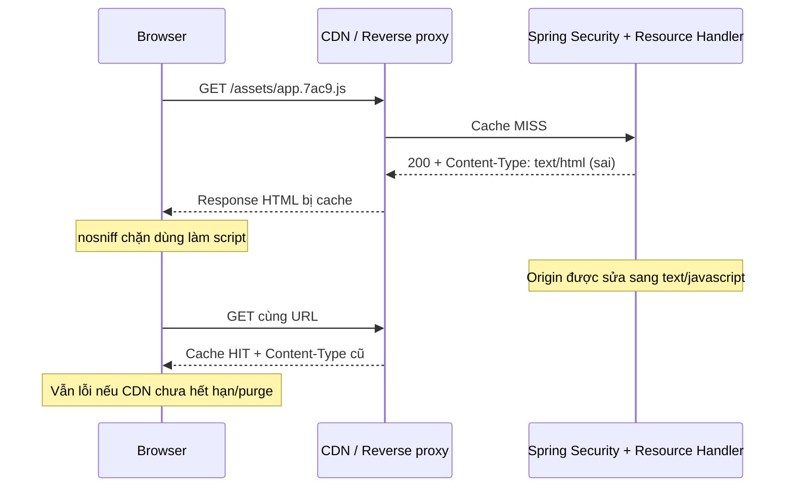

# Đặt Content-Type chính xác cho HTML, JSON và tệp tải xuống

## 1. Vì sao Content-Type là một phần của phòng vệ HTTP?

Trong ứng dụng Spring Security, ba URL dưới đây có thể đều trả HTTP `200 OK` nhưng phải được trình duyệt xử lý theo **ba cách khác nhau**:

- `GET /account`: HTML dành cho người dùng đã đăng nhập, cần được hiển thị như một trang web.
- `GET /api/account/me`: JSON mô tả tài khoản, dùng làm dữ liệu cho JavaScript chứ không phải một đoạn mã để thực thi.
- `GET /api/documents/{id}/download`: tệp được cấp phép tải về, không nên tự động hiển thị như HTML hoặc script dưới origin ứng dụng.

Nếu máy chủ trả `Content-Type` sai, trình duyệt có thể không tải được CSS/JavaScript, API client có thể giải mã body sai, hoặc nội dung tải lên không đáng tin bị trình duyệt xử lý ngoài ý định. Sai sót có thể kéo dài vì CDN hoặc browser cache giữ cả body lẫn response headers.

Bài nằm trong chương **Bộ nhớ đệm và MIME** của mô-đun **SPRING_SECURITY_HTTP_PROTECTION**. Mô-đun nghiên cứu các lớp phòng vệ HTTP và trình duyệt trong Spring Security, bao gồm CSRF, CORS, security headers, CSP, HSTS, HTTP firewall và bảo vệ session, với ứng dụng **Servlet** lẫn **Reactive**. Bài này tập trung vào **đặt đúng kiểu MIME cho HTML, JSON và download**, phối hợp `X-Content-Type-Options: nosniff`, `Cache-Control`, `Content-Disposition`, phân quyền tài nguyên và kiểm thử đường đi qua proxy/CDN.

Sau bài học, bạn có thể:

1. Giải thích `Content-Type` trong **request** và **response**, cũng như sự khác biệt với `Accept`, `Content-Disposition` và `Content-Encoding`.
2. Chọn MIME type chuẩn cho HTML, JSON, PDF và tệp nhị phân không xác định.
3. Phân biệt vai trò của `produces`, `consumes`, `ResponseEntity.contentType(...)`, message converter/writer trong Spring.
4. Viết controller Servlet/WebFlux phát đúng header cho HTML/JSON và download có phân quyền.
5. Phối hợp `nosniff`, `no-store`, CSP, kiểm soát upload và tách origin khi phục vụ nội dung không đáng tin.
6. Chẩn đoán vì sao JS nhận HTML, JSON nhận `text/plain` hoặc file download bị render như trang; kiểm thử bằng MockMvc, WebTestClient, `curl` và trình duyệt.

## 2. Content-Type mô tả representation, không mô tả tên URL

`Content-Type` là header cho biết **media type của nội dung** trong HTTP message. Trong response, nó mô tả loại biểu diễn mà máy chủ gửi về. Ví dụ:

```http
HTTP/1.1 200 OK
Content-Type: text/html; charset=UTF-8

<!doctype html><html lang="vi">...</html>
```

```http
HTTP/1.1 200 OK
Content-Type: application/json

{"name":"Alice","roles":["USER"]}
```

```http
HTTP/1.1 200 OK
Content-Type: application/pdf
Content-Disposition: attachment; filename="invoice.pdf"

%PDF-...
```

Các header này phục vụ các ngữ nghĩa khác nhau:

| Header | Chiều thường quan tâm | Trả lời câu hỏi | Ví dụ |
| --- | --- | --- | --- |
| `Content-Type` | Request **và** response | Body đang mang kiểu nội dung nào? | `application/json` |
| `Accept` | Request | Client có thể chấp nhận response thuộc loại nào? | `Accept: application/json` |
| `Content-Disposition` | Response | Nên hiển thị inline hay tải xuống với tên file nào? | `attachment; filename="report.pdf"` |
| `Content-Encoding` | Request/response | Body đã áp phép mã hóa nội dung nào? | `gzip`, `br` |
| `Cache-Control` | Request/response | Có thể lưu/dùng lại HTTP response theo điều kiện nào? | `no-store` |
| `X-Content-Type-Options` | Response | Có yêu cầu hạn chế một số kiểu MIME sniffing không? | `nosniff` |
| `Content-Length` | Request/response khi áp dụng | Kích thước body gửi trên đường truyền là bao nhiêu byte? | `24768` |

**Chú ý:** `Content-Encoding: gzip` không biến file JSON thành `application/gzip`; nội dung vẫn là `application/json`, còn bytes trên đường truyền đã được nén. Cũng vậy, `Content-Disposition` không định nghĩa media type: nó hướng trình duyệt cách trình bày/tải xuống.

### 2.1. Không suy MIME type từ đuôi file một cách mù quáng

Đường dẫn `/assets/main.js` có thể bất ngờ nhận body HTML trang đăng nhập do proxy rewrite hoặc SPA fallback. Ngược lại, người dùng có thể upload tệp `photo.jpg` với bytes không phải JPEG. **URL và filename là gợi ý, không phải bằng chứng định dạng và độ tin cậy.**

Khi quyết định loại response, cần xét:

1. Content được máy chủ tạo hoặc đã xác minh là gì?
2. Client có định sử dụng nó như trang, dữ liệu API, tài nguyên nhúng hay tệp tải xuống?
3. Nếu bytes do người dùng không đáng tin kiểm soát, có cho phép browser render nó dưới origin ứng dụng không?
4. Có chứa dữ liệu cá nhân, cần `no-store` hoặc bypass shared cache hay không?
5. Những proxy/CDN ở phía trước có thay đổi media type hoặc header không?

### 2.2. Một số MIME type thường dùng

| Nội dung | `Content-Type` gợi ý | Ngữ cảnh |
| --- | --- | --- |
| Trang HTML | `text/html; charset=UTF-8` | Render trang |
| JSON API | `application/json` | API trả object/list |
| HTML fragment | `text/html; charset=UTF-8` | Chỉ khi thực sự là markup có chủ đích |
| Plain text | `text/plain; charset=UTF-8` | Nội dung văn bản không phải HTML |
| CSS | `text/css` | `<link rel="stylesheet">` |
| JavaScript | `text/javascript` | `<script src="...">` hoặc module script |
| PNG | `image/png` | Ảnh PNG có nội dung phù hợp |
| JPEG | `image/jpeg` | Ảnh JPEG |
| SVG | `image/svg+xml` | Cần thận trọng với SVG không đáng tin |
| WOFF2 | `font/woff2` | Web font |
| PDF | `application/pdf` | PDF đã kiểm tra định dạng |
| ZIP | `application/zip` | Tệp ZIP đã xác minh |
| Dữ liệu tải xuống không xác định/chưa đáng tin | `application/octet-stream` | Ưu tiên xử lý như dữ liệu nhị phân |
| CSV | `text/csv; charset=UTF-8` | Có thể cần quy tắc bảo vệ formula injection khi mở bảng tính |

MIME type không chỉ có một cách diễn đạt cho mọi loại tệp; lựa chọn phải dựa trên định dạng đã được xác minh và phần mềm sẽ tiêu thụ. Với JSON theo RFC 8259, mã hóa trao đổi phổ biến là UTF-8 và **không cần tự gắn `charset=UTF-8`** vào `application/json`. Với HTML hoặc text/plain, tham số charset giúp client giải mã ký tự nhất quán.

## 3. Content negotiation: `Accept`, `produces` và `consumes`

Một số nhầm lẫn Spring phổ biến đến từ việc dùng sai chiều của header.

### 3.1. `Accept` đề nghị kiểu response

Request:

```http
GET /api/account/me HTTP/1.1
Accept: application/json
```

cho biết client muốn nhận JSON. Nếu endpoint chỉ có thể tạo `application/json` nhưng client chỉ chấp nhận `application/xml` theo quy tắc negotiation, Spring thường trả `406 Not Acceptable`. Không nên trả body HTML rồi nói `Content-Type: application/json` chỉ để thỏa `Accept`: body và media type phải khớp.

### 3.2. `Content-Type` trong request mô tả body client gửi lên

```http
POST /api/preferences HTTP/1.1
Content-Type: application/json
Accept: application/json

{"theme":"dark"}
```

Request `Content-Type` là **JSON đầu vào**; `Accept` là **mong muốn cho response**. Nếu endpoint yêu cầu JSON nhưng client gửi `text/plain`, trường hợp thường gặp là `415 Unsupported Media Type`. Dù request đúng MIME, server vẫn phải validate cấu trúc dữ liệu, quyền người dùng, CSRF/token và các ràng buộc khác.

### 3.3. Spring mapping: `produces` khác `consumes`

```java
import org.springframework.http.MediaType;
import org.springframework.web.bind.annotation.PostMapping;
import org.springframework.web.bind.annotation.RequestBody;
import org.springframework.web.bind.annotation.RestController;

@RestController
class PreferenceController {

    @PostMapping(
        path = "/api/preferences",
        consumes = MediaType.APPLICATION_JSON_VALUE,
        produces = MediaType.APPLICATION_JSON_VALUE
    )
    PreferenceView update(@RequestBody PreferenceInput input) {
        // Phần xác thực, phân quyền và service được lược bỏ ở ví dụ.
        return new PreferenceView(input.theme());
    }

    record PreferenceInput(String theme) {}
    record PreferenceView(String theme) {}
}
```

- `consumes` ràng buộc **kiểu body request** phù hợp với handler.
- `produces` ràng buộc **kiểu representation response** mà handler có thể tạo và dùng trong content negotiation.
- `@RequestBody` nhờ `HttpMessageConverter` (Servlet) hoặc `HttpMessageReader` (WebFlux) đọc body phù hợp.
- Giá trị Java trả về được converter/writer serialize thành body; `Content-Type` phản ánh representation được chọn.

Đây là ví dụ ngữ nghĩa MIME, chưa phải endpoint production: phải bổ sung security rule, validation input, business logic và chính sách CSRF/bearer token phù hợp.

**Điều quan trọng:** `produces="application/json"` là ràng buộc chọn handler/representation, **không phải phân quyền**, không tự làm sạch dữ liệu và không tự bật `no-store`. Khi cần đảm bảo response rõ ràng, có thể đặt `.contentType(MediaType.APPLICATION_JSON)` qua `ResponseEntity`.

## 4. HTML: sử dụng `text/html` đúng mục đích

HTML là nội dung có thể chứa script, form, link và markup được browser xử lý như tài liệu. Với ứng dụng render HTML, `Content-Type` đúng thường là:

```http
Content-Type: text/html; charset=UTF-8
```

Nếu server trả body HTML nhưng `Content-Type: application/json`, client kỳ vọng JSON sẽ giải mã lỗi. Nếu server trả HTML như `text/plain`, browser có thể hiển thị markup dưới dạng văn bản thay vì render. Nếu browser tải HTML từ đường dẫn JavaScript và `nosniff` đang bật, việc dùng response đó như script bị chặn — đó là hành vi đúng.

### 4.1. HTML tĩnh có chủ đích qua Spring MVC

Ví dụ endpoint công khai chỉ trả chuỗi HTML cố định:

```java
import java.nio.charset.StandardCharsets;

import org.springframework.http.CacheControl;
import org.springframework.http.MediaType;
import org.springframework.http.ResponseEntity;
import org.springframework.web.bind.annotation.GetMapping;
import org.springframework.web.bind.annotation.RestController;

@RestController
class PublicHelpController {

    @GetMapping(path = "/public/help", produces = MediaType.TEXT_HTML_VALUE)
    ResponseEntity<String> help() {
        var html = """
            <!doctype html>
            <html lang="vi">
              <head><meta charset="UTF-8"><title>Trợ giúp</title></head>
              <body><h1>Trung tâm trợ giúp</h1></body>
            </html>
            """;

        return ResponseEntity.ok()
            .contentType(new MediaType("text", "html", StandardCharsets.UTF_8))
            .cacheControl(CacheControl.noCache())
            .body(html);
    }
}
```

`noCache()` ở đây cho phép HTTP cache lưu trang công khai nhưng yêu cầu revalidation trước khi dùng lại; nếu HTML có dữ liệu cá nhân, chọn `noStore()`. Đoạn code dùng Java text block (Java 15+) và chỉ chứa HTML cố định.

**Không nối trực tiếp chuỗi HTML với dữ liệu người dùng mà không encode.** Với trang động, ưu tiên template engine như Thymeleaf và output escaping đúng ngữ cảnh; `Content-Type: text/html` không phòng chống XSS. CSP là lớp bảo vệ bổ sung, không thay encoding và kiểm tra dữ liệu.

### 4.2. HTML từ template trong Spring MVC

Trong Spring MVC, `@Controller` thường trả **tên view**, không phải body text:

```java
import org.springframework.stereotype.Controller;
import org.springframework.ui.Model;
import org.springframework.web.bind.annotation.GetMapping;

@Controller
class AccountPageController {

    @GetMapping("/account")
    String account(Model model) {
        model.addAttribute("pageTitle", "Thông tin tài khoản");
        return "account";  // Template / view đã cấu hình.
    }
}
```

View resolver/renderer (Thymeleaf, JSP hoặc engine khác) chịu trách nhiệm render HTML và thường thiết lập `text/html` với charset phù hợp. Nếu view này có dữ liệu cá nhân, phải bảo vệ `/account` bằng Spring Security và đặt `Cache-Control: no-store` trên **response HTML cuối**. Trong nhiều ứng dụng, bộ security cache headers mặc định hỗ trợ yêu cầu này; nếu đã có filter/controller khác đặt cache header, cần kiểm tra response thực để tránh vô tình phát `public`.

Đừng nhầm một controller `@RestController` trả `String` với `@Controller` trả tên view: cái trước thường trả String như **body**, cái sau thường trả String như **view name**.

### 4.3. HTML entry point và HTML sau đăng nhập có rủi ro cache khác nhau

| Loại HTML | `Content-Type` | Cache policy thường phù hợp |
| --- | --- | --- |
| Trang public help hoặc landing page | `text/html; charset=UTF-8` | `public, max-age` ngắn hoặc `no-cache` |
| `index.html` của SPA công khai, tham chiếu asset có hash | `text/html; charset=UTF-8` | `no-cache` hoặc TTL ngắn để nhận bản triển khai mới |
| Trang dashboard sau đăng nhập | `text/html; charset=UTF-8` | `no-store` |
| Trang đăng nhập có token/nonce nhạy cảm | `text/html; charset=UTF-8` | `no-store` |
| Trang lỗi hiển thị thông tin nội bộ | `text/html` hoặc JSON thống nhất API | Không để lộ stack trace/secret; `no-store` khi chứa dữ liệu nhạy cảm |

Tài nguyên tĩnh JS/CSS có thể cache lâu, **không vì thế cache lâu cả HTML có đăng nhập**. Các header MIME và cache bảo vệ hai vấn đề độc lập.

## 5. JSON: luôn trả dữ liệu JSON như `application/json`

JSON là định dạng trao đổi dữ liệu. Trong Spring Boot, khi có Jackson và dùng `@RestController` trả DTO, Spring thường chọn converter JSON phù hợp. Tuy nhiên, policy nên được làm rõ ở những endpoint nhạy cảm.

### 5.1. Controller Servlet cho API cá nhân

```java
import org.springframework.http.CacheControl;
import org.springframework.http.MediaType;
import org.springframework.http.ResponseEntity;
import org.springframework.security.core.Authentication;
import org.springframework.web.bind.annotation.GetMapping;
import org.springframework.web.bind.annotation.RestController;

@RestController
class AccountApiController {

    record AccountView(String username, String displayName) {}

    @GetMapping(
        path = "/api/account/me",
        produces = MediaType.APPLICATION_JSON_VALUE
    )
    ResponseEntity<AccountView> me(Authentication authentication) {
        var body = new AccountView(authentication.getName(), "Người dùng");

        return ResponseEntity.ok()
            .contentType(MediaType.APPLICATION_JSON)
            .cacheControl(CacheControl.noStore())
            .body(body);
    }
}
```

Mục tiêu của ba lớp:

- **Authentication/authorization** xác định người hiện tại và dữ liệu được phép xem.
- **`Content-Type: application/json`** bảo đảm response được khai báo là JSON.
- **`Cache-Control: no-store`** yêu cầu HTTP cache không giữ response cá nhân.
- Spring Security mặc định có thể thêm **`X-Content-Type-Options: nosniff`** khi header writer được bật.

Ví dụ trả một tên hiển thị cố định để minh họa, không truy vấn dữ liệu thật; production cần lấy DTO từ service đã kiểm tra tenant/record ownership.

### 5.2. Không dùng HTML hoặc JavaScript JSONP để thay JSON

Sai lầm thường thấy:

```http
HTTP/1.1 200 OK
Content-Type: text/html

{"user":"alice"}
```

Body giống JSON nhưng header nói HTML, khiến client và các lớp bảo vệ xử lý không nhất quán. Cũng không xuất JSON như `text/javascript`/JSONP chỉ để client có thể nhúng qua `<script>`; JSON API hiện đại nên dùng `application/json`, phân quyền thích hợp và CORS khi thật sự cho phép origin khác đọc.

Response lỗi API cũng cần nhất quán. Ví dụ `401`/`403` có thể trả JSON hoặc body trống theo API contract, không nên âm thầm trả HTML login `200` dưới URL API. Nếu API được Spring Security redirect sang trang login do cấu hình dành cho web, client JSON có thể nhận HTML và báo parse error; hãy thiết kế authentication entry point riêng cho API nếu yêu cầu.

### 5.3. `Content-Type` đúng không có nghĩa JSON an toàn để công khai

`X-Content-Type-Options: nosniff` có thể ngăn browser dùng response `application/json` làm một script sai loại MIME. Nhưng nó **không** ngăn một JavaScript client có quyền dùng `fetch()` để đọc JSON. Quyền truy cập được quyết định bởi session/token, endpoint authorization, same-origin policy/CORS và các lớp bảo vệ khác.

Ví dụ `GET /api/account/me` trả JSON đúng MIME nhưng CDN ép `public, max-age=600` có thể làm rò rỉ dữ liệu khi cache key không phân biệt người gọi. Vẫn cần `no-store` và bypass shared cache.

### 5.4. Tránh nhầm `Content-Type` với response parsing

Client gửi:

```javascript
const response = await fetch("/api/account/me", {
  credentials: "include",
  headers: { "Accept": "application/json" },
  cache: "no-store"
});

if (!response.ok) {
  throw new Error("Không thể tải thông tin tài khoản");
}

const contentType = response.headers.get("Content-Type") ?? "";
if (!contentType.toLowerCase().startsWith("application/json")) {
  throw new Error("Server không trả JSON như đã thỏa thuận");
}

const account = await response.json();
```

`response.json()` phân tích body như JSON, nhưng không thay thế việc server phát đúng `Content-Type`. Kiểm tra type giúp chẩn đoán lỗi như trang login HTML bị trả thay API. `cache: "no-store"` chỉ yêu cầu riêng cho lượt `fetch`; **server vẫn phải gửi** `Cache-Control: no-store` để áp chính sách nhất quán cho mọi client.

## 6. Tệp tải xuống: `Content-Type` và `Content-Disposition` phải phối hợp

Tệp tải xuống khác với việc trình duyệt tự hiển thị HTML hoặc JSON. Cần diễn đạt cả **định dạng thực** và **ý định xử lý của client**.

Ví dụ PDF hợp lệ mà sản phẩm muốn tải về:

```http
HTTP/1.1 200 OK
Content-Type: application/pdf
Content-Disposition: attachment; filename="invoice.pdf"
Cache-Control: no-store
X-Content-Type-Options: nosniff

%PDF-...
```

Ở đây:

- `application/pdf` mô tả định dạng nội dung đã xác minh.
- `attachment` khuyến nghị browser tải về thay vì render trực tiếp trong trang.
- `filename` là tên tải về gợi ý; browser có thể xử lý/đổi tên theo chính sách an toàn.
- `no-store` hạn chế HTTP cache giữ hóa đơn cá nhân.
- `nosniff` giữ lớp phòng vệ chống sử dụng sai MIME trong những ngữ cảnh phù hợp.

**Không thể bảo đảm chỉ bằng `Content-Disposition` rằng mọi trình duyệt/ứng dụng hệ điều hành sẽ không bao giờ mở hoặc thực thi tệp sau khi người dùng đã tải xuống.** File có thể được lưu ra thư mục Downloads hoặc mở bằng công cụ khác; cần bảo vệ từ phía upload, quyền truy cập và loại tệp.

### 6.1. Khi nào dùng `application/octet-stream`?

Nếu ứng dụng nhận file từ người dùng mà không thể khẳng định định dạng, hoặc muốn phục vụ như bytes tải xuống không đáng tin thay vì cho browser preview, có thể dùng:

```http
Content-Type: application/octet-stream
Content-Disposition: attachment; filename="download.bin"
Cache-Control: no-store
```

`application/octet-stream` là loại dữ liệu nhị phân tổng quát; nó **không tự diệt trừ payload độc hại**. Nếu tài liệu là PDF đã kiểm chứng và việc tích hợp yêu cầu MIME PDF, dùng `application/pdf` sẽ chính xác hơn. Không tùy tiện khai báo mọi file là PDF chỉ vì tên kết thúc bằng `.pdf`.

### 6.2. `inline` và `attachment` khác nhau

| Giá trị | Ý nghĩa | Rủi ro cần xét |
| --- | --- | --- |
| `Content-Disposition: inline` | Cho phép/trình bày nội dung trực tiếp nếu user agent hỗ trợ | Không an toàn cho HTML/SVG không đáng tin trên cùng origin nếu không sandbox |
| `Content-Disposition: attachment` | Khuyến nghị tải xuống | File vẫn có thể được mở sau khi tải; không thay validation |
| Không có `Content-Disposition` | Browser thường quyết định theo MIME, URL và chính sách riêng | Có thể preview PDF/ảnh hoặc render HTML không mong muốn |
| `attachment; filename="..."` | Gợi ý tên tải xuống | Phải kiểm soát tên file, không cho CRLF/path traversal hoặc giá trị gây nhầm lẫn |

Đối với nội dung được phép preview (ví dụ PDF do hệ thống tạo đáng tin), có thể chủ đích dùng `inline` và `application/pdf`. Khi làm vậy cần tiếp tục áp dụng kiểm tra quyền, `no-store` nếu riêng tư và các hạn chế nhúng/sandbox phù hợp.

### 6.3. Filename quốc tế hóa và `filename*`

Tên tải xuống có thể chứa tiếng Việt. Header `Content-Disposition` có cơ chế `filename*` theo chuẩn để biểu diễn tên UTF-8. Ví dụ về mặt ý nghĩa:

```http
Content-Disposition: attachment;
  filename="hoa-don.pdf";
  filename*=UTF-8''h%C3%B3a-%C4%91%C6%A1n.pdf
```

Hai dòng trên chỉ để **minh họa cú pháp**; trong HTTP thật chúng phải là **một giá trị header liên tục**, không tự xuống dòng tùy tiện. `filename` là fallback ASCII cho client cũ, `filename*` dùng biểu diễn mở rộng. Một số phiên bản Spring có cách encode cụ thể khi gọi builder; không hard-code giả định header sẽ giống hệt ví dụ này.

Dùng `ContentDisposition.attachment().filename(safeName, StandardCharsets.UTF_8).build()` của Spring để tránh tự ghép chuỗi và tự escape sai. Tên file phải được xác định từ metadata **đã chuẩn hóa ở server**, không dùng nguyên chuỗi client gửi; loại bỏ path separator, control characters, ký tự nhầm lẫn và giới hạn độ dài.

## 7. Spring MVC: download có phân quyền và header chuẩn

Ví dụ dưới đây mô tả API tải xuống tệp thuộc một người dùng. ID là `UUID`, không nhận đường dẫn file thô từ query string; service phải kiểm tra quyền trước khi trả resource.

### 7.1. Cấu trúc service có contract rõ ràng

```java
import java.util.UUID;
import org.springframework.core.io.Resource;

// Các type minh họa cần được hiện thực trong ứng dụng thực.
record AuthorizedDownload(Resource resource, String safeName, long size) {}

interface AuthorizedDownloadService {
    AuthorizedDownload loadAuthorized(UUID id, String username);
}
```

Service phải:

1. Dùng ID để tra metadata đã lưu, không nối `id` hoặc tên file từ request thành đường dẫn tùy ý.
2. Xác thực người gọi và kiểm tra tenant/owner/quyền truy cập trên **bản ghi cụ thể**.
3. Phát hiện tệp không tồn tại hoặc không có quyền với status phù hợp.
4. Trả `Resource` đọc được, `safeName` đã chuẩn hóa, kích thước đáng tin nếu có.
5. Bảo đảm dữ liệu được lưu an toàn, kiểm tra loại file/upload và xử lý giới hạn kích thước.

Cấp quyền bằng `.authenticated()` ở SecurityFilterChain **chỉ xác nhận đã đăng nhập**, không thay việc kiểm tra ownership của một tài liệu cụ thể.

### 7.2. Controller tải xuống file chưa đáng tin

```java
import java.nio.charset.StandardCharsets;
import java.util.UUID;

import org.springframework.core.io.Resource;
import org.springframework.http.CacheControl;
import org.springframework.http.ContentDisposition;
import org.springframework.http.HttpHeaders;
import org.springframework.http.MediaType;
import org.springframework.http.ResponseEntity;
import org.springframework.security.core.Authentication;
import org.springframework.web.bind.annotation.GetMapping;
import org.springframework.web.bind.annotation.PathVariable;
import org.springframework.web.bind.annotation.RestController;

@RestController
class DownloadServletController {

    private final AuthorizedDownloadService service;

    DownloadServletController(AuthorizedDownloadService service) {
        this.service = service;
    }

    @GetMapping("/api/documents/{id}/download")
    ResponseEntity<Resource> download(
        @PathVariable UUID id, Authentication authentication) {

        AuthorizedDownload file =
            service.loadAuthorized(id, authentication.getName());

        var disposition = ContentDisposition.attachment()
            .filename(file.safeName(), StandardCharsets.UTF_8)
            .build();

        return ResponseEntity.ok()
            .contentType(MediaType.APPLICATION_OCTET_STREAM)
            .header(HttpHeaders.CONTENT_DISPOSITION, disposition.toString())
            .cacheControl(CacheControl.noStore())
            .contentLength(file.size())
            .body(file.resource());
    }
}
```

Đoạn này yêu cầu `AuthorizedDownloadService` đã triển khai và file có kích thước xác định chính xác. Nếu không biết kích thước, **không đặt một `Content-Length` đoán mò**. Đặc biệt, tránh dùng phương pháp tính length tiêu thụ stream một lần của `InputStreamResource` rồi cố đọc lại stream. Với file lớn, dùng loại `Resource` thích hợp hoặc streaming mechanism của framework để tránh đưa toàn bộ bytes vào RAM.

Vì file có thể đến từ upload chưa đáng tin, ví dụ chủ động dùng `application/octet-stream` và `attachment`. Nếu service đã xác minh đó là PDF và sản phẩm cần MIME PDF, có thể đổi sang `MediaType.APPLICATION_PDF`; đồng thời kiểm tra upload, nội dung, quyền và khả năng mở file.

### 7.3. PDF do ứng dụng tạo: đặt đúng `application/pdf`

Với PDF thực sự được hệ thống tạo ra (không phụ thuộc MIME do client tùy ý gửi), policy có thể là:

```java
var pdfDisposition = ContentDisposition.attachment()
    .filename("statement.pdf")
    .build();

return ResponseEntity.ok()
    .contentType(MediaType.APPLICATION_PDF)
    .header(HttpHeaders.CONTENT_DISPOSITION, pdfDisposition.toString())
    .cacheControl(CacheControl.noStore())
    .body(pdfResource);
```

Đây là trích đoạn handler có `pdfResource` đã được tạo/cấp quyền. Tệp công khai có thể có chính sách cache khác; PDF sao kê cá nhân nên dùng `no-store`. Không bỏ kiểm tra quyền hoặc cho phép người dùng truy cập PDF của người khác bằng cách sửa ID trong URL.

### 7.4. Cấu hình quyền cho Servlet

```java
import org.springframework.context.annotation.Bean;
import org.springframework.context.annotation.Configuration;
import org.springframework.security.config.annotation.web.builders.HttpSecurity;
import org.springframework.security.web.SecurityFilterChain;

@Configuration
class ServletSecurityConfig {

    @Bean
    SecurityFilterChain securityFilterChain(HttpSecurity http) throws Exception {
        return http.authorizeHttpRequests(auth -> auth
            .requestMatchers("/public/**", "/assets/**").permitAll()
            .requestMatchers("/api/account/**",
                             "/api/documents/**").authenticated()
            .anyRequest().authenticated())
            .build();
    }
}
```

Đây là cấu hình minh họa; form login, bearer token, CSRF, CORS, session và các rule thực tế cần được bổ sung theo ứng dụng. Giữ các **security headers mặc định**; không tắt `nosniff` để làm một file sai MIME có thể mở được.

## 8. Spring WebFlux: response MIME đúng và download reactive

WebFlux sử dụng cùng quy tắc HTTP nhưng API trả dữ liệu bất đồng bộ và security filter chain khác Servlet. Hai ví dụ dưới đây **thay thế các controller Servlet** nếu ứng dụng chạy Reactive.

### 8.1. SecurityWebFilterChain

```java
import org.springframework.context.annotation.Bean;
import org.springframework.context.annotation.Configuration;
import org.springframework.security.config.annotation.web.reactive.EnableWebFluxSecurity;
import org.springframework.security.config.web.server.ServerHttpSecurity;
import org.springframework.security.web.server.SecurityWebFilterChain;

@Configuration
@EnableWebFluxSecurity
class ReactiveSecurityConfig {

    @Bean
    SecurityWebFilterChain filterChain(ServerHttpSecurity http) {
        return http.authorizeExchange(auth -> auth
                .pathMatchers("/public/**", "/assets/**").permitAll()
                .pathMatchers("/api/account/**",
                              "/api/documents/**").authenticated()
                .anyExchange().authenticated())
            .build();
    }
}
```

### 8.2. JSON API trong WebFlux

```java
import java.security.Principal;

import reactor.core.publisher.Mono;

import org.springframework.http.CacheControl;
import org.springframework.http.MediaType;
import org.springframework.http.ResponseEntity;
import org.springframework.web.bind.annotation.GetMapping;
import org.springframework.web.bind.annotation.RestController;

@RestController
class AccountReactiveController {

    record AccountView(String username) {}

    @GetMapping(
        path = "/api/account/me",
        produces = MediaType.APPLICATION_JSON_VALUE
    )
    Mono<ResponseEntity<AccountView>> me(Mono<Principal> principal) {
        return principal.map(p -> ResponseEntity.ok()
            .contentType(MediaType.APPLICATION_JSON)
            .cacheControl(CacheControl.noStore())
            .body(new AccountView(p.getName())));
    }
}
```

`Mono` không làm thay đổi ý nghĩa `application/json` hay `no-store`. Với ứng dụng thật, lấy dữ liệu từ service trả `Mono<DTO>`, xác minh quyền và không chặn event loop bằng I/O đồng bộ.

### 8.3. Download qua WebFlux với service reactive

Ví dụ contract có thể có:

```java
import java.util.UUID;
import org.springframework.core.io.Resource;
import reactor.core.publisher.Mono;

record ReactiveDownload(Resource resource, String safeName, long size) {}

interface ReactiveDownloadService {
    Mono<ReactiveDownload> loadAuthorized(UUID id, String username);
}
```

Handler:

```java
import java.nio.charset.StandardCharsets;
import java.security.Principal;
import java.util.UUID;

import org.springframework.core.io.Resource;
import org.springframework.http.CacheControl;
import org.springframework.http.ContentDisposition;
import org.springframework.http.HttpHeaders;
import org.springframework.http.MediaType;
import org.springframework.http.ResponseEntity;
import org.springframework.web.bind.annotation.GetMapping;
import org.springframework.web.bind.annotation.PathVariable;
import org.springframework.web.bind.annotation.RestController;
import reactor.core.publisher.Mono;

@RestController
class DownloadReactiveController {

    private final ReactiveDownloadService service;

    DownloadReactiveController(ReactiveDownloadService service) {
        this.service = service;
    }

    @GetMapping("/api/documents/{id}/download")
    Mono<ResponseEntity<Resource>> download(
            @PathVariable UUID id, Mono<Principal> principal) {

        return principal.flatMap(p ->
            service.loadAuthorized(id, p.getName())
        ).map(file -> {
            var disposition = ContentDisposition.attachment()
                .filename(file.safeName(), StandardCharsets.UTF_8)
                .build();

            return ResponseEntity.ok()
                .contentType(MediaType.APPLICATION_OCTET_STREAM)
                .header(HttpHeaders.CONTENT_DISPOSITION,
                        disposition.toString())
                .cacheControl(CacheControl.noStore())
                .contentLength(file.size())
                .body(file.resource());
        });
    }
}
```

Service phải thực sự có cách truy xuất non-blocking hoặc cô lập thao tác blocking đúng scheduler, không chỉ bọc đọc file chậm trong một `Mono.just(...)` chạy trên event loop. File lớn cần lưu ý chiến lược streaming/backpressure, giới hạn bộ nhớ và cơ chế `Resource` đang sử dụng.

### 8.4. Content-Type trước khi commit response

Khi đặt header trực tiếp trên `ServerHttpResponse` hoặc `ServerResponse` của functional endpoint, phải làm **trước khi response được commit**. Sau khi body streaming bắt đầu, thay đổi header có thể không còn hiệu lực. Với `ResponseEntity` và annotated controllers như trên, framework xử lý nhiều chi tiết theo lifecycle của writer.

Không đặt `Content-Type: application/json` rồi phát `Flux<DataBuffer>` chứa HTML, cũng không phát tệp download với `Content-Type: text/html` vì đường dẫn có đuôi `.html`. Media type phải mô tả bytes **thực sự gửi**.

## 9. Spring Security `nosniff` và các phòng vệ cần phối hợp

Khi mặc định security headers được bật, Spring Security thường phát:

```http
X-Content-Type-Options: nosniff
```

Header này giúp browser từ chối sử dụng response có MIME type không phù hợp trong các ngữ cảnh như tải **script** hoặc **stylesheet**. Ví dụ, khi trang nhúng `<script src="/assets/app.js">` nhưng URL nhận:

```http
HTTP/1.1 200 OK
Content-Type: text/html
X-Content-Type-Options: nosniff

<!doctype html><html>Đăng nhập</html>
```

browser từ chối dùng HTML như JavaScript. **Giải pháp là sửa routing/Content-Type/status**, không tắt `nosniff`.

### 9.1. `nosniff` không đồng nghĩa “mọi download đều an toàn”

`nosniff` không tự biến HTML, SVG hoặc tệp script không đáng tin thành tệp vô hại. Với file upload có thể chứa active content:

- Không cho client tự quyết định MIME response chỉ bằng `Content-Type` đã gửi khi upload.
- Kiểm tra định dạng và lưu file ở vùng không thể chạy/serve tùy ý như một script.
- Nếu file chỉ để tải về, trả `Content-Disposition: attachment` và media type phù hợp hoặc `application/octet-stream`.
- Cân nhắc **origin tách biệt**, không chia sẻ cookie xác thực, khi phải phục vụ nội dung do người dùng tạo.
- Nếu muốn preview HTML/SVG, cần sanitizer, sandbox, CSP và chính sách rõ ràng; `nosniff` không thay thế các bước này.

### 9.2. Header liên quan nhưng không thay thế

| Lớp bảo vệ | Đối tượng bảo vệ | Điều không làm thay `Content-Type` |
| --- | --- | --- |
| `X-Content-Type-Options: nosniff` | Chặn dùng sai MIME cho một số request destinations | Không sửa MIME sai và không xác minh file upload |
| **CSP** | Kiểm soát nguồn mã/script, hạn chế một số kiểu XSS | Không thay khai báo đúng media type |
| **CORS/SOP** | Quyền JavaScript từ origin khác đọc response | Không biến JSON thành script hợp lệ |
| **CSRF** | Yêu cầu thay đổi trạng thái dựa trên credential browser | Không bảo vệ định dạng download |
| **HSTS/HTTPS** | Bảo vệ kết nối và giảm nguy cơ downgrade | Không kiểm tra bytes PDF/HTML |
| **Content-Disposition** | Hướng xử lý inline/attachment và tên file | Không xác nhận file an toàn hoặc người gọi có quyền |
| **Cache-Control** | HTTP cache lưu hoặc dùng lại response | Không kiểm tra MIME hay ngăn HTML tự chạy nếu được phục vụ inline |
| **Authorization** | Ai được nhận bytes | Không xác định đúng loại bytes |
| **Upload validation** | Giới hạn dữ liệu không đáng tin được lưu/phục vụ | Không thay permission và cache policy |

Đối với JSON theo người dùng, cấu hình tốt có thể là **`application/json + no-store + nosniff + authorization`**. Đối với PDF tải xuống riêng, cấu hình có thể là **`application/pdf` (khi bytes đúng) + `attachment` + `no-store` + kiểm tra quyền**. Không có một header đơn lẻ nào làm mọi bước.

## 10. Tương tác với bộ nhớ đệm, reverse proxy và CDN

Cùng một response có thể đi qua browser, CDN, reverse proxy và Spring origin. Mỗi tầng có khả năng **giữ nguyên, bổ sung, thay đổi hoặc cache lại** header theo cấu hình của nó. Một lỗi MIME có thể tồn tại ở CDN dù origin đã sửa.

Ví dụ:



Tình huống thường gặp:

1. SPA fallback trả `index.html` thay JS khi asset không tồn tại.
2. Auth middleware redirect asset sang login; proxy thay redirect bằng HTML `200`.
3. Object storage gắn metadata `application/octet-stream` cho mọi file.
4. CDN cache body và `Content-Type` sai từ một phiên bản trước.
5. Gateway dùng `Content-Disposition: inline` cho file upload không đáng tin dù origin muốn `attachment`.
6. CDN ép cache `/api/documents/**` như tài nguyên tĩnh, làm rò rỉ file cá nhân.
7. Các hệ thống nén hoặc chuyển mã tự thay đổi `Content-Encoding` nhưng không giữ tính nhất quán của response.

### 10.1. Chính sách cache đi kèm loại nội dung

| Loại response | MIME type | `Cache-Control` gợi ý |
| --- | --- | --- |
| JS/CSS công khai có URL chứa hash | `text/javascript` / `text/css` | `public, max-age=31536000`; có thể thêm `immutable` khi URL thật sự bất biến |
| HTML entry point công khai của SPA | `text/html; charset=UTF-8` | `no-cache` hoặc TTL ngắn để nhận URL asset mới |
| HTML sau đăng nhập | `text/html; charset=UTF-8` | `no-store` |
| JSON theo người dùng | `application/json` | `no-store` |
| PDF cá nhân tải xuống | `application/pdf` (bytes được xác minh) | `no-store`, edge bypass |
| File upload riêng tư không xác định | `application/octet-stream` + `attachment` | `no-store`, edge bypass |
| File public ở URL cố định | Media type đúng theo file | TTL ngắn hoặc revalidation theo nhu cầu cập nhật |

Một policy public chỉ hợp lý khi **mọi người dùng được phép nhận cùng bytes**. Không biến file cá nhân thành công khai chỉ vì đường dẫn chứa `.pdf`, `.json` hoặc nằm sau CDN. Với API/document riêng, CDN phải bypass shared caching hoặc tuân thủ `no-store` rõ ràng; cần kiểm thử bằng nhiều tài khoản.

### 10.2. Cách đối chiếu origin và edge

Khi thấy sai MIME:

1. Gửi request trực tiếp tới origin **được phép truy cập** với Host/TLS đúng; ghi status, `Content-Type` và `Content-Disposition`.
2. Gửi cùng request qua CDN; so sánh các header và body.
3. Quan sát `Age`, `Via`, `X-Cache` hoặc trạng thái cache riêng của nhà cung cấp nếu có.
4. Tìm route rewrite và response login/error HTML bị phục vụ dưới URL asset/API.
5. Nếu metadata cũ đã cache, purge bản sai hoặc phát hành URL asset mới theo chính sách triển khai.
6. Kiểm tra thêm service worker `CacheStorage` và browser cache nếu frontend là PWA.
7. Giữ `nosniff`; giải quyết tận gốc MIME/routing/cache.

**Không dùng `curl -k` hoặc bỏ xác minh TLS để “đo nhanh” trong quy trình bảo mật**. Nếu origin dùng chứng thư nội bộ, cấu hình môi trường test tin cậy thích hợp.

## 11. Kiểm thử bằng `curl` và Developer Tools

### 11.1. HTML: kiểm tra response thực

```bash
curl -sS -D - -o /dev/null \
  -H 'Accept: text/html' \
  'https://app.example.com/public/help'
```

Kỳ vọng `Content-Type: text/html` kèm charset phù hợp. Nếu endpoint public được cache theo `no-cache`, response có thể được lưu và revalidate; không kết luận rằng header đó cấm lưu.

### 11.2. JSON: phân biệt `Accept` và `Content-Type`

```bash
curl -sS -D - -o /dev/null \
  -H 'Accept: application/json' \
  -H 'Authorization: Bearer <test-token>' \
  'https://app.example.com/api/account/me'
```

Kỳ vọng response được phép có `Content-Type: application/json`, `Cache-Control: no-store` và `X-Content-Type-Options: nosniff`. Chỉ dùng token môi trường thử nghiệm; không ghi token thật trong báo cáo.

Thử gửi `Accept: application/xml` đến API chỉ sản xuất JSON để tìm hiểu content negotiation:

```bash
curl -i \
  -H 'Accept: application/xml' \
  -H 'Authorization: Bearer <test-token>' \
  'https://app.example.com/api/account/me'
```

Nếu route được chọn nhưng không có representation chấp nhận được, có thể nhận `406 Not Acceptable` theo cấu hình framework. Hãy kiểm tra status **và** body lỗi; không giả định mọi setup đều trả một định dạng lỗi giống nhau.

### 11.3. Download: không dùng HEAD làm bằng chứng duy nhất

```bash
curl -sS -D - -o /dev/null \
  -H 'Authorization: Bearer <test-token>' \
  'https://app.example.com/api/documents/00000000-0000-0000-0000-000000000001/download'
```

Đây là ID mẫu, phải thay bằng ID được cấp quyền trong môi trường test. Kiểm tra `Content-Type`, `Content-Disposition`, `Cache-Control` và `nosniff`. `-D - -o /dev/null` gửi **GET thật** nhưng không lưu body ra tệp. `curl -I` dùng HEAD, có thể đi qua handler/proxy khác hoặc không phản ánh toàn bộ đường đi của GET.

Nếu cần xác nhận bytes PDF thực sự bắt đầu với magic header PDF, chỉ lưu file từ môi trường test/được phép và kiểm tra bằng công cụ phù hợp. Không cho rằng chỉ vì response gắn `application/pdf` mà bytes thật chắc chắn là PDF.

### 11.4. Developer Tools: lỗi MIME thường lộ ở script/style

Với HTML nhúng:

```html
<script src="/assets/app.7ac9.js" defer></script>
<link rel="stylesheet" href="/assets/site.2dba.css">
```

Mở Network và Console, quan sát:

- URL thật, redirect chain, status.
- `Content-Type` cuối; script nên là MIME JavaScript hợp lệ, CSS nên là `text/css`.
- `X-Content-Type-Options: nosniff`.
- Content body có thực sự là JS/CSS hay bị thay bằng HTML login/error.
- `Cache-Control`, `Age`, `X-Cache`, `Vary` và request được phục vụ từ browser cache hoặc CDN.

**Đừng tắt `nosniff` khi script bị từ chối.** Browser đang báo sai lệch giữa MIME và mục đích sử dụng. Sửa điểm trả response sai.

## 12. Kiểm thử tích hợp Servlet bằng MockMvc

Một test có ý nghĩa phải chạy với Spring Security filter chain và tài nguyên test/bean cần thiết. Ví dụ dưới sử dụng Spring Boot Test, MockMvc và `spring-security-test`:

```java
import static org.hamcrest.Matchers.containsString;
import static org.hamcrest.Matchers.startsWith;
import static org.springframework.security.test.web.servlet.request
    .SecurityMockMvcRequestPostProcessors.user;
import static org.springframework.test.web.servlet.request
    .MockMvcRequestBuilders.get;
import static org.springframework.test.web.servlet.result
    .MockMvcResultMatchers.*;

import org.junit.jupiter.api.Test;
import org.springframework.beans.factory.annotation.Autowired;
import org.springframework.boot.test.autoconfigure.web.servlet.AutoConfigureMockMvc;
import org.springframework.boot.test.context.SpringBootTest;
import org.springframework.http.HttpHeaders;
import org.springframework.http.MediaType;
import org.springframework.test.web.servlet.MockMvc;

@SpringBootTest
@AutoConfigureMockMvc
class ServletContentTypeTest {

    @Autowired MockMvc mvc;

    @Test
    void publicHtmlIsHtml() throws Exception {
        mvc.perform(get("/public/help").accept(MediaType.TEXT_HTML))
            .andExpect(status().isOk())
            .andExpect(content().contentTypeCompatibleWith(
                MediaType.TEXT_HTML))
            .andExpect(header().string(
                "X-Content-Type-Options", "nosniff"));
    }

    @Test
    void accountJsonIsJsonAndNotStored() throws Exception {
        mvc.perform(get("/api/account/me")
                .with(user("alice"))
                .accept(MediaType.APPLICATION_JSON))
            .andExpect(status().isOk())
            .andExpect(content().contentTypeCompatibleWith(
                MediaType.APPLICATION_JSON))
            .andExpect(header().string(
                HttpHeaders.CACHE_CONTROL, containsString("no-store")))
            .andExpect(header().string(
                "X-Content-Type-Options", "nosniff"))
            .andExpect(jsonPath("$.username").value("alice"));
    }

    @Test
    void downloadRequestsAttachment() throws Exception {
        mvc.perform(get(
                "/api/documents/00000000-0000-0000-0000-000000000001/download")
                .with(user("alice")))
            .andExpect(status().isOk())
            .andExpect(content().contentTypeCompatibleWith(
                MediaType.APPLICATION_OCTET_STREAM))
            .andExpect(header().string(
                HttpHeaders.CONTENT_DISPOSITION, startsWith("attachment")))
            .andExpect(header().string(
                HttpHeaders.CACHE_CONTROL, containsString("no-store")));
    }
}
```

Test cuối cần `AuthorizedDownloadService`/fixture thực tế trả file có quyền đọc cho Alice và ID trên. Nếu chưa có, dùng mock bean hoặc slice test với service test double thích hợp. Không dùng `status().isOk()` để suy rằng phương thức service đã kiểm tra ownership: bổ sung test với người dùng không được phép xem tài liệu, kỳ vọng `403` hoặc `404` theo API policy.

Những assertion trên kiểm tra response ở **lớp ứng dụng**; phải tiếp tục kiểm tra origin→CDN→browser nếu deployment có những tầng đó.

### 12.1. Kiểm thử lỗi negotiation và sai MIME

Nên có các test bổ sung:

- `GET /api/account/me` với `Accept: application/xml` nếu API chỉ hỗ trợ JSON → kiểm tra `406` theo contract.
- `POST` dùng `consumes=application/json` nhưng gửi `Content-Type: text/plain` → kiểm tra `415` theo contract; thêm CSRF token/mock auth hợp lệ để lỗi CSRF không che lỗi media type.
- Asset JS bị rewrite sang `text/html` → test route/resource mapping phải trả đúng `Content-Type: text/javascript` và không trả body login.
- Download dùng file ID của người khác → không nhận dữ liệu; response lỗi không bị shared-cache trái policy.
- Tên file chứa dấu tiếng Việt/ký tự đặc biệt → kiểm tra `Content-Disposition` có encode hợp lệ và không chèn response header.
- Không bao giờ dùng filename từ user input không được làm sạch để thử header injection trên hệ thống production.

## 13. Kiểm thử Reactive bằng WebTestClient

Với Spring WebFlux, `WebTestClient` có thể xác nhận response headers mà không cần browser. Ví dụ test client đã được bind vào ApplicationContext và áp dụng Spring Security test support:

```java
import static org.springframework.security.test.web.reactive.server
    .SecurityMockServerConfigurers.mockUser;

import org.junit.jupiter.api.Test;
import org.springframework.http.MediaType;
import org.springframework.test.web.reactive.server.WebTestClient;

// Trích đoạn nằm trong test class có WebTestClient client đã cấu hình.
void assertReactiveContentTypes(WebTestClient client) {
    client.get().uri("/public/help")
        .accept(MediaType.TEXT_HTML)
        .exchange()
        .expectStatus().isOk()
        .expectHeader().contentTypeCompatibleWith(MediaType.TEXT_HTML)
        .expectHeader().valueEquals(
            "X-Content-Type-Options", "nosniff");

    client.mutateWith(mockUser("alice"))
        .get().uri("/api/account/me")
        .accept(MediaType.APPLICATION_JSON)
        .exchange()
        .expectStatus().isOk()
        .expectHeader().contentTypeCompatibleWith(
            MediaType.APPLICATION_JSON)
        .expectHeader().valueMatches("Cache-Control", ".*no-store.*")
        .expectBody().jsonPath("$.username").isEqualTo("alice");
}
```

Đây là **trích đoạn kiểm thử**: lớp test cần khởi tạo `WebTestClient`, ví dụ qua `bindToApplicationContext(context).apply(springSecurity()).configureClient().build()`, và có các controller/fixture tương ứng. Nếu `/public/help` chỉ được triển khai ở Servlet mẫu, cần bổ sung endpoint HTML tương đương trong ứng dụng Reactive trước khi chạy test đó.

Test download Reactive cũng nên assert `Content-Type` phù hợp, `Content-Disposition` bắt đầu bằng `attachment`, `Cache-Control` chứa `no-store`, `nosniff` có mặt nếu filter chạy, và người dùng không có quyền không thể lấy tệp.

## 14. Chẩn đoán lỗi theo triệu chứng

| Triệu chứng | Nguyên nhân cần điều tra | Cách xử lý |
| --- | --- | --- |
| Browser từ chối chạy `app.js` vì MIME `text/html` | Asset URL bị redirect login, fallback SPA hoặc CDN cache HTML | Xem status/redirect/body; sửa routing, resource mapping, cache |
| CSS không được áp dụng vì MIME `application/octet-stream` | Static host không biết đuôi file/CSS metadata sai | Trả `text/css`, purge hoặc version asset cũ |
| Client `response.json()` ném lỗi HTML token | API URL thực sự nhận login/error HTML | Xem `Content-Type`, status, auth entry point và redirect |
| API trả body JSON nhưng `Content-Type: text/plain` | Handler trả `String` hoặc message converter/header sai | Trả DTO, `produces=application/json`, dùng converter JSON |
| PDF mở trực tiếp thay vì download | `Content-Disposition` không có hoặc `inline` | Dùng `attachment` theo yêu cầu sản phẩm |
| PDF tải về tên lỗi/ký tự tiếng Việt hỏng | Ghép header thủ công hoặc không encode `filename*` đúng | Dùng Spring `ContentDisposition` builder, chuẩn hóa tên |
| File upload HTML được render trong origin chính | Phục vụ inline/`text/html` không qua kiểm soát | Dùng attachment/octet-stream, tách origin, sanitize nếu preview |
| Download trả `200` cho tài liệu người khác | Thiếu kiểm tra owner/tenant trong service | Thực thi phân quyền trên từng file; test IDOR |
| Có `nosniff` nhưng browser vẫn render HTML nguy hiểm | `nosniff` không làm sạch HTML được điều hướng đúng MIME | CSP, escaping, sandbox, tách origin/kiểm soát upload |
| Response đúng ở origin nhưng sai ở edge | Gateway/CDN thay `Content-Type` hoặc cache metadata cũ | So cùng request tại hai tầng; sửa policy, purge cache |
| Response download có `Cache-Control: public` | Controller/CDN đang cache file riêng | `no-store` và bypass shared cache |
| `Content-Length` không đúng/stream lỗi | Đã đoán length, đóng stream sớm hoặc dùng InputStreamResource sai | Dùng resource/streaming phù hợp và metadata đáng tin |
| Chỉ một trình duyệt gặp lỗi MIME | Quy tắc script module, sniffing, CSP và cache khác nhau | Test browser được hỗ trợ, xem Network/Console |
| HTTP 406/415 xuất hiện ngoài ý muốn | `Accept` hoặc request `Content-Type` không khớp `produces`/`consumes` | Sửa contract client/server; không ép media type sai |
| JSON API dùng same-origin vẫn đọc được dù có `nosniff` | `nosniff` không chặn `fetch()` đọc JSON được cấp quyền | Kiểm tra SOP/CORS và authorization, không nhầm ý nghĩa header |

### Quy trình điều tra đề xuất

1. **Phân loại route:** HTML, JSON hay download? Công khai hay theo người dùng?
2. **Đọc request:** `Accept`, request `Content-Type`, cookie/token thử nghiệm, path và method.
3. **Đọc response origin:** status, `Content-Type`, `Content-Disposition`, `Cache-Control`, `X-Content-Type-Options` và body thật.
4. **Đọc response edge:** proxy/CDN có rewrite, cache, đổi MIME hoặc header không?
5. **Kiểm tra client:** browser DevTools cho script/style/download; API client xem JSON parse và auth errors.
6. **Sửa tầng gốc:** code serialize/view resolver, static MIME mapping, upload/download service, security entry point hoặc cache/CDN.
7. **Tái kiểm thử:** positive path, unauthorized path, MIME sai có chủ đích trong môi trường test, tên file Unicode và hành vi sau logout.

Không dùng credentials hoặc dữ liệu tài khoản thật trong log, ảnh chụp màn hình và tài liệu kiểm thử.

## 15. Bài thực hành tổng hợp

Ứng dụng nhân sự sử dụng Spring Security và có các endpoint:

- `GET /dashboard`: HTML của người đang đăng nhập, hiển thị một số thông tin cá nhân.
- `GET /api/payroll/me`: JSON chứa dữ liệu lương.
- `GET /api/payroll/slip/{id}/download`: PDF phiếu lương cần xác thực và kiểm tra quyền theo ID.
- `GET /assets/app.8c71a.js`: JavaScript công khai có tên chứa hash, CDN cache một năm.
- `GET /uploads/{id}`: file do nhân viên tải lên, có thể là bất kỳ bytes nào.

Sự cố triển khai: một số trình duyệt từ chối chạy JavaScript do MIME `text/html`; người dùng khác lại mở được tệp upload HTML trong tab cùng origin. Nhóm vận hành phát hiện CDN đang cache mọi URL kết thúc bằng `.js` hoặc `.pdf` mà không xét dữ liệu cá nhân.

**Yêu cầu:**

1. Chọn `Content-Type` và `Cache-Control` phù hợp cho từng endpoint, giải thích vì sao `/api/payroll/slip/...` không được xem là public asset dù URL kết thúc bằng `.pdf`.
2. Đề xuất `Content-Disposition` cho phiếu lương và tệp upload không đáng tin. Xử lý tên file chứa tiếng Việt bằng API Spring nào?
3. Phân biệt `Accept`, request `Content-Type`, `produces` và `consumes` trong một endpoint POST JSON.
4. Viết một controller MVC hoặc WebFlux trả JSON lương đúng MIME sau xác thực; bảo đảm chỉ trả DTO thuộc người hiện tại.
5. Thiết kế service download kiểm tra user/tenant/record ownership và ngăn path traversal.
6. Chẩn đoán vì sao request `/assets/app.8c71a.js` nhận `text/html`; không tắt `nosniff` để chữa biểu hiện.
7. Thiết kế ba nhóm test: origin HTTP headers, negative test unauthorized download, end-to-end kiểm tra CDN không phát nhầm file riêng.
8. Giải thích giới hạn của `application/octet-stream` + `attachment` khi người dùng vẫn có thể tải file độc hại và mở nó bằng phần mềm khác.

### Định hướng đáp án

- `/dashboard`: `text/html; charset=UTF-8` và `no-store`; đòi hỏi xác thực.
- `/api/payroll/me`: `application/json`, `no-store`, JSON serializer phù hợp và phân quyền; giữ `nosniff`.
- Phiếu lương: `application/pdf` **chỉ khi bytes là PDF đúng định dạng**, `Content-Disposition: attachment` với filename an toàn, `no-store`; phân quyền theo ID trước khi đọc file.
- Asset JS: `text/javascript`, `public, max-age=31536000` nếu URL thật sự gắn hash nội dung; `nosniff`.
- File upload: xác minh loại file/quyền; với download không đáng tin dùng `application/octet-stream` + `attachment` hoặc tách origin phù hợp; không render HTML/SVG người dùng tùy ý trong origin có cookie ứng dụng.
- CDN: không cache mọi `.pdf` chỉ vì extension, vì tài liệu có thể riêng tư. Dùng allowlist tài nguyên thực sự công khai, bypass API và download đã xác thực.
- Script nhận HTML: tìm SPA fallback, 302 login, resource không tồn tại hoặc CDN lưu response lỗi. Giữ `nosniff` và sửa MIME/routing/cache.
- Test cần xác nhận **body và quyền truy cập**, không chỉ các header; thử ID tài liệu của người khác và hai tài khoản qua cùng edge.

## Tài liệu tham khảo

- [RFC 9110 — HTTP Semantics](https://www.rfc-editor.org/rfc/rfc9110.html): `Content-Type`, `Accept`, representation metadata, HTTP status và content negotiation.
- [RFC 6266 — Use of Content-Disposition in HTTP](https://www.rfc-editor.org/rfc/rfc6266.html): `inline`, `attachment`, `filename` và `filename*`.
- [RFC 8187 — Character Set and Language Encoding for HTTP Header Field Parameters](https://www.rfc-editor.org/rfc/rfc8187.html): biểu diễn tên tệp không phải ASCII trong header.
- [RFC 8259 — The JavaScript Object Notation (JSON) Data Interchange Format](https://www.rfc-editor.org/rfc/rfc8259.html): định dạng JSON và mã hóa.
- [Spring Framework — HTTP Message Conversion (Spring MVC)](https://docs.spring.io/spring-framework/reference/web/webmvc/message-converters.html): converter cho body HTML/JSON và các media types.
- [Spring Framework — Spring MVC Request Mapping](https://docs.spring.io/spring-framework/reference/web/webmvc/mvc-controller/ann-requestmapping.html): `produces`, `consumes` và content negotiation.
- [Spring Framework — Spring WebFlux Annotated Controllers](https://docs.spring.io/spring-framework/reference/web/webflux/controller.html): response body, media type và reactive handlers.
- [Spring Framework Javadoc — ContentDisposition](https://docs.spring.io/spring-framework/docs/current/javadoc-api/org/springframework/http/ContentDisposition.html): builder `attachment()`, `filename(...)`.
- [Spring Security — HTTP Response Headers](https://docs.spring.io/spring-security/reference/features/exploits/headers.html): `X-Content-Type-Options: nosniff` và bộ header chống cache mặc định.
- [Spring Security — Servlet HTTP Response Headers](https://docs.spring.io/spring-security/reference/servlet/exploits/headers.html): cấu hình header writers trong Servlet.
- [Spring Security — Reactive HTTP Response Headers](https://docs.spring.io/spring-security/reference/reactive/exploits/headers.html): cấu hình header writers trong WebFlux.
- [MDN — Content-Type](https://developer.mozilla.org/en-US/docs/Web/HTTP/Reference/Headers/Content-Type): MIME response và request.
- [MDN — Content-Disposition](https://developer.mozilla.org/en-US/docs/Web/HTTP/Reference/Headers/Content-Disposition): tải xuống và tên file.
- [MDN — X-Content-Type-Options](https://developer.mozilla.org/en-US/docs/Web/HTTP/Reference/Headers/X-Content-Type-Options): tác dụng của `nosniff`.
- [RFC 9111 — HTTP Caching](https://www.rfc-editor.org/rfc/rfc9111.html): `no-store` và khác biệt với metadata representation.
