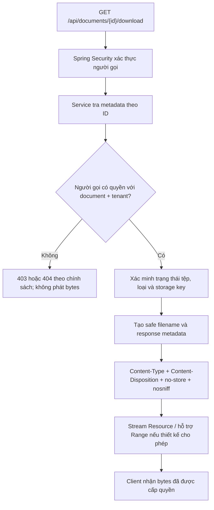

# Content-Disposition và trách nhiệm của lớp phục vụ tệp

## 1. Bối cảnh: trả một tệp không chỉ là gửi các byte

Một ứng dụng dùng Spring Security phục vụ nhiều loại tài nguyên: CSS và JavaScript công khai, ảnh đại diện, hợp đồng PDF, bảng lương, tài liệu do người dùng tải lên và bản xuất dữ liệu từ hệ thống. Với `GET /api/documents/{id}/download`, máy chủ không chỉ cần trả đúng nội dung; còn phải quyết định:

- Người yêu cầu **có quyền** xem và tải **chính tệp đó** hay không.
- Response là dữ liệu muốn browser **hiển thị trong trang** hay **xử lý như tệp tải xuống**.
- `Content-Type` có mô tả đúng bytes và `Content-Disposition` có đề xuất cách xử lý/tên tệp an toàn hay không.
- Có cho HTTP cache ở trình duyệt, reverse proxy hoặc CDN lưu response không.
- Có cần hỗ trợ file lớn, truyền luồng, `Range`/`206 Partial Content` và tải tiếp hay không.
- Khi có lỗi hoặc người dùng đăng xuất, dữ liệu có thể bị phát lại hoặc nằm trong storage phía client như thế nào.

Nếu sai bất kỳ bước nào, `Content-Disposition: attachment` **không thể tự ngăn rò rỉ dữ liệu, path traversal, XSS do file không đáng tin, hoặc quyền đọc chéo tài khoản**.

Bài thuộc chương **Bộ nhớ đệm và MIME** của mô-đun **SPRING_SECURITY_HTTP_PROTECTION**. Trong phạm vi các lớp phòng vệ HTTP/trình duyệt như CSRF, CORS, security headers, CSP, HSTS, HTTP firewall và bảo vệ session, bài này tập trung vào **`Content-Disposition` và trách nhiệm của lớp phục vụ tệp** trong cả Spring MVC/Servlet lẫn Spring WebFlux/Reactive. Người học sẽ thiết kế endpoint download an toàn, phân biệt luồng inline/attachment, kiểm thử header, phân quyền, cache/CDN và chẩn đoán sự cố triển khai.

Sau bài này, bạn có thể:

1. Giải thích `inline`, `attachment`, `filename` và `filename*` theo ngữ nghĩa HTTP; phân biệt với multipart upload.
2. Chọn `Content-Type`, `Content-Disposition`, `Cache-Control` và `X-Content-Type-Options` phù hợp với tài liệu công khai, tài liệu riêng và tệp không đáng tin.
3. Xây dựng lớp phục vụ tệp có bước **xác thực, phân quyền trên bản ghi, tra cứu storage key an toàn, chuẩn hóa tên tải xuống và streaming có kiểm soát**.
4. Trả `ResponseEntity<Resource>` qua Spring MVC và Reactive, hiểu điều kiện hỗ trợ HTTP Range.
5. Tránh các lỗi phổ biến như IDOR, path traversal, header injection, content sniffing, cache dùng chung và redirect signed URL không kiểm soát.
6. Viết kiểm thử cả luồng thành công và bị từ chối, từ đơn vị ứng dụng đến trình duyệt/CDN.

## 2. `Content-Disposition` là gì?

`Content-Disposition` là HTTP response header biểu đạt **cách user agent nên trình bày hoặc xử lý nội dung của response**, thường là hiển thị nội tuyến (*inline*) hoặc tải xuống (*attachment*). Nó không thay `Content-Type`, không tự xác minh định dạng, và không cấp quyền cho người gọi.

Hai ví dụ cùng chứa bytes PDF nhưng diễn đạt **ý định khác nhau**:

```http
HTTP/1.1 200 OK
Content-Type: application/pdf
Content-Disposition: inline; filename="manual.pdf"
```

```http
HTTP/1.1 200 OK
Content-Type: application/pdf
Content-Disposition: attachment; filename="manual.pdf"
```

Browser có thể hiển thị PDF với `inline` nếu hỗ trợ và chính sách cho phép; với `attachment`, browser thường xử lý như một tệp tải xuống và có thể gợi ý tên tệp. Cách hiện hộp thoại Save As hoặc tự lưu phụ thuộc trình duyệt, cài đặt, download manager và hệ điều hành. **Không có bảo đảm mọi trình duyệt sẽ thực hiện một hành vi giống hệt nhau.**

### 2.1. Các directive và tham số chính

| Thành phần | Ý nghĩa | Lưu ý |
| --- | --- | --- |
| `inline` | Cho phép hiển thị như một phần trang/trình xem nếu user agent hỗ trợ | **Không** làm nội dung không đáng tin trở nên an toàn |
| `attachment` | Yêu cầu browser xem response như tệp đính kèm/tải xuống | Không kiểm tra người tải, không loại bỏ mã độc trong tệp |
| `filename="file.pdf"` | Tên tệp gợi ý, tương thích rộng với client | Cần quote/escape và chuẩn hóa; client có thể sửa tên khi lưu |
| `filename*=UTF-8''...` | Tên tệp gợi ý theo mã hóa mở rộng (RFC 8187) | Hữu ích cho tiếng Việt và Unicode; hỗ trợ tùy user agent |
| Không gửi header | Browser quyết định theo MIME, ngữ cảnh và chính sách của nó | Không nên dựa vào mặc định khi yêu cầu tải xuống là quan trọng |

Ví dụ định dạng một dòng hợp lệ:

```http
Content-Disposition: attachment; filename="bao-cao.pdf"
```

Ví dụ tên Unicode:

```http
Content-Disposition: attachment; filename="bao-cao.pdf"; filename*=UTF-8''b%C3%A1o-c%C3%A1o.pdf
```

Khi cả hai tham số được gửi, client hiểu `filename*` nên ưu tiên giá trị đó. `filename` ASCII giúp tương thích client cũ. Tuy nhiên, **không nên tự ghép `filename*` từ raw input**; dùng API encoding của framework và thử trình duyệt mục tiêu.

### 2.2. `Content-Type` không phải `Content-Disposition`

Giả sử cùng URL trả một PDF riêng tư:

```http
HTTP/1.1 200 OK
Content-Type: application/pdf
Content-Disposition: attachment; filename="invoice.pdf"
Cache-Control: no-store
X-Content-Type-Options: nosniff
```

Bốn header xử lý bốn trách nhiệm:

- `Content-Type`: representation là PDF thực sự.
- `Content-Disposition`: đề nghị tải xuống và tên file.
- `Cache-Control`: không cho HTTP cache tuân thủ chuẩn lưu body riêng tư.
- `X-Content-Type-Options: nosniff`: hạn chế browser sử dụng response sai MIME trong các ngữ cảnh tiêu chuẩn quy định.

**Authentication và authorization vẫn là những bước riêng**: dù header đúng hoàn toàn, nếu Bob có thể đổi ID để tải hóa đơn của Alice thì endpoint vẫn có lỗ hổng.

### 2.3. `Content-Disposition` của multipart upload là chuyện khác

Một form upload có thể gửi:

```http
POST /api/uploads HTTP/1.1
Content-Type: multipart/form-data; boundary=demo

--demo
Content-Disposition: form-data; name="file"; filename="report.pdf"
Content-Type: application/pdf

<bytes>
--demo--
```

`form-data` trong **multipart part** mô tả trường form và tên file phía client; nó **không phải** directive download của response. Tên `filename` khi upload là dữ liệu đầu vào **không đáng tin**: không dùng nó làm đường dẫn lưu trên máy chủ, không dùng làm tên hiển thị/tải xuống khi chưa làm sạch.

Đặc biệt, `filename*` của response download theo RFC 6266/8187 không nên được bê nguyên cách dùng sang multipart form-data; các quy tắc của RFC 7578 khác nhau.

## 3. `inline` hay `attachment`: chọn theo nguồn gốc và độ tin cậy

Một hệ thống có thể cho phép preview PDF đã được tạo bởi chính ứng dụng nhưng yêu cầu tải xuống đối với file upload chưa đáng tin. Không nên quyết định chỉ dựa vào đuôi `.html` hoặc `.pdf`.

| Nhóm tệp | Cách xử lý gợi ý | Lý do |
| --- | --- | --- |
| PDF hướng dẫn công khai đã kiểm soát nội dung | `application/pdf`; `inline` hoặc `attachment` tùy sản phẩm | Có thể preview; cache public nếu bytes công khai |
| Hóa đơn PDF riêng tư, định dạng đã xác minh | `application/pdf` + `attachment` + `no-store` | Tránh preview không cần thiết, bảo vệ cache |
| Ảnh công khai của sản phẩm | `image/png` / `image/jpeg`; thường inline | Phù hợp cho ``; cache có thể dài nếu URL version hóa |
| CSV xuất dữ liệu người dùng | `text/csv` + `attachment` + `no-store` | Tránh shared cache, hướng tải xuống; còn cần xử lý CSV/formula injection |
| File upload bất kỳ/chưa đáng tin | `application/octet-stream` + `attachment`, cân nhắc origin tách biệt | Không cố để browser render HTML/SVG dưới origin ứng dụng |
| HTML do người dùng tự viết, cần preview | Chỉ preview trong môi trường **sandbox/origin riêng** với quy tắc rõ ràng | `inline` trên origin có cookie ứng dụng có thể nguy hiểm |
| ZIP/ảnh/tài liệu được upload nhưng chỉ nội bộ | MIME đã được xác thực hoặc `octet-stream`; attachment theo mục đích | Kiểm tra loại file, quyền, giới hạn kích thước và malware |

`attachment` là tín hiệu hữu ích nhưng **không phải sandbox**: người dùng có thể mở tệp đã tải trong trình duyệt hoặc ứng dụng khác. Với SVG/HTML/PDF do người ngoài cung cấp, vẫn cần validation, malware scanning nếu quy trình yêu cầu, và thiết kế nguồn gốc an toàn.

## 4. Tên file tải xuống: dữ liệu hiển thị không phải storage key

Lỗi thiết kế phổ biến là sử dụng cùng một chuỗi cho cả **đường dẫn lưu vật lý** và **tên tải xuống**. Điều này làm tăng nguy cơ path traversal, lộ tên thư mục, chèn ký tự điều khiển hoặc ghi đè tệp.

Thiết kế tốt tách ba khái niệm:

| Thuộc tính | Ví dụ | Nguồn và trách nhiệm |
| --- | --- | --- |
| Public document ID | `bb40ecf4-...` | ID không mang đường dẫn; chỉ dùng để tra metadata |
| Storage key nội bộ | `private/2026/11/7c8e...bin` | Server tự tạo hoặc metadata đã kiểm tra; **không** lấy trực tiếp từ tên file client |
| Safe display/download name | `bao-cao-thang-11.pdf` | Metadata đã được chuẩn hóa, có fallback an toàn và giới hạn độ dài |

Ví dụ upload `../../config/application.yml` không được tạo path trực tiếp từ chuỗi đó. Với một filename như `hóa-đơn.pdf`, vấn đề lại là mã hóa tiếng Việt hợp lệ trong `Content-Disposition`. Hai việc này **khác nhau**: mã hóa header đúng không đồng nghĩa đường dẫn lưu hoặc tên gợi ý đã an toàn.

### 4.1. Nguy cơ với filename chưa kiểm soát

- `../`, `..\\`, ký tự slash/backslash: có thể dẫn đến traversal nếu dùng làm path hoặc filename nguy hiểm khi client lưu.
- CR, LF và ký tự điều khiển: nguy cơ phá cú pháp response header nếu tự nối chuỗi mà không kiểm tra.
- Dấu nháy kép, chấm phẩy và ký tự không ASCII: yêu cầu encode/escape đúng quy tắc header.
- Unicode bidirectional control, ký tự gần giống nhau: có thể làm tên file **trông khác** đuôi/thứ tự thật.
- Tên file dài, tên đặc biệt của Windows hoặc tên bắt đầu bằng dấu chấm: có thể gây lỗi tương thích khi tải.
- Double extension như `invoice.pdf.html`: có thể đánh lừa người dùng về định dạng thật.
- Ký tự `%` và các escape sequence: client khác nhau có thể xử lý khác nhau.

**Chiến lược:** Chuẩn hóa tên hiển thị theo allowlist ký tự/phạm vi Unicode cho phép, loại bỏ đường dẫn và control characters, giới hạn độ dài, kiểm tra extension theo định dạng thực, có tên fallback kiểu `download.bin`. Đây là phần việc của **file metadata/service**, không phải nhiệm vụ của browser.

### 4.2. Dùng `ContentDisposition` builder của Spring

Thay vì:

```java
// Sai: không ghép trực tiếp tên do client cung cấp.
response.setHeader("Content-Disposition",
    "attachment; filename=\"" + untrustedName + "\"");
```

hãy dùng:

```java
import java.nio.charset.StandardCharsets;
import org.springframework.http.ContentDisposition;
import org.springframework.http.HttpHeaders;

String safeName = "bao-cao-thang-11.pdf"; // Service đã chuẩn hóa.
ContentDisposition value = ContentDisposition.attachment()
    .filename(safeName, StandardCharsets.UTF_8)
    .build();

response.setHeader(
    HttpHeaders.CONTENT_DISPOSITION, value.toString());
```

`ContentDisposition` biết cách format/encode giá trị tham số theo API Spring. Nó **không tự xử lý mọi nguy cơ tên tệp hoặc thực hiện chính sách đặt tên của sản phẩm**. Phải luôn kết hợp với bước tạo `safeName` độc lập và kiểm thử tên có dấu, dấu nháy, backslash, khoảng trắng và control characters. Tùy phiên bản Spring, chuỗi header cuối có thể khác nhau; không viết test so khớp từng byte với một định dạng mã hóa tự đoán.

### 4.3. Tên file response và multipart request khác nhau

Theo Spring `ContentDisposition.Builder`, overload `filename(name, UTF_8)` sử dụng encoding của tham số response; đừng dùng kiểu mã hóa mở rộng này khi xây dựng `Content-Disposition` cho một part `multipart/form-data` upload vì quy tắc RFC 7578 khác. Phía nhận upload phải kiểm tra tên file client gửi, không dùng API xây response download như cơ chế làm sạch tên đầu vào.

## 5. Trách nhiệm thực sự của lớp phục vụ tệp

Một endpoint download an toàn là tổ hợp nhiều bước, không chỉ là một controller trả `Resource`:



### 5.1. Phân quyền trên từng đối tượng, không chỉ `authenticated()`

Rule:

```java
.requestMatchers("/api/documents/**").authenticated()
```

chỉ yêu cầu request đã đăng nhập. Nó **chưa chứng minh** người đó có quyền tải `documentId` bất kỳ. Nếu Alice sở hữu tài liệu `D1` và Bob có thể gửi `GET /api/documents/D1/download` rồi nhận body, đây là lỗi **IDOR/Broken Object Level Authorization** dù Spring Security filter chain hoạt động đúng.

Service phải kiểm tra owner/tenant/quyền trên bản ghi đang được yêu cầu **trước khi mở tệp hoặc ký URL**, và có chính sách rõ ràng với admin, chia sẻ tài liệu hoặc tài liệu công khai.

### 5.2. Mapping ID sang storage key an toàn

Không thiết kế:

```java
// Sai: user có thể tác động trực tiếp vào path.
Path requested = Path.of("/data/uploads", userProvidedPath);
return new FileSystemResource(requested);
```

Thiết kế tốt hơn: client chỉ biết `UUID` hoặc opaque document identifier; service tra metadata đã lưu, từ đó lấy storage key server kiểm soát. Với filesystem phải kiểm tra path nằm dưới thư mục được phép sau normalization/canonicalization phù hợp, cẩn trọng symbolic links và race conditions. Với object storage, giới hạn bucket/prefix và IAM, không dùng raw object key do người dùng tự chọn.

### 5.3. Độ tin cậy của định dạng và nội dung

Upload có `Content-Type: application/pdf` **không chứng minh bytes là PDF**. Cần chính sách kiểm tra file ở lúc upload (signature/file magic, bộ parse hoặc scanner, giới hạn kích thước, loại file được phép). Nếu phải phục vụ nội dung chưa đáng tin, đừng render HTML/SVG tùy ý ở origin có cookie đăng nhập của hệ thống.

Nếu service biết chắc tệp PDF hợp lệ, có thể đặt `application/pdf`. Nếu mục tiêu là **tải bytes chưa đáng tin** và không có loại MIME được xác minh, dùng `application/octet-stream` cùng `attachment`. Đây là cơ chế hướng client; nó không loại bỏ nguy cơ người dùng mở tệp về sau.

### 5.4. Quản lý luồng và tài nguyên

Với tệp lớn, tránh đọc toàn bộ bytes vào `byte[]`/`ByteArrayResource` nếu không có nhu cầu hoặc giới hạn rõ ràng. Ưu tiên cơ chế `Resource`/streaming, có giới hạn concurrency và timeout phù hợp; khi nguồn đọc lỗi, phải giải phóng file handle/kết nối storage theo lifecycle.

Các điểm vận hành:

- `Content-Length` **chỉ phát khi biết chính xác số byte** của body sẽ gửi; không đoán và không buộc đọc hết stream chỉ để tính size.
- Với tệp từ network/object store, cách đọc có thể blocking; trong WebFlux cần tránh chặn event-loop.
- Lưu ý client ngắt kết nối, hủy tải, lỗi giữa luồng và giới hạn tài nguyên.
- Có thể dùng `HEAD` để trả metadata nhưng phải **kiểm tra quyền** như GET.
- Hỗ trợ `Range` không được làm lỏng kiểm tra quyền; mỗi request partial vẫn phải được xác thực/phân quyền.

### 5.5. Kiểm soát lộ thông tin khi từ chối

Nếu tệp không tồn tại, đã bị xóa, bị cách ly hoặc người dùng không có quyền, endpoint cần trả status thích hợp mà **không tiết lộ path vật lý, bucket nội bộ, secret hoặc thông tin của người khác**. Tùy threat model, với tài liệu không thuộc quyền có thể chọn `404 Not Found` để tránh xác nhận sự tồn tại, hoặc `403 Forbidden` để phản ánh chính sách API. Quan trọng là nhất quán và có test; không tải bytes ra rồi mới kiểm tra.

## 6. Spring Security Servlet: bảo vệ route trước khi tải tệp

Ví dụ ứng dụng có assets công khai ở `/assets/**`, API tải tài liệu có đăng nhập ở `/api/documents/**` và phần còn lại cần xác thực.

```java
import org.springframework.context.annotation.Bean;
import org.springframework.context.annotation.Configuration;
import org.springframework.security.config.annotation.web.builders.HttpSecurity;
import org.springframework.security.web.SecurityFilterChain;

@Configuration
class ServletSecurityConfig {

    @Bean
    SecurityFilterChain securityFilterChain(HttpSecurity http)
            throws Exception {
        return http.authorizeHttpRequests(auth -> auth
                .requestMatchers("/assets/**").permitAll()
                .requestMatchers("/api/documents/**").authenticated()
                .anyRequest().authenticated())
            .build();
    }
}
```

Đây là ví dụ giữ các security headers mặc định, trong đó thường có `X-Content-Type-Options: nosniff` và bộ chống HTTP caching. Không tắt `http.headers(...)` để xử lý sự cố download. Trong thực tế, chọn form login/session hay bearer token, CSRF, CORS, method security và logout theo yêu cầu triển khai.

### 6.1. Contract của service tải tài liệu

Tách service khỏi HTTP controller:

```java
import org.springframework.core.io.Resource;
import java.util.UUID;

record AuthorizedFile(
    Resource resource,
    String safeDownloadName,
    long contentLength,
    boolean verifiedPdf
) {}

interface AuthorizedFileService {
    AuthorizedFile loadAuthorized(UUID documentId, String username);
}
```

`AuthorizedFileService` là interface minh họa. Triển khai thật phải xác thực document ownership/tenant, trạng thái file, storage location, tên tải xuống đã chuẩn hóa và tính chính xác của `contentLength`. Khi không biết kích thước, thay đổi contract để biểu diễn giá trị không xác định và **không phát `Content-Length`**.

### 6.2. Trả `ResponseEntity<Resource>` có đầy đủ header

```java
import java.nio.charset.StandardCharsets;
import java.util.UUID;

import org.springframework.core.io.Resource;
import org.springframework.http.CacheControl;
import org.springframework.http.ContentDisposition;
import org.springframework.http.HttpHeaders;
import org.springframework.http.MediaType;
import org.springframework.http.ResponseEntity;
import org.springframework.security.core.Authentication;
import org.springframework.web.bind.annotation.GetMapping;
import org.springframework.web.bind.annotation.PathVariable;
import org.springframework.web.bind.annotation.RestController;

@RestController
class PrivateDownloadController {

    private final AuthorizedFileService files;

    PrivateDownloadController(AuthorizedFileService files) {
        this.files = files;
    }

    @GetMapping("/api/documents/{id}/download")
    ResponseEntity<Resource> download(
            @PathVariable UUID id,
            Authentication authentication) {

        AuthorizedFile file =
            files.loadAuthorized(id, authentication.getName());

        ContentDisposition disposition = ContentDisposition.attachment()
            .filename(file.safeDownloadName(), StandardCharsets.UTF_8)
            .build();

        MediaType mediaType = file.verifiedPdf()
            ? MediaType.APPLICATION_PDF
            : MediaType.APPLICATION_OCTET_STREAM;

        return ResponseEntity.ok()
            .contentType(mediaType)
            .header(HttpHeaders.CONTENT_DISPOSITION,
                    disposition.toString())
            .cacheControl(CacheControl.noStore())
            .contentLength(file.contentLength())
            .body(file.resource());
    }
}
```

Kết quả với PDF riêng tư có thể là:

```http
HTTP/1.1 200 OK
Content-Type: application/pdf
Content-Disposition: attachment; filename="report.pdf"
Cache-Control: no-store
X-Content-Type-Options: nosniff
Content-Length: 20480
```

Giá trị `Content-Length`, tên file và cách Spring encode header thực tế phụ thuộc metadata; response trên chỉ minh họa. `nosniff` đến từ Spring Security nếu filter chain của request có cấu hình header writer mặc định. `Cache-Control: no-store` được controller đặt có chủ đích cho tệp riêng.

Với source stream chỉ đọc được một lần, phải kiểm tra loại `Resource` và khả năng Spring xử lý; `InputStreamResource` có những hạn chế về tính length và HTTP Range. Không tạo `new InputStreamResource(streamĐãĐọc())` rồi đo length bằng cách đọc hết input stream trước khi gửi.

### 6.3. Vì sao controller không nên biết đường dẫn vật lý?

Controller trên chỉ nhận `UUID` và `Authentication` rồi gọi service. Service chịu trách nhiệm truy vấn bản ghi, kiểm tra quyền và lấy `Resource` từ nguồn đã được kiểm soát. Đây là ranh giới có lợi:

- HTTP layer quản lý status/headers/content negotiation.
- Domain/service layer kiểm soát **ai được tải cái gì**.
- Storage layer mở file/object theo key nội bộ, tuân thủ resource policy.

Tách lớp giúp thay filesystem bằng S3-compatible object storage hoặc database blob mà không chuyển quyền kiểm tra vào tên URL hay query string.

## 7. Spring WebFlux (Reactive): giữ nguyên chính sách, khác cách truyền dữ liệu

Trong WebFlux, dùng `SecurityWebFilterChain` và `ServerHttpSecurity`:

```java
import org.springframework.context.annotation.Bean;
import org.springframework.context.annotation.Configuration;
import org.springframework.security.config.annotation.web.reactive.EnableWebFluxSecurity;
import org.springframework.security.config.web.server.ServerHttpSecurity;
import org.springframework.security.web.server.SecurityWebFilterChain;

@Configuration
@EnableWebFluxSecurity
class ReactiveSecurityConfig {

    @Bean
    SecurityWebFilterChain securityWebFilterChain(ServerHttpSecurity http) {
        return http.authorizeExchange(auth -> auth
                .pathMatchers("/assets/**").permitAll()
                .pathMatchers("/api/documents/**").authenticated()
                .anyExchange().authenticated())
            .build();
    }
}
```

### 7.1. Service reactive và controller

Đây là **phương án độc lập**, không đăng ký đồng thời với Servlet controller ở mục 6 trên cùng endpoint.

```java
import java.util.UUID;
import org.springframework.core.io.Resource;
import reactor.core.publisher.Mono;

record ReactiveAuthorizedFile(
    Resource resource,
    String safeDownloadName,
    long contentLength,
    boolean verifiedPdf
) {}

interface ReactiveAuthorizedFileService {
    Mono<ReactiveAuthorizedFile> loadAuthorized(
        UUID documentId, String username);
}
```

```java
import java.nio.charset.StandardCharsets;
import java.security.Principal;
import java.util.UUID;

import org.springframework.core.io.Resource;
import org.springframework.http.CacheControl;
import org.springframework.http.ContentDisposition;
import org.springframework.http.HttpHeaders;
import org.springframework.http.MediaType;
import org.springframework.http.ResponseEntity;
import org.springframework.web.bind.annotation.GetMapping;
import org.springframework.web.bind.annotation.PathVariable;
import org.springframework.web.bind.annotation.RestController;
import reactor.core.publisher.Mono;

@RestController
class ReactiveDownloadController {

    private final ReactiveAuthorizedFileService files;

    ReactiveDownloadController(ReactiveAuthorizedFileService files) {
        this.files = files;
    }

    @GetMapping("/api/documents/{id}/download")
    Mono<ResponseEntity<Resource>> download(
            @PathVariable UUID id, Mono<Principal> principal) {

        return principal.flatMap(p ->
            files.loadAuthorized(id, p.getName())
        ).map(file -> {
            ContentDisposition disposition = ContentDisposition.attachment()
                .filename(file.safeDownloadName(), StandardCharsets.UTF_8)
                .build();

            MediaType mediaType = file.verifiedPdf()
                ? MediaType.APPLICATION_PDF
                : MediaType.APPLICATION_OCTET_STREAM;

            return ResponseEntity.ok()
                .contentType(mediaType)
                .header(HttpHeaders.CONTENT_DISPOSITION,
                        disposition.toString())
                .cacheControl(CacheControl.noStore())
                .contentLength(file.contentLength())
                .body(file.resource());
        });
    }
}
```

Điều kiện bảo mật **không đổi**: người gọi phải có quyền đối với tệp cụ thể trước khi mở hoặc phát bytes; tên file hiển thị và storage key được tách biệt; `no-store` cho dữ liệu riêng, MIME đáng tin, `attachment` khi cần download.

### 7.2. `Mono` không tự biến đọc file thành non-blocking

Nếu `loadAuthorized(...)` dùng JDBC đồng bộ, gọi filesystem/blocking object-storage SDK hoặc mở stream ngay trên event loop rồi bọc trong `Mono.just(...)`, ứng dụng vẫn có thể **chặn event loop**. Service phải dùng storage/driver reactive phù hợp, hoặc chuyển việc blocking sang scheduler được thiết kế cho blocking I/O (ví dụ bounded elastic) với cơ chế giải phóng tài nguyên đúng.

Với tệp rất lớn hoặc lưu trong object store, cân nhắc luồng `Flux<DataBuffer>` và `DataBufferUtils`, kiểm soát backpressure, timeout và cancel. Không mặc nhiên xây tệp lớn thành `byte[]` chỉ vì API dùng `Mono`.

### 7.3. Đặt header trước response commit

`ServerHttpResponse` và `ServerResponse` của WebFlux chỉ cho thay đổi header **trước khi response đã được commit**. Khi streaming đã bắt đầu, không thể bảo đảm sửa `Content-Disposition`, `Content-Type` hay `Cache-Control` còn có tác dụng. `ResponseEntity` cung cấp cách khai báo status/header/body rõ ràng trước giai đoạn ghi dữ liệu.

## 8. HTTP Range, 206, tải tiếp và tệp lớn

Nhiều client tải video, PDF hoặc file lớn theo từng phần. HTTP cho phép request gửi:

```http
GET /api/documents/<id>/download HTTP/1.1
Range: bytes=0-1023
```

Server có thể trả:

```http
HTTP/1.1 206 Partial Content
Content-Type: application/pdf
Content-Disposition: attachment; filename="report.pdf"
Content-Range: bytes 0-1023/65536
Content-Length: 1024
Cache-Control: no-store
```

Đây là response ví dụ, không phải bằng chứng ứng dụng tự hỗ trợ mọi dạng range. Nếu không hỗ trợ range, server có thể bỏ qua `Range` và trả toàn bộ representation với `200` theo quy tắc HTTP; request range không hợp lệ có thể dẫn đến `416 Range Not Satisfiable`.

### 8.1. Điều kiện hỗ trợ tự động trong Spring MVC/WebFlux

Theo tài liệu Spring Framework, khi annotated controller trả `Resource` hoặc `ResponseEntity<Resource>`, Spring có thể xử lý `Range` một cách minh bạch với một số điều kiện:

- `Resource` **không phải `InputStreamResource`**.
- Với `ResponseEntity<Resource>`, status ban đầu phải là **`200 OK`**.
- Resource phải có đặc tính phù hợp để truy cập vùng bytes (ví dụ tài nguyên file hỗ trợ truy cập lại).
- Có bộ converter/writer phù hợp và ứng dụng không dùng một đường truyền response tự viết làm mất cơ chế hỗ trợ.

Với `InputStreamResource` dùng stream chỉ đọc một lần, không mặc định có HTTP Range tự động. Nếu ứng dụng cần tải tiếp từ object storage, có thể phải tự mapping range sang yêu cầu storage và tạo response `206` đúng chuẩn; không giả định mọi nguồn stream đều random-access.

### 8.2. Mỗi yêu cầu Range vẫn cần kiểm tra quyền

Nếu Alice có quyền tải file nhưng đã logout giữa hai lượt tải tiếp:

```http
GET /api/documents/<id>/download
Range: bytes=8192-16383
Cookie: JSESSIONID=<session-da-huy>
```

server phải xử lý request mới theo **quyền hiện tại**. Không trả `206` chỉ vì client biết `Range`, `ETag` hoặc URL đã dùng trước đó. Tương tự, nếu có CDN, phải đảm bảo **không shared-cache các range của tài liệu riêng tư**.

### 8.3. `HEAD`, `ETag` và `If-Range`

- `HEAD` có thể cung cấp metadata không chứa body, nhưng phải áp cùng cơ chế phân quyền với `GET`.
- `ETag` và `Last-Modified` có thể giúp client revalidate hoặc chọn phiên bản representation.
- `If-Range` có thể yêu cầu server trả một phần **chỉ khi validator khớp**, nếu không trả representation đầy đủ theo ngữ nghĩa HTTP.
- Với tài liệu nhạy cảm, `no-store` giúp tránh HTTP cache giữ body; validator không phải công cụ phân quyền.
- Khi phản hồi `206`, `Content-Range` và `Content-Length` phải mô tả **phần bytes thực gửi**, không phải cứ dùng kích thước toàn bộ file.

Để kiểm tra, dùng GET có `Range` thật thay vì chỉ một request HEAD; quan sát status, headers và kích thước body.

## 9. Phục vụ trực tiếp, qua gateway hay signed URL?

Có ba kiến trúc thường gặp:

| Cách truyền bytes | Lợi ích | Cần kiểm tra bảo mật |
| --- | --- | --- |
| Spring controller trả `ResponseEntity<Resource>` | Dễ kiểm soát header, quyền và log tại ứng dụng | Streaming, timeout, số kết nối và I/O blocking |
| Reverse proxy dùng cơ chế nội bộ được ủy quyền (ví dụ internal redirect/acceleration) | Giảm tải xử lý bytes ở application | Chỉ phát tệp sau kiểm tra quyền; chặn truy cập trực tiếp đường nội bộ, truyền metadata an toàn |
| Redirect hoặc cấp **signed URL** có thời hạn đến object store/CDN | Offload bytes lớn, mở rộng băng thông | Signed URL là một capability, có thể bị chia sẻ; giới hạn object/phương thức/TTL, logging và cache policy |

### 9.1. Signed URL không xóa trách nhiệm phân quyền

Trước khi tạo signed URL, Spring Security vẫn phải kiểm tra người gọi và quyền đối với tài liệu. URL được ký cần:

- Chỉ áp dụng cho **đúng object** và thao tác tải xuống; tránh cấp quyền liệt kê cả bucket.
- Thời hạn ngắn, tùy dữ liệu và yêu cầu sản phẩm; chú ý cơ chế thu hồi sớm nếu cần.
- Không xuất hiện ở referrer/log không an toàn, email công khai hoặc analytics.
- HTTPS và bucket/storage policy phù hợp.
- `Content-Type`/`Content-Disposition` của response cuối ở storage/CDN được thiết lập đúng; header controller **không tự theo redirect sang một origin khác**.
- Không shared-cache file riêng tư theo một cache key có thể bị dùng chung sai.

Một signed URL có thể tiếp tục dùng được cho đến lúc hết hạn dù session Spring đã logout. Nếu chính sách yêu cầu thu hồi tức thì, kiến trúc cần phương án phù hợp (short TTL, proxy kiểm tra quyền, revocation/denylist nếu hệ thống hỗ trợ).

### 9.2. Đừng chuyển tiếp header download từ client không kiểm tra

Nếu client được phép truyền query như `?filename=...&contentType=...`, **không** lấy trực tiếp hai giá trị đó để làm `Content-Disposition` và `Content-Type` cho object. Chỉ dùng metadata server đã xác minh hoặc allowlist định dạng hợp lệ, đồng thời kiểm soát cách storage/CDN áp các tham số response override.

## 10. `Content-Disposition`, `nosniff`, CSRF, CORS và CSP

Các lớp bảo vệ giải quyết những rủi ro khác nhau:

| Cơ chế | Mục đích chính | Không thay được điều gì? |
| --- | --- | --- |
| `Content-Disposition: attachment` | Hướng browser xử lý response như tệp tải xuống | Không xác thực người dùng, không quét malware |
| `Content-Type` | Khai báo media type của bytes | Không bảo đảm file thực sự đúng định dạng nếu metadata sai |
| `X-Content-Type-Options: nosniff` | Hạn chế dùng sai MIME cho một số request như script/style | Không làm sạch HTML/SVG được phục vụ dưới MIME cho phép |
| `Cache-Control: no-store` | Ngăn HTTP cache tuân thủ chuẩn lưu response nhạy cảm | Không xóa file đã tải khỏi Downloads |
| CSRF protection | Chặn một số thao tác trạng thái trái ý người dùng với credential tự động | Không phải cơ chế định dạng tệp |
| CORS / same-origin policy | Quy định JavaScript cross-origin được đọc response như thế nào | Không tự kiểm soát link navigation tải xuống hoặc phân quyền file |
| CSP, sandbox, origin riêng | Giảm nguy cơ thực thi/nhúng active content không đáng tin | Không thay việc chuẩn hóa tên hoặc kiểm tra quyền |
| Session/bearer authorization | Ai được tải bytes | Không sửa `Content-Disposition` hoặc MIME sai |

### 10.1. Khi JavaScript dùng `fetch()` để tải tệp

`Content-Disposition: attachment` đặc biệt hữu ích khi browser **điều hướng** đến URL download hoặc người dùng kích hoạt link thích hợp. Tuy nhiên, nếu code viết:

```javascript
const response = await fetch("/api/documents/123/download");
```

trình duyệt **không tự mở hộp thoại Save As chỉ vì response có `attachment`**. `fetch()` trao response cho JavaScript, và ứng dụng phải chủ động xử lý dữ liệu (ví dụ tạo `Blob`/link tải xuống) hoặc dùng cách tải khác.

Với tệp rất lớn, biến toàn bộ body thành `Blob` có thể tốn nhiều bộ nhớ. Nếu có thể dùng cookie/session an toàn cùng route download, một `<a href="/api/documents/.../download">` có thể phù hợp hơn; với bearer token chỉ có trong JS, cần thiết kế riêng để truyền credential an toàn, tránh đưa token vào query string.

Thuộc tính HTML `download` của `<a>` không có hiệu lực giống nhau với URL cross-origin; `Content-Disposition` do server trả vẫn rất quan trọng cho việc điều hướng tải về.

### 10.2. Đọc `Content-Disposition` từ JavaScript cross-origin

Khi frontend ở `https://app.example.com` gọi API download ở `https://api.example.net` bằng `fetch()`, CORS phải cho phép origin/credentials phù hợp. Nếu frontend cần **đọc tên file từ header**:

```http
Access-Control-Expose-Headers: Content-Disposition
```

Header này là cách chỉ định `Content-Disposition` có thể được JavaScript cross-origin truy cập khi CORS thành công, vì nó không thuộc nhóm response headers được CORS expose mặc định. Đừng nhầm `Access-Control-Expose-Headers` với `Access-Control-Allow-Headers` (cấp phép request headers).

Với CORS credentials, phải cấu hình allowed origin cụ thể theo chính sách; không tùy tiện dùng `Access-Control-Allow-Origin: *` cùng credentials. Tuy nhiên, **expose header không cấp quyền tải tài liệu**: origin vẫn phải thực hiện authentication/authorization từng tệp.

## 11. Cache browser, reverse proxy và CDN cho file download

Một PDF cá nhân có thể được lưu nếu CDN “cache mọi GET có đuôi `.pdf`” dù đường dẫn thực là API trả tài liệu riêng. Đây là lỗi nghiêm trọng nếu cùng URL ID bị dùng lại giữa tài khoản, hoặc cache key không phân biệt session.

| Loại nội dung | Cache-Control gợi ý | Lý do |
| --- | --- | --- |
| Tài liệu lương, hóa đơn, bản xuất dữ liệu theo người dùng | `no-store` | Không cho HTTP cache lưu body riêng tư |
| File upload riêng tư theo tenant | `no-store` | Chặn shared-cache và hạn chế browser cache |
| Tài liệu công khai, URL có hash nội dung | `public, max-age=31536000` *(ví dụ)* | Các client được phép nhận cùng bytes, cập nhật bằng URL mới |
| Tài liệu công khai ở URL ổn định | `public, max-age=300` hoặc `no-cache` | Giới hạn độ cũ, revalidate khi cần |
| File chia sẻ qua signed URL | Phụ thuộc threat model; thường tránh shared cache nếu riêng tư | URL là capability; phải hiểu TTL, key, edge rule và thu hồi |

Spring Security mặc định có các header chống HTTP cache và `nosniff`. Khi controller đã đặt `Cache-Control: no-store`, không nhất thiết thấy đầy đủ `Pragma`/`Expires`, vì writer có thể xem policy đã do ứng dụng kiểm soát. Điều cần kiểm tra là **header cuối có `no-store` và edge không override**.

**Lưu ý:** `no-store` không xóa bản PDF đã được người dùng lưu ở Downloads. Không thể cam kết “thu hồi tệp đã tải” bằng cách logout hoặc thêm header vào response sau này.

### 11.1. Không cache theo phần mở rộng một cách mù quáng

Rule kiểu “`*.pdf` → `public, max-age=3600`” không phân biệt PDF công khai và phiếu lương riêng. Với CDN, dùng **allowlist route public** và bypass `/api/documents/**`, `/api/account/**`, `/exports/**` nếu các endpoint này gắn với quyền; không dựa vào `.pdf`/`.zip`/`.csv` làm bằng chứng công khai.

### 11.2. Response lỗi cũng cần chính sách

`401`, `403`, `404`, `302` và `416` có thể xuất hiện trong quy trình download. Một proxy có thể cache lỗi theo rule riêng; đừng để một login redirect hoặc thông báo lỗi chứa dữ liệu riêng bị lưu lâu ngoài chủ đích. Kiểm tra header/cache policy trên **nhánh thành công lẫn từ chối** và sau gateway.

## 12. Kiểm thử bằng HTTP client và trình duyệt

### 12.1. Kiểm tra GET thực thay vì chỉ HEAD

Ví dụ với credential thử nghiệm:

```bash
curl -sS -D - -o /dev/null \
  -H 'Authorization: Bearer <test-token>' \
  'https://app.example.com/api/documents/00000000-0000-0000-0000-000000000001/download'
```

Kỳ vọng với file riêng tư đã được cấp quyền:

- Status `200` (hoặc `206` nếu gửi request Range và được hỗ trợ).
- `Content-Type` đúng với loại file, hoặc `application/octet-stream` khi chủ đích phục vụ bytes chưa đáng tin.
- `Content-Disposition` có `attachment` và tên file được mã hóa/chuẩn hóa an toàn.
- `Cache-Control` chứa `no-store`, `X-Content-Type-Options: nosniff` khi security headers được áp dụng.
- Không có `public`/`s-maxage` do CDN ghi đè sai.

`curl -I` gửi HEAD, đôi khi đi qua code path khác; HEAD hữu ích để kiểm tra metadata nhưng **không đủ** chứng minh GET và streaming sẽ đúng. Với `curl -D - -o /dev/null`, phương thức vẫn là GET nhưng body bị bỏ, không ghi file.

### 12.2. Kiểm tra tên file Unicode

Sử dụng tài liệu test có tên `hóa-đơn tháng 11.pdf` và kiểm tra response `Content-Disposition` được browser giải mã hợp lý. Không assume string header phải bằng chuỗi do bạn tự ghép; các phiên bản Spring/client có thể dùng fallback và dạng mã hóa khác nhau.

Thử các tên chứa dấu nháy, dấu chấm phẩy, khoảng trắng, ký tự điều khiển và chuỗi giống path trong **môi trường kiểm thử** để bảo đảm hệ thống chuẩn hóa hoặc từ chối trước khi gửi header. Không sử dụng tên file mang payload có chủ đích trên hệ thống không được phép thử.

### 12.3. Kiểm thử Range

```bash
curl -sS -i \
  -H 'Authorization: Bearer <test-token>' \
  -H 'Range: bytes=0-31' \
  'https://app.example.com/api/documents/00000000-0000-0000-0000-000000000001/download'
```

Nếu ứng dụng và resource hỗ trợ range, có thể nhận `206` với `Content-Range: bytes 0-31/<total>` và body 32 bytes. Nếu không hỗ trợ, có thể nhận `200` với body đầy đủ; phải xác định theo contract thực. Kiểm tra thêm `416` cho range không hợp lệ và quyền truy cập trước khi xử lý range.

### 12.4. Kiểm tra download trong browser

- Dùng link/điều hướng thực đến URL download, không chỉ gọi `fetch()`.
- Xem DevTools Network: status, redirect, `Content-Type`, `Content-Disposition`, `Cache-Control`, `X-Content-Type-Options`.
- Kiểm tra tên file được đề xuất bằng Chrome/Edge, Firefox, Safari và mobile nếu sản phẩm hỗ trợ.
- Đăng xuất, chuyển tài khoản, thử ID không thuộc quyền và xem browser/CDN có phát lại body riêng hay không.
- Nếu dùng signed URL, kiểm tra response **tại object storage/CDN đích**, không chỉ response `302` của Spring.
- Với file lớn, thử tạm ngắt mạng/hủy tải/tải tiếp và theo dõi release file handles, lỗi stream.

## 13. Kiểm thử Spring MVC bằng MockMvc

Các test sau minh họa `MockMvc` với Spring Security filter chain, service download fixture và file test được cấp quyền cho Alice. Chúng **không tự tạo** service/resource; cần cấu hình test double hoặc bộ fixture phù hợp.

```java
import static org.hamcrest.Matchers.containsString;
import static org.hamcrest.Matchers.startsWith;
import static org.springframework.security.test.web.servlet.request
    .SecurityMockMvcRequestPostProcessors.user;
import static org.springframework.test.web.servlet.request
    .MockMvcRequestBuilders.get;
import static org.springframework.test.web.servlet.result
    .MockMvcResultMatchers.*;

import org.junit.jupiter.api.Test;
import org.springframework.beans.factory.annotation.Autowired;
import org.springframework.boot.test.autoconfigure.web.servlet.AutoConfigureMockMvc;
import org.springframework.boot.test.context.SpringBootTest;
import org.springframework.http.HttpHeaders;
import org.springframework.http.MediaType;
import org.springframework.test.web.servlet.MockMvc;

@SpringBootTest
@AutoConfigureMockMvc
class PrivateDownloadMvcTest {

    @Autowired MockMvc mvc;

    private static final String FILE_URL =
        "/api/documents/00000000-0000-0000-0000-000000000001/download";

    @Test
    void attachmentHasSafeHeaders() throws Exception {
        mvc.perform(get(FILE_URL).with(user("alice")))
            .andExpect(status().isOk())
            .andExpect(header().string(
                HttpHeaders.CONTENT_DISPOSITION,
                startsWith("attachment")))
            .andExpect(header().string(
                HttpHeaders.CACHE_CONTROL,
                containsString("no-store")))
            .andExpect(header().string(
                "X-Content-Type-Options", "nosniff"))
            .andExpect(content().contentTypeCompatibleWith(
                MediaType.APPLICATION_PDF));
    }

    @Test
    void unauthenticatedRequestMustNotReturnFile() throws Exception {
        mvc.perform(get(FILE_URL))
            .andExpect(result -> {
                int status = result.getResponse().getStatus();
                if (status == 200 || status == 206) {
                    throw new AssertionError(
                        "Tệp riêng không được trả khi chưa xác thực");
                }
            });
    }
}
```

Ví dụ thứ hai **không cố định `401`** vì form login có thể redirect `302` thay vì trả JSON `401`. Với endpoint chỉ dành cho API bearer token và đã cấu hình entry point, có thể assert `401` chính xác. Cần thêm test người **đã đăng nhập nhưng không có quyền** để phát hiện IDOR.

### 13.1. Kiểm thử phân quyền từng tệp

Nên tạo fixture có hai tài khoản Alice và Bob, mỗi người sở hữu một tài liệu riêng. Với Bob gửi ID của Alice, kỳ vọng `403` hoặc `404` theo API contract; **không có bytes tài liệu của Alice**.

Bản quyền download phải nằm ở service, nên test cần assert cả việc **service kiểm tra user ID/tenant** hoặc truy vấn có scope phù hợp, không chỉ test security matcher `authenticated()`. Nếu hệ thống có admin hoặc chia sẻ tài liệu, bổ sung test quyền tương ứng.

### 13.2. Kiểm thử tên file và Content-Length

- Filename có tiếng Việt được encode/escape hợp lệ qua builder, browser có thể giải mã.
- Tên chứa path separator/CRLF không được giữ raw.
- `Content-Length` bằng kích thước body đầy đủ thực tế trên response `200` khi giá trị được gửi.
- Với `206`, `Content-Range` và `Content-Length` phải khớp range.
- Một file bị thiếu/xóa trong storage không được trả `200` cùng body lỗi HTML mang `Content-Type: application/pdf`.
- Không để converter đọc stream một lần chỉ để đo length trước khi gửi.

## 14. Kiểm thử WebFlux bằng WebTestClient

Với application context WebFlux có Spring Security test support, có thể dùng `WebTestClient` và `mockUser`:

```java
import static org.springframework.security.test.web.reactive.server
    .SecurityMockServerConfigurers.mockUser;

// client đã bindToApplicationContext(context).apply(springSecurity())
// .configureClient().build() hoặc được cấu hình tương đương.

client.mutateWith(mockUser("alice"))
    .get().uri("/api/documents/00000000-0000-0000-0000-000000000001/download")
    .exchange()
    .expectStatus().isOk()
    .expectHeader().valueMatches(
        "Content-Disposition", "attachment.*")
    .expectHeader().valueMatches(
        "Cache-Control", ".*no-store.*")
    .expectHeader().valueEquals(
        "X-Content-Type-Options", "nosniff");
```

Đây là **trích đoạn test**, cần `ReactiveAuthorizedFileService` và fixture nội dung/metadata đúng. Test header không thay thế test stream tệp lớn, backpressure hoặc quyền owner; kiểm tra riêng các trường hợp WebSession/token hết hạn và request `Range` khi hệ thống hỗ trợ.

## 15. Chẩn đoán lỗi khi phục vụ tệp

| Triệu chứng | Nguyên nhân có thể | Cách xử lý |
| --- | --- | --- |
| PDF mở trong tab dù muốn tải về | Không có `attachment`, hoặc browser/plugin xử lý riêng | Kiểm tra `Content-Disposition` tại response cuối và thử đúng browser |
| Tệp được tải với tên lạ hoặc mất dấu tiếng Việt | Tên chưa encode đúng; filename fallback/filename* không tương thích | Dùng `ContentDisposition` builder, test tên Unicode |
| Response có `Content-Disposition` nhưng `fetch()` không bật Save As | `fetch()` trả object Response cho JS | Dùng link/điều hướng tải trực tiếp hoặc xử lý Blob/stream chủ động |
| Bob tải được file của Alice khi đổi ID | Thiếu kiểm tra quyền ở service, IDOR | Authorize theo document + tenant + principal trước khi mở |
| Tên tệp chứa `../` dẫn đến đọc nhầm file | Ghép raw filename/path từ request vào filesystem | Tra storage key qua metadata server, giới hạn root và chống symlink/traversal |
| File upload HTML chạy dưới origin ứng dụng | Phục vụ `inline`/`text/html` cho untrusted content | Dùng attachment/`octet-stream`, sandbox/tách origin theo nhu cầu |
| JS/CSS bị chặn khi tải qua download handler | Response MIME/`Content-Disposition` không phù hợp cho script/style | Phân nhóm asset và download route riêng, giữ `nosniff` |
| Controller trả `no-store` nhưng CDN vẫn có HIT trên file riêng | Edge rule ép cache hoặc sai key | Bypass, sửa policy và purge bản cache cũ |
| `206` có length sai | Dùng tổng kích thước file làm `Content-Length` của range | Xác định đúng số bytes phần trả về, kiểm thử Range |
| Request Range không hoạt động | Dùng `InputStreamResource`, status không phải 200 hoặc storage không hỗ trợ random access | Chọn Resource/streaming phù hợp và kiểm tra Spring range support |
| Tải file lớn làm tăng RAM đột biến | Đọc toàn bộ tệp vào `byte[]`, `Blob` hoặc memory buffer | Dùng streaming, giới hạn concurrency và kiểm soát cancel |
| WebFlux có latency cao khi tải file | Blocking I/O trên event loop | Dùng non-blocking resource/service hoặc offload blocking đúng cách |
| Browser có tên file tốt nhưng header có ký tự đáng ngờ | Header builder encode nhưng filename chưa sanitize | Chuẩn hóa tên trong service trước khi format header |
| Signed URL vẫn tải được sau logout | URL là capability chưa hết hạn | TTL ngắn, revocation hoặc proxy bảo vệ theo chính sách |
| Frontend cross-origin không đọc được `Content-Disposition` | Chưa expose header qua CORS | Thêm `Access-Control-Expose-Headers: Content-Disposition` khi allowed origin phù hợp |
| `HEAD` thành công nhưng `GET` lỗi | Luồng file/storage hoặc path thực không đọc được | Test GET thật, release resource và log lỗi an toàn |

Quy trình khoanh vùng:

1. Xác định **route** và đối tượng bảo vệ: file public, file riêng hay upload không đáng tin.
2. Kiểm tra **xác thực/phân quyền**: ai sở hữu file, service có kiểm tra trước khi đọc không.
3. Đọc response ở **origin**: status, `Content-Type`, `Content-Disposition`, `Cache-Control`, `Content-Length` và body.
4. So sánh với **CDN/proxy**: redirect, cache hit, thay header, signed URL hay internal redirect.
5. Kiểm tra **browser/client**: link navigation hay `fetch()`, tên tệp, file mở inline hay tải.
6. Với file lớn, thử **Range/interrupt/resume** và xác minh không leak tài nguyên.
7. Chạy lại các test phủ định: ID người khác, không đăng nhập, revoked token, filename xấu, file bị xóa, storage error.

Không ghi bearer token/cookie thật, đường dẫn nội bộ nhạy cảm hoặc nội dung khách hàng vào báo cáo kiểm thử.

## 16. Bài thực hành tổng hợp

Ứng dụng Spring Security cung cấp:

- `GET /public/guides/setup.pdf`: tài liệu hướng dẫn công khai đã được xác minh định dạng.
- `GET /api/payroll/slips/{id}/download`: phiếu lương PDF theo nhân viên.
- `GET /api/uploads/{id}/download`: file do người dùng tải lên, có thể là HTML/SVG/ZIP tùy quy định.
- `GET /exports/{id}`: file CSV kết quả truy vấn nhạy cảm, có thể vài GB.
- Một CDN đang có rule cache mọi đường dẫn kết thúc bằng `.pdf` trong một giờ.

Hiện tượng: nhân viên Bob thay ID phiếu lương trong URL và tải được PDF của Alice; file tải về có tên `hóa đơn.pdf` nhưng vài trình duyệt hiển thị không đúng dấu; sau khi logout vẫn có thể dùng một signed URL tải file ở object store.

### Yêu cầu

1. Chỉ ra những lỗi mà `Content-Disposition: attachment` **không thể ngăn** trong tình huống này.
2. Thiết kế security rule và service cho download; phân biệt `authenticated()` với kiểm tra document ownership.
3. Đặt `Content-Type`, `Content-Disposition`, `Cache-Control` cho bốn nhóm tài nguyên và giải thích lựa chọn.
4. Dùng Spring `ContentDisposition` builder để tạo tên tải xuống UTF-8 an toàn, không dùng path/filename trực tiếp từ client.
5. Mô tả vì sao việc CDN cache mọi `*.pdf` là nguy hiểm và cách thay bằng allowlist route công khai.
6. Đối với file lớn, chọn `Resource`/streaming phù hợp, giải thích giới hạn của `InputStreamResource` trong Spring Range support.
7. Thiết kế kịch bản `GET`, `HEAD`, `Range`, `401`/`403`/`404` và test chuyển tài khoản.
8. Nếu frontend `fetch()` tài liệu từ origin khác, giải thích khi nào cần `Access-Control-Expose-Headers: Content-Disposition` và vì sao không tự xuất hiện hộp thoại tải.
9. Đề xuất chính sách signed URL để hạn chế việc tiếp tục tải sau logout, đồng thời nêu giới hạn thu hồi.
10. Nêu cách xử lý nội dung HTML/SVG do người dùng upload nếu sản phẩm muốn cho xem trước trong trình duyệt.

### Định hướng đáp án

- Phiếu lương và bản export theo user là **dữ liệu riêng**: kiểm tra quyền từng bản ghi, `no-store`, CDN bypass, trả `attachment` và MIME khớp định dạng được xác minh.
- File upload chưa đáng tin có thể trả `application/octet-stream` + `attachment`; nếu phải preview HTML/SVG, dùng origin riêng/sandbox và quy trình sanitize phù hợp.
- Tài liệu public PDF có thể dùng `application/pdf` và `inline` hoặc `attachment` tùy sản phẩm; cho phép shared cache nếu thực sự công khai và cache key đúng.
- `authenticated()` không ngăn IDOR; service phải scope theo owner/tenant/quyền trước khi phát `Resource` hoặc ký URL.
- Filename cần an toàn ở tầng service và được format qua `ContentDisposition.attachment().filename(safeName, UTF_8)`; builder không thay bước sanitize.
- Với tệp lớn, dùng Resource/streaming có kiểm soát, quan sát Range support và không đoán content length; không dùng `InputStreamResource` nếu dựa vào auto-range.
- CDN chỉ cache các URL public đã allowlist, không chọn theo phần mở rộng file. Signed URL cần scope chặt, TTL ngắn và cân nhắc cách thu hồi; URL đã cấp thường có thể dùng cho đến hết hạn.
- Bài test phải kiểm tra **status, headers, body và owner**, không dừng ở việc hộp thoại Save As xuất hiện.

## Tài liệu tham khảo

- [RFC 6266 — Use of the Content-Disposition Header Field in HTTP](https://www.rfc-editor.org/rfc/rfc6266.html): `inline`, `attachment`, `filename` và cách xử lý an toàn.
- [RFC 8187 — Character Set and Language Encoding for HTTP Header Field Parameters](https://www.rfc-editor.org/rfc/rfc8187.html): mã hóa tham số tên file Unicode.
- [RFC 7578 — multipart/form-data](https://www.rfc-editor.org/rfc/rfc7578.html): `Content-Disposition: form-data` trong upload khác download.
- [RFC 9110 — HTTP Semantics](https://www.rfc-editor.org/rfc/rfc9110.html): representation metadata, conditional requests, `Range`, `206` và `416`.
- [RFC 9111 — HTTP Caching](https://www.rfc-editor.org/rfc/rfc9111.html): shared/private cache và `Cache-Control: no-store`.
- [Spring Framework — ResponseEntity (Spring MVC)](https://docs.spring.io/spring-framework/reference/web/webmvc/mvc-controller/ann-methods/responseentity.html): trả `ResponseEntity<Resource>`, metadata và streaming.
- [Spring Framework — Range Requests (Spring MVC)](https://docs.spring.io/spring-framework/reference/web/webmvc/mvc-range.html): điều kiện tự xử lý `Range` với `Resource`.
- [Spring Framework — Range Requests (Spring WebFlux)](https://docs.spring.io/spring-framework/reference/web/webflux/range.html): hỗ trợ `Range` và giới hạn `InputStreamResource` trên Reactive.
- [Spring Framework Javadoc — ContentDisposition.Builder](https://docs.spring.io/spring-framework/docs/current/javadoc-api/org/springframework/http/ContentDisposition.Builder.html): `attachment()`, `filename(String, Charset)` và các tham số.
- [Spring Security — Servlet HTTP Response Headers](https://docs.spring.io/spring-security/reference/servlet/exploits/headers.html): `nosniff`, cache headers và cấu hình Servlet.
- [Spring Security — Reactive HTTP Response Headers](https://docs.spring.io/spring-security/reference/reactive/exploits/headers.html): HTTP response headers của WebFlux.
- [Spring Security — Authorize HTTP Requests](https://docs.spring.io/spring-security/reference/servlet/authorization/authorize-http-requests.html): HTTP-level authorization và giới hạn matcher.
- [MDN — Content-Disposition](https://developer.mozilla.org/en-US/docs/Web/HTTP/Reference/Headers/Content-Disposition): cách browser xử lý attachment/inline, filename và form-data.
- [MDN — phần tử `<a>` và download](https://developer.mozilla.org/en-US/docs/Web/HTML/Reference/Elements/a): khác biệt giữa direct navigation, thuộc tính `download` và nguồn cross-origin.
- [MDN — CORS](https://developer.mozilla.org/en-US/docs/Web/HTTP/Guides/CORS): header exposure, credential và quyền đọc response cross-origin.
