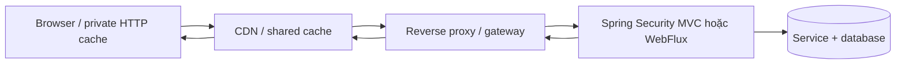
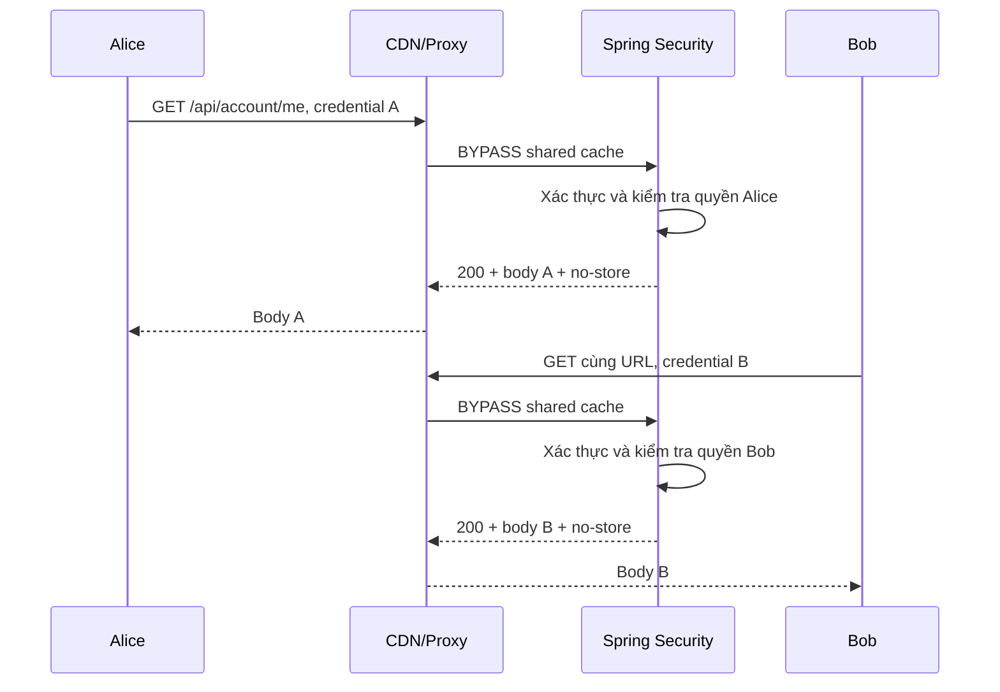
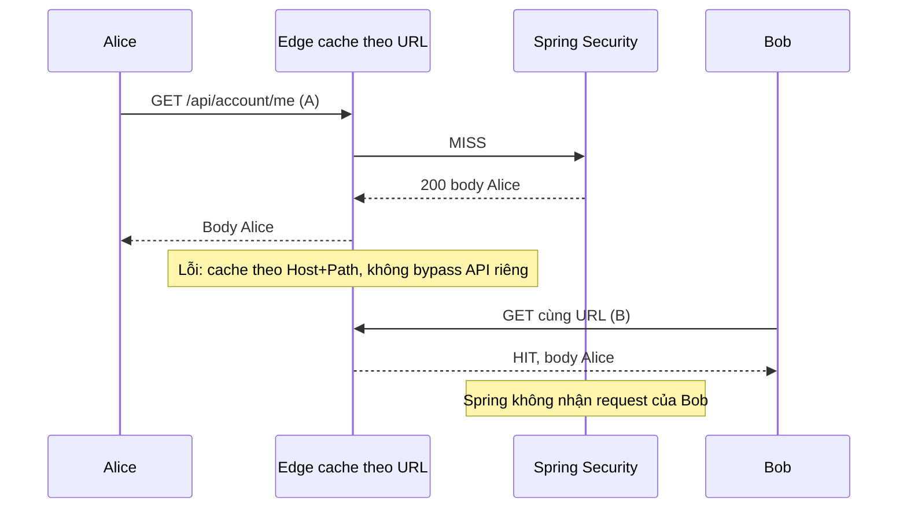

# Kiểm thử nội dung riêng tư không bị dùng chung giữa người dùng

## 1. Bài toán và mục tiêu bảo mật

Giả sử Alice đăng nhập vào ứng dụng Spring Security rồi gọi `GET /api/account/me`. Server trả JSON chứa thông tin Alice. Ngay sau đó, Bob đăng nhập bằng một phiên khác và gọi **chính xác cùng scheme, host, path và query string**. Bob chỉ được nhận dữ liệu thuộc quyền của Bob, ngay cả khi cả hai request đi qua CDN, reverse proxy, trình duyệt hoặc API gateway.

Nếu CDN lưu phản hồi của Alice với cache key chỉ gồm URL, request của Bob có thể nhận **cache HIT chứa nội dung Alice** mà không đến Spring Security. Khi đó, authorization trong backend không có cơ hội thực thi. Ngược lại, nếu Bob nhận dữ liệu Alice khi gọi trực tiếp origin, lỗi có thể nằm ở code truy vấn, phân quyền hoặc application cache, không phải CDN.

Bài thuộc chương **Bộ nhớ đệm và MIME** của mô-đun **SPRING_SECURITY_HTTP_PROTECTION**, nơi người học triển khai bảo vệ HTTP và trình duyệt bằng Spring Security: CSRF, CORS, security headers, CSP, HSTS, HTTP firewall và bảo vệ session, với cả **Servlet** lẫn **Reactive**. Mục tiêu cụ thể của bài là **thiết kế kiểm thử phát hiện nội dung riêng tư bị dùng chung giữa người dùng**, xác định tầng gây lỗi và chứng minh phương án khắc phục.

Sau bài này, người học có thể:

1. Phân biệt **lỗi phân quyền origin**, **application cache sai khóa** và **shared HTTP cache phát lại body sai**.
2. Chuẩn bị hai account, hai tenant và marker riêng để phát hiện rò rỉ không cần dữ liệu thật.
3. Kiểm tra `Cache-Control`, `Vary`, `ETag`, `Age` và cache HIT/MISS đúng ngữ cảnh.
4. Kiểm thử Servlet với MockMvc và Reactive với WebTestClient mà không nhầm unit/in-process test với edge test.
5. Thực hiện chuỗi A→B→B→A qua cùng URL tại CDN/proxy; kiểm tra sau logout, thu hồi quyền, ETag/304 và request đồng thời.
6. Thiết lập tiêu chí nghiệm thu, cách báo cáo và quy trình điều tra an toàn.

## 2. Ba bất biến cần kiểm tra

Một bài test không nên chỉ hỏi “response có `Cache-Control: no-store` không?”. Nó phải chứng minh cả ba điều kiện:

**Đúng danh tính.** Với credential của Alice, response chứa dữ liệu Alice; với credential của Bob, response chứa dữ liệu Bob. Hai tài khoản không nhận được dữ liệu của nhau, kể cả khi cùng URL.

**Không dùng chung nội dung riêng.** CDN/reverse proxy và các cache dùng chung không được phục vụ lại body, metadata nhạy cảm hoặc bản response riêng của một tài khoản cho tài khoản khác.

**Quyền có hiệu lực tại thời điểm truy cập.** Session bị hủy, token bị thu hồi hoặc quyền xem tài liệu bị rút thì request mới phải được từ chối. `ETag`, `304` hoặc `Range` không được đi tắt qua authorization.

Giả mã invariant:

```text
URL = https://app.example.com/api/account/me
A = Alice, tenant Red
B = Bob, tenant Blue

Khi A gọi URL: body.owner == "alice"
Khi B gọi URL: body.owner == "bob"

Với mọi thứ tự request A/B trên cùng URL:
    body(B) không được chứa marker riêng của A
    body(A) không được chứa marker riêng của B

Sau logout hoặc mất quyền:
    credential cũ không được lấy body nhạy cảm từ origin hoặc cache.
```

Một số trường công khai có thể giống nhau giữa hai người dùng, vì vậy **không dùng điều kiện đơn giản “hai body phải khác nhau” thay cho kiểm tra owner và marker**.

### 2.1. Fixture thử nghiệm

| Thuộc tính | Alice | Bob | Ý nghĩa |
| --- | --- | --- | --- |
| Username | `alice` | `bob` | Kiểm tra principal |
| Tenant | `red` | `blue` | Phát hiện lộ chéo tenant |
| URL | `/api/account/me` | `/api/account/me` | Giữ nguyên cache key theo URL |
| Marker giả | `PRIVATE-ALICE-741` | `PRIVATE-BOB-926` | Phát hiện chính xác body bị trộn |
| Hóa đơn | `DOC-A-01` | `DOC-B-02` | Kiểm tra phân quyền theo tài liệu |
| Session | Cookie jar A | Cookie jar B | Không vô tình dùng chung session |
| Bearer token (nếu có) | Token thử A | Token thử B | Kiểm tra riêng cách edge xử lý Authorization |

Dữ liệu nên được tạo trong **staging/test**, không dùng hồ sơ thật. Marker có thể chứa một ID thử nghiệm duy nhất; log chỉ cần lưu test ID, status và pass/fail, không cần lưu email hoặc token.

## 3. Tại sao phải kiểm tra nhiều tầng?



Ở lượt `cache HIT`, một shared cache có thể trả response mà **không gọi origin**. Một test chỉ chạy trong Spring không thể chứng minh cache phía trước có bypass chính xác.

| Cấp kiểm thử | Công cụ ví dụ | Phát hiện được | Không tự chứng minh được |
| --- | --- | --- | --- |
| Service/unit | JUnit, repository test | Query scope owner/tenant, permission và cache key nội bộ | HTTP cache browser/CDN |
| Servlet in-process | MockMvc, `spring-security-test` | Controller, filter chain, body/header theo principal | Reverse proxy/CDN ngoài JVM |
| Reactive in-process | WebTestClient, `springSecurity()` | WebFlux security chain và response header | Edge cache thật |
| Proxy integration | Reverse proxy trong test environment | Rule bypass, TTL và một số cache-key scenarios | Tất cả POP và chính sách CDN production |
| End-to-end | `curl`/HTTP client qua domain có CDN | Body và headers cuối, luồng A/B cùng URL qua edge | SPA state, bfcache, mọi trình duyệt |
| Browser regression | DevTools, Playwright/Selenium | Browser HTTP cache, session switch, Back/Forward, service worker | Đảm bảo cache ở mọi khu vực địa lý |

### 3.1. Luồng an toàn



### 3.2. Luồng lỗi



Đây là **mô hình cấu hình sai cần phát hiện**, không phải hành vi mặc định của mọi CDN. Nhiều CDN có mặc định thận trọng nhưng operator có thể bật rule ép cache không phù hợp.

## 4. Các header liên quan và cách đọc chính xác

Spring Security mặc định cung cấp bộ chống HTTP caching:

```http
Cache-Control: no-cache, no-store, max-age=0, must-revalidate
Pragma: no-cache
Expires: 0
```

Khi ứng dụng tự đặt cache header, Spring Security thường nhường quyền điều khiển cho ứng dụng. Vì thế, endpoint riêng tư phải được kiểm tra **response cuối có `no-store`**, không nhất thiết đủ cả `Pragma`/`Expires` nếu controller đã đặt `Cache-Control` riêng.

| Directive | Ý nghĩa đối với cache tuân thủ chuẩn | Dùng cho dữ liệu riêng tư |
| --- | --- | --- |
| `no-store` | Cấm lưu response để tái sử dụng | **Ưu tiên** với body nhạy cảm |
| `private` | Cấm shared cache lưu; private cache có thể lưu | Chỉ cân nhắc nếu chấp nhận bản lưu cục bộ |
| `no-cache` | Có thể lưu nhưng phải revalidate trước khi dùng lại | Không thay cho `no-store` |
| `max-age=60` | Cho phép dùng response còn fresh trong 60 giây nếu lưu hợp lệ | Tránh khi phải thu hồi quyền ngay |
| `public` | Cho phép shared cache lưu theo điều kiện HTTP | Không áp cho response cá nhân hóa |
| `s-maxage=300` | Freshness cho shared cache | Chỉ dùng cho nội dung công khai |
| `must-revalidate` | Khi stale phải revalidate thành công | Không phải chỉ thị cấm lưu |

`Pragma: no-cache` trong **response** không có ngữ nghĩa chống lưu chuẩn tương đương `no-store`. `Expires: 0` cho biết phản hồi đã stale, **không** cấm store.

### 4.1. Cookie, Authorization và `Vary`

- `Cookie` hay `Set-Cookie` **không tự động mang nghĩa `private` hoặc `no-store`**. Chính sách của từng CDN có thể khác, đặc biệt khi có rule ép cache.
- Theo RFC 9111, shared cache bị ràng buộc riêng đối với request có `Authorization`, nhưng có những directive response như `public`, `s-maxage` hoặc `must-revalidate` có thể cho phép shared caching theo điều kiện chuẩn. Vì vậy đừng coi token là bảo đảm chống cache dùng chung.
- `Vary: Cookie`/`Vary: Authorization` giúp cache tuân thủ HTTP chọn biến thể nhưng **không thực thi quyền truy cập** và có thể gây cardinality lớn, trộn cache nếu bị proxy bỏ qua.
- Với endpoint theo tài khoản hoặc tenant, cách rõ ràng hơn là **`Cache-Control: no-store` tại origin và BYPASS shared cache** tại CDN/proxy.

### 4.2. `Age`, `Via` và cache status không phải bằng chứng độc lập

`Age: 120` mô tả tuổi ước lượng của bản cache; `Via` có thể cho biết trung gian; `X-Cache: HIT`, `CF-Cache-Status` hoặc các header nhà cung cấp là tín hiệu vận hành không đồng nhất. Một request vào `/assets/app.<hash>.js` có HIT là bình thường. Một request vào `/api/account/me` có HIT cần kiểm tra nghiêm túc, nhưng **status HIT/MISS không thay thế assert body đúng người**.

## 5. Kế hoạch kiểm thử A/B qua cache dùng chung

### 5.1. Quy tắc giữ nguyên request

- Hai tài khoản gọi **cùng scheme + host + path + query** và cùng HTTP method.
- Chỉ thay credential/session và những header thực sự gắn với danh tính theo contract.
- Không gắn `?user=alice` hoặc timestamp khác nhau cho hai account: như vậy có thể tạo hai cache key riêng và che lỗ hổng.
- Không gửi `Cache-Control: no-cache`/`Pragma: no-cache` trên **request kiểm thử HIT chính**, vì một số cache sẽ revalidate hoặc bypass.
- Dùng các marker khác nhau, bảo đảm một response Bob chứa marker Alice phải fail ngay.
- Thử cả thứ tự **A→B→B→A** và **B→A→A→B**, có phiên cache phù hợp để tránh kiểm thử chỉ một chiều.
- Khi so sánh origin với CDN, dùng cùng identity/URL và đường origin được cấp phép; không tắt HTTPS/certificate checks để tiện thao tác.

### 5.2. Ma trận test thực tế

| Mã | Kịch bản | Kỳ vọng | Rủi ro phát hiện |
| --- | --- | --- | --- |
| A1 | Alice GET `/api/account/me` | 200, marker Alice, no-store | Chính sách origin sai |
| A2 | Bob GET **cùng URL** ngay sau Alice | 200, marker Bob, không marker Alice | Shared-cache cross-user leak |
| A3 | Bob GET lại rồi Alice GET lại | Luôn đúng mỗi tài khoản | Cache bị “đổi chủ” |
| A4 | Anonymous GET cùng URL | 401 hoặc redirect hợp lệ, không body riêng | Cache đáp cho người chưa login |
| A5 | Alice logout, dùng session cũ GET lại | Không trả body Alice | Session invalidation/cache |
| A6 | Bob gửi ETag Alice trong `If-None-Match` | Không dùng validator sai biểu diễn | 304 trả sai phạm vi |
| A7 | Alice bị thu hồi quyền với document D1 | GET/HEAD/Range đều từ chối | Quyền sau thay đổi |
| A8 | Bob GET document D1 của Alice | 403/404, không bytes D1 | IDOR/BOLA hoặc cache |
| A9 | Tenant Blue gọi URL cùng path Tenant Red | Không thấy dữ liệu Tenant Red | Tenant isolation/cache key |
| A10 | A/B GET đồng thời cùng URL | Mọi response đúng owner | Cache collapsed requests/race |
| A11 | 401/403/404/302 response | Không rò body/header riêng hoặc TTL public | Cache lỗi/redirect sai |
| A12 | File JS/CSS public có hash | Có thể CDN HIT, bytes giống nhau giữa account | Bảo đảm không tắt toàn bộ cache |
| A13 | Back/Forward sau đổi tài khoản | Không tiếp tục lộ state riêng | Browser cache/SPA/bfcache |
| A14 | Response API theo user được gzip/br | Vẫn body đúng danh tính | Cache key/`Vary` sai biến thể |

**Không chỉ kiểm tra HTTP 200/401.** Tối thiểu kiểm tra owner, marker, body bất thường, response cache policy và tuyến proxy được dùng. Một response `200` chứa dữ liệu đúng người nhưng bị edge thay `Cache-Control` thành `public, max-age=600` vẫn cần được xem là lỗi chính sách.

## 6. Ví dụ ứng dụng Spring MVC (Servlet)

Tạo endpoint minh họa chỉ có dữ liệu giả, nhưng nội dung khác theo principal.

### 6.1. Cấu hình Spring Security

```java
import org.springframework.context.annotation.Bean;
import org.springframework.context.annotation.Configuration;
import org.springframework.security.config.annotation.web.builders.HttpSecurity;
import org.springframework.security.web.SecurityFilterChain;

@Configuration
class ServletSecurityConfig {

    @Bean
    SecurityFilterChain chain(HttpSecurity http) throws Exception {
        return http.authorizeHttpRequests(auth -> auth
                .requestMatchers("/assets/**").permitAll()
                .requestMatchers("/api/account/**").authenticated()
                .anyRequest().authenticated())
            .build();
    }
}
```

`authenticated()` chỉ yêu cầu login cho route. Nếu URL chứa ID, tenant hoặc record ownership, service vẫn phải kiểm tra người được phép xem **từng bản ghi**.

### 6.2. Controller phát `no-store` tường minh

```java
import org.springframework.http.CacheControl;
import org.springframework.http.MediaType;
import org.springframework.http.ResponseEntity;
import org.springframework.security.core.Authentication;
import org.springframework.web.bind.annotation.GetMapping;
import org.springframework.web.bind.annotation.RestController;

@RestController
class PrivateAccountServletController {

    record AccountView(String owner, String marker) {}

    @GetMapping(
        path = "/api/account/me",
        produces = MediaType.APPLICATION_JSON_VALUE
    )
    ResponseEntity<AccountView> me(Authentication authentication) {
        String user = authentication.getName();
        return ResponseEntity.ok()
            .contentType(MediaType.APPLICATION_JSON)
            .cacheControl(CacheControl.noStore())
            .body(new AccountView(user, "PRIVATE-" + user.toUpperCase()));
    }
}
```

Response giả:

```http
HTTP/1.1 200 OK
Content-Type: application/json
Cache-Control: no-store
X-Content-Type-Options: nosniff

{"owner":"alice","marker":"PRIVATE-ALICE"}
```

Đoạn này giúp tập trung vào test cache; nó không thay thế service lấy dữ liệu DB theo tenant/owner hoặc chính sách kiểm soát field DTO ngoài thực tế.

## 7. Test Servlet bằng MockMvc

Ví dụ Spring Boot Test có `spring-security-test` và filter chain được tích hợp:

```java
import static org.hamcrest.Matchers.containsString;
import static org.springframework.security.test.web.servlet.request
    .SecurityMockMvcRequestPostProcessors.user;
import static org.springframework.test.web.servlet.request
    .MockMvcRequestBuilders.get;
import static org.springframework.test.web.servlet.result
    .MockMvcResultMatchers.*;

import org.junit.jupiter.api.Test;
import org.springframework.beans.factory.annotation.Autowired;
import org.springframework.boot.test.autoconfigure.web.servlet.AutoConfigureMockMvc;
import org.springframework.boot.test.context.SpringBootTest;
import org.springframework.http.HttpHeaders;
import org.springframework.test.web.servlet.MockMvc;

@SpringBootTest
@AutoConfigureMockMvc
class PrivateCacheMvcTest {
    @Autowired MockMvc mvc;

    @Test
    void personalResponseBelongsToEachUser() throws Exception {
        mvc.perform(get("/api/account/me").with(user("alice")))
            .andExpect(status().isOk())
            .andExpect(header().string(
                HttpHeaders.CACHE_CONTROL, containsString("no-store")))
            .andExpect(jsonPath("$.owner").value("alice"))
            .andExpect(jsonPath("$.marker").value("PRIVATE-ALICE"));

        mvc.perform(get("/api/account/me").with(user("bob")))
            .andExpect(status().isOk())
            .andExpect(header().string(
                HttpHeaders.CACHE_CONTROL, containsString("no-store")))
            .andExpect(jsonPath("$.owner").value("bob"))
            .andExpect(jsonPath("$.marker").value("PRIVATE-BOB"));

        mvc.perform(get("/api/account/me").with(user("alice")))
            .andExpect(status().isOk())
            .andExpect(jsonPath("$.marker").value("PRIVATE-ALICE"));
    }
}
```

**Giới hạn quan trọng:** `.with(user(...))` tạo authentication giả cho từng request; nó **không mô phỏng cookie đăng nhập thật, logout theo chuỗi, CDN hay reverse proxy**. Test này chứng minh origin trả đúng body/header trong đường đi Servlet. Cần kiểm thử riêng qua domain có cache thật để khẳng định không phát lại giữa các account.

Test bổ sung nên có anonymous access (status theo API entry point, không body riêng) và `GET /api/documents/{id}` bằng người đã đăng nhập nhưng không sở hữu file. Với form login, anonymous có thể nhận redirect `302`; với API bearer token có thể `401` — viết assertion theo contract thay vì đoán.

## 8. Tương ứng với Spring WebFlux (Reactive)

### 8.1. SecurityWebFilterChain

```java
import org.springframework.context.annotation.Bean;
import org.springframework.context.annotation.Configuration;
import org.springframework.security.config.annotation.web.reactive.EnableWebFluxSecurity;
import org.springframework.security.config.web.server.ServerHttpSecurity;
import org.springframework.security.web.server.SecurityWebFilterChain;

@Configuration
@EnableWebFluxSecurity
class ReactiveSecurityConfig {

    @Bean
    SecurityWebFilterChain chain(ServerHttpSecurity http) {
        return http.authorizeExchange(auth -> auth
                .pathMatchers("/assets/**").permitAll()
                .pathMatchers("/api/account/**").authenticated()
                .anyExchange().authenticated())
            .build();
    }
}
```

### 8.2. Controller Reactive

```java
import java.security.Principal;
import org.springframework.http.CacheControl;
import org.springframework.http.MediaType;
import org.springframework.http.ResponseEntity;
import org.springframework.web.bind.annotation.GetMapping;
import org.springframework.web.bind.annotation.RestController;
import reactor.core.publisher.Mono;

@RestController
class PrivateAccountReactiveController {

    record AccountView(String owner, String marker) {}

    @GetMapping(
        path = "/api/account/me",
        produces = MediaType.APPLICATION_JSON_VALUE
    )
    Mono<ResponseEntity<AccountView>> me(Mono<Principal> principal) {
        return principal.map(p -> ResponseEntity.ok()
            .contentType(MediaType.APPLICATION_JSON)
            .cacheControl(CacheControl.noStore())
            .body(new AccountView(
                p.getName(), "PRIVATE-" + p.getName().toUpperCase())));
    }
}
```

Đây là phương án **thay thế** controller Servlet, không đăng ký đồng thời cùng URL trong cùng ví dụ. `Mono` không tự cô lập HTTP cache. Nếu service dùng cache trong ứng dụng hoặc thread-local không phù hợp Reactive, vẫn có nguy cơ trộn dữ liệu.

### 8.3. WebTestClient kiểm tra hai tài khoản

```java
import static org.springframework.security.test.web.reactive.server
    .SecurityMockServerConfigurers.mockUser;
import static org.springframework.security.test.web.reactive.server
    .SecurityMockServerConfigurers.springSecurity;

import org.junit.jupiter.api.BeforeEach;
import org.junit.jupiter.api.Test;
import org.springframework.beans.factory.annotation.Autowired;
import org.springframework.boot.test.context.SpringBootTest;
import org.springframework.context.ApplicationContext;
import org.springframework.test.web.reactive.server.WebTestClient;

@SpringBootTest
class PrivateCacheReactiveTest {
    @Autowired ApplicationContext context;
    WebTestClient client;

    @BeforeEach
    void setup() {
        client = WebTestClient.bindToApplicationContext(context)
            .apply(springSecurity())
            .configureClient().build();
    }

    @Test
    void eachPrincipalGetsItsOwnPrivateBody() {
        client.mutateWith(mockUser("alice"))
            .get().uri("/api/account/me")
            .exchange()
            .expectStatus().isOk()
            .expectHeader().valueMatches(
                "Cache-Control", ".*no-store.*")
            .expectBody()
            .jsonPath("$.owner").isEqualTo("alice")
            .jsonPath("$.marker").isEqualTo("PRIVATE-ALICE");

        client.mutateWith(mockUser("bob"))
            .get().uri("/api/account/me")
            .exchange()
            .expectStatus().isOk()
            .expectHeader().valueMatches(
                "Cache-Control", ".*no-store.*")
            .expectBody()
            .jsonPath("$.owner").isEqualTo("bob")
            .jsonPath("$.marker").isEqualTo("PRIVATE-BOB");
    }
}
```

`springSecurity()` gắn WebFlux security test support cho client. Test này **không tạo cache dùng chung**: phải có bài end-to-end khác. Nếu ứng dụng dùng session/WebSession hoặc token thật, viết test riêng lấy credential theo login flow để xác minh logout.

## 9. End-to-end: gửi cùng URL qua CDN/reverse proxy

### 9.1. Chuẩn bị

Chạy trong môi trường được phép với dữ liệu giả. Chuẩn bị hai bearer token độc lập hoặc hai cookie jar riêng (nếu ứng dụng dùng session). Không hard-code credential vào mã nguồn hoặc log và không thu thập payload thật của khách hàng.

Dùng **một URL cố định**:

```text
https://staging.example.com/api/account/me
```

Các lượt request **chỉ thay credential**, không đổi path, query hoặc host. Nếu bạn thêm `?user=alice` và `?user=bob`, proxy có thể tạo hai cache key khác nhau và test không bắt được lỗi.

### 9.2. Chuỗi thử đơn giản với `curl`

```bash
# Biến token phải được cấp an toàn trong môi trường test.
BASE_URL="https://staging.example.com"

# Alice warm URL.
curl -sS -D - \
  -H "Authorization: Bearer ${ALICE_TOKEN}" \
  "${BASE_URL}/api/account/me"

# Bob gọi CHÍNH URL đó, không gửi request cache-buster.
curl -sS -D - \
  -H "Authorization: Bearer ${BOB_TOKEN}" \
  "${BASE_URL}/api/account/me"

# Tiếp tục Bob, rồi Alice, cùng URL.
curl -sS -D - \
  -H "Authorization: Bearer ${BOB_TOKEN}" \
  "${BASE_URL}/api/account/me"

curl -sS -D - \
  -H "Authorization: Bearer ${ALICE_TOKEN}" \
  "${BASE_URL}/api/account/me"
```

Trong môi trường thật, tránh in body và bearer token vào terminal/log dùng chung; ví dụ này chỉ dùng marker giả để học. Cần kiểm tra nội dung Alice/Bob theo đúng danh tính, `no-store` ở edge và cache status/trace nếu nhà cung cấp có.

### 9.3. Script regression có assertion

Đoạn sau dùng `bash`, `curl`, `jq` và dữ liệu giả có schema `{"owner":"alice","marker":"PRIVATE-ALICE"}`. Secret được cung cấp qua biến môi trường từ CI secret store:

```bash
#!/usr/bin/env bash
set -euo pipefail

: "${BASE_URL:?Thiếu BASE_URL}"
: "${ALICE_TOKEN:?Thiếu token Alice}"
: "${BOB_TOKEN:?Thiếu token Bob}"

tmp="$(mktemp -d)"
trap 'rm -rf "$tmp"' EXIT
url="${BASE_URL%/}/api/account/me"

request_and_assert() {
  local user="$1" token="$2"
  local code
  code="$(curl -sS \
    -D "$tmp/headers" \
    -o "$tmp/body" \
    -w '%{http_code}' \
    -H "Authorization: Bearer $token" \
    "$url")"

  if [[ "$code" != "200" ]]; then
    echo "FAIL: status không phải 200 cho $user"
    exit 1
  fi
  if ! grep -Eqi '^cache-control:.*no-store' "$tmp/headers"; then
    echo "FAIL: endpoint riêng thiếu Cache-Control: no-store"
    exit 1
  fi

  local owner marker
  owner="$(jq -r '.owner' "$tmp/body")"
  marker="$(jq -r '.marker' "$tmp/body")"
  if [[ "$owner" != "$user" || "$marker" != "PRIVATE-${user^^}" ]]; then
    echo "FAIL: body không thuộc $user"
    exit 1
  fi
}

request_and_assert alice "$ALICE_TOKEN"
request_and_assert bob   "$BOB_TOKEN"
request_and_assert bob   "$BOB_TOKEN"
request_and_assert alice "$ALICE_TOKEN"

echo "PASS: không phát lại nội dung chéo người dùng"
```

Script chỉ kiểm tra body/headers theo fixture, **không tự xác minh cache HIT/MISS**; kết hợp access log origin và trace/CDN cache status. Nó yêu cầu schema trả `owner`/`marker` và API trả `200`; điều chỉnh cho contract thật, không dùng schema giả trên dữ liệu production.

Không bật `set -x` trên runner chứa secret; lưu ý token trong tham số process của `curl` có thể hiện với người có quyền inspect máy chạy. Với API dùng cookie, đăng nhập vào **hai cookie jars riêng**, không dùng chung jar hoặc browser session trong test edge.

### 9.4. Không làm vô hiệu bài test cache một cách vô tình

Bài test chính **không** nên gửi:

```http
Cache-Control: no-cache
Pragma: no-cache
```

vì đây là chỉ thị request có thể khiến cache revalidate hoặc bypass, làm kết quả có vẻ an toàn dù đường HIT bị lỗi. Không dùng query random/timestamp cho mỗi account hoặc luôn bật DevTools **Disable cache** rồi coi đó là phép kiểm tra HTTP caching đầy đủ.

Sau lượt kiểm tra HIT bình thường, hãy tạo test **riêng** cho revalidation và validator để bảo đảm cả đường điều kiện hoạt động đúng.

## 10. `ETag`, `304` và kiểm thử quyền

Một response `Cache-Control: private, no-cache` cho phép browser lưu body nhưng bắt buộc revalidate trước khi dùng lại. Giả sử Alice đã nhận:

```http
HTTP/1.1 200 OK
Cache-Control: private, no-cache
ETag: "alice-r17"
Content-Type: application/json

{"owner":"alice","theme":"dark"}
```

Ở lần gọi tiếp theo, Alice có thể gửi `If-None-Match: "alice-r17"`. Server phải **xác thực và phân quyền người gọi hiện tại** trước khi trả `304 Not Modified`, vì `304` cho phép cache hợp lệ tái sử dụng body đã lưu từ `200` trước đó.

### 10.1. Bộ ca validator

| Lượt | Yêu cầu | Kỳ vọng |
| --- | --- | --- |
| V1 | Alice GET resource của Alice | `200`, body Alice + ETag đúng representation |
| V2 | Alice gửi ETag cũ, vẫn có quyền | Có thể `304` nếu biểu diễn chưa đổi |
| V3 | Bob gửi ETag **của Alice** tới cùng URL | Không được `304` chỉ vì validator khớp representation Alice |
| V4 | Alice bị thu hồi quyền, gửi ETag cũ | Phải từ chối theo policy, không dùng bản cũ |
| V5 | Edge thử phát body Alice đã cache cho Bob | Bị chặn bởi `private/no-store` và bypass rule |

`304` không có body **không đồng nghĩa không có rò rỉ**, vì browser có thể dùng body đã lưu. Nếu dữ liệu rất nhạy cảm, `no-store` thường dễ kiểm tra hơn việc cho phép lưu private và dựa vào revalidation. Không dùng `Vary: Cookie` như một biện pháp thay thế việc kiểm tra quyền.

## 11. Logout, đổi tài khoản và thay đổi quyền

### 11.1. Logout với session

Với ứng dụng Servlet dùng session:

1. Alice gọi API đã đăng nhập, kiểm tra marker Alice.
2. Gửi `POST /logout` hợp lệ với CSRF token khi CSRF bật.
3. Gửi **chính cookie/session cũ** lại vào cùng URL qua origin và edge.
4. Kỳ vọng bị từ chối (`401` hoặc redirect login theo contract), không nhận marker Alice.
5. Bob đăng nhập cùng thiết bị: không nhận dữ liệu Alice từ HTTP cache hoặc state giao diện.

Với WebFlux cần kiểm tra security context/WebSession đã được dọn theo logout handlers được cấu hình. Với JWT tự chứa, xóa token ở frontend **không tự thu hồi** token đã bị sao chép; khi yêu cầu thu hồi ngay phải có TTL/revocation/introspection phù hợp.

### 11.2. Thay đổi quyền khi chưa logout

Với file `D1` thuộc Alice, admin thu hồi quyền sau khi Alice đã tải lần đầu. Request tiếp theo của Alice, bao gồm `If-None-Match`, `HEAD` hoặc `Range`, phải được xét quyền hiện tại. Không để HTTP cache hoặc application cache phát lại bản cũ trái quyền.

Với signed URL từ object storage, URL đã cấp là một capability và có thể tiếp tục dùng đến khi hết hạn; cần thiết kế TTL ngắn, cơ chế thu hồi hoặc proxy bắt buộc kiểm tra quyền nếu yêu cầu sản phẩm cao.

### 11.3. Trình duyệt vẫn hiển thị nội dung cũ

Nếu API từ origin và CDN đều từ chối request sau logout nhưng UI vẫn hiển thị thông tin Alice, cần kiểm tra:

- HTTP browser cache từng giữ response trước khi có `no-store`.
- SPA state, query cache, `localStorage`, `sessionStorage`, `IndexedDB`.
- Back/forward cache (bfcache) có thể khôi phục DOM và JavaScript state.
- Service worker `CacheStorage` nếu PWA từng cache API riêng.

`Cache-Control: no-store` không tự xóa toàn bộ những nơi này. Test browser cần xem Back/Forward, nhiều tab, đổi tài khoản, offline mode và dọn state đúng lifecycle.

## 12. Tài liệu tải xuống, `HEAD` và `Range`

Một file `/api/documents/{id}/download` có thể chứa hóa đơn hoặc bảng lương. Không được cache public chỉ vì URL kết thúc `.pdf`. Với file riêng tư, cần `no-store`, CDN bypass và **authorization theo document owner/tenant**.

### 12.1. Ma trận tệp

1. Alice GET `/api/documents/D1/download` thuộc Alice: được cấp quyền, response đúng bytes.
2. Bob GET **cùng URL D1**: `403`/`404` theo contract, không bytes Alice.
3. Anonymous GET D1: từ chối.
4. Bob thử `HEAD` và `Range: bytes=0-1023` của D1: vẫn bị từ chối, không `206` hợp lệ cho tài liệu không thuộc quyền.
5. Alice bị thu hồi quyền rồi gọi lại D1: bị từ chối qua cả origin và edge.

Khi Spring hỗ trợ partial content (`206`), mỗi request Range vẫn phải được kiểm tra quyền. Shared cache không được dùng chung các mảnh dữ liệu của người này cho người khác. `Content-Range` và `Content-Length` cần khớp phần trả, không phải tự động dùng chiều dài file đầy đủ.

### 12.2. Web cache deception

Một CDN có thể ép cache URL có đuôi `.css`/`.pdf`; nếu origin vẫn trả HTML/JSON riêng cho những URL có suffix đó do routing/fallback sai, nội dung có thể bị lưu như asset. Test route bất thường trong **môi trường được phép** và thay chiến lược cache-by-extension bằng **allowlist tài nguyên thực sự public**.

## 13. Concurrency, tenant và request collapsing

Nhiều shared cache có cơ chế gom các request đồng thời đến cùng URL khi đang MISS để giảm tải origin. Nếu response chứa dữ liệu theo credential mà edge không phân biệt đúng, **collapsed forwarding** có thể phát chung body sai.

Thiết kế test staging với tải nhỏ (ví dụ 10–20 request A/B gần đồng thời, tùy khả năng hạ tầng và quyền thử nghiệm). Mỗi response phải có owner/marker đúng, bất kể thứ tự hoàn tất. Thử cả cache cold và sau khi một account đã warm đường URL.

Với nhiều tenant, đừng chỉ kiểm tra `/api/account/me`. Kiểm tra endpoint mà cùng path có thể trả dữ liệu khác theo tenant (host, claim, header hoặc resource ID). Một cache key bỏ hostname/tenant có thể gây rò rỉ liên tenant. Với dữ liệu có quyền, giải pháp dễ kiểm chứng nhất vẫn là **không dùng shared HTTP cache**, không cố nhồi tất cả context phân quyền vào key.

## 14. Cấu hình CDN/proxy phù hợp với invariant

Không có cú pháp chung cho mọi CDN, nhưng chính sách cần rõ ràng trước khi chuyển thành cấu hình sản phẩm:

```text
# Pseudocode chính sách (không phải cú pháp Nginx/CDN cụ thể)
ALLOW_SHARED_CACHE:
    /assets/**   (công khai, có content hash)
    /public/**   (chỉ nếu body độc lập user/tenant)

BYPASS_SHARED_CACHE:
    /api/account/**
    /api/documents/**
    /dashboard
    /auth/**
    /logout
    tất cả URL có body phụ thuộc người dùng hoặc tenant

DEFAULT:
    không tự ép cache mọi GET chỉ vì status 200
    tôn trọng Cache-Control origin
    cho phép shared cache chỉ ở route public đã kiểm chứng
```

Cần kiểm tra thêm: rule override `no-store`, edge TTL, cache key/query/host/`Vary`, request có `Cookie`/`Authorization`, cache response lỗi/redirect, stale-on-error, CDN purge/invalidation và việc các POP đã nhận cấu hình mới chưa.

### 14.1. Không để bản cache cũ tồn tại sau khi sửa

Nếu trước đây origin/edge từng phát `public` cho API nhạy cảm, việc sửa sang `no-store` **không bảo đảm** xóa bản đã lưu. Khi phát hiện rò rỉ, phải chặn rule sai, purge/invalidate cache phù hợp, đánh giá phạm vi ảnh hưởng theo log an toàn rồi chạy lại A/B suite qua cùng domain.

### 14.2. Đừng tắt cache của asset public chỉ để làm test pass

Kỳ vọng `/assets/app.<hash>.js` có thể `public, max-age=31536000` và được browser/CDN cache đúng cách. Bài kiểm thử riêng tư không yêu cầu vô hiệu hóa cache toàn hệ thống: nó yêu cầu **chỉ dữ liệu công khai mới được dùng chung**, còn dữ liệu theo user phải có chính sách khác.

## 15. Tìm nguyên nhân khi test fail

| Quan sát | Nghi vấn chính | Phân biệt bằng cách nào? |
| --- | --- | --- |
| Bob nhận body Alice ở **origin trực tiếp** | Authorization/service/application cache sai | Test service theo user và tenant; kiểm tra query/cache key nội bộ |
| Origin đúng, Bob sai **chỉ qua CDN** | Cache key hoặc edge rule sai | So response/trace origin–edge, kiểm tra bypass và TTL |
| Header `no-store` ở origin nhưng edge trả `public` | Proxy sửa policy | Sửa edge rule, so header cuối |
| Origin đã sửa nhưng lỗi còn ở một POP | Bản lưu cũ hoặc propagation | Kiểm tra purge và POP |
| MockMvc A/B PASS, staging FAIL | In-process test không có shared cache | Bổ sung E2E qua domain staging |
| Test luôn MISS vì query random hoặc request `no-cache` | Test vô tình bypass cache | Dùng cùng URL và request bình thường |
| API 401 ở server nhưng browser vẫn thấy dữ liệu | SPA/bfcache/PWA/client state | Test Back/Forward và dọn state |
| Bob nhận `304` với validator Alice | Revalidation sai phạm vi | Auth trước validator, kiểm tra representation và quyền |
| GET tệp bị từ chối nhưng Range lấy được | Quyền không thống nhất cho partial requests | Kiểm tra HEAD/Range/GET cùng security policy |
| A/B trả đúng nhưng lộ chéo tenant | Tenant resolution hoặc app cache | Test hai tenant cùng URI, owner/tenant assertions |
| `X-Cache: HIT` trên file JS public | Có thể bình thường | Kiểm tra body không phụ thuộc user |
| Response lỗi chứa marker riêng | Error handler/proxy vô tình cache nội dung | Rà 401/403/404/302 và header policy |

Quy trình gỡ lỗi: **(1)** gọi origin với A/B; **(2)** nếu origin sai, xem SecurityContext, method security, tenant query và cache nội bộ; **(3)** nếu origin đúng, gọi cùng URL qua edge; **(4)** xem cache rule/key, header transformations, logs và purge; **(5)** nếu network an toàn nhưng browser vẫn hiển thị cũ, kiểm tra bfcache/SPA/storage; **(6)** chạy lại toàn bộ ma trận sau sửa.

## 16. Tiêu chí nghiệm thu và báo cáo kiểm thử

Một lần chạy có thể báo PASS khi:

- Response theo user chứa đúng owner/tenant/marker; không có marker người khác trong body hoặc header nhạy cảm.
- Response nhạy cảm có `Cache-Control: no-store` và CDN/proxy không ép shared caching trái chính sách.
- Anonymous và credential đã logout không nhận dữ liệu riêng.
- Với validator, quyền được kiểm tra trước `304`; sau thu hồi quyền không dùng lại body cũ.
- File riêng có authorization theo ID, kể cả GET/HEAD/Range khi hỗ trợ.
- Browser không giữ state riêng không phù hợp khi chuyển tài khoản.
- Asset công khai vẫn cache hiệu quả, không bị tắt toàn bộ vì bài test bảo mật.
- Mọi test edge chạy qua đường cache thật, không đổi URL theo từng người để né cache.
- Log kiểm thử chỉ chứa dữ liệu giả, status và trace ID an toàn, không lưu token.

Ví dụ kết quả:

```text
TEST: PRIVATE_RESPONSE_ISOLATION
ENV: staging + CDN test
URL: GET /api/account/me (cùng URL mọi lượt)
IDENTITIES: alice, bob, anonymous
ORDER: A -> B -> B -> A
ASSERT: owner, private marker, status, Cache-Control, edge trace
RESULT: PASS
API CACHE: BYPASS / no-store
PUBLIC ASSETS: HIT được phép
SECURITY LOGS: không chứa token/body thật
```

PASS có nghĩa **đã kiểm chứng đúng phạm vi, cấu hình và thời điểm test**, không phải bảo đảm vĩnh viễn cho mọi POP/browser. Khi đổi CDN rules, mô hình session, cách xác thực hoặc URL normalization, hãy chạy lại regression.

## 17. Bài thực hành

Ứng dụng quản lý hóa đơn dùng Spring Security:

- `GET /api/account/me` trả dữ liệu cá nhân.
- `GET /api/invoices/current` trả hóa đơn theo session.
- `GET /api/invoices/{id}/download` trả PDF riêng tư.
- `GET /assets/app.8f64c2.js` trả JS công khai có content hash.
- Alice thuộc tenant Red (marker `RED-ALICE-741`), Bob thuộc tenant Blue (marker `BLUE-BOB-926`).
- CDN đang áp `cache all GET 600s` với key `Host + Path` và bỏ qua cookie/query string.

**Yêu cầu:**

1. Giải thích vì sao MockMvc/WebTestClient PASS không chứng minh CDN không rò rỉ.
2. Thiết kế bài test A→B→B→A và B→A→A→B, giữ nguyên URL; ghi rõ assertion body/header.
3. Viết rule CDN mới với allowlist public asset và bypass API riêng.
4. Thiết kế test Bob gửi `If-None-Match` của Alice; nêu vì sao `304` sai phạm vi là nguy hiểm.
5. Thử người chưa đăng nhập, logout và sau thu hồi quyền.
6. Thử GET/HEAD/Range đối với PDF của Alice khi Bob không có quyền.
7. Thử nhiều request đồng thời ở staging với tải hợp lý.
8. Nêu cách phân biệt lỗi ở Spring origin và lỗi chỉ ở edge.
9. Giải thích vì sao sửa `no-store` không xóa hồi tố bản cũ đã cache.
10. Đề xuất mẫu báo cáo CI không chứa token và dữ liệu cá nhân thật.

**Gợi ý:** Origin phải trả đúng body từng principal, `no-store` cho API riêng, bảo vệ từng document ID. CDN bypass các route gắn danh tính; chỉ cache assets công khai có URL đã version hóa. Kiểm tra **cùng URL**, marker riêng, authz trước conditional GET, purge cache sai và kiểm thử lại trên đường edge thật. Với browser, bổ sung kiểm tra state SPA, bfcache và service worker sau đổi account.

## Tài liệu tham khảo

- [RFC 9111 — HTTP Caching](https://www.rfc-editor.org/rfc/rfc9111.html): shared/private cache, `no-store`, `Authorization`, `Vary`, revalidation và cache key.
- [RFC 9110 — HTTP Semantics](https://www.rfc-editor.org/rfc/rfc9110.html): ETag, `304`, conditional requests, HTTP Range và status.
- [Spring Security — Security HTTP Response Headers](https://docs.spring.io/spring-security/reference/features/exploits/headers.html): cache headers mặc định, policy do ứng dụng cung cấp.
- [Spring Security — Servlet HTTP Response Headers](https://docs.spring.io/spring-security/reference/servlet/exploits/headers.html): cache control cho Servlet.
- [Spring Security — Reactive HTTP Response Headers](https://docs.spring.io/spring-security/reference/reactive/exploits/headers.html): cache control cho WebFlux.
- [Spring Security — MockMvc Authentication](https://docs.spring.io/spring-security/reference/servlet/test/mockmvc/authentication.html): `user()` và test Servlet.
- [Spring Security — Reactive Testing](https://docs.spring.io/spring-security/reference/reactive/test/index.html): `mockUser()` và WebTestClient.
- [Spring Framework — MockMvc](https://docs.spring.io/spring-framework/reference/testing/mockmvc.html): kiểm thử MVC tại application.
- [Spring Framework — WebTestClient](https://docs.spring.io/spring-framework/reference/testing/webtestclient.html): kiểm thử WebFlux.
- [MDN — HTTP Caching](https://developer.mozilla.org/en-US/docs/Web/HTTP/Guides/Caching): browser và shared cache.
- [OWASP — Web Cache Deception](https://owasp.org/www-community/attacks/Web_Cache_Deception): nội dung động bị cache như static resource.
