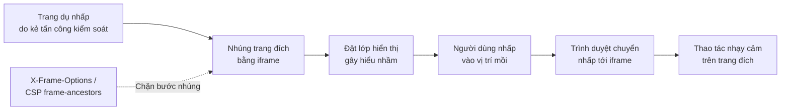

# Clickjacking và tương tác bị đánh lừa trong iframe

## 1. Vấn đề: người dùng nhấp đúng chỗ nhìn thấy, nhưng sai thành phần thực sự

**Clickjacking** (chiếm đoạt thao tác nhấp, một dạng *UI redressing*) là kỹ thuật khiến người dùng tương tác với một giao diện khác với giao diện mà họ tưởng mình đang sử dụng. Trường hợp điển hình: trang do kẻ tấn công kiểm soát nhúng một trang hợp lệ vào `<iframe>`, đặt iframe trong suốt hoặc che một phần lên nút mồi, rồi dụ người dùng nhấp vào một vị trí. Trình duyệt chuyển thao tác nhấp đến nút thật ở trang được nhúng.

Ví dụ trong một hệ thống quản trị: người dùng đang đăng nhập tại `https://admin.example.com` và mở trang `https://promo.attacker.example`. Trang thứ hai hiển thị nút “Nhận quà”, nhưng ngay dưới nút này là iframe chứa trang thay đổi cấu hình của hệ thống quản trị. Nếu trình duyệt cho phép nhúng, nút “Nhận quà” được căn trùng với “Xác nhận thay đổi”, thì một cú nhấp có thể kích hoạt thao tác quản trị bằng chính phiên đăng nhập của người dùng.

Các điều kiện thường gặp để tấn công có tác dụng:

1. Trang đích **cho phép bị nhúng** bởi một trang ngoài không đáng tin cậy.
2. Nạn nhân truy cập trang của kẻ tấn công, đồng thời trang đích có chức năng nhạy cảm có thể thao tác qua giao diện.
3. Quyền đăng nhập hoặc ngữ cảnh cần thiết vẫn có hiệu lực trong iframe. Điều này phụ thuộc cả vào chính sách cookie và hành vi của trình duyệt; không phải cookie nào cũng được gửi khi nhúng chéo website.
4. Kẻ tấn công dự đoán hoặc bố trí được vị trí thành phần cần nhấp, có thể qua lớp phủ, độ trong suốt, cuộn trang hoặc nhiều bước dẫn dụ.

**Điểm mấu chốt:** *Same-Origin Policy* thường ngăn JavaScript của trang tấn công đọc DOM bên trong iframe khác origin, nhưng **không tự ngăn thao tác nhấp của con người** được chuyển đến trang trong iframe. Trang đích phải chủ động quyết định ai được phép nhúng mình.



Khi trang đích từ chối bị nhúng, luồng tấn công bị chặn **trước bước người dùng tương tác**. Việc chặn iframe hữu ích cho trang đổi mật khẩu, thanh toán, cấp quyền, thay đổi email, cấu hình tài khoản và các màn hình quản trị.

## 2. Những lớp phòng vệ nào thực sự xử lý clickjacking?

| Cơ chế | Bảo vệ được gì? | Có thay thế chính sách chống nhúng không? |
| --- | --- | --- |
| `X-Frame-Options` | Chỉ thị cho trình duyệt từ chối hoặc giới hạn việc nhúng **chính response này** vào frame. | Là một lớp bảo vệ trực tiếp. |
| CSP `frame-ancestors` | Chỉ rõ các origin được phép trở thành **trang tổ tiên** của response, kể cả chuỗi iframe lồng nhau. | Là lựa chọn linh hoạt để khai báo danh sách nguồn nhúng hợp lệ. |
| CSRF token | Ngăn các request giả mạo thiếu token hợp lệ. | **Không**: người dùng có thể thực sự bấm nút trên trang hợp lệ trong iframe, vì vậy form vẫn mang CSRF token hợp lệ. |
| CORS | Kiểm soát khả năng JavaScript của origin khác đọc response và một số request chéo origin. | **Không**: điều khiển CORS không phải điều khiển khả năng hiển thị trang trong iframe. |
| Cookie `SameSite` | Có thể hạn chế gửi cookie trong ngữ cảnh nhúng chéo site. | Chỉ giảm một số trường hợp; không thể áp dụng thay cho việc chặn nhúng, nhất là với các quan hệ cùng site, phiên không dựa trên cookie hoặc nội dung công khai. |
| CSP `frame-src` / `child-src` | Quy định **trang hiện tại được phép nhúng nguồn nào**. | **Không**: khác chiều với `frame-ancestors`, vốn quy định **ai được phép nhúng trang hiện tại**. |
| Thuộc tính `sandbox` của iframe | Hạn chế các quyền của iframe do **trang cha** tạo ra. | Không bảo đảm bảo vệ một trang đích trước trang cha độc hại vì kẻ tấn công kiểm soát cách tạo iframe. |

Ứng dụng Spring Security cần đặt chính sách ở **HTTP response của trang đích**. Không thể trông chờ vào mã JavaScript “thoát iframe” như `if (top !== self) top.location = self.location`: cơ chế này có thể bị giới hạn bởi sandbox, chính sách trình duyệt và các tình huống khác; nó không thay thế header do trình duyệt thực thi.

## 3. Hai HTTP response header quan trọng

### 3.1. `X-Frame-Options`: chính sách đơn giản

```http
X-Frame-Options: DENY
```

- `DENY`: từ chối nhúng trang vào frame, **kể cả trang cha cùng origin**.
- `SAMEORIGIN`: chỉ cho phép nhúng trong ngữ cảnh cùng origin theo cách trình duyệt thực thi. Origin gồm **scheme, host và port**; khác port thường là khác origin.
- `ALLOW-FROM`: cú pháp cũ, không được hỗ trợ nhất quán trong các trình duyệt hiện đại; không dùng để tạo danh sách origin cho ứng dụng mới.

Đối với trang quản trị hoặc trang nhạy cảm không có nhu cầu nhúng, `DENY` là lựa chọn mặc định dễ kiểm chứng.

### 3.2. Content Security Policy `frame-ancestors`: chính sách chi tiết

```http
Content-Security-Policy: frame-ancestors 'none'
```

| Giá trị `frame-ancestors` | Ý nghĩa |
| --- | --- |
| `'none'` | Không trang nào được nhúng response, kể cả cùng origin. |
| `'self'` | Chỉ cho phép các trang tổ tiên cùng origin với response. |
| `'self' https://portal.example.com` | Cho phép cùng origin hoặc origin `https://portal.example.com` làm tổ tiên. |
| `https://portal.example.com` | Chỉ định origin được phép nhúng; không mặc nhiên cho phép `'self'` nếu không khai báo. |

Ví dụ: trang `https://app.example.com/embed/report` có header:

```http
Content-Security-Policy: frame-ancestors 'self' https://portal.example.com
```

thì trang tại `https://portal.example.com` có thể nhúng báo cáo; `https://random.example.net` không thể nhúng. Với iframe lồng nhau, **toàn bộ các trang tổ tiên** phải phù hợp với `frame-ancestors`. Trình duyệt kiểm tra chính sách này trước khi hiển thị response trong frame.

Cần nhớ ba quy tắc:

1. `frame-ancestors` phải nằm trong **HTTP header `Content-Security-Policy`** của nội dung được nhúng; đặt trong `<meta http-equiv="Content-Security-Policy">` không có tác dụng đối với directive này.
2. CSP **không tự được thêm** chỉ vì ứng dụng đã bật Spring Security. Phải khai báo nếu muốn sử dụng `frame-ancestors`.
3. Nếu có cả CSP `frame-ancestors` và `X-Frame-Options`, các trình duyệt hiện đại ưu tiên chính sách CSP có hiệu lực. Tuy nhiên, việc để `X-Frame-Options: DENY` cạnh một CSP cho phép origin ngoài có thể gây xung đột trên trình duyệt cũ hoặc qua proxy. Cần kiểm thử cấu hình response cuối cùng và trình duyệt mục tiêu.

## 4. Mặc định của Spring Security

Với cấu hình HTTP security tiêu chuẩn và **không tắt bộ security headers mặc định**, Spring Security gửi:

```http
X-Frame-Options: DENY
```

Điều này áp dụng cho cả Servlet stack (`HttpSecurity`, `SecurityFilterChain`) và Reactive stack (`ServerHttpSecurity`, `SecurityWebFilterChain`). Header được thêm bởi bộ lọc bảo mật khi request đi qua security chain phù hợp. Spring Security **không** thiết lập một chính sách CSP tổng quát theo mặc định vì mỗi ứng dụng có nhu cầu tài nguyên và nhúng khác nhau.

Trước khi đổi cấu hình, xác định rõ nhu cầu sản phẩm:

- **Không cần iframe:** giữ `X-Frame-Options: DENY` và có thể bổ sung CSP `frame-ancestors 'none'`.
- **Chỉ cần iframe cùng origin:** cấu hình `SAMEORIGIN` và CSP `frame-ancestors 'self'`.
- **Cần một đối tác ở origin khác nhúng một nhóm trang:** dùng danh sách origin rõ ràng trong CSP `frame-ancestors` cho **riêng nhóm URL đó**; xử lý `X-Frame-Options` tương ứng để không chặn nhầm, đồng thời giữ các trang còn lại ở `DENY`.

Không nên tắt toàn bộ security headers chỉ để cho phép một iframe. Việc tắt `headers` có thể loại bỏ cả những header bảo vệ khác như `X-Content-Type-Options` và những cấu hình được đặt bởi ứng dụng.

## 5. Cấu hình Spring Security trên Servlet

Các ví dụ dưới đây sử dụng kiểu cấu hình lambda và `SecurityFilterChain` của Spring Security hiện đại. Giả định ứng dụng đã có cơ chế xác thực phù hợp; nội dung chỉ tập trung vào header chống nhúng.

### 5.1. Chặn nhúng trên mọi trang

```java
@Bean
SecurityFilterChain webSecurity(HttpSecurity http) throws Exception {
    return http
        .authorizeHttpRequests(auth -> auth
            .anyRequest().authenticated())
        .headers(headers -> headers
            .contentSecurityPolicy(csp -> csp
                .policyDirectives("frame-ancestors 'none'")))
        .build();
}
```

Spring Security vẫn giữ `X-Frame-Options: DENY` mặc định; đoạn mã trên **bổ sung** CSP `frame-ancestors 'none'`. Không cần gọi `frameOptions(frame -> frame.disable())` trong trường hợp này.

### 5.2. Cho phép nhúng trong cùng origin

Nếu ứng dụng cần iframe nội bộ, ví dụ dashboard nhúng widget khác **cùng scheme, host và port**:

```java
.headers(headers -> headers
    .frameOptions(frame -> frame.sameOrigin())
    .contentSecurityPolicy(csp -> csp
        .policyDirectives("frame-ancestors 'self'")))
```

Đây là phần thay thế cho cấu hình `headers(...)` ở ví dụ trước, **không phải chuỗi code độc lập**. Cả `SAMEORIGIN` lẫn `'self'` đều không cho phép iframe từ một origin ngoài.

### 5.3. Chỉ cho phép một cổng đối tác nhúng `/embed/**`

Giả sử `https://portal.example.com` được phép nhúng báo cáo tại `https://app.example.com/embed/report`, còn trang `/account`, `/admin` vẫn phải chống nhúng. Dùng hai security chain với thứ tự rõ ràng:

```java
@Configuration
@EnableWebSecurity
class SecurityConfig {

    @Bean
    @Order(1)
    SecurityFilterChain embeddablePages(HttpSecurity http) throws Exception {
        return http
            .securityMatcher("/embed/**")
            .authorizeHttpRequests(auth -> auth
                .anyRequest().authenticated())
            .headers(headers -> headers
                .frameOptions(frame -> frame.disable())
                .contentSecurityPolicy(csp -> csp
                    .policyDirectives(
                        "frame-ancestors 'self' https://portal.example.com")))
            .build();
    }

    @Bean
    @Order(2)
    SecurityFilterChain otherPages(HttpSecurity http) throws Exception {
        return http
            .authorizeHttpRequests(auth -> auth
                .anyRequest().authenticated())
            .headers(headers -> headers
                .contentSecurityPolicy(csp -> csp
                    .policyDirectives("frame-ancestors 'none'")))
            .build();
    }
}
```

Các import tương ứng thuộc `org.springframework.context.annotation` (`@Bean`, `@Configuration`), `org.springframework.core.annotation.Order`, `org.springframework.security.config.annotation.web.builders.HttpSecurity`, `org.springframework.security.config.annotation.web.configuration.EnableWebSecurity` và `org.springframework.security.web.SecurityFilterChain`.

Kết quả dự kiến:

| URL được phản hồi | `X-Frame-Options` | CSP `frame-ancestors` |
| --- | --- | --- |
| `/embed/report` | Không phát từ chain dành cho `/embed/**` | `'self' https://portal.example.com` |
| `/account`, `/admin` | `DENY` (mặc định) | `'none'` |

**Vì sao phải tắt `frameOptions` ở chain đầu tiên?** `X-Frame-Options` không có cách tương thích rộng rãi để liệt kê một origin ngoài như `https://portal.example.com`. Việc bỏ `DENY` **chỉ trên nhóm URL cần nhúng** giúp CSP `frame-ancestors` đóng vai trò chính sách cho các trang đó. Với trình duyệt không hỗ trợ `frame-ancestors`, cách này không cung cấp chính sách chặn nhúng tương đương; hãy cân nhắc yêu cầu hỗ trợ trình duyệt cũ trước khi mở nhúng từ origin ngoài.

Trong hệ thống thực tế, hai chain còn phải giữ cấu hình xác thực, phân quyền, CSRF, session và những header khác tương ứng với ứng dụng. Không dùng ví dụ này để bỏ qua kiểm soát quyền trên endpoint nhúng: **được phép hiển thị trong iframe không đồng nghĩa được phép truy cập dữ liệu**.

## 6. Cấu hình Spring Security trên Reactive / WebFlux

WebFlux dùng `ServerHttpSecurity` và `SecurityWebFilterChain`, **không** dùng `HttpSecurity`. Để chặn iframe trên toàn ứng dụng:

```java
@Bean
SecurityWebFilterChain reactiveSecurity(ServerHttpSecurity http) {
    return http
        .authorizeExchange(exchanges -> exchanges
            .anyExchange().authenticated())
        .headers(headers -> headers
            .contentSecurityPolicy(csp -> csp
                .policyDirectives("frame-ancestors 'none'")))
        .build();
}
```

WebFlux cũng phát `X-Frame-Options: DENY` theo mặc định. Nếu cần cho phép nhúng **cùng origin**, thay phần `headers(...)` bằng:

```java
.headers(headers -> headers
    .frameOptions(frame -> frame
        .mode(XFrameOptionsServerHttpHeadersWriter.Mode.SAMEORIGIN))
    .contentSecurityPolicy(csp -> csp
        .policyDirectives("frame-ancestors 'self'")))
```

Kiểu `XFrameOptionsServerHttpHeadersWriter` ở đây thuộc `org.springframework.security.web.server.header`.

Khi cần cho phép origin ngoài trên một nhóm URL, WebFlux cũng hỗ trợ nhiều `SecurityWebFilterChain` và matcher theo đường dẫn:

```java
@Bean
@Order(1)
SecurityWebFilterChain reactiveEmbeddablePages(ServerHttpSecurity http) {
    return http
        .securityMatcher(
            new PathPatternParserServerWebExchangeMatcher("/embed/**"))
        .authorizeExchange(exchanges -> exchanges
            .anyExchange().authenticated())
        .headers(headers -> headers
            .frameOptions(frame -> frame.disable())
            .contentSecurityPolicy(csp -> csp
                .policyDirectives(
                    "frame-ancestors 'self' https://portal.example.com")))
        .build();
}
```

Matcher ở ví dụ nằm trong `org.springframework.security.web.server.util.matcher.PathPatternParserServerWebExchangeMatcher`. Định nghĩa thêm một chain `@Order(2)` không giới hạn matcher cho các route còn lại, với `frame-ancestors 'none'` và `X-Frame-Options` mặc định `DENY`, tương tự cách làm trên Servlet. Các chain phải bao phủ tất cả đường dẫn được dự định bảo vệ.

## 7. Thực hành quan sát phản ứng của trình duyệt

Thí nghiệm trên **ứng dụng và tài khoản thử nghiệm do bạn kiểm soát**:

1. Tạo một trang `/account` hoặc `/demo-action` trên ứng dụng Spring Security ở `http://localhost:8080`, cấu hình `X-Frame-Options: DENY`.
2. Tạo một trang HTML riêng trên `http://localhost:9090/frame-test.html` với nội dung:

   ```html
   <!doctype html>
   <html lang="vi">
   <head><meta charset="utf-8"><title>Kiểm thử chống nhúng</title></head>
   <body>
     <h1>Kiểm thử iframe trên hai origin</h1>
     <iframe
       src="http://localhost:8080/account"
       title="Trang tài khoản thử nghiệm"
       width="900"
       height="500"></iframe>
   </body>
   </html>
   ```

3. Mở trang thử nghiệm trong trình duyệt. Với header `DENY`, iframe không hiển thị nội dung mục tiêu; Console thường thông báo việc nhúng bị từ chối do `X-Frame-Options` hoặc CSP.
4. Quan sát tab **Network**, chọn **response thực sự của URL đích**, kiểm tra `X-Frame-Options` và `Content-Security-Policy`. Nếu request bị chuyển hướng tới trang đăng nhập, phải kiểm tra thêm response cuối cùng sau chuyển hướng và ngữ cảnh đăng nhập hợp lệ.
5. Đổi sang `SAMEORIGIN` / `'self'` và thử lại: `localhost:9090` vẫn **không** được phép nhúng `localhost:8080` vì **khác port**. Chỉ trang cha cùng origin `http://localhost:8080` mới được nhúng.
6. Với ví dụ `/embed/**`, thay origin demo bằng origin được cho phép trong CSP và kiểm tra rằng **chỉ** URL thuộc nhóm này được hiển thị.

Có thể quan sát header trực tiếp (hãy dùng URL và quyền đăng nhập thích hợp):

```bash
curl -i http://localhost:8080/account
curl -i http://localhost:8080/embed/report
```

`curl` hữu ích để xem header nhưng **không chứng minh trình duyệt đã áp dụng** chính sách iframe. Kiểm tra qua trình duyệt mới là bước xác nhận hành vi. Khi ứng dụng dùng HTTPS, cũng cần kiểm tra response được phân phối qua reverse proxy/CDN vì chúng có thể thêm, ghi đè hoặc xóa header.

## 8. Kiểm thử tự động để ngăn cấu hình bị sửa sai

### 8.1. Servlet: MockMvc

Với `spring-security-test` và cấu hình bảo mật ở mục 5.3, kiểm thử header cho cả URL bị cấm lẫn URL được phép nhúng:

```java
mockMvc.perform(get("/account").with(user("tester")))
    .andExpect(status().isOk())
    .andExpect(header().string("X-Frame-Options", "DENY"))
    .andExpect(header().string(
        "Content-Security-Policy", "frame-ancestors 'none'"));

mockMvc.perform(get("/embed/report").with(user("tester")))
    .andExpect(status().isOk())
    .andExpect(header().doesNotExist("X-Frame-Options"))
    .andExpect(header().string(
        "Content-Security-Policy",
        "frame-ancestors 'self' https://portal.example.com"));
```

Đây là phần thân test minh họa: thêm fixture/controller `/account`, `/embed/report`, cấu hình `MockMvc` và các static import `get`, `user`, `status`, `header` theo dự án. Nếu response có nhiều directive CSP, hãy kiểm tra directive `frame-ancestors` trong giá trị policy phù hợp thay vì giả định cả header chỉ có một directive.

### 8.2. Reactive: WebTestClient

Với ứng dụng WebFlux có endpoint `/account` trả `200 OK` khi đăng nhập thử nghiệm:

```java
webTestClient.mutateWith(mockUser("tester"))
    .get().uri("/account")
    .exchange()
    .expectStatus().isOk()
    .expectHeader().valueEquals("X-Frame-Options", "DENY")
    .expectHeader().valueEquals(
        "Content-Security-Policy", "frame-ancestors 'none'");
```

`mockUser` thuộc tiện ích `SecurityMockServerConfigurers` của `spring-security-test`. Với endpoint cần quyền đặc biệt, cấp role/authority phù hợp trong test. Nên kiểm tra thêm **không có header `X-Frame-Options: DENY`** trên endpoint được phép nhúng từ origin ngoài và có đúng danh sách `frame-ancestors`.

### 8.3. Kiểm thử tích hợp tại môi trường triển khai

| Kịch bản | Kết quả mong đợi |
| --- | --- |
| Trang độc hại nhúng `/admin` | Bị từ chối bởi `DENY` hoặc `'none'`. |
| Trang cùng origin nhúng `/account` khi `DENY` | Vẫn bị từ chối. |
| Trang cùng origin nhúng widget cấu hình `SAMEORIGIN` / `'self'` | Được hiển thị nếu các kiểm soát khác cho phép. |
| `https://portal.example.com` nhúng `/embed/report` | Được hiển thị khi người dùng có quyền và trình duyệt hỗ trợ CSP. |
| Origin không nằm trong danh sách nhúng `/embed/report` | Bị từ chối theo `frame-ancestors`. |
| URL ngoài `/embed/**` bị nhúng từ portal | Bị từ chối; ngoại lệ không lan ra toàn website. |
| Trang nhúng qua chuyển hướng đăng nhập | Kiểm tra header và chính sách của **từng response** liên quan, đặc biệt trang hiển thị cuối. |

## 9. Chẩn đoán các lỗi thường gặp

**“Đã đặt CSP nhưng iframe của đối tác vẫn trắng.”** Kiểm tra response được nhúng có `X-Frame-Options: DENY` / `SAMEORIGIN` hay không; reverse proxy, gateway hoặc bộ security headers khác có thể thêm header. Kiểm tra chính sách CSP trên mọi ancestor nếu có iframe lồng nhau, đúng scheme/host/port của đối tác và Console của trình duyệt.

**“Iframe tải được trên localhost nhưng lỗi khi triển khai.”** So sánh header từ response HTTPS thực tế. Một môi trường có thể thêm CSP nghiêm ngặt, header trùng, hoặc chuyển hướng đến một origin/trang đăng nhập khác. Cũng kiểm tra mixed content nếu trang cha là HTTPS nhưng iframe dùng HTTP.

**“Đã cấu hình CORS cho portal nhưng vẫn bị cấm nhúng.”** CORS cho JavaScript đọc tài nguyên giữa các origin. Quyền nhúng giao diện phụ thuộc `X-Frame-Options` và CSP `frame-ancestors` ở **response trang đích**, không phụ thuộc `Access-Control-Allow-Origin`.

**“Đã đặt `frame-src` trong portal nhưng ứng dụng đích vẫn không hiện.”** `frame-src` chỉ là chính sách phía trang **đang nhúng**, còn ứng dụng đích phải cho phép trang cha qua `frame-ancestors`. Hai bên có thể đồng thời có các chính sách riêng.

**“Chỉ cho phép `/embed/**`, nhưng trang đăng nhập vẫn không xuất hiện trong iframe.”** Trang đăng nhập thường ở một route khác và vẫn bị `DENY`. Đây không nhất thiết là lỗi; cần thiết kế lại luồng đăng nhập, chẳng hạn xác thực ở cửa sổ cấp cao trước khi mở nội dung được phép nhúng. Không tự động mở nhúng toàn bộ login và tài khoản để chữa triệu chứng.

**“Tắt frameOptions nhưng không còn bảo vệ.”** Tắt `X-Frame-Options` trên một nhóm URL **chỉ an toàn khi thay bằng `frame-ancestors` chính xác**, kiểm tra trên trình duyệt được hỗ trợ và không có đường dẫn nhạy cảm nằm nhầm trong nhóm được phép nhúng. Không gọi `headers(headers -> headers.disable())`.

## 10. Nguyên tắc thiết kế khi thực sự cần iframe

- **Mặc định đóng, ngoại lệ theo URL:** áp dụng `DENY` / `'none'` cho toàn hệ thống; chỉ mở nhúng cho màn hình có lý do nghiệp vụ cụ thể.
- **Danh sách origin tường minh:** dùng scheme HTTPS và host cụ thể. Cân nhắc port nếu ứng dụng triển khai trên cổng khác chuẩn. Tránh wildcard rộng nếu không quản lý được các subdomain.
- **Phân quyền độc lập:** endpoint `/embed/**` vẫn phải xác thực, kiểm tra ownership và quyền truy cập; không cho phép dữ liệu xuất hiện chỉ vì trang cha thuộc origin tin cậy.
- **Bảo vệ thao tác nguy hiểm:** duy trì CSRF protection, kiểm tra quyền phía server và cân nhắc xác nhận rõ ràng cho thao tác có tác động lớn; đây là các lớp bổ sung bên cạnh chính sách chống nhúng.
- **Xác minh cookie và phiên:** `SameSite`, `Secure`, việc chặn third-party cookies và session storage có thể ảnh hưởng tới đăng nhập trong iframe. Giải quyết yêu cầu đăng nhập đúng cách, không hạ chính sách cookie toàn hệ thống chỉ vì một màn hình nhúng.
- **Kiểm tra header cuối đường đi:** web server, Spring Security, gateway, reverse proxy, CDN và cấu hình CSP khác nhau có thể cùng tác động lên response. Các CSP enforced đồng thời có thể làm chính sách chặt hơn dự kiến.
- **Phủ đủ cả Servlet/Reactive và mọi chain:** khi nhiều security chain cùng tồn tại, mỗi đường dẫn phải khớp với chain dự định. Một route nằm ngoài chuỗi bảo vệ có thể bỏ lỡ header.

### Tình huống áp dụng

Một nền tảng học trực tuyến có dashboard tại `https://learn.example.com`. Nội dung khóa học mở trong iframe **cùng origin**, còn trang đổi email và trang quản trị không được nhúng. Phương án phù hợp là cho phép `SAMEORIGIN` / `frame-ancestors 'self'` **chỉ ở các trang học cần nhúng** và đặt `DENY` / `'none'` cho phần còn lại. Nếu sau này đối tác tại `https://partner.example.org` cần nhúng một bài học, chỉ bổ sung origin đối tác vào `frame-ancestors` của **đúng nhóm trang bài học**, đồng thời kiểm tra quyền truy cập, hành vi cookie và các browser được hỗ trợ.

## 11. Ghi nhớ

Clickjacking khai thác **sự khác biệt giữa giao diện người dùng nhìn thấy và phần tử thực sự nhận thao tác**. Trong Spring Security, lớp phòng vệ trực tiếp là response header **`X-Frame-Options`** và đặc biệt là CSP **`frame-ancestors`** khi phải cho phép một số origin nhúng hợp lệ. Mặc định `DENY` bảo vệ tốt các trang không cần iframe. Khi mở ngoại lệ, hãy giới hạn bằng đường dẫn, khai báo origin chính xác, bảo toàn xác thực/CSRF và xác nhận hành vi bằng cả kiểm thử header lẫn trình duyệt.
