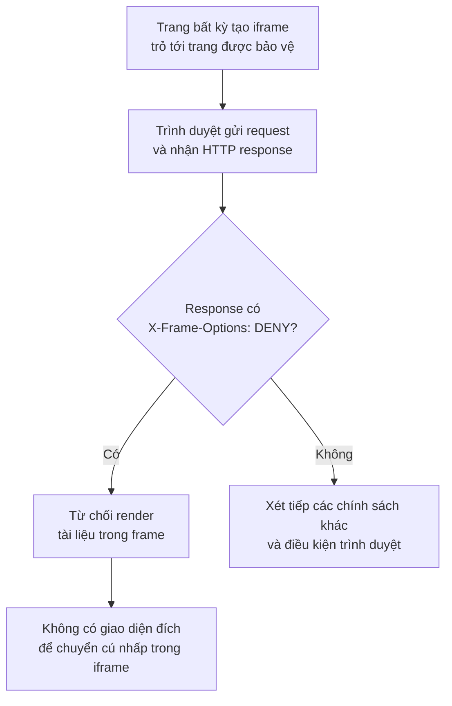

# X-Frame-Options với chính sách DENY

## 1. Mục tiêu và tình huống cần bảo vệ

Trong nhóm chủ đề **Chống nhúng trang** của module `SPRING_SECURITY_HTTP_PROTECTION`, một cách phòng vệ trực tiếp trước **clickjacking** là gửi HTTP response header:

```http
X-Frame-Options: DENY
```

Header này yêu cầu trình duyệt **không hiển thị tài liệu được trả về bên trong một frame**, kể cả khi trang cha và trang con thuộc cùng một origin. Đây là chính sách phù hợp với các trang không có nhu cầu nhúng như đăng nhập, đổi mật khẩu, xác nhận thanh toán, quản trị người dùng hoặc thay đổi thông tin tài khoản.

### Một kịch bản cụ thể

Giả sử người dùng đã đăng nhập tại `https://bank.example`. Một trang do kẻ tấn công kiểm soát cố nhúng trang xác nhận chuyển khoản vào iframe trong suốt, đặt chồng lên nút “Xem ưu đãi”. Nếu trình duyệt được phép hiển thị iframe, nhấp chuột vào nút mồi có thể được chuyển đến giao diện ngân hàng. Kẻ tấn công không nhất thiết phải đọc được DOM của iframe: họ khai thác **vị trí nhấp** và bối cảnh đăng nhập của người dùng.

Khi response của trang ngân hàng chứa `X-Frame-Options: DENY` và trình duyệt thực thi chính sách này, nội dung trang ngân hàng **không được render trong iframe**. Kẻ tấn công không còn giao diện ngân hàng bên dưới để nhận cú nhấp theo cách đó.



**Phạm vi bảo vệ:** `DENY` ngăn cách hiển thị tài liệu trong khung nhúng. Nó **không** biến URL thành tài nguyên bí mật, không thay thế xác thực/phân quyền, không tự chặn request mạng, không phải kiểm soát CSRF và không ngăn người dùng mở trực tiếp URL trong tab bình thường.

## 2. Header hoạt động như thế nào?

Một response HTML điển hình:

```http
HTTP/1.1 200 OK
Content-Type: text/html; charset=UTF-8
X-Frame-Options: DENY

<!doctype html>
<html lang="vi">
  <head><title>Tài khoản</title></head>
  <body><h1>Thông tin tài khoản</h1></body>
</html>
```

Khi một trang cố tải response này qua phần tử `<iframe>` hoặc `<frame>`, trình duyệt hỗ trợ sẽ kiểm tra chính sách và từ chối hiển thị tài liệu trong khung. Việc gửi header chỉ có ý nghĩa khi nó xuất hiện trên **response của trang bị nhúng**; gửi header từ trang cha không thể thay người quản trị của trang đích quyết định ai được nhúng trang đích.

Đặt cạnh hai lựa chọn chính:

| Chính sách | Trang cha khác origin | Trang cha cùng origin | Trường hợp điển hình |
| --- | --- | --- | --- |
| `X-Frame-Options: DENY` | Bị từ chối | **Bị từ chối** | Trang không cần nhúng dưới bất kỳ hình thức nào. |
| `X-Frame-Options: SAMEORIGIN` | Bị từ chối | Có thể được phép | Widget hoặc chức năng cần iframe nội bộ cùng origin. |
| Không có `X-Frame-Options` | Không bị header này chặn | Không bị header này chặn | Chỉ chấp nhận nếu có cơ chế phù hợp khác, đặc biệt CSP `frame-ancestors`. |

**Origin** được xác định bởi bộ ba `scheme + host + port`:

- `https://app.example.com/account` và `https://app.example.com/dashboard`: cùng origin.
- `http://app.example.com` và `https://app.example.com`: khác origin do khác scheme.
- `http://localhost:8080` và `http://localhost:9090`: khác origin do khác port.

Với `DENY`, những khác biệt này không ảnh hưởng đến kết quả: **mọi trang cha đều bị từ chối**.

Không sử dụng giá trị `ALLOW-FROM` để cấu hình nhúng cho origin đối tác: giá trị cũ này không được hỗ trợ nhất quán bởi các trình duyệt hiện đại. Nếu cần danh sách origin cụ thể, sử dụng CSP `frame-ancestors`.

## 3. Vì sao DENY thường là mặc định an toàn?

Áp dụng `DENY` không yêu cầu người phát triển biết trước kẻ tấn công đặt trang ở origin nào. Đối với trang không phải thành phần nhúng, ứng dụng giảm một lớp rủi ro với cấu hình ngắn gọn và dễ kiểm tra.

Lợi ích chính:

1. **Chặn cả iframe khác origin lẫn cùng origin**: hữu ích ngay cả khi ứng dụng có trang con hoặc nội dung do người dùng tải lên tại cùng origin.
2. **Do trình duyệt thực thi**: không phụ thuộc vào JavaScript phòng vệ được tải và chạy đúng thời điểm.
3. **Gắn với response**: có thể kiểm tra từ tab Network hoặc kiểm thử HTTP header.
4. **Phù hợp mặc định của Spring Security**: ở cấu hình HTTP security tiêu chuẩn với bộ security headers chưa bị tắt, Spring Security đã gửi `X-Frame-Options: DENY`.

Đánh đổi quan trọng nhất: `DENY` cũng chặn iframe **hợp lệ**. Ví dụ, nếu dashboard cùng origin cần nhúng `/widgets/chart`, thì chart trả `DENY` sẽ không hiển thị trong iframe. Khi sản phẩm thực sự cần nhúng, phải xác định đúng phạm vi URL được mở nhúng và lựa chọn chính sách phù hợp.

## 4. Spring Security Servlet: giữ mặc định hoặc cấu hình DENY tường minh

Spring Security bổ sung các security header thông qua `SecurityFilterChain`. Trong cấu hình thông thường, bộ header mặc định bao gồm `X-Frame-Options: DENY`. Có thể viết lại ý định một cách tường minh:

```java
import org.springframework.context.annotation.Bean;
import org.springframework.context.annotation.Configuration;
import org.springframework.security.config.annotation.web.builders.HttpSecurity;
import org.springframework.security.config.annotation.web.configuration.EnableWebSecurity;
import org.springframework.security.web.SecurityFilterChain;

@Configuration
@EnableWebSecurity
public class SecurityConfig {

    @Bean
    SecurityFilterChain securityFilterChain(HttpSecurity http) throws Exception {
        return http
            .authorizeHttpRequests(authorize -> authorize
                .anyRequest().authenticated())
            .headers(headers -> headers
                .frameOptions(frame -> frame.deny()))
            .build();
    }
}
```

Đối với các request đi qua chain này, Spring Security ghi header `X-Frame-Options: DENY` vào response theo cơ chế header writer. `authorizeHttpRequests` trong ví dụ chỉ thể hiện yêu cầu đăng nhập: ứng dụng thực tế còn phải phân quyền theo endpoint và cấu hình đăng nhập thích hợp. Việc đặt `DENY` không làm thay đổi ý nghĩa của xác thực hoặc CSRF.

Nếu không cần cấu hình tùy biến, có thể **bỏ hoàn toàn phần `.headers(...)`** ở ví dụ mà vẫn nhận `DENY` mặc định, miễn là bộ security headers của Spring Security còn được bật. Việc viết `.frameOptions(frame -> frame.deny())` hữu ích khi muốn chủ động ghi rõ quy tắc trong mã nguồn và regression test.

### Một cấu hình dễ làm mất lớp bảo vệ

```java
// Ví dụ cần tránh nếu toàn bộ website vẫn cần bảo vệ chống nhúng.
.headers(headers -> headers.disable())
```

Lệnh trên tắt **toàn bộ** việc viết security headers do Spring Security quản lý, không riêng `X-Frame-Options`. Tương tự, `.frameOptions(frame -> frame.disable())` tắt riêng header `X-Frame-Options` cho chain đang cấu hình. Chỉ dùng khi có chính sách chống nhúng thay thế được thiết kế, thử nghiệm kỹ và áp dụng đúng nhóm endpoint.

### Nhiều SecurityFilterChain có thể gây lệch chính sách

Trong ứng dụng có nhiều chain, một request được xử lý bởi chain khớp theo thứ tự ưu tiên. Ví dụ, chain cho `/api/**`, chain cho `/admin/**`, chain còn lại cho website. Nếu chỉ cấu hình header trong một chain, các endpoint được xử lý bởi chain khác cần được kiểm tra riêng.

Với một trang HTML `/admin/settings`, hãy đảm bảo response thực sự đi qua chain được cấu hình và giữ `DENY`. Một route không khớp bất cứ chain nào hoặc response được phục vụ ở thành phần nằm ngoài Spring Security có thể không nhận được header như kỳ vọng.

## 5. Spring Security Reactive / WebFlux: DENY trên ServerHttpSecurity

Ứng dụng Reactive dùng `ServerHttpSecurity` và `SecurityWebFilterChain` thay vì `HttpSecurity` và `SecurityFilterChain`. Khi bật bộ security headers thông thường, Spring Security WebFlux cũng dùng `X-Frame-Options: DENY` mặc định.

Ví dụ chỉ định `DENY` tường minh:

```java
import org.springframework.context.annotation.Bean;
import org.springframework.context.annotation.Configuration;
import org.springframework.security.config.annotation.web.reactive.EnableWebFluxSecurity;
import org.springframework.security.config.web.server.ServerHttpSecurity;
import org.springframework.security.web.server.SecurityWebFilterChain;
import org.springframework.security.web.server.header.XFrameOptionsServerHttpHeadersWriter;

@Configuration
@EnableWebFluxSecurity
public class ReactiveSecurityConfig {

    @Bean
    SecurityWebFilterChain springSecurityFilterChain(ServerHttpSecurity http) {
        return http
            .authorizeExchange(exchanges -> exchanges
                .anyExchange().authenticated())
            .headers(headers -> headers
                .frameOptions(frame -> frame
                    .mode(XFrameOptionsServerHttpHeadersWriter.Mode.DENY)))
            .build();
    }
}
```

Khác biệt cú pháp cần nhớ:

| Servlet | Reactive / WebFlux |
| --- | --- |
| `HttpSecurity` | `ServerHttpSecurity` |
| `SecurityFilterChain` | `SecurityWebFilterChain` |
| `authorizeHttpRequests(...)` | `authorizeExchange(...)` |
| `frameOptions(frame -> frame.deny())` | `frameOptions(frame -> frame.mode(...Mode.DENY))` |

Cả hai dùng cùng **header HTTP ở response**. Khi kiểm thử, đừng suy luận rằng hành vi khác nhau chỉ vì Servlet dùng filter còn WebFlux dùng web filter.

## 6. Cấu hình DENY cùng CSP frame-ancestors

`X-Frame-Options` là cơ chế bảo vệ chống nhúng đã có từ lâu. CSP `frame-ancestors` cho phép khai báo các nguồn tổ tiên được phép nhúng trang:

```http
X-Frame-Options: DENY
Content-Security-Policy: frame-ancestors 'none'
```

Hai chính sách ở ví dụ cùng mang ý nghĩa **không ai được nhúng trang này**. Để bổ sung CSP mà vẫn giữ `DENY` mặc định trên Servlet:

```java
.headers(headers -> headers
    .frameOptions(frame -> frame.deny())
    .contentSecurityPolicy(csp -> csp
        .policyDirectives("frame-ancestors 'none'")))
```

Trên Reactive / WebFlux:

```java
.headers(headers -> headers
    .frameOptions(frame -> frame
        .mode(XFrameOptionsServerHttpHeadersWriter.Mode.DENY))
    .contentSecurityPolicy(csp -> csp
        .policyDirectives("frame-ancestors 'none'")))
```

Đây là các **đoạn thay thế cho phần `headers(...)`** của cấu hình ở mục trước; chúng không phải Java độc lập. Spring Security không tự thêm CSP tổng quát theo mặc định, vì chính sách CSP phụ thuộc cách ứng dụng tải tài nguyên và nhúng nội dung.

### Phân biệt các trường hợp khi có cả hai header

| Response trang đích | Kết quả và điều cần lưu ý |
| --- | --- |
| Chỉ có `X-Frame-Options: DENY` | Trình duyệt hỗ trợ XFO sẽ từ chối nhúng. |
| `DENY` cùng `frame-ancestors 'none'` | Hai chính sách nhất quán: từ chối mọi tổ tiên. |
| `DENY` cùng `frame-ancestors 'self'` | **Mâu thuẫn về ý định**: CSP cho phép tổ tiên cùng origin trong khi XFO từ chối. Với CSP enforced có `frame-ancestors`, trình duyệt hiện đại ưu tiên CSP; cách xử lý có thể khác ở trình duyệt cũ. |
| Không có XFO, có `frame-ancestors 'none'` | Trình duyệt hỗ trợ CSP `frame-ancestors` sẽ từ chối nhúng; cần cân nhắc khả năng hỗ trợ trình duyệt mục tiêu. |

**Không đặt `frame-ancestors` trong `<meta http-equiv="Content-Security-Policy">`**: directive này chỉ có hiệu lực qua HTTP response header. Cũng không nhầm `frame-ancestors` với `frame-src`: `frame-ancestors` xác định **ai được nhúng response hiện tại**, còn `frame-src` xác định **response hiện tại được nhúng những nguồn nào**.

Nếu sản phẩm cần cho phép iframe từ một origin đối tác bên ngoài, `DENY` không đáp ứng được yêu cầu. Khi đó phải thiết kế CSP `frame-ancestors` dành riêng cho endpoint nhúng và quản lý `X-Frame-Options` để tránh chính sách mâu thuẫn; vẫn áp dụng `DENY` cho phần lớn trang còn lại.

## 7. Thực hành trên trình duyệt: kiểm tra chặn nhúng từ cả hai origin

Thực hành này dùng **ứng dụng do bạn kiểm soát**, không cần tài khoản hoặc hệ thống của bên thứ ba.

### Bước 1: Chuẩn bị trang đích

Trong ứng dụng Spring Boot Servlet hoặc WebFlux chạy tại `http://localhost:8080`, tạo trang HTML `/demo/target` và bật `X-Frame-Options: DENY` cho response. Trang có thể chỉ chứa:

```html
<!doctype html>
<html lang="vi">
<head><meta charset="utf-8"><title>Trang đích thử nghiệm</title></head>
<body>
  <h1>Chức năng thử nghiệm</h1>
  <button type="button">Xác nhận mô phỏng</button>
</body>
</html>
```

Nếu ứng dụng yêu cầu đăng nhập, xác thực bằng tài khoản thử nghiệm trước khi quan sát. Không cần xây dựng thao tác nhạy cảm thật.

### Bước 2: Tạo trang nhúng thử nghiệm

Đặt trang sau ở `http://localhost:9090/test-frame.html`:

```html
<!doctype html>
<html lang="vi">
<head><meta charset="utf-8"><title>Thử nghiệm X-Frame-Options</title></head>
<body>
  <h1>Kiểm tra iframe</h1>
  <iframe
    title="Trang đích có header DENY"
    src="http://localhost:8080/demo/target"
    width="800"
    height="400"></iframe>
</body>
</html>
```

Mở trang cha trong trình duyệt. Nội dung `/demo/target` không được render trong iframe. Tab **Console** thường cho biết trình duyệt từ chối hiển thị tài liệu do `X-Frame-Options: DENY` hoặc do CSP có hiệu lực.

### Bước 3: Kiểm tra cả trường hợp cùng origin

Tạo cùng nội dung trang nhúng nhưng phục vụ từ chính `http://localhost:8080` (ví dụ `/demo/test-frame`). Với `DENY`, iframe vẫn bị chặn dù cả hai tài liệu cùng origin. Đây là phép thử phân biệt rõ `DENY` và `SAMEORIGIN`.

### Bước 4: Xác minh HTTP response

```bash
curl -i http://localhost:8080/demo/target
```

Tìm `X-Frame-Options: DENY` trong response. Nếu ứng dụng yêu cầu đăng nhập, `curl` có thể nhận `302` chuyển hướng hoặc `401` thay vì trang HTML mong muốn: cần kiểm tra **response của đúng trang đích** bằng tài khoản thử nghiệm, tab Network hoặc request có xác thực thích hợp. Khi có reverse proxy/CDN, hãy kiểm tra response thật qua địa chỉ người dùng truy cập.

**Giới hạn của `curl`:** nhìn thấy header chứng tỏ máy chủ đã gửi nó ở request đó, nhưng không xác nhận trình duyệt có từ chối render iframe. Ngược lại, iframe trống cũng không tự chứng minh do XFO: trang có thể bị chặn bởi CSP, thiếu phiên, lỗi HTTPS/mixed content hoặc lỗi ứng dụng.

## 8. Kiểm thử tự động trong Spring Security

Kiểm thử header giúp phát hiện trường hợp ai đó tắt bộ security headers, thay đổi chain hoặc ghi đè cấu hình.

### 8.1. Servlet: MockMvc

Với dependency kiểm thử `spring-security-test`, endpoint `/demo/target` có thể được kiểm tra như sau:

```java
mockMvc.perform(get("/demo/target").with(user("tester")))
    .andExpect(status().isOk())
    .andExpect(header().string("X-Frame-Options", "DENY"));
```

Đoạn trên là **phần thân kiểm thử**: cần cấu hình `MockMvc`, controller trả `200 OK`, các static import từ `MockMvcRequestBuilders`, `SecurityMockMvcRequestPostProcessors` và `MockMvcResultMatchers`. Nếu chỉ cần xác nhận header có mặt trên response bảo mật, có thể kiểm tra trực tiếp status phù hợp mà không bắt buộc `200`.

### 8.2. Reactive: WebTestClient

Với WebFlux và `spring-security-test`:

```java
webTestClient.mutateWith(mockUser("tester"))
    .get()
    .uri("/demo/target")
    .exchange()
    .expectStatus().isOk()
    .expectHeader().valueEquals("X-Frame-Options", "DENY");
```

`mockUser` có thể import tĩnh từ `SecurityMockServerConfigurers`. Endpoint cần thực sự tồn tại và quyền tài khoản thử nghiệm phải phù hợp. Nếu ứng dụng có nhiều security chain, chọn ít nhất một URL đại diện cho **mỗi nhóm route phục vụ HTML nhạy cảm**.

### 8.3. Ma trận kiểm chứng hồi quy

| Trường hợp | Mong đợi khi trang đích dùng `DENY` |
| --- | --- |
| Nhúng từ trang khác origin | Không render nội dung đích. |
| Nhúng từ trang cùng origin | Không render nội dung đích. |
| Mở trang đích trực tiếp trong tab | Có thể hiển thị nếu người dùng được phép truy cập. |
| Response 200 của trang HTML nhạy cảm | Chứa `X-Frame-Options: DENY`. |
| Đường dẫn nằm trong chain bảo mật thứ hai | Vẫn có header theo chính sách dự kiến. |
| Phân phối qua gateway hoặc CDN | Header đến trình duyệt đúng như chính sách đã thiết kế. |
| Có thêm CSP `frame-ancestors 'none'` | Cả hai header nhất quán trong response cuối. |

## 9. Chẩn đoán khi DENY không có tác dụng hoặc chặn nhầm

**Vấn đề 1: Đã cấu hình `DENY` nhưng response không có header.** Kiểm tra URL thực sự được gọi, chain phù hợp, thứ tự matcher và liệu `headers().disable()` hoặc `frameOptions().disable()` có được áp dụng ở nơi khác hay không. Với proxy hoặc CDN, kiểm tra header trên response của từng tầng. Một endpoint không đi qua Spring Security sẽ không tự nhận header của chain khác.

**Vấn đề 2: Header xuất hiện trên trang cha nhưng trang đích vẫn bị nhúng.** Header chống nhúng phải có trên **response của trang đích**, không phải chỉ trên response của trang cha. Hãy mở tab Network, chọn request iframe và kiểm tra `Response Headers` của URL trả về HTML cuối cùng.

**Vấn đề 3: Dashboard nội bộ không tải được widget cùng origin.** `DENY` từ chối cả iframe cùng origin. Nếu widget thực sự cần nhúng, cân nhắc `SAMEORIGIN` hoặc CSP `frame-ancestors 'self'` trên **endpoint widget**, giữ `DENY` ở các trang không cần iframe. Tránh mở quyền nhúng toàn bộ ứng dụng chỉ để sửa một widget.

**Vấn đề 4: Đã cấu hình CORS đúng nhưng iframe vẫn bị chặn.** CORS không kiểm soát quyền hiển thị response trong iframe. Việc thiết lập `Access-Control-Allow-Origin` không gỡ bỏ tác động của `X-Frame-Options: DENY`.

**Vấn đề 5: Trên localhost hoạt động khác khi triển khai.** So sánh response cuối qua HTTPS, thay đổi route, cookie/phiên, redirect tới trang đăng nhập, CSP bổ sung và header do gateway ghi đè. Kiểm tra thông báo cụ thể trên Console thay vì kết luận từ một iframe trắng.

**Vấn đề 6: Có cả `DENY` và CSP nhưng một trình duyệt vẫn nhúng được.** Xác định liệu CSP `frame-ancestors` đang cho phép tổ tiên hay không, CSP có được gửi trong enforced header hay chỉ ở chế độ Report-Only, và trình duyệt có ưu tiên CSP hay không. Để cấm tuyệt đối, dùng **hai chính sách thống nhất**: `DENY` và `frame-ancestors 'none'`.

## 10. Quy tắc triển khai trong hệ thống thực tế

Khi áp dụng chống nhúng trang trong Spring Security ở cả Servlet và Reactive:

1. **Mặc định `DENY` cho HTML nhạy cảm**, nhất là trang quản trị, tài khoản và thao tác thay đổi dữ liệu.
2. **Giữ security headers mặc định** nếu không có nhu cầu tùy biến; nếu thêm cấu hình, tránh tắt toàn bộ header writer.
3. **Đánh giá nhu cầu iframe theo endpoint** trước khi mở ngoại lệ. Nếu phải mở, xác định origin/trang cha và dùng CSP `frame-ancestors` chính xác.
4. **Bảo vệ bằng nhiều lớp**: phân quyền phía server, CSRF cho thao tác thay đổi trạng thái, xác nhận thao tác nguy hiểm, cookie/session thích hợp. `DENY` chỉ xử lý hướng tấn công qua nhúng giao diện.
5. **Kiểm thử từ cả hai phía**: unit/integration test xác minh response header; trình duyệt kiểm tra hành vi iframe; staging/production xác nhận proxy không thay đổi policy.
6. **Giải quyết xung đột CSP/XFO có chủ đích**: nếu đặt CSP `frame-ancestors 'none'` thì chính sách phải được gửi qua HTTP header và thống nhất với `DENY`.

### Ví dụ quyết định chính sách

Một nền tảng học trực tuyến có các URL `/profile/security`, `/admin/users` và `/lesson/view`. Nếu cả ba chỉ được mở như trang thông thường, chính sách `DENY` là phù hợp. Nếu sau này `/lesson/view` cần xuất hiện bên trong iframe của chính nền tảng, có thể chọn `SAMEORIGIN` hoặc CSP `frame-ancestors 'self'` **chỉ trên trang bài học**, đồng thời tiếp tục từ chối nhúng ở `/profile/security` và `/admin/users`. Quyết định này dựa trên nhu cầu nhúng thực tế chứ không chỉ dựa trên việc URL có cùng domain.

## 11. Tổng kết kiến thức

`X-Frame-Options: DENY` là lựa chọn chống clickjacking rõ ràng nhất khi một trang **không cần được nhúng**: trình duyệt từ chối render tài liệu đó trong iframe, kể cả iframe cùng origin. Spring Security cung cấp `DENY` trong bộ security headers mặc định cho cả Servlet và WebFlux. Cấu hình tường minh, kiểm thử response cuối cùng và giữ CSP `frame-ancestors` nhất quán giúp hạn chế sai lệch khi ứng dụng có nhiều security chain hoặc proxy. Với trang thực sự cần được nhúng, phải thiết kế ngoại lệ riêng theo URL thay vì tắt bảo vệ trên toàn bộ ứng dụng.
