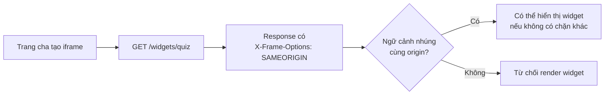

# SAMEORIGIN và yêu cầu nhúng trang cùng nguồn

## 1. Khi nào cần SAMEORIGIN?

Trong module **SPRING_SECURITY_HTTP_PROTECTION**, người học triển khai các lớp bảo vệ HTTP và trình duyệt của Spring Security cho cả Servlet và Reactive. Nhóm **Chống nhúng trang** tập trung vào nguy cơ *clickjacking*: trang do người khác kiểm soát cố đặt giao diện ứng dụng vào một `<iframe>` để đánh lừa người dùng tương tác với các nút, biểu mẫu hoặc thao tác nhạy cảm.

Chính sách `X-Frame-Options: DENY` từ chối mọi việc nhúng, kể cả trong nội bộ ứng dụng. Nhưng một số sản phẩm có nhu cầu hợp lệ: trang học trực tuyến cần nhúng bảng bài tập, bảng điều khiển cần nhúng biểu đồ, trang chính cần nhúng widget hỗ trợ. Nếu **trang cha và trang được nhúng thực sự cùng origin**, chính sách `SAMEORIGIN` có thể đáp ứng nhu cầu này mà vẫn chặn các trang từ origin khác.

```http
X-Frame-Options: SAMEORIGIN
```

**Ý nghĩa:** trình duyệt hỗ trợ có thể hiển thị tài liệu trong frame khi điều kiện cùng origin được thỏa mãn; nếu trang cha nằm ở origin khác, trình duyệt từ chối. `SAMEORIGIN` là chính sách ở **response của tài liệu được nhúng**, không phải thuộc tính đặt vào thẻ iframe của trang cha.

Ví dụ thiết kế:

- `https://learn.example.com/course/42` là trang cha.
- `https://learn.example.com/widgets/quiz` là trang bài tập cần nhúng.
- `https://external.example.net/trick` là trang không được phép nhúng bài tập.
- `https://learn.example.com/account/password` là trang thay đổi mật khẩu **không cần** nhúng, vẫn nên dùng `DENY`.

Mục tiêu cấu hình: mở nhúng nội bộ cho **`/widgets/**`**, giữ chính sách chặt hơn cho các trang còn lại và kiểm tra hành vi bằng trình duyệt lẫn HTTP test.

## 2. Hiểu chính xác “cùng nguồn” (same origin)

Một **origin** của URL HTTP(S) là bộ ba **scheme + host + port**. Hai URL được xem là cùng origin khi cả ba thành phần tương đương sau khi áp dụng các quy tắc chuẩn hóa URL, trong đó cổng mặc định của HTTPS là 443 và của HTTP là 80.

Giả sử tài liệu được nhúng đến từ `https://learn.example.com/widgets/quiz`:

| Origin của trang cha | Cùng origin? | Lý do |
| --- | --- | --- |
| `https://learn.example.com/course/42` | Có | Cùng scheme HTTPS, host và port. |
| `https://learn.example.com:443/course/42` | Có | Port 443 được xem là port mặc định của HTTPS. |
| `http://learn.example.com/course/42` | Không | Scheme HTTP khác HTTPS. |
| `https://learn.example.com:8443/course/42` | Không | Port khác. |
| `https://app.learn.example.com/course/42` | Không | Host khác vì có subdomain `app`. |
| `https://example.com/course/42` | Không | Host khác, dù tên miền có liên quan. |
| `https://attacker.example.org/demo` | Không | Khác origin hoàn toàn. |

Đặc biệt, **same-site không đồng nghĩa same-origin**. Hai tên miền con `app.example.com` và `learn.example.com` có thể cùng *site* khi xét chính sách cookie nhưng vẫn khác **origin**. Một cookie có `SameSite=Lax` hoặc `SameSite=Strict` không biến hai origin thành một.

Khi kiểm thử ở máy cá nhân:

```text
http://localhost:8080/course     -> http://localhost:8080/widgets/quiz  (cùng origin)
http://localhost:9090/frame-test -> http://localhost:8080/widgets/quiz  (khác origin)
```

Đổi một mình port cũng đủ làm `SAMEORIGIN` từ chối iframe từ trang cha khác port. Trên production, frontend ở `https://www.example.com` và backend/view ở `https://app.example.com` **không** cùng origin chỉ vì chúng thuộc một doanh nghiệp.

## 3. Browser áp dụng SAMEORIGIN ở đâu?

Giả sử trang cha tại `/course/42` chứa:

```html
<iframe
  src="/widgets/quiz"
  title="Bài tập của khóa học"
  width="900"
  height="560">
</iframe>
```

Server trả HTML của `/widgets/quiz` cùng header `X-Frame-Options: SAMEORIGIN`. Trình duyệt xem xét chính sách **của response `/widgets/quiz`** trước khi hiển thị tài liệu trong iframe.



Ba điểm dễ hiểu nhầm:

1. **`SAMEORIGIN` không cho phép vượt qua chính sách khác.** Nếu ứng dụng đồng thời gửi CSP `frame-ancestors 'none'` thì trình duyệt hiện đại sẽ từ chối iframe, ngay cả khi trang cha cùng origin.
2. **Được phép nhúng không đồng nghĩa được phép truy cập.** Endpoint vẫn phải kiểm tra session, phân quyền và dữ liệu mà người dùng có thể xem.
3. **Các frame lồng nhau cần chú ý toàn bộ chuỗi tổ tiên.** Việc kiểm tra `X-Frame-Options: SAMEORIGIN` trong các trình duyệt/phiên bản cũ không hoàn toàn đồng nhất khi có nhiều cấp iframe. Nếu yêu cầu chặt chẽ rằng *mọi ancestor* phải cùng origin, dùng thêm CSP `frame-ancestors 'self'` và thử nghiệm trên trình duyệt được hỗ trợ.

Ví dụ chuỗi sau có nguy cơ khó đánh giá nếu chỉ dựa vào XFO:

```text
https://outsider.example.org  (trang trên cùng)
  └── https://learn.example.com/course/42
        └── https://learn.example.com/widgets/quiz
```

Dù trang cha trực tiếp của quiz cùng origin, trang trên cùng lại khác origin. CSP `frame-ancestors 'self'` trên **quiz** yêu cầu **mọi ancestor** được xét đều cùng origin, nên chặn chuỗi nhúng trên. Trong các luồng nhúng đa cấp, không nên suy diễn toàn bộ độ an toàn chỉ từ kiểm tra origin của trang cha trực tiếp.

## 4. Lựa chọn SAMEORIGIN, DENY và CSP frame-ancestors

| Cơ chế trên response | Cho nhúng từ cùng origin | Cho nhúng từ origin ngoài | Khi nên dùng |
| --- | --- | --- | --- |
| `X-Frame-Options: DENY` | Không | Không | Trang không có nhu cầu iframe. |
| `X-Frame-Options: SAMEORIGIN` | Có thể, nếu không bị chính sách khác chặn | Không | Trang cần iframe nội bộ trên cùng origin. |
| CSP `frame-ancestors 'none'` | Không | Không | Cấm mọi ancestor ở trình duyệt hỗ trợ CSP. |
| CSP `frame-ancestors 'self'` | Có | Không | Xác thực toàn bộ chuỗi ancestor cùng origin. |
| CSP `frame-ancestors 'self' https://portal.example.com` | Có | Có, với origin được liệt kê | Widget cho phép một portal ở origin ngoài. |

Để bảo vệ widget nội bộ, cấu hình nhất quán là:

```http
X-Frame-Options: SAMEORIGIN
Content-Security-Policy: frame-ancestors 'self'
```

**Phân biệt hai directive CSP có tên gần nhau:**

- `frame-ancestors` nằm trong **response của trang bị nhúng**, kiểm soát **ai được nhúng trang đó**.
- `frame-src` nằm trong **response của trang cha**, kiểm soát **trang cha được tải nguồn nào vào iframe**.

Một trang cha có CSP `frame-src 'self'` vẫn không thể nhúng trang con có `X-Frame-Options: DENY`. Ngược lại, trang con cho phép nhúng qua `SAMEORIGIN` vẫn có thể bị CSP `frame-src 'none'` trên trang cha chặn. Hai phía phải cho phép theo từng chính sách liên quan.

`frame-ancestors` phải được gửi bằng **HTTP response header `Content-Security-Policy`**, không được đặt trong `<meta http-equiv="Content-Security-Policy">`. Spring Security **không tự gửi CSP tổng quát theo mặc định**; phải cấu hình khi muốn bổ sung directive này.

### Khi thực sự cần nhúng chéo origin

Nếu portal nằm tại `https://portal.example.com` nhưng widget ở `https://learn.example.com` thì `SAMEORIGIN` **không đáp ứng** yêu cầu. Có hai lựa chọn thiết kế:

1. Phục vụ trang cha và widget dưới **cùng origin** được kiểm soát, ví dụ đặt reverse proxy hợp lý; vẫn phải kiểm soát routing và các nội dung không đáng tin cậy.
2. Cho phép đúng origin của portal bằng CSP `frame-ancestors 'self' https://portal.example.com` và không gửi XFO `SAMEORIGIN` trên **riêng response widget**, bởi XFO không có cơ chế danh sách origin hiện đại tương đương. Cách này yêu cầu trình duyệt hỗ trợ CSP `frame-ancestors` và kiểm thử kỹ.

Không dùng `X-Frame-Options: ALLOW-FROM` như một giải pháp mới: hỗ trợ trình duyệt không nhất quán. Đừng mở nhúng cho tất cả route chỉ để phục vụ một widget.

## 5. Spring Security Servlet: cấu hình theo nhóm URL

Spring Security trên Servlet dùng `HttpSecurity` để tạo `SecurityFilterChain`. Khi security headers tiêu chuẩn đang bật, `X-Frame-Options` mặc định là **`DENY`**. Muốn dùng `SAMEORIGIN`, phải thay đổi cấu hình phù hợp.

Ví dụ dưới đây có hai chain: `/widgets/**` được phép nhúng cùng origin; các trang khác vẫn bị cấm nhúng. Mỗi response nhận một CSP nhất quán với XFO.

```java
import org.springframework.context.annotation.Bean;
import org.springframework.context.annotation.Configuration;
import org.springframework.core.annotation.Order;
import org.springframework.security.config.annotation.web.builders.HttpSecurity;
import org.springframework.security.config.annotation.web.configuration.EnableWebSecurity;
import org.springframework.security.web.SecurityFilterChain;

@Configuration
@EnableWebSecurity
public class SecurityConfig {

    @Bean
    @Order(1)
    SecurityFilterChain widgetChain(HttpSecurity http) throws Exception {
        return http
            .securityMatcher("/widgets/**")
            .authorizeHttpRequests(auth -> auth
                .anyRequest().authenticated())
            .headers(headers -> headers
                .frameOptions(frame -> frame.sameOrigin())
                .contentSecurityPolicy(csp -> csp
                    .policyDirectives("frame-ancestors 'self'")))
            .build();
    }

    @Bean
    @Order(2)
    SecurityFilterChain defaultChain(HttpSecurity http) throws Exception {
        return http
            .authorizeHttpRequests(auth -> auth
                .anyRequest().authenticated())
            .headers(headers -> headers
                .frameOptions(frame -> frame.deny())
                .contentSecurityPolicy(csp -> csp
                    .policyDirectives("frame-ancestors 'none'")))
            .build();
    }
}
```

Kết quả dự kiến:

| Response | `X-Frame-Options` | CSP `frame-ancestors` |
| --- | --- | --- |
| `/widgets/quiz` | `SAMEORIGIN` | `'self'` |
| `/widgets/chart` | `SAMEORIGIN` | `'self'` |
| `/account/password` | `DENY` | `'none'` |
| `/admin/users` | `DENY` | `'none'` |

`@Order(1)` đảm bảo chain có matcher cụ thể cho widget được xét trước chain còn lại. Chain mặc định không đặt `securityMatcher` nên áp dụng cho các request còn lại. Ví dụ dùng `authenticated()` để tập trung vào chính sách nhúng; ứng dụng thực tế phải bổ sung rule phân quyền phù hợp, cơ chế đăng nhập và các kiểm soát khác. `frameOptions` là cấu hình header, **không thay thế** kiểm tra quyền truy cập của endpoint.

**Khi toàn bộ ứng dụng cần iframe cùng origin:** có thể viết một chain duy nhất với:

```java
.headers(headers -> headers
    .frameOptions(frame -> frame.sameOrigin())
    .contentSecurityPolicy(csp -> csp
        .policyDirectives("frame-ancestors 'self'")))
```

Đây là đoạn thay thế cho `headers(...)`, không phải đoạn Java chạy độc lập. Phương án một chain kém phù hợp nếu trong ứng dụng có màn hình nhạy cảm không cần nhúng.

## 6. Spring Security Reactive / WebFlux: cấu hình tương đương

Trong WebFlux, cấu hình dựa trên `ServerHttpSecurity` và `SecurityWebFilterChain`. Với bộ security headers tiêu chuẩn đang bật, `X-Frame-Options: DENY` cũng là mặc định; cấu hình `SAMEORIGIN` dùng kiểu `XFrameOptionsServerHttpHeadersWriter.Mode.SAMEORIGIN`.

Ví dụ chia hai chain theo cùng quy tắc với Servlet:

```java
import org.springframework.context.annotation.Bean;
import org.springframework.context.annotation.Configuration;
import org.springframework.core.annotation.Order;
import org.springframework.security.config.annotation.web.reactive.EnableWebFluxSecurity;
import org.springframework.security.config.web.server.ServerHttpSecurity;
import org.springframework.security.web.server.SecurityWebFilterChain;
import org.springframework.security.web.server.header.XFrameOptionsServerHttpHeadersWriter;
import org.springframework.security.web.server.util.matcher.PathPatternParserServerWebExchangeMatcher;

@Configuration
@EnableWebFluxSecurity
public class ReactiveSecurityConfig {

    @Bean
    @Order(1)
    SecurityWebFilterChain widgetChain(ServerHttpSecurity http) {
        return http
            .securityMatcher(
                new PathPatternParserServerWebExchangeMatcher("/widgets/**"))
            .authorizeExchange(exchanges -> exchanges
                .anyExchange().authenticated())
            .headers(headers -> headers
                .frameOptions(frame -> frame
                    .mode(XFrameOptionsServerHttpHeadersWriter.Mode.SAMEORIGIN))
                .contentSecurityPolicy(csp -> csp
                    .policyDirectives("frame-ancestors 'self'")))
            .build();
    }

    @Bean
    @Order(2)
    SecurityWebFilterChain defaultChain(ServerHttpSecurity http) {
        return http
            .authorizeExchange(exchanges -> exchanges
                .anyExchange().authenticated())
            .headers(headers -> headers
                .frameOptions(frame -> frame
                    .mode(XFrameOptionsServerHttpHeadersWriter.Mode.DENY))
                .contentSecurityPolicy(csp -> csp
                    .policyDirectives("frame-ancestors 'none'")))
            .build();
    }
}
```

Khác biệt API nằm ở `authorizeExchange`, `SecurityWebFilterChain`, matcher WebFlux và enum mode. **Giá trị HTTP header nhận được bởi trình duyệt vẫn giống nhau**. Nếu ứng dụng vừa có các endpoint HTML vừa có endpoint API, hãy xác định chính xác chain bảo vệ mỗi response HTML; đừng cho rằng cấu hình của chain `/api/**` tự động áp dụng cho widget nằm ở route khác.

## 7. Bài thực hành: iframe được chấp nhận ở cùng origin

Sử dụng ứng dụng Spring Boot thử nghiệm do bạn kiểm soát tại `http://localhost:8080`, với cấu hình Servlet hoặc Reactive ở trên. Giả sử có route `GET /widgets/quiz` trả HTML và route `GET /account/password` trả HTML; hai route chỉ để quan sát chính sách, không cần thực hiện thao tác thay đổi dữ liệu thật.

### 7.1. Tạo trang nhúng cùng origin

Phục vụ đoạn HTML sau qua chính origin `http://localhost:8080`, ví dụ route `GET /course/demo`:

```html
<!doctype html>
<html lang="vi">
<head>
  <meta charset="utf-8">
  <title>Thử nghiệm SAMEORIGIN</title>
</head>
<body>
  <h1>Khóa học thử nghiệm</h1>
  <iframe
    src="/widgets/quiz"
    title="Bài tập nội bộ"
    width="900"
    height="500"></iframe>
</body>
</html>
```

Sau khi đăng nhập với tài khoản thử nghiệm, iframe `/widgets/quiz` **có thể được hiển thị** vì response của widget cho phép `SAMEORIGIN` và CSP `frame-ancestors 'self'`. Cần nhớ các yếu tố khác như phân quyền, xác thực, route và CSP của trang cha vẫn có thể chặn.

### 7.2. Tạo trang nhúng khác origin

Phục vụ cùng đoạn HTML từ `http://localhost:9090/frame-test.html`. Khi đó `src="/widgets/quiz"` sẽ trỏ về **localhost:9090**, không phải 8080. Để kiểm tra đúng trang đích, phải thay bằng URL tuyệt đối:

```html
<iframe
  src="http://localhost:8080/widgets/quiz"
  title="Widget ở origin khác"
  width="900"
  height="500"></iframe>
```

Lúc này origin của trang cha là `http://localhost:9090` và của widget là `http://localhost:8080`; khác port nên việc nhúng phải bị từ chối. Quan sát Console để xác định lý do chặn là XFO/CSP thay vì lỗi mạng hoặc lỗi đăng nhập.

### 7.3. Kiểm tra endpoint vẫn dùng DENY

Tại trang `http://localhost:8080/course/demo`, đổi `src` thành `/account/password`. Dù cùng origin, iframe vẫn phải bị từ chối vì response của `/account/password` có `DENY` và CSP `frame-ancestors 'none'`.

### 7.4. Quan sát response thực tế

```bash
curl -i http://localhost:8080/widgets/quiz
curl -i http://localhost:8080/account/password
```

Nếu endpoint yêu cầu xác thực, `curl` có thể nhận `302` chuyển hướng tới đăng nhập hoặc `401`. Khi đó kiểm tra qua tab **Network** của trình duyệt đang đăng nhập, hoặc gửi request thử nghiệm có xác thực thích hợp. Điều cần đọc là **response cuối cùng của chính trang sẽ được render**; một redirect hoặc trang login có chính sách khác có thể khiến iframe không hiển thị.

Một response header đúng chỉ xác nhận cấu hình server; **kiểm thử trong trình duyệt mới xác nhận cách iframe được xử lý**. Ở production, proxy, CDN và gateway có thể sửa header trước khi gửi tới người dùng.

## 8. Kiểm thử hồi quy với Spring Security

Giả sử các endpoint demo trả HTTP `200 OK` khi đã đăng nhập. Các đoạn sau tập trung vào việc kiểm tra response header, với `spring-security-test` được cấu hình cho dự án.

### 8.1. Servlet: MockMvc

```java
mockMvc.perform(get("/widgets/quiz").with(user("tester")))
    .andExpect(status().isOk())
    .andExpect(header().string("X-Frame-Options", "SAMEORIGIN"))
    .andExpect(header().string(
        "Content-Security-Policy", "frame-ancestors 'self'"));

mockMvc.perform(get("/account/password").with(user("tester")))
    .andExpect(status().isOk())
    .andExpect(header().string("X-Frame-Options", "DENY"))
    .andExpect(header().string(
        "Content-Security-Policy", "frame-ancestors 'none'"));
```

Đây là phần thân của test, cần fixture cho các route, `MockMvc` cùng static import cho `get`, `user`, `status` và `header`. Nếu CSP còn nhiều directive khác, nên dùng assertion kiểm tra có đúng `frame-ancestors` thay vì so khớp toàn chuỗi chính sách.

### 8.2. Reactive / WebFlux: WebTestClient

```java
webTestClient.mutateWith(mockUser("tester"))
    .get().uri("/widgets/quiz")
    .exchange()
    .expectStatus().isOk()
    .expectHeader().valueEquals("X-Frame-Options", "SAMEORIGIN")
    .expectHeader().valueEquals(
        "Content-Security-Policy", "frame-ancestors 'self'");

webTestClient.mutateWith(mockUser("tester"))
    .get().uri("/account/password")
    .exchange()
    .expectStatus().isOk()
    .expectHeader().valueEquals("X-Frame-Options", "DENY")
    .expectHeader().valueEquals(
        "Content-Security-Policy", "frame-ancestors 'none'");
```

`mockUser` ở đây là tiện ích của `SecurityMockServerConfigurers` trong `spring-security-test`. Cần tạo các route và quyền thử nghiệm đúng với mô hình ứng dụng.

### 8.3. Ma trận kiểm thử trên trình duyệt

| Trang cha | URL trong iframe | Kết quả dự kiến |
| --- | --- | --- |
| `http://localhost:8080/course/demo` | `http://localhost:8080/widgets/quiz` | Được nhúng nếu đã xác thực và không có chính sách khác chặn. |
| `http://localhost:9090/frame-test.html` | `http://localhost:8080/widgets/quiz` | Bị chặn vì khác origin. |
| `http://localhost:8080/course/demo` | `http://localhost:8080/account/password` | Bị chặn vì endpoint sử dụng `DENY`. |
| `https://portal.example.com` | `https://learn.example.com/widgets/quiz` | Bị chặn với `SAMEORIGIN`, dù hai host có thể cùng doanh nghiệp. |
| Trang cùng origin nằm trong iframe của trang ngoài | Widget lồng trong iframe đó | Với CSP `frame-ancestors 'self'` trên widget, bị chặn do có ancestor ngoài origin. |

## 9. Phân tích xung đột thực tế

### 9.1. “Cùng domain rồi, sao iframe vẫn bị từ chối?”

Hãy đối chiếu **origin chính xác**, bao gồm scheme, hostname và port. Subdomain, port 8443 hoặc thay `http` bằng `https` đều có thể khiến origin khác nhau. Kiểm tra URL **sau redirect**. Trường hợp `https://learn.example.com` và `https://app.learn.example.com` là *cùng họ tên miền*, nhưng không cùng origin.

### 9.2. “Đã đặt SAMEORIGIN nhưng Console báo frame-ancestors 'none'”

Response có thể đồng thời gửi:

```http
X-Frame-Options: SAMEORIGIN
Content-Security-Policy: frame-ancestors 'none'
```

Đây là cấu hình **mâu thuẫn**. CSP enforced có `frame-ancestors 'none'` sẽ chặn nhúng. Khi widget cần nhúng nội bộ, đổi chính sách CSP **trên widget** thành `frame-ancestors 'self'`; vẫn giữ `'none'` ở trang nhạy cảm. Lưu ý CSP có thể do gateway, web server hoặc nhiều lớp ứng dụng cùng thêm, tạo ra nhiều chính sách đồng thời có hiệu lực.

### 9.3. “CORS đã cho phép origin khác mà iframe vẫn trắng”

CORS điều chỉnh cách JavaScript của origin khác truy cập response và một số cross-origin request; CORS **không cho phép** trang đích bị nhúng trái với `X-Frame-Options` hay `frame-ancestors`. Chỉnh `Access-Control-Allow-Origin` không sửa được vấn đề nhúng UI.

### 9.4. “Iframe tải trang đăng nhập nhưng widget không hiện”

Nếu cookie/session không hợp lệ, request widget có thể chuyển hướng đến login, trong khi login gửi `DENY`. Trước hết kiểm tra xác thực, đường dẫn sau redirect và header của trang HTML cuối cùng. Trang cha/iframe ở **cùng origin** thường tránh một số vấn đề cookie bên thứ ba, nhưng không đảm bảo tài khoản có quyền hay loại bỏ mọi hạn chế liên quan đến sandbox.

### 9.5. “Nhúng cùng origin nhưng vẫn bị CSP của trang cha từ chối”

Ngoài `frame-ancestors` của widget, trang cha có thể dùng `frame-src 'none'` hoặc chỉ cho phép các nguồn khác. Trường hợp này, chính trang cha đang chặn việc tải iframe. Cần kiểm tra **hai response** và cấu hình đồng bộ theo nhu cầu nghiệp vụ, không chỉ chỉnh widget.

### 9.6. “Ứng dụng có HTML do người dùng tải lên trên cùng origin”

`SAMEORIGIN` không phân biệt trang đáng tin cậy và không đáng tin cậy **nếu cùng origin**. Một trang HTML do người dùng kiểm soát và được phục vụ trên cùng origin có thể trở thành trang cha nhúng widget, gây rủi ro UI redressing trong phạm vi same-origin. Hạn chế lưu trữ nội dung HTML không tin cậy cùng origin với ứng dụng nhạy cảm, làm sạch đầu vào, kiểm soát XSS và chỉ cấp `SAMEORIGIN` cho nội dung thực sự cần iframe. Đừng coi cùng origin là bảo chứng rằng mọi trang cùng origin đều do đội ứng dụng kiểm soát.

## 10. Thiết kế an toàn và câu hỏi tự kiểm tra

Khi chọn `SAMEORIGIN` trong một hệ thống Spring Security, nên trả lời được các câu hỏi sau:

1. **Endpoint nào thực sự cần nhúng?** Xác định route cụ thể, ví dụ `/widgets/**`; phần không cần nhúng tiếp tục dùng `DENY`.
2. **Ai sẽ nhúng endpoint này?** Kiểm tra đầy đủ scheme, host, port. Nếu trang cha ở origin ngoài, `SAMEORIGIN` không phù hợp.
3. **Các frame có lồng nhau không?** Nếu có, dùng CSP `frame-ancestors 'self'` để các ancestor phải tuân thủ điều kiện cùng origin.
4. **Có lớp bảo vệ khác xung đột không?** Kiểm tra `frame-src` của trang cha, CSP và XFO của trang con, cấu hình reverse proxy/CDN.
5. **Endpoint còn được phân quyền và bảo vệ CSRF không?** Cho nhúng không miễn trừ xác thực, quyền dữ liệu, chống CSRF và xác nhận thao tác nguy hiểm.
6. **Đã kiểm tra bằng trình duyệt và test tự động chưa?** Test header có thể pass dù iframe vẫn bị chặn do CSP khác; cần thử cả luồng cùng origin và khác origin.

### Bài tập vận dụng

**Bài tập A:** Trang `https://learn.example.com/classes` nhúng `https://learn.example.com:8443/widgets/quiz`. Giải thích vì sao `SAMEORIGIN` từ chối và đề xuất cách triển khai để hai trang thực sự cùng origin mà vẫn kiểm soát phân quyền.

**Bài tập B:** Một dashboard và widget đều nằm ở `https://app.example.com`. Response widget gửi `X-Frame-Options: SAMEORIGIN` và `Content-Security-Policy: frame-ancestors 'none'`. Dự đoán kết quả nhúng, xác định header gây xung đột và đề xuất cặp chính sách phù hợp.

**Bài tập C:** Thiết kế hai security chain cho `/widgets/**` và `/admin/**` ở Servlet hoặc Reactive. Viết các assertion kiểm tra widget nhận `SAMEORIGIN` / `'self'` và trang admin nhận `DENY` / `'none'`. Sau đó kiểm tra bằng một trang cha cùng origin và một trang khác origin.

**Gợi ý kiểm tra:** A — port khác làm origin khác; có thể thống nhất URL dưới một HTTPS origin qua proxy được cấu hình đúng. B — CSP `'none'` chặn; widget nên dùng `frame-ancestors 'self'` cùng `SAMEORIGIN`. C — cần kiểm tra cả header thực tế và kết quả render trong browser.

## 11. Tổng kết

**`X-Frame-Options: SAMEORIGIN`** cho phép một trang web hỗ trợ iframe **nội bộ cùng origin** trong khi ngăn các trang từ origin ngoài nhúng giao diện đó. “Cùng nguồn” phụ thuộc **scheme, host và port**, không phụ thuộc việc hai URL cùng công ty hay cùng *site* cookie. Trong Spring Security, cả Servlet và WebFlux đều có thể cấu hình `SAMEORIGIN` theo endpoint; giữ `DENY` cho các route không cần iframe. Kết hợp `SAMEORIGIN` với **CSP `frame-ancestors 'self'`**, xác thực/phân quyền và kiểm thử trình duyệt giúp bảo vệ cả những tình huống có iframe lồng nhau hoặc nhiều lớp cấu hình HTTP.
