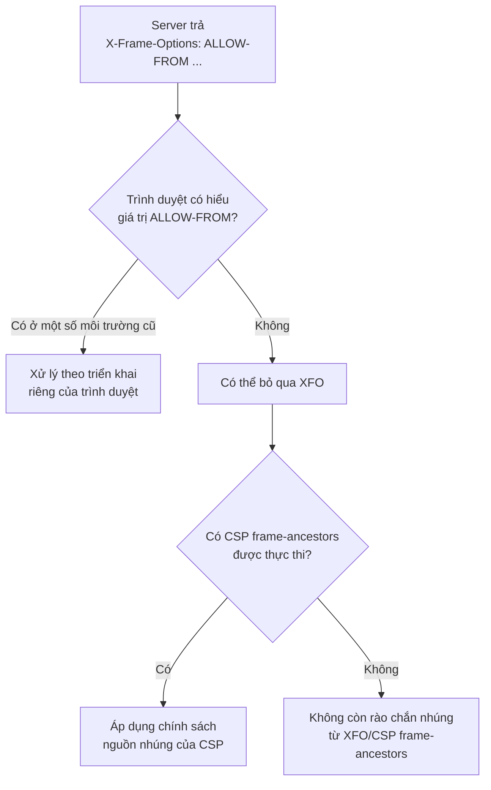

# Giới hạn của giá trị ALLOW-FROM trong hệ sinh thái hiện hành

## 1. Bối cảnh: cho phép một trang khác nhúng nội dung mà vẫn chống clickjacking

Trong nhóm **Chống nhúng trang** của module **SPRING_SECURITY_HTTP_PROTECTION**, chúng ta cần cân bằng hai yêu cầu: ngăn kẻ tấn công nhúng giao diện của ứng dụng để đánh lừa người dùng (*clickjacking*) và hỗ trợ các tình huống nhúng hợp lệ như portal đối tác, dashboard hay bài học tương tác.

Giả sử hệ thống cung cấp một báo cáo tại `https://reports.example.com/embed/summary`. Khách hàng muốn nhúng báo cáo vào iframe của `https://portal.example.org`, nhưng hệ thống phải từ chối mọi trang không được cấp quyền nhúng. Chính sách `X-Frame-Options: DENY` quá chặt cho yêu cầu này; `SAMEORIGIN` cũng không phù hợp vì hai trang **khác origin**.

Trong các triển khai cũ, người ta có thể gặp header:

```http
X-Frame-Options: ALLOW-FROM https://portal.example.org
```

Ý định lịch sử của `ALLOW-FROM` là cho phép một origin xác định nhúng tài liệu. **Ngày nay không nên dùng giá trị này làm cơ chế chống clickjacking**: nó đã lỗi thời, không được hỗ trợ nhất quán và có thể khiến trình duyệt bỏ qua toàn bộ chính sách `X-Frame-Options`. Giải pháp được ưu tiên trong các trình duyệt hiện đại là directive **CSP `frame-ancestors`** gửi qua HTTP response header.

### Mục tiêu học tập

Sau bài này, người học có thể:

1. Giải thích `ALLOW-FROM` từng được dùng như thế nào và vì sao không đủ tin cậy hiện nay.
2. Phân biệt `ALLOW-FROM` với `DENY`, `SAMEORIGIN` và CSP `frame-ancestors`.
3. Chuyển yêu cầu nhúng chéo origin thành CSP với danh sách nguồn rõ ràng.
4. Cấu hình chính sách theo URL cho **Spring Security Servlet** và **Reactive/WebFlux**.
5. Kiểm tra header, hành vi của trình duyệt, tác động của reverse proxy và các xung đột CSP/XFO.

## 2. ALLOW-FROM từng có nghĩa gì?

`X-Frame-Options` (viết tắt **XFO**) là một HTTP **response** header dùng để điều khiển khả năng hiển thị tài liệu trong frame. Các giá trị thường gặp:

| Giá trị XFO | Ý định | Nhận định cho triển khai mới |
| --- | --- | --- |
| `DENY` | Cấm nhúng bất kể origin của trang cha. | Phù hợp khi trang hoàn toàn không cần iframe. |
| `SAMEORIGIN` | Cho phép nhúng ở ngữ cảnh cùng origin theo cách trình duyệt hỗ trợ thực thi. | Phù hợp cho iframe nội bộ; nên cân nhắc CSP `frame-ancestors 'self'` để kiểm soát chuỗi tổ tiên. |
| `ALLOW-FROM https://portal.example.org` | Chỉ một origin được chỉ định có thể nhúng. | **Lỗi thời, thiếu hỗ trợ và không nên sử dụng.** |

Khi xem mã nguồn, tài liệu cũ hoặc response của một hệ thống lâu năm, bạn có thể thấy các ví dụ tương tự:

```http
X-Frame-Options: ALLOW-FROM https://trusted.example.com
```

Vấn đề cốt lõi là **giá trị này không được triển khai đồng nhất giữa các trình duyệt**. Không thể lấy việc một trình duyệt thử nghiệm trước đây chấp nhận `ALLOW-FROM` làm căn cứ rằng chính sách vẫn bảo vệ người dùng ở Chrome, Edge, Firefox, Safari hay trình duyệt nhúng trong ứng dụng hiện nay.

Ngoài ra, mô hình `ALLOW-FROM` có những hạn chế thiết kế:

- Không phải cơ chế cho phép **nhiều origin** bằng một allowlist chuẩn hóa; các cách ghép nhiều URL, phân tách dấu phẩy hoặc liệt kê nhiều `ALLOW-FROM` không phải một giải pháp có khả năng tương thích đáng tin cậy.
- Không cung cấp biểu thức nguồn linh hoạt và thống nhất như CSP; những cách viết tự chế kiểu `ALLOW-FROM *` hoặc nhiều wildcard không thể biến nó thành một CSP.
- Cách trình duyệt cũ đánh giá các **frame lồng nhau** cũng không tạo được bảo đảm kiểm tra mọi trang tổ tiên giống CSP `frame-ancestors`.
- Quan trọng hơn cả: **giá trị lạ/không hỗ trợ có thể bị bỏ qua**; một số trình duyệt hiện đại bỏ qua cả header XFO khi gặp `ALLOW-FROM`.

Vì vậy, câu “`ALLOW-FROM` chỉ không cho đối tác nhúng được” đánh giá chưa đủ rủi ro. Trong tình huống trình duyệt **bỏ qua XFO hoàn toàn**, một trang độc hại cũng có thể nhúng trang đích nếu không có chính sách chống nhúng khác.

## 3. Hiệu ứng nguy hiểm: cấu hình trông có vẻ bảo vệ nhưng thực tế không có hiệu lực

Xét response:

```http
HTTP/1.1 200 OK
Content-Type: text/html; charset=UTF-8
X-Frame-Options: ALLOW-FROM https://portal.example.org
```

Nhóm phát triển có thể kỳ vọng: “Chỉ `https://portal.example.org` nhúng được; mọi site khác đều bị chặn.” Trình duyệt không hỗ trợ `ALLOW-FROM` có thể xử lý header này như **không có XFO hợp lệ**. Nếu response cũng không có CSP `frame-ancestors` có hiệu lực thì rào chắn chống nhúng dựa trên header không còn.



Ví dụ một trang thử nghiệm chứa:

```html
<iframe
  src="https://reports.example.com/embed/summary"
  title="Báo cáo được nhúng"
  width="920"
  height="560">
</iframe>
```

Nếu trang đích chỉ gửi `ALLOW-FROM` và trình duyệt bỏ qua giá trị đó, việc iframe được hiển thị trên một trang **không thuộc allowlist dự định** là dấu hiệu rõ ràng của cấu hình thiếu hiệu lực. Không nên dùng `ALLOW-FROM` như fallback mù quáng cho hệ thống mới.

**Không nhầm với cơ chế từ chối tải request:** `X-Frame-Options` chủ yếu điều khiển việc **render tài liệu trong frame**; request mạng vẫn có thể được gửi đến server. Việc tài nguyên có được tải hoặc người dùng có thể truy cập URL trực tiếp còn phụ thuộc xác thực, phân quyền, cookie, CSP khác và chính sách của trình duyệt.

## 4. Thay thế hiện đại: CSP frame-ancestors

**Content Security Policy (CSP)** có directive `frame-ancestors`, khai báo những nguồn được phép là **trang tổ tiên của tài liệu hiện tại**. Đây là cách biểu đạt chính sách khi có một hoặc nhiều portal cần nhúng một endpoint.

Ví dụ cho phép chính origin của báo cáo và một portal:

```http
Content-Security-Policy: frame-ancestors 'self' https://portal.example.org
```

Những giá trị cần nắm:

| CSP `frame-ancestors` | Ý nghĩa |
| --- | --- |
| `'none'` | Không tổ tiên nào được phép nhúng, kể cả cùng origin. |
| `'self'` | Chỉ các trang tổ tiên cùng origin với tài liệu được nhúng. |
| `https://portal.example.org` | Chỉ origin được chỉ định có quyền làm tổ tiên; không tự động có `'self'`. |
| `'self' https://portal.example.org https://dashboard.example.net` | Cho phép cùng origin và hai nguồn ngoài đã nêu. |

**Origin** là tổ hợp *scheme, host, port*. `http://portal.example.org` khác `https://portal.example.org`; `https://portal.example.org:8443` cũng khác origin dùng port HTTPS mặc định. Chính sách phải khớp với URL triển khai và hành vi chuyển hướng thực tế.

Nếu iframe lồng nhiều tầng, **mọi trang tổ tiên** đều phải khớp danh sách `frame-ancestors`:

```text
https://outside.example.net       ← trang trên cùng: không được cho phép
  └── https://portal.example.org   ← trang trung gian: được cho phép
        └── https://reports.example.com/embed/summary
```

Với CSP `frame-ancestors 'self' https://portal.example.org` trên báo cáo, trình duyệt hiện đại vẫn từ chối nhúng báo cáo vì trang `outside.example.net` là một tổ tiên không được cho phép. Đây là khác biệt thiết kế quan trọng so với việc suy luận dựa trên trang cha trực tiếp.

### Phân biệt frame-ancestors, frame-src và CORS

| Cơ chế | Phải cấu hình ở đâu? | Trả lời câu hỏi nào? |
| --- | --- | --- |
| CSP `frame-ancestors` | **Response của trang bị nhúng** | Ai được nhúng *tôi*? |
| CSP `frame-src` | **Response của trang cha** | Tôi được nhúng iframe đến những nguồn nào? |
| `X-Frame-Options` | **Response của trang bị nhúng** | Trang của tôi có được render trong frame theo chính sách XFO không? |
| CORS / `Access-Control-Allow-Origin` | Response API/tài nguyên cần chia sẻ chéo origin | JavaScript bên origin nào có thể truy cập response trong các trường hợp CORS áp dụng? |

Cho phép CORS không làm iframe vượt qua XFO/CSP `frame-ancestors`. Và `frame-src` trên portal không thể cưỡng ép một báo cáo từ chối nhúng phải hiển thị.

### Hai quy tắc CSP quan trọng

1. `frame-ancestors` chỉ có hiệu lực trong **HTTP response header `Content-Security-Policy`**; viết trong `<meta http-equiv="Content-Security-Policy">` không có tác dụng với directive này.
2. `frame-ancestors` **không kế thừa `default-src`**. Ngay cả khi một CSP đã có `default-src 'none'`, nếu muốn ngăn trang bị nhúng, vẫn phải khai báo `frame-ancestors 'none'` riêng.

Chính sách gửi bằng `Content-Security-Policy-Report-Only` có thể hỗ trợ quan sát vi phạm, nhưng **không tự chặn việc nhúng**. Muốn áp đặt hạn chế, phải gửi policy qua `Content-Security-Policy`.

## 5. Những xung đột giữa X-Frame-Options và CSP cần dự đoán

Ứng dụng đang chuyển từ XFO `ALLOW-FROM` có thể vô tình phát **hai chính sách trái nhau**. Theo đặc tả CSP, khi có CSP `frame-ancestors` ở chế độ thực thi, trình duyệt tuân thủ CSP hiện đại sẽ sử dụng directive này thay cho `X-Frame-Options`. Tuy nhiên một số trình duyệt cũ có thể áp dụng XFO khác biệt. Không nên dựa vào xung đột để điều khiển tính tương thích.

| Header được trả về | Hệ quả |
| --- | --- |
| `X-Frame-Options: ALLOW-FROM https://portal.example.org`, không có CSP | **Không bảo đảm bảo vệ**: trình duyệt không hỗ trợ có thể bỏ qua XFO. |
| `X-Frame-Options: DENY` và CSP `frame-ancestors 'none'` | Cùng từ chối mọi iframe; phù hợp với trang không cần nhúng. |
| `X-Frame-Options: SAMEORIGIN` và CSP `frame-ancestors 'self'` | Cùng định hướng cho phép cùng origin, chặn origin ngoài. |
| `X-Frame-Options: DENY` và CSP `frame-ancestors https://portal.example.org` | **Mâu thuẫn về mục đích**; trình duyệt cũ có thể từ chối portal dù CSP cho phép. |
| Không có XFO và CSP `frame-ancestors 'self' https://portal.example.org` | Cách làm chủ đạo để cho phép portal ngoài qua trình duyệt hỗ trợ CSP; cần xét hỗ trợ trình duyệt cũ. |

Đặc biệt, **không có một giá trị `X-Frame-Options` hiện đại, hỗ trợ rộng rãi, để thay thế CSP allowlist nhiều origin**. Nếu phải cho nhúng chéo origin, không thể vừa yêu cầu một trình duyệt cũ chỉ biết `DENY` bảo vệ nghiêm ngặt, vừa kỳ vọng cùng trình duyệt đó cho portal bên ngoài nhúng bằng CSP mà nó không hiểu. Đây là **giới hạn tương thích thực sự cần được ghi nhận**.

Một response có thể có nhiều CSP do Spring Security, reverse proxy hoặc CDN cùng thêm. Các chính sách **đều được thực thi** và hiệu ứng kết hợp có thể chặt hơn mong muốn. Ví dụ:

```http
Content-Security-Policy: frame-ancestors https://portal.example.org
Content-Security-Policy: frame-ancestors 'none'
```

Dù policy đầu cho phép portal, policy thứ hai vẫn chặn mọi ancestor. Cần kiểm tra **toàn bộ các header trong response cuối cùng**, không chỉ giá trị được khai báo trong Java.

## 6. Chiến lược chuyển đổi an toàn từ ALLOW-FROM

Khi gặp `X-Frame-Options: ALLOW-FROM ...` trong ứng dụng cũ, tiến hành theo quyết định về nhu cầu iframe:

| Nhu cầu thực tế | Chính sách nên dùng |
| --- | --- |
| Trang không cần nhúng | `X-Frame-Options: DENY`, có thể thêm CSP `frame-ancestors 'none'`. |
| Chỉ cần nhúng cùng origin | `X-Frame-Options: SAMEORIGIN` và CSP `frame-ancestors 'self'`. |
| Một hoặc vài portal ngoài được nhúng một số endpoint | CSP `frame-ancestors` chỉ định các origin được phép **trên các endpoint đó**; tránh phát XFO xung đột, giữ `DENY` cho phần còn lại. |
| Cần hỗ trợ trình duyệt không hiểu CSP `frame-ancestors` | Xác định yêu cầu hỗ trợ thực tế; cân nhắc giải pháp kiến trúc cùng origin hoặc ngừng hỗ trợ đường nhúng đó, vì `ALLOW-FROM` không phải fallback tin cậy. |

### Ví dụ di trú

**Trước khi chuyển đổi (không an toàn để dựa vào):**

```http
GET /embed/summary
X-Frame-Options: ALLOW-FROM https://portal.example.org
```

**Sau khi chuyển đổi cho riêng `/embed/**`:**

```http
HTTP/1.1 200 OK
Content-Type: text/html; charset=UTF-8
Content-Security-Policy: frame-ancestors 'self' https://portal.example.org
```

Không còn header `X-Frame-Options` ở response này vì portal cần nhúng từ **origin khác**. Với các trang còn lại, ví dụ `/account` hoặc `/admin`:

```http
X-Frame-Options: DENY
Content-Security-Policy: frame-ancestors 'none'
```

Đây là mô hình **mặc định chặn, chỉ mở theo URL**. Cần bảo đảm matcher chỉ bao phủ đúng trang thực sự muốn cho phép nhúng, đặc biệt không đưa trang thay đổi mật khẩu, thanh toán hoặc quản trị vào nhóm `/embed/**`.

Ngoài chính sách chống nhúng, endpoint báo cáo vẫn phải áp dụng xác thực, quyền xem dữ liệu, CSRF với thao tác thay đổi trạng thái và các header bảo mật khác. Việc một portal được phép làm trang cha **không có nghĩa portal nhận quyền đọc dữ liệu của mọi người dùng**.

## 7. Cấu hình Spring Security Servlet

Spring Security cho Servlet dùng `HttpSecurity` và `SecurityFilterChain`. Khi giữ bộ security headers mặc định, Spring Security phát `X-Frame-Options: DENY`. Vì vậy trên các trang cần nhúng bởi portal ngoài, phải **tắt riêng XFO ở đúng chain** và bổ sung CSP `frame-ancestors`; không tắt tất cả security headers.

Ví dụ hai nhóm route cho hệ thống báo cáo:

```java
import org.springframework.context.annotation.Bean;
import org.springframework.context.annotation.Configuration;
import org.springframework.core.annotation.Order;
import org.springframework.security.config.annotation.web.builders.HttpSecurity;
import org.springframework.security.config.annotation.web.configuration.EnableWebSecurity;
import org.springframework.security.web.SecurityFilterChain;

@Configuration
@EnableWebSecurity
public class SecurityConfig {

    @Bean
    @Order(1)
    SecurityFilterChain embeddableReportChain(HttpSecurity http)
            throws Exception {
        return http
            .securityMatcher("/embed/**")
            .authorizeHttpRequests(auth -> auth
                .anyRequest().authenticated())
            .headers(headers -> headers
                .frameOptions(frame -> frame.disable())
                .contentSecurityPolicy(csp -> csp
                    .policyDirectives(
                        "frame-ancestors 'self' https://portal.example.org")))
            .build();
    }

    @Bean
    @Order(2)
    SecurityFilterChain defaultChain(HttpSecurity http) throws Exception {
        return http
            .authorizeHttpRequests(auth -> auth
                .anyRequest().authenticated())
            .headers(headers -> headers
                .frameOptions(frame -> frame.deny())
                .contentSecurityPolicy(csp -> csp
                    .policyDirectives("frame-ancestors 'none'")))
            .build();
    }
}
```

Kết quả mong đợi khi request đi qua đúng chain:

| URL response | XFO | CSP `frame-ancestors` |
| --- | --- | --- |
| `/embed/summary` | Không có XFO do chain nhúng viết ra | `'self' https://portal.example.org` |
| `/embed/chart` | Không có XFO do chain nhúng viết ra | `'self' https://portal.example.org` |
| `/account/password` | `DENY` | `'none'` |
| `/admin/settings` | `DENY` | `'none'` |

`@Order(1)` làm chain có `securityMatcher("/embed/**")` được xét trước chain không giới hạn đường dẫn. Nếu đổi thứ tự hoặc cấu hình matcher sai, response có thể nhận chính sách không mong muốn. Ví dụ xác thực `authenticated()` chỉ là nền tối thiểu để tập trung vào headers; ứng dụng phải bổ sung phân quyền thích hợp cho từng vai trò và tài nguyên.

**Điểm dễ sai:**

```java
// Không dùng chỉ để mở iframe của một portal.
.headers(headers -> headers.disable())
```

Lệnh này vô hiệu hóa **toàn bộ** security headers do Spring Security quản lý trên chain, chứ không chỉ `X-Frame-Options`. Hãy dùng `frameOptions(frame -> frame.disable())` đúng tại các response được thiết kế dùng CSP `frame-ancestors`.

## 8. Cấu hình Spring Security Reactive / WebFlux

Với WebFlux, API là `ServerHttpSecurity` và `SecurityWebFilterChain`; nguyên tắc thiết kế vẫn như Servlet: cho phép nhúng chéo origin chỉ ở `/embed/**` và giữ chính sách chặn ở những nơi khác.

```java
import org.springframework.context.annotation.Bean;
import org.springframework.context.annotation.Configuration;
import org.springframework.core.annotation.Order;
import org.springframework.security.config.annotation.web.reactive.EnableWebFluxSecurity;
import org.springframework.security.config.web.server.ServerHttpSecurity;
import org.springframework.security.web.server.SecurityWebFilterChain;
import org.springframework.security.web.server.header.XFrameOptionsServerHttpHeadersWriter;
import org.springframework.security.web.server.util.matcher.PathPatternParserServerWebExchangeMatcher;

@Configuration
@EnableWebFluxSecurity
public class ReactiveSecurityConfig {

    @Bean
    @Order(1)
    SecurityWebFilterChain embeddableReportChain(ServerHttpSecurity http) {
        return http
            .securityMatcher(
                new PathPatternParserServerWebExchangeMatcher("/embed/**"))
            .authorizeExchange(auth -> auth
                .anyExchange().authenticated())
            .headers(headers -> headers
                .frameOptions(frame -> frame.disable())
                .contentSecurityPolicy(csp -> csp
                    .policyDirectives(
                        "frame-ancestors 'self' https://portal.example.org")))
            .build();
    }

    @Bean
    @Order(2)
    SecurityWebFilterChain defaultChain(ServerHttpSecurity http) {
        return http
            .authorizeExchange(auth -> auth
                .anyExchange().authenticated())
            .headers(headers -> headers
                .frameOptions(frame -> frame
                    .mode(XFrameOptionsServerHttpHeadersWriter.Mode.DENY))
                .contentSecurityPolicy(csp -> csp
                    .policyDirectives("frame-ancestors 'none'")))
            .build();
    }
}
```

Ở Servlet lẫn Reactive, **không cần và không nên cố tạo `X-Frame-Options: ALLOW-FROM` bằng cách viết header thủ công**. Các cấu hình `deny`, `sameOrigin`, `disable` (hoặc mode tương ứng ở WebFlux) thể hiện các lựa chọn XFO thực tế; nhu cầu origin bên ngoài thuộc về CSP.

Nếu Spring Security, Nginx, gateway hoặc CDN cùng xử lý response, kiểm tra xem có header `X-Frame-Options: DENY` nào bị thêm trở lại ở tầng ngoài hay không; đặc biệt lưu ý các policy CSP bị thêm nhiều lần.

## 9. Kiểm thử: header đúng chưa đủ, phải xác nhận trình duyệt

Kiểm thử nên phân tách **cấu hình response** và **hành vi render iframe**. Đặt hai endpoint thử nghiệm:

- `https://reports.example.com/embed/summary`: được phép nhúng từ `https://portal.example.org` theo CSP.
- `https://reports.example.com/account`: cấm nhúng bằng `DENY` và `frame-ancestors 'none'`.

### 9.1. Servlet: MockMvc

Với `spring-security-test`, controller thử nghiệm trả `200 OK` khi user `viewer` đã đăng nhập:

```java
mockMvc.perform(get("/embed/summary").with(user("viewer")))
    .andExpect(status().isOk())
    .andExpect(header().doesNotExist("X-Frame-Options"))
    .andExpect(header().string(
        "Content-Security-Policy",
        "frame-ancestors 'self' https://portal.example.org"));

mockMvc.perform(get("/account").with(user("viewer")))
    .andExpect(status().isOk())
    .andExpect(header().string("X-Frame-Options", "DENY"))
    .andExpect(header().string(
        "Content-Security-Policy", "frame-ancestors 'none'"));
```

Đây là phần thân test minh họa; cần cấu hình `MockMvc`, controller và static import `get`, `user`, `status`, `header`. Nếu chính sách CSP thực tế còn thêm directive khác, điều chỉnh assertion để xác minh **`frame-ancestors` mong muốn** thay vì so khớp nguyên chuỗi.

### 9.2. Reactive: WebTestClient

```java
webTestClient.mutateWith(mockUser("viewer"))
    .get().uri("/embed/summary")
    .exchange()
    .expectStatus().isOk()
    .expectHeader().doesNotExist("X-Frame-Options")
    .expectHeader().valueEquals(
        "Content-Security-Policy",
        "frame-ancestors 'self' https://portal.example.org");

webTestClient.mutateWith(mockUser("viewer"))
    .get().uri("/account")
    .exchange()
    .expectStatus().isOk()
    .expectHeader().valueEquals("X-Frame-Options", "DENY")
    .expectHeader().valueEquals(
        "Content-Security-Policy", "frame-ancestors 'none'");
```

`mockUser` là tiện ích từ `SecurityMockServerConfigurers` trong `spring-security-test`. Cả Servlet và WebFlux đều nên có test riêng cho những security chain/route phục vụ nội dung HTML nhạy cảm.

### 9.3. Thí nghiệm trình duyệt trên môi trường kiểm soát

Để tạo mô hình đơn giản trên localhost, chạy ứng dụng thử nghiệm ở `http://localhost:8080` và thay origin được cho phép trong CSP ở **môi trường phát triển** thành `http://localhost:9090`. Không dùng URL HTTP thử nghiệm đó cho production.

Trang hợp lệ phục vụ từ `http://localhost:9090`:

```html
<!doctype html>
<html lang="vi">
<head><meta charset="utf-8"><title>Portal thử nghiệm</title></head>
<body>
  <h1>Báo cáo nhúng từ ứng dụng thử nghiệm</h1>
  <iframe
    src="http://localhost:8080/embed/summary"
    title="Báo cáo"
    width="900"
    height="500"></iframe>
</body>
</html>
```

Tạo một trang cha khác ở `http://localhost:9091` chứa iframe tương tự. Nếu response báo cáo gửi `frame-ancestors 'self' http://localhost:9090`, kết quả mong đợi:

| Trang cha | Iframe trỏ tới | Kết quả mong đợi |
| --- | --- | --- |
| `http://localhost:9090` | `http://localhost:8080/embed/summary` | Có thể hiển thị nếu quyền và chính sách khác đều cho phép. |
| `http://localhost:9091` | `http://localhost:8080/embed/summary` | Bị CSP `frame-ancestors` chặn. |
| `http://localhost:8080` | `http://localhost:8080/embed/summary` | Có thể hiển thị vì CSP có `'self'`. |
| `http://localhost:9090` | `http://localhost:8080/account` | Bị XFO `DENY` và CSP `'none'` chặn. |
| Một trang ngoài nhúng portal, portal nhúng báo cáo | `/embed/summary` | Bị từ chối nếu trang ngoài không nằm trong danh sách `frame-ancestors`. |

Quan sát tab **Network** để đọc đúng response của `/embed/summary`, và **Console** để xem thông báo CSP/XFO. Nếu request chuyển hướng tới trang đăng nhập, kiểm tra header của **response cuối cùng**; cookie `SameSite`, việc giới hạn third-party cookies, phiên hết hạn hoặc chính sách CSP trên trang cha đều có thể ảnh hưởng tới việc iframe hiển thị.

Xem header bằng:

```bash
curl -i http://localhost:8080/embed/summary
curl -i http://localhost:8080/account
```

`curl` kiểm tra header trên request nhận được nhưng không mô phỏng việc trình duyệt thực thi chính sách frame. Khi endpoint yêu cầu đăng nhập, response `302`/`401` có thể khác với response HTML nhận được sau khi xác thực, nên không kết luận từ một request chưa đăng nhập.

## 10. Những lỗi thường gặp khi thay ALLOW-FROM

### “Đã chuyển sang CSP nhưng portal hợp lệ vẫn không nhúng được”

Kiểm tra response báo cáo có còn `X-Frame-Options: DENY` hoặc `SAMEORIGIN` hay không, đặc biệt header do reverse proxy/CDN thêm. Kiểm tra có nhiều CSP enforced cùng tồn tại và có policy khác chứa `frame-ancestors 'none'` không. Kiểm tra origin chính xác: scheme, hostname, port, URL cuối sau redirect và toàn bộ chuỗi frame tổ tiên.

### “Chrome không chặn iframe dù response có ALLOW-FROM”

Đây là rủi ro điển hình của một giá trị XFO không được hỗ trợ: trình duyệt có thể bỏ qua XFO. Hãy xóa phụ thuộc vào `ALLOW-FROM` và bổ sung `frame-ancestors` phù hợp, không thử cứu bằng cách thêm danh sách origin vào cùng header XFO.

### “Thêm CSP trong meta tag mà vẫn nhúng được ở trang lạ”

`frame-ancestors` không có hiệu lực trong CSP meta. Cấu hình CSP qua **HTTP response header** do Spring Security hoặc tầng cung cấp nội dung gửi. Nếu chỉ gửi CSP ở chế độ `Report-Only`, browser ghi nhận vi phạm mà không cưỡng chế chặn.

### “Đã khai báo default-src 'none' nên tưởng mọi iframe bị chặn”

`default-src` không thay cho `frame-ancestors`. `default-src 'none'` giới hạn các loại tài nguyên của tài liệu theo cơ chế fallback của CSP, nhưng **không tự cấm người khác nhúng tài liệu đó**. Muốn từ chối nhúng phải dùng `frame-ancestors 'none'` (và có thể giữ `X-Frame-Options: DENY`).

### “Đã mở CORS và cookie rồi nhưng iframe vẫn trắng”

CORS không cấp phép nhúng giao diện. Cần kiểm tra CSP `frame-ancestors` trên response trang con và `frame-src` trên trang cha. Sau khi giải quyết chính sách frame, xác thực, quyền truy cập, cookie phiên và giới hạn third-party cookies vẫn có thể khiến nội dung hiển thị khác mong đợi.

### “Đã thử header đúng ở local nhưng production lại khác”

Ứng dụng có thể qua nhiều tầng: Spring Security → web server → reverse proxy → CDN → trình duyệt. Một tầng có thể ghi đè, thêm XFO, thêm CSP hoặc chuyển hướng sang trang đăng nhập. So sánh **response gửi tới browser** với cấu hình dự kiến, kiểm tra mọi endpoint và các header trùng. Nếu cần thay đổi, sửa tại tầng đang phát ra policy sai và kiểm thử lại qua URL production.

## 11. Bài tập ứng dụng và câu hỏi tự đánh giá

**Bài tập 1 — Phân tích thất bại.** Một API trả HTML có:

```http
X-Frame-Options: ALLOW-FROM https://partners.example.net
```

Không có CSP `frame-ancestors`. Nhóm phát triển kết luận: “Mọi trang khác partner đều bị chặn.” Hãy chỉ ra vì sao kết luận không đáng tin và đề xuất chính sách thay thế nếu chỉ `https://partners.example.net` được phép nhúng trang HTML này.

**Bài tập 2 — Quyết định cấu hình.** Ứng dụng có `/account/change-password`, `/admin/users`, `/embed/report`. Chỉ `/embed/report` cần xuất hiện trong iframe của `https://portal.example.org`. Hãy thiết kế hai security chain và xác định hai response đầu phải có header gì, response báo cáo phải có header gì, vì sao không nên dùng `headers.disable()`.

**Bài tập 3 — Tìm xung đột.** Response báo cáo có:

```http
X-Frame-Options: DENY
Content-Security-Policy: frame-ancestors https://portal.example.org
Content-Security-Policy: frame-ancestors 'none'
```

Hãy giải thích vì sao portal không hiển thị báo cáo, kể cả khi trình duyệt hỗ trợ CSP; sửa policy theo nhu cầu sản phẩm và mô tả cách kiểm tra browser sau sửa.

**Đáp án gợi ý:** (1) `ALLOW-FROM` có thể bị bỏ qua; dùng CSP `frame-ancestors https://partners.example.net` trên HTML được phép nhúng, không phát XFO mâu thuẫn. (2) Các trang nhạy cảm dùng `DENY`/`'none'`; `/embed/report` dùng `frame-ancestors` chỉ rõ origin portal, cấu hình theo path, giữ các header bảo vệ còn lại. (3) CSP `frame-ancestors 'none'` thứ hai chặn hoàn toàn, bất kể policy đầu có cho phép; XFO `DENY` cũng có thể gây chặn trên trình duyệt cũ. Loại bỏ policy xung đột từ đúng tầng phát header, thử với portal hợp lệ, site ngoài và mọi trang tổ tiên trong chuỗi frame.

## 12. Ghi nhớ

`X-Frame-Options: ALLOW-FROM` là **cú pháp cũ không còn phù hợp để bảo vệ chống clickjacking trong môi trường trình duyệt hiện đại**. Trình duyệt không hiểu giá trị này có thể bỏ qua toàn bộ XFO, gây ra **rủi ro cho phép nhúng ngoài dự định**. Khi cần iframe từ một hoặc nhiều origin cụ thể, hãy chuyển sang **HTTP CSP `frame-ancestors`**, giới hạn ngoại lệ theo đường dẫn, duy trì `DENY` trên trang không cần nhúng, bảo vệ phân quyền và kiểm tra response cuối cùng trong trình duyệt. Với Spring Security, nguyên tắc này áp dụng như nhau cho cả Servlet và Reactive; khác biệt chỉ ở DSL và loại security chain.
