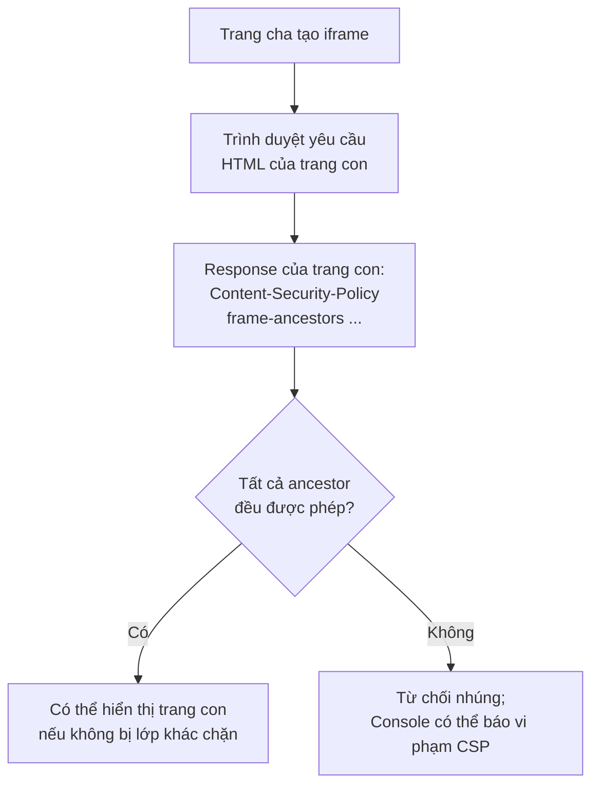

# CSP frame-ancestors và nguồn được phép nhúng

## 1. Bài toán: chỉ cho những trang đáng tin cậy nhúng nội dung

Trong nhóm **Chống nhúng trang** của module `SPRING_SECURITY_HTTP_PROTECTION`, chúng ta cần bảo vệ giao diện HTTP trước **clickjacking**: trang do kẻ tấn công kiểm soát tạo một `<iframe>` chứa giao diện hợp lệ, sau đó dùng lớp phủ hoặc bố cục gây hiểu nhầm để người dùng nhấp vào nút bên trong iframe. Vì thao tác thật diễn ra trong ứng dụng đích, người dùng có thể vô tình kích hoạt chức năng bằng chính phiên đăng nhập của mình.

Một biện pháp phòng vệ là quy định **những trang nào được phép nhúng response HTML**. Nếu trang không cần iframe, `X-Frame-Options: DENY` hoặc CSP `frame-ancestors 'none'` là lựa chọn tự nhiên. Nhưng nếu ứng dụng cần một portal đối tác nhúng biểu đồ, màn hình học tập hoặc báo cáo, ta cần một danh sách nguồn được phép cụ thể.

**CSP `frame-ancestors`** là directive trong HTTP response header `Content-Security-Policy`, cho phép server khai báo **nguồn hợp lệ của mọi trang tổ tiên** có thể chứa tài liệu hiện tại trong `<frame>`, `<iframe>`, `<object>` hoặc `<embed>`.

Ví dụ, response của `https://reports.example.com/embed/overview` trả:

```http
Content-Security-Policy: frame-ancestors 'self' https://portal.example.org
```

Chính sách này cho phép tài liệu được nhúng trong trang cùng nguồn phù hợp hoặc tại `https://portal.example.org`. Trang bất kỳ như `https://untrusted.example.net` không được phép nhúng báo cáo.

**Sau bài học, người học sẽ có thể** viết chính sách `frame-ancestors` phù hợp với nhu cầu nghiệp vụ; phân biệt nó với CORS, CSP `frame-src` và X-Frame-Options; triển khai cho Servlet lẫn Reactive; kiểm thử danh sách nguồn trong trình duyệt; chẩn đoán xung đột với proxy, authentication và các CSP khác.

## 2. CSP frame-ancestors được kiểm tra từ phía nào?

Giả sử portal `https://portal.example.org` có:

```html
<iframe
  src="https://reports.example.com/embed/overview"
  title="Báo cáo tổng hợp"
  width="960"
  height="600">
</iframe>
```

Trình duyệt tải trang **con** tại `reports.example.com` và đọc CSP **trong response của trang con**. Nếu tất cả các trang tổ tiên khớp `frame-ancestors`, trình duyệt có thể hiển thị tài liệu trong iframe. Nếu có ít nhất một tổ tiên không khớp, việc nhúng bị từ chối.



Header này **không ngăn URL được mở trong tab trực tiếp**. Nó cũng không cấp quyền đọc dữ liệu cho trang cha và không thay thế xác thực, phân quyền hay CSRF protection. Ngay cả khi portal được phép nhúng, endpoint báo cáo vẫn phải quyết định người dùng nào được xem dữ liệu nào.

### Nguồn được phép chính là các ancestor, không chỉ trang cha gần nhất

Với iframe lồng nhiều tầng:

```text
https://outer.example.net
  └── https://portal.example.org
        └── https://reports.example.com/embed/overview
```

Nếu báo cáo gửi `frame-ancestors 'self' https://portal.example.org` thì **không được nhúng**: portal ở giữa hợp lệ nhưng `outer.example.net` không thuộc danh sách. Quy tắc là **từng ancestor phải khớp một nguồn trong danh sách**, không phải chỉ một ancestor hoặc chỉ trang cha trực tiếp.

Điều này quan trọng khi ứng dụng của đối tác cũng có iframe riêng, ví dụ cổng quản trị đặt trong một dashboard ngoài. Muốn hỗ trợ chuỗi đó, phải xác định chính xác các ancestor dự kiến và cân nhắc rủi ro trước khi mở chính sách.

## 3. Cú pháp và ý nghĩa của danh sách nguồn

Một policy điển hình:

```http
Content-Security-Policy: frame-ancestors 'self' https://portal.example.org https://dashboard.example.net;
```

Các nguồn được phân tách bằng **khoảng trắng**; dấu chấm phẩy kết thúc directive nếu CSP còn những directive khác. `frame-ancestors` là một **navigation directive**, không phải fetch directive.

| Giá trị | Ý nghĩa và lưu ý |
| --- | --- |
| `frame-ancestors 'none'` | Không nguồn nào được làm ancestor; cấm cả iframe cùng origin. Dấu nháy đơn quanh `'none'` là bắt buộc. |
| `frame-ancestors 'self'` | Chỉ cho phép các ancestor khớp nguồn của tài liệu theo quy tắc `'self'` của CSP; thường dùng cho iframe nội bộ cùng origin. |
| `frame-ancestors https://portal.example.org` | Cho phép nguồn portal đã chỉ định; **không tự động bao gồm `'self'`**. |
| `frame-ancestors 'self' https://portal.example.org` | Cho phép chính ứng dụng và portal đã chỉ định. |
| `frame-ancestors https://a.example.org https://b.example.net` | Cho phép nhiều nguồn được liệt kê tường minh. |
| `frame-ancestors https:` | Cho phép một phạm vi rất rộng các nguồn HTTPS. **Không nên dùng như allowlist đối tác cụ thể.** |
| `frame-ancestors https://*.partner.example.org` | Mẫu hostname cho phép nhiều subdomain; phải đánh giá nguy cơ nếu bất kỳ subdomain nào có thể bị chiếm quyền hoặc do khách hàng kiểm soát. |

`'none'` nên được dùng **đơn lẻ** để diễn đạt cấm nhúng; đừng ghép `'none'` cùng các nguồn khác với kỳ vọng đó là cơ chế “chặn tất cả trừ...”. Nếu muốn ngoại lệ, liệt kê đúng các nguồn hợp lệ.

### Khác biệt giữa origin, site, subdomain và port

Trong web, một **origin** thường được nhận diện bởi **scheme + host + port**. Hai URL có hostname giống nhau nhưng khác port hoặc khác scheme có thể là hai origin khác nhau.

Giả sử báo cáo trả CSP:

```http
Content-Security-Policy: frame-ancestors https://portal.example.org
```

| Nguồn trang cha | Khớp nguồn được khai báo? | Giải thích |
| --- | --- | --- |
| `https://portal.example.org/home` | Có | Cùng HTTPS, host và port HTTPS mặc định. |
| `https://portal.example.org:443/home` | Có | Port 443 là port mặc định của HTTPS. |
| `https://portal.example.org:8443/home` | Không | Port khác. |
| `http://portal.example.org/home` | Không | HTTP không khớp nguồn HTTPS đã khai báo. |
| `https://admin.portal.example.org/home` | Không | Host là subdomain khác. |
| `https://untrusted.example.net/home` | Không | Host khác hoàn toàn. |

**Cẩn thận với tính đặc thù của CSP:** việc so khớp source expression tuân theo thuật toán của CSP, có một số quy tắc nâng cấp an toàn HTTP → HTTPS đối với những nguồn áp dụng. Không nên tự thực thi kiểm tra bằng so sánh chuỗi URL hoặc suy luận mọi trường hợp chỉ từ tên miền. Khi thiết kế chính sách HTTPS cho portal, hãy khai báo rõ **scheme HTTPS, host và port** dự kiến rồi kiểm thử các URL thực tế.

Hai subdomain `app.example.com` và `portal.example.com` có thể thuộc cùng *site* theo quy tắc cookie nhưng vẫn là **hai origin khác nhau**. CSP `'self'` không phải viết tắt của “mọi subdomain cùng doanh nghiệp”.

### Nguồn rộng có thể khiến bảo vệ mất ý nghĩa

Nên tránh cấu hình như:

```http
Content-Security-Policy: frame-ancestors https:
```

Header trên hầu như cho phép bất kỳ trang HTTPS nào nhúng nội dung, bao gồm trang HTTPS do kẻ tấn công sở hữu. Tương tự, dùng `*.example.com` mà không kiểm soát mọi subdomain cũng có thể mở nhúng từ khu vực không tin cậy. **Nguyên tắc:** danh sách nguồn chỉ gồm các portal có nhu cầu kinh doanh rõ ràng, được quản lý và kiểm soát.

## 4. Các quy tắc không thể bỏ qua của frame-ancestors

### 4.1. Chỉ gửi trong HTTP response header

Cấu hình hợp lệ:

```http
HTTP/1.1 200 OK
Content-Type: text/html; charset=UTF-8
Content-Security-Policy: frame-ancestors 'self' https://portal.example.org
```

Cấu hình sau **không bảo vệ** việc bị nhúng:

```html
<meta
  http-equiv="Content-Security-Policy"
  content="frame-ancestors 'none'">
```

Trình duyệt **bỏ qua `frame-ancestors` khi directive nằm trong CSP `<meta>`**. Điều này đặc biệt dễ sai với ứng dụng SPA: đưa CSP vào `index.html` không thay thế việc cấu hình security header từ server hoặc reverse proxy.

### 4.2. Không có fallback từ default-src

Policy sau **không tự cấm người khác nhúng trang**:

```http
Content-Security-Policy: default-src 'none'
```

`default-src` chủ yếu làm nguồn fallback cho những **fetch directives** tương ứng. `frame-ancestors` là navigation directive và **không kế thừa `default-src`**. Nếu muốn từ chối nhúng, phải thêm `frame-ancestors 'none'` rõ ràng:

```http
Content-Security-Policy: default-src 'none'; frame-ancestors 'none'
```

### 4.3. Policy thực thi và policy quan sát

Muốn trình duyệt **chặn** iframe vi phạm, gửi directive trong `Content-Security-Policy` ở chế độ thực thi. Không thể kỳ vọng chính sách chỉ ở `Content-Security-Policy-Report-Only` sẽ chặn nhúng. Hơn nữa, theo đặc tả CSP, `frame-ancestors` bị bỏ qua khi kiểm tra policy ở chế độ theo dõi (*monitoring*); không nên lấy kết quả Report-Only làm bằng chứng cơ chế chống clickjacking đã có hiệu lực.

### 4.4. Không tự xác định được phân quyền

`frame-ancestors` kiểm tra **nguồn của trang chứa iframe**, không kiểm tra ai đang đăng nhập, user role, quyền với dữ liệu hay việc người dùng có chủ ý bấm nút. Các kiểm soát vẫn cần duy trì:

- Xác thực và phân quyền phía server cho từng endpoint và tài nguyên.
- CSRF token với request có thay đổi trạng thái, khi áp dụng.
- Quản lý session/cookie phù hợp, bao gồm những hạn chế cookie ở ngữ cảnh third-party.
- Kiểm tra XSS và nội dung HTML không tin cậy do người dùng cung cấp.
- Xác nhận thao tác nhạy cảm và giám sát sự kiện quan trọng khi cần.

## 5. Phân biệt frame-ancestors với frame-src, X-Frame-Options và CORS

| Cơ chế | Xuất hiện ở đâu? | Kiểm soát điều gì? |
| --- | --- | --- |
| CSP `frame-ancestors` | Response của **trang được nhúng** | **Ai được phép nhúng trang này?** |
| CSP `frame-src` | Response của **trang cha** | **Trang cha được nhúng những nguồn nào?** |
| CSP `child-src` | Response của trang cha | Một số nguồn nested browsing context/worker theo cơ chế fallback của CSP, tùy directive liên quan. |
| `X-Frame-Options: DENY` | Response của trang được nhúng | Cấm mọi frame ở trình duyệt hỗ trợ. |
| `X-Frame-Options: SAMEORIGIN` | Response của trang được nhúng | Hạn chế frame theo ngữ cảnh cùng origin. |
| CORS | Response của API/tài nguyên được gọi chéo origin | Xác định phạm vi truy cập response của JavaScript và những quy tắc request CORS. |
| Cookie `SameSite` | `Set-Cookie` và quy tắc gửi cookie | Giới hạn gửi cookie trong một số ngữ cảnh cross-site, **không trực tiếp thiết lập allowlist iframe**. |

Ví dụ portal có:

```http
Content-Security-Policy: frame-src https://reports.example.com
```

Nó chỉ nói **portal được phép tải iframe từ reports.example.com**. Nếu báo cáo trả `frame-ancestors 'none'` thì trình duyệt **vẫn chặn**. Để giao diện xuất hiện, cả chính sách trang cha (nếu có) và chính sách trang con đều phải cho phép.

Điều chỉnh `Access-Control-Allow-Origin` không gỡ được quy tắc chống nhúng; CORS và `frame-ancestors` xử lý hai vấn đề khác nhau.

## 6. Quan hệ giữa CSP frame-ancestors và X-Frame-Options

Spring Security sử dụng `X-Frame-Options: DENY` trong bộ security headers mặc định khi cấu hình security chain thông thường. Ngược lại, Spring Security **không tự thiết lập một CSP tổng quát**: ứng dụng phải chủ động cung cấp `frame-ancestors`.

Khi trình duyệt hỗ trợ CSP gặp một chính sách `frame-ancestors` thực thi, đặc tả yêu cầu nó ưu tiên `frame-ancestors` so với XFO cho tài liệu đó. Tuy nhiên, trình duyệt cũ có thể áp dụng XFO theo cách khác. Vì vậy **đừng chủ động phát hai header thể hiện ý định trái ngược**.

| Nhu cầu của response | XFO phù hợp | `frame-ancestors` phù hợp |
| --- | --- | --- |
| Trang không được nhúng ở đâu | `DENY` | `'none'` |
| Widget được nhúng ở cùng origin | `SAMEORIGIN` | `'self'` |
| Báo cáo được nhúng từ một portal origin khác | **Không phát XFO DENY/SAMEORIGIN** cho response đó; dựa vào CSP ở trình duyệt hỗ trợ | `'self' https://portal.example.org` (nếu còn cho phép nội bộ). |

Không dùng `X-Frame-Options: ALLOW-FROM` làm cách liệt kê portal đối tác. Giá trị cũ này không được hỗ trợ nhất quán và có thể làm XFO mất hiệu lực trên một số trình duyệt. CSP `frame-ancestors` là cách thích hợp để khai báo một hoặc nhiều nguồn nhúng.

### Nhiều Content-Security-Policy header cùng tồn tại

Nếu Spring Security gửi:

```http
Content-Security-Policy: frame-ancestors https://portal.example.org
```

nhưng reverse proxy bổ sung:

```http
Content-Security-Policy: frame-ancestors 'none'
```

thì trình duyệt **thực thi cả hai policy**; portal vẫn bị chặn bởi policy thứ hai. Hai policy không được hợp nhất theo kiểu “lấy hợp của mọi nguồn cho phép”. Tình huống này thường gây khó hiểu vì code Java trông đúng, nhưng response đến browser không đúng như thiết kế.

Không nên ghi một loạt CSP header với các danh sách nguồn khác nhau để cố mở thêm nguồn; hãy xác định tầng chịu trách nhiệm và cấu hình một chính sách nhất quán cho từng loại response.

## 7. Spring Security Servlet: cho phép portal nhúng đúng endpoint

Yêu cầu ví dụ:

- `GET /embed/**`: báo cáo có thể được nhúng từ `https://portal.example.org` hoặc cùng origin của ứng dụng.
- `/admin/**`, `/account/**` và các route còn lại: mặc định không được nhúng.
- Các trang nhúng vẫn yêu cầu người dùng đăng nhập và có quyền đối với báo cáo.

Ví dụ dùng `HttpSecurity` và hai `SecurityFilterChain`:

```java
import org.springframework.context.annotation.Bean;
import org.springframework.context.annotation.Configuration;
import org.springframework.core.annotation.Order;
import org.springframework.security.config.annotation.web.builders.HttpSecurity;
import org.springframework.security.config.annotation.web.configuration.EnableWebSecurity;
import org.springframework.security.web.SecurityFilterChain;

@Configuration
@EnableWebSecurity
public class SecurityConfig {

    @Bean
    @Order(1)
    SecurityFilterChain embeddablePages(HttpSecurity http) throws Exception {
        return http
            .securityMatcher("/embed/**")
            .authorizeHttpRequests(auth -> auth
                .anyRequest().authenticated())
            .headers(headers -> headers
                .frameOptions(frame -> frame.disable())
                .contentSecurityPolicy(csp -> csp
                    .policyDirectives(
                        "frame-ancestors 'self' https://portal.example.org")))
            .build();
    }

    @Bean
    @Order(2)
    SecurityFilterChain otherPages(HttpSecurity http) throws Exception {
        return http
            .authorizeHttpRequests(auth -> auth
                .anyRequest().authenticated())
            .headers(headers -> headers
                .frameOptions(frame -> frame.deny())
                .contentSecurityPolicy(csp -> csp
                    .policyDirectives("frame-ancestors 'none'")))
            .build();
    }
}
```

Đoạn `.frameOptions(frame -> frame.disable())` **chỉ vô hiệu hóa XFO cho nhóm `/embed/**`**. Nó không tắt CSP và không tắt toàn bộ header writer của Spring Security. Ở các trang không cần iframe, `otherPages` tiếp tục dùng `DENY` và `frame-ancestors 'none'`.

| URL trả về HTML | XFO do chain viết | CSP `frame-ancestors` |
| --- | --- | --- |
| `/embed/overview` | Không có | `'self' https://portal.example.org` |
| `/embed/chart` | Không có | `'self' https://portal.example.org` |
| `/account/password` | `DENY` | `'none'` |
| `/admin/users` | `DENY` | `'none'` |

**Lưu ý về bảo mật ứng dụng:** cấu hình `authenticated()` chỉ thể hiện yêu cầu xác thực cơ bản, không phải chiến lược phân quyền hoàn chỉnh. Phải ràng buộc quyền xem báo cáo, tenant, ownership và quyền theo vai trò ở endpoint và service. Không hạ chính sách CSRF chỉ vì trang được nhúng.

Nếu trang trong `/embed/**` chuyển hướng đến `/login`, login thường thuộc chain thứ hai và bị từ chối nhúng. Điều này có thể đúng theo thiết kế; hãy xác thực ở cửa sổ cấp cao hoặc thiết kế cơ chế đăng nhập phù hợp trước khi mở iframe, thay vì mở nhúng tất cả trang đăng nhập và tài khoản.

## 8. Spring Security Reactive / WebFlux: chính sách tương đương

Trong WebFlux, dùng `ServerHttpSecurity` và `SecurityWebFilterChain`. Cũng có thể phân tách chain với matcher theo đường dẫn:

```java
import org.springframework.context.annotation.Bean;
import org.springframework.context.annotation.Configuration;
import org.springframework.core.annotation.Order;
import org.springframework.security.config.annotation.web.reactive.EnableWebFluxSecurity;
import org.springframework.security.config.web.server.ServerHttpSecurity;
import org.springframework.security.web.server.SecurityWebFilterChain;
import org.springframework.security.web.server.header.XFrameOptionsServerHttpHeadersWriter;
import org.springframework.security.web.server.util.matcher.PathPatternParserServerWebExchangeMatcher;

@Configuration
@EnableWebFluxSecurity
public class ReactiveSecurityConfig {

    @Bean
    @Order(1)
    SecurityWebFilterChain embeddablePages(ServerHttpSecurity http) {
        return http
            .securityMatcher(
                new PathPatternParserServerWebExchangeMatcher("/embed/**"))
            .authorizeExchange(auth -> auth
                .anyExchange().authenticated())
            .headers(headers -> headers
                .frameOptions(frame -> frame.disable())
                .contentSecurityPolicy(csp -> csp
                    .policyDirectives(
                        "frame-ancestors 'self' https://portal.example.org")))
            .build();
    }

    @Bean
    @Order(2)
    SecurityWebFilterChain otherPages(ServerHttpSecurity http) {
        return http
            .authorizeExchange(auth -> auth
                .anyExchange().authenticated())
            .headers(headers -> headers
                .frameOptions(frame -> frame.mode(
                    XFrameOptionsServerHttpHeadersWriter.Mode.DENY))
                .contentSecurityPolicy(csp -> csp
                    .policyDirectives("frame-ancestors 'none'")))
            .build();
    }
}
```

Về mặt trình duyệt, Servlet và Reactive đều phát cùng loại HTTP response header. Khác biệt là DSL `HttpSecurity`/`ServerHttpSecurity`, chain và API matcher. Khi nhiều chain tồn tại, cần bảo đảm mỗi route HTML được xử lý bởi **chain dự định**, không để một nhóm đường dẫn bị bỏ sót.

Không dùng `headers(headers -> headers.disable())` để sửa lỗi iframe: thao tác đó có thể tắt nhiều security headers khác ngoài XFO. Nếu cần thay đổi XFO, dùng `frameOptions(...disable())` có giới hạn và đặt CSP thay thế rõ ràng.

## 9. Thực hành: nguồn được phép, nguồn bị từ chối và iframe lồng nhau

Để thực hành trên môi trường bạn quản lý, sử dụng:

- Ứng dụng Spring Boot trên `http://localhost:8080`, có `/embed/overview` và `/account`.
- Portal hợp lệ tại `http://localhost:9090`.
- Trang không được phép tại `http://localhost:9091`.

**Trong cấu hình thử nghiệm**, thay CSP tại `/embed/**` thành:

```http
Content-Security-Policy: frame-ancestors 'self' http://localhost:9090
```

Giữ `/account` ở `X-Frame-Options: DENY` và `frame-ancestors 'none'`. Tại portal 9090, đặt trang HTML:

```html
<!doctype html>
<html lang="vi">
<head>
  <meta charset="utf-8">
  <title>Kiểm tra nguồn nhúng</title>
</head>
<body>
  <h1>Portal được phép</h1>
  <iframe
    src="http://localhost:8080/embed/overview"
    title="Báo cáo"
    width="900"
    height="500"></iframe>
</body>
</html>
```

Tại 9091, đặt trang có iframe tương tự. Kiểm tra các kịch bản:

| Trang cha / chuỗi ancestor | Iframe đích | Kết quả mong đợi |
| --- | --- | --- |
| `http://localhost:9090` | `http://localhost:8080/embed/overview` | Được phép nhúng theo `frame-ancestors`, nếu các điều kiện khác thỏa mãn. |
| `http://localhost:9091` | `http://localhost:8080/embed/overview` | Bị từ chối vì 9091 không nằm trong allowlist. |
| `http://localhost:8080` | `http://localhost:8080/embed/overview` | Được phép vì CSP bao gồm `'self'`. |
| `http://localhost:9090` | `http://localhost:8080/account` | Bị từ chối bởi CSP `'none'` / XFO `DENY`. |
| `http://localhost:9091` → `http://localhost:9090` → báo cáo | `http://localhost:8080/embed/overview` | Bị từ chối do ancestor 9091 không hợp lệ. |

### Quan sát bằng DevTools

1. Mở trang thử nghiệm ở cả 9090 và 9091.
2. Trong **Network**, chọn request của chính `/embed/overview`, xem **Response Headers**. Xác định CSP có đúng `frame-ancestors` và có XFO gây xung đột hay không.
3. Trong **Console**, quan sát lỗi khi iframe bị từ chối. Thông báo thường cho biết directive CSP liên quan.
4. Thử các trang cùng origin và route `/account` để phát hiện ngoại lệ bị mở quá rộng.
5. Nếu có iframe lồng nhau, kiểm tra mọi ancestor thực tế của response báo cáo.

Xem header từ dòng lệnh:

```bash
curl -i http://localhost:8080/embed/overview
curl -i http://localhost:8080/account
```

**Giới hạn:** `curl` chỉ hiển thị response của request được gửi, không mô phỏng trình duyệt kiểm tra chuỗi ancestor. Nếu ứng dụng yêu cầu đăng nhập, request chưa xác thực có thể nhận `302`, `401` hoặc HTML login thay vì báo cáo. Hãy kiểm tra đúng response sau xác thực; không kết luận từ một request bị chuyển hướng.

Ngay cả khi CSP cho phép, cookie bên thứ ba, `SameSite`, phiên không hợp lệ, CSP `frame-src` của trang cha hoặc thuộc tính `sandbox` của iframe vẫn có thể khiến việc nhúng hoặc tương tác không hoạt động.

## 10. Kiểm thử tự động trong Spring Security

Các kiểm thử sau giả định endpoint demo đã tồn tại, user thử nghiệm có quyền truy cập và response trả `200 OK`. Dùng `spring-security-test` và khởi tạo `MockMvc` hoặc `WebTestClient` trong test fixture thích hợp.

### 10.1. Servlet: MockMvc

```java
mockMvc.perform(get("/embed/overview").with(user("viewer")))
    .andExpect(status().isOk())
    .andExpect(header().doesNotExist("X-Frame-Options"))
    .andExpect(header().string(
        "Content-Security-Policy",
        "frame-ancestors 'self' https://portal.example.org"));

mockMvc.perform(get("/account").with(user("viewer")))
    .andExpect(status().isOk())
    .andExpect(header().string("X-Frame-Options", "DENY"))
    .andExpect(header().string(
        "Content-Security-Policy", "frame-ancestors 'none'"));
```

Các static import minh họa lấy từ `MockMvcRequestBuilders.get`, `SecurityMockMvcRequestPostProcessors.user` và `MockMvcResultMatchers`. Trong dự án có CSP chứa nhiều directive, hãy kiểm tra policy có `frame-ancestors` đúng thay vì yêu cầu toàn bộ header khớp chính xác một chuỗi đơn.

### 10.2. Reactive / WebFlux: WebTestClient

```java
webTestClient.mutateWith(mockUser("viewer"))
    .get().uri("/embed/overview")
    .exchange()
    .expectStatus().isOk()
    .expectHeader().doesNotExist("X-Frame-Options")
    .expectHeader().valueEquals(
        "Content-Security-Policy",
        "frame-ancestors 'self' https://portal.example.org");

webTestClient.mutateWith(mockUser("viewer"))
    .get().uri("/account")
    .exchange()
    .expectStatus().isOk()
    .expectHeader().valueEquals("X-Frame-Options", "DENY")
    .expectHeader().valueEquals(
        "Content-Security-Policy", "frame-ancestors 'none'");
```

`mockUser` có thể import tĩnh từ `SecurityMockServerConfigurers` của `spring-security-test`. Kiểm thử header **không thay thế kiểm thử trình duyệt**, nhưng giúp phát hiện khi refactor làm mất CSP, đổi sai matcher hoặc vô tình bật XFO ở trang nhúng từ origin ngoài.

## 11. Chẩn đoán xung đột bảo mật khi triển khai

### “Đã cho phép portal nhưng iframe vẫn trắng”

Kiểm tra đủ **ba nhóm chính sách**: `frame-ancestors` của trang con, `frame-src` của trang cha (nếu có) và XFO của trang con. Kiểm tra scheme/host/port chính xác của portal, mọi ancestor khi lồng iframe và response **sau redirect**. Nếu còn `X-Frame-Options: DENY` do gateway thêm, trình duyệt cũ có thể chặn dù CSP cho phép.

### “Bài test HTTP pass nhưng production lại bị chặn”

Spring Security có thể trả một CSP đúng, nhưng CDN, proxy hoặc web server phát thêm `Content-Security-Policy: frame-ancestors 'none'`. **Các CSP enforced đồng thời đều có hiệu lực**. Quan sát header tại trình duyệt qua đúng hostname production và xác định tầng phát policy xung đột.

### “Dùng default-src 'none' mà trang vẫn bị website lạ nhúng”

`default-src` không tạo fallback cho `frame-ancestors`. Thêm directive `frame-ancestors 'none'` hoặc danh sách nguồn được phép **trong response của trang bị nhúng**.

### “Đặt CSP trong HTML rồi mà không chặn”

Nếu directive nằm trong `<meta http-equiv="Content-Security-Policy">`, browser bỏ qua `frame-ancestors`. Hãy cấu hình ở HTTP response header. Chỉ đặt `frame-src` trên portal cũng không quyết định ai được nhúng trang báo cáo.

### “Mở CORS cho portal nhưng iframe vẫn không hiển thị”

CORS cho phép hoặc giới hạn việc JavaScript chéo origin truy cập response khi áp dụng, **không thay đổi quyền nhúng theo CSP**. Đồng thời, việc portal được phép nhúng không có nghĩa JavaScript của portal tự do đọc DOM của iframe báo cáo khác origin.

### “Iframe chuyển hướng sang login và login bị chặn”

Chính sách của `/embed/**` không tự áp dụng lên trang `/login`. Mở trang đăng nhập trong iframe có thể không phù hợp; hãy thiết kế luồng xác thực cấp cao trước khi nhúng. Đánh giá cookie `SameSite` và việc chặn third-party cookies độc lập với chính sách frame.

### “Danh sách nguồn cho phép được thay bằng giá trị lấy từ Origin request”

Đừng phản chiếu `Origin` hay `Referer` vào `frame-ancestors` một cách mù quáng. `Origin` có thể không được gửi cho request điều hướng iframe và không phải bằng chứng đáng tin để tự cấp phép nhúng. Nếu chính sách phụ thuộc tenant hoặc partner, phải ánh xạ từ **cấu hình server đã kiểm duyệt**, ràng buộc đúng tài nguyên và kiểm thử việc cache/CDN lưu response. Tránh tạo chính sách thay đổi theo input không đáng tin cậy.

## 12. Bài tập vận dụng

**Tình huống A — Danh sách nguồn.** Một widget tại `https://charts.example.com/view` cần nhúng trong `https://portal.example.org` và `https://admin.example.net`, nhưng không muốn trang khác nhúng. Hãy viết CSP thích hợp và giải thích vì sao không chọn `frame-ancestors https:`.

**Tình huống B — Hai cấp iframe.** `https://partner.example.org` nhúng `https://portal.example.org`, còn portal nhúng báo cáo của `https://reports.example.com`. Báo cáo chỉ cho phép `https://portal.example.org`. Dự đoán hành vi và đề xuất câu hỏi cần làm rõ với đối tác trước khi bổ sung `partner.example.org`.

**Tình huống C — Phân quyền theo route.** Hệ thống Servlet/WebFlux có `/embed/report`, `/admin/users` và `/account/password`. Chỉ báo cáo được nhúng từ portal. Hãy xác định XFO và CSP dự kiến cho từng route, sau đó viết test header và bài thử trên trình duyệt.

**Tình huống D — Chính sách bị ghi đè.** Ứng dụng phát `frame-ancestors https://portal.example.org`; proxy phát thêm `frame-ancestors 'none'`. Hãy lý giải vì sao portal bị chặn và nơi cần sửa cấu hình.

**Định hướng trả lời:** A — dùng `frame-ancestors https://portal.example.org https://admin.example.net`; nguồn `https:` quá rộng. B — ancestor partner chưa được cấp phép, nên bị chặn; cần kiểm tra nhu cầu, sở hữu và tin cậy của mọi tầng. C — chỉ route nhúng được phép dùng CSP allowlist và bỏ XFO xung đột; hai trang còn lại giữ `DENY`/`'none'`. D — nhiều CSP enforced tạo ràng buộc đồng thời; phải xử lý policy xung đột ở tầng proxy hoặc cấu hình trung tâm.

## 13. Kết luận và tài liệu tham khảo

**`frame-ancestors` là cơ chế CSP chủ đạo để khai báo ai được phép nhúng một trang**. Nó được gửi bằng HTTP response header của **trang bị nhúng**, kiểm tra **mọi ancestor**, không kế thừa `default-src` và không hoạt động khi chỉ viết trong CSP `<meta>`. Với Spring Security, áp dụng chính sách **mặc định từ chối, ngoại lệ theo đường dẫn**, giữ XFO `DENY` cho trang nhạy cảm và dùng CSP allowlist rõ ràng cho những endpoint thật sự cần nhúng từ origin ngoài. Kiểm tra cả Servlet, Reactive và response qua proxy, đồng thời giữ xác thực, phân quyền, session/CSRF độc lập với quyền nhúng.

Tài liệu đối chiếu:

- [MDN — CSP frame-ancestors](https://developer.mozilla.org/en-US/docs/Web/HTTP/Reference/Headers/Content-Security-Policy/frame-ancestors): cú pháp, ancestor matching, không fallback từ `default-src` và không hỗ trợ trong `<meta>`.
- [MDN — CSP frame-src](https://developer.mozilla.org/en-US/docs/Web/HTTP/Reference/Headers/Content-Security-Policy/frame-src): phân biệt hướng kiểm soát iframe từ phía trang cha.
- [Spring Security — Servlet HTTP Response Headers](https://docs.spring.io/spring-security/reference/servlet/exploits/headers.html): header mặc định và cách cấu hình `contentSecurityPolicy`.
- [Spring Security — Reactive HTTP Response Headers](https://docs.spring.io/spring-security/reference/reactive/exploits/headers.html): cơ chế security headers cho WebFlux.
- [W3C — Content Security Policy Level 3](https://www.w3.org/TR/CSP/): đặc tả `frame-ancestors` và cách thực thi CSP.
