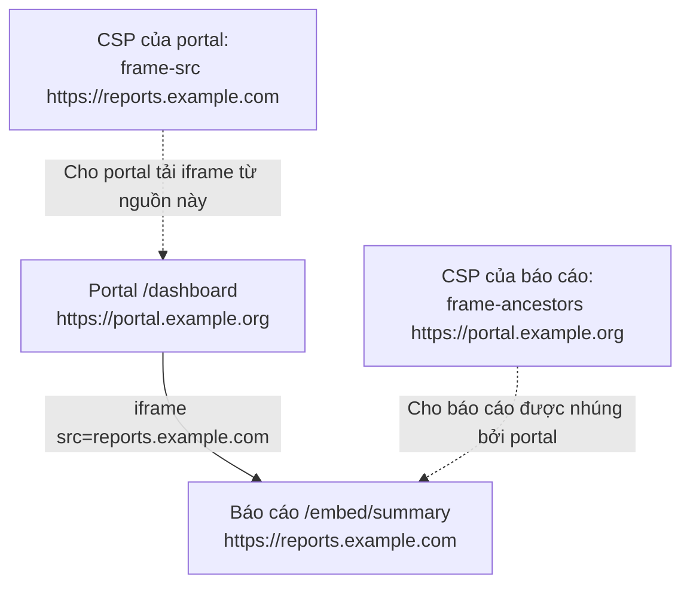

# Phân biệt frame-ancestors với frame-src

## 1. Hai câu hỏi bảo mật thường bị nhầm thành một

Trong module **SPRING_SECURITY_HTTP_PROTECTION**, người học triển khai các lớp phòng vệ HTTP và trình duyệt của Spring Security, từ CSRF, CORS, security headers và Content Security Policy (CSP) đến việc bảo vệ session. Ở nhóm **Chống nhúng trang**, một sự nhầm lẫn hay gặp là nghĩ rằng khai báo CSP `frame-src` đã đủ để ngăn người khác nhúng trang của mình.

Hai directive **`frame-ancestors`** và **`frame-src`** điều khiển **hai chiều hoàn toàn khác nhau**:

- **`frame-ancestors`** trên **response của trang được nhúng**: *“Những trang nào được phép chứa tôi trong iframe/frame?”*
- **`frame-src`** trên **response của trang tạo iframe**: *“Trang của tôi được phép tải nội dung iframe từ những nguồn nào?”*

Ví dụ một cổng thông tin tại `https://portal.example.org/dashboard` cần nhúng báo cáo từ `https://reports.example.com/embed/summary`. Muốn iframe xuất hiện, ít nhất hai chính sách sau phải đồng thời phù hợp:

**Response của portal (trang cha):**

```http
Content-Security-Policy: frame-src https://reports.example.com
```

**Response của báo cáo (trang con):**

```http
Content-Security-Policy: frame-ancestors https://portal.example.org
```

Nếu portal **không cho phép nguồn báo cáo** bằng `frame-src`, trình duyệt có thể chặn việc tải iframe từ phía trang cha. Nếu **báo cáo không cho phép portal** bằng `frame-ancestors`, trình duyệt từ chối nhúng báo cáo theo chính sách của trang con. Một phía cấu hình đúng không thể ghi đè quyết định của phía còn lại.

> **Quy tắc nhớ nhanh:** `frame-src` xét **nguồn con mà tôi muốn tải**; `frame-ancestors` xét **nguồn cha đang chứa tôi**. Việc chúng đều liên quan đến iframe không có nghĩa chúng thay thế nhau.

## 2. Hình dung hai chiều kiểm soát



Đường đi của trình duyệt, giản lược:

1. Người dùng mở trang `/dashboard`; trình duyệt nhận HTML và CSP của **portal**.
2. HTML của portal chứa `<iframe src="https://reports.example.com/embed/summary">`.
3. Trình duyệt kiểm tra `frame-src` (hoặc cơ chế fallback phù hợp) của portal để xác định việc tải nguồn iframe có được phép hay không.
4. Khi nhận response của báo cáo, trình duyệt kiểm tra `frame-ancestors` của **báo cáo** đối với các trang tổ tiên hiện tại.
5. Chỉ khi **cả hai** không ngăn chặn, cùng các chính sách khác đều cho phép, tài liệu báo cáo mới có thể hiển thị trong iframe.

Kiểm tra này không mặc nhiên cấp quyền đọc DOM giữa hai origin. **Same-Origin Policy** vẫn giới hạn JavaScript của portal truy cập tài liệu báo cáo khác origin. Các chính sách CSP ở đây quyết định **quyền tải và nhúng giao diện**, không tự cấp quyền truy xuất dữ liệu.

## 3. Bảng so sánh chi tiết

| Tiêu chí | CSP `frame-src` | CSP `frame-ancestors` |
| --- | --- | --- |
| Câu hỏi | Trang này **được tải iframe từ đâu?** | Trang này **được ai nhúng?** |
| Nơi cấu hình | HTTP response của **trang chứa iframe** | HTTP response của **trang nằm trong iframe** |
| Hướng kiểm soát | Từ **cha xuống con** | Từ **con lên mọi ancestor** |
| Đối tượng | Nguồn tài liệu được tải trong `<frame>` / `<iframe>` | Các nguồn tổ tiên của tài liệu được hiển thị trong `<frame>`, `<iframe>`, `<object>`, `<embed>` |
| `'none'` | Trang hiện tại không được tải nội dung vào iframe từ bất kỳ nguồn nào. | Trang hiện tại không được nằm trong frame của bất kỳ trang nào. |
| `'self'` | Chỉ tải iframe từ nguồn phù hợp với `'self'` của trang cha. | Chỉ cho các ancestor phù hợp với `'self'` của trang con. |
| Nếu không khai báo | Có thể rơi về `child-src` rồi `default-src` theo quy tắc CSP. | **Không** rơi về `default-src`; không tự sinh hạn chế chống nhúng. |
| Liên quan XFO | XFO trên **con** không được `frame-src` của cha ghi đè. | Có chức năng chống nhúng gần với XFO nhưng hỗ trợ danh sách nguồn linh hoạt hơn. |
| CSP trong `<meta>` | Có thể bị áp dụng từ meta theo những điều kiện CSP tương ứng. | **Không được hỗ trợ trong CSP meta**; phải gửi bằng HTTP header. |

Nhiều ứng dụng có cả hai vai trò: một trang dashboard **vừa** tự được nhúng trong một shell **vừa** nhúng widget khác. Khi đó response dashboard có thể cần **cả `frame-ancestors` lẫn `frame-src`** với các danh sách nguồn khác nhau.

## 4. Hiểu nguồn cho phép: 'self', 'none' và origin

### 4.1. `'none'` có nghĩa khác nhau theo chiều

**Portal không được tự nhúng nguồn nào:**

```http
Content-Security-Policy: frame-src 'none'
```

Nếu portal có thẻ `<iframe>`, trình duyệt từ chối tải tài liệu vào frame theo chính sách trên. Nhưng header đó **không có nghĩa người khác bị cấm nhúng chính portal**.

**Báo cáo không được xuất hiện trong iframe của người khác:**

```http
Content-Security-Policy: frame-ancestors 'none'
```

Đây mới là chính sách chặn nhúng báo cáo. Nó không tự ngăn báo cáo tạo iframe tải tài liệu khác; nếu muốn điều đó, cần `frame-src` riêng.

### 4.2. `'self'` phụ thuộc response sở hữu policy

Với trang cha ở `https://portal.example.org`:

```http
Content-Security-Policy: frame-src 'self'
```

Trang cha chỉ được nhúng những nguồn khớp `'self'` với **portal** theo CSP; `https://reports.example.com` khác origin và không được cho phép.

Với báo cáo ở `https://reports.example.com`:

```http
Content-Security-Policy: frame-ancestors 'self'
```

Các trang tổ tiên phải khớp `'self'` với **báo cáo**. Portal `https://portal.example.org` khác origin nên bị từ chối.

Do đó, viết cùng một chữ `'self'` tại hai website khác nhau **không tạo ra một sự đồng ý song phương**. `'self'` được giải thích theo nguồn của tài liệu **đang sở hữu policy**.

### 4.3. Phân biệt origin với tên miền liên quan

Origin của URL HTTP(S) là bộ ba **scheme + host + port**. Ví dụ nguồn `https://reports.example.com` có scheme HTTPS, host `reports.example.com` và cổng mặc định 443.

| URL so với `https://reports.example.com` | Origin thông thường |
| --- | --- |
| `https://reports.example.com/view` | Cùng origin |
| `https://reports.example.com:443/view` | Cùng origin |
| `https://reports.example.com:8443/view` | Khác port |
| `http://reports.example.com/view` | Khác scheme |
| `https://app.reports.example.com/view` | Khác host |
| `https://portal.example.com/view` | Khác host |

CSP có thuật toán so khớp source expression riêng, bao gồm một số quy tắc nâng cấp bảo mật khi nguồn được khai báo với scheme cụ thể. Khi thiết kế allowlist đối tác, nên khai báo tường minh `https://host` và port nếu cần, sau đó kiểm thử với URL thực tế. Không nên đồng nhất khái niệm **same-site** dùng trong chính sách cookie với **same-origin** của CSP.

### 4.4. Hai nguồn được phép không thể suy ra từ nhau

Một portal có thể được phép **nhúng báo cáo** mà không được phép **bị nhúng bởi báo cáo**:

```http
Content-Security-Policy: frame-src https://reports.example.com; frame-ancestors 'none'
```

Ở chiều ngược lại, báo cáo có thể cho portal **nhúng báo cáo**, nhưng không muốn báo cáo nhúng bất kỳ trang nào:

```http
Content-Security-Policy: frame-ancestors https://portal.example.org; frame-src 'none'
```

Đây là hai chính sách hợp lý, đối xứng về **nhu cầu sản phẩm** nhưng **không đối xứng về ý nghĩa directive**.

## 5. Quy tắc fallback: điểm phân biệt thường bị bỏ sót

Một trong những khác biệt quan trọng nhất là **khi directive vắng mặt**, trình duyệt xử lý thế nào.

### 5.1. `frame-src` có fallback

Đối với chính sách CSP hiện đại, khi không có `frame-src`, trình duyệt xem xét `child-src`; nếu `child-src` cũng vắng mặt, có thể sử dụng `default-src` theo quy tắc fallback của CSP.

Ví dụ:

```http
Content-Security-Policy: default-src 'none'
```

Trang sở hữu policy **không được tải iframe từ nguồn nào** theo fallback của `frame-src`, nếu không có directive phù hợp khác ghi đè.

Thêm `frame-src` có thể tạo ngoại lệ rõ ràng:

```http
Content-Security-Policy: default-src 'none'; frame-src https://reports.example.com
```

Khi đó về phần iframe, portal được tải tài liệu từ `https://reports.example.com` dù các fetch directive khác vẫn bị hạn chế bởi `default-src 'none'` hoặc directive cụ thể của chúng. Một ứng dụng thực tế cần khai báo thêm script, style, image, connect... theo tài nguyên đang dùng; ví dụ này chỉ minh họa fallback của iframe.

### 5.2. `frame-ancestors` không có fallback

Xét một trang báo cáo chỉ có:

```http
Content-Security-Policy: default-src 'none'
```

Header này **không cấm các website khác nhúng báo cáo** theo hướng `frame-ancestors`. `default-src` không tự thay thế `frame-ancestors`.

Muốn cấm nhúng:

```http
Content-Security-Policy: default-src 'none'; frame-ancestors 'none'
```

Muốn chỉ portal được nhúng:

```http
Content-Security-Policy: default-src 'none'; frame-ancestors https://portal.example.org
```

**Lưu ý về triển khai:** `default-src 'none'` sẽ chặn tải nhiều tài nguyên của chính trang báo cáo. Không sao chép nguyên xi policy đó vào website đang dùng script/CSS/API mà chưa thiết kế CSP đầy đủ.

## 6. Iframe lồng nhau: một trang có thể chịu cả hai chiều chính sách

Xét ba tài liệu:

```text
https://shell.example.net (A)
  └── https://portal.example.org/dashboard (B)
        └── https://reports.example.com/embed/summary (C)
```

Để chuỗi này được render, cần xét:

1. **A muốn nhúng B:** `frame-src` của A (hoặc fallback) phải cho phép nguồn của B.
2. **B chấp nhận bị nhúng bởi A:** `frame-ancestors` của B (nếu có) phải cho phép A.
3. **B muốn nhúng C:** `frame-src` của B phải cho phép nguồn của C.
4. **C chấp nhận bị nhúng:** `frame-ancestors` của C phải cho phép **cả A và B**, không chỉ B.

Ngay cả khi B được phép nhúng C và C cho phép B làm ancestor, chuỗi vẫn có thể bị chặn nếu A không nằm trong `frame-ancestors` của C. Đây là lý do kiểm tra chỉ một iframe trực tiếp không đủ để bảo đảm hệ thống nhúng nhiều tầng hoạt động.

### Ví dụ phân tích lỗi đa cấp

**A:**

```http
Content-Security-Policy: frame-src https://portal.example.org
```

**B:**

```http
Content-Security-Policy: frame-ancestors https://shell.example.net; frame-src https://reports.example.com
```

**C:**

```http
Content-Security-Policy: frame-ancestors https://portal.example.org
```

A có thể nhúng B; B có thể yêu cầu nhúng C; nhưng C **không hiển thị** vì ancestor A không thuộc danh sách được phép của C. Nếu nghiệp vụ thật sự tin cậy cả hai tầng, chính sách trên C có thể cần:

```http
Content-Security-Policy: frame-ancestors https://shell.example.net https://portal.example.org
```

Không nên thêm nguồn A chỉ vì iframe lỗi nếu chưa xác nhận ai quản lý A và vì sao A được quyền tạo chuỗi nhúng này.

## 7. Cấu hình Spring Security Servlet: portal và ứng dụng báo cáo

Spring Security Servlet sử dụng `HttpSecurity` và `SecurityFilterChain`. Mặc định, khi bộ HTTP security headers được bật, Spring Security phát `X-Frame-Options: DENY`. **XFO là chính sách ở response của trang bị nhúng**, vì vậy XFO mặc định của ứng dụng báo cáo cần được xử lý nếu cho portal khác origin nhúng báo cáo. Spring Security không tự thêm một CSP tổng quát theo mặc định.

Các mẫu dưới đây là **hai ứng dụng Spring Boot độc lập**, không phải hai bean cấu hình đồng thời trong cùng một ứng dụng. Mỗi ứng dụng tiếp tục cần triển khai xác thực, phân quyền và endpoint HTML tương ứng.

### 7.1. Ứng dụng portal tại https://portal.example.org

Portal được phép nhúng báo cáo, nhưng bản thân portal không được nhúng:

```java
import org.springframework.context.annotation.Bean;
import org.springframework.context.annotation.Configuration;
import org.springframework.security.config.annotation.web.builders.HttpSecurity;
import org.springframework.security.config.annotation.web.configuration.EnableWebSecurity;
import org.springframework.security.web.SecurityFilterChain;

@Configuration
@EnableWebSecurity
public class PortalSecurityConfig {

    @Bean
    SecurityFilterChain portalChain(HttpSecurity http) throws Exception {
        return http
            .authorizeHttpRequests(auth -> auth
                .anyRequest().authenticated())
            .headers(headers -> headers
                .contentSecurityPolicy(csp -> csp
                    .policyDirectives(
                        "frame-src https://reports.example.com; " +
                        "frame-ancestors 'none'")))
            .build();
    }
}
```

Ứng dụng portal vẫn giữ `X-Frame-Options: DENY` mặc định, nhất quán với `frame-ancestors 'none'`. **Điều này không ngăn portal nhúng báo cáo**: XFO của portal điều khiển việc *portal bị trang khác nhúng*, không điều khiển nguồn iframe mà portal tải.

### 7.2. Ứng dụng báo cáo tại https://reports.example.com

Báo cáo cho portal nhúng mình, nhưng trang báo cáo không tự nhúng nguồn khác:

```java
import org.springframework.context.annotation.Bean;
import org.springframework.context.annotation.Configuration;
import org.springframework.security.config.annotation.web.builders.HttpSecurity;
import org.springframework.security.config.annotation.web.configuration.EnableWebSecurity;
import org.springframework.security.web.SecurityFilterChain;

@Configuration
@EnableWebSecurity
public class ReportSecurityConfig {

    @Bean
    SecurityFilterChain reportChain(HttpSecurity http) throws Exception {
        return http
            .authorizeHttpRequests(auth -> auth
                .anyRequest().authenticated())
            .headers(headers -> headers
                .frameOptions(frame -> frame.disable())
                .contentSecurityPolicy(csp -> csp
                    .policyDirectives(
                        "frame-ancestors https://portal.example.org; " +
                        "frame-src 'none'")))
            .build();
    }
}
```

Với **một ứng dụng phục vụ cả trang báo cáo cần nhúng và các trang nhạy cảm không cần nhúng**, không được áp dụng `frameOptions.disable()` cho toàn bộ ứng dụng. Hãy tách `SecurityFilterChain` theo `securityMatcher("/embed/**")`, mở nhúng bằng `frame-ancestors` chỉ cho đường dẫn báo cáo và giữ `X-Frame-Options: DENY`/`frame-ancestors 'none'` cho trang tài khoản hoặc quản trị.

Các đoạn trên thiết lập CSP rất hẹp để nhấn mạnh cách phân biệt `frame-src` và `frame-ancestors`. Ứng dụng thật có thể cần bổ sung `default-src`, `script-src`, `style-src`, `img-src` và các directive liên quan; giữ nguyên ý nghĩa của hai directive frame khi mở rộng.

## 8. Cấu hình Spring Security Reactive / WebFlux

WebFlux dùng `ServerHttpSecurity` và `SecurityWebFilterChain`. Cũng có hai ứng dụng độc lập: **portal** có `frame-src` để tải báo cáo; **báo cáo** có `frame-ancestors` để quyết định ai được nhúng.

### 8.1. Cấu hình portal WebFlux

```java
import org.springframework.context.annotation.Bean;
import org.springframework.context.annotation.Configuration;
import org.springframework.security.config.annotation.web.reactive.EnableWebFluxSecurity;
import org.springframework.security.config.web.server.ServerHttpSecurity;
import org.springframework.security.web.server.SecurityWebFilterChain;

@Configuration
@EnableWebFluxSecurity
public class ReactivePortalSecurityConfig {

    @Bean
    SecurityWebFilterChain portalChain(ServerHttpSecurity http) {
        return http
            .authorizeExchange(auth -> auth
                .anyExchange().authenticated())
            .headers(headers -> headers
                .contentSecurityPolicy(csp -> csp
                    .policyDirectives(
                        "frame-src https://reports.example.com; " +
                        "frame-ancestors 'none'")))
            .build();
    }
}
```

XFO mặc định `DENY` trên response của portal được giữ nguyên.

### 8.2. Cấu hình báo cáo WebFlux

```java
import org.springframework.context.annotation.Bean;
import org.springframework.context.annotation.Configuration;
import org.springframework.security.config.annotation.web.reactive.EnableWebFluxSecurity;
import org.springframework.security.config.web.server.ServerHttpSecurity;
import org.springframework.security.web.server.SecurityWebFilterChain;

@Configuration
@EnableWebFluxSecurity
public class ReactiveReportSecurityConfig {

    @Bean
    SecurityWebFilterChain reportChain(ServerHttpSecurity http) {
        return http
            .authorizeExchange(auth -> auth
                .anyExchange().authenticated())
            .headers(headers -> headers
                .frameOptions(frame -> frame.disable())
                .contentSecurityPolicy(csp -> csp
                    .policyDirectives(
                        "frame-ancestors https://portal.example.org; " +
                        "frame-src 'none'")))
            .build();
    }
}
```

Giống Servlet, khi ứng dụng báo cáo có các route không được nhúng, phải chia security chain và chỉ `disable()` XFO ở những route thực sự cần iframe từ origin ngoài. Tránh `headers(headers -> headers.disable())` vì nó sẽ làm mất các HTTP security headers khác trên chain.

### 8.3. Hai response cuối cùng cần có những gì?

| Ứng dụng | CSP quan trọng | XFO |
| --- | --- | --- |
| Portal (trang cha) | `frame-src https://reports.example.com; frame-ancestors 'none'` | `DENY` mặc định |
| Reports (trang con) | `frame-ancestors https://portal.example.org; frame-src 'none'` | Không phát XFO từ chain cho phép nhúng ngoài origin |

Nếu báo cáo vẫn nhận `X-Frame-Options: DENY` từ reverse proxy, trình duyệt cũ có thể chặn iframe dù CSP cho phép. Kiểm tra **response thực tế tới browser**, không chỉ cấu hình Java.

## 9. Thực hành phân biệt lỗi phía cha và phía con

Hãy thử trên các ứng dụng nội bộ do bạn kiểm soát. Quy ước:

- Portal tại `http://localhost:9090`, có route `/dashboard`.
- Báo cáo tại `http://localhost:8080`, có route `/embed/summary`.
- Trang thử không được phép tại `http://localhost:9091`.

Trong môi trường thử nghiệm, thay policy của hai ứng dụng lần lượt thành:

**Portal 9090:**

```http
Content-Security-Policy: frame-src http://localhost:8080; frame-ancestors 'none'
```

**Báo cáo 8080:**

```http
Content-Security-Policy: frame-ancestors http://localhost:9090; frame-src 'none'
```

Trên báo cáo cần tắt XFO mặc định cho endpoint `/embed/summary` theo đúng cách cấu hình đã nêu. Dùng HTTP chỉ cho môi trường kiểm thử local; production nên dùng HTTPS.

### 9.1. HTML của trang cha

Trang `http://localhost:9090/dashboard`:

```html
<!doctype html>
<html lang="vi">
  <head>
    <meta charset="utf-8">
    <title>Dashboard thử nghiệm</title>
  </head>
  <body>
    <h1>Dashboard của portal</h1>
    <iframe
      src="http://localhost:8080/embed/summary"
      title="Báo cáo trong iframe"
      width="900"
      height="560"></iframe>
  </body>
</html>
```

Nếu endpoint trả HTML thành công và các kiểm soát xác thực/session khác cho phép, iframe có thể hiển thị.

### 9.2. Thay đổi từng chính sách để thấy chiều tác động

| Thay đổi | Dự đoán | Cách xác minh |
| --- | --- | --- |
| Portal đổi `frame-src` thành `'none'`, báo cáo giữ nguyên. | Iframe không tải vì **portal cấm tải nguồn con**. | Console nêu vi phạm `frame-src` (hoặc fallback); kiểm tra CSP response portal. |
| Portal cho phép 8080; báo cáo đổi `frame-ancestors` thành `'none'`. | Iframe bị từ chối vì **báo cáo không cho portal nhúng**. | Console nêu vi phạm `frame-ancestors`; kiểm tra CSP response báo cáo. |
| Portal `frame-src http://localhost:8080`; báo cáo `frame-ancestors http://localhost:9090`. | Iframe có thể hiển thị. | Network kiểm tra cả hai response, sau đó xem giao diện. |
| Trang 9091 cố nhúng báo cáo 8080. | Bị từ chối vì 9091 không thuộc `frame-ancestors` của báo cáo. | Console/Network của trang 9091. |
| Báo cáo có `frame-src 'none'` nhưng cho phép 9090 ở `frame-ancestors`. | Báo cáo **vẫn có thể được portal nhúng**; chỉ cấm báo cáo nhúng tài liệu khác. | Không nhầm `frame-src` của con với `frame-ancestors` của con. |
| Portal có `frame-ancestors 'none'` nhưng `frame-src` cho phép 8080. | Portal **vẫn được tải báo cáo**; chỉ cấm trang khác nhúng portal. | Mở portal trực tiếp và kiểm tra iframe. |

### 9.3. Quan sát HTTP response

```bash
curl -i http://localhost:9090/dashboard
curl -i http://localhost:8080/embed/summary
```

`curl` giúp đối chiếu **header mà server thực sự gửi** nhưng không đánh giá được chuỗi ancestor hoặc render của trình duyệt. Nếu hai route yêu cầu xác thực, lệnh chưa đăng nhập có thể nhận `302`/`401` hoặc trang login; cần kiểm tra response của HTML cuối sau xác thực bằng DevTools Network.

Trong **DevTools**:

1. Ở tab **Network**, xem response của `/dashboard` và `/embed/summary`, chú ý header CSP trên **cả hai**.
2. Ở tab **Console**, phân biệt lỗi `frame-src` từ portal với lỗi `frame-ancestors` từ báo cáo.
3. Kiểm tra URL thực tế sau redirect, scheme, host và port; nếu iframe lồng nhau, kiểm tra **toàn bộ ancestor**.
4. Kiểm tra có XFO `DENY` hoặc CSP khác do gateway/CDN bổ sung ở trang báo cáo hay không.

Trình duyệt có thể chặn iframe vì CSP khác, session hết hạn, cookie bên thứ ba, nội dung HTTP trong trang HTTPS hoặc thuộc tính `sandbox`. Đừng chỉ nhìn vùng iframe trống rồi suy ra đúng directive gây lỗi.

## 10. Kiểm thử tự động: xác nhận policy của từng response

Spring Security cung cấp công cụ kiểm thử header cho Servlet và Reactive. Các đoạn dưới giả định đã có controller/handler trả `200 OK`, có `spring-security-test` và tài khoản `viewer` đủ quyền. Mỗi test tương ứng với **ứng dụng riêng** mà nó kiểm tra.

### 10.1. Servlet — MockMvc cho portal

```java
mockMvc.perform(get("/dashboard").with(user("viewer")))
    .andExpect(status().isOk())
    .andExpect(header().string("X-Frame-Options", "DENY"))
    .andExpect(header().string(
        "Content-Security-Policy",
        "frame-src https://reports.example.com; frame-ancestors 'none'"));
```

Test này xác nhận **portal được phép tải iframe từ reports**; nó không chứng minh báo cáo có cho phép portal làm ancestor hay không.

### 10.2. Servlet — MockMvc cho ứng dụng báo cáo

```java
mockMvc.perform(get("/embed/summary").with(user("viewer")))
    .andExpect(status().isOk())
    .andExpect(header().doesNotExist("X-Frame-Options"))
    .andExpect(header().string(
        "Content-Security-Policy",
        "frame-ancestors https://portal.example.org; frame-src 'none'"));
```

Tính chất của test ngược với portal: nó chứng minh **báo cáo cho phép portal làm ancestor** nhưng không cấp quyền nhúng từ một website khác.

Đây là phần thân kiểm thử minh họa. Static import thường dùng: `MockMvcRequestBuilders.get`, `SecurityMockMvcRequestPostProcessors.user`, `MockMvcResultMatchers.header` và `status`. Nếu CSP production gồm nhiều directive hơn, nên so khớp directive tương ứng thay vì toàn bộ chuỗi duy nhất.

### 10.3. Reactive — WebTestClient cho hai ứng dụng

**Trong test của portal:**

```java
webTestClient.mutateWith(mockUser("viewer"))
    .get().uri("/dashboard")
    .exchange()
    .expectStatus().isOk()
    .expectHeader().valueEquals("X-Frame-Options", "DENY")
    .expectHeader().valueEquals(
        "Content-Security-Policy",
        "frame-src https://reports.example.com; frame-ancestors 'none'");
```

**Trong test của ứng dụng báo cáo:**

```java
webTestClient.mutateWith(mockUser("viewer"))
    .get().uri("/embed/summary")
    .exchange()
    .expectStatus().isOk()
    .expectHeader().doesNotExist("X-Frame-Options")
    .expectHeader().valueEquals(
        "Content-Security-Policy",
        "frame-ancestors https://portal.example.org; frame-src 'none'");
```

`mockUser` thuộc các tiện ích `SecurityMockServerConfigurers` của `spring-security-test`. Test header tự động giúp phát hiện lỗi cấu hình Spring Security, còn **kiểm thử trình duyệt** mới xác nhận hai chính sách đang phối hợp đúng qua các origin, redirect và proxy thực tế.

## 11. Chẩn đoán nhanh khi iframe không hoạt động

### 11.1. Console báo `frame-src`

Kiểm tra **response trang cha**: có `frame-src 'none'`, `frame-src 'self'` hoặc không khai báo `frame-src` nhưng `child-src`/`default-src` quá chặt không? Nếu cần nhúng báo cáo, cho phép đúng nguồn báo cáo trên policy của trang cha. Không cần thay `frame-ancestors` của báo cáo nếu chính báo cáo đã cho phép portal.

### 11.2. Console báo `frame-ancestors`

Kiểm tra **response trang con**: danh sách ancestor có bao gồm portal thực tế không? Có iframe lồng khiến một trang tổ tiên khác bị thiếu không? CSP có nằm trong **HTTP response header** thay vì `<meta>` không? Có policy thứ hai chứa `frame-ancestors 'none'` không?

### 11.3. Response báo cáo còn `X-Frame-Options: DENY`

Spring Security thường thêm `DENY` mặc định. Với báo cáo cần nhúng từ origin ngoài, bỏ XFO ở **đúng endpoint** và dùng CSP `frame-ancestors` thay thế. Các trình duyệt hiện đại ưu tiên CSP `frame-ancestors` có hiệu lực so với XFO; trình duyệt cũ có thể xử lý khác và vẫn chặn. Kiểm tra reverse proxy để tránh vô tình thêm lại `DENY`.

### 11.4. Đã thêm `default-src 'none'` nhưng vẫn bị website khác nhúng

`default-src` không phải fallback cho `frame-ancestors`. Cần thêm `frame-ancestors 'none'` hoặc danh sách nguồn được phép trong **response chính trang cần được bảo vệ**. Ngược lại, `default-src 'none'` có thể chặn trang cha tải iframe khi không có `frame-src`/`child-src` phù hợp.

### 11.5. Đã cho phép CORS nhưng iframe vẫn trắng

CORS liên quan đến việc JavaScript truy cập tài nguyên chéo origin, không cấp phép nhúng giao diện. `Access-Control-Allow-Origin` không thay thế `frame-src` hoặc `frame-ancestors`. Hai directive CSP phải được kiểm tra đúng phía sở hữu chúng.

### 11.6. Chỉ gửi CSP ở `Content-Security-Policy-Report-Only`

Policy Report-Only phục vụ theo dõi, không cưỡng chế chặn. Nếu muốn bảo vệ thật, gửi directive qua `Content-Security-Policy`. Riêng `frame-ancestors` không hỗ trợ áp dụng qua CSP `<meta>`; đặt trong meta không tạo lớp chặn clickjacking.

### 11.7. Proxy/CDN thêm CSP thứ hai

Trình duyệt thực thi **tất cả các CSP enforced** cùng có mặt; nó không lấy hợp các allowlist. Nếu portal phát một `frame-src` cho reports nhưng proxy thêm CSP `frame-src 'none'`, việc tải iframe vẫn bị từ chối. Nếu báo cáo gửi `frame-ancestors https://portal.example.org` nhưng CDN thêm `frame-ancestors 'none'`, việc bị nhúng vẫn bị từ chối. Cần xác định **tầng tạo ra policy xung đột** và kiểm tra response cuối cùng.

## 12. Những nguyên tắc thiết kế nên giữ

1. **Chọn đúng chiều chính sách:** trang tạo iframe dùng `frame-src`; trang bị nhúng dùng `frame-ancestors`.
2. **Cho phép theo nhu cầu cụ thể:** tránh `frame-src https:` hoặc `frame-ancestors https:` khi chỉ có một vài nguồn đối tác cần quyền. Những biểu thức nguồn quá rộng có thể làm giảm đáng kể tác dụng bảo vệ.
3. **Mặc định cấm nhúng trang nhạy cảm:** `X-Frame-Options: DENY` và CSP `frame-ancestors 'none'` cho trang tài khoản, quản trị hoặc xác nhận giao dịch không có nhu cầu iframe.
4. **Chỉ mở nhúng chéo origin ở endpoint được thiết kế:** dùng route matcher trong Servlet/WebFlux để cấu hình CSP và XFO phù hợp; tránh tắt toàn bộ security headers.
5. **Bảo vệ phiên và dữ liệu riêng:** quyền được làm ancestor không phải quyền đọc DOM, quyền lấy dữ liệu hay quyền thực hiện giao dịch. Duy trì xác thực, phân quyền, CSRF, session và xử lý cookie `SameSite` đúng nghiệp vụ.
6. **Kiểm tra mọi tầng:** route sau redirect, browser, reverse proxy, CDN và mọi CSP header thực thi đều có thể tác động kết quả.

## 13. Bài tập vận dụng

**Bài A — Xác định đúng directive.** Một báo cáo tại `https://reports.example.com/view` bị nhúng bởi trang lạ. Nhóm phát triển thêm `Content-Security-Policy: frame-src 'none'` vào response của báo cáo nhưng trang lạ vẫn có thể nhúng. Hãy giải thích nguyên nhân và viết header đúng để cấm nhúng.

**Bài B — Phối hợp hai website.** Portal tại `https://portal.example.org` cần nhúng `https://reports.example.com/view`. Hãy viết CSP phía portal và phía báo cáo, đồng thời giải thích vì sao `X-Frame-Options: DENY` trên báo cáo có thể gây lỗi tương thích với trình duyệt cũ.

**Bài C — Fallback không đối xứng.** Cả hai trang chỉ có `Content-Security-Policy: default-src 'none'`. Trang cha có thể tải iframe từ trang con không? Trang con có được bảo vệ chống việc bị website ngoài nhúng không? Giải thích hai kết quả.

**Bài D — Chuỗi ba tầng.** Trang A nhúng B, B nhúng C; C chỉ cho B ở `frame-ancestors`. Hãy chỉ ra điều kiện còn thiếu để iframe C được hiển thị và giải thích chính sách nào nằm ở từng response.

**Gợi ý trả lời:** A — `frame-src` chỉ cấm báo cáo tự nhúng nguồn khác; cần `frame-ancestors 'none'` trên báo cáo. B — portal `frame-src https://reports.example.com`, báo cáo `frame-ancestors https://portal.example.org`; tránh XFO `DENY` xung đột trên báo cáo. C — `default-src` có thể chặn tải iframe của cha qua fallback, nhưng **không cấm** website khác nhúng con nếu con thiếu `frame-ancestors` và lớp phòng vệ tương đương. D — `frame-src` ở A/B phải cho phép con tương ứng; `frame-ancestors` ở C phải cho **mọi ancestor** hợp lệ, gồm A và B.

## 14. Tóm tắt kiến thức

Sự khác biệt giữa `frame-src` và `frame-ancestors` nằm ở **ai phát policy và hướng kiểm soát**. `frame-src` của **trang cha** giới hạn nơi trang đó được tải iframe; `frame-ancestors` của **trang con** giới hạn những trang nào được nhúng trang con, bao gồm toàn bộ chuỗi tổ tiên. `frame-src` có cơ chế fallback từ `child-src`/`default-src`; `frame-ancestors` **không** có fallback từ `default-src` và phải được gửi bằng **HTTP response header**. Trong Spring Security Servlet và Reactive, cấu hình CSP trên đúng ứng dụng/endpoint, xử lý XFO mặc định một cách có giới hạn và xác minh **cả hai response** là cách tránh các lỗi nhúng trang và bảo vệ chống clickjacking khi triển khai.
