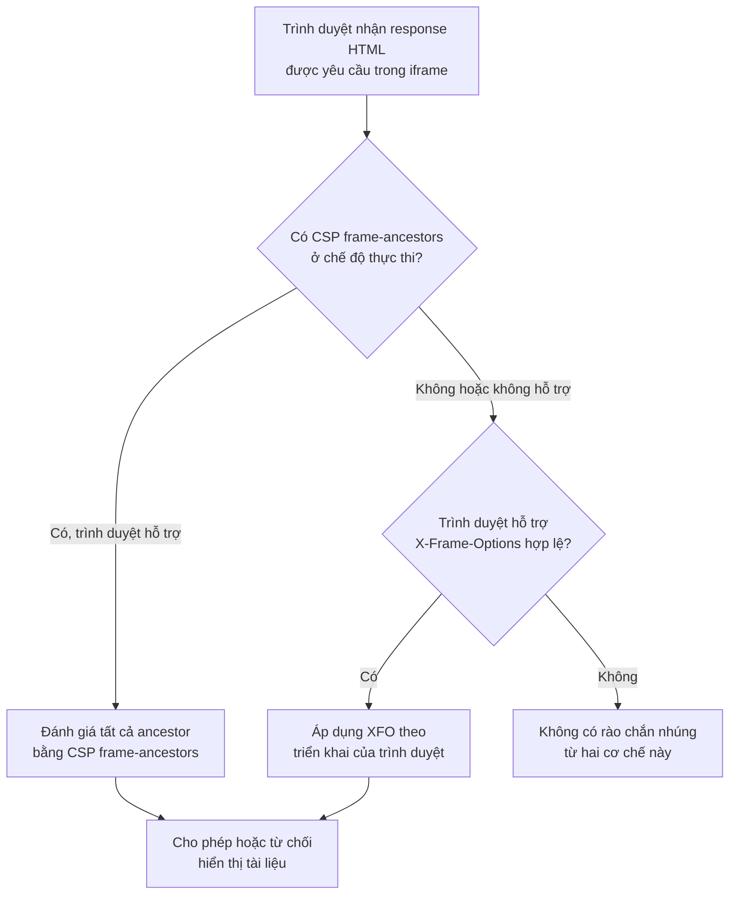

# Phối hợp X-Frame-Options và CSP trên các trình duyệt

## 1. Vì sao ứng dụng cần cân nhắc cả hai cơ chế?

Trong module **SPRING_SECURITY_HTTP_PROTECTION**, các lớp bảo vệ HTTP và trình duyệt phải hoạt động cùng nhau khi ứng dụng được triển khai qua Spring Security, web server, reverse proxy và nhiều loại trình duyệt. Ở nhóm **Chống nhúng trang**, hai cơ chế chính chống *clickjacking* là:

- HTTP response header **`X-Frame-Options` (XFO)** với các giá trị phổ biến `DENY`, `SAMEORIGIN`.
- Directive **`frame-ancestors`** trong HTTP response header **`Content-Security-Policy` (CSP)**.

Clickjacking xảy ra khi một website độc hại nhúng giao diện ứng dụng vào frame, đặt lớp phủ để người dùng tưởng đang nhấp vào nút vô hại nhưng thật ra lại tương tác với giao diện hợp lệ ở phía dưới. **Same-Origin Policy** thường ngăn website độc hại đọc DOM của iframe khác origin, nhưng không tự ngăn người dùng nhấp vào giao diện được hiển thị trong iframe.

Giả sử một hệ thống báo cáo có ba URL:

| Đường dẫn | Nhu cầu nghiệp vụ | Chính sách dự kiến |
| --- | --- | --- |
| `https://app.example.com/account` | Trang tài khoản, không cần nhúng | Cấm mọi frame. |
| `https://app.example.com/widgets/chart` | Widget nhúng trong cùng ứng dụng | Chỉ cho phép tổ tiên cùng origin. |
| `https://app.example.com/embed/report` | Báo cáo cần nhúng tại `https://portal.partner.example` | Cho phép portal đối tác và có thể cả cùng origin. |

Không thể sử dụng một header giống nhau cho cả ba URL mà vẫn đáp ứng chính xác nhu cầu. Ngoài ra, **trình duyệt hiện đại và trình duyệt cũ có thể xử lý cặp XFO/CSP theo cách khác nhau**, nên cần thiết kế chính sách nhất quán và kiểm thử tập trình duyệt thực tế của sản phẩm.

### Kết quả cần đạt

Sau bài này, người học có thể xác định thứ tự ưu tiên giữa XFO và CSP `frame-ancestors`, nhận diện cấu hình gây xung đột, lựa chọn chính sách theo route, cấu hình **Spring Security Servlet và Reactive**, kiểm thử phản ứng của trình duyệt và chẩn đoán header bị thay đổi khi triển khai.

## 2. X-Frame-Options và frame-ancestors cùng kiểm soát việc bị nhúng

**XFO** là HTTP response header trên tài liệu **được nhúng**:

```http
X-Frame-Options: DENY
```

Nó yêu cầu trình duyệt từ chối hiển thị response trong frame bất kể origin của trang cha. Nếu thay bằng:

```http
X-Frame-Options: SAMEORIGIN
```

trình duyệt hỗ trợ có thể cho phép nhúng trong ngữ cảnh cùng origin, nhưng không cho website ở origin ngoài nhúng. “Cùng origin” phụ thuộc **scheme, host và port**; `https://app.example.com` và `https://portal.app.example.com` là hai origin khác nhau.

**CSP `frame-ancestors`** cũng nằm trên response của tài liệu được nhúng, nhưng biểu đạt danh sách tổ tiên cụ thể hơn:

```http
Content-Security-Policy: frame-ancestors 'self' https://portal.partner.example
```

Nghĩa là mọi trang tổ tiên trong chuỗi iframe phải khớp `'self'` của trang được nhúng hoặc nguồn `https://portal.partner.example`. Trong iframe lồng nhiều cấp, **từng ancestor** phải hợp lệ; chỉ kiểm tra trang cha trực tiếp là chưa đủ.

| Mục đích | XFO | CSP `frame-ancestors` |
| --- | --- | --- |
| Cấm tất cả iframe | `DENY` | `'none'` |
| Chỉ cho phép cùng origin | `SAMEORIGIN` | `'self'` |
| Cho phép một hoặc nhiều origin ngoài | Không có giá trị XFO hiện đại, được hỗ trợ rộng rãi, để tạo allowlist | Liệt kê origin tường minh, ví dụ `'self' https://portal.partner.example` |
| Kiểm soát mọi ancestor của iframe lồng nhau | Hành vi kiểm tra giữa một số trình duyệt/phiên bản cũ không đồng nhất | Mô hình `frame-ancestors` kiểm tra toàn bộ chuỗi tổ tiên |
| Đặt trong HTML `<meta>` | Không phải cơ chế áp dụng XFO | `frame-ancestors` **không có hiệu lực trong CSP meta** |

Giá trị XFO `ALLOW-FROM https://origin.example` là cú pháp cũ, **không được hỗ trợ nhất quán bởi trình duyệt hiện đại**. Một trình duyệt không hiểu giá trị này có thể bỏ qua XFO, khiến chính sách chống nhúng mất hiệu lực nếu không có CSP phù hợp. Không dùng `ALLOW-FROM` làm giải pháp nhúng đối tác.

## 3. Quy tắc ưu tiên: vì sao không thể lấy giao hai header để suy đoán?

Theo mô hình CSP hiện đại, khi response có **CSP `frame-ancestors` ở chế độ thực thi (enforced)**, trình duyệt tuân thủ đặc tả phải **bỏ qua `X-Frame-Options` đối với việc kiểm soát nhúng tài liệu đó**. Như vậy, XFO và CSP `frame-ancestors` trong trường hợp này không đơn giản là hai điều kiện luôn được áp dụng theo phép giao.



**Điểm cần thận trọng:** một số trình duyệt cũ không tuân thủ đầy đủ thứ tự ưu tiên này. Chúng có thể áp dụng XFO ngay cả khi response có `frame-ancestors` hợp lệ, hoặc không hỗ trợ `frame-ancestors`. Vì vậy, **không thiết kế hệ thống dựa vào việc hai header mâu thuẫn nhưng trình duyệt hiện đại vẫn cho phép**.

### 3.1. Cặp header nhất quán: cấm tất cả

```http
X-Frame-Options: DENY
Content-Security-Policy: frame-ancestors 'none'
```

Hai giá trị cùng mục đích: không cho bất kỳ website nào nhúng trang, kể cả trang cùng origin. Trình duyệt hiểu CSP sẽ áp dụng `'none'`; trình duyệt cũ chỉ hiểu XFO sẽ áp dụng `DENY`. Đây là cách phối hợp đơn giản cho trang tài khoản, trang quản trị hay thao tác có dữ liệu nhạy cảm.

### 3.2. Cặp header nhất quán: nhúng nội bộ

```http
X-Frame-Options: SAMEORIGIN
Content-Security-Policy: frame-ancestors 'self'
```

Hai giá trị hướng tới việc chỉ cho phép nhúng cùng origin. CSP `frame-ancestors` còn giúp xác định chặt chẽ yêu cầu đối với **toàn bộ các ancestor** trong chuỗi iframe lồng nhau ở trình duyệt hỗ trợ. Nếu có một trang trung gian hoặc trang trên cùng khác origin, CSP `'self'` của tài liệu con từ chối.

### 3.3. Cặp header mâu thuẫn: nhúng đối tác

```http
X-Frame-Options: DENY
Content-Security-Policy: frame-ancestors 'self' https://portal.partner.example
```

Nếu portal thực sự ở `https://portal.partner.example`, một trình duyệt hiện đại hỗ trợ CSP enforced có thể **cho phép** portal nhúng trang theo `frame-ancestors`. Tuy nhiên, trình duyệt cũ chỉ hiểu XFO hoặc ưu tiên XFO có thể **từ chối**. Kết quả sẽ không đồng nhất giữa môi trường khách hàng.

Giải pháp cho endpoint cần nhúng chéo origin là **không phát XFO `DENY`/`SAMEORIGIN` tại endpoint đó**, dùng allowlist CSP `frame-ancestors` và xác định rõ yêu cầu hỗ trợ trình duyệt. Với trình duyệt không hỗ trợ CSP `frame-ancestors`, cấu hình này **không cung cấp cùng mức bảo vệ chống nhúng**. Nếu nhóm người dùng đó còn bắt buộc hỗ trợ, cần cân nhắc thay đổi kiến trúc nhúng hoặc phạm vi trình duyệt được hỗ trợ.

## 4. Ma trận hành vi qua các nhóm trình duyệt

Không nên mô tả hỗ trợ bằng giả định rằng “mọi Chrome/Firefox/Safari đều giống nhau” hoặc một con số phiên bản không được kiểm tra. Ma trận dưới đây chia theo **khả năng thực thi chuẩn**. Khi xác định hỗ trợ sản phẩm, hãy kiểm thử trên các phiên bản trình duyệt thực tế được cam kết.

| Response của trang đích | Trình duyệt thực thi CSP `frame-ancestors` theo chuẩn | Trình duyệt chỉ hiểu XFO hợp lệ | Rủi ro/nhận xét |
| --- | --- | --- | --- |
| `XFO: DENY`, không có `frame-ancestors` | Bị chặn bởi XFO | Bị chặn bởi XFO | Phù hợp với trang không nhúng. |
| `XFO: DENY` + `frame-ancestors 'none'` | Bị chặn bởi CSP | Bị chặn bởi XFO | Mục đích thống nhất. |
| `XFO: SAMEORIGIN` + `frame-ancestors 'self'` | Cho nhúng cùng origin theo CSP | Theo cơ chế SAMEORIGIN của XFO | Kiểm thử iframe lồng nhau nếu hỗ trợ browser cũ. |
| Không có XFO + `frame-ancestors https://portal.partner.example` | Chỉ nguồn hợp lệ được làm ancestor | Không có chính sách chống nhúng từ hai header này | Cần xác định nhóm trình duyệt được hỗ trợ. |
| `XFO: DENY` + `frame-ancestors https://portal.partner.example` | Portal có thể nhúng theo CSP | Portal bị từ chối bởi XFO | **Xung đột** giữa trình duyệt. |
| `XFO: ALLOW-FROM https://portal.partner.example`, không có CSP | Có thể không được bảo vệ vì XFO không hợp lệ/không hỗ trợ | Hành vi tùy trình duyệt cũ | Tránh sử dụng. |
| `XFO: DENY` + CSP chỉ ở `Report-Only` | Vẫn bị XFO chặn | Vẫn bị XFO chặn | Report-Only không biến thành CSP chống nhúng enforced. |

`XFO` trong bảng là viết tắt của header `X-Frame-Options`, không phải tên HTTP header thực tế. Việc iframe được phép theo chính sách chống nhúng **chưa bảo đảm nó hiển thị**: xác thực, quyền truy cập, CSP `frame-src` của trang cha, cookie phiên, sandbox, mixed content và các lỗi tải trang vẫn có thể chặn luồng nhúng.

### Chú ý riêng tới CSP Report-Only

`Content-Security-Policy-Report-Only` không thực thi việc chặn như `Content-Security-Policy`. Theo xử lý CSP, `frame-ancestors` không phải một biện pháp chống nhúng có hiệu lực khi chỉ đặt trong chính sách theo dõi. Đừng bỏ XFO `DENY` chỉ vì mới thêm `frame-ancestors` trong header Report-Only.

```http
X-Frame-Options: DENY
Content-Security-Policy-Report-Only: frame-ancestors https://portal.partner.example
```

Response này vẫn bị chặn bởi `X-Frame-Options: DENY` ở trình duyệt hỗ trợ XFO. Khi thực sự muốn cho phép partner nhúng, phải chuyển policy cho endpoint sang header **`Content-Security-Policy`** ở chế độ thực thi và bỏ XFO gây xung đột.

## 5. Các quy tắc CSP thường gây hiểu nhầm khi phối hợp

### 5.1. `frame-src` khác `frame-ancestors`

**Trang cha** điều khiển nguồn được phép tải vào iframe bằng `frame-src`:

```http
Content-Security-Policy: frame-src https://app.example.com
```

**Trang con** điều khiển ai được nhúng mình bằng `frame-ancestors`:

```http
Content-Security-Policy: frame-ancestors https://portal.partner.example
```

Trang cha có `frame-src` đúng vẫn không buộc được trang con hiển thị nếu trang con từ chối nhúng. Tương tự, trang con cho phép nhúng qua `frame-ancestors` không có nghĩa trang cha có quyền tải nó nếu `frame-src` của trang cha cấm nguồn đó.

### 5.2. `default-src` không bảo vệ được hướng “ai được nhúng tôi”

`frame-src` có cơ chế fallback qua `child-src` rồi `default-src` trong CSP. Ngược lại, `frame-ancestors` **không kế thừa `default-src`**.

```http
Content-Security-Policy: default-src 'none'
```

Một response chỉ có header trên **không tự cấm website khác nhúng trang đó**. Nếu trang không cần nhúng, hãy khai báo thêm `frame-ancestors 'none'` và cân nhắc giữ XFO `DENY`.

### 5.3. `frame-ancestors` chỉ có hiệu lực trong response header

```html
<!-- Không có tác dụng bảo vệ chống nhúng bằng frame-ancestors. -->
<meta
  http-equiv="Content-Security-Policy"
  content="frame-ancestors 'none'">
```

Trình duyệt không áp dụng `frame-ancestors` từ CSP `<meta>`. Với SPA hoặc trang tĩnh, cấu hình chính sách qua web server, CDN, reverse proxy hoặc Spring Security để HTTP response thực sự có header enforced.

### 5.4. Nhiều CSP không hợp thành một allowlist rộng hơn

Ví dụ ứng dụng và proxy cùng gửi CSP:

```http
Content-Security-Policy: frame-ancestors https://portal.partner.example
Content-Security-Policy: frame-ancestors 'none'
```

Trình duyệt thực thi **cả hai CSP**. Policy thứ hai cấm mọi ancestor nên portal bị từ chối, dù policy thứ nhất cho phép. Không diễn giải hai CSP là một phép **hợp** của các nguồn được phép.

Một response có nhiều directive trùng tên trong cùng một policy cũng không phải cách bổ sung allowlist. Hãy tạo một `frame-ancestors` rõ ràng, liệt kê đủ các nguồn hợp lệ, và kiểm tra tất cả CSP header thực tế trong response cuối.

## 6. Chọn chính sách theo từng nhóm URL

Thay vì cố tạo một cấu hình dùng cho toàn website, phân loại trang theo nhu cầu nhúng:

| Nhóm route | Chính sách XFO | Chính sách CSP |
| --- | --- | --- |
| `/account/**`, `/admin/**`, các trang nhạy cảm không cần iframe | `DENY` | `frame-ancestors 'none'` |
| `/widgets/**` chỉ dùng trong cùng origin | `SAMEORIGIN` | `frame-ancestors 'self'` |
| `/embed/**` cho portal bên ngoài | Không phát XFO từ chain này | `frame-ancestors 'self' https://portal.partner.example` |

Giữ `'self'` trong nhóm `/embed/**` chỉ khi chính ứng dụng có nhu cầu nhúng nội bộ. Nếu chỉ muốn portal ngoài nhúng thì có thể bỏ `'self'`. Với danh sách nhiều đối tác, thêm origin cụ thể ngăn cách bằng khoảng trắng; hạn chế wildcard và tránh dùng `https:` vì gần như mọi website HTTPS đều có thể trở thành tổ tiên.

Đây là một quyết định kiến trúc liên quan **hỗ trợ trình duyệt**:

- Nếu bắt buộc tương thích với trình duyệt rất cũ chỉ hiểu XFO, trang **không cần iframe** vẫn bảo vệ được bằng `DENY`, và trang **cùng origin** có thể có chính sách `SAMEORIGIN`.
- Nếu cần cho **origin ngoài** nhúng, XFO không cung cấp một allowlist hiện đại đáng tin. CSP là lựa chọn phù hợp cho trình duyệt hỗ trợ; người dùng trình duyệt không hỗ trợ sẽ có mức bảo vệ kém hơn. Hãy xác định rõ giới hạn hỗ trợ này trước khi triển khai.
- Không phản chiếu mù quáng giá trị từ `Origin` hoặc `Referer` của request vào `frame-ancestors`. Danh sách origin phải đến từ cấu hình server đáng tin cậy và gắn với đúng nhóm tài nguyên/tenant.

## 7. Cấu hình Spring Security Servlet theo ba nhóm trang

Spring Security Servlet dùng `HttpSecurity` và `SecurityFilterChain`. Khi bộ security headers mặc định được bật, Spring Security thường gửi **`X-Frame-Options: DENY`**; CSP tổng quát không tự được cấu hình cho ứng dụng. Muốn dùng `SAMEORIGIN` hoặc CSP theo route, cần cấu hình rõ.

Ví dụ dưới đây sử dụng ba chain: trang partner, widget nội bộ và phần còn lại. Ở mỗi chain, các quy tắc xác thực/phân quyền thực tế phải được bổ sung theo mô hình ứng dụng.

```java
import org.springframework.context.annotation.Bean;
import org.springframework.context.annotation.Configuration;
import org.springframework.core.annotation.Order;
import org.springframework.security.config.annotation.web.builders.HttpSecurity;
import org.springframework.security.config.annotation.web.configuration.EnableWebSecurity;
import org.springframework.security.web.SecurityFilterChain;

@Configuration
@EnableWebSecurity
public class SecurityConfig {

    @Bean
    @Order(1)
    SecurityFilterChain partnerEmbed(HttpSecurity http) throws Exception {
        return http
            .securityMatcher("/embed/**")
            .authorizeHttpRequests(auth -> auth
                .anyRequest().authenticated())
            .headers(headers -> headers
                .frameOptions(frame -> frame.disable())
                .contentSecurityPolicy(csp -> csp
                    .policyDirectives(
                        "frame-ancestors 'self' https://portal.partner.example")))
            .build();
    }

    @Bean
    @Order(2)
    SecurityFilterChain internalWidgets(HttpSecurity http) throws Exception {
        return http
            .securityMatcher("/widgets/**")
            .authorizeHttpRequests(auth -> auth
                .anyRequest().authenticated())
            .headers(headers -> headers
                .frameOptions(frame -> frame.sameOrigin())
                .contentSecurityPolicy(csp -> csp
                    .policyDirectives("frame-ancestors 'self'")))
            .build();
    }

    @Bean
    @Order(3)
    SecurityFilterChain otherPages(HttpSecurity http) throws Exception {
        return http
            .authorizeHttpRequests(auth -> auth
                .anyRequest().authenticated())
            .headers(headers -> headers
                .frameOptions(frame -> frame.deny())
                .contentSecurityPolicy(csp -> csp
                    .policyDirectives("frame-ancestors 'none'")))
            .build();
    }
}
```

**Điểm cần hiểu về chain:**

1. `@Order(1)`/`@Order(2)` làm matcher cụ thể được xét trước chain còn lại.
2. `frameOptions(frame -> frame.disable())` **chỉ tắt XFO trong chain dành cho `/embed/**`**, nơi CSP allowlist được dùng thay thế.
3. `frameOptions(frame -> frame.sameOrigin())` giữ widget nội bộ ở `SAMEORIGIN`, nhất quán với `frame-ancestors 'self'`.
4. Chain cuối áp dụng `DENY` và `'none'` cho đường dẫn còn lại, tránh mở rộng khả năng nhúng ngoài nhu cầu.
5. **Không dùng `headers(headers -> headers.disable())`** chỉ để cho portal nhúng báo cáo: thao tác đó vô hiệu hóa toàn bộ bộ security headers do Spring Security quản lý trong chain.

`authenticated()` chỉ thể hiện yêu cầu đăng nhập; ứng dụng thực tế phải kiểm tra vai trò, tenant, quyền xem báo cáo và CSRF với hành động thay đổi trạng thái. Việc portal được phép nhúng không tự cấp quyền xem dữ liệu của người khác.

## 8. Cấu hình Spring Security Reactive / WebFlux

WebFlux dùng `ServerHttpSecurity` và `SecurityWebFilterChain`. Các header trình duyệt nhận được vẫn như Servlet, nhưng API cấu hình và matcher khác:

```java
import org.springframework.context.annotation.Bean;
import org.springframework.context.annotation.Configuration;
import org.springframework.core.annotation.Order;
import org.springframework.security.config.annotation.web.reactive.EnableWebFluxSecurity;
import org.springframework.security.config.web.server.ServerHttpSecurity;
import org.springframework.security.web.server.SecurityWebFilterChain;
import org.springframework.security.web.server.header.XFrameOptionsServerHttpHeadersWriter;
import org.springframework.security.web.server.util.matcher.PathPatternParserServerWebExchangeMatcher;

@Configuration
@EnableWebFluxSecurity
public class ReactiveSecurityConfig {

    @Bean
    @Order(1)
    SecurityWebFilterChain partnerEmbed(ServerHttpSecurity http) {
        return http
            .securityMatcher(
                new PathPatternParserServerWebExchangeMatcher("/embed/**"))
            .authorizeExchange(auth -> auth
                .anyExchange().authenticated())
            .headers(headers -> headers
                .frameOptions(frame -> frame.disable())
                .contentSecurityPolicy(csp -> csp
                    .policyDirectives(
                        "frame-ancestors 'self' https://portal.partner.example")))
            .build();
    }

    @Bean
    @Order(2)
    SecurityWebFilterChain internalWidgets(ServerHttpSecurity http) {
        return http
            .securityMatcher(
                new PathPatternParserServerWebExchangeMatcher("/widgets/**"))
            .authorizeExchange(auth -> auth
                .anyExchange().authenticated())
            .headers(headers -> headers
                .frameOptions(frame -> frame.mode(
                    XFrameOptionsServerHttpHeadersWriter.Mode.SAMEORIGIN))
                .contentSecurityPolicy(csp -> csp
                    .policyDirectives("frame-ancestors 'self'")))
            .build();
    }

    @Bean
    @Order(3)
    SecurityWebFilterChain otherPages(ServerHttpSecurity http) {
        return http
            .authorizeExchange(auth -> auth
                .anyExchange().authenticated())
            .headers(headers -> headers
                .frameOptions(frame -> frame.mode(
                    XFrameOptionsServerHttpHeadersWriter.Mode.DENY))
                .contentSecurityPolicy(csp -> csp
                    .policyDirectives("frame-ancestors 'none'")))
            .build();
    }
}
```

Khi kiểm thử trên Servlet và WebFlux, hãy so sánh **response HTTP thực tế** thay vì suy luận khác biệt từ cơ chế filter và web filter. Dù DSL khác nhau, chính sách nhúng do trình duyệt nhận vẫn là XFO/CSP; các xung đột với proxy hoặc browser cũ có thể xuất hiện ở cả hai.

## 9. Thí nghiệm trên trình duyệt: nhận diện khác biệt chính sách

Thực hành trên **ứng dụng và tài khoản thử nghiệm do bạn kiểm soát**. Cấu hình Spring Security ở môi trường local với:

- Ứng dụng HTML tại `http://localhost:8080`, có route `/account`, `/widgets/chart` và `/embed/report`.
- Trang portal hợp lệ tại `http://localhost:9090`.
- Trang thử từ origin khác tại `http://localhost:9091`.

Ở **môi trường thử nghiệm**, thay CSP của `/embed/**` thành:

```http
Content-Security-Policy: frame-ancestors 'self' http://localhost:9090
```

Đảm bảo không có XFO trên response `/embed/report`, `SAMEORIGIN`/`'self'` trên `/widgets/chart` và `DENY`/`'none'` trên `/account`.

### 9.1. Tạo trang portal và trang kiểm thử ngoài origin

Dùng cùng HTML dưới đây trên server 9090 và 9091:

```html
<!doctype html>
<html lang="vi">
<head>
  <meta charset="utf-8">
  <title>Kiểm tra chính sách nhúng</title>
</head>
<body>
  <h1>Trang cha thử nghiệm</h1>
  <iframe
    src="http://localhost:8080/embed/report"
    title="Báo cáo"
    width="900"
    height="500"></iframe>
</body>
</html>
```

Khi chính sách và quyền truy cập phù hợp, trang **9090** có thể nhúng báo cáo; trang **9091** bị từ chối vì không có trong `frame-ancestors`.

### 9.2. Bảng phép thử phân biệt hai cơ chế

| Nguồn của trang cha | Tài liệu đích | Chính sách trên response đích | Kết quả kỳ vọng ở trình duyệt hỗ trợ CSP |
| --- | --- | --- | --- |
| `localhost:9090` | `localhost:8080/embed/report` | Không XFO, `frame-ancestors 'self' http://localhost:9090` | Có thể hiển thị. |
| `localhost:9091` | `localhost:8080/embed/report` | Như trên | Bị CSP chặn. |
| `localhost:8080` | `localhost:8080/widgets/chart` | `SAMEORIGIN` và `'self'` | Có thể hiển thị. |
| `localhost:9090` | `localhost:8080/widgets/chart` | Như trên | Bị chặn. |
| `localhost:8080` | `localhost:8080/account` | `DENY` và `'none'` | Bị chặn dù cùng origin. |
| `localhost:9090` | `localhost:8080/account` | Như trên | Bị chặn. |

### 9.3. Thử trường hợp có XFO và CSP trái nhau

Trên **endpoint demo không chứa thao tác thật**, tạm thiết lập:

```http
X-Frame-Options: DENY
Content-Security-Policy: frame-ancestors http://localhost:9090
```

Một trình duyệt hiện đại tuân thủ CSP `frame-ancestors` enforced có thể nhúng từ 9090 dù XFO là `DENY`; trình duyệt cũ hoặc không hỗ trợ CSP có thể từ chối. Dùng tình huống này để **quan sát sự khác biệt**, sau đó khôi phục cấu hình nhất quán. Không giữ cặp header xung đột trên endpoint production.

### 9.4. Khi kiểm thử, quan sát những gì?

1. Mở **DevTools → Network**, chọn response **của chính URL iframe**, kiểm tra `X-Frame-Options` và tất cả `Content-Security-Policy`. Nếu request chuyển hướng đến login, kiểm tra thêm response HTML cuối sau chuyển hướng.
2. Mở **Console**, đọc thông báo vi phạm `frame-ancestors` hoặc XFO. Đừng kết luận từ việc iframe trắng vì còn có thể do xác thực, cookie, CSP `frame-src` của trang cha hoặc mixed content.
3. Lặp lại trên **các trình duyệt/phiên bản sản phẩm thực sự hỗ trợ**, gồm bản desktop, mobile và trình duyệt nhúng nếu chúng nằm trong phạm vi sản phẩm.
4. Kiểm tra trường hợp có iframe **lồng nhiều tầng**: mọi ancestor phải khớp CSP của tài liệu đích.
5. So sánh response qua **reverse proxy/CDN và HTTPS production-like**, không chỉ response từ Spring Boot ở localhost.

Có thể xem header bằng:

```bash
curl -i http://localhost:8080/account
curl -i http://localhost:8080/widgets/chart
curl -i http://localhost:8080/embed/report
```

`curl` cho biết header nhận được trong request tương ứng, nhưng **không thực thi quy tắc iframe của trình duyệt**. Nếu route yêu cầu đăng nhập, response trả cho `curl` chưa xác thực có thể là `302` hoặc `401` và không phải tài liệu cần kiểm tra; hãy dùng request có xác thực hoặc DevTools Network của phiên thử nghiệm đã đăng nhập.

## 10. Tự động hóa kiểm thử header ở Servlet và Reactive

Kiểm thử HTTP regression giúp phát hiện khi một route bị chuyển nhầm security chain hoặc một lần refactor vô tình làm mất `frame-ancestors`. Các ví dụ giả định đã có endpoint trả `200 OK` cho tài khoản `viewer`, cấu hình `spring-security-test` và đối tượng `MockMvc`/`WebTestClient`.

### 10.1. Servlet — MockMvc

```java
mockMvc.perform(get("/account").with(user("viewer")))
    .andExpect(status().isOk())
    .andExpect(header().string("X-Frame-Options", "DENY"))
    .andExpect(header().string(
        "Content-Security-Policy", "frame-ancestors 'none'"));

mockMvc.perform(get("/widgets/chart").with(user("viewer")))
    .andExpect(status().isOk())
    .andExpect(header().string("X-Frame-Options", "SAMEORIGIN"))
    .andExpect(header().string(
        "Content-Security-Policy", "frame-ancestors 'self'"));

mockMvc.perform(get("/embed/report").with(user("viewer")))
    .andExpect(status().isOk())
    .andExpect(header().doesNotExist("X-Frame-Options"))
    .andExpect(header().string(
        "Content-Security-Policy",
        "frame-ancestors 'self' https://portal.partner.example"));
```

Đây là **phần thân test minh họa**, cần controller/fixture và static import từ `MockMvcRequestBuilders`, `SecurityMockMvcRequestPostProcessors` và `MockMvcResultMatchers`. Nếu ứng dụng có CSP gồm nhiều directive, điều chỉnh assertion để kiểm tra directive dự kiến thay vì giả định toàn bộ CSP có đúng một directive.

### 10.2. Reactive — WebTestClient

```java
webTestClient.mutateWith(mockUser("viewer"))
    .get().uri("/account")
    .exchange()
    .expectStatus().isOk()
    .expectHeader().valueEquals("X-Frame-Options", "DENY")
    .expectHeader().valueEquals(
        "Content-Security-Policy", "frame-ancestors 'none'");

webTestClient.mutateWith(mockUser("viewer"))
    .get().uri("/widgets/chart")
    .exchange()
    .expectStatus().isOk()
    .expectHeader().valueEquals("X-Frame-Options", "SAMEORIGIN")
    .expectHeader().valueEquals(
        "Content-Security-Policy", "frame-ancestors 'self'");

webTestClient.mutateWith(mockUser("viewer"))
    .get().uri("/embed/report")
    .exchange()
    .expectStatus().isOk()
    .expectHeader().doesNotExist("X-Frame-Options")
    .expectHeader().valueEquals(
        "Content-Security-Policy",
        "frame-ancestors 'self' https://portal.partner.example");
```

`mockUser` là tiện ích của `SecurityMockServerConfigurers` trong `spring-security-test`. Test header tự động **không thay thế** phép thử trình duyệt; để xác nhận cách xử lý XFO/CSP, cần mở iframe thật trên các browser mục tiêu.

## 11. Chẩn đoán các xung đột thường gặp khi triển khai

### “Portal đối tác hiển thị trên trình duyệt này nhưng bị chặn trên trình duyệt khác”

Kiểm tra có phải response đang gửi **XFO `DENY` hoặc `SAMEORIGIN` cùng CSP allowlist origin ngoài** hay không. Trình duyệt hiện đại ưu tiên `frame-ancestors` enforced; một số trình duyệt cũ có thể vẫn áp dụng XFO. Khi business yêu cầu origin ngoài, bỏ XFO xung đột trên đúng endpoint, kiểm tra hỗ trợ CSP của các trình duyệt phải dùng.

### “Cấu hình Spring Security đã bỏ XFO nhưng Network vẫn có DENY”

Tầng Nginx, Apache, gateway, ingress hoặc CDN có thể thêm header mặc định. Xác định **response cuối tới browser** và tầng phát header. Việc tắt XFO ở `SecurityFilterChain` chỉ tác động header writer của chain đó, không tự xóa header do tầng khác thêm vào.

### “Đã cho phép portal nhưng console báo frame-ancestors 'none'”

Kiểm tra response có **nhiều CSP enforced**. Một policy từ Spring cho phép portal nhưng policy khác từ proxy chứa `frame-ancestors 'none'` thì việc nhúng vẫn bị cấm. Chỉnh policy ở đúng nơi phát ra xung đột; không cố bổ sung thêm policy khác để “mở rộng” vì CSP enforced đồng thời có thể làm điều kiện chặt hơn.

### “Thêm CSP trong HTML nhưng vẫn bị website lạ nhúng”

`frame-ancestors` không có hiệu lực trong CSP `<meta>`. Phải gửi bằng `Content-Security-Policy` trên HTTP response trang đích. `default-src 'none'` cũng không thay cho `frame-ancestors 'none'`.

### “Đã bật CORS mà iframe vẫn trắng”

CORS kiểm soát những trường hợp JavaScript từ origin khác được phép truy cập response. CORS **không cho phép nhúng UI** trái với `X-Frame-Options` hoặc `frame-ancestors`. Đồng thời, portal có `frame-src` cho phép nguồn báo cáo cũng chưa đủ nếu báo cáo từ chối bị nhúng.

### “Response iframe chuyển hướng đến trang đăng nhập”

Request `/embed/report` có thể trả redirect đến `/login`. Header của trang đăng nhập thường nghiêm ngặt hơn và đúng là không được nhúng. Kiểm tra URL cuối, session, cookie `SameSite`, chính sách third-party cookies và quyền tài khoản. Nên thiết kế luồng đăng nhập bên ngoài iframe khi cần, không mở nhúng tất cả route đăng nhập chỉ để sửa lỗi hiển thị.

### “Môi trường staging chạy được nhưng production không”

Đối chiếu chính sách sau khi được web server, proxy, CDN xử lý; kiểm tra origin thực của partner (scheme, host, port), HSTS/HTTPS, nội dung hỗn hợp HTTP trong trang HTTPS, cache và các response lỗi. Một header chính xác trong unit test chưa bảo đảm response production giống vậy.

## 12. Bài tập vận dụng

**Bài tập A — Dự đoán thứ tự ưu tiên.** Response của `/embed/report`:

```http
X-Frame-Options: DENY
Content-Security-Policy: frame-ancestors https://portal.partner.example
```

Hãy dự đoán khác biệt giữa trình duyệt hiện đại hỗ trợ `frame-ancestors` và trình duyệt chỉ hiểu XFO. Giải thích vì sao cặp header này nên được chỉnh lại.

**Bài tập B — Đánh giá cặp nhất quán.** Với trang `/account` trả `DENY` và `frame-ancestors 'none'`, hãy dự đoán hành vi khi trang cha cùng origin, khác origin và khi người dùng mở URL trực tiếp trên tab.

**Bài tập C — Lỗi ở proxy.** Spring Security gửi `frame-ancestors https://portal.partner.example` cho `/embed/report`, còn CDN thêm `frame-ancestors 'none'`. Giải thích lý do bị chặn và đề xuất cách kiểm tra, điều chỉnh.

**Bài tập D — Lựa chọn trình duyệt mục tiêu.** Một portal cần nhúng báo cáo ngoài origin, nhưng một nhóm người dùng dùng trình duyệt cũ không hỗ trợ CSP `frame-ancestors`. Có thể dùng `ALLOW-FROM` làm fallback đáng tin không? Có những lựa chọn thiết kế nào cần thảo luận với đội sản phẩm?

**Bài tập E — Kiểm thử hồi quy.** Thiết kế kiểm thử header cho ba route `/account`, `/widgets/chart`, `/embed/report` và thử nghiệm iframe bằng hai trang cha cùng/khác origin. Bổ sung một kịch bản iframe lồng nhau để xác minh CSP kiểm tra tất cả tổ tiên.

**Gợi ý trả lời:** A — trình duyệt hỗ trợ CSP enforced có thể cho portal nhúng, trình duyệt chỉ hiểu XFO sẽ chặn; bỏ XFO xung đột trên đúng endpoint nhúng. B — cả hai iframe bị chặn; mở trực tiếp vẫn có thể hiển thị khi được phân quyền. C — CSP được áp dụng đồng thời và policy `'none'` cấm mọi ancestor; tìm tầng CDN phát header rồi sửa tại đó. D — `ALLOW-FROM` không phải fallback tin cậy; cân nhắc thiết kế cùng origin, thay đổi luồng UX hoặc cập nhật phạm vi trình duyệt được hỗ trợ. E — kiểm tra response header bằng MockMvc/WebTestClient và xác nhận hành vi render bằng browser thực.

## 13. Tóm tắt và tài liệu đối chiếu

**`X-Frame-Options` và CSP `frame-ancestors` cùng hướng tới ngăn một website không mong muốn nhúng giao diện ứng dụng.** Với trình duyệt hỗ trợ chuẩn hiện đại, CSP `frame-ancestors` **ở chế độ thực thi** có quyền ưu tiên so với XFO; nhưng các trình duyệt cũ có thể xử lý khác. Vì vậy:

- Trang **không cần iframe**: `X-Frame-Options: DENY` và `frame-ancestors 'none'`.
- Trang **chỉ cần iframe cùng origin**: `SAMEORIGIN` và `frame-ancestors 'self'`.
- Trang **cần iframe từ đối tác ngoài origin**: CSP `frame-ancestors` liệt kê origin tin cậy, loại bỏ XFO gây xung đột **chỉ trên nhóm URL đó**, đánh giá rõ khả năng hỗ trợ trình duyệt.

Trong Spring Security Servlet hay WebFlux, hãy cấu hình đúng security chain, bảo toàn các security headers khác, tiếp tục kiểm soát CSRF/session và xác minh header sau proxy bằng test HTTP **lẫn kiểm thử iframe trong trình duyệt**.

Tài liệu tham khảo để tra cứu khi cần triển khai hoặc nâng cấp:

- [MDN — X-Frame-Options](https://developer.mozilla.org/en-US/docs/Web/HTTP/Reference/Headers/X-Frame-Options): chính sách `DENY`, `SAMEORIGIN` và giới hạn `ALLOW-FROM`.
- [MDN — CSP frame-ancestors](https://developer.mozilla.org/en-US/docs/Web/HTTP/Reference/Headers/Content-Security-Policy/frame-ancestors): danh sách ancestor, cú pháp và giới hạn đặt qua `<meta>`.
- [W3C — Content Security Policy Level 3](https://www.w3.org/TR/CSP/): cơ chế thực thi CSP và mối quan hệ với XFO.
- [Spring Security — Servlet HTTP Response Headers](https://docs.spring.io/spring-security/reference/servlet/exploits/headers.html): headers mặc định và DSL cấu hình.
- [Spring Security — Reactive HTTP Response Headers](https://docs.spring.io/spring-security/reference/reactive/exploits/headers.html): cấu hình tương ứng trên WebFlux.
