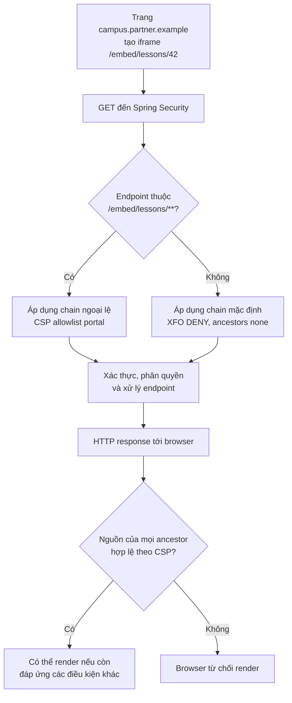

# Ngoại lệ nhúng trang theo endpoint với phạm vi xác định

## 1. Bài toán: chỉ mở iframe ở nơi thực sự cần

Trong module **SPRING_SECURITY_HTTP_PROTECTION**, người học áp dụng các biện pháp bảo vệ HTTP và trình duyệt của Spring Security, bao gồm CSRF, CORS, security headers, Content Security Policy (CSP), HSTS và bảo vệ session trên cả **Servlet** lẫn **Reactive**. Chủ đề **Chống nhúng trang** xử lý nguy cơ *clickjacking*: một trang độc hại nhúng giao diện ứng dụng trong `<iframe>` và đánh lừa người dùng nhấp vào thao tác thật ở bên trong.

Giả sử nền tảng học trực tuyến hoạt động ở `https://learn.example.com`. Đối tác `https://campus.partner.example` được phép nhúng một số bài học vào cổng học tập của họ. Trong cùng ứng dụng còn có trang đổi mật khẩu, quản lý thanh toán và quản trị người dùng.

Yêu cầu đúng không phải “cho phép cả website được nhúng”, mà là:

- Chỉ nhóm `GET /embed/lessons/**` chứa **giao diện bài học được thiết kế cho iframe** mới có ngoại lệ.
- Chỉ `https://campus.partner.example` được phép làm trang tổ tiên của giao diện này.
- `/account/**`, `/admin/**`, `/payments/**` và những route khác tiếp tục **cấm mọi iframe**.
- Từng request vẫn phải trải qua xác thực, phân quyền, quản lý session và các kiểm soát CSRF phù hợp.
- Cả trình duyệt hiện đại, reverse proxy và cấu hình Spring Security đều phải thực thi nhất quán ý định trên.

**Ngoại lệ nhúng theo endpoint** là cách phát hành chính sách bảo vệ **khác nhau cho những tập URL được xác định rõ**, ưu tiên trạng thái an toàn mặc định. Nó không phải việc tắt tính năng chống clickjacking trên toàn bộ ứng dụng.

## 2. Thiết kế chính sách bảo vệ mặc định và ngoại lệ

Một response HTML không có nhu cầu iframe nên trả:

```http
X-Frame-Options: DENY
Content-Security-Policy: frame-ancestors 'none'
```

`DENY` và `frame-ancestors 'none'` đều biểu đạt **không cho phép nhúng**, kể cả từ trang cùng origin. Với trang bài học dành cho đối tác, response cần:

```http
Content-Security-Policy: frame-ancestors https://campus.partner.example
```

Trên endpoint ngoại lệ, **không phát `X-Frame-Options: DENY` hoặc `SAMEORIGIN` từ security chain** để tránh xung đột đối với những trình duyệt cũ còn xét XFO. CSP `frame-ancestors` trở thành cơ chế khai báo origin được phép nhúng.

Nếu ứng dụng **cũng cần tự nhúng** bài học ở `https://learn.example.com`, có thể dùng:

```http
Content-Security-Policy: frame-ancestors 'self' https://campus.partner.example
```

Chỉ thêm `'self'` khi có nhu cầu. Nguyên tắc là **mỗi nguồn xuất hiện trong danh sách đều phải có lý do nghiệp vụ**.

| Response | Nhu cầu nhúng | XFO mong đợi | CSP `frame-ancestors` mong đợi |
| --- | --- | --- | --- |
| `/embed/lessons/42` | Chỉ cổng đối tác | Không có từ chain ngoại lệ | `https://campus.partner.example` |
| `/embed/lessons/99` | Chỉ cổng đối tác | Không có từ chain ngoại lệ | `https://campus.partner.example` |
| `/account/security` | Không cần nhúng | `DENY` | `'none'` |
| `/admin/users` | Không cần nhúng | `DENY` | `'none'` |
| `/payments/confirm` | Không cần nhúng | `DENY` | `'none'` |
| `/lessons/42` (trang bài học thông thường) | Không cần nhúng | `DENY` | `'none'` |

Việc có cả `/lessons/42` và `/embed/lessons/42` là **thiết kế phân tách rõ mục đích**: một trang thông thường vẫn được bảo vệ nghiêm ngặt; một giao diện iframe riêng có chính sách được thu hẹp. Hai route có thể gọi chung service lấy dữ liệu nếu vẫn áp dụng đúng quyền truy cập.

### Vì sao không đặt ngoại lệ quá rộng?

Một matcher như `/embed/**` có thể vô tình mở khả năng nhúng cho `/embed/admin`, `/embed/settings` hoặc những URL mới được tạo sau này. Matcher `/embed/lessons/**` cụ thể hơn, nhưng vẫn phải kiểm soát **mọi endpoint nằm dưới prefix đó**.

Không lấy “route có chữ `embed`” làm bằng chứng an toàn: đội phát triển phải xác nhận rằng chỉ những màn hình có mục đích nhúng hợp lệ xuất hiện trong phạm vi đã mở.

## 3. Hai quyết định khác nhau: cho phép nhúng và cho phép truy cập

Phân biệt hai câu hỏi:

1. **Trình duyệt có được phép hiển thị response bên trong iframe của portal không?** Điều này phụ thuộc CSP `frame-ancestors` của **trang được nhúng** cùng các chính sách trình duyệt khác.
2. **Người dùng có quyền xem nội dung bài học hoặc thực hiện thao tác không?** Điều này phụ thuộc xác thực, phân quyền và kiểm tra dữ liệu ở **server**.

Một portal được ghi trong `frame-ancestors` không tự nhận được quyền truy cập nội dung của bất kỳ học viên nào. Ngược lại, một học viên đã đăng nhập vẫn không thể nhúng `/account/security` từ portal nếu response có `frame-ancestors 'none'`.



**Lưu ý:** sơ đồ mô tả luồng quyết định theo cách đơn giản. Header chống nhúng trên response **không thay cho kiểm tra quyền ở bước xử lý request**; việc response có header thích hợp cũng không bảo đảm người dùng đã được xác thực hay nội dung được render.

## 4. Quy tắc CSP cần hiểu trước khi viết ngoại lệ

### 4.1. `frame-ancestors` ở response của trang con

Trình duyệt xét `frame-ancestors` từ **HTTP response của tài liệu bị nhúng**. Không dùng `frame-src` để thay:

| Directive | Vai trò |
| --- | --- |
| `frame-ancestors https://campus.partner.example` trên trang bài học | Ai được phép nhúng **trang bài học**? |
| `frame-src https://learn.example.com` trên portal | Portal được phép **tải iframe từ đâu**? |
| `Access-Control-Allow-Origin` | Phục vụ những quy tắc CORS liên quan request/tài nguyên, **không cấp quyền nhúng UI**. |

Cả hai website có thể có CSP riêng. Portal có `frame-src` đúng vẫn không thể buộc bài học được render nếu bài học có `frame-ancestors 'none'`.

### 4.2. Khớp nguồn chính xác

`https://campus.partner.example` không đồng nghĩa `http://campus.partner.example`, `https://campus.partner.example:8443` hoặc `https://admin.campus.partner.example`. Khi xác định nguồn đối tác, hãy ghi rõ **scheme, hostname và port cần thiết**, kiểm tra URL thực tế sau redirect, đồng thời hiểu rằng CSP dùng thuật toán source matching của trình duyệt.

Tránh:

```http
Content-Security-Policy: frame-ancestors https:
```

Policy quá rộng này cho phép rất nhiều website HTTPS làm ancestor, bao gồm website của kẻ tấn công. Đừng dùng wildcard subdomain khi không quản lý toàn bộ các subdomain tương ứng.

### 4.3. Iframe nhiều tầng

Nếu `https://external.example.net` nhúng portal, rồi portal nhúng bài học, **cả external lẫn portal đều là ancestor** của bài học:

```text
https://external.example.net
  └── https://campus.partner.example
        └── https://learn.example.com/embed/lessons/42
```

Với `frame-ancestors https://campus.partner.example`, trình duyệt hỗ trợ CSP **từ chối render bài học**, vì `external.example.net` không được cấp phép. Chỉ mở thêm external nếu đã xác minh đây thực sự là yêu cầu nghiệp vụ và nguồn đáng tin cậy.

### 4.4. Header thực thi, không phải meta hoặc Report-Only

`frame-ancestors` phải có trong **HTTP response header `Content-Security-Policy`** để thực thi. Directive này **không có hiệu lực** khi khai báo trong `<meta http-equiv="Content-Security-Policy">`. Policy ở `Content-Security-Policy-Report-Only` cũng **không tự chặn iframe**.

`frame-ancestors` **không kế thừa `default-src`**. Kể cả khi response có `default-src 'none'`, nếu muốn cấm website khác nhúng thì vẫn cần `frame-ancestors 'none'` hoặc XFO phù hợp.

## 5. Spring Security Servlet: hai SecurityFilterChain có phạm vi rõ

Với Spring Security Servlet hiện đại, cấu hình HTTP thông qua `HttpSecurity` và `SecurityFilterChain`. Khi bật bộ security headers mặc định, Spring Security gửi `X-Frame-Options: DENY`; mặc định **không phát chính sách CSP tổng quát**. Vì vậy, chỉ trên những URL cần nhúng chéo origin, ta bỏ XFO và khai báo CSP `frame-ancestors` tường minh.

Ví dụ đầy đủ dưới đây dùng **hai chain**, một cho endpoint iframe và một cho mọi URL còn lại. Phần xác thực trong ví dụ dùng `authenticated()` để minh họa; dự án thực tế phải bổ sung phân quyền theo học viên, khóa học và tenant.

```java
import org.springframework.context.annotation.Bean;
import org.springframework.context.annotation.Configuration;
import org.springframework.core.annotation.Order;
import org.springframework.http.HttpMethod;
import org.springframework.security.config.annotation.web.builders.HttpSecurity;
import org.springframework.security.config.annotation.web.configuration.EnableWebSecurity;
import org.springframework.security.web.SecurityFilterChain;

@Configuration
@EnableWebSecurity
public class SecurityConfig {

    @Bean
    @Order(1)
    SecurityFilterChain embeddedLessons(HttpSecurity http) throws Exception {
        return http
            .securityMatcher("/embed/lessons/**")
            .authorizeHttpRequests(auth -> auth
                .requestMatchers(HttpMethod.GET, "/embed/lessons/**")
                    .authenticated()
                .anyRequest().denyAll())
            .headers(headers -> headers
                .frameOptions(frame -> frame.disable())
                .contentSecurityPolicy(csp -> csp
                    .policyDirectives(
                        "frame-ancestors https://campus.partner.example")))
            .build();
    }

    @Bean
    @Order(2)
    SecurityFilterChain defaultPages(HttpSecurity http) throws Exception {
        return http
            .authorizeHttpRequests(auth -> auth
                .anyRequest().authenticated())
            .headers(headers -> headers
                .frameOptions(frame -> frame.deny())
                .contentSecurityPolicy(csp -> csp
                    .policyDirectives("frame-ancestors 'none'")))
            .build();
    }
}
```

Đọc chính xác từng lớp:

1. `securityMatcher("/embed/lessons/**")` quyết định **request nào chọn chain ngoại lệ**. Không dùng đường dẫn quá rộng nếu chỉ một loại HTML cần được nhúng.
2. `@Order(1)` đặt chain cụ thể trước chain mặc định; chain mặc định không có matcher hạn chế, nên bao phủ phần còn lại.
3. `requestMatchers(HttpMethod.GET, ...).authenticated()` cho phép **chỉ GET đã xác thực** trong nhóm route; các phương thức khác trong chain bị `denyAll()` từ chối. Đây là giới hạn ở lớp HTTP, chưa thay cho authorization theo nội dung/tenant.
4. `frameOptions(frame -> frame.disable())` chỉ tắt việc viết **X-Frame-Options** của chain ngoại lệ; CSP vẫn được phát và các security headers còn lại vẫn được giữ.
5. Chain mặc định ghi `DENY` và CSP `'none'`, vì vậy việc tạo thêm `/account` hoặc `/admin` sau này không tự được hưởng ngoại lệ nhúng.

**Không dùng:**

```java
// Phạm vi quá rộng; dễ mở nhúng cho những trang không dự kiến.
http.headers(headers -> headers.frameOptions(frame -> frame.disable()));

// Tắt toàn bộ bộ security headers trong chain.
http.headers(headers -> headers.disable());
```

Đoạn trên là các ví dụ **cần tránh** khi chỉ có một nhóm URL được phép nhúng. Nếu cấu hình như vậy trong chain bao phủ toàn bộ ứng dụng, những route không cần iframe cũng có thể mất lớp bảo vệ.

### Một lỗi cấu hình matcher rất thường gặp

```java
// Chỉ quyết định ai được truy cập, không tạo chính sách header riêng.
http.authorizeHttpRequests(auth -> auth
    .requestMatchers("/embed/lessons/**").permitAll()
    .anyRequest().authenticated());
```

`requestMatchers(...)` **bên trong `authorizeHttpRequests`** chỉ phân quyền; nó **không tự tạo ngoại lệ `frame-ancestors`** và không tự xóa XFO mặc định. Muốn các response của URL nhúng có header riêng, phải chọn cơ chế cấp header tương ứng, ví dụ **`securityMatcher` của chain** như trên. Đồng thời, `permitAll()` không thay cho kiểm tra quyền xem nội dung và có thể làm dữ liệu lộ nếu dùng sai.

## 6. Spring Security Reactive / WebFlux: phạm vi tương đương

Trong WebFlux, Spring Security dùng `ServerHttpSecurity` và `SecurityWebFilterChain`. Cơ chế browser nhận response header tương tự Servlet, nhưng API matcher và phân quyền khác:

```java
import org.springframework.context.annotation.Bean;
import org.springframework.context.annotation.Configuration;
import org.springframework.core.annotation.Order;
import org.springframework.http.HttpMethod;
import org.springframework.security.config.annotation.web.reactive.EnableWebFluxSecurity;
import org.springframework.security.config.web.server.ServerHttpSecurity;
import org.springframework.security.web.server.SecurityWebFilterChain;
import org.springframework.security.web.server.header.XFrameOptionsServerHttpHeadersWriter;
import org.springframework.security.web.server.util.matcher.PathPatternParserServerWebExchangeMatcher;

@Configuration
@EnableWebFluxSecurity
public class ReactiveSecurityConfig {

    @Bean
    @Order(1)
    SecurityWebFilterChain embeddedLessons(ServerHttpSecurity http) {
        return http
            .securityMatcher(
                new PathPatternParserServerWebExchangeMatcher(
                    "/embed/lessons/**"))
            .authorizeExchange(auth -> auth
                .pathMatchers(HttpMethod.GET, "/embed/lessons/**")
                    .authenticated()
                .anyExchange().denyAll())
            .headers(headers -> headers
                .frameOptions(frame -> frame.disable())
                .contentSecurityPolicy(csp -> csp
                    .policyDirectives(
                        "frame-ancestors https://campus.partner.example")))
            .build();
    }

    @Bean
    @Order(2)
    SecurityWebFilterChain defaultPages(ServerHttpSecurity http) {
        return http
            .authorizeExchange(auth -> auth
                .anyExchange().authenticated())
            .headers(headers -> headers
                .frameOptions(frame -> frame.mode(
                    XFrameOptionsServerHttpHeadersWriter.Mode.DENY))
                .contentSecurityPolicy(csp -> csp
                    .policyDirectives("frame-ancestors 'none'")))
            .build();
    }
}
```

Ở đây `PathPatternParserServerWebExchangeMatcher("/embed/lessons/**")` chọn chain theo đường dẫn, trong khi `pathMatchers(HttpMethod.GET, ...)` xác định rule cho GET. Tương tự Servlet, **bỏ XFO chỉ trên chain ngoại lệ**; không tắt toàn bộ bộ security headers.

Nếu endpoint trả về cả HTML và API JSON từ cùng prefix, cần kiểm tra yêu cầu bảo vệ của từng loại response. Chia đường dẫn cụ thể hơn khi cần; đừng mặc định mọi tài nguyên trong `/embed/lessons/**` đều có quyền nhúng như HTML của bài học.

## 7. Tính đầy đủ của phạm vi: phương thức, trang lỗi và tài nguyên phụ

### 7.1. Tại sao giới hạn theo đường dẫn vẫn cần kiểm tra?

Một matcher `/embed/lessons/**` có thể khớp nhiều URL:

```text
/embed/lessons/42
/embed/lessons/42/preview
/embed/lessons/42/settings
/embed/lessons/42/delete-confirmation
```

Nếu hai route cuối chứa thao tác nhạy cảm, **không nên để chúng nằm trong không gian URL được mở nhúng**. Hãy giữ nhóm nhúng chỉ dành cho giao diện hiển thị, phân tách route quản trị, và bổ sung kiểm tra phân quyền ở server. Giới hạn GET ở ví dụ tránh một số request có phương thức khác nhưng **không biến mọi trang GET thành nội dung an toàn**.

Trường hợp ngoại lệ chỉ dành cho một route duy nhất, dùng matcher chính xác như `/embed/lesson-view` thay vì prefix; nếu có nhiều route, nên xác định một nhóm ổn định và rà soát khi thêm endpoint mới.

### 7.2. Tài nguyên phụ cũng chịu chính sách riêng

Trang bài học có thể tải script, CSS, ảnh hoặc iframe khác:

```html
<link rel="stylesheet" href="/assets/lesson.css">
<script defer src="/assets/lesson.js"></script>
```

Việc tài liệu HTML được phép nhúng **không đồng nghĩa** mọi nguồn tài nguyên của nó được phép tải. CSP `script-src`, `style-src`, `img-src`, `connect-src` của chính trang và CSP của portal (đặc biệt `frame-src`) có thể ảnh hưởng. Không mở `frame-ancestors` trên toàn bộ `/assets/**` chỉ vì trang bài học tải CSS/JS từ đó; `frame-ancestors` chủ yếu có ý nghĩa với tài liệu bị nhúng vào frame.

### 7.3. Trang đăng nhập và chuyển hướng

Iframe trỏ đến `/embed/lessons/42` nhưng request chưa đăng nhập có thể bị chuyển hướng đến `/login`. Trang đăng nhập thuộc chain mặc định nên gửi `DENY` và `frame-ancestors 'none'`; iframe sẽ không hiển thị login. Đây có thể là hành vi đúng theo thiết kế.

Để hỗ trợ đối tác, có thể yêu cầu học viên đăng nhập ở cửa sổ cấp cao trước rồi quay về portal; hoặc xây dựng luồng SSO phù hợp. Không nên giải quyết bằng cách mở nhúng **toàn bộ trang đăng nhập** vì điều đó mở rộng bề mặt clickjacking.

### 7.4. Response lỗi, cache và proxy

Đường dẫn `/embed/lessons/**` có thể trả `404`, `403` hoặc `500`. Nếu lỗi được render thành trang HTML trong chính URL ngoại lệ, response vẫn có thể mang CSP cho phép portal nhúng nó. Hãy tránh hiển thị chức năng nhạy cảm trên trang lỗi và xác định hành vi của cơ chế error dispatch/framework; có thể áp dụng chính sách `'none'` riêng cho trang lỗi nếu cần.

Với reverse proxy, gateway hoặc CDN, cần kiểm tra **header cuối cùng tới trình duyệt**. Một tầng ngoài có thể thêm `X-Frame-Options: DENY` hoặc CSP `frame-ancestors 'none'` vào cả nhóm URL ngoại lệ. Ngược lại, một proxy đặt CSP quá rộng cho toàn site có thể làm mất tính chất “ngoại lệ đúng endpoint”.

## 8. Ngoại lệ cho nhiều đối tác và nhiều tenant

Giả sử nền tảng phục vụ hai trường học:

| Tenant/khóa học | Portal được phép nhúng | Đường dẫn ví dụ |
| --- | --- | --- |
| Trường A | `https://campus-a.partner.example` | `/embed/tenant-a/lessons/42` |
| Trường B | `https://campus-b.partner.example` | `/embed/tenant-b/lessons/93` |

Một CSP chung cho cả hai portal:

```http
Content-Security-Policy: frame-ancestors https://campus-a.partner.example https://campus-b.partner.example
```

có thể tạo **quyền nhúng rộng hơn dự kiến** ở từng trang. Nếu yêu cầu cô lập tenant, chính sách nên dựa vào **cấu hình server đã kiểm duyệt** tương ứng với tài nguyên hoặc tenant đã được xác định và phân quyền. Ví dụ, response tenant A chỉ cho `campus-a.partner.example`; tenant B chỉ cho `campus-b.partner.example`.

Những nguyên tắc triển khai cần giữ:

1. **Không phản chiếu tùy ý `Origin` hoặc `Referer` thành `frame-ancestors`.** Điều hướng iframe có thể không mang `Origin`; `Referer` có thể bị lược bớt hoặc vắng mặt. Các header request không tự chứng minh portal được phép.
2. **Không dùng tham số URL chưa xác thực** như `?allowedParent=https://...` để tự xây dựng CSP, vì kẻ tấn công có thể chọn nguồn của chính họ.
3. **Ràng buộc tenant với tài nguyên và người dùng trên server**. Kiểm tra quyền trước khi trả nội dung hoặc chính sách theo tenant.
4. **Cẩn thận với cache chia sẻ.** Nếu header CSP hoặc HTML được tạo theo tenant/người dùng, CDN phải có cache key phù hợp hoặc dùng `Cache-Control: private, no-store` cho response nhạy cảm. `Vary: Origin` không phải giải pháp tổng quát cho iframe, vì request điều hướng iframe có thể không có header `Origin`.
5. **Kiểm soát trường hợp cấu hình thiếu**: nếu không tìm thấy nguồn hợp lệ cho tài nguyên, ưu tiên `frame-ancestors 'none'` hoặc từ chối trả trang thay vì mở nhúng tự do.

Khi muốn chọn CSP động, có thể dùng cơ chế viết header của riêng endpoint/response ở server **theo dữ liệu đáng tin**, hoặc cấu hình các chain được xác định tường minh. Không nên vừa phát CSP tĩnh từ một chain vừa bổ sung CSP động trái ngược tại controller, vì **nhiều CSP enforced đồng thời đều được áp dụng** và policy chặt hơn có thể vô hiệu hóa ngoại lệ.

## 9. Kiểm thử tự động phạm vi ngoại lệ

Kiểm thử ở mức HTTP xác nhận **đúng route được mở** và **mọi route ngoài phạm vi vẫn đóng**. Các đoạn dưới giả định có handler/controller trả `200 OK` cho tài khoản thử nghiệm `learner`; dùng `spring-security-test`, `MockMvc` hoặc `WebTestClient` đã được cấu hình.

### 9.1. Servlet: MockMvc

```java
mockMvc.perform(get("/embed/lessons/42").with(user("learner")))
    .andExpect(status().isOk())
    .andExpect(header().doesNotExist("X-Frame-Options"))
    .andExpect(header().string(
        "Content-Security-Policy",
        "frame-ancestors https://campus.partner.example"));

mockMvc.perform(get("/account/security").with(user("learner")))
    .andExpect(status().isOk())
    .andExpect(header().string("X-Frame-Options", "DENY"))
    .andExpect(header().string(
        "Content-Security-Policy", "frame-ancestors 'none'"));

mockMvc.perform(get("/lessons/42").with(user("learner")))
    .andExpect(status().isOk())
    .andExpect(header().string("X-Frame-Options", "DENY"));
```

Đây là **phần thân các test minh họa**; cần các static import `get`, `user`, `status`, `header` và fixture route tương ứng. Nếu CSP có thêm directive khác, hãy kiểm tra `frame-ancestors` một cách phù hợp thay vì buộc cả header chỉ có một directive.

Để kiểm tra phương thức ngoài GET không được cấp quyền:

```java
mockMvc.perform(post("/embed/lessons/42")
        .with(user("learner"))
        .with(csrf()))
    .andExpect(status().isForbidden());
```

Ví dụ này giả định route POST (nếu tồn tại) đi qua chain nhúng và `denyAll()` như cấu hình mục 5. Gửi CSRF token hợp lệ nhằm bảo đảm kết quả `403` phản ánh chính sách deny thay vì chỉ do thiếu CSRF; đây là một **kiểm thử authorization**, không thay cho test header trên GET.

### 9.2. Reactive: WebTestClient

```java
webTestClient.mutateWith(mockUser("learner"))
    .get().uri("/embed/lessons/42")
    .exchange()
    .expectStatus().isOk()
    .expectHeader().doesNotExist("X-Frame-Options")
    .expectHeader().valueEquals(
        "Content-Security-Policy",
        "frame-ancestors https://campus.partner.example");

webTestClient.mutateWith(mockUser("learner"))
    .get().uri("/account/security")
    .exchange()
    .expectStatus().isOk()
    .expectHeader().valueEquals("X-Frame-Options", "DENY")
    .expectHeader().valueEquals(
        "Content-Security-Policy", "frame-ancestors 'none'");
```

`mockUser` thuộc `SecurityMockServerConfigurers` của `spring-security-test`. Khi có nhiều chain, hãy kiểm tra thêm một endpoint nằm gần ranh giới matcher, ví dụ `/embed/lesson` (số ít) hoặc `/embed/admin`, để chắc chắn route **không thuộc `/embed/lessons/**`** vẫn được bảo vệ bằng chain mặc định.

Kiểm thử HTTP header giúp phát hiện cấu hình sai nhưng **không mô phỏng việc trình duyệt áp dụng `frame-ancestors`**. Hãy bổ sung kiểm thử giao diện thực tế.

## 10. Thực hành trên trình duyệt: ngoại lệ chỉ dành cho portal

Thử trên các server và tài khoản do bạn kiểm soát:

- Ứng dụng Spring Boot: `http://localhost:8080`.
- Portal được phép: `http://localhost:9090`.
- Trang kiểm tra không được phép: `http://localhost:9091`.

Đối với **môi trường phát triển**, thay nguồn CSP trên route `/embed/lessons/**` bằng:

```http
Content-Security-Policy: frame-ancestors http://localhost:9090
```

Trên cả portal 9090 và trang 9091, tạo HTML:

```html
<!doctype html>
<html lang="vi">
<head>
  <meta charset="utf-8">
  <title>Thử nghiệm phạm vi iframe</title>
</head>
<body>
  <h1>Trang cha thử nghiệm</h1>
  <iframe
    src="http://localhost:8080/embed/lessons/42"
    title="Bài học được nhúng"
    width="900"
    height="550"></iframe>
</body>
</html>
```

Sau khi xác thực phù hợp, kiểm tra:

| Trang cha | Trang con | Kết quả dự kiến |
| --- | --- | --- |
| `localhost:9090` | `localhost:8080/embed/lessons/42` | Có thể hiển thị vì 9090 được khai báo trong CSP. |
| `localhost:9091` | `localhost:8080/embed/lessons/42` | Bị từ chối vì 9091 không nằm trong allowlist. |
| `localhost:9090` | `localhost:8080/account/security` | Bị từ chối dù portal được tin cậy ở route nhúng, vì `/account/**` vẫn có `DENY`/`'none'`. |
| `localhost:9090` | `localhost:8080/lessons/42` | Bị từ chối; chỉ phiên bản `/embed/lessons/**` có ngoại lệ. |
| `localhost:8080` | `localhost:8080/embed/lessons/42` | Bị từ chối nếu CSP chỉ liệt kê 9090 mà không có `'self'`. |
| 9091 nhúng 9090, 9090 nhúng bài học | `/embed/lessons/42` | Bị từ chối vì có ancestor 9091 không được cấp phép. |

Trong DevTools:

1. Ở tab **Network**, chọn response chính của iframe, kiểm tra `Content-Security-Policy` và sự vắng mặt của XFO trên route ngoại lệ.
2. Ở tab **Console**, phân biệt thông báo vi phạm `frame-ancestors` với lỗi cookie, CSP `frame-src` của portal hoặc tài nguyên phụ.
3. Mở trực tiếp `/account/security` và `/embed/lessons/42` để kiểm tra việc chặn iframe **không ngăn truy cập tab trực tiếp** theo quyền người dùng.
4. Kiểm tra response **sau redirect**; nếu bị điều hướng sang login, chính sách chặn iframe của trang login có thể khiến iframe trắng.
5. Lặp lại ở môi trường production-like qua HTTPS/gateway/CDN, vì các tầng này có thể thêm hoặc ghi đè header.

Có thể quan sát header thô:

```bash
curl -i http://localhost:8080/embed/lessons/42
curl -i http://localhost:8080/account/security
```

Lệnh `curl` không mô phỏng điều kiện ancestor của browser. Nếu chưa xác thực, response `302` hoặc `401` có thể khác HTML sau khi đăng nhập; đọc đúng **response cuối của trang đích**, không suy diễn từ request chưa đăng nhập.

## 11. Các lỗi triển khai thường làm ngoại lệ mất kiểm soát

### “Cho phép một trang nhưng tất cả trang đều có thể bị nhúng”

Kiểm tra `.frameOptions(...disable())` có nằm trong chain mặc định không; có vô tình cấu hình `frame-ancestors https:`, `frame-ancestors *` hoặc bỏ hoàn toàn CSP không. Kiểm tra đường dẫn `securityMatcher` có bao gồm route nhạy cảm không và chain mặc định có thật sự bao phủ phần còn lại không.

### “Đã cấu hình CSP đúng nhưng portal vẫn bị chặn”

Kiểm tra **response cuối tới browser** có `X-Frame-Options: DENY` do Nginx/ingress/CDN thêm không, hay có CSP thứ hai `frame-ancestors 'none'`. Trình duyệt hiện đại thực thi tất cả CSP enforced đồng thời; một CSP chặt hơn có thể chặn ngay cả khi policy đầu cho phép portal. Kiểm tra `frame-src` từ phía portal và mọi ancestor nếu có iframe lồng nhau.

### “Matcher đã đúng nhưng response vẫn mang DENY”

Xác minh request khớp chain ngoại lệ theo thứ tự `@Order`, đúng đường dẫn có prefix context path/route mapping như triển khai. `requestMatchers` trong `authorizeHttpRequests` không phải cách tách header policy. Nếu HTTP response được phục vụ ngoài Spring Security (ví dụ một static server hoặc gateway khác), cấu hình Spring có thể không áp dụng.

### “Nhúng được nhưng không có dữ liệu hoặc liên tục quay về login”

Chính sách frame chỉ quyết định quyền hiển thị. Cookie `SameSite`, trình duyệt chặn third-party cookies, session hết hạn hoặc thiếu quyền tài nguyên đều có thể làm widget không tải. Tránh đổi cookie sang `SameSite=None` trên toàn hệ thống mà chưa phân tích rủi ro và luồng xác thực; với cookie cần dùng cross-site, `Secure` và HTTPS là điều kiện quan trọng.

### “Đặt CORS cho portal nhưng vẫn không nhúng được”

`Access-Control-Allow-Origin` không cấp quyền nhúng UI. CSP `frame-ancestors` trên **trang bài học** quyết định portal nào có quyền nhúng, còn CSP `frame-src` trên **portal** có thể giới hạn portal được tải nguồn nào.

### “CSP động đúng cho từng tenant nhưng đôi lúc trả nguồn của tenant khác”

Kiểm tra cache key và các lớp CDN/reverse proxy. Header bảo vệ được phát theo tenant hoặc user phải đi cùng chính HTML và dữ liệu đúng tenant. Một response cache dùng chung với chính sách của tenant khác có thể làm hỏng phạm vi nhúng hoặc gây rủi ro lộ dữ liệu. Ưu tiên khóa cache rõ ràng hoặc `Cache-Control: private, no-store` khi dữ liệu nhạy cảm.

### “Trang 404 dưới /embed/lessons/** cũng được phép nhúng”

Đây là hệ quả có thể có của việc chọn chain theo URL: response lỗi dưới prefix cũng có thể thừa hưởng policy ngoại lệ. Kiểm tra HTML lỗi và các route mới trong prefix. Nếu nội dung lỗi có dữ liệu nhạy cảm, thiết kế xử lý lỗi riêng hoặc chọn matcher hẹp hơn.

## 12. Checklist trước khi phát hành

| Câu hỏi xác nhận | Tiêu chí đạt |
| --- | --- |
| Endpoint được mở nhúng có danh sách đầy đủ không? | Chỉ các URL có mục đích nhúng hợp lệ nằm trong matcher. |
| Những route nhạy cảm có giữ mặc định từ chối không? | `DENY` và CSP `'none'` trên account/admin/payment và URL thông thường. |
| Origin đối tác đã được xác minh chưa? | Scheme/host/port khớp và không có wildcard ngoài ý muốn. |
| Có iframe nhiều tầng không? | Mọi ancestor dự kiến được kiểm soát; không bổ sung nguồn lạ tùy tiện. |
| XFO có bị tắt quá rộng không? | Chỉ chain nhúng chéo origin không phát XFO mặc định. |
| Các lớp bảo vệ ứng dụng còn nguyên không? | Xác thực, phân quyền, CSRF, session/cookie và các security headers khác phù hợp. |
| Có nhiều CSP hoặc proxy thêm header không? | Response cuối tại trình duyệt có policy nhất quán. |
| Đã thử browser và test HTTP chưa? | Test cả portal hợp lệ, portal lạ, route ngoài ngoại lệ và trình duyệt mục tiêu. |
| Có CSP theo tenant/user không? | Nguồn lấy từ cấu hình đáng tin cậy, cache và dữ liệu được cô lập. |

## 13. Bài tập áp dụng

**Bài A — Xác định phạm vi nhỏ nhất.** Hệ thống có `/embed/lessons/42`, `/embed/lessons/42/edit`, `/account/password` và `/lessons/42`. Chỉ báo cáo bài học ở URL đầu cần iframe đối tác. Chọn matcher hoặc cách tổ chức lại route để tránh mở nhúng các trang còn lại, rồi giải thích vì sao `/embed/**` là quá rộng.

**Bài B — So sánh quyền truy cập và quyền nhúng.** Portal đã được ghi trong `frame-ancestors`, nhưng một học viên chưa mua khóa học mở iframe. Có nên hiển thị bài học không? Hãy phân biệt browser framing policy với kiểm tra authorization ở server.

**Bài C — Phát hiện sai scope.** Đoạn code chỉ có `.authorizeHttpRequests(auth -> auth.requestMatchers("/embed/lessons/**").permitAll())` và không cấu hình header khác. Hãy giải thích tại sao điều này không tạo được ngoại lệ iframe, và vì sao `permitAll` có thể gây hậu quả nếu bài học cần xác thực.

**Bài D — Hai đối tác.** Tenant A dùng `https://a.portal.example`, tenant B dùng `https://b.portal.example`. Đề xuất cách ràng buộc CSP `frame-ancestors` với từng tenant, cách xử lý cache và điều gì xảy ra nếu response thiếu cấu hình nguồn.

**Bài E — Triển khai qua proxy.** Spring Security trả CSP cho phép portal nhưng reverse proxy thêm `X-Frame-Options: DENY` và CSP `frame-ancestors 'none'`. Dự đoán hành vi ở trình duyệt hiện đại và trình duyệt cũ, rồi mô tả các điểm cần kiểm tra để sửa lỗi.

**Gợi ý:** A — route nhúng nên riêng biệt và matcher càng hẹp càng tốt. B — portal hợp lệ không thay quyền mua khóa học/authorization. C — authorization matcher khác security chain matcher và header writer. D — nguồn CSP từ mapping server đáng tin, kiểm soát cache theo tenant, mặc định từ chối khi thiếu mapping. E — CSP `'none'` từ proxy chặn trên trình duyệt hiện đại; XFO `DENY` có thể chặn trên trình duyệt cũ, cần sửa tại tầng phát policy xung đột.

## 14. Ghi nhớ

**Ngoại lệ nhúng trang an toàn phải được thiết kế theo endpoint có phạm vi xác định.** Trong Spring Security, dùng **chain có matcher cụ thể** cho những URL cần iframe, phát CSP `frame-ancestors` chỉ rõ nguồn đối tác, và **chỉ tắt X-Frame-Options trên chain ngoại lệ** khi việc nhúng chéo origin yêu cầu. Chain mặc định tiếp tục phát `DENY` và `frame-ancestors 'none'` cho các trang khác.

Cách tiếp cận này áp dụng cho cả **Servlet** và **Reactive/WebFlux**. Để ngoại lệ có hiệu lực mà không mở rộng rủi ro, phải xác minh matcher, origin, mọi ancestor, quyền truy cập, session, chính sách CSP/XFO cuối qua proxy và kết quả kiểm thử trong trình duyệt thật. **Được phép nhúng không đồng nghĩa được phép truy cập dữ liệu hoặc thực hiện thao tác.**
