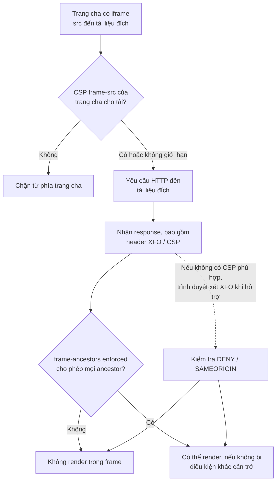

# Kiểm thử việc nhúng từ trang cùng nguồn và khác nguồn

## 1. Mục tiêu của bài thực hành

Trong module **SPRING_SECURITY_HTTP_PROTECTION**, người học áp dụng các lớp phòng vệ HTTP và trình duyệt của Spring Security cho cả **Servlet** và **Reactive/WebFlux**, đồng thời kiểm thử hành vi thực tế thay vì chỉ nhìn vào cấu hình Java. Ở chương **Chống nhúng trang**, một yêu cầu quan trọng là xác nhận ứng dụng ngăn được *clickjacking* nhưng vẫn cho phép những iframe phục vụ nghiệp vụ hợp lệ.

Clickjacking xuất hiện khi website độc hại nhúng giao diện ứng dụng trong `<iframe>`, rồi sắp đặt các lớp hiển thị để người dùng bấm nhầm nút hoặc biểu mẫu ở trang đích. Việc JavaScript của trang ngoài không đọc được DOM khác origin **không tự ngăn** cú nhấp của người dùng đến giao diện trong iframe. Các HTTP response header **`X-Frame-Options`** (XFO) và **CSP `frame-ancestors`** cho phép trang đích kiểm soát ai được nhúng nó.

Ta sẽ kiểm thử ba loại response từ ứng dụng tại `http://localhost:8080`:

| Endpoint HTML | Chính sách chống nhúng | Ý định |
| --- | --- | --- |
| `/protected/deny` | `X-Frame-Options: DENY` và `frame-ancestors 'none'` | Không cho bất kỳ trang nào nhúng. |
| `/protected/same` | `X-Frame-Options: SAMEORIGIN` và `frame-ancestors 'self'` | Chỉ cho iframe từ cùng origin. |
| `/protected/partner` | CSP `frame-ancestors 'self' http://localhost:9090`; không phát XFO | Cho phép cùng origin và một portal tại port 9090. |

Hai nguồn trang cha để thử là **`http://localhost:8080` (cùng origin)** và **`http://localhost:9090` (khác origin)**; thêm `http://localhost:9091` làm nguồn ngoài **không được cấp phép**. Các trang HTML chỉ chứa dấu hiệu kiểm thử, không có hành động nhạy cảm thật.

Sau bài này, bạn sẽ có thể:

1. Dự đoán trang nào được phép nhúng một endpoint theo XFO/CSP.
2. Phân biệt **HTTP response tải thành công** với **tài liệu được trình duyệt render trong frame**.
3. Thiết lập bài thử cùng nguồn, khác nguồn và iframe nhiều tầng.
4. Kiểm thử header bằng **MockMvc**, **WebTestClient**, rồi kiểm chứng bằng trình duyệt/DevTools.
5. Chẩn đoán sự cố do redirect, phân quyền, cookie, CSP trang cha, proxy và chính sách chồng chéo.

## 2. Xác định “cùng nguồn” trước khi bắt đầu

Với URL HTTP(S), **origin** được xác định bởi bộ ba **scheme, host và port**. Hai đường dẫn trên cùng website không làm origin thay đổi, nhưng đổi scheme, hostname hoặc port thì có thể làm origin khác.

Giả sử tài liệu đích nằm tại `http://localhost:8080/protected/same`:

| Nguồn trang cha | Cùng origin với đích? | Vì sao |
| --- | --- | --- |
| `http://localhost:8080/lab/same-parent` | Có | Cùng HTTP, host `localhost`, port 8080. |
| `http://localhost:9090/frame-test.html` | Không | Port khác (9090 so với 8080). |
| `http://localhost:9091/frame-test.html` | Không | Port khác (9091 so với 8080). |
| `http://127.0.0.1:8080/page` | Không | Host `127.0.0.1` khác `localhost`. |
| `https://localhost:8080/page` | Không | HTTPS khác HTTP. |
| `http://localhost:8080/another-path` | Có | Path không phải thành phần origin. |

**Same-site khác same-origin.** Hai trang `localhost:8080` và `localhost:9090` là **khác origin** nhưng có thể cùng site dưới góc nhìn cookie; bài thử chứng minh chính sách iframe theo origin, **không đại diện đầy đủ cho việc trình duyệt chặn third-party cookies giữa hai website thực tế**.

Đừng kiểm tra `SAMEORIGIN` bằng cách đổi mỗi đường dẫn hoặc domain cùng công ty rồi mặc định rằng chúng tương đương. Trên production, `https://portal.example.com` và `https://app.example.com` là hai origin khác nhau.

## 3. Cách trình duyệt quyết định có render iframe hay không



Sơ đồ đơn giản hóa các nhánh xử lý: trên trình duyệt hiện đại tuân thủ CSP, **`frame-ancestors` ở chế độ thực thi được ưu tiên so với XFO**. Khi không có directive này, XFO hợp lệ vẫn có thể từ chối nhúng. Trình duyệt cũ có thể không thực thi đầy đủ CSP.

**Không dùng mã trạng thái `200 OK` làm bằng chứng iframe đã hiển thị.** Trình duyệt có thể đã gửi request và nhận `200` cùng HTML, nhưng từ chối render sau khi đọc `X-Frame-Options` hoặc `frame-ancestors`. Lỗi thường xuất hiện trong **DevTools Console** chứ không nhất thiết là `403` ở Network.

### Hai chiều chính sách iframe

- **`frame-ancestors` của trang con** quyết định *ai được nhúng trang con*.
- **`frame-src` của trang cha** quyết định *trang cha được tải iframe từ đâu*.

Khi trang cha không có CSP `frame-src`, hoặc không có fallback giới hạn qua `child-src`/`default-src`, phía cha có thể không chặn request iframe. Dù vậy trang con vẫn có quyền từ chối bị nhúng. CORS/`Access-Control-Allow-Origin` không thay thế hai directive này.

## 4. Ma trận kết quả cần dự đoán trước khi thử

Một cấu hình tốt phải cho phép đúng trang cha hợp lệ và từ chối những trang cha không được cấp phép.

| Trang cha | `/protected/deny` | `/protected/same` | `/protected/partner` |
| --- | --- | --- | --- |
| `http://localhost:8080` | **Chặn** dù cùng origin | **Cho phép** | **Cho phép** nhờ `'self'` |
| `http://localhost:9090` | **Chặn** | **Chặn** vì khác origin | **Cho phép** vì portal nằm trong CSP |
| `http://localhost:9091` | **Chặn** | **Chặn** | **Chặn** vì không thuộc CSP |

Điều kiện ngầm định của các ô “Cho phép” là trang đích được tải thành công, người dùng được phép truy cập, CSP trang cha không chặn nguồn iframe và các yếu tố như cookie/sandbox không làm hỏng luồng. “Chặn” nghĩa là **trình duyệt không render tài liệu trong frame**, không nhất thiết là request không được gửi.

Để kiểm tra tính chính xác của chính sách, cần thử:

- **Dương tính:** cùng origin nhúng `SAMEORIGIN` và portal 9090 nhúng `/protected/partner`.
- **Âm tính:** cùng origin không được nhúng `DENY`; 9090 không được nhúng `SAMEORIGIN`; 9091 không được nhúng `/protected/partner`.
- **Ngoài iframe:** mở trực tiếp ba URL để phân biệt lỗi render với lỗi endpoint.
- **Frame lồng nhau:** 9091 nhúng trang 9090, trang 9090 lại nhúng `/protected/partner`; trang con phải chặn vì có ancestor 9091 không hợp lệ.

## 5. Chuẩn bị một ứng dụng Spring Boot thử nghiệm trên Servlet

Ví dụ sử dụng Spring Security với `HttpSecurity` và nhiều `SecurityFilterChain`. Cấu hình `permitAll()` dưới đây **chỉ phục vụ lab với nội dung giả**, giúp quan sát header mà không phải cấu hình đăng nhập. **Không áp dụng `permitAll()` cho các trang tài khoản hoặc dữ liệu thật**; production phải giữ xác thực, phân quyền và CSRF phù hợp.

### 5.1. Cấu hình bảo vệ cho ba endpoint

```java
import org.springframework.context.annotation.Bean;
import org.springframework.context.annotation.Configuration;
import org.springframework.core.annotation.Order;
import org.springframework.security.config.annotation.web.builders.HttpSecurity;
import org.springframework.security.config.annotation.web.configuration.EnableWebSecurity;
import org.springframework.security.web.SecurityFilterChain;

@Configuration
@EnableWebSecurity
public class FrameLabSecurityConfig {

    @Bean
    @Order(1)
    SecurityFilterChain sameOriginFrame(HttpSecurity http)
            throws Exception {
        return http
            .securityMatcher("/protected/same")
            .authorizeHttpRequests(auth -> auth
                .anyRequest().permitAll())
            .headers(headers -> headers
                .frameOptions(frame -> frame.sameOrigin())
                .contentSecurityPolicy(csp -> csp
                    .policyDirectives("frame-ancestors 'self'")))
            .build();
    }

    @Bean
    @Order(2)
    SecurityFilterChain partnerFrame(HttpSecurity http)
            throws Exception {
        return http
            .securityMatcher("/protected/partner")
            .authorizeHttpRequests(auth -> auth
                .anyRequest().permitAll())
            .headers(headers -> headers
                .frameOptions(frame -> frame.disable())
                .contentSecurityPolicy(csp -> csp
                    .policyDirectives(
                        "frame-ancestors 'self' http://localhost:9090")))
            .build();
    }

    @Bean
    @Order(3)
    SecurityFilterChain defaultPages(HttpSecurity http)
            throws Exception {
        return http
            .authorizeHttpRequests(auth -> auth
                .anyRequest().permitAll())
            .headers(headers -> headers
                .frameOptions(frame -> frame.deny())
                .contentSecurityPolicy(csp -> csp
                    .policyDirectives("frame-ancestors 'none'")))
            .build();
    }
}
```

Ba chain tạo ra ba mức bảo vệ:

1. `/protected/same`: cho phép các ancestor cùng origin với response.
2. `/protected/partner`: cho phép cùng origin và `http://localhost:9090`; bỏ riêng XFO mặc định để tránh xung đột với origin ngoài.
3. `/protected/deny` và các URL còn lại: chặn mọi iframe bằng `DENY` và `'none'`.

Spring Security thông thường thêm `X-Frame-Options: DENY` theo mặc định khi bộ security headers được bật. Phần `frameOptions(frame -> frame.disable())` trong **chain 2** chỉ ngừng viết XFO trên nhóm request đó, không tắt CSP hoặc toàn bộ security headers.

Không dùng `headers(headers -> headers.disable())` chỉ để mở một iframe; nó tắt cả các header bảo vệ khác do Spring Security quản lý.

### 5.2. Tạo ba trang đích có dấu kiểm tra

Một controller chỉ trả về HTML vô hại. Cùng một marker cho cả ba URL để quan sát **sự khác biệt do header**, không phải do nội dung HTML:

```java
import org.springframework.http.MediaType;
import org.springframework.web.bind.annotation.GetMapping;
import org.springframework.web.bind.annotation.RestController;

@RestController
public class FrameLabController {

    @GetMapping(
        value = {"/protected/deny", "/protected/same", "/protected/partner"},
        produces = MediaType.TEXT_HTML_VALUE)
    public String protectedDemo() {
        return """
            <!doctype html>
            <html lang="vi">
            <head><meta charset="utf-8"><title>Frame target</title></head>
            <body>
                <h1 id="frame-marker">Nội dung demo đã render</h1>
                <button type="button">Nút mô phỏng, không xử lý dữ liệu</button>
            </body>
            </html>
            """;
    }

    @GetMapping(
        value = "/lab/same-parent",
        produces = MediaType.TEXT_HTML_VALUE)
    public String sameOriginParent() {
        return """
            <!doctype html>
            <html lang="vi">
            <head><meta charset="utf-8"><title>Parent same origin</title></head>
            <body>
                <h1>Trang cha trên port 8080</h1>
                <iframe id="deny" src="/protected/deny"
                        title="Deny" width="600" height="130"></iframe>
                <iframe id="same" src="/protected/same"
                        title="Same origin" width="600" height="130"></iframe>
                <iframe id="partner" src="/protected/partner"
                        title="Partner" width="600" height="130"></iframe>
            </body>
            </html>
            """;
    }
}
```

Các text block `"""` yêu cầu **Java hỗ trợ text blocks (Java 15 trở lên)**; đây là mã demo minh họa cho dự án Spring Boot hiện đại. Ứng dụng có thể dùng template HTML riêng thay cho trả chuỗi từ controller. Khi mở trực tiếp `http://localhost:8080/protected/deny`, nội dung marker vẫn có thể hiển thị vì XFO/CSP `frame-ancestors` chỉ chi phối việc **bị nhúng**, không cấm điều hướng top-level.

## 6. Tạo hai trang cha ở origin khác

Tại hai server tĩnh khác nhau, một trên `http://localhost:9090` và một trên `http://localhost:9091`, phục vụ cùng nội dung `frame-test.html` dưới đây. Có thể dùng bất kỳ web server thử nghiệm nào miễn là trình duyệt thật sự truy cập đúng hai port; **không mở file bằng `file://`** vì origin kiểu local file không tương đương origin HTTP của bài thử.

```html
<!doctype html>
<html lang="vi">
<head>
  <meta charset="utf-8">
  <title>Cross-origin iframe test</title>
</head>
<body>
  <h1>Thử iframe từ trang cha khác origin</h1>
  <h2>Endpoint DENY</h2>
  <iframe id="deny"
    src="http://localhost:8080/protected/deny"
    title="Deny" width="600" height="130"></iframe>

  <h2>Endpoint SAMEORIGIN</h2>
  <iframe id="same"
    src="http://localhost:8080/protected/same"
    title="Same origin" width="600" height="130"></iframe>

  <h2>Endpoint cho phép portal 9090</h2>
  <iframe id="partner"
    src="http://localhost:8080/protected/partner"
    title="Partner" width="600" height="130"></iframe>
</body>
</html>
```

**Tại sao phải dùng URL tuyệt đối ở trang 9090 và 9091?** Nếu dùng `src="/protected/same"`, trình duyệt sẽ request `localhost:9090/protected/same` hoặc `localhost:9091/protected/same`. Khi đó bạn đang thử sai server và có thể nhầm lỗi `404` thành kết quả chống nhúng.

Khi mở `http://localhost:8080/lab/same-parent`, ba iframe dùng URL cùng origin 8080. Khi mở `http://localhost:9090/frame-test.html`, các iframe trỏ về 8080 nhưng trang cha là 9090, vì thế chỉ `partner` được phép hiển thị. Tại 9091, cả ba phải bị chặn.

## 7. Thực hiện kiểm thử trong trình duyệt và DevTools

### Bước 1. Kiểm tra endpoint trực tiếp

Mở lần lượt:

```text
http://localhost:8080/protected/deny
http://localhost:8080/protected/same
http://localhost:8080/protected/partner
```

Nếu các trang đều hiện `Nội dung demo đã render` trong **tab trực tiếp**, controller đang hoạt động. Nếu có lỗi `404`, `500` hoặc đăng nhập thất bại, cần sửa luồng request trước khi đánh giá XFO/CSP.

### Bước 2. Kiểm tra trang cha cùng origin

Mở `http://localhost:8080/lab/same-parent`:

- `deny`: không render marker, dù trang cha cùng origin.
- `same`: render marker.
- `partner`: render marker vì CSP khai báo `'self'`.

Đây là phép thử bắt buộc để xác nhận chính sách `DENY` **khác** `SAMEORIGIN`.

### Bước 3. Kiểm tra trang cha khác origin hợp lệ

Mở `http://localhost:9090/frame-test.html`:

- `deny`: bị chặn.
- `same`: bị chặn vì khác port.
- `partner`: render marker vì `http://localhost:9090` có trong `frame-ancestors`.

### Bước 4. Kiểm tra trang cha khác origin không hợp lệ

Mở `http://localhost:9091/frame-test.html`. Cả ba iframe phải bị từ chối. Nếu `partner` vẫn hiện, kiểm tra CSP đã được gửi qua response thật hay chưa và có phải phiên bản thử nghiệm đang dùng CSP quá rộng như `frame-ancestors http:` hoặc `frame-ancestors *`.

### Bước 5. Quan sát Network và Console

Trong **DevTools → Network**, chọn request của **chính URL trong iframe**. Xác nhận header trên **response đích**:

```http
# /protected/deny
X-Frame-Options: DENY
Content-Security-Policy: frame-ancestors 'none'

# /protected/same
X-Frame-Options: SAMEORIGIN
Content-Security-Policy: frame-ancestors 'self'

# /protected/partner
Content-Security-Policy: frame-ancestors 'self' http://localhost:9090
```

Dòng chú thích `#` trong khối trên chỉ để phân nhóm ví dụ; chúng không phải HTTP header thật. Với `/protected/partner`, kết quả mong đợi là **không có `X-Frame-Options` do ứng dụng phát**.

Ở tab **Console**, tìm thông báo tương ứng `X-Frame-Options` hoặc CSP `frame-ancestors`. Cú pháp lỗi khác nhau tùy trình duyệt/phiên bản; dựa vào ý nghĩa thông báo và header hơn là so khớp chính xác một câu chữ.

**Quan trọng:** trang con có thể trả HTTP `200 OK` và vẫn không render. Kiểm thử phải quan sát cả **header thực tế**, **Console** và **marker trong frame**.

## 8. Kiểm thử response header bằng MockMvc (Servlet)

Với `spring-security-test` và `MockMvc`, có thể chặn hồi quy do thay đổi matcher hoặc cấu hình header. Ví dụ sau là **phần thân test**, cần khởi tạo `MockMvc`, có controller demo và static import từ `MockMvcRequestBuilders`/`MockMvcResultMatchers`:

```java
mockMvc.perform(get("/protected/deny"))
    .andExpect(status().isOk())
    .andExpect(header().string("X-Frame-Options", "DENY"))
    .andExpect(header().string(
        "Content-Security-Policy", "frame-ancestors 'none'"));

mockMvc.perform(get("/protected/same"))
    .andExpect(status().isOk())
    .andExpect(header().string("X-Frame-Options", "SAMEORIGIN"))
    .andExpect(header().string(
        "Content-Security-Policy", "frame-ancestors 'self'"));

mockMvc.perform(get("/protected/partner"))
    .andExpect(status().isOk())
    .andExpect(header().doesNotExist("X-Frame-Options"))
    .andExpect(header().string(
        "Content-Security-Policy",
        "frame-ancestors 'self' http://localhost:9090"));
```

Đây là **test HTTP header**, không phải mô phỏng browser. Nó chứng minh security chain tạo response như dự kiến; nó **chưa chứng minh** trang 9090 nhúng được, trang 9091 bị từ chối hoặc iframe lồng nhau hoạt động đúng.

Trong ứng dụng thật có CSP gồm thêm `default-src`, `script-src` hoặc nhiều directive khác, hãy sử dụng assertion tìm **directive `frame-ancestors` cần thiết** thay vì luôn so khớp toàn bộ chuỗi. Với hệ thống có nhiều chain, nên thêm test cho các route ngay ngoài phạm vi ngoại lệ như `/protected/partner-other` để tránh mở nhúng ngoài ý muốn.

## 9. Kiểm thử response header bằng WebTestClient (Reactive)

Spring Security WebFlux dùng `ServerHttpSecurity` và `SecurityWebFilterChain` thay vì `HttpSecurity`. Với cấu hình bảo vệ tương đương, WebFlux cũng có XFO mặc định `DENY` nếu không tùy biến. Phần header để tạo ba nhóm chính sách có thể viết như sau:

```java
// Trích đoạn cho một SecurityWebFilterChain áp dụng
// riêng với endpoint /protected/same:
.headers(headers -> headers
    .frameOptions(frame -> frame.mode(
        XFrameOptionsServerHttpHeadersWriter.Mode.SAMEORIGIN))
    .contentSecurityPolicy(csp -> csp
        .policyDirectives("frame-ancestors 'self'")))

// Trích đoạn cho chain của /protected/partner:
.headers(headers -> headers
    .frameOptions(frame -> frame.disable())
    .contentSecurityPolicy(csp -> csp
        .policyDirectives(
            "frame-ancestors 'self' http://localhost:9090")))

// Trích đoạn cho chain mặc định:
.headers(headers -> headers
    .frameOptions(frame -> frame.mode(
        XFrameOptionsServerHttpHeadersWriter.Mode.DENY))
    .contentSecurityPolicy(csp -> csp
        .policyDirectives("frame-ancestors 'none'")))
```

`XFrameOptionsServerHttpHeadersWriter` thuộc package `org.springframework.security.web.server.header`. Các đoạn trên **là các nhánh `headers(...)` của ba chain khác nhau**, không phải một đoạn Java độc lập. Với WebFlux, có thể dùng `securityMatcher(new PathPatternParserServerWebExchangeMatcher("/protected/same"))` cho nhóm same và matcher tương tự cho partner, cộng chain mặc định có `@Order` thấp hơn.

Phần thân kiểm thử với `WebTestClient` và các route demo cho phép truy cập:

```java
webTestClient.get().uri("/protected/deny")
    .exchange()
    .expectStatus().isOk()
    .expectHeader().valueEquals("X-Frame-Options", "DENY")
    .expectHeader().valueEquals(
        "Content-Security-Policy", "frame-ancestors 'none'");

webTestClient.get().uri("/protected/same")
    .exchange()
    .expectStatus().isOk()
    .expectHeader().valueEquals("X-Frame-Options", "SAMEORIGIN")
    .expectHeader().valueEquals(
        "Content-Security-Policy", "frame-ancestors 'self'");

webTestClient.get().uri("/protected/partner")
    .exchange()
    .expectStatus().isOk()
    .expectHeader().doesNotExist("X-Frame-Options")
    .expectHeader().valueEquals(
        "Content-Security-Policy",
        "frame-ancestors 'self' http://localhost:9090");
```

Nếu ứng dụng thực tế yêu cầu đăng nhập, test Servlet dùng `.with(user("tester"))` trong MockMvc; test Reactive dùng `.mutateWith(mockUser("tester"))` trong WebTestClient với tiện ích của `spring-security-test`. Phải cấp đúng quyền và kiểm tra endpoint phản hồi HTML mong muốn, không nhầm trang đăng nhập với trang cần nhúng.

## 10. Kiểm thử end-to-end với Playwright

HTTP test không mô phỏng việc browser kiểm tra origin của **trang cha**, vì request HTTP đơn lẻ không có khái niệm trang tổ tiên. Để bổ sung, có thể tạo kiểm thử end-to-end bằng Playwright trên máy thử nghiệm có ba server đang chạy.

Ví dụ dưới sử dụng **TypeScript và Playwright Test**, giả định các iframe có ID `deny`, `same`, `partner` như HTML ở trên, và trang con có `id="frame-marker"`.

```typescript
import { test, expect } from "@playwright/test";

test("iframe cùng origin: DENY chặn, SAMEORIGIN cho phép", async ({ page }) => {
  await page.goto("http://localhost:8080/lab/same-parent", {
    waitUntil: "load"
  });

  await expect(
    page.frameLocator("iframe#same").locator("#frame-marker")
  ).toBeVisible();

  await expect(
    page.frameLocator("iframe#partner").locator("#frame-marker")
  ).toBeVisible();

  await expect(
    page.frameLocator("iframe#deny").locator("#frame-marker")
  ).toHaveCount(0);
});

test("iframe khác origin: chỉ portal hợp lệ hiển thị", async ({ page }) => {
  await page.goto("http://localhost:9090/frame-test.html", {
    waitUntil: "load"
  });

  await expect(
    page.frameLocator("iframe#partner").locator("#frame-marker")
  ).toBeVisible();

  await expect(
    page.frameLocator("iframe#same").locator("#frame-marker")
  ).toHaveCount(0);
  await expect(
    page.frameLocator("iframe#deny").locator("#frame-marker")
  ).toHaveCount(0);
});

test("trang ngoài allowlist không được nhúng", async ({ page }) => {
  await page.goto("http://localhost:9091/frame-test.html", {
    waitUntil: "load"
  });

  for (const id of ["deny", "same", "partner"]) {
    await expect(
      page.frameLocator("iframe#" + id).locator("#frame-marker")
    ).toHaveCount(0);
  }
});
```

Các phép thử “không thấy marker” là **tín hiệu hành vi**, cần kết hợp với **header assertion** và thông báo Console/Network để tránh dương tính giả: marker có thể không xuất hiện vì `404`, lỗi JavaScript, timeout hoặc tài liệu chưa tải. `waitUntil: "load"` giúp đồng bộ điều hướng của trang chính, nhưng không thay thế việc xác nhận response iframe và nguyên nhân từ chối.

Có thể cấu hình Playwright chạy cùng bộ test trên các engine Chromium, Firefox và WebKit được môi trường hỗ trợ, sau đó đối chiếu khác biệt cần thiết. **Không suy ra khả năng tương thích của các phiên bản trình duyệt lịch sử** chỉ từ một lần chạy trên bản engine hiện tại.

## 11. Kiểm thử iframe lồng nhau

Giả sử `http://localhost:9091` nhúng trang `http://localhost:9090/outer.html`, trong khi `outer.html` nhúng `http://localhost:8080/protected/partner`:

```text
http://localhost:9091            (trang trên cùng, không được cho phép)
  └── http://localhost:9090       (portal được cho phép)
        └── http://localhost:8080/protected/partner
```

Trong response trang partner:

```http
Content-Security-Policy: frame-ancestors 'self' http://localhost:9090
```

Trình duyệt hỗ trợ `frame-ancestors` thực thi phải kiểm tra **toàn bộ các ancestor** của `/protected/partner`. Trang 9090 được phép nhưng trang 9091 không được phép, nên **iframe trong cùng bị từ chối**. Việc portal đứng ngay trên tài liệu đích **không đủ** để vượt qua policy.

Thử nghiệm này giúp phân biệt CSP với một số hành vi không thống nhất của các trình duyệt cũ đối với `X-Frame-Options: SAMEORIGIN` khi có nhiều cấp iframe. Đừng mở `frame-ancestors http:` hoặc wildcard để chữa lỗi nhiều tầng; chỉ thêm nguồn mới khi xác minh thật sự tin cậy cả chuỗi tổ tiên.

## 12. Kiểm tra CSP trang cha và tình huống policy xung đột

### 12.1. Trang cha có thể tự chặn iframe

Nếu response trang 9090 gửi:

```http
Content-Security-Policy: frame-src 'none'
```

thì portal **tự cấm tải iframe** ngay cả khi response `/protected/partner` cho phép 9090 làm ancestor. Đây là lỗi **phía trang cha**, không phải lỗi `frame-ancestors` phía trang con.

Nếu portal cần nhúng từ 8080, CSP của portal có thể khai báo:

```http
Content-Security-Policy: frame-src http://localhost:8080
```

Tuy nhiên `frame-src` của portal **không cấp quyền** cho tài liệu `/protected/deny` hoặc `/protected/same` được nhúng từ 9090. Hai chiều kiểm soát độc lập.

### 12.2. XFO và CSP mâu thuẫn

Nếu `/protected/partner` đồng thời phát:

```http
X-Frame-Options: DENY
Content-Security-Policy: frame-ancestors 'self' http://localhost:9090
```

thì chính sách về mục đích **không nhất quán**. Trình duyệt hiện đại tuân thủ CSP enforced ưu tiên `frame-ancestors` và có thể cho 9090 nhúng; trình duyệt cũ chỉ hiểu XFO có thể từ chối. Đối với endpoint cần origin ngoài, cấu hình theo mẫu lab: **không phát XFO** trên endpoint đó, dùng CSP allowlist rõ ràng và xác định phạm vi trình duyệt hỗ trợ.

### 12.3. Có nhiều CSP trên response

Nếu Spring Security gửi:

```http
Content-Security-Policy: frame-ancestors http://localhost:9090
```

nhưng gateway bổ sung:

```http
Content-Security-Policy: frame-ancestors 'none'
```

thì trình duyệt thực thi **cả hai chính sách CSP**, và `'none'` vẫn chặn iframe. Nhiều CSP không được ghép theo phép hợp các nguồn cho phép. Trong DevTools phải kiểm tra **mọi header Content-Security-Policy**, không chỉ một dòng.

### 12.4. Meta và Report-Only không tạo chính sách chống nhúng enforced

`frame-ancestors` phải được gửi qua **HTTP response header `Content-Security-Policy`**. Đặt nó vào:

```html
<meta http-equiv="Content-Security-Policy"
      content="frame-ancestors 'none'">
```

không có hiệu lực. Tương tự, chỉ cấu hình `Content-Security-Policy-Report-Only` không thực thi chặn iframe. `default-src 'none'` cũng **không** tự thay thế `frame-ancestors 'none'` vì `frame-ancestors` không có fallback từ `default-src`.

## 13. Chẩn đoán khi kết quả sai dự đoán

| Triệu chứng | Nguyên nhân có thể | Cách phân biệt |
| --- | --- | --- |
| `/protected/same` bị chặn từ trang cùng origin | CSP/XFO khác xuất hiện; URL chuyển hướng hoặc parent khác host/port | So sánh URL, response cuối, mọi CSP và Console. |
| `/protected/partner` bị chặn ở 9090 | Proxy thêm XFO/CSP, trang cha có `frame-src`, iframe lồng qua ancestor khác | Kiểm tra cả response cha/con và chain ancestor. |
| `/protected/partner` lại hiển thị ở 9091 | CSP enforced vắng mặt, policy quá rộng, response khác dự kiến | Kiểm tra response iframe và header `frame-ancestors`. |
| Network báo 200 nhưng iframe trắng | Browser chặn render theo XFO/CSP; hoặc lỗi DOM/tải tài nguyên | Đọc Console, tìm marker, xác minh URL và HTML response. |
| Iframe redirect tới login | Cookie/session, third-party cookie, `SameSite`, tài khoản chưa đăng nhập | Kiểm tra URL sau redirect và xác thực trước khi thử framing. |
| Chỉ thất bại trên HTTPS production | Mixed content, HSTS, proxy thêm header, khác origin với lab | Kiểm tra URL thực tế và security headers sau proxy. |
| Browser test không thấy marker ở mọi frame | Endpoint không chạy, server không truy cập được, test chạy sớm, CSP trang cha chặn | Kiểm tra điều hướng trực tiếp, Console/Network, test dương tính. |

### Tránh nhầm vấn đề cookie với vấn đề origin

Hai port khác nhau của `localhost` là **khác origin**, đủ để kiểm thử `SAMEORIGIN`. Tuy nhiên, cookie `SameSite` dựa trên **site** chứ không dựa trực tiếp vào port. Vì vậy thí nghiệm 8080/9090 có thể không bộc lộ vấn đề cookie bên thứ ba như khi nhúng giữa hai website thực tế.

Ở môi trường thật, cookie `SameSite=Strict`/`Lax` hoặc trình duyệt chặn third-party cookies có thể khiến iframe hợp lệ theo CSP **không có session**. Đừng vội hạ chính sách cookie toàn ứng dụng chỉ để iframe xuất hiện; trước tiên xác minh thiết kế xác thực và rủi ro CSRF đi kèm.

### Kiểm tra URL sau redirect

Request đến `/protected/partner` có thể nhận `302` sang `/login`. Trang login vẫn gửi `X-Frame-Options: DENY` hoặc CSP `frame-ancestors 'none'` và bị từ chối render. Đây là kết quả của **response cuối**, dù request ban đầu trỏ đến endpoint có ngoại lệ.

Đối với trang đăng nhập và thao tác nhạy cảm, việc giữ chính sách không được nhúng thường hợp lý. Cân nhắc đăng nhập ở top-level hoặc luồng SSO rõ ràng thay vì mở toàn bộ trang login trong iframe.

## 14. Nguyên tắc đưa kiểm thử vào CI

- **Chạy test header và test trình duyệt cùng nhau:** MockMvc/WebTestClient xác nhận server phát chính sách; browser xác nhận chính sách được thực thi với origin trang cha.
- **Tạo ít nhất một trường hợp dương tính cho mỗi ngoại lệ:** nếu chỉ kiểm tra iframe không xuất hiện, một lỗi 404 hoặc server tắt cũng có thể khiến bộ test PASS.
- **Kiểm tra route ngoài ngoại lệ:** một đường dẫn gần giống `/protected/partner-other` phải nhận chính sách mặc định, tránh matcher rộng vô tình mở nhúng.
- **Xác thực URL và header sau proxy:** HTTP test ứng dụng có thể PASS nhưng gateway/CDN vẫn thêm XFO/CSP khác trước khi response tới browser.
- **Thử cả trang cha cùng origin, khác origin hợp lệ, khác origin không được phép và iframe nhiều cấp.**
- **Giữ phân quyền độc lập:** CSP cho phép portal làm ancestor không tự cấp quyền xem dữ liệu của tài khoản/tenant khác.
- **Không đồng nhất mọi trình duyệt:** chạy trên phiên bản thuộc phạm vi hỗ trợ; với browser cũ, xác minh cách xử lý XFO/CSP và ghi nhận giới hạn.

## 15. Bài tập tự đánh giá

**Bài A — Dự đoán kết quả.** Widget tại `https://app.example.com/chart` gửi `X-Frame-Options: SAMEORIGIN` và `Content-Security-Policy: frame-ancestors 'self'`. Widget được nhúng từ `https://app.example.com/dashboard` và `https://portal.example.com/dashboard`. Trang nào được phép? Vì sao cùng họ tên miền không bảo đảm cùng origin?

**Bài B — Chẩn đoán 200 OK.** Iframe trả `200 OK` ở Network nhưng không hiện nội dung. Hãy liệt kê các bước xác định xem nguyên nhân là XFO/CSP, CSS/DOM hay redirect đến login.

**Bài C — Ngoại lệ một portal.** `/embed/report` cần cho `https://partner.example.org` nhúng nhưng `/account` phải từ chối tất cả. Viết chính sách XFO/CSP mong đợi cho hai response và đề xuất cặp test browser.

**Bài D — Iframe hai tầng.** Trang A ngoài allowlist nhúng portal B, B nhúng báo cáo C. Báo cáo C chỉ liệt kê B trong `frame-ancestors`. Báo cáo có hiển thị được không, và vì sao?

**Bài E — Ngăn test âm tính giả.** Bộ test Playwright chỉ assert marker không xuất hiện ở trang ngoài. Ứng dụng test vô tình trả 404 nhưng test vẫn PASS. Hãy mô tả phép kiểm tra dương tính và header cần bổ sung.

**Gợi ý:** A — chỉ `app.example.com` được phép; `portal.example.com` khác host. B — kiểm tra request cuối, response headers và Console trước khi kết luận. C — `/embed/report` dùng CSP `frame-ancestors https://partner.example.org`, không gửi XFO xung đột; `/account` dùng `DENY`/`'none'`. D — không, mọi ancestor phải được cấp phép. E — xác minh mở URL trực tiếp trả nội dung thật, có test portal hợp lệ hiển thị marker và assertion header của response đích.

## 16. Kết luận

Kiểm thử chống clickjacking cần chứng minh **cả hai mặt của chính sách**: iframe từ trang cha hợp lệ được render khi có quyền, còn iframe từ nguồn không được phép bị từ chối. Các URL cùng scheme, host và port là **cùng origin**; chỉ đổi port đã tạo **khác origin**, nhưng điều đó không tự mô phỏng mọi quy tắc cookie cross-site.

Với Spring Security Servlet và Reactive, quy trình đáng tin cậy là **cấu hình XFO/CSP theo đúng endpoint → kiểm tra HTTP response bằng MockMvc/WebTestClient → thử iframe từ các trang cha độc lập trong trình duyệt → đọc Console/Network và kiểm tra response qua proxy**. Mã trạng thái `200` không chứng minh iframe đã hiển thị, cũng như iframe trắng không tự chứng minh chính sách chống nhúng đang hoạt động. Kết quả đúng cần có cả **kiểm thử dương tính**, **kiểm thử âm tính** và kiểm chứng nguyên nhân.
