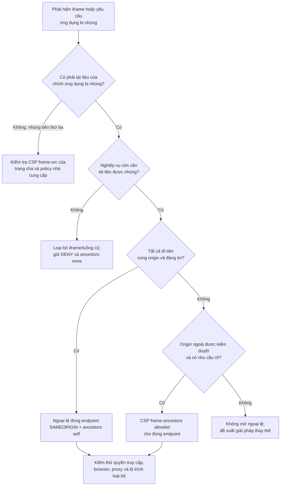

# Đánh giá nhu cầu iframe của thư viện giao diện hoặc ứng dụng cũ

## 1. Vì sao kiểm tra iframe trước khi thay đổi security headers?

Trong module **SPRING_SECURITY_HTTP_PROTECTION**, chúng ta triển khai các lớp phòng vệ HTTP và trình duyệt của Spring Security, gồm CSRF, CORS, security headers, CSP, HSTS, HTTP firewall và bảo vệ session, cho cả ứng dụng **Servlet** lẫn **Reactive/WebFlux**. Ở chương **Chống nhúng trang**, một quyết định thường gây lỗi triển khai là bật hoặc siết `X-Frame-Options` và CSP `frame-ancestors` trong khi **không biết giao diện cũ đang sử dụng iframe ở đâu**.

Ví dụ: một ứng dụng Spring Boot có trang quản trị tài khoản, một trình biên tập nội dung đời cũ, bảng điều khiển nội bộ và khu vực báo cáo cho đối tác. Sau khi cập nhật Spring Security, nhóm phát triển thấy:

- Trình biên tập WYSIWYG có vùng soạn thảo trống.
- Màn hình nội bộ trước đây nhúng `/legacy/charts` không còn hiển thị.
- Portal đối tác không tải được `/embed/reports/quarterly`.
- Một widget video bên thứ ba bị chặn, dù trang ứng dụng không hề bị website khác nhúng.

Bốn triệu chứng này **không nhất thiết cùng một nguyên nhân**. Đặc biệt, nếu ứng dụng là **trang cha** nhúng tài nguyên bên ngoài, cần xem CSP `frame-src` của trang cha hoặc chính sách ở nhà cung cấp. Nếu ứng dụng là **trang con** được nhúng, phải xem `X-Frame-Options` và `frame-ancestors` trên response của ứng dụng.

**Mục tiêu của bài:** xây dựng phương pháp kiểm kê nhu cầu iframe, đánh giá rủi ro clickjacking, phân loại ngoại lệ theo endpoint, chọn phương án giữ hoặc thay thế iframe và triển khai an toàn với Spring Security.

## 2. Một iframe có thể phục vụ nhiều mục đích khác nhau

Không nên thấy chuỗi `<iframe>` rồi lập tức tắt chống nhúng. Một thư viện có thể tạo frame bằng JavaScript, sử dụng `srcdoc` hoặc `about:blank`, hoặc thay đổi DOM ở thời điểm runtime. Ngược lại, một trang bị nhúng bởi ứng dụng ngoài có thể **không chứa bất kỳ thẻ iframe nào trong HTML của chính nó**.

| Kiểu sử dụng | Ai là trang cha? | Ai là trang con? | Câu hỏi cần xác minh |
| --- | --- | --- | --- |
| Widget báo cáo nội bộ | Dashboard của ứng dụng | `/legacy/charts` cùng origin | Có thật cần iframe thay vì component thông thường không? |
| Trình biên tập rich-text đời cũ | Trang biên tập | Tài liệu tạo bằng `about:blank`/`srcdoc` hoặc URL riêng | Frame được tạo ra thế nào? Có request HTML để gắn XFO không? |
| Trang HTML legacy trong shell mới | Giao diện SPA hiện đại | Trang legacy cùng origin hoặc origin khác | Người dùng có tương tác với biểu mẫu nhạy cảm ở trang legacy không? |
| Portal của đối tác | `https://campus.partner.example` | `/embed/lessons/**` của ứng dụng | Ai được cấp quyền nhúng, có ancestor trung gian không? |
| Video/bản đồ bên thứ ba | Trang của ứng dụng | Website của nhà cung cấp | Cần kiểm tra `frame-src` của **trang cha** và quyền nhúng do nhà cung cấp quyết định. |
| Silent login/SSO cũ qua iframe | Trang ứng dụng | Endpoint đăng nhập/ủy quyền | Browser/cookie/IdP có cho phép luồng này không? Có phương án hiện đại hơn không? |
| Console phát triển, ví dụ H2 console | Trang công cụ trong môi trường dev | Một trang công cụ khác được nhúng nội bộ | Có phải tính năng **chỉ dành cho phát triển** và không được mở công khai không? |

Đôi khi iframe của trình biên tập dùng một tài liệu `about:blank` hoặc `srcdoc` với cơ chế nguồn gốc và kế thừa chính sách riêng của browser. Trường hợp đó **không thể kết luận chỉ từ việc response của website có `X-Frame-Options: DENY`**: có thể không có HTTP response riêng dành cho tài liệu frame. Phải xem **`iframe.src`, `srcdoc`, thuộc tính `sandbox`, request Network và Console** của trình duyệt.

## 3. Phân biệt hai chiều: “tôi nhúng người khác” và “người khác nhúng tôi”

Hai chính sách CSP thường được nhắc cùng nhau nhưng không thay thế nhau:

| Cơ chế | Nằm trên response của ai? | Mục đích |
| --- | --- | --- |
| `Content-Security-Policy: frame-src ...` | **Trang cha** tạo iframe | Giới hạn nguồn mà trang cha được tải vào iframe. |
| `Content-Security-Policy: frame-ancestors ...` | **Trang con** bị nhúng | Giới hạn những trang tổ tiên được phép nhúng tài liệu hiện tại. |
| `X-Frame-Options: DENY` | **Trang con** bị nhúng | Cấm hiển thị tài liệu trong frame. |
| `X-Frame-Options: SAMEORIGIN` | **Trang con** bị nhúng | Hạn chế nhúng theo ngữ cảnh cùng origin ở trình duyệt hỗ trợ. |

Ví dụ portal `https://campus.partner.example` nhúng `https://learn.example.com/embed/lessons/42`:

**Response portal:**

```http
Content-Security-Policy: frame-src https://learn.example.com
```

**Response bài học:**

```http
Content-Security-Policy: frame-ancestors https://campus.partner.example
```

Portal không được phép tự ý làm tài liệu bài học bỏ `frame-ancestors`; ngược lại, việc bài học cho phép portal làm ancestor không khiến portal được miễn `frame-src` của chính nó.

**CORS không giải quyết vấn đề này.** `Access-Control-Allow-Origin` liên quan đến quyền truy cập response của JavaScript trong những trường hợp CORS áp dụng, không phải chính sách render tài liệu trong frame. Cookie `SameSite` cũng không phải danh sách origin được phép nhúng.

## 4. Quy trình kiểm kê: tìm nhu cầu thật trước khi mở ngoại lệ

Một lần kiểm kê nên dựa trên **bằng chứng runtime** lẫn thông tin đội sản phẩm. Không phải iframe được tạo ra cũng là một trường hợp nhúng HTML mà Spring Security của bạn kiểm soát.

### Bước 1 — Liệt kê các màn hình và luồng người dùng

Ưu tiên những luồng dễ bị ảnh hưởng: quản trị, đăng nhập, giao diện legacy, khu vực soạn thảo, dashboard, popup cũ, màn hình đối tác và luồng liên quan thanh toán. Với mỗi luồng, ghi nhận **người dùng làm gì**, chứ không chỉ tên thư viện.

### Bước 2 — Quan sát trên trình duyệt thật

Mở từng màn hình trong Chrome/Firefox/WebKit hoặc những browser nằm trong phạm vi hỗ trợ. Trong DevTools:

1. Dùng tab **Elements** để tìm `<iframe>`, `<frame>`, `<object>`, `<embed>` và các node được tạo sau khi tải trang.
2. Ghi `src`, `srcdoc`, `sandbox`, `allow`, nguồn trang cha và các frame lồng nhau. Không giả định mọi iframe đều có `src` là URL HTTP.
3. Mở **Network**, chọn request tài liệu thực sự nằm trong frame; xác nhận response status, URL sau redirect và các header `X-Frame-Options`/`Content-Security-Policy`.
4. Mở **Console**, tìm thông báo vi phạm CSP `frame-src`, `frame-ancestors` hoặc XFO. Lưu ý iframe trắng cũng có thể do `404`, session hết hạn hoặc lỗi JavaScript.
5. Kiểm tra màn hình ở trạng thái **chưa đăng nhập**, **đã đăng nhập**, và trong vai trò được cấp phép khác nếu luồng có phân quyền.

### Bước 3 — Xác nhận yêu cầu nhúng với chủ sở hữu tính năng

Đội kỹ thuật nên xác định: tính năng còn sử dụng không, có hỗ trợ đối tác nào, có cần thao tác nhạy cảm trong iframe không, có thể thay bằng component hiện đại không, thời hạn dỡ bỏ legacy là khi nào. **Không tự mở iframe chỉ vì thấy một lỗi hiển thị**.

### Bước 4 — Tạo ma trận đánh giá

Một bản kiểm kê hữu ích có thể theo mẫu sau:

| Màn hình / URL | Trang cha thực tế | Trạng thái | Rủi ro | Đề xuất |
| --- | --- | --- | --- | --- |
| `/account/security` | Không có nhu cầu | Trang nhạy cảm | Cao nếu bị nhúng | Giữ `DENY` và `frame-ancestors 'none'`. |
| `/legacy/ui/chart` | `https://learn.example.com/dashboard` | Iframe nội bộ còn dùng | Trung bình, tùy quyền | Cho `SAMEORIGIN`/`'self'` riêng URL, có thời hạn thay thế. |
| `/embed/lessons/42` | `https://campus.partner.example` | Tích hợp đã được duyệt | Phụ thuộc quyền và dữ liệu | CSP `frame-ancestors` chỉ origin đối tác trên route nhúng. |
| Rich-text editor `srcdoc` | Chính trang biên tập | Không có request HTML riêng | XSS, sandbox và origin | Kiểm tra cơ chế editor trước; không tắt XFO toàn site. |
| Video ngoài từ `video.example.net` | Trang bài học | Iframe bên thứ ba | Điều kiện nhà cung cấp | Điều chỉnh `frame-src` của trang bài học nếu phù hợp. |

Đây là **mẫu minh họa**, không phải danh sách tự động suy ra từ tên package. Chỉ duy trì ngoại lệ khi có người chịu trách nhiệm, mục đích được phê duyệt và cách kiểm thử hồi quy.

## 5. Phân loại rủi ro trước khi quyết định chính sách

Đánh giá việc nhúng như một quyết định **giao diện và an ninh**, không chỉ là sự cố header.

### 5.1. Mức nhạy cảm của tài liệu được nhúng

Một biểu đồ chỉ đọc không chứa dữ liệu nhạy cảm có mức rủi ro khác màn hình đổi mật khẩu hoặc phê duyệt thanh toán. Tuy nhiên “chỉ đọc” vẫn cần xác thực nếu chứa dữ liệu cá nhân. Một trang có nút thay đổi trạng thái, form, xác nhận hoặc điều hướng đặc quyền nên **mặc định không cho nhúng** trừ khi đã phân tích luồng thật kỹ.

### 5.2. Mức độ tin cậy của trang cha

**Cùng origin không có nghĩa mọi trang đều đáng tin.** Nếu cùng host còn phục vụ HTML tải lên từ người dùng, widget quảng cáo hoặc nội dung không đáng tin cậy, `SAMEORIGIN` vẫn có thể tạo bề mặt tấn công trong cùng origin. Cần tách nội dung không tin cậy sang origin riêng, phòng XSS và kiểm tra quyền tài nguyên.

Với portal bên ngoài, danh sách `frame-ancestors` nên chỉ gồm những **origin được quản lý và có hợp đồng tích hợp rõ ràng**. Không dùng `frame-ancestors https:`, wildcard rộng hoặc phản chiếu tùy ý `Origin`/`Referer` của request vào header để “tự động cho phép”.

### 5.3. Chuỗi iframe lồng nhau

Ví dụ:

```text
https://external.example.net
  └── https://campus.partner.example
        └── https://learn.example.com/embed/lessons/42
```

CSP `frame-ancestors https://campus.partner.example` trên bài học **không cho phép** trường hợp trên, vì ancestor `external.example.net` không được liệt kê. Trình duyệt thực thi CSP `frame-ancestors` kiểm tra **toàn bộ tổ tiên**, không chỉ cha trực tiếp.

### 5.4. Phụ thuộc cookie, SSO và session

Một iframe được phép bởi CSP vẫn có thể không đăng nhập được vì cookie `SameSite`, giới hạn third-party cookies hoặc chính sách của nhà cung cấp danh tính. **Không hạ `SameSite` hay tắt CSRF trên toàn bộ hệ thống** chỉ để iframe hiện ra. Với một số luồng SSO legacy dùng iframe ẩn để làm mới phiên, nên đánh giá chuyển sang luồng xác thực cấp cao/top-level hoặc cách thức được nhà cung cấp danh tính hỗ trợ hiện nay.

### 5.5. Tương thích trình duyệt

XFO `DENY` hoặc `SAMEORIGIN` được dùng rộng rãi cho trường hợp cấm hoặc cho phép cùng origin. Với trường hợp **đối tác khác origin**, `X-Frame-Options: ALLOW-FROM` là giá trị cũ, không được hỗ trợ nhất quán và có thể bị bỏ qua. Dùng CSP `frame-ancestors` cho browser hiện đại, đồng thời ghi rõ **giới hạn hỗ trợ** đối với browser cũ không hiểu CSP. Không coi một phép thử trên một browser là bảo đảm cho tất cả browser.

## 6. Cây quyết định: giữ iframe, thu hẹp quyền hay loại bỏ



**Chiến lược ưu tiên:** nếu tính năng cũ có thể thay bằng layout/component trực tiếp mà không cần iframe, hãy cân nhắc loại bỏ phụ thuộc. Nếu iframe vẫn là yêu cầu đã xác nhận, mở ngoại lệ **chỉ trên response cần nhúng**, không tắt header ở cấp website.

| Phương án | Ưu điểm | Điều phải cân nhắc |
| --- | --- | --- |
| Loại bỏ iframe, dùng component/router thông thường | Giảm phụ thuộc framing và một số rủi ro giao diện | Có thể cần sửa kiến trúc legacy, quản lý CSS/JS và quyền truy cập. |
| Giữ iframe cùng origin | Ít thay đổi hơn, hỗ trợ UI nội bộ | Trang cha cùng origin phải được tin cậy; `SAMEORIGIN` không cho portal ngoài. |
| CSP `frame-ancestors` cho đối tác | Giới hạn cụ thể danh sách origin được nhúng | Phụ thuộc browser hỗ trợ CSP, cookie phiên và mọi ancestor; tránh XFO xung đột. |
| Tạo trang nhúng riêng `/embed/**` | Tách rõ UI nhúng với UI nhạy cảm | Cần quản lý API, dữ liệu, authorization và bảo trì hai giao diện. |
| Sử dụng token/view-only embed có hạn và quyền hẹp | Phù hợp báo cáo chia sẻ không cần thao tác | Cần ràng buộc token, thời hạn, phạm vi dữ liệu, chống lộ qua URL/referrer/cache và kiểm tra máy chủ. |

Token nhúng không được coi là biện pháp thay thế `frame-ancestors` hoặc phân quyền. Nếu tồn tại token, phải thiết kế chống sao chép/rò rỉ và xem xét liệu token là bearer credential. Không đưa dữ liệu nhạy cảm vào URL nếu không có biện pháp bảo vệ phù hợp.

## 7. Tránh nhầm cấu hình: XFO và CSP áp dụng theo response

Giả sử một thư viện UI legacy được nhúng trong dashboard nội bộ:

```html
<iframe
  src="/legacy/ui/chart"
  title="Biểu đồ cũ"
  width="1000"
  height="600"></iframe>
```

Nếu response của `/legacy/ui/chart` có:

```http
X-Frame-Options: DENY
```

thì iframe sẽ bị từ chối cả khi trang cha cùng origin. Đổi đúng **response của chart** thành:

```http
X-Frame-Options: SAMEORIGIN
Content-Security-Policy: frame-ancestors 'self'
```

cho phép nhúng nội bộ theo các điều kiện bảo mật khác.

Nhưng với một trang bài học có iframe của dịch vụ video bên thứ ba:

```html
<iframe
  src="https://video.example.net/player/abc"
  title="Video bài học"></iframe>
```

thì **đổi XFO của trang bài học không giải quyết việc video bị chặn**. Cần kiểm tra CSP `frame-src` trên trang bài học và chính sách cho phép nhúng do `video.example.net` phát ra. XFO của trang cha điều khiển **bản thân trang cha có bị nhúng không**, không quyết định nguồn iframe mà nó được tải.

### Cần chú ý CSP đặt qua HTML và header

`frame-ancestors` **không được áp dụng từ `<meta http-equiv="Content-Security-Policy">`**; phải gửi bằng HTTP response header `Content-Security-Policy`. `default-src 'none'` cũng **không thay thế** `frame-ancestors 'none'` vì directive latter không có fallback từ `default-src`.

Nếu response có cả XFO và CSP `frame-ancestors`, trình duyệt hiện đại tuân thủ CSP enforced ưu tiên `frame-ancestors`; một số browser cũ có thể xử lý XFO khác. Nên phát cặp chính sách **nhất quán**: `DENY` với `'none'` hoặc `SAMEORIGIN` với `'self'`. Với đối tác khác origin, tránh XFO `DENY`/`SAMEORIGIN` trên endpoint được phép nhúng chéo origin.

## 8. Thiết kế route: một phần legacy được nhúng, phần còn lại từ chối

Hãy giả sử kết quả kiểm kê là:

1. `/legacy/ui/**`: giao diện nội bộ có iframe **cùng origin** và đã xác minh đủ an toàn để giữ tạm.
2. `/embed/reports/**`: chỉ portal `https://portal.partner.example` được phép nhúng báo cáo; đây là một nhóm trang **được thiết kế riêng cho iframe**.
3. `/account/**`, `/admin/**`, `/payments/**` cùng mọi route còn lại: **không có nhu cầu nhúng**, tiếp tục từ chối.

Các response dự kiến:

| URL | XFO | CSP `frame-ancestors` |
| --- | --- | --- |
| `/legacy/ui/chart` | `SAMEORIGIN` | `'self'` |
| `/legacy/ui/editor-frame` | `SAMEORIGIN`, nếu là tài liệu HTTP cần nhúng | `'self'` |
| `/embed/reports/summary` | Không phát XFO từ chain này | `https://portal.partner.example` |
| `/account/change-password` | `DENY` | `'none'` |
| `/admin/users` | `DENY` | `'none'` |
| `/payments/confirm` | `DENY` | `'none'` |

Nếu báo cáo cũng được nhúng từ cùng ứng dụng, có thể thêm `'self'` vào `frame-ancestors` của **riêng `/embed/reports/**`** sau khi xác minh yêu cầu đó.

## 9. Spring Security Servlet: cấu hình ba nhóm chính sách

Spring Security Servlet dùng `HttpSecurity` và `SecurityFilterChain`. Khi bật bộ security headers mặc định, Spring Security thường gửi `X-Frame-Options: DENY`. Dưới đây là cấu hình theo **thứ tự chain rõ ràng**: nội bộ cùng origin, portal ngoài origin và toàn bộ phần còn lại.

```java
import org.springframework.context.annotation.Bean;
import org.springframework.context.annotation.Configuration;
import org.springframework.core.annotation.Order;
import org.springframework.security.config.annotation.web.builders.HttpSecurity;
import org.springframework.security.config.annotation.web.configuration.EnableWebSecurity;
import org.springframework.security.web.SecurityFilterChain;

@Configuration
@EnableWebSecurity
public class SecurityConfig {

    @Bean
    @Order(1)
    SecurityFilterChain legacyUi(HttpSecurity http) throws Exception {
        return http
            .securityMatcher("/legacy/ui/**")
            .authorizeHttpRequests(auth -> auth
                .anyRequest().authenticated())
            .headers(headers -> headers
                .frameOptions(frame -> frame.sameOrigin())
                .contentSecurityPolicy(csp -> csp
                    .policyDirectives("frame-ancestors 'self'")))
            .build();
    }

    @Bean
    @Order(2)
    SecurityFilterChain partnerReports(HttpSecurity http) throws Exception {
        return http
            .securityMatcher("/embed/reports/**")
            .authorizeHttpRequests(auth -> auth
                .anyRequest().authenticated())
            .headers(headers -> headers
                .frameOptions(frame -> frame.disable())
                .contentSecurityPolicy(csp -> csp
                    .policyDirectives(
                        "frame-ancestors https://portal.partner.example")))
            .build();
    }

    @Bean
    @Order(3)
    SecurityFilterChain defaultPages(HttpSecurity http) throws Exception {
        return http
            .authorizeHttpRequests(auth -> auth
                .anyRequest().authenticated())
            .headers(headers -> headers
                .frameOptions(frame -> frame.deny())
                .contentSecurityPolicy(csp -> csp
                    .policyDirectives("frame-ancestors 'none'")))
            .build();
    }
}
```

Giải thích:

- `securityMatcher` chọn **chain viết header** cho nhóm URL. `requestMatchers` bên trong `authorizeHttpRequests` chỉ quy định quyền truy cập; bản thân nó không đặt CSP/XFO riêng cho endpoint.
- `@Order(1)` và `@Order(2)` ưu tiên các matcher cụ thể; chain cuối bao phủ các request còn lại.
- `.frameOptions(frame -> frame.sameOrigin())` là ngoại lệ có giới hạn cho UI legacy cùng origin.
- `.frameOptions(frame -> frame.disable())` chỉ **ngừng viết XFO** trên chain `/embed/reports/**`, vì CSP allowlist có origin ngoài. Nó **không** có nghĩa tắt CSP hoặc tất cả headers.
- `.frameOptions(frame -> frame.deny())` giữ lớp phòng vệ chặt cho mặc định.

**Lưu ý phạm vi:** `/legacy/ui/**` và `/embed/reports/**` là các prefix ví dụ. Nếu dưới những prefix đó có trang đổi quyền, xóa dữ liệu hoặc cấu hình nhạy cảm, **phải tách chúng ra khỏi ngoại lệ** hoặc dùng matcher cụ thể hơn. Mọi trang chỉ đọc vẫn cần phân quyền theo dữ liệu.

**Không sửa lỗi iframe bằng cách làm như sau:**

```java
// Không dùng trên toàn bộ website chỉ vì một widget bị lỗi.
.headers(headers -> headers.disable())
```

Lệnh này tắt **toàn bộ** security headers do Spring Security quản lý trong chain. Nếu cần điều chỉnh riêng XFO, dùng `frameOptions(...)` trên **chain phù hợp**.

## 10. Spring Security Reactive / WebFlux: nguyên tắc tương tự

Ứng dụng Reactive sử dụng `ServerHttpSecurity`, `SecurityWebFilterChain` và matcher cho WebFlux. Chính sách trình duyệt nhận được **không khác Servlet về mặt ý nghĩa**, dù API cấu hình khác:

```java
import org.springframework.context.annotation.Bean;
import org.springframework.context.annotation.Configuration;
import org.springframework.core.annotation.Order;
import org.springframework.security.config.annotation.web.reactive.EnableWebFluxSecurity;
import org.springframework.security.config.web.server.ServerHttpSecurity;
import org.springframework.security.web.server.SecurityWebFilterChain;
import org.springframework.security.web.server.header.XFrameOptionsServerHttpHeadersWriter;
import org.springframework.security.web.server.util.matcher.PathPatternParserServerWebExchangeMatcher;

@Configuration
@EnableWebFluxSecurity
public class ReactiveSecurityConfig {

    @Bean
    @Order(1)
    SecurityWebFilterChain legacyUi(ServerHttpSecurity http) {
        return http
            .securityMatcher(
                new PathPatternParserServerWebExchangeMatcher("/legacy/ui/**"))
            .authorizeExchange(auth -> auth
                .anyExchange().authenticated())
            .headers(headers -> headers
                .frameOptions(frame -> frame.mode(
                    XFrameOptionsServerHttpHeadersWriter.Mode.SAMEORIGIN))
                .contentSecurityPolicy(csp -> csp
                    .policyDirectives("frame-ancestors 'self'")))
            .build();
    }

    @Bean
    @Order(2)
    SecurityWebFilterChain partnerReports(ServerHttpSecurity http) {
        return http
            .securityMatcher(
                new PathPatternParserServerWebExchangeMatcher(
                    "/embed/reports/**"))
            .authorizeExchange(auth -> auth
                .anyExchange().authenticated())
            .headers(headers -> headers
                .frameOptions(frame -> frame.disable())
                .contentSecurityPolicy(csp -> csp
                    .policyDirectives(
                        "frame-ancestors https://portal.partner.example")))
            .build();
    }

    @Bean
    @Order(3)
    SecurityWebFilterChain defaultPages(ServerHttpSecurity http) {
        return http
            .authorizeExchange(auth -> auth
                .anyExchange().authenticated())
            .headers(headers -> headers
                .frameOptions(frame -> frame.mode(
                    XFrameOptionsServerHttpHeadersWriter.Mode.DENY))
                .contentSecurityPolicy(csp -> csp
                    .policyDirectives("frame-ancestors 'none'")))
            .build();
    }
}
```

Các đoạn mã trên tập trung **chỉ vào chính sách nhúng**. Ứng dụng thực tế vẫn cần cấu hình đăng nhập, xác thực, phân quyền và chính sách CSRF tương thích với các luồng thao tác. Nếu một thư viện yêu cầu POST từ iframe, không được kết luận `SAMEORIGIN` tự xử lý CSRF hoặc tự cấp quyền POST.

### Cẩn thận khi đã có một CSP tổng quát

Trong thực tế, ứng dụng còn có CSP về `script-src`, `style-src`, `connect-src`, `img-src`, `form-action`... Các ví dụ `policyDirectives("frame-ancestors ...")` **chỉ minh họa phần chống nhúng**; khi triển khai, cần **gộp** directive này vào chính sách CSP hoàn chỉnh tương thích với ứng dụng, tránh vô tình thay mất các directive bảo vệ khác.

Ngoài ra, nhiều CSP enforced được gửi đồng thời có thể làm điều kiện chặt hơn. Nếu app cho phép portal nhưng proxy thêm `Content-Security-Policy: frame-ancestors 'none'` thì browser **vẫn từ chối nhúng**. Không cố sửa bằng cách tiếp tục thêm nhiều CSP khác.

## 11. Những tình huống legacy cần quyết định riêng

### 11.1. Trình biên tập rich-text dùng iframe

Một số editor cũ có vùng soạn thảo là tài liệu iframe; một số khác dùng `contenteditable` hoặc shadow DOM. Trước khi cấu hình `SAMEORIGIN`, hãy xác định chính xác **iframe có `src` HTTP nào, hay dùng `srcdoc`/`about:blank`**. Nếu frame được tạo nội bộ và không tải response HTML của server, XFO trên toàn site có thể **không phải nguyên nhân** của lỗi. Cần kiểm tra CSP `frame-src`, `sandbox`, origin của document, script editor và lỗi JavaScript.

Nếu vùng editor dùng iframe đến `/legacy/ui/editor-frame`, hãy cân nhắc giữ `SAMEORIGIN`/`'self'` **chỉ trên tài liệu đó**. Nếu sử dụng editor mới không còn iframe, có thể thu hồi ngoại lệ sau khi kiểm thử.

### 11.2. Console cơ sở dữ liệu hoặc công cụ phát triển

Một số giao diện công cụ nội bộ dùng frame để chia bố cục. Trong môi trường dev, có thể cần `SAMEORIGIN` ở các route cụ thể; điều này **không phải lý do mở nhúng trên production**. Cần bảo đảm công cụ không công khai, có phân quyền đúng, chỉ bật ở profile/môi trường chủ động cho phép và xem xét hạn chế mạng.

Đặc biệt, không tắt CSRF toàn ứng dụng chỉ vì công cụ phát triển yêu cầu cấu hình riêng. Mọi ngoại lệ CSRF (nếu có và được phê duyệt) cần tách theo route/môi trường và đánh giá độc lập với chính sách iframe.

### 11.3. Trang legacy dùng iframe làm shell để giữ cookie/session

Một ứng dụng cũ có thể cố chạy login hoặc refresh token trong iframe ẩn. Khi chuyển sang portal khác site, cookie third-party có thể không được gửi hoặc bị trình duyệt chặn, mặc dù CSP `frame-ancestors` đã cho phép. Cần xem lại **luồng đăng nhập** trước khi nới chính sách chống nhúng. Các giải pháp chuyển hướng top-level, đăng nhập theo luồng hiện đại và cơ chế của identity provider thường phù hợp hơn việc dựa vào một iframe ẩn lâu dài.

### 11.4. Cổng báo cáo cho nhiều tenant

Nếu mỗi tenant có portal riêng, một danh sách chung `frame-ancestors https://tenant-a.example https://tenant-b.example` có thể cấp **quyền làm tổ tiên rộng hơn dự định** cho từng báo cáo. Khi yêu cầu cô lập tenant, response nên dùng allowlist gắn với tenant đã xác minh ở **server**, không lấy URL tự do từ query parameter hay request header chưa tin cậy.

Cache cũng là một phần của kiểm soát: CSP cá nhân hóa và HTML nhạy cảm không nên được CDN lưu dùng chung giữa các tenant. Cân nhắc cache key rõ ràng hoặc `Cache-Control: private, no-store` cho tài nguyên nhạy cảm.

### 11.5. Nội dung widget được chia sẻ với domain không đáng tin cậy

Khi nhiều hệ thống cần hiển thị cùng dữ liệu, một API có phân quyền hoặc component chuyên dụng có thể thích hợp hơn việc mở một UI nhạy cảm cho mọi origin. API cross-origin có bài toán **CORS** riêng; không vì chuyển từ iframe sang API mà bỏ kiểm tra quyền, CSRF hoặc giới hạn dữ liệu.

## 12. Bộ kiểm thử tối thiểu: xác minh không làm hỏng legacy và không mở quá rộng

Một lần nâng cấp Spring Security nên có **kiểm thử dương tính** (luồng iframe hợp lệ vẫn hoạt động) và **kiểm thử âm tính** (trang không đáng tin cậy không thể nhúng những URL khác).

| Trang cha | Trang con | Kết quả mong đợi |
| --- | --- | --- |
| `https://learn.example.com/dashboard` | `/legacy/ui/chart` (cùng origin) | Có thể hiển thị nếu xác thực và CSP trang cha phù hợp. |
| `https://untrusted.example.net` | `https://learn.example.com/legacy/ui/chart` | Bị XFO/CSP từ chối vì khác origin. |
| `https://portal.partner.example` | `https://learn.example.com/embed/reports/summary` | Có thể hiển thị theo allowlist. |
| `https://untrusted.example.net` | `https://learn.example.com/embed/reports/summary` | Bị từ chối vì không nằm trong CSP. |
| `https://portal.partner.example` | `https://learn.example.com/account/security` | Bị từ chối, kể cả portal là đối tác hợp lệ cho báo cáo. |
| `https://learn.example.com/dashboard` | `https://learn.example.com/account/security` | Bị từ chối dù cùng origin. |
| Trang trên cùng ngoài allowlist → portal partner → báo cáo | `/embed/reports/summary` | Bị từ chối nếu ancestor ngoài chưa được cho phép. |

**Trường hợp trang legacy không còn tồn tại:** trước khi kết luận rằng iframe đã bị CSP chặn, xác minh HTTP status và HTML thật sự được trả về. Một `404` cũng có thể tạo vùng iframe trắng và khiến test âm tính giả.

### 12.1. Kiểm thử Servlet bằng MockMvc

Giả sử có controller demo `/legacy/ui/chart`, `/embed/reports/summary` và `/account/security` trả `200 OK` cho user `viewer` có quyền. Với `spring-security-test`, có thể viết:

```java
mockMvc.perform(get("/legacy/ui/chart").with(user("viewer")))
    .andExpect(status().isOk())
    .andExpect(header().string("X-Frame-Options", "SAMEORIGIN"))
    .andExpect(header().string(
        "Content-Security-Policy", "frame-ancestors 'self'"));

mockMvc.perform(get("/embed/reports/summary").with(user("viewer")))
    .andExpect(status().isOk())
    .andExpect(header().doesNotExist("X-Frame-Options"))
    .andExpect(header().string(
        "Content-Security-Policy",
        "frame-ancestors https://portal.partner.example"));

mockMvc.perform(get("/account/security").with(user("viewer")))
    .andExpect(status().isOk())
    .andExpect(header().string("X-Frame-Options", "DENY"))
    .andExpect(header().string(
        "Content-Security-Policy", "frame-ancestors 'none'"));
```

Đây là **phần thân test minh họa**: cần `MockMvc`, controller và static import `get`, `user`, `status`, `header`. Nếu response production có thêm directive CSP, nên kiểm tra `frame-ancestors` mong đợi mà không buộc toàn bộ header là đúng một chuỗi.

### 12.2. Kiểm thử Reactive bằng WebTestClient

```java
webTestClient.mutateWith(mockUser("viewer"))
    .get().uri("/legacy/ui/chart")
    .exchange()
    .expectStatus().isOk()
    .expectHeader().valueEquals("X-Frame-Options", "SAMEORIGIN")
    .expectHeader().valueEquals(
        "Content-Security-Policy", "frame-ancestors 'self'");

webTestClient.mutateWith(mockUser("viewer"))
    .get().uri("/embed/reports/summary")
    .exchange()
    .expectStatus().isOk()
    .expectHeader().doesNotExist("X-Frame-Options")
    .expectHeader().valueEquals(
        "Content-Security-Policy",
        "frame-ancestors https://portal.partner.example");

webTestClient.mutateWith(mockUser("viewer"))
    .get().uri("/account/security")
    .exchange()
    .expectStatus().isOk()
    .expectHeader().valueEquals("X-Frame-Options", "DENY")
    .expectHeader().valueEquals(
        "Content-Security-Policy", "frame-ancestors 'none'");
```

`mockUser` là tiện ích của `SecurityMockServerConfigurers` trong `spring-security-test`. Những test này xác minh **HTTP response headers** của các chain, **không thể tự mô phỏng trình duyệt xử lý iframe**.

### 12.3. Kiểm thử browser cùng và khác origin

Dùng ba trang cha thử nghiệm:

- Trang nội bộ trên `http://localhost:8080` nhúng `/legacy/ui/chart`: phải được phép ở môi trường lab nếu cấu hình `SAMEORIGIN`.
- Portal ngoài trên `http://localhost:9090` nhúng `http://localhost:8080/embed/reports/summary`: phải được phép khi trong **cấu hình lab** đã thay origin CSP đối tác thành `http://localhost:9090`.
- Trang không tin cậy trên `http://localhost:9091` thử nhúng cả hai tài liệu: phải bị từ chối.

Để thử iframe lồng nhau, cho 9091 nhúng trang 9090, trang 9090 tiếp tục nhúng báo cáo 8080. Nếu CSP trên báo cáo chỉ cho `9090`, tổ tiên 9091 sẽ làm iframe báo cáo bị từ chối.

Trong DevTools:

1. Xác định iframe được tạo bởi **trang cha** nào, có nguồn `about:blank`/`srcdoc` hay HTTP URL.
2. Kiểm tra response header trên **trang con thực sự tải**, không chỉ trên trang cha.
3. Kiểm tra `frame-src` của trang cha khi lỗi chặn request, `frame-ancestors` của trang con khi lỗi từ chối nhúng.
4. Phân biệt trang nhúng bị từ chối bởi CSP/XFO với trang lỗi do authentication, cookie, CORS request khác, redirect, mixed content hoặc JavaScript.
5. Lặp lại sau khi đi qua reverse proxy/CDN và trên các browser thực tế sản phẩm hỗ trợ.

`curl -i` có thể kiểm tra header nhưng **không tái hiện điều kiện ancestor** hay render của browser. Một HTTP `200 OK` cũng **không chứng minh** trang đã xuất hiện trong iframe. Luôn có kiểm thử browser với ít nhất một trường hợp **được phép** và một trường hợp **bị chặn**.

## 13. Chẩn đoán tình huống thường gặp sau khi nâng cấp Spring Security

### “Editor cũ trắng sau khi bật X-Frame-Options: DENY”

Trước tiên xác nhận editor tạo iframe trỏ đến URL HTTP nào. Nếu nó dùng `about:blank` hoặc `srcdoc`, phải kiểm tra `sandbox`, script và CSP; không nên mặc định XFO gây lỗi. Nếu editor tải một route HTML cùng origin, thử cấu hình `SAMEORIGIN`/`frame-ancestors 'self'` chỉ trên route đó và kiểm thử lại.

### “Đã thêm SAMEORIGIN nhưng portal bên ngoài vẫn bị chặn”

`SAMEORIGIN` **không cho phép khác origin**. Muốn portal ngoài nhúng một endpoint, dùng CSP `frame-ancestors` với origin đối tác và không gửi XFO mâu thuẫn trên response đó. Kiểm tra chính xác scheme, host, port và mọi ancestor; tên miền có liên quan không đồng nghĩa cùng origin.

### “H2 console hoặc công cụ nội bộ vẫn không hoạt động”

Kiểm tra chức năng có nằm trong **môi trường phát triển được phép** không, request nào bị chặn, XFO/CSP trên response đích, cookie và các rule riêng của công cụ. Nếu cần ngoại lệ, chỉ mở đúng route và profile dev, không nới global `frameOptions` hoặc tắt CSRF toàn hệ thống.

### “Trang tải qua iframe nhưng luôn chuyển hướng sang đăng nhập”

Request đến route ngoại lệ có thể bị chuyển hướng sang `/login`. Trang đăng nhập thường gửi `DENY` và `frame-ancestors 'none'`, vì vậy iframe trắng. Cần kiểm tra URL cuối, phiên cookie, SameSite và giới hạn third-party cookies. Cân nhắc luồng đăng nhập top-level/SSO đúng thay vì mở nhúng mọi trang login.

### “Trên localhost hoạt động, qua CDN thì không”

Kiểm tra CDN/proxy có thêm `X-Frame-Options: DENY` hoặc một CSP khác `frame-ancestors 'none'` không. Nhiều CSP enforced được **thực thi đồng thời**, không tạo một phép hợp các nguồn cho phép. Kiểm tra cả redirect, cache, protocol HTTPS và đúng hostname mà user truy cập.

### “Sửa CSP cho widget rồi trang khác bỗng nhúng được”

Khả năng ngoại lệ bị mở rộng trong chain matcher, ví dụ dùng `/legacy/**` thay vì `/legacy/ui/chart` hoặc không có chain mặc định bảo vệ. Kiểm tra route ở **ngoài phạm vi**, gồm trang tài khoản, quyền quản trị và payment. Tránh dùng `frame-ancestors https:` hoặc mở tất cả subdomain không đáng tin cậy.

### “Ứng dụng nhúng video của nhà cung cấp nhưng tăng quyền XFO không giải quyết”

Vì video là **trang con do bên ngoài phục vụ**, XFO của trang cha không quyết định nhà cung cấp có cho phép bị nhúng. Kiểm tra CSP `frame-src` của trang cha và header/policy của tài liệu video, cùng điều kiện bản quyền/tài khoản và SDK liên quan.

## 14. Lộ trình triển khai và gỡ bỏ phụ thuộc iframe legacy

Một phương án thực tế là xử lý theo nhiều giai đoạn:

1. **Baseline:** ghi nhận hiện trạng các luồng legacy, URL iframe thực tế, origin trang cha, browser mục tiêu và lỗi Console/Network trước thay đổi.
2. **Phân loại:** đánh dấu những trang không cần iframe, nội bộ cùng origin, nhúng đối tác ngoài origin và iframe do thư viện tạo không có tài liệu HTTP riêng.
3. **Mở nhỏ nhất:** giữ `DENY`/`'none'` ở mặc định; thêm các chain có matcher hẹp cho trường hợp đã được duyệt; tránh wildcard rộng.
4. **Bổ sung hồi quy:** test header và browser cho trường hợp hợp lệ lẫn không hợp lệ, redirect, iframe lồng nhau và URL nằm sát ranh giới matcher.
5. **Triển khai từng bước:** kiểm thử staging sau proxy, theo dõi lỗi iframe/CSP và phản hồi người dùng; có kế hoạch khôi phục chính sách đúng endpoint nếu gây gián đoạn.
6. **Loại bỏ dần:** khi chuyển được editor/console/chart sang component hiện đại hoặc bỏ chức năng cũ, thu hồi chain ngoại lệ và xác nhận trang trở về `DENY`/`'none'`.

Các chỉ số nên quan sát gồm số endpoint cần ngoại lệ, số đối tác/origin được phép, tỷ lệ lỗi nhúng theo browser, số trường hợp chặn đúng kỳ vọng và tỷ lệ tính năng legacy đã thay thế. **Giảm số ngoại lệ theo thời gian** thường là tín hiệu hệ thống đang thu hẹp bề mặt clickjacking, nhưng vẫn phải đo cùng nhu cầu sử dụng sản phẩm.

### Ví dụ tiêu chí chấp nhận khi sửa một thư viện UI cũ

| Tiêu chí | Đạt khi |
| --- | --- |
| Tính năng vẫn chạy | Widget/editor hiển thị và thao tác đúng trong luồng được phép. |
| Không mở trang ngoài dự định | Trang account/admin/payment vẫn trả `DENY`/`'none'`. |
| Không nhầm chiều CSP | Trang cha có `frame-src` thích hợp nếu cần; trang con có `frame-ancestors` phù hợp. |
| Không có ngoại lệ toàn cục | Chỉ những route sở hữu nhu cầu thật được `SAMEORIGIN` hoặc CSP allowlist. |
| Không làm yếu authentication/CSRF | Quyền người dùng và token CSRF vẫn được kiểm tra cho thao tác tương ứng. |
| Hỗ trợ browser có cơ sở | Luồng được thử trên các phiên bản trình duyệt có trong phạm vi hỗ trợ. |
| Qua proxy vẫn đúng | Header cuối cùng tới trình duyệt nhất quán với thiết kế. |
| Có kế hoạch bảo trì | Ngoại lệ có owner, lý do, test và điều kiện xóa bỏ. |

## 15. Bài tập thực hành và câu hỏi tự đánh giá

**Tình huống A — Trình biên tập cũ.** Một WYSIWYG editor hiển thị trắng sau khi bật security headers. DevTools cho thấy editor tạo `<iframe srcdoc="...">`, không có request riêng tới `/editor-frame`. Có nên ngay lập tức tắt `X-Frame-Options` trên toàn ứng dụng? Bạn sẽ kiểm tra những gì trước?

**Tình huống B — Dashboard nội bộ.** Trang `https://learn.example.com/dashboard` nhúng `https://learn.example.com/legacy/ui/chart`. Chart nhận `X-Frame-Options: DENY`. Hãy đề xuất CSP/XFO hợp lý và vị trí áp dụng. Tại sao không dùng `SAMEORIGIN` cho `/account/security`?

**Tình huống C — Portal đối tác.** `https://campus.partner.example` nhúng `https://learn.example.com/embed/reports/summary`, nhưng response có `DENY`. Hãy xác định chain cần thay, CSP cần có, cách bảo vệ các route còn lại và giới hạn của phương án với browser không hỗ trợ CSP.

**Tình huống D — Video bên ngoài.** Một bài học không hiển thị video từ `https://video.example.net`; nhóm phát triển muốn chuyển XFO của bài học thành `SAMEORIGIN`. Vì sao thay đổi này không trực tiếp giải quyết lỗi? Những response và directive nào cần xem?

**Tình huống E — Thu hồi ngoại lệ.** Nhóm dự án đã thay editor cũ bằng component không dùng iframe. Hãy mô tả điều kiện để xóa `SAMEORIGIN` của route editor và những kiểm thử phải cập nhật để chứng minh hệ thống an toàn hơn nhưng không mất chức năng.

**Gợi ý:** A — iframe `srcdoc` không tải HTML qua request riêng, cần kiểm tra sandbox, origin, CSP, script và lỗi runtime; không mở XFO toàn site. B — `SAMEORIGIN`/`frame-ancestors 'self'` chỉ trên response chart; giữ `DENY`/`'none'` cho account. C — chain của `/embed/reports/**` không phát XFO và dùng `frame-ancestors https://campus.partner.example`, giữ mặc định chặn cho route còn lại, cân nhắc hỗ trợ CSP. D — xem `frame-src` của trang bài học, policy nhà cung cấp, request/video iframe. E — kiểm tra tính năng mới và luồng chính, trả route không còn dùng về mặc định chặn, chạy cả test dương tính/âm tính.

## 16. Tổng kết

**Đánh giá nhu cầu iframe của thư viện giao diện hoặc ứng dụng cũ là bước quyết định trước khi nới các lớp chống clickjacking.** Điều cần tìm không phải “iframe nào đang lỗi”, mà là **ai nhúng ai, nguồn nào được tin cậy, endpoint nào thực sự cần nhúng và quyền truy cập nào vẫn phải bảo vệ**.

Với Spring Security **Servlet** và **Reactive/WebFlux**, cách triển khai bền vững là **mặc định `X-Frame-Options: DENY` cùng CSP `frame-ancestors 'none'`**, chỉ tạo ngoại lệ **`SAMEORIGIN`/`'self'`** cho tài liệu nội bộ cần iframe, hoặc **CSP allowlist** cho endpoint được nhúng bởi portal ngoài origin. Đừng dùng `ALLOW-FROM` cũ hay tắt security headers toàn cục; hãy duy trì xác thực, phân quyền, CSRF và session độc lập với quyền nhúng. Mọi ngoại lệ cần được kiểm thử trên browser thật, giám sát qua proxy và có lộ trình thu hồi khi chức năng legacy được thay thế.
