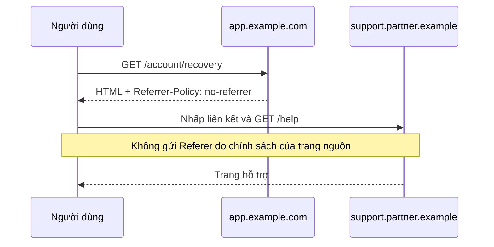

# Referrer-Policy và dữ liệu được gửi theo liên kết

## 1. Vì sao một cú nhấp liên kết cũng có thể làm lộ thông tin?

Trong module **SPRING_SECURITY_HTTP_PROTECTION**, việc phòng vệ HTTP không chỉ nằm ở xác thực, CSRF, CORS, security headers, CSP và HSTS. Trình duyệt còn có cơ chế tự động gửi thông tin về **trang nguồn** khi người dùng nhấp liên kết, khi website tải ảnh hoặc script, hay khi tạo một iframe. Chủ đề **Quyền và cô lập trình duyệt** vì vậy cần chú ý đến **`Referrer-Policy`**: một HTTP response header giúp giới hạn thông tin về địa chỉ trang nguồn được chuyển sang request tiếp theo.

Giả sử người dùng đang xem trang:

```text
https://app.example.com/account/recovery?flow=demo123&email=user%40example.com
```

Trang này có liên kết đến một website hỗ trợ bên ngoài:

```html
<a href="https://support.partner.example/help">
  Mở trang hướng dẫn
</a>
```

Khi người dùng nhấp liên kết, trình duyệt **có thể** gửi request kèm header:

```http
Referer: https://app.example.com/
```

Nếu ứng dụng sử dụng một chính sách referrer ít hạn chế hơn, trình duyệt có thể gửi cả path và query của URL nguồn. Khi đó các giá trị như email, định danh người dùng, mã đặt lại mật khẩu, mã truy cập ngắn hạn hoặc thông tin luồng nghiệp vụ trong URL có nguy cơ bị lưu ở log của website nhận request.

**`Referrer-Policy` giới hạn lượng thông tin URL nguồn mà trình duyệt gửi ra ngoài.** Nó không phải cơ chế mã hóa URL và không thay thế việc tránh đưa dữ liệu nhạy cảm vào URL ngay từ đầu.

### Mục tiêu học tập

Sau bài này, người học có thể:

1. Giải thích sự khác nhau giữa **`Referrer-Policy`** (tên header cấu hình) và **`Referer`** (tên header request).
2. Dự đoán phần nào của URL nguồn được gửi khi điều hướng **cùng origin**, **khác origin** và từ **HTTPS xuống HTTP**.
3. Chọn chính sách phù hợp cho trang thông thường và trang nhạy cảm.
4. Cấu hình chính sách với **Spring Security Servlet** và **Reactive/WebFlux**, kể cả ngoại lệ theo endpoint.
5. Kiểm chứng trên HTTP response, trình duyệt và DevTools; phân biệt lỗi cấu hình với hành vi do browser hoặc proxy gây ra.

## 2. Hai tên gần giống nhau nhưng vai trò khác nhau

Trong HTTP, cách viết **`Referer`** thiếu một chữ `r` so với từ tiếng Anh *referrer* là tên trường lịch sử và vẫn được dùng cho **request header**. Còn **`Referrer-Policy`** là tên chính thức của **response header** quy định cách tạo thông tin referrer.

| Header | Hướng truyền | Ví dụ | Ý nghĩa |
| --- | --- | --- | --- |
| `Referrer-Policy` | Server → trình duyệt, trong response | `Referrer-Policy: strict-origin-when-cross-origin` | Đặt quy tắc cho referrer của các request tiếp theo phát sinh trong ngữ cảnh tài liệu. |
| `Referer` | Trình duyệt → server đích, trong request | `Referer: https://app.example.com/` | Cho server đích biết thông tin về URL trang nguồn, theo chính sách và các giới hạn của browser. |

Luồng minh họa:



**Chiều áp dụng là điểm quan trọng:** chính sách gắn với **trang nguồn** quyết định cách browser gửi `Referer` khi người dùng rời trang đó hoặc khi trang đó tải subresource. Việc thêm `Referrer-Policy` vào **response của trang đích** không thể thay đổi ngược lại request đã được gửi để truy cập trang đích.

Nếu trang A nhấp sang B, hãy kiểm tra **response của A** để hiểu chính sách xuất phát; kiểm tra **request đến B** để quan sát kết quả. Chỉ nhìn response của B là chưa đủ.

## 3. URL nguồn có những phần nào có thể xuất hiện trong Referer?

Ví dụ:

```text
https://app.example.com:8443/courses/42?tab=progress&user=demo#details
└─scheme─┘ └─────host────┘ └port┘ └──path──┘ └────query─────┘ └fragment┘
```

Khi chính sách cho phép **URL đầy đủ**, thông tin có thể bao gồm scheme, host, port, path và query. **Fragment** bắt đầu bằng `#` không được gửi trong `Referer`; thông tin tài khoản/mật khẩu trong URL (userinfo), nếu có, cũng không được đưa vào `Referer` theo quy tắc xử lý referrer.

Khi chính sách chỉ cho phép **origin**, dữ liệu được gửi sẽ có dạng:

```http
Referer: https://app.example.com:8443/
```

Path và query đã bị lược bỏ. URL HTTPS dùng cổng mặc định có thể được chuẩn hóa thành `https://app.example.com/`.

**Origin** được xác định bởi **scheme + host + port**. Hai URL cùng họ tên miền nhưng khác subdomain hoặc port vẫn có thể khác origin. Ví dụ `https://app.example.com` và `https://portal.example.com` là hai origin khác nhau.

### Vì sao query đặc biệt nhạy cảm?

Một ứng dụng cũ có thể đặt những dữ liệu sau vào URL:

- Địa chỉ email, mã hồ sơ, mã khách hàng hoặc định danh tenant.
- Mã xác thực, mã khôi phục, token chia sẻ hoặc liên kết có chữ ký.
- Tên tài liệu nội bộ, tham số tìm kiếm hoặc bộ lọc phản ánh thông tin cá nhân.
- Giá trị tạm thời của một luồng xác thực.

Nếu referrer chứa cả query và được chuyển đến máy chủ ngoài, các giá trị đó có thể xuất hiện trong **access log**, hệ thống phân tích hoặc các thành phần hạ tầng của bên nhận. Không nên đặt token nhạy cảm trong URL chỉ vì đang dùng `Referrer-Policy: no-referrer`: URL vẫn có thể xuất hiện trong lịch sử trình duyệt, log của chính ứng dụng, proxy, ảnh chụp màn hình hoặc các kênh khác.

## 4. Tám giá trị Referrer-Policy và tác động thực tế

Các giá trị thường dùng gồm:

| Giá trị | Cùng origin | Khác origin, không hạ cấp bảo mật | Điều hướng HTTPS → HTTP |
| --- | --- | --- | --- |
| `no-referrer` | Không gửi `Referer` | Không gửi | Không gửi |
| `same-origin` | Gửi URL nguồn, không gồm fragment | Không gửi | Không gửi nếu khác origin |
| `origin` | Chỉ gửi origin | Chỉ gửi origin | Có thể gửi origin |
| `strict-origin` | Chỉ gửi origin | Chỉ gửi origin | Không gửi |
| `origin-when-cross-origin` | Gửi URL nguồn | Chỉ gửi origin | Có thể gửi origin |
| `strict-origin-when-cross-origin` | Gửi URL nguồn | Chỉ gửi origin | Không gửi |
| `no-referrer-when-downgrade` | Gửi URL nguồn | Gửi URL nguồn | Không gửi |
| `unsafe-url` | Gửi URL nguồn | Gửi URL nguồn | Có thể gửi URL nguồn |

Ở bảng trên, **URL nguồn** là URL có thể gồm path/query nhưng không gồm fragment hoặc userinfo. Với cột “khác origin”, tình huống điển hình là **HTTPS → HTTPS** hoặc HTTP → HTTP; một số giá trị áp dụng quy tắc riêng khi mức an toàn của kết nối thay đổi. “Có thể gửi” còn tùy các giới hạn về điều hướng, môi trường browser và chính sách bảo mật khác.

### 4.1. `strict-origin-when-cross-origin` — điểm khởi đầu cân bằng

```http
Referrer-Policy: strict-origin-when-cross-origin
```

- Request **cùng origin**: browser có thể gửi path và query của trang nguồn, giúp các luồng nội bộ vẫn biết trang điều hướng.
- Request **khác origin, không hạ cấp bảo mật**: chỉ gửi origin, ví dụ `https://app.example.com/`.
- Request **từ HTTPS đến HTTP**: không gửi `Referer`.

Đây là **mặc định phổ biến của trình duyệt hiện đại** khi không có chính sách riêng. Tuy nhiên không nên phụ thuộc hoàn toàn vào mặc định nếu ứng dụng cần một bảo đảm có thể kiểm thử và kiểm soát khi nhiều browser hoặc proxy tham gia.

### 4.2. `no-referrer` — phù hợp với tài liệu đặc biệt nhạy cảm

```http
Referrer-Policy: no-referrer
```

Browser không gửi `Referer` cho request xuất phát từ ngữ cảnh được áp dụng chính sách, kể cả tới cùng origin. Phù hợp cho trang khôi phục tài khoản, trang chứa thông tin nghiệp vụ nhạy cảm hoặc luồng mà **không có lý do đáng tin cậy để tiết lộ URL nguồn**.

Đánh đổi: một số hệ thống phân tích, đo nguồn truy cập hoặc ứng dụng cũ dựa trên `Referer` có thể giảm dữ liệu. Điều này là lý do cần kiểm thử nghiệp vụ, **không phải lý do để vô hiệu hóa bảo vệ mà không đánh giá**.

### 4.3. `same-origin` và `strict-origin` — hai chiến lược khác nhau

`same-origin` cho phép URL nguồn đầy đủ **chỉ khi request cùng origin**, không gửi gì khi khác origin. `strict-origin` chỉ gửi **origin**, cả khi cùng origin và khi khác origin không hạ cấp. Nếu mục tiêu là chặn mọi thông tin về website khi rời origin, `same-origin` phù hợp hơn; nếu ứng dụng muốn giữ origin để đối tác biết nguồn nhưng không lộ path, `strict-origin` có thể phù hợp.

### 4.4. `unsafe-url` và `no-referrer-when-downgrade` — không nên chọn tùy tiện

`unsafe-url` có thể gửi path/query tới origin ngoài **kể cả khi điều hướng từ HTTPS xuống HTTP**; tên gọi phản ánh nguy cơ lộ thông tin. `no-referrer-when-downgrade` không gửi khi HTTPS → HTTP, nhưng có thể gửi **URL đầy đủ** khi HTTPS → HTTPS qua origin ngoài.

Những giá trị ít hạn chế này có thể xuất hiện trong hệ thống cũ. Việc giữ lại chỉ vì một hệ thống tracking cần path/query phải được xem như **ngoại lệ có rủi ro**, cần kiểm soát dữ liệu URL và rà soát phương án thay thế.

## 5. Ma trận tình huống minh họa

Trang nguồn đang ở:

```text
https://learn.example.com/profile/settings?section=private#password
```

Giả định trình duyệt đang tải tài liệu theo HTTPS, không có `referrerpolicy` riêng trên liên kết và không có cơ chế khác ghi đè chính sách.

| Đích của liên kết | `strict-origin-when-cross-origin` | `no-referrer` | `same-origin` |
| --- | --- | --- | --- |
| `https://learn.example.com/help` | `https://learn.example.com/profile/settings?section=private` | Không có `Referer` | URL nguồn không gồm fragment |
| `https://support.example.net/help` | `https://learn.example.com/` | Không có `Referer` | Không có `Referer` |
| `http://support.example.net/help` | Không có `Referer` | Không có `Referer` | Không có `Referer` |

Lưu ý: `#password` không xuất hiện trong `Referer` ở bất kỳ trường hợp nào, **không phải vì `Referrer-Policy` tự bảo vệ fragment**, mà vì quy tắc tạo referrer vốn không gửi fragment.

Thử nghiệm với cùng origin quan trọng: ngay cả chính sách `strict-origin-when-cross-origin` vẫn có thể gửi **query string** cho request trong ứng dụng. Do đó, chính sách này không đủ cho mọi trang nhạy cảm nếu cả log cùng origin cũng cần tránh ghi nhận URL nguồn chi tiết.

## 6. Referrer không chỉ xuất hiện khi nhấp thẻ a

Browser có thể áp dụng chính sách referrer cho nhiều loại request xuất phát từ trang:

- Điều hướng qua `<a href="...">` và những tình huống điều hướng liên quan.
- Tải hình ảnh, script, stylesheet hoặc nội dung nhúng, tùy ngữ cảnh.
- Điều hướng vào `<iframe>`.
- Các request JavaScript như `fetch`, theo `referrerPolicy` của request và chính sách trình duyệt.

Vì vậy, trang chứa URL nhạy cảm **không cần người dùng nhấp một liên kết ngoài** mới có nguy cơ lộ referrer. Chỉ cần browser tải một tài nguyên ngoài origin, chính sách của request đó cũng cần được xem xét.

### Header cấp tài liệu

Nếu response HTML của trang nguồn có:

```http
HTTP/1.1 200 OK
Content-Type: text/html; charset=UTF-8
Referrer-Policy: no-referrer
```

thì các request phát sinh trong tài liệu thường được điều khiển bởi chính sách này, trừ khi có quy tắc hoặc thiết lập phù hợp khác áp dụng cho request cụ thể.

### Ghi đè theo liên kết

Không nhất thiết phải thay chính sách của **mọi** trang để chặn `Referer` cho một liên kết cụ thể:

```html
<a href="https://support.partner.example/help"
   referrerpolicy="no-referrer">
  Mở hỗ trợ bên ngoài
</a>
```

Với liên kết HTML, `rel="noreferrer"` cũng là cách yêu cầu không gửi thông tin referrer:

```html
<a href="https://support.partner.example/help"
   rel="noreferrer">
  Mở trợ giúp mà không gửi địa chỉ trang nguồn
</a>
```

**Phạm vi khác nhau:** `Referrer-Policy` ở response đặt chính sách cấp tài liệu; `referrerpolicy` hoặc `rel="noreferrer"` điều khiển một loại điều hướng/tải tài nguyên cụ thể. Các quy tắc ưu tiên và hỗ trợ thuộc tính phụ thuộc phần tử và trình duyệt; hãy kiểm tra request thật thay vì mặc định rằng toàn bộ link sẽ có cùng `Referer`.

### Iframe và fetch

```html
<iframe
  src="https://docs.partner.example/embed"
  title="Tài liệu đối tác"
  referrerpolicy="no-referrer">
</iframe>
```

Thuộc tính `referrerpolicy` trên iframe điều khiển **referrer của request tải iframe**. Nó **không thay thế CSP `frame-ancestors` hoặc X-Frame-Options** ở response trang con: browser vẫn có thể từ chối render iframe theo chính sách chống nhúng.

Với JavaScript:

```javascript
fetch("https://api.partner.example/public-info", {
  method: "GET",
  referrerPolicy: "no-referrer"
});
```

Tùy chọn `referrerPolicy` chỉ điều chỉnh thông tin referrer của request này; **không tự cấp quyền CORS**, không làm response được đọc khi máy chủ không cho phép và không thay thế authorization.

### CSP meta và Referrer-Policy meta không giống nhau

Một số browser hỗ trợ:

```html
<meta name="referrer" content="no-referrer">
```

Tuy nhiên, với ứng dụng Spring Security, **HTTP response header `Referrer-Policy` là cách cấu hình trung tâm dễ kiểm thử**. Không nhầm meta `name="referrer"` với CSP `frame-ancestors`; directive `frame-ancestors` không có hiệu lực khi đặt qua CSP meta, còn đây là hai cơ chế khác nhau.

## 7. Chọn chính sách cho từng nhóm trang

Không nhất thiết toàn bộ ứng dụng phải dùng đúng một mức chia sẻ referrer. Hãy phân loại theo **dữ liệu trong URL và nhu cầu nghiệp vụ**:

| Loại trang | Định hướng chính sách | Lý do |
| --- | --- | --- |
| Trang nội dung công khai, bài viết, trang khóa học không mang thông tin nhạy cảm trong URL | `strict-origin-when-cross-origin` | Cân bằng dữ liệu điều hướng nội bộ với bảo vệ path/query khi sang origin ngoài. |
| Trang khôi phục tài khoản, xác minh danh tính, liên kết có mã một lần | `no-referrer` | Không gửi địa chỉ trang nguồn, kể cả cho request cùng origin. |
| Trang tài khoản có nhiều tài nguyên nội bộ và cần không tiết lộ origin ra ngoài | `same-origin` | Chỉ chia sẻ `Referer` cho request nội bộ cùng origin. |
| Trang cũ dùng `unsafe-url` để tracking | Rà soát trước khi thay; ưu tiên chính sách chặt hơn | Có nguy cơ gửi path/query tới bên ngoài, kể cả trong trường hợp hạ cấp. |
| Trang nhúng báo cáo với URL được cá nhân hóa | `no-referrer` hoặc mức chặt tương ứng | Quyền iframe và quyền tiết lộ URL nguồn là hai quyết định độc lập. |

**Không dùng `Referer` như căn cứ cấp quyền**. Header request có thể vắng mặt do browser, chính sách riêng tư, extension hoặc client không phải trình duyệt; nó cũng không phải bằng chứng mật mã. Với các thao tác thay đổi trạng thái, cần CSRF protection theo thiết kế và kiểm tra xác thực/phân quyền phía server.

## 8. Spring Security Servlet: cấu hình header mặc định

Trong Spring Security Servlet, cấu hình security headers thông qua `HttpSecurity` và `SecurityFilterChain`. **`Referrer-Policy` không phải header mặc định được Spring Security tự thêm trong cấu hình tiêu chuẩn**, vì chính sách phải phù hợp với nhu cầu của ứng dụng. Chúng ta nên chọn giá trị và khai báo một cách tường minh.

Ví dụ với DSL dựa trên lambda:

```java
import org.springframework.context.annotation.Bean;
import org.springframework.context.annotation.Configuration;
import org.springframework.security.config.annotation.web.builders.HttpSecurity;
import org.springframework.security.config.annotation.web.configuration.EnableWebSecurity;
import org.springframework.security.web.SecurityFilterChain;
import org.springframework.security.web.header.writers.ReferrerPolicyHeaderWriter;

@Configuration
@EnableWebSecurity
public class SecurityConfig {

    @Bean
    SecurityFilterChain webSecurity(HttpSecurity http) throws Exception {
        return http
            .authorizeHttpRequests(auth -> auth
                .anyRequest().authenticated())
            .headers(headers -> headers
                .referrerPolicy(referrer -> referrer
                    .policy(ReferrerPolicyHeaderWriter.ReferrerPolicy
                        .STRICT_ORIGIN_WHEN_CROSS_ORIGIN)))
            .build();
    }
}
```

Response dự kiến khi request đi qua security chain:

```http
Referrer-Policy: strict-origin-when-cross-origin
```

Phần `authenticated()` chỉ minh họa yêu cầu xác thực. Ứng dụng thực tế còn cần cấu hình cơ chế đăng nhập và phân quyền phù hợp. **Referrer-Policy không làm thay đổi quyết định ai được truy cập URL**.

### Ngoại lệ cho trang nhạy cảm

Nếu các trang tại `/account/recovery/**` phải dùng `no-referrer`, còn phần còn lại dùng `strict-origin-when-cross-origin`, hãy tách rõ hai chain:

```java
import org.springframework.context.annotation.Bean;
import org.springframework.context.annotation.Configuration;
import org.springframework.core.annotation.Order;
import org.springframework.security.config.annotation.web.builders.HttpSecurity;
import org.springframework.security.web.SecurityFilterChain;
import org.springframework.security.web.header.writers.ReferrerPolicyHeaderWriter;

@Configuration
public class ScopedReferrerPolicyConfig {

    @Bean
    @Order(1)
    SecurityFilterChain recoveryPages(HttpSecurity http) throws Exception {
        return http
            .securityMatcher("/account/recovery/**")
            .authorizeHttpRequests(auth -> auth
                .anyRequest().authenticated())
            .headers(headers -> headers
                .referrerPolicy(referrer -> referrer
                    .policy(ReferrerPolicyHeaderWriter.ReferrerPolicy
                        .NO_REFERRER)))
            .build();
    }

    @Bean
    @Order(2)
    SecurityFilterChain otherPages(HttpSecurity http) throws Exception {
        return http
            .authorizeHttpRequests(auth -> auth
                .anyRequest().authenticated())
            .headers(headers -> headers
                .referrerPolicy(referrer -> referrer
                    .policy(ReferrerPolicyHeaderWriter.ReferrerPolicy
                        .STRICT_ORIGIN_WHEN_CROSS_ORIGIN)))
            .build();
    }
}
```

Đây là **phương án thay thế** cho cấu hình một chain ở trên; không khai báo cả hai lớp cấu hình với nhiều chain trùng chức năng trong cùng ứng dụng. `@Order(1)` giúp matcher cụ thể được xét trước chain không giới hạn URL. `securityMatcher` chọn **security chain viết response header**; `requestMatchers` chỉ nằm trong `authorizeHttpRequests` thì không tạo policy riêng cho URL.

**Lưu ý:** Nếu khôi phục mật khẩu có endpoint truy cập công khai, cần xây dựng rule xác thực/`permitAll` đúng nghiệp vụ và kiểm tra token; ví dụ `authenticated()` chỉ nhằm tập trung vào header, không phải hướng dẫn áp `authenticated()` cho mọi trang recovery.

**Không dùng `headers(headers -> headers.disable())`** để “sửa” vấn đề referrer: lệnh đó tắt toàn bộ security headers do Spring Security quản lý, bao gồm các lớp bảo vệ khác. Thêm hoặc chỉnh đúng `referrerPolicy` là đủ.

## 9. Spring Security Reactive / WebFlux: cấu hình tương ứng

Trên WebFlux, ứng dụng dùng `ServerHttpSecurity` và `SecurityWebFilterChain`. Ý nghĩa của HTTP response header là giống Servlet, nhưng lớp cấu hình và enum của header writer thuộc phần Reactive:

```java
import org.springframework.context.annotation.Bean;
import org.springframework.context.annotation.Configuration;
import org.springframework.security.config.annotation.web.reactive.EnableWebFluxSecurity;
import org.springframework.security.config.web.server.ServerHttpSecurity;
import org.springframework.security.web.server.SecurityWebFilterChain;
import org.springframework.security.web.server.header.ReferrerPolicyServerHttpHeadersWriter;

@Configuration
@EnableWebFluxSecurity
public class ReactiveSecurityConfig {

    @Bean
    SecurityWebFilterChain webSecurity(ServerHttpSecurity http) {
        return http
            .authorizeExchange(auth -> auth
                .anyExchange().authenticated())
            .headers(headers -> headers
                .referrerPolicy(referrer -> referrer
                    .policy(ReferrerPolicyServerHttpHeadersWriter.ReferrerPolicy
                        .STRICT_ORIGIN_WHEN_CROSS_ORIGIN)))
            .build();
    }
}
```

Để đặt chính sách theo route trong WebFlux, dùng các `SecurityWebFilterChain` với `securityMatcher` tương ứng:

```java
import org.springframework.context.annotation.Bean;
import org.springframework.context.annotation.Configuration;
import org.springframework.core.annotation.Order;
import org.springframework.security.config.annotation.web.reactive.EnableWebFluxSecurity;
import org.springframework.security.config.web.server.ServerHttpSecurity;
import org.springframework.security.web.server.SecurityWebFilterChain;
import org.springframework.security.web.server.header.ReferrerPolicyServerHttpHeadersWriter;
import org.springframework.security.web.server.util.matcher.PathPatternParserServerWebExchangeMatcher;

@Configuration
@EnableWebFluxSecurity
public class ScopedReactiveReferrerPolicyConfig {

    @Bean
    @Order(1)
    SecurityWebFilterChain recoveryPages(ServerHttpSecurity http) {
        return http
            .securityMatcher(
                new PathPatternParserServerWebExchangeMatcher(
                    "/account/recovery/**"))
            .authorizeExchange(auth -> auth
                .anyExchange().authenticated())
            .headers(headers -> headers
                .referrerPolicy(referrer -> referrer
                    .policy(ReferrerPolicyServerHttpHeadersWriter.ReferrerPolicy
                        .NO_REFERRER)))
            .build();
    }

    @Bean
    @Order(2)
    SecurityWebFilterChain otherPages(ServerHttpSecurity http) {
        return http
            .authorizeExchange(auth -> auth
                .anyExchange().authenticated())
            .headers(headers -> headers
                .referrerPolicy(referrer -> referrer
                    .policy(ReferrerPolicyServerHttpHeadersWriter.ReferrerPolicy
                        .STRICT_ORIGIN_WHEN_CROSS_ORIGIN)))
            .build();
    }
}
```

Tương tự Servlet, **hai chain ở đoạn sau là phương án thay thế** cho một chain toàn ứng dụng ở ví dụ đầu. Response `/account/recovery/**` được gắn `no-referrer`; response các URL còn lại được gắn `strict-origin-when-cross-origin`. Khi hệ thống có nhiều chain khác, phải xác định route nào thực sự đi qua chain nào và tránh trùng matcher/thứ tự không dự kiến.

## 10. Thực hành kiểm thử bằng trình duyệt

Thử nghiệm trên hệ thống do bạn kiểm soát:

- **Trang nguồn A** tại `http://localhost:8080/lab/source?sample=public`.
- **Trang nhận B** khác origin tại `http://localhost:9090/inspect`.
- **Trang nhận A** cùng origin tại `http://localhost:8080/inspect`.

Ở đây đổi **port** tạo ra origin khác, đủ để kiểm tra `strict-origin-when-cross-origin`, nhưng chưa mô phỏng đầy đủ HTTPS → HTTP. Các giá trị trong query của bài lab đều là **dữ liệu giả**.

### 10.1. Tạo trang nguồn

Phục vụ HTML dưới đây từ origin 8080 và đảm bảo response chứa:

```http
Referrer-Policy: strict-origin-when-cross-origin
```

```html
<!doctype html>
<html lang="vi">
<head>
  <meta charset="utf-8">
  <title>Thử nghiệm Referrer-Policy</title>
</head>
<body>
  <h1>Quan sát Referer của request đích</h1>
  <p>Địa chỉ trang nguồn có query thử nghiệm: sample=public</p>

  <a href="http://localhost:8080/inspect" target="_blank">
    Mở trang cùng origin
  </a>

  <a href="http://localhost:9090/inspect" target="_blank">
    Mở trang khác origin
  </a>

  <a href="http://localhost:9090/inspect"
     target="_blank" referrerpolicy="no-referrer">
    Mở trang khác origin nhưng không gửi Referer
  </a>
</body>
</html>
```

Để tránh các yếu tố ngoài bài học, chỉ dùng endpoint `/inspect` trả thông tin request vô hại và không thu thập thông tin cá nhân. Nếu không tạo endpoint echo, có thể quan sát tab **Network → Request Headers** của request điều hướng; trong một số trường hợp, request điều hướng mở tab khác cần kiểm tra DevTools của tab đích.

### 10.2. Kết quả kỳ vọng

| Request phát sinh từ trang A | Giá trị `Referer` dự kiến |
| --- | --- |
| A → `http://localhost:8080/inspect` | `http://localhost:8080/lab/source?sample=public` |
| A → `http://localhost:9090/inspect` | `http://localhost:8080/` |
| A → 9090 với `referrerpolicy="no-referrer"` | Không có header `Referer` |
| A → 9090 khi response A dùng `no-referrer` | Không có header `Referer` |

**Không đưa token thật vào query khi thực hành.** Chính sách `strict-origin-when-cross-origin` ở cùng origin vẫn có thể gửi query như hàng đầu tiên. Trên môi trường production, hãy quan sát chính sách thật ở HTTPS vì hành vi khi hạ cấp khác với lab HTTP→HTTP.

### 10.3. Thử HTTPS → HTTP

Muốn kiểm chứng nhánh hạ cấp, cần trang nguồn được phục vụ qua **HTTPS thực sự** và liên kết đến HTTP. Với `strict-origin-when-cross-origin`, chính sách yêu cầu **không gửi `Referer`** cho điều hướng HTTPS → HTTP.

Thực nghiệm hạ cấp có thể chịu thêm giới hạn của browser hoặc cơ chế khác như chặn mixed content; nếu điều hướng bị chặn hoàn toàn, kết quả đó **không phải bằng chứng riêng** rằng `Referrer-Policy` đã loại bỏ header. Hãy phân biệt “request không xảy ra” với “request xảy ra nhưng không có `Referer`”.

### 10.4. DevTools cần quan sát những gì?

1. Chọn **response HTML của trang nguồn** và xác nhận `Referrer-Policy`.
2. Nhấp liên kết; tìm **request đến trang đích** rồi xem **Request Headers → Referer**.
3. Thử cùng origin, khác origin và một liên kết có `referrerpolicy="no-referrer"`.
4. Đối chiếu chính sách được chọn với query/path thực sự được gửi.
5. Lặp lại qua proxy/CDN ở staging để đảm bảo response header không bị ghi đè.

**Header `Referer` có thể vắng mặt vì nhiều nguyên nhân**: chính sách của trang nguồn, thuộc tính trên link, extension bảo mật, thiết lập quyền riêng tư, request không được thực hiện hoặc hạn chế đặc thù của trình duyệt. Đừng kết luận chỉ từ một request đơn lẻ.

## 11. Kiểm thử tự động trong Spring Security

MockMvc và WebTestClient giúp kiểm tra **server phát đúng `Referrer-Policy`**. Nhưng các HTTP test này **không mô phỏng một trang nguồn tạo điều hướng**, nên không chứng minh được browser sẽ phát `Referer` cụ thể. Cần test header kèm bài thử browser.

### 11.1. Servlet: MockMvc

Giả sử đã cấu hình controller/handler trả response cho hai URL, và dùng `spring-security-test`:

```java
mockMvc.perform(get("/account/recovery/start").with(user("tester")))
    .andExpect(status().isOk())
    .andExpect(header().string("Referrer-Policy", "no-referrer"));

mockMvc.perform(get("/courses/42").with(user("tester")))
    .andExpect(status().isOk())
    .andExpect(header().string(
        "Referrer-Policy", "strict-origin-when-cross-origin"));
```

Đây là **phần thân test minh họa**, cần `MockMvc`, controller và các static import `get`, `user`, `status`, `header`. Nếu endpoint nhạy cảm trả redirect, phải chọn đúng response HTML mà người dùng thực sự mở để xác nhận chính sách phù hợp.

### 11.2. Reactive: WebTestClient

```java
webTestClient.mutateWith(mockUser("tester"))
    .get().uri("/account/recovery/start")
    .exchange()
    .expectStatus().isOk()
    .expectHeader().valueEquals("Referrer-Policy", "no-referrer");

webTestClient.mutateWith(mockUser("tester"))
    .get().uri("/courses/42")
    .exchange()
    .expectStatus().isOk()
    .expectHeader().valueEquals(
        "Referrer-Policy", "strict-origin-when-cross-origin");
```

`mockUser` là tiện ích của `SecurityMockServerConfigurers` trong `spring-security-test`. Trong cả Servlet và WebFlux, bổ sung test cho những route gần phạm vi ngoại lệ hoặc được xử lý bởi chain khác để tránh thay đổi chính sách ngoài dự kiến.

### 11.3. Ma trận regression nên giữ

| Trường hợp | Điều cần kiểm tra |
| --- | --- |
| Trang nội dung thông thường | Response có `strict-origin-when-cross-origin`. |
| Trang khôi phục tài khoản | Response có `no-referrer`. |
| Link cùng origin từ trang thông thường | Request `Referer` có thể chứa path/query của trang nguồn. |
| Link khác origin không hạ cấp | Request `Referer` chỉ chứa origin. |
| Link có `referrerpolicy="no-referrer"` | Không gửi `Referer` cho link này. |
| Trang nhạy cảm nhấp link ngoài | Không gửi `Referer` nếu trang dùng `no-referrer`. |
| HTTPS → HTTP | Không gửi `Referer` theo `strict-origin-when-cross-origin` khi request thực sự xảy ra. |
| Response qua proxy/CDN | Không bị thêm chính sách yếu hơn hoặc header trùng gây khó đoán. |

## 12. Những lỗi phổ biến khi triển khai

### “Đã cấu hình Referrer-Policy nhưng request ban đầu vẫn có Referer”

Kiểm tra **trang nào là trang nguồn của request ban đầu**. Policy trên response đích chỉ chi phối các request phát sinh **sau khi** browser nhận response và sử dụng ngữ cảnh đó; nó không thể sửa `Referer` của request đã đến máy chủ.

### “Chính sách strict-origin-when-cross-origin vẫn gửi query trong website”

Đây là hành vi dự kiến khi request **cùng origin**. Chính sách này chỉ rút gọn thành origin khi request **khác origin** mà không hạ cấp. Với trang thực sự nhạy cảm, cân nhắc `no-referrer` hoặc `same-origin` theo phạm vi dữ liệu được phép chia sẻ.

### “Một subdomain vẫn nhận Referer dù dùng same-origin”

Nếu source là `https://app.example.com` và destination là `https://help.example.com`, đó là **khác origin**. Dưới `same-origin`, browser không gửi `Referer` cho request này. Nếu vẫn thấy header, kiểm tra chính sách thực tế được tải, thuộc tính HTML riêng, proxy và request nào đang được quan sát.

### “Trang đối tác đột nhiên mất thông tin analytics”

Khi chuyển từ `no-referrer-when-downgrade` sang `strict-origin-when-cross-origin`, đối tác có thể không còn nhận path/query đầy đủ của URL nguồn. Đây thường là **mục tiêu bảo vệ thông tin**, không nhất thiết là lỗi. Nếu nghiệp vụ cần nguồn chiến dịch, cân nhắc cơ chế đo lường có chủ đích và tối thiểu hóa dữ liệu, thay vì khôi phục `unsafe-url` trên toàn site.

### “Đã đặt no-referrer nhưng URL bí mật vẫn nằm trong log”

`Referrer-Policy` chỉ kiểm soát **thông tin referrer của request phù hợp**. URL ban đầu vẫn có thể được ghi vào access log của ứng dụng, history, proxy và telemetry; một script cùng origin cũng có thể biết URL hiện tại nếu chạy trong tài liệu. Giải pháp đúng là **không đưa secret lâu dài vào URL**, dùng mã ngắn hạn/one-time với quy trình xử lý an toàn, làm sạch log và xem xét cache.

### “Đã tắt Referer nhưng CSRF vẫn có thể xảy ra”

`Referrer-Policy` **không phải biện pháp phòng vệ CSRF**. Kiểm tra `Origin` hoặc `Referer` đôi khi là lớp tín hiệu bổ sung phía server, nhưng `Referer` có thể bị loại bỏ hợp lệ. Ứng dụng vẫn cần cơ chế CSRF token và các kiểm soát session/cookie thích hợp với kiến trúc.

### “Cấu hình trong ứng dụng đúng nhưng production trả chính sách khác”

Một reverse proxy, ingress, web server hoặc CDN có thể thêm/ghi đè `Referrer-Policy`. Hãy so sánh **response thực sự tới trình duyệt** với response trong kiểm thử Spring Security. Khi có nhiều giá trị/header, browser sẽ xử lý theo cú pháp danh sách policy và khả năng hỗ trợ giá trị; không nên phụ thuộc vào một cấu hình trùng lặp không kiểm soát.

### “Đặt referrerpolicy lên iframe thì clickjacking hết”

Không đúng. `referrerpolicy` trên iframe giới hạn **thông tin trang nguồn gửi cùng request tải iframe**; nó không quy định **ai được phép nhúng tài liệu iframe**. Clickjacking cần bảo vệ bằng `X-Frame-Options` hoặc CSP `frame-ancestors` trên **response trang bị nhúng**, đồng thời vẫn giữ xác thực/phân quyền.

## 13. Phối hợp với những lớp phòng vệ khác

| Cơ chế | Điều nó giải quyết | Không thể thay thế |
| --- | --- | --- |
| `Referrer-Policy` | Mức tiết lộ URL nguồn qua `Referer` ở request. | CSRF, CORS, xác thực, CSP framing. |
| CORS | Quyền đọc response cross-origin của JavaScript trong trường hợp CORS áp dụng. | Chính sách referrer và quyền nhúng iframe. |
| CSP `frame-ancestors` / XFO | Website nào được phép nhúng tài liệu vào frame. | Việc ẩn URL nguồn khi tải liên kết hoặc ảnh/script. |
| CSP `frame-src` | Nguồn iframe mà trang cha được tải. | Quyền trang con được nhúng và Referrer-Policy. |
| Cookie `SameSite` | Giới hạn một số tình huống gửi cookie theo site. | Ngăn URL query bị gửi trong `Referer`. |
| HSTS | Giúp chuyển kết nối cho host được áp dụng sang HTTPS theo quy tắc HSTS. | Chính sách dữ liệu referrer và phân quyền. |
| CSRF token và phân quyền | Ngăn thao tác trái phép/kiểm soát quyền dữ liệu. | Tối thiểu hóa thông tin URL nguồn tới website khác. |

Nhìn rộng hơn, **Referrer-Policy là một lớp giảm rò rỉ dữ liệu**, không phải cơ chế kiểm soát việc người dùng được truy cập trang nào. Với URL nhạy cảm, ưu tiên thiết kế không đưa dữ liệu bí mật vào URL; sử dụng `no-referrer` ở đúng nơi; và kiểm soát request/response ở các tầng liên quan.

## 14. Bài tập và câu hỏi tự đánh giá

**Bài A — Dự đoán header.** Trang nguồn tại `https://app.example.com/profile?tab=private#section` có policy `strict-origin-when-cross-origin`. Hãy dự đoán `Referer` khi nhấp đến (1) `https://app.example.com/help`, (2) `https://partner.example.net/help` và (3) `http://partner.example.net/help`.

**Bài B — Đổi chính sách cho trang nhạy cảm.** Nhóm ứng dụng đang dùng `strict-origin-when-cross-origin` cho tất cả route, nhưng trang `/account/recovery/**` chứa thông tin một lần trong URL. Hãy thiết kế hai `SecurityFilterChain` Servlet hoặc WebFlux để trang recovery không gửi `Referer`, phần còn lại vẫn dùng chính sách mặc định của nhóm.

**Bài C — Phân biệt hướng áp dụng.** Server B đã cấu hình `Referrer-Policy: no-referrer` nhưng vẫn thấy một request đến B có `Referer: https://a.example.com/`. Tại sao đây chưa phải lỗi ở B? Chính sách của tài liệu nào phải được kiểm tra?

**Bài D — Liên kết ngoại lệ.** Một trang công khai cần gửi origin tới đối tác để thống kê, nhưng liên kết tới trang hỗ trợ y tế phải không gửi `Referer`. Hãy đề xuất thuộc tính HTML trên liên kết cụ thể mà không thay đổi policy toàn website.

**Bài E — Kiểm tra lớp bảo vệ.** Ứng dụng dùng `Referrer-Policy: no-referrer`, rồi cho rằng không cần CSRF token trên các thao tác POST vì request sẽ không có `Referer`. Hãy nêu sai lầm và các kiểm soát cần duy trì.

**Gợi ý trả lời:** A — (1) URL nguồn gồm path/query nhưng không có fragment; (2) chỉ `https://app.example.com/`; (3) không gửi `Referer`. B — chain có `securityMatcher("/account/recovery/**")` dùng `NO_REFERRER`, chain còn lại dùng `STRICT_ORIGIN_WHEN_CROSS_ORIGIN`, kiểm thử cả hai. C — policy của **trang A** tạo request mới quyết định referrer gửi đến B; response của B không retroactively sửa request. D — dùng `referrerpolicy="no-referrer"` hoặc `rel="noreferrer"` cho liên kết cần bảo vệ. E — CSRF là bài toán thao tác không được ủy quyền, không thể thay bằng việc bỏ header `Referer`; cần giữ kiểm tra CSRF, quyền truy cập và session theo thiết kế.

## 15. Checklist phát hành và kết luận

Trước khi đưa cấu hình `Referrer-Policy` vào môi trường thực:

1. **Kiểm kê dữ liệu trong URL:** query/path có chứa token, email, mã người dùng hoặc dữ liệu nhạy cảm không?
2. **Chọn chính sách theo rủi ro:** `strict-origin-when-cross-origin` cho phần lớn trang thông thường; `no-referrer` hoặc mức phù hợp cho trang cần bảo mật hơn.
3. **Xem cả request cùng origin:** đừng tưởng policy mặc định của trình duyệt tự loại query khỏi mọi request.
4. **Kiểm thử từ trang nguồn:** so sánh response `Referrer-Policy` của source với request `Referer` gửi đến destination.
5. **Kiểm tra các ngoại lệ HTML/JavaScript:** `referrerpolicy`, `rel="noreferrer"` và request API có thể thay đổi kết quả.
6. **Kiểm thử trên Servlet và WebFlux:** đặt header theo đúng security chain và không tắt các security headers khác.
7. **Xác minh sau proxy/CDN:** kiểm tra response cuối cùng và tác động đến chức năng analytics/SSO hợp lệ.
8. **Không biến Referer thành cơ chế bảo mật duy nhất:** duy trì xác thực, CSRF, kiểm soát session, CSP và các lớp bảo vệ khác.

**Kết luận:** `Referrer-Policy` giúp ứng dụng Spring Security kiểm soát **mức tiết lộ URL trang nguồn** khi người dùng theo liên kết hoặc browser phát sinh request. Giá trị `strict-origin-when-cross-origin` thường cân bằng tính hữu dụng và quyền riêng tư; `no-referrer` phù hợp nơi đặc biệt nhạy cảm. Điểm quyết định là hiểu **chính sách nằm ở response của trang nguồn, nhưng kết quả được thấy ở header `Referer` của request tiếp theo**. Hãy thiết kế để URL không mang secret, giới hạn thông tin phát ra theo nhu cầu và kiểm chứng hành vi trên trình duyệt thực.

### Tài liệu tham khảo

- [MDN — Referrer-Policy](https://developer.mozilla.org/en-US/docs/Web/HTTP/Reference/Headers/Referrer-Policy): giá trị chính sách, cơ chế áp dụng và lưu ý bảo mật.
- [MDN — Referer](https://developer.mozilla.org/en-US/docs/Web/HTTP/Reference/Headers/Referer): cú pháp request header và thông tin có thể xuất hiện trong referrer.
- [Spring Security — Servlet HTTP Response Headers](https://docs.spring.io/spring-security/reference/servlet/exploits/headers.html): cấu hình `Referrer-Policy` với `HttpSecurity`.
- [Spring Security — Reactive HTTP Response Headers](https://docs.spring.io/spring-security/reference/reactive/exploits/headers.html): cấu hình `Referrer-Policy` với `ServerHttpSecurity`.
- [W3C — Referrer Policy](https://www.w3.org/TR/referrer-policy/): mô hình tạo và áp dụng chính sách referrer trong trình duyệt.
