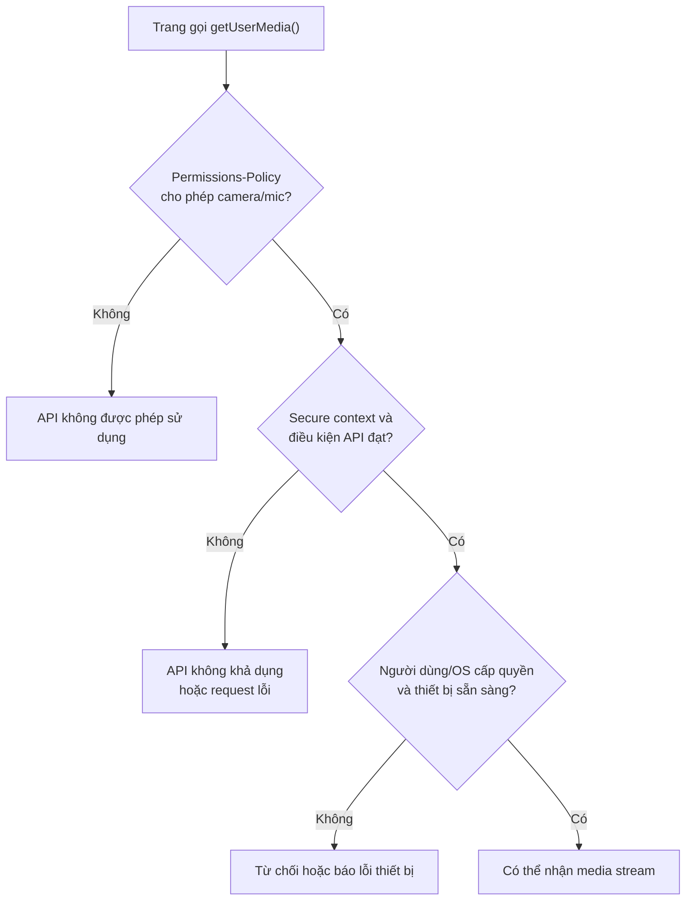
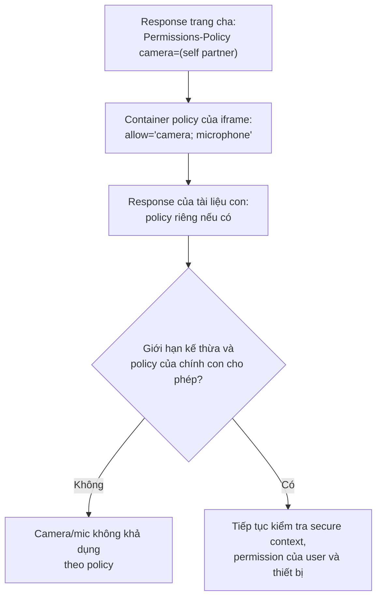

# Permissions-Policy cho camera, microphone và tính năng trình duyệt

## 1. Bài toán: ứng dụng cần chức năng trình duyệt nhưng phải giới hạn quyền

Trong module **SPRING_SECURITY_HTTP_PROTECTION**, chúng ta triển khai nhiều lớp phòng vệ HTTP và trình duyệt của Spring Security: CSRF, CORS, security headers, CSP, HSTS, HTTP firewall và bảo vệ session cho cả **Servlet** lẫn **Reactive/WebFlux**. Ở chương **Quyền và cô lập trình duyệt**, chủ đề **Permissions-Policy** tập trung vào câu hỏi: *tài liệu web nào được phép sử dụng những API trình duyệt nhạy cảm, và chúng có được sử dụng trong iframe hay không?*

Giả sử nền tảng học trực tuyến có:

- Trang `/courses/42` chỉ hiển thị nội dung, **không cần camera hay microphone**.
- Trang `/meeting/room` cho học viên tham gia lớp học trực tuyến, **có thể cần camera và microphone**, sau khi người dùng đồng ý.
- Trang `/meeting/embedded` chứa iframe gọi dịch vụ hội nghị ở `https://call.partner.example`.
- Trang `/admin/reports` không cần định vị, camera hoặc microphone.

Nếu không phân loại rõ, mã JavaScript được tải trong một trang có thể thử gọi API nhạy cảm mà sản phẩm không hề có nhu cầu. Điều này đặc biệt đáng quan tâm khi trang tích hợp script, widget hoặc iframe từ hệ thống khác. **Permissions-Policy** giúp server đặt một **giới hạn trên** cho những khả năng trình duyệt được phép cung cấp cho tài liệu và các frame con.

Ví dụ policy chặn ba nhóm tính năng:

```http
Permissions-Policy: camera=(), microphone=(), geolocation=()
```

Đây là một **HTTP response header**. Với trình duyệt hỗ trợ các directive liên quan, tài liệu nằm trong phạm vi chính sách không được sử dụng camera, microphone hoặc geolocation, ngay cả khi JavaScript cố gọi API.

**Permissions-Policy không phải hộp thoại xin quyền của người dùng.** Policy cho phép một tính năng **không đồng nghĩa** người dùng đã chấp thuận, hệ điều hành đã cấp quyền, thiết bị tồn tại hoặc API có thể được gọi từ bất cứ ngữ cảnh nào.

### Mục tiêu học tập

Sau bài này, bạn sẽ có thể:

1. Hiểu mô hình giới hạn tính năng bằng `Permissions-Policy` và cách nó phối hợp với quyền người dùng.
2. Viết đúng cú pháp `camera`, `microphone`, `geolocation` và các feature directive khác.
3. Phân biệt policy **cấp trang**, **điều kiện kế thừa trong iframe** và thuộc tính `allow`.
4. Cấu hình **Spring Security Servlet** và **Reactive/WebFlux**, mặc định từ chối và mở ngoại lệ hẹp theo route.
5. Kiểm thử HTTP header, kiểm tra khả năng sử dụng API trong trình duyệt và chẩn đoán lỗi khi tích hợp widget họp trực tuyến.

## 2. Permissions-Policy thực sự kiểm soát điều gì?

`Permissions-Policy` (trước đây thường được biết đến qua cơ chế **Feature-Policy**) cho phép tài liệu chỉ định các **tính năng trình duyệt** được sử dụng trong những ngữ cảnh nhất định. Một tính năng có thể được quản lý gồm:

| Directive | Khả năng thường liên quan | Ví dụ nhu cầu |
| --- | --- | --- |
| `camera` | Sử dụng camera qua API như `getUserMedia` | Lớp học có video, quét QR bằng camera. |
| `microphone` | Sử dụng microphone qua API như `getUserMedia` | Thu âm, hội nghị trực tuyến. |
| `geolocation` | Truy cập vị trí địa lý qua Geolocation API | Bản đồ hoặc dịch vụ dựa trên vị trí. |
| `display-capture` | Khả năng chụp/chia sẻ màn hình qua API liên quan | Trình chiếu trong cuộc họp, nơi browser hỗ trợ policy. |
| `fullscreen` | Khả năng chuyển nội dung sang toàn màn hình | Trình phát bài giảng, video nhúng. |
| `autoplay` | Khả năng tự động phát nội dung media trong những điều kiện áp dụng | Video/tài liệu media. |
| `clipboard-read`, `clipboard-write` | Những khả năng liên quan clipboard | Sao chép/dán qua các API có điều kiện bảo mật. |
| `payment`, `usb`, `serial` | Các API chuyên biệt | Thanh toán, thiết bị phần cứng, ứng dụng nghiệp vụ. |

**Danh mục directive, giá trị mặc định và mức hỗ trợ không giống nhau ở mọi browser hoặc phiên bản.** Một directive chưa được trình duyệt hỗ trợ có thể bị bỏ qua; không nên xem một header là bằng chứng rằng mọi tính năng đều đã bị khóa trên tất cả client. Khi triển khai, chỉ chọn feature thực sự liên quan và **kiểm tra bảng tương thích cho tập trình duyệt được hỗ trợ**.

Permissions-Policy hỗ trợ nguyên tắc **least privilege ở cấp tài liệu**: trang không cần camera thì không cấp khả năng camera; trang họp có nhu cầu thì mở có giới hạn. Tuy nhiên chính sách này **không thể loại bỏ nguy cơ XSS** hoặc bảo đảm script cùng origin luôn đáng tin. Nếu trang được cho phép dùng camera và có script độc hại chạy trong chính ngữ cảnh đó, vẫn cần các lớp bảo vệ script, quyền truy cập và kiểm soát hành vi khác.

## 3. Ba lớp cần thỏa mãn trước khi camera/microphone hoạt động

Để một trang hội nghị gọi `navigator.mediaDevices.getUserMedia(...)` thành công, ít nhất phải xem xét:

1. **Permissions-Policy** có cho phép tính năng trong tài liệu đang chạy mã không?
2. **Quy tắc API và trình duyệt** có cho phép sử dụng từ ngữ cảnh hiện tại không? Ví dụ, camera/microphone qua `getUserMedia` yêu cầu **secure context**; HTTPS là lựa chọn bắt buộc trong triển khai thực, còn `localhost` thường được browser xem là nguồn đáng tin cho phát triển.
3. **Người dùng và hệ điều hành** có cấp quyền không? Trình duyệt có thể hiển thị lời nhắc, nhớ quyết định từ trước, chặn do thiết lập quyền riêng tư hoặc báo không có thiết bị.



Policy là **giới hạn tối đa**, không phải thao tác tự động mở camera. Một lời nhắc cấp quyền **không xuất hiện** có thể vì policy chặn, thiết lập browser đã chặn, trang không an toàn hoặc API không sẵn có. Ngược lại, policy `camera=(self)` không khiến browser bỏ qua việc hỏi người dùng.

### Phân biệt những nhóm “quyền” dễ nhầm

| Cơ chế | Vấn đề chính | Không thể thay cho |
| --- | --- | --- |
| `Permissions-Policy` | Những document/origin nào có thể sử dụng tính năng browser | Sự đồng ý của người dùng và OS. |
| Lời nhắc camera/microphone của browser | Người dùng cho phép ứng dụng truy cập thiết bị hay không | Ranh giới chính sách cho iframe và tài liệu. |
| `Content-Security-Policy` (CSP) | Giới hạn nguồn script, frame, tài nguyên và những hành vi tương ứng | Quyền camera/microphone của người dùng. |
| CORS | Việc JavaScript cross-origin có quyền đọc một số response hay không | Quyền truy cập camera/microphone. |
| `X-Frame-Options` / CSP `frame-ancestors` | Ai được phép nhúng một tài liệu trong frame | Quyền dùng API của tài liệu sau khi được nhúng. |
| Xác thực/phân quyền Spring Security | Người dùng có được truy cập URL và nghiệp vụ hay không | Cấp phép phần cứng ở trình duyệt. |

Một request API thành công hoặc một HTTP response `200` không chứng minh camera có thể bật. Ngược lại, ứng dụng không thể “cấp quyền camera qua backend” bằng cách trả thêm một header.

## 4. Cú pháp header: danh sách nguồn được phép

`Permissions-Policy` sử dụng cú pháp dựa trên **Structured Fields**. Mỗi directive dạng `feature=allowlist`; các directive cách nhau bởi dấu phẩy.

```http
Permissions-Policy: camera=(), microphone=(), geolocation=()
```

| Cú pháp | Diễn giải |
| --- | --- |
| `camera=()` | Không cho document/những ngữ cảnh thuộc phạm vi policy sử dụng camera. |
| `camera=(self)` | Cho phép camera đối với nguồn phù hợp `self` của tài liệu, theo ràng buộc kế thừa. |
| `camera=("https://call.partner.example")` | Chỉ định origin được phép sử dụng camera; tài liệu chính có thể không nằm trong allowlist này nếu khác origin. |
| `camera=(self "https://call.partner.example")` | Cho phép tài liệu cùng origin và một origin đối tác được liệt kê. |
| `microphone=(self)` | Cho phép microphone ở phạm vi `self`, nhưng vẫn cần điều kiện API và quyền người dùng. |
| `geolocation=()` | Chặn Geolocation API theo policy khi directive được hỗ trợ. |
| `camera=*` | Mở khả năng camera cho các origin trong phạm vi áp dụng mà không giới hạn bằng allowlist origin; **không nên dùng như mặc định**. |

**Cú pháp khác CSP:** đối với Permissions-Policy, dùng `camera=()` hoặc `camera=(self)`, **không** dùng `camera 'none'`, `camera 'self'` như source expression của CSP. Trong header này, origin cụ thể đặt trong dấu nháy kép, ví dụ `"https://call.partner.example"`.

Một số lưu ý:

- `self` là từ khóa không đặt trong dấu nháy kép trong ví dụ header `Permissions-Policy`.
- Một allowlist không tự đồng nghĩa “mọi subdomain”. Chỉ ghi các origin đã xác minh; `https://call.partner.example` khác `https://chat.call.partner.example`.
- Origin của URL HTTP(S) được xác định bởi **scheme, host và port**. Thử nghiệm `localhost:8080` và `localhost:9090` là khác origin dù host giống nhau.
- Nếu thiếu directive, browser áp dụng **mặc định tương ứng với feature đó**. Không có một mặc định chung cho mọi tính năng; không nên suy luận rằng chỉ vì đã cấu hình `camera` thì `microphone` cũng tự bị chặn.
- Không phải mọi API có liên quan thiết bị đều nằm dưới cùng directive: chia sẻ màn hình dùng cơ chế và directive riêng trong những browser hỗ trợ, không thể coi `camera=()` là lệnh cấm mọi khả năng quay/chụp màn hình.

## 5. Thiết kế chính sách cho ứng dụng học trực tuyến

Giả sử ứng dụng vận hành tại `https://learn.example.com`, có một dịch vụ họp video ngoài tại `https://call.partner.example`.

### 5.1. Trang không cần camera và microphone

```http
Permissions-Policy: camera=(), microphone=(), geolocation=()
```

Áp dụng cho những tài liệu HTML như trang khóa học thông thường, tài khoản hoặc dashboard không dùng các tính năng đó. Khi áp dụng trong browser hỗ trợ, ngay cả mã JavaScript cố gọi camera trong tài liệu này cũng không được phép sử dụng API đó.

### 5.2. Trang họp sử dụng camera/microphone trên cùng origin

```http
Permissions-Policy: camera=(self), microphone=(self), geolocation=()
```

Policy cho phép tài liệu thuộc origin hiện tại dùng camera/microphone khi các điều kiện khác đạt. **Nó không yêu cầu browser tự mở camera**, cũng không cấp quyền cho mọi iframe cross-origin.

### 5.3. Trang họp chứa iframe của đối tác

Trang `/meeting/embedded` cần nhúng:

```html
<iframe
  src="https://call.partner.example/rooms/42"
  title="Phòng học trực tuyến"
  allow="camera; microphone"
  width="960"
  height="620">
</iframe>
```

Policy được cấu hình trên response **trang cha** có thể là:

```http
Permissions-Policy: camera=(self "https://call.partner.example"), microphone=(self "https://call.partner.example"), geolocation=()
```

**Để frame khác origin có thể sử dụng camera/microphone**, không chỉ liệt kê origin đối tác trong header của trang cha, mà còn cần cấu hình ủy quyền phù hợp qua **thuộc tính `allow` của iframe**. Những ràng buộc trong response của chính frame đối tác (nếu có), chính sách kế thừa, HTTPS, thiết lập trình duyệt và quyền người dùng vẫn phải được đáp ứng.

Thí dụ thêm một origin vào header cha nhưng quên `allow`, hoặc thêm `allow` nhưng cha gửi `camera=()`, đều có thể làm tính năng thất bại. **Header và iframe attribute phối hợp theo hướng giới hạn quyền, không phải một bên tự vượt qua lệnh cấm của bên kia.**

### 5.4. Ba trường hợp so sánh

| Trang cha gửi header | Iframe có gì? | Kết quả về giới hạn chính sách |
| --- | --- | --- |
| `camera=()` | `allow="camera"` | Bị chặn bởi header cha, `allow` không mở được khả năng đã bị cấm. |
| `camera=(self)` | Iframe **khác origin** với `allow="camera"` | Origin ngoài không nằm trong allowlist, vẫn bị chặn. |
| `camera=(self "https://call.partner.example")` | Iframe từ `call.partner.example` với `allow="camera; microphone"`, microphone cũng được khai báo phù hợp | Có thể được phép về mặt policy; còn phụ thuộc browser, quyền người dùng và điều kiện API. |

Đừng nhầm `allow="camera; microphone"` với tính năng tự bật thiết bị hay bỏ qua hộp thoại cấp quyền. Đó là **ủy quyền khả năng sử dụng API trong frame** theo những ràng buộc có sẵn.

## 6. Chính sách kế thừa giữa top-level page và iframe

Permissions-Policy ở trang trên cùng đặt ra phạm vi tính năng có thể truyền xuống các frame. Chính sách của một tài liệu con có thể **hạn chế thêm**, nhưng không thể tự mở một tính năng đã bị tổ tiên cấm.



Ví dụ lỗi thường gặp:

```http
Permissions-Policy: camera=(), microphone=()
```

Nếu đây là response trang cha, một iframe bên dưới **không thể khắc phục** bằng cách thêm:

```html
<iframe src="https://call.partner.example/room"
        allow="camera; microphone"
        title="Video call"></iframe>
```

Để cho phép có chọn lọc, **sửa policy của chính trang cha được thiết kế cho cuộc họp**; không xóa `Permissions-Policy` của toàn bộ ứng dụng và không dùng allowlist `*` nếu chỉ có một origin đối tác hợp lệ.

Nếu frame lồng nhiều tầng, cần kiểm tra **mọi chính sách kế thừa qua từng cấp**. Một shell bên ngoài chặn camera cũng có thể làm widget họp bên trong không truy cập được camera, dù iframe trực tiếp ngay trên widget đã có `allow` đúng.

### Permissions-Policy không thay thế chính sách chống nhúng

Một tài liệu `https://call.partner.example/room` có thể đồng thời:

- Cho phép camera khi đã được ủy quyền.
- Từ chối bị iframe nhúng bởi origin không thuộc CSP `frame-ancestors`.
- Cần session hợp lệ hoặc bị ảnh hưởng bởi quy tắc third-party cookies.

Nếu iframe **không hiển thị**, trước hết kiểm tra XFO/CSP `frame-ancestors` và CSP `frame-src`, route/redirect; sau đó mới kiểm tra camera/microphone. **Không điều chỉnh quyền thiết bị để sửa vấn đề clickjacking hoặc chặn frame.**

## 7. Spring Security Servlet: cấu hình Permissions-Policy

Spring Security Servlet sử dụng `HttpSecurity` và `SecurityFilterChain`. Bộ security headers mặc định của Spring Security thường **không tự thêm Permissions-Policy với một allowlist cụ thể**; ứng dụng cần chọn chính sách phù hợp và cấu hình tường minh.

Với Spring Security có hỗ trợ DSL `permissionsPolicy`:

```java
import org.springframework.context.annotation.Bean;
import org.springframework.context.annotation.Configuration;
import org.springframework.security.config.annotation.web.builders.HttpSecurity;
import org.springframework.security.config.annotation.web.configuration.EnableWebSecurity;
import org.springframework.security.web.SecurityFilterChain;

@Configuration
@EnableWebSecurity
public class SecurityConfig {

    @Bean
    SecurityFilterChain webSecurity(HttpSecurity http) throws Exception {
        return http
            .authorizeHttpRequests(auth -> auth
                .anyRequest().authenticated())
            .headers(headers -> headers
                .permissionsPolicy(policy -> policy
                    .policy("camera=(), microphone=(), geolocation=()")))
            .build();
    }
}
```

Response của trang đi qua chain:

```http
Permissions-Policy: camera=(), microphone=(), geolocation=()
```

`authenticated()` chỉ minh họa rule truy cập; ứng dụng thật cần thêm login và phân quyền. Các ví dụ cấu hình ở đây dùng API của **Spring Security hiện đại**; khi dự án sử dụng phiên bản khác, phải kiểm tra API/header writer mà phiên bản đã khóa thực sự cung cấp, không sao chép mù quáng một đoạn DSL.

### Phân tách trang họp và phần còn lại bằng hai chain

Đừng cho phép camera trên toàn bộ website nếu chỉ trang `/meeting/**` cần tính năng này. Ví dụ sau **thay thế** cho ví dụ một chain ở trên, không đăng ký đồng thời các chain trùng phạm vi của hai mẫu trong cùng ứng dụng:

```java
import org.springframework.context.annotation.Bean;
import org.springframework.context.annotation.Configuration;
import org.springframework.core.annotation.Order;
import org.springframework.security.config.annotation.web.builders.HttpSecurity;
import org.springframework.security.config.annotation.web.configuration.EnableWebSecurity;
import org.springframework.security.web.SecurityFilterChain;

@Configuration
@EnableWebSecurity
public class ScopedPermissionsPolicyConfig {

    @Bean
    @Order(1)
    SecurityFilterChain meetingPages(HttpSecurity http) throws Exception {
        return http
            .securityMatcher("/meeting/**")
            .authorizeHttpRequests(auth -> auth
                .anyRequest().authenticated())
            .headers(headers -> headers
                .permissionsPolicy(policy -> policy.policy(
                    "camera=(self \"https://call.partner.example\"), " +
                    "microphone=(self \"https://call.partner.example\"), " +
                    "geolocation=()")))
            .build();
    }

    @Bean
    @Order(2)
    SecurityFilterChain otherPages(HttpSecurity http) throws Exception {
        return http
            .authorizeHttpRequests(auth -> auth
                .anyRequest().authenticated())
            .headers(headers -> headers
                .permissionsPolicy(policy -> policy
                    .policy("camera=(), microphone=(), geolocation=()")))
            .build();
    }
}
```

Ở đây:

1. `securityMatcher("/meeting/**")` quyết định **chain viết header khác** cho response cuộc họp.
2. `@Order(1)` đặt chain cụ thể trước chain mặc định không giới hạn đường dẫn.
3. `.authorizeHttpRequests(...)` quyết định quyền truy cập, **không tự tạo ngoại lệ Permissions-Policy**. Một `requestMatchers(...)` chỉ để phân quyền không tương đương một chain chọn header khác.
4. Chain họp **chỉ mở camera/microphone** cho `self` và origin đối tác. `geolocation` vẫn bị từ chối.
5. Chain mặc định chặn ba tính năng trên, bao gồm những URL mới nằm ngoài nhóm `/meeting/**`.

**Lưu ý thiết kế:** Nếu chỉ `/meeting/embedded` cần iframe gọi đối tác, không nhất thiết phải đặt chính sách mở ở toàn bộ `/meeting/**`. Có thể dùng matcher hẹp hơn, ví dụ `/meeting/embedded`, hoặc tách thêm chain cho trang họp nội bộ và trang họp dùng iframe. Mỗi ngoại lệ cần theo đúng nhu cầu thật.

## 8. Spring Security Reactive / WebFlux

Trong WebFlux, `ServerHttpSecurity` và `SecurityWebFilterChain` tạo response headers. Chính sách browser nhận **vẫn là cùng một header HTTP** như trên Servlet.

```java
import org.springframework.context.annotation.Bean;
import org.springframework.context.annotation.Configuration;
import org.springframework.security.config.annotation.web.reactive.EnableWebFluxSecurity;
import org.springframework.security.config.web.server.ServerHttpSecurity;
import org.springframework.security.web.server.SecurityWebFilterChain;

@Configuration
@EnableWebFluxSecurity
public class ReactiveSecurityConfig {

    @Bean
    SecurityWebFilterChain webSecurity(ServerHttpSecurity http) {
        return http
            .authorizeExchange(auth -> auth
                .anyExchange().authenticated())
            .headers(headers -> headers
                .permissionsPolicy(policy -> policy
                    .policy("camera=(), microphone=(), geolocation=()")))
            .build();
    }
}
```

Nếu cần ngoại lệ theo đường dẫn, sử dụng hai chain có thứ tự và matcher cụ thể:

```java
import org.springframework.context.annotation.Bean;
import org.springframework.context.annotation.Configuration;
import org.springframework.core.annotation.Order;
import org.springframework.security.config.annotation.web.reactive.EnableWebFluxSecurity;
import org.springframework.security.config.web.server.ServerHttpSecurity;
import org.springframework.security.web.server.SecurityWebFilterChain;
import org.springframework.security.web.server.util.matcher.PathPatternParserServerWebExchangeMatcher;

@Configuration
@EnableWebFluxSecurity
public class ScopedReactivePermissionsPolicyConfig {

    @Bean
    @Order(1)
    SecurityWebFilterChain meetingPages(ServerHttpSecurity http) {
        return http
            .securityMatcher(
                new PathPatternParserServerWebExchangeMatcher("/meeting/**"))
            .authorizeExchange(auth -> auth
                .anyExchange().authenticated())
            .headers(headers -> headers
                .permissionsPolicy(policy -> policy.policy(
                    "camera=(self \"https://call.partner.example\"), " +
                    "microphone=(self \"https://call.partner.example\"), " +
                    "geolocation=()")))
            .build();
    }

    @Bean
    @Order(2)
    SecurityWebFilterChain otherPages(ServerHttpSecurity http) {
        return http
            .authorizeExchange(auth -> auth
                .anyExchange().authenticated())
            .headers(headers -> headers
                .permissionsPolicy(policy -> policy
                    .policy("camera=(), microphone=(), geolocation=()")))
            .build();
    }
}
```

Đây là **phương án thay thế** cho ví dụ một chain Reactive. Như ở Servlet, API cấu hình cần tương thích với phiên bản Spring Security đang sử dụng; nếu một phiên bản thiếu DSL `permissionsPolicy`, phải chọn cơ chế header writer tương ứng của phiên bản đó và kiểm thử response thay vì loại bỏ hoàn toàn header hoặc mở rộng quyền mặc định.

## 9. Thực hành: so sánh policy chặn và cho phép

Thực hiện trong môi trường thử nghiệm do bạn quản lý, không dùng dữ liệu thật hoặc tiến hành quay/thu âm mà người dùng không biết.

Giả sử ứng dụng chạy tại `http://localhost:8080`, cung cấp hai trang:

| URL | Response `Permissions-Policy` |
| --- | --- |
| `/courses/demo` | `camera=(), microphone=(), geolocation=()` |
| `/meeting/demo` | `camera=(self), microphone=(self), geolocation=()` |

Trên môi trường local, `localhost` thường được browser xem là **potentially trustworthy** cho một số API bảo mật, nhưng **production phải dùng HTTPS** và kiểm thử với origin HTTPS thật.

### 9.1. Kiểm tra policy bằng JavaScript (không bật thiết bị)

Trong DevTools Console ở từng trang:

```javascript
const policy = document.permissionsPolicy ?? document.featurePolicy;
if (policy && typeof policy.allowsFeature === "function") {
  console.log("Camera:", policy.allowsFeature("camera"));
  console.log("Microphone:", policy.allowsFeature("microphone"));
  console.log("Geolocation:", policy.allowsFeature("geolocation"));
} else {
  console.log("API kiểm tra policy không khả dụng trên browser này");
}
```

Tên API phản ánh sự phát triển từ Feature Policy sang Permissions Policy và **không phải mọi browser đều hỗ trợ phương thức kiểm tra này**. Kết quả `allowsFeature("camera") === true` chỉ là tín hiệu **policy không chặn tính năng**, không có nghĩa người dùng đã cấp quyền hoặc camera có thể bật.

Trên `/courses/demo`, nếu browser thực thi policy, camera và microphone phải bị hạn chế. Trên `/meeting/demo`, policy có thể cho phép hai tính năng; thao tác cấp quyền vẫn được kiểm soát độc lập.

### 9.2. Thử gọi camera theo thao tác chủ động của người dùng

Ví dụ nút thử nghiệm sau **chỉ được nhấn bởi người tham gia đã đồng ý kiểm tra**. Khi thành công, dừng các track ngay để không tiếp tục sử dụng camera/microphone:

```html
<button id="testMedia" type="button">
  Kiểm tra quyền camera/microphone
</button>
<pre id="result" aria-live="polite"></pre>

<script>
document.getElementById("testMedia").addEventListener("click", async () => {
  const result = document.getElementById("result");
  if (!navigator.mediaDevices?.getUserMedia) {
    result.textContent = "getUserMedia không khả dụng hoặc ngữ cảnh không an toàn";
    return;
  }

  let stream;
  try {
    stream = await navigator.mediaDevices.getUserMedia({
      video: true,
      audio: true
    });
    result.textContent = "Được phép; đã dừng stream thử nghiệm";
  } catch (error) {
    result.textContent = "Không nhận được stream: " + error.name;
  } finally {
    if (stream) {
      stream.getTracks().forEach(track => track.stop());
    }
  }
});
</script>
```

**Không lấy `NotAllowedError` làm bằng chứng duy nhất của lỗi Permissions-Policy.** Lỗi này có thể phản ánh policy bị chặn, người dùng từ chối, quyền OS, cài đặt browser hoặc cơ chế khác. Phải kết hợp kiểm tra policy, response header và Console. Trường hợp không có thiết bị còn có thể dẫn tới lỗi khác như `NotFoundError`.

Nếu cần test tự động trong CI, ưu tiên kiểm tra **header và trạng thái policy bằng API browser**, hoặc dùng thiết bị media giả trong môi trường kiểm thử được cô lập. Tránh tự động bật camera/microphone thật của người dùng.

## 10. Kiểm thử iframe cùng origin và khác origin

Ở môi trường phát triển, tạo hai trang cha:

- **Trang cha cùng origin** ở `http://localhost:8080/meeting/embedded`.
- **Trang cha khác origin** ở `http://localhost:9090/host.html`, muốn nhúng một widget tại `http://localhost:8080/meeting/demo`.

Với trang cha ở 8080, nếu widget cùng origin và trang cha cho camera theo policy:

```html
<iframe
  src="/meeting/demo"
  title="Cuộc họp nội bộ"
  allow="camera; microphone">
</iframe>
```

Với trang cha ở 9090, nếu muốn ủy quyền cho widget ở 8080, **chính trang 9090 phải cho phép origin 8080 trong Permissions-Policy của trang cha**, đồng thời iframe có `allow` tương ứng:

```http
Permissions-Policy: camera=("http://localhost:8080"), microphone=("http://localhost:8080")
```

```html
<iframe
  src="http://localhost:8080/meeting/demo"
  title="Cuộc họp từ origin khác"
  allow="camera; microphone">
</iframe>
```

Trang con ở 8080 còn chịu policy của **chính response con** và hạn chế kế thừa. Nếu trang con lại trả `camera=()`, nó vẫn không được sử dụng camera. Nếu browser từ chối hiển thị iframe do CSP `frame-ancestors`, bài kiểm tra camera không còn ý nghĩa cho tới khi lỗi nhúng được giải quyết.

### Ma trận kiểm thử

| Response cha / iframe | Response con | Kỳ vọng về policy |
| --- | --- | --- |
| Cha `camera=()`, iframe `allow="camera"` | Con cho camera | Vẫn bị chặn bởi cha. |
| Cha chỉ cho `self`, iframe khác origin | Con cho camera | Bị chặn vì origin ngoài không thuộc allowlist cha. |
| Cha cho origin con, iframe có `allow="camera"` | Con không chặn camera | Có thể hợp lệ về policy, nhưng còn cần HTTPS/permission/thiết bị. |
| Cha cho origin con nhưng iframe không ủy quyền phù hợp | Con không chặn camera | Có thể bị chặn vì thiếu quyền container. |
| Cha cho origin con và iframe có `allow` | Con `camera=()` | Con tự hạn chế thêm, camera vẫn bị chặn. |

Trên browser hỗ trợ, dùng API kiểm tra chính sách **trong tài liệu con** để xác minh giới hạn hiệu lực tại đó. Không suy luận chỉ từ việc có `allow` trong HTML cha.

## 11. MockMvc và WebTestClient: kiểm tra response header

Kiểm thử phía server cần xác nhận **những route không cần thiết bị luôn trả policy chặn**, còn những route họp nhận policy có chủ đích. Các ví dụ giả định controller/handler trả `200 OK` và user `learner` có quyền truy cập; cần `spring-security-test` và các test fixture thích hợp.

### 11.1. Servlet — MockMvc

```java
mockMvc.perform(get("/courses/42").with(user("learner")))
    .andExpect(status().isOk())
    .andExpect(header().string(
        "Permissions-Policy",
        "camera=(), microphone=(), geolocation=()"));

mockMvc.perform(get("/meeting/room").with(user("learner")))
    .andExpect(status().isOk())
    .andExpect(header().string(
        "Permissions-Policy",
        "camera=(self \"https://call.partner.example\"), " +
        "microphone=(self \"https://call.partner.example\"), " +
        "geolocation=()"));
```

Đây là phần thân test minh họa, yêu cầu static import `get`, `user`, `status` và `header`. Nếu ứng dụng có cấu hình header bổ sung ở proxy, test MockMvc chỉ thấy phần Spring Security tạo ra trong môi trường test.

### 11.2. Reactive — WebTestClient

```java
webTestClient.mutateWith(mockUser("learner"))
    .get().uri("/courses/42")
    .exchange()
    .expectStatus().isOk()
    .expectHeader().valueEquals(
        "Permissions-Policy",
        "camera=(), microphone=(), geolocation=()");

webTestClient.mutateWith(mockUser("learner"))
    .get().uri("/meeting/room")
    .exchange()
    .expectStatus().isOk()
    .expectHeader().valueEquals(
        "Permissions-Policy",
        "camera=(self \"https://call.partner.example\"), " +
        "microphone=(self \"https://call.partner.example\"), " +
        "geolocation=()");
```

`mockUser` có thể được import từ `SecurityMockServerConfigurers` của `spring-security-test`. Trong cả Servlet và Reactive, kiểm tra thêm route nằm **ngoài matcher ngoại lệ** như `/meeting-old` hoặc `/admin/users` để bảo đảm không mở quyền camera/microphone nhầm khu vực.

### 11.3. Kiểm tra HTTP header qua curl

```bash
curl -i https://learn.example.com/courses/42
curl -i https://learn.example.com/meeting/room
```

Khi request chưa xác thực, server có thể trả `302` hoặc `401` thay vì HTML đích. Khi đó cần kiểm tra response cuối với phiên xác thực hợp lệ qua DevTools hoặc request thử nghiệm được cấp quyền. **`curl` chỉ kiểm tra header; nó không thể xác nhận hộp thoại cấp quyền hay việc browser thực thi Permissions-Policy**.

## 12. Chẩn đoán lỗi thường gặp khi triển khai

### “Trang họp được phép camera nhưng không xuất hiện hộp thoại”

Kiểm tra response có `camera=()` hoặc một CSP/header khác bị thêm từ proxy không; nếu là iframe, kiểm tra **policy của tất cả ancestor** và `allow` của iframe. Sau đó xác nhận HTTPS/secure context, quyền đã từng bị người dùng từ chối, quyền của hệ điều hành và thiết bị. Đừng suy luận chỉ từ thông báo lỗi của `getUserMedia`.

### “Đã thêm `allow="camera; microphone"` nhưng widget không hoạt động”

Thuộc tính `allow` không vượt qua được header của trang cha. Nếu cha gửi `camera=()` thì việc thêm `allow` không giúp được. Cần cho phép origin widget trong **Permissions-Policy của trang cha** có phạm vi đủ hẹp, kiểm tra `iframe.src` và policy của trang con.

### “Ứng dụng tự dùng camera được, nhưng iframe bên ngoài thì không”

`camera=(self)` chủ yếu cho phép ngữ cảnh tương ứng cùng origin; iframe khác origin không tự được phép. Xác định chính xác scheme/host/port của widget và bổ sung origin tin cậy trong policy của trang cha nếu nghiệp vụ cho phép. Sau đó dùng `allow="camera; microphone"` trên iframe và kiểm tra policy của frame.

### “Iframe trắng, không thấy video”

Đừng sửa Permissions-Policy ngay. Trước hết phân biệt iframe không được **render** do CSP `frame-ancestors`/XFO hay được render nhưng không thể **lấy camera**. Kiểm tra `frame-src` của trang cha, `frame-ancestors` của trang con, route sau redirect, session cookie và Console.

### “Trên localhost chạy được nhưng HTTPS production không”

Origin production khác nguồn local; một origin được phép phải khớp scheme/host/port thực tế. Proxy có thể thêm hoặc ghi đè Permissions-Policy; iframe có thể bị bao bởi một trang shell bổ sung có policy hạn chế. Kiểm tra **response cuối tới browser** và toàn bộ chuỗi frame.

### “Gửi Permissions-Policy rồi vẫn thấy tính năng hoạt động trên một browser”

Không phải mọi directive đều được triển khai như nhau trên mọi trình duyệt. Xác định browser và phiên bản, kiểm tra cú pháp header, cách nhận policy, API đang dùng và tình trạng hỗ trợ feature. Nếu directive chưa được browser hỗ trợ, đừng tuyên bố rào chắn đã được thực thi ở browser đó. Có thể cần giới hạn hỗ trợ và bổ sung biện pháp giảm rủi ro khác.

### “Chặn microphone mà chức năng họp âm thanh mất hoàn toàn”

Đây có thể là **kết quả đúng của cấu hình quá rộng**. Nếu đặt `microphone=()` cho tất cả trang, trang họp cũng bị chặn. Tách chính sách theo route hoặc nguồn iframe đã được xác nhận, không hạ về `microphone=*` trên toàn ứng dụng.

### “Chỉ muốn chặn camera trong widget ngoài nhưng vẫn cho ứng dụng chính dùng”

Đặt `camera=(self)` trên trang cha có thể cho ngữ cảnh cùng origin sử dụng camera, đồng thời không ủy quyền cho iframe khác origin; tuy nhiên phải kiểm tra mã và thư viện thật sự gọi API trong document nào. Một script bên thứ ba chạy trực tiếp trong document **cùng origin với trang cha** không tự bị cách ly như iframe chỉ vì nó được tải từ host khác. Cần kết hợp CSP script restrictions, kiểm tra script supply chain, sandbox/iframe phù hợp và phân quyền.

## 13. Thiết kế an toàn cùng các lớp HTTP khác

Permissions-Policy là một lớp **giới hạn năng lực trình duyệt**. Một ứng dụng web bảo mật tốt còn cần các lớp khác:

| Mục tiêu | Biện pháp liên quan | Vai trò |
| --- | --- | --- |
| Ngăn script không tin cậy | CSP `script-src`, review dependency, bảo vệ XSS | Giảm khả năng mã độc chạy trong document đã được cấp khả năng. |
| Chống nhúng trái phép | XFO, CSP `frame-ancestors` | Giới hạn website nào có thể nhúng tài liệu. |
| Giới hạn website cha được tải iframe từ đâu | CSP `frame-src` | Kiểm soát nguồn frame mà trang tạo. |
| Bảo vệ thông tin điều hướng | `Referrer-Policy` | Giới hạn thông tin URL nguồn gửi qua `Referer`. |
| Bảo vệ request thay đổi trạng thái | CSRF token, xác thực, phân quyền, cookie `SameSite` | Không phụ thuộc vào quyền camera/microphone. |
| Bảo vệ kết nối và cookie | HTTPS, HSTS, `Secure`/`HttpOnly`, quản lý session | Bảo vệ kênh và phiên; camera/mic cần secure context. |
| Giới hạn quyền API thiết bị | `Permissions-Policy` + user/OS permission | Đặt giới hạn cho các document và tính năng browser. |

Một trang có `camera=()` **vẫn có thể** chứa lỗi XSS, CSRF hoặc lộ dữ liệu. Một trang có `camera=(self)` **vẫn phải** kiểm tra quyền người dùng, minh bạch UI và quản lý media stream đúng. Không xem Permissions-Policy là biện pháp thay thế cho các kiểm soát khác trong `SPRING_SECURITY_HTTP_PROTECTION`.

## 14. Bài tập tình huống

**Bài A — Trang công khai không cần thiết bị.** Một trang khóa học tĩnh chỉ hiển thị bài viết và ảnh. Viết `Permissions-Policy` để không cấp camera, microphone và geolocation. Nếu trang vẫn tải video từ CDN, vì sao chặn camera không đồng nghĩa chặn khả năng phát video?

**Bài B — Trang họp nội bộ.** Trang `https://learn.example.com/meeting/room` cần gọi `getUserMedia` từ chính document đó. Viết policy phù hợp và giải thích tại sao browser vẫn có thể từ chối dù policy đã cho phép.

**Bài C — Iframe đối tác.** Trang `https://learn.example.com/meeting/embedded` nhúng `https://call.partner.example/rooms/42`. Parent đang gửi `camera=(self), microphone=(self)`; iframe có `allow="camera; microphone"`. Tại sao widget có thể thất bại? Hãy đề xuất điều chỉnh **cả header cha và thuộc tính iframe**, rồi nêu những điều kiện bổ sung còn phải kiểm tra.

**Bài D — Lỗi khi thử nghiệm.** Một request `getUserMedia({video:true})` thất bại với `NotAllowedError`. Hãy đề xuất trình tự kiểm tra để phân biệt bị policy chặn với user từ chối, ngữ cảnh không an toàn, browser không hỗ trợ và quyền OS.

**Bài E — Ngoại lệ bị mở quá rộng.** Nhóm dự án đặt `Permissions-Policy: camera=*` ở toàn site chỉ để sửa trang họp. Hãy thiết kế lại hai security chain cho Servlet hoặc WebFlux, bổ sung kiểm thử cho route ngoài `/meeting/**` và mô tả cách kiểm tra header sau reverse proxy.

**Gợi ý:** A — dùng `camera=(), microphone=(), geolocation=()`; việc phát video thông thường không nhất thiết dùng MediaDevices camera. B — `camera=(self), microphone=(self)`, nhưng vẫn cần HTTPS, permission và thiết bị. C — liệt kê origin `"https://call.partner.example"` ở policy cha, giữ `allow` và kiểm tra response con, frame ancestors, secure context và user consent. D — kết hợp `document.permissionsPolicy`/`featurePolicy`, Network, Console, trình duyệt và quyền OS; không kết luận chỉ từ tên lỗi. E — dùng matcher hẹp cho trang họp, mặc định `camera=(), microphone=()` ở route còn lại.

## 15. Checklist triển khai và kết luận

Trước khi phát hành policy, hãy xác nhận:

1. **Danh sách tính năng cần thiết:** những trang nào thực sự cần camera, microphone, geolocation hoặc feature khác?
2. **Mặc định hạn chế:** những trang không cần thiết bị có policy rõ ràng, không vô tình mở cho toàn bộ site.
3. **Origin được cấp phép:** nếu iframe khác origin, allowlist nêu đúng scheme/host/port của đối tác và chỉ chứa origin được phê duyệt.
4. **Ủy quyền iframe:** thuộc tính `allow` trên iframe, policy của tài liệu con và các ancestor đều tương thích.
5. **HTTPS và quyền người dùng:** môi trường production là secure context, flow xin quyền minh bạch, xử lý trường hợp bị từ chối và dừng stream khi không dùng.
6. **Xác minh đúng tầng:** xem header `Permissions-Policy` của response trang cha và tài liệu con, CSP framing và request sau proxy.
7. **Kiểm thử đa lớp:** MockMvc/WebTestClient kiểm tra header; trình duyệt kiểm tra việc thực thi; không bật thiết bị thật khi tự động kiểm thử không có sự đồng ý.
8. **Đánh giá tương thích:** browser/phiên bản được hỗ trợ phải thực thi directive liên quan; kiểm tra lại khi nâng cấp Spring Security hoặc trình duyệt.

**Kết luận:** `Permissions-Policy` là cơ chế cho phép ứng dụng Spring Security thiết lập **trần quyền truy cập các tính năng trình duyệt** ở cấp tài liệu và iframe. Với camera và microphone, chính sách `camera=(), microphone=()` giúp từ chối nơi không cần; `camera=(self), microphone=(self)` hoặc allowlist origin rõ ràng cho phép những trang họp hợp lệ **có cơ hội xin quyền**, chứ không tự động có quyền. Cấu hình theo đúng endpoint cho Servlet và WebFlux, phối hợp iframe `allow`, HTTPS, quyền người dùng, CSP/XFO và kiểm thử trong browser sẽ tạo nên mô hình phòng vệ có kiểm soát.

### Tài liệu đối chiếu

- [MDN — Permissions-Policy](https://developer.mozilla.org/en-US/docs/Web/HTTP/Reference/Headers/Permissions-Policy): cú pháp header, allowlist và các directive hỗ trợ.
- [MDN — Permissions Policy](https://developer.mozilla.org/en-US/docs/Web/HTTP/Guides/Permissions_Policy): cách áp dụng theo document và iframe.
- [MDN — MediaDevices.getUserMedia()](https://developer.mozilla.org/en-US/docs/Web/API/MediaDevices/getUserMedia): secure context, cấp quyền người dùng và lỗi thường gặp.
- [Spring Security — Servlet HTTP Response Headers](https://docs.spring.io/spring-security/reference/servlet/exploits/headers.html): cấu hình security headers cho Servlet.
- [Spring Security — Reactive HTTP Response Headers](https://docs.spring.io/spring-security/reference/reactive/exploits/headers.html): security headers cho WebFlux.
