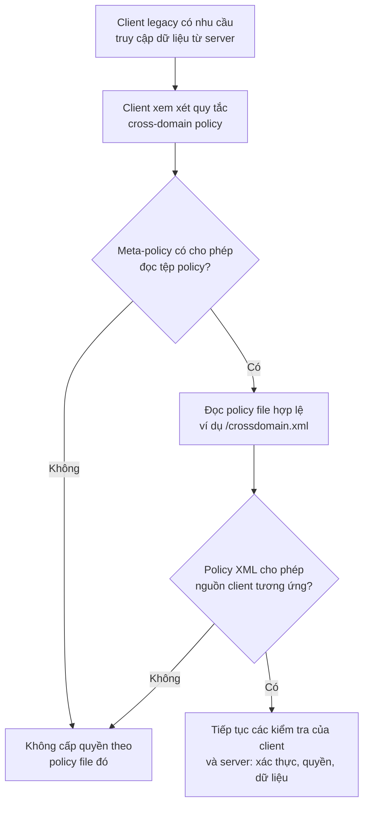

# X-Permitted-Cross-Domain-Policies và trường hợp sử dụng

## 1. Một security header ít gặp nhưng vẫn cần hiểu đúng

Trong module **SPRING_SECURITY_HTTP_PROTECTION**, chúng ta xây dựng các lớp bảo vệ HTTP và trình duyệt bằng Spring Security: CSRF, CORS, security headers, CSP, HSTS, HTTP firewall và bảo vệ session cho ứng dụng **Servlet** cũng như **Reactive/WebFlux**. Ở chương **Quyền và cô lập trình duyệt**, một header dễ bị hiểu nhầm là **`X-Permitted-Cross-Domain-Policies`**.

Giả sử ứng dụng `https://api.example.com` đã bật CORS phù hợp và đang rà soát các tệp được phục vụ trong thư mục public. Nhóm bảo mật phát hiện:

```text
https://api.example.com/crossdomain.xml
https://api.example.com/clientaccesspolicy.xml
```

Đây có thể là dấu vết từ hệ thống tích hợp dùng **Adobe Flash** hoặc **Microsoft Silverlight** trong quá khứ. Với một số client/plugin cũ, tệp chính sách cross-domain không giống CORS: nó từng được dùng để quyết định một chương trình ở domain khác có thể truy cập tài nguyên hay không. Nếu tệp khai báo quá rộng, quyền truy cập dữ liệu qua môi trường client kế thừa có thể vượt ngoài ý định ban đầu.

`X-Permitted-Cross-Domain-Policies` là **HTTP response header quy định meta-policy cho việc chấp nhận các tệp chính sách cross-domain trong một số sản phẩm Adobe cũ**, tiêu biểu là Flash Player và một số tình huống liên quan Acrobat. Header này không phải chính sách CORS của trình duyệt hiện đại, không tự cấp quyền truy cập API và không trực tiếp kiểm soát camera/microphone, iframe hay JavaScript `fetch`.

Một cấu hình phòng vệ phổ biến cho ứng dụng **không có nhu cầu hỗ trợ các policy file legacy** là:

```http
X-Permitted-Cross-Domain-Policies: none
```

Giá trị `none` yêu cầu client legacy tuân thủ cơ chế này **không cho phép sử dụng các tệp chính sách cross-domain**. Đây là một lớp *defense in depth* hữu ích khi rà soát hệ thống cũ, nhưng hiệu quả phụ thuộc vào client có triển khai cơ chế hay không. Browser hiện đại không dùng header này làm cơ sở cho CORS.

### Mục tiêu học tập

Sau bài này, người học có thể:

1. Giải thích lý do tồn tại của `crossdomain.xml` và sự khác nhau với CORS.
2. Nhận biết các giá trị `none`, `master-only`, `by-content-type`, `by-ftp-filename` và `all` cùng rủi ro khi mở rộng.
3. Xác định trường hợp nên dùng `none` và trường hợp ngoại lệ legacy cần đánh giá riêng.
4. Cấu hình và kiểm thử header bằng **Spring Security Servlet** và **Reactive/WebFlux**.
5. Kiểm kê các policy file, phân biệt header này với Silverlight, CSP, Permissions-Policy và những lớp kiểm soát truy cập hiện đại.

## 2. Nguồn gốc: cross-domain policy file khác gì CORS?

Ngày nay, JavaScript trong trình duyệt bị ràng buộc bởi **Same-Origin Policy**; cơ chế **CORS** cho phép server chỉ định trường hợp origin bên ngoài có thể truy cập response qua các request thuộc phạm vi CORS. Tuy nhiên, trong các hệ sinh thái plugin cũ, client có cơ chế đọc policy file riêng.

Ví dụ đơn giản về một tệp `/crossdomain.xml` do server phục vụ:

```xml
<?xml version="1.0" encoding="UTF-8"?>
<cross-domain-policy>
    <site-control permitted-cross-domain-policies="master-only"/>
    <allow-access-from domain="legacy-app.partner.example" secure="true"/>
</cross-domain-policy>
```

Ý định của cấu hình này là chỉ định quyền truy cập cross-domain cho một client được hỗ trợ và một domain cụ thể trong môi trường legacy. **Không sao chép tệp trên vào ứng dụng production chỉ vì có nhu cầu gọi API từ một SPA hiện đại**: client hiện đại dùng CORS, còn policy XML phục vụ các cơ chế lịch sử khác.

Một mẫu **quá rộng, cần tránh** từng thấy trong hệ thống cũ:

```xml
<?xml version="1.0" encoding="UTF-8"?>
<cross-domain-policy>
    <allow-access-from domain="*" secure="false"/>
    <allow-http-request-headers-from domain="*" headers="*"/>
</cross-domain-policy>
```

Những wildcard như `domain="*"` và `headers="*"` có thể cấp quyền rất rộng cho các client thực thi chính sách này. Nếu tồn tại endpoint chứa dữ liệu nhạy cảm và client cũ có quyền truy cập với phiên hợp lệ, đây là một nguy cơ cần đánh giá. Mức ảnh hưởng cụ thể còn phụ thuộc vào client, chính sách, xác thực và cách server xử lý request.

### So sánh hai mô hình

| Tiêu chí | Policy XML của client legacy | CORS của web hiện đại |
| --- | --- | --- |
| Đối tượng chủ yếu | Một số runtime/plugin lịch sử, ví dụ Flash | Trình duyệt web thực thi Fetch/CORS |
| Nơi cấu hình | Tệp như `crossdomain.xml` và các quy tắc meta-policy liên quan | HTTP response headers như `Access-Control-Allow-Origin` |
| Ví dụ cho phép domain | `<allow-access-from domain="legacy-app.partner.example"/>` | `Access-Control-Allow-Origin: https://app.partner.example` |
| Nguồn gốc cơ chế | Quy ước riêng của sản phẩm/runtime legacy | Mô hình web platform hiện hành |
| Khi client không hỗ trợ | Policy có thể không được áp dụng | Không tự phát sinh quyền từ XML của Flash |
| Cách quản lý trong Spring | Header và file public nếu ứng dụng thật sự hỗ trợ legacy | Cấu hình CORS cho endpoint/origin phù hợp |

**Không có quan hệ tương đương một-một:** `X-Permitted-Cross-Domain-Policies: none` **không** thay thế `Access-Control-Allow-Origin`, và bật CORS đúng **không** tự sửa một tệp `crossdomain.xml` quá rộng đang được phục vụ cho một client cũ.

## 3. Phân biệt “meta-policy” với quyền truy cập nội dung

Header `X-Permitted-Cross-Domain-Policies` không nói “origin X được phép đọc API Y” như cấu hình CORS. Nó chủ yếu quy định **những loại hoặc vị trí policy file nào được client Adobe legacy chấp nhận**. Việc tệp policy hợp lệ tiếp tục khai báo các nguồn được quyền truy cập là một bước khác.



Sơ đồ mô tả **khái niệm** chứ không thay cho thuật toán cụ thể của mỗi phiên bản Flash/Acrobat. Ngoài meta-policy và XML, quyền truy cập thực tế còn bị chi phối bởi các giới hạn môi trường, cách request được tạo và kiểm tra quyền ở server.

Ví dụ:

```http
HTTP/1.1 200 OK
X-Permitted-Cross-Domain-Policies: none
Content-Type: application/json
```

Header trên là tín hiệu **không cho phép cross-domain policy file** đối với client thực thi header, **không** nói rằng response JSON này bị cấm đối với người dùng đã đăng nhập. Nếu server trả dữ liệu cho client không có quyền, `none` không thể sửa lỗi phân quyền đó.

Tương tự, không được kết luận `X-Permitted-Cross-Domain-Policies: none` làm browser hiện đại từ chối mọi request cross-origin. **Same-Origin Policy và CORS vẫn hoạt động độc lập**.

## 4. Các giá trị X-Permitted-Cross-Domain-Policies

Một số giá trị thường xuất hiện trong tài liệu và cấu hình legacy:

| Giá trị | Ý định của meta-policy legacy | Nhận định khi triển khai |
| --- | --- | --- |
| `none` | Không cho phép sử dụng policy file cross-domain. | **Ưu tiên khi hệ thống không cần tương thích legacy.** |
| `master-only` | Chỉ cho phép **master policy file**, điển hình `/crossdomain.xml` ở root được quy định bởi runtime. | Chỉ cân nhắc khi có yêu cầu Flash/Adobe legacy rõ ràng và file master được khóa chặt. |
| `by-content-type` | Cho phép policy file được phục vụ với MIME type chuyên dụng `text/x-cross-domain-policy` trong trường hợp client hỗ trợ. | Cần kiểm soát response `Content-Type` và nội dung file; không phải allowlist origin. |
| `by-ftp-filename` | Chấp nhận policy file theo quy ước tên file trong trường hợp FTP legacy. | Hầu như không có lý do dùng cho ứng dụng HTTP/HTTPS hiện đại. |
| `all` | Cho phép các policy file theo các cơ chế mà client hỗ trợ. | Rủi ro mở rộng bề mặt legacy; **không dùng như cấu hình chung**. |

Ví dụ tương ứng:

```http
X-Permitted-Cross-Domain-Policies: none
```

```http
X-Permitted-Cross-Domain-Policies: master-only
```

```http
X-Permitted-Cross-Domain-Policies: by-content-type
```

```http
X-Permitted-Cross-Domain-Policies: all
```

**Đừng nhầm các giá trị này với CSP.** `master-only` không liên quan `frame-ancestors 'self'`; `all` không giống `Access-Control-Allow-Origin: *`. Đây là một ngôn ngữ meta-policy lịch sử dành cho client có triển khai nó.

### Vậy “master” có nghĩa là gì?

Trong mô hình Flash policy file, master policy thường là một tệp với vị trí đặc biệt ở cấp root domain, điển hình `https://example.com/crossdomain.xml`. Cơ chế này khác việc cho phép mọi file XML được tìm thấy trong các thư mục bất kỳ. Cấu hình `master-only` **không tự xác minh rằng nội dung master policy là an toàn**; vẫn phải đọc và thu hẹp nội dung của tệp đó.

Một tệp `/crossdomain.xml` chứa `allow-access-from domain="*"` có thể cấp phép rộng, ngay cả khi meta-policy chỉ cho phép một tệp master.

## 5. Trường hợp nào thực sự cần header này?

### 5.1. Ứng dụng web hiện đại không sử dụng Flash/Acrobat legacy

Với phần lớn hệ thống Spring Boot phục vụ REST API, SPA, ứng dụng server-rendered HTML hoặc WebFlux ngày nay, không có lý do để cấp quyền qua `crossdomain.xml`. Lựa chọn phòng vệ rõ ràng là:

```http
X-Permitted-Cross-Domain-Policies: none
```

Đồng thời, rà soát và **loại bỏ các policy file legacy không còn phục vụ nhu cầu thực**. Header là lớp dự phòng; không nên để một tệp XML mở rộng quyền tồn tại chỉ vì tin rằng browser hiện đại đã ngừng chạy Flash.

### 5.2. Hệ thống nội bộ vẫn có thành phần Adobe legacy được xác nhận

Một tổ chức có thể còn hệ thống chuyên dụng hoặc môi trường cô lập sử dụng runtime legacy. Trường hợp này phải được quản trị như **ngoại lệ có thời hạn**, không phải mặc định:

- Xác định chính xác sản phẩm, phiên bản runtime, máy khách và chức năng cần truy cập.
- Xác nhận có thể thay Flash/client legacy bằng giao thức hiện đại hay không.
- Nếu vẫn bắt buộc, cân nhắc **hostname hoặc deployment riêng** cho nội dung legacy, không trộn với API tài khoản/quản trị nhạy cảm.
- Dùng meta-policy có phạm vi nhỏ nhất mà client thật sự hỗ trợ, chẳng hạn `master-only` nếu phù hợp.
- Giới hạn `crossdomain.xml` vào **domain client được xác minh**, không sử dụng wildcard rộng.
- Tiếp tục xác thực, phân quyền ở server, log truy cập và giới hạn mạng; policy file không thay thế bất kỳ kiểm tra quyền nào.
- Lên lịch loại bỏ ngoại lệ khi phần mềm không còn được hỗ trợ.

**Lưu ý về vòng đời:** Adobe Flash Player đã kết thúc hỗ trợ từ cuối năm 2020 và trình duyệt hiện đại không còn hỗ trợ sử dụng plugin Flash theo cách thông thường. Không khuyến khích cài runtime đã ngừng hỗ trợ trên máy làm việc hoặc đưa nó trở lại production chỉ để thử một header.

### 5.3. Khi phát hiện một file XML cũ nhưng không còn client sử dụng

Không cần giữ `master-only` chỉ vì `/crossdomain.xml` từng tồn tại. Hãy xác minh owner, luồng gọi, thời điểm truy cập cuối và kế hoạch loại bỏ. Nếu không có nhu cầu được phê duyệt, **xóa đường phục vụ XML cũ và giữ meta-policy `none`**.

### 5.4. Khi chỉ có SPA frontend cần gọi API khác origin

**Không dùng crossdomain.xml.** Cần cấu hình CORS đúng cho API hiện đại, ví dụ giới hạn `Access-Control-Allow-Origin` về origin frontend đáng tin, xử lý credentials/preflight và bảo vệ CSRF khi áp dụng. Header `X-Permitted-Cross-Domain-Policies` có thể vẫn là `none`.

## 6. Silverlight và clientaccesspolicy.xml: gần chủ đề nhưng không đồng nhất

Một số ứng dụng cũ có tệp:

```text
/clientaccesspolicy.xml
```

Tệp này gắn với mô hình client-access policy của **Microsoft Silverlight** và cần được kiểm kê riêng. Không được giả định rằng:

```http
X-Permitted-Cross-Domain-Policies: none
```

**tự động kiểm soát mọi cách Silverlight xử lý `clientaccesspolicy.xml`.** Header `X-Permitted-Cross-Domain-Policies` vốn phục vụ cơ chế meta-policy của những client Adobe nhất định; Silverlight sử dụng các quy tắc và tệp riêng.

Vì vậy, một cuộc rà soát legacy nên phân biệt:

| Dấu vết | Hệ sinh thái thường liên quan | Việc cần làm |
| --- | --- | --- |
| `/crossdomain.xml` | Adobe Flash và những client Adobe có hỗ trợ | Xác định còn client dùng không; kiểm tra XML và meta-policy. |
| `/clientaccesspolicy.xml` | Microsoft Silverlight | Kiểm tra riêng nội dung, giới hạn và sự cần thiết; không mặc định header Adobe bao phủ. |
| `Access-Control-Allow-Origin` | Trình duyệt hiện đại | Đánh giá CORS theo origin, phương thức, credential và endpoint. |
| `Content-Security-Policy` | Trình duyệt hiện đại | Kiểm tra nguồn script/frame/connect và các directive cần thiết. |

Đây là lý do việc tìm thấy file XML **không đủ để suy ra** ứng dụng đang sử dụng runtime nào; phải xác minh client và luồng tích hợp thực tế.

## 7. Kiểm kê bề mặt tấn công trong dự án Spring

Trước khi sửa header, hãy có một **bảng chứng cứ** tối thiểu:

| Hạng mục | Câu hỏi kiểm tra | Kết quả mong muốn |
| --- | --- | --- |
| `/crossdomain.xml` | URL này có được phục vụ trên domain/API hiện tại không? | Không có nếu không có yêu cầu legacy đã duyệt. |
| `/clientaccesspolicy.xml` | Có tệp Silverlight cũ không? | Không có, hoặc được rà soát riêng. |
| Đường dẫn phụ | Có các tệp policy khác trong thư mục con không? | Không có policy file mở ngoài dự định. |
| Nội dung XML | Có `domain="*"`, `headers="*"` hoặc quyền quá rộng không? | Chỉ giới hạn thực sự cần thiết. |
| MIME type | Tệp XML đang có `Content-Type` nào? | Phù hợp yêu cầu bảo mật và client được hỗ trợ; không dùng MIME type để che rủi ro XML. |
| HTTP response | Header `X-Permitted-Cross-Domain-Policies` có được phát ổn định không? | `none` trên ứng dụng hiện đại không cần legacy. |
| Proxy/CDN | Response cuối có bị thêm, thay thế hoặc lặp header không? | Một chính sách nhất quán ở tầng phát cuối. |
| CORS | Có allowlist frontend ngoài origin quá rộng không? | CORS được đánh giá **độc lập** với policy file. |
| Xác thực/CSRF | Những API nhạy cảm có kiểm soát truy cập không? | Quyền được kiểm tra ở server, không dựa trên policy XML. |

### Không để SPA fallback che giấu chính sách XML

Một số ứng dụng SPA trả `index.html` cho mọi đường dẫn chưa biết. Khi thử `GET /crossdomain.xml`, server có thể trả:

```http
HTTP/1.1 200 OK
Content-Type: text/html
```

Điều này **không đồng nghĩa tồn tại một policy XML hợp lệ**. Phải kiểm tra cả `Content-Type` và **nội dung response**. Ngược lại, nếu server trả policy XML từ static resources hoặc reverse proxy, Spring Security ở tầng ứng dụng có thể không hề là nơi tạo response.

**Chỉ xử lý những URL do hệ thống của bạn sở hữu.** Không dùng bài thực hành này để dò quét hệ thống bên ngoài không được cấp phép.

## 8. Spring Security Servlet: phát header rõ ràng

Với ứng dụng Servlet, `HttpSecurity` và `SecurityFilterChain` là vị trí cấu hình các HTTP security headers. Một cách đặt header tường minh qua Spring Security là dùng `StaticHeadersWriter`:

```java
import org.springframework.context.annotation.Bean;
import org.springframework.context.annotation.Configuration;
import org.springframework.security.config.annotation.web.builders.HttpSecurity;
import org.springframework.security.config.annotation.web.configuration.EnableWebSecurity;
import org.springframework.security.web.SecurityFilterChain;
import org.springframework.security.web.header.writers.StaticHeadersWriter;

@Configuration
@EnableWebSecurity
public class SecurityConfig {

    @Bean
    SecurityFilterChain securityFilterChain(HttpSecurity http) throws Exception {
        return http
            .authorizeHttpRequests(auth -> auth
                .anyRequest().authenticated())
            .headers(headers -> headers
                .addHeaderWriter(new StaticHeadersWriter(
                    "X-Permitted-Cross-Domain-Policies", "none")))
            .build();
    }
}
```

Kết quả kỳ vọng trên response qua chain:

```http
X-Permitted-Cross-Domain-Policies: none
```

Ở đây `authenticated()` chỉ minh họa yêu cầu đăng nhập. Ứng dụng thực tế vẫn cần chính sách xác thực, authorization/tenant, CSRF và session theo nghiệp vụ. `StaticHeadersWriter` chỉ thêm giá trị header cố định, **không tự xóa tệp `crossdomain.xml`** và không cấp hay thu hồi quyền server.

### Nếu phiên bản Spring Security có header writer chuyên dụng

Một số phiên bản Spring Security cung cấp API hoặc header writer riêng cho `X-Permitted-Cross-Domain-Policies`; cách khai báo cụ thể tùy phiên bản. **Không được thêm writer tĩnh song song với writer mặc định/chuyên dụng mà không kiểm tra response cuối**, vì có thể tạo header trùng lặp. Hãy chọn **một điểm phát chính sách** trong ứng dụng và xác minh nó không bị proxy ghi đè.

### Có nên dùng securityMatcher để mở master-only theo một URL?

Chỉ nên dùng `master-only` khi **thực sự hỗ trợ client legacy**, và cần xem đây là **quyết định về meta-policy ở phạm vi host/client**, không đơn giản là “cho phép iframe tại một endpoint”. Một policy file master có thể ảnh hưởng nhiều tài nguyên cùng domain. Vì thế không nên áp dụng `master-only` tùy tiện chỉ trên một route `/legacy/**` rồi suy ra rằng toàn bộ domain đã được phân tách quyền đúng.

**Phương án dễ kiểm soát hơn** cho legacy bắt buộc là phục vụ nó trên **hostname/deployment riêng**, có meta-policy và XML được phê duyệt, còn ứng dụng hiện đại giữ `none`. Khi hệ thống có host routing phức tạp, cần kiểm tra cả route đến policy file, Host header, CORS và phiên người dùng ở mức triển khai thực tế.

## 9. Spring Security Reactive / WebFlux

WebFlux sử dụng `ServerHttpSecurity` và `SecurityWebFilterChain`; HTTP header nhận bởi client có cùng ý nghĩa. Có thể khai báo một header writer cố định trong phần Reactive:

```java
import org.springframework.context.annotation.Bean;
import org.springframework.context.annotation.Configuration;
import org.springframework.security.config.annotation.web.reactive.EnableWebFluxSecurity;
import org.springframework.security.config.web.server.ServerHttpSecurity;
import org.springframework.security.web.server.SecurityWebFilterChain;
import org.springframework.security.web.server.header.StaticServerHttpHeadersWriter;

@Configuration
@EnableWebFluxSecurity
public class ReactiveSecurityConfig {

    @Bean
    SecurityWebFilterChain securityWebFilterChain(ServerHttpSecurity http) {
        return http
            .authorizeExchange(auth -> auth
                .anyExchange().authenticated())
            .headers(headers -> headers
                .addWriter(new StaticServerHttpHeadersWriter(
                    "X-Permitted-Cross-Domain-Policies", "none")))
            .build();
    }
}
```

Đây là cách minh họa **đặt header trong chain**. Tên builder/API có thể thay đổi theo dòng phiên bản; trước khi sử dụng ở dự án thực, đối chiếu API có sẵn trong version Spring Security đang dùng, tránh tự suy ra hai DSL Servlet/Reactive phải có cùng phương thức.

**Giữ nguyên các HTTP security headers khác.** Đừng dùng `headers(headers -> headers.disable())` để giải quyết một xung đột header: nó có thể vô hiệu hóa cả các lớp như X-Content-Type-Options, X-Frame-Options, HSTS và các headers khác do Spring Security quản lý.

### Khi nào cấu hình ở proxy tốt hơn?

Nếu ứng dụng gồm nhiều service Servlet/WebFlux và static assets do Nginx/CDN phục vụ, nhóm bảo mật có thể đặt cùng meta-policy ở **gateway** để bảo đảm các response trên host không bị bỏ sót.

Ví dụ cấu hình Nginx ở phạm vi server đã xác định:

```nginx
add_header X-Permitted-Cross-Domain-Policies "none" always;
```

Khi chọn đặt ở proxy, cần kiểm tra quy tắc kế thừa `add_header` của Nginx, các location override, error responses và cách upstream gửi header. **Không để nhiều tầng cùng phát các giá trị trái nhau**. Kiểm tra bằng request đi qua đúng hostname và CDN mà người dùng thực sự truy cập.

## 10. Kiểm thử header và policy file trên HTTP

### 10.1. Quan sát response thật

Trên môi trường do bạn quản lý, gọi:

```bash
curl -i https://api.example.com/health
curl -i https://api.example.com/crossdomain.xml
curl -i https://api.example.com/clientaccesspolicy.xml
```

Khi xem kết quả:

- `/health` hoặc tài nguyên HTML/API thích hợp nên có `X-Permitted-Cross-Domain-Policies: none` nếu chính sách phòng vệ đã được cấu hình ở tầng đó.
- `/crossdomain.xml` không nên trả một policy XML cho phép truy cập rộng nếu ứng dụng không còn hỗ trợ client legacy.
- `/clientaccesspolicy.xml` cần được kiểm kê riêng; không suy luận kết quả từ `X-Permitted-Cross-Domain-Policies`.
- Khi response là `302`, `401`, `404` hoặc `200` với HTML fallback, phải ghi nhận **URL, status, content-type và body thực tế** trước khi kết luận có policy file.

**`curl` không kiểm chứng được cách Flash/Acrobat legacy thực thi policy**, cũng không thay thế browser CORS test. Nó chỉ cho thấy header và nội dung HTTP mà server đang phát.

### 10.2. MockMvc cho Servlet

Với controller thử nghiệm `/health` trả `200 OK` và `spring-security-test`, phần thân test có thể viết:

```java
mockMvc.perform(get("/health").with(user("viewer")))
    .andExpect(status().isOk())
    .andExpect(header().string(
        "X-Permitted-Cross-Domain-Policies", "none"));
```

Đây là đoạn minh họa: cần fixture `MockMvc`, controller, static import `get`, `user`, `status` và `header`. Nếu endpoint là public trong ứng dụng thật, thay rule xác thực và test cho đúng nghiệp vụ; không thay policy header chỉ để test tiện hơn.

Kiểm thử riêng sự vắng mặt của policy XML khi đã loại bỏ:

```java
mockMvc.perform(get("/crossdomain.xml").with(user("viewer")))
    .andExpect(status().isNotFound());
```

**Chỉ áp dụng assertion `404` khi thiết kế của hệ thống thực sự trả 404.** Nếu service dùng SPA fallback, reverse proxy hoặc error handler khác, thay bằng assertion phù hợp với thiết kế và kiểm tra body/MIME để chắc chắn không có tệp XML hợp lệ.

### 10.3. WebTestClient cho Reactive

```java
webTestClient.mutateWith(mockUser("viewer"))
    .get().uri("/health")
    .exchange()
    .expectStatus().isOk()
    .expectHeader().valueEquals(
        "X-Permitted-Cross-Domain-Policies", "none");
```

`mockUser` có thể import từ `SecurityMockServerConfigurers` trong `spring-security-test`. Nếu dùng route public, bỏ mock user khi phù hợp; điều quan trọng là **assert header của đúng response đang được client nhận**.

### 10.4. Ma trận regression đề xuất

| Trường hợp | Điều cần khẳng định |
| --- | --- |
| HTML trang chính | Nhận meta-policy mong đợi, không bị trùng hoặc ghi đè. |
| API response thành công | Header có mặt ở response đi qua tầng được chọn. |
| Response lỗi hoặc redirect | Kiểm tra chính sách ở response cuối; không chỉ `200`. |
| `/crossdomain.xml` trên host chính | Không tồn tại hoặc không có nội dung cho phép legacy ngoài dự kiến. |
| `/clientaccesspolicy.xml` | Không tồn tại hoặc được rà soát theo cơ chế Silverlight riêng. |
| CDN/proxy | Không phát `all` hoặc `master-only` ngoài phạm vi legacy được duyệt. |
| CORS request từ frontend | CORS đúng theo yêu cầu nghiệp vụ; không phụ thuộc header này. |
| Chính sách mới trên host legacy | Được phê duyệt, kiểm tra XML, quyền server và kế hoạch loại bỏ. |

## 11. Kiểm chứng bằng trình duyệt hiện đại: điều gì có thể và không thể?

Trình duyệt Chrome, Edge, Firefox, Safari hiện đại không sử dụng `X-Permitted-Cross-Domain-Policies` làm chính sách cho JavaScript `fetch`. Vì vậy, phép thử sau:

```javascript
fetch("https://api.example.com/public-info")
  .then(response => response.json())
  .then(data => console.log(data))
  .catch(error => console.error(error));
```

**không kiểm thử trực tiếp header `X-Permitted-Cross-Domain-Policies`**. Nếu request bị chặn đọc response, nguyên nhân có thể là **CORS**, kết nối, xác thực hoặc CSP `connect-src` của trang nguồn. Nếu request thành công, cũng không chứng minh legacy policy file an toàn.

Để kiểm tra cơ chế cũ, tổ chức chỉ nên dùng **môi trường kiểm thử được cô lập và đã được cấp phép**, với client legacy nằm trong phạm vi hỗ trợ nội bộ; không khuyến khích cài lại plugin Flash đã ngừng hỗ trợ vào browser làm việc để chứng minh một header. Kiểm tra bảo mật hiện đại vẫn phải dựa trên CORS, CSP, phân quyền và các test HTTP tương ứng.

## 12. Chẩn đoán các hiểu nhầm và xung đột triển khai

### “Có `X-Permitted-Cross-Domain-Policies: none` rồi nên không cần CORS”

Sai. `none` nhắm vào policy file legacy được client tương thích xử lý. Frontend hiện đại gọi API bằng `fetch` hoặc XHR vẫn phải tuân theo Same-Origin Policy/CORS. Nếu API có credential, không dùng allowlist origin quá rộng và phải đánh giá CSRF riêng.

### “Thêm `crossdomain.xml` để sửa lỗi fetch của React”

Không đúng hướng. React/Angular/Vue chạy trong browser hiện đại sử dụng CORS, không dựa trên Adobe policy file. Tệp XML này không cấp quyền đọc response của `fetch` và có thể làm tăng bề mặt tương thích legacy không cần thiết.

### “Header `none` là đủ, không cần xem `crossdomain.xml`”

Không nên. Client khác nhau có mức hỗ trợ khác nhau, XML quá rộng vẫn là rủi ro nếu được một runtime cũ sử dụng hoặc được phục vụ trên host khác. **Kiểm kê và gỡ file không còn sử dụng** là kiểm soát mạnh hơn việc chỉ thêm header.

### “Chúng tôi cần một ứng dụng Flash cũ, nên đặt `all` cho toàn bộ API”

`all` là lựa chọn quá rộng, đặc biệt khi host còn chứa tài nguyên nhạy cảm. Hãy xác định client legacy, tạo phân vùng host/deployment chuyên dụng nếu cần, cân nhắc `master-only` với policy file được kiểm soát, và tiếp tục kiểm tra quyền server.

### “Đặt `none` thì iframe hoặc camera bị tắt”

Header này không kiểm soát quyền nhúng UI hoặc thiết bị. Với iframe, kiểm tra `X-Frame-Options`, CSP `frame-ancestors` của trang con và `frame-src` của trang cha. Với camera/microphone, kiểm tra `Permissions-Policy`, secure context, sự đồng ý của người dùng và quyền của OS.

### “`clientaccesspolicy.xml` còn tồn tại, nhưng `none` đã chặn nó”

Không có bảo đảm như vậy. Silverlight dùng cơ chế riêng. Cần đánh giá tệp `clientaccesspolicy.xml` độc lập và loại bỏ nếu không còn ứng dụng được phê duyệt sử dụng.

### “Header đúng trong Spring nhưng không xuất hiện tại production”

Có thể API được phục vụ qua proxy, CDN, static server, một security chain khác hoặc response lỗi được sinh ngoài Spring. Kiểm tra **response cuối** và từng đường đi của request. Nếu proxy cũng thêm header, phải tránh hai cấu hình không thống nhất.

### “Header xuất hiện hai lần với `none` và `master-only`”

Không xem đây là một cơ chế ghép chính sách đáng tin. Tùy client legacy, cách xử lý giá trị trùng/mâu thuẫn có thể khác nhau. Hãy thống nhất **một nguồn phát chính sách**, loại bỏ cấu hình trùng và kiểm thử đúng client mục tiêu nếu vẫn có yêu cầu legacy.

## 13. Quan hệ với các lớp bảo vệ Spring Security HTTP khác

| Cơ chế | Kiểm soát chính | Có thay thế X-Permitted-Cross-Domain-Policies không? |
| --- | --- | --- |
| CORS | Quyền đọc response chéo origin trong browser hiện đại | Không; phục vụ client/model khác. |
| CSP `connect-src` | Các đích kết nối script có thể truy cập | Không; không quyết định policy file legacy. |
| CSP `frame-ancestors` / XFO | Ai được phép nhúng trang trong frame | Không. |
| CSP `frame-src` | Trang được tải iframe từ nguồn nào | Không. |
| `Permissions-Policy` | Sử dụng tính năng browser như camera/microphone/geolocation | Không. |
| `Referrer-Policy` | Mức thông tin URL nguồn gửi trong `Referer` | Không. |
| `X-Content-Type-Options: nosniff` | Giảm MIME sniffing cho các loại tài nguyên thuộc phạm vi bảo vệ | Không; cũng không sửa nội dung policy XML yếu. |
| CSRF token, xác thực và phân quyền | Phòng thao tác trái phép, kiểm soát quyền người dùng | **Vẫn bắt buộc độc lập** với meta-policy. |
| HSTS và HTTPS | Bảo vệ kết nối theo quy tắc tương ứng | Không; không tự thu hẹp policy file. |

Điều quan trọng nhất là **không dùng một header lịch sử làm bằng chứng rằng toàn bộ cơ chế truy cập chéo origin của ứng dụng đã được bảo vệ**. Mỗi lớp giải quyết một vấn đề cụ thể.

## 14. Bài tập ứng dụng

**Bài A — Ứng dụng web hiện đại.** Một SPA ở `https://app.example.com` gọi REST API ở `https://api.example.com`. API gửi `X-Permitted-Cross-Domain-Policies: none` và không có `Access-Control-Allow-Origin`. SPA vẫn lỗi CORS. Hãy giải thích vì sao, rồi nêu hướng cấu hình đúng.

**Bài B — Kiểm kê XML cũ.** Server phát:

```xml
<cross-domain-policy>
    <allow-access-from domain="*" secure="false"/>
</cross-domain-policy>
```

Trong khi đó response API có `X-Permitted-Cross-Domain-Policies: none`. Có nên kết luận đã an toàn tuyệt đối không? Hãy liệt kê ít nhất ba bước kiểm tra và loại bỏ rủi ro.

**Bài C — Hệ thống legacy có yêu cầu thực.** Một ứng dụng Adobe cũ trong mạng nội bộ cần truy cập dữ liệu từ domain chuyên dụng. Nêu điều kiện có thể cân nhắc `master-only`, cách giới hạn policy XML và vì sao không nên chuyển toàn hệ thống sang `all`.

**Bài D — Trường hợp Silverlight.** Dự án phát hiện `clientaccesspolicy.xml` trong static resources nhưng team chỉ biết header `X-Permitted-Cross-Domain-Policies`. Hãy chỉ ra phạm vi sai lầm nếu dùng header Adobe để kết luận cơ chế Silverlight đã bị chặn.

**Bài E — Kiểm thử.** Viết một assertion MockMvc hoặc WebTestClient kiểm tra response có `X-Permitted-Cross-Domain-Policies: none`, rồi đề xuất hai phép kiểm tra bổ sung nhằm xác định `/crossdomain.xml` không vô tình chứa policy rộng và proxy không ghi đè header.

**Gợi ý trả lời:** A — cấu hình CORS đúng origin/credentials cho API; header legacy không có tác dụng với fetch. B — xác minh client sử dụng, kiểm tra nơi phục vụ XML và quyền cấp phép, gỡ file khi không cần, test qua proxy. C — client thực sự còn được quản lý, domain riêng, master XML giới hạn origin, server tiếp tục phân quyền. D — Silverlight có cơ chế policy riêng, cần kiểm kê `clientaccesspolicy.xml` trực tiếp. E — assert header trong test HTTP, thử GET policy file và đọc nội dung/MIME, kiểm tra response production qua gateway/CDN.

## 15. Checklist vận hành và lộ trình loại bỏ legacy

1. **Xác nhận client sử dụng thực tế:** có Adobe Flash/Acrobat legacy nào còn tiêu thụ `crossdomain.xml` hay không?
2. **Kiểm kê cả hai loại XML:** `crossdomain.xml` và `clientaccesspolicy.xml`, phân biệt Adobe/Silverlight.
3. **Mặc định chặn khi không cần:** gửi `X-Permitted-Cross-Domain-Policies: none` và gỡ các policy file không còn được sử dụng.
4. **Không cấp quyền bằng wildcard:** nếu có ngoại lệ, khóa domain, header và phạm vi theo nhu cầu được phê duyệt.
5. **Ưu tiên cách ly:** phục vụ phần legacy trên host hoặc môi trường riêng, không dùng chung domain chứa dữ liệu nhạy cảm nếu có thể tránh.
6. **Duy trì CORS và quyền server:** không coi meta-policy là thay thế cho SOP/CORS, CSRF, xác thực, phân quyền hoặc session.
7. **Xác minh response cuối:** kiểm tra Servlet/WebFlux, proxy, CDN, static files và các đường dẫn lỗi.
8. **Không tin vào một browser test hiện đại:** test HTTP giúp xác nhận cấu hình, nhưng không chứng minh cách client legacy thực thi policy.
9. **Ghi owner và thời hạn ngoại lệ:** nếu vẫn cần `master-only` hay một policy XML, phải có trách nhiệm bảo trì, rà soát và thời điểm loại bỏ.

## 16. Kết luận

**`X-Permitted-Cross-Domain-Policies` là meta-policy của một hệ sinh thái client legacy, không phải tên khác của CORS.** Nó giúp giới hạn việc chấp nhận các tệp policy cross-domain trong những client cũ có triển khai cơ chế liên quan. Với ứng dụng Spring Security hiện đại không cần Flash/Adobe legacy, **`X-Permitted-Cross-Domain-Policies: none`** là cấu hình phòng vệ hợp lý, nhưng cần đi cùng **việc loại bỏ hoặc kiểm soát các tệp `crossdomain.xml` và `clientaccesspolicy.xml`**, kiểm thử response qua proxy và giữ nguyên các lớp bảo vệ HTTP hiện đại.

Ở cả **Servlet** và **Reactive/WebFlux**, cách làm đúng là xác định một nơi phát header rõ ràng, kiểm tra không có giá trị mâu thuẫn và không dùng header này để thay thế CORS, CSP, Permissions-Policy, xác thực hay phân quyền. Nếu tổ chức vẫn buộc phải duy trì client legacy, hãy cô lập, thu hẹp quyền, kiểm thử trong môi trường được quản lý và xây dựng lộ trình ngừng phụ thuộc.

### Nguồn tham khảo để đối chiếu khi bảo trì

- [MDN — X-Permitted-Cross-Domain-Policies](https://developer.mozilla.org/en-US/docs/Web/HTTP/Reference/Headers/X-Permitted-Cross-Domain-Policies): phạm vi header và các giá trị meta-policy lịch sử.
- [MDN — Cross-Origin Resource Sharing](https://developer.mozilla.org/en-US/docs/Web/HTTP/Guides/CORS): mô hình CORS của trình duyệt hiện đại.
- [Spring Security — Servlet HTTP Response Headers](https://docs.spring.io/spring-security/reference/servlet/exploits/headers.html): cấu hình security headers trong `HttpSecurity`.
- [Spring Security — Reactive HTTP Response Headers](https://docs.spring.io/spring-security/reference/reactive/exploits/headers.html): security headers cho WebFlux.
