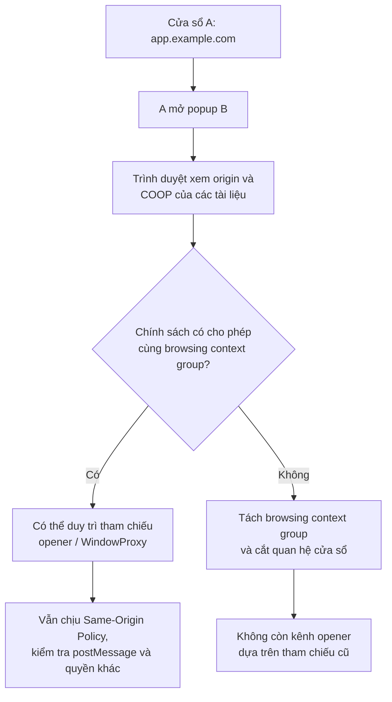

# Cross-Origin-Opener-Policy và quan hệ giữa các cửa sổ

## 1. Vì sao hai cửa sổ web có quan hệ với nhau lại là vấn đề bảo mật?

Trong module **SPRING_SECURITY_HTTP_PROTECTION**, người học triển khai các lớp phòng vệ HTTP và trình duyệt bằng Spring Security, từ CSRF, CORS, security headers, CSP, HSTS đến HTTP firewall và bảo vệ session. Ở chương **Quyền và cô lập trình duyệt**, header **`Cross-Origin-Opener-Policy` (COOP)** giúp kiểm soát **quan hệ giữa một tài liệu cấp cao và những cửa sổ/tab khác**, đặc biệt khi sử dụng `window.open()`, liên kết mở tab mới hoặc điều hướng giữa các origin.

Xét một ứng dụng tài chính tại `https://app.example.com`:

1. Người dùng mở trang tài khoản.
2. Trang gọi `window.open("https://login.partner.example/authorize")` để mở một popup đăng nhập.
3. Popup chuyển hướng qua nhiều website rồi quay về một trang callback.
4. Sau xác thực, ứng dụng có thể cần nhận tín hiệu từ popup để hoàn tất luồng.

Ở một chức năng khác, người dùng nhấp liên kết dẫn đến một website không đáng tin cậy. Nếu cửa sổ mới giữ quan hệ với cửa sổ mở nó, JavaScript trong cửa sổ mới có thể có những khả năng thao tác giới hạn với cửa sổ ban đầu, ngay cả khi hai origin khác nhau. Chẳng hạn một số trường hợp có thể điều hướng cửa sổ mở nó đến trang lừa đảo (*reverse tabnabbing*), hoặc khai thác khác biệt quan sát được qua quan hệ cửa sổ (*cross-site leaks*, thường gọi XS-Leaks).

**COOP giúp tài liệu quy định mức độ tách biệt khỏi các cửa sổ cấp cao ở origin khác**, nhằm giảm khả năng những trang ngoài không tin cậy giữ quan hệ cửa sổ có thể quan sát hoặc thao tác ngoài ý định.

Ví dụ:

```http
Cross-Origin-Opener-Policy: same-origin
```

Đây là **response header** do server gửi cho tài liệu, không phải request header. Trình duyệt hỗ trợ COOP dùng header khi tạo hoặc điều hướng các **top-level browsing context** để quyết định quan hệ giữa những cửa sổ và việc phân nhóm *browsing context group*.

### Mục tiêu sau bài học

Người học sẽ có thể:

- Giải thích COOP, `window.opener` và *browsing context group* (BCG) mà không nhầm với SOP, CORS hay CSP.
- So sánh `unsafe-none`, `same-origin` và `same-origin-allow-popups`.
- Đánh giá vì sao popup đăng nhập/thanh toán có thể hỏng khi siết COOP.
- Thiết kế chính sách theo endpoint trên **Spring Security Servlet** và **Reactive/WebFlux**.
- Kiểm thử quan hệ opener trong trình duyệt, kiểm tra security headers và xử lý xung đột qua gateway/CDN.

## 2. COOP kiểm soát điều gì: browsing context group và opener

Một trang có thể mở cửa sổ khác bằng:

```javascript
const popup = window.open(
  "https://login.partner.example/authorize",
  "_blank",
  "width=520,height=640"
);
```

Trong những ngữ cảnh được phép, cửa sổ mới có thể có thuộc tính `window.opener` trỏ tới cửa sổ đã mở nó, và cửa sổ ban đầu có thể giữ một `WindowProxy` trả về bởi `window.open()`. Đây là một **mối quan hệ giữa hai cửa sổ cấp cao**, không phải quyền truy cập DOM không giới hạn.

**Same-Origin Policy (SOP)** vẫn hạn chế đọc/ghi DOM và dữ liệu của một cửa sổ khác origin. Tuy nhiên, SOP không làm mọi tương tác cross-origin giữa các cửa sổ trở thành bất khả thi: có một số thuộc tính/phương thức được phép, hoạt động điều hướng và `postMessage`, tùy quy tắc hiện hành.

COOP bổ sung một ranh giới: trình duyệt có thể đưa cửa sổ vào **browsing context group khác** nếu chính sách của các tài liệu không tương thích với việc chia sẻ nhóm. Khi bị tách nhóm, **quan hệ opener có thể bị cắt**, hạn chế việc cửa sổ khác origin giữ các kênh tương tác dựa trên tham chiếu cửa sổ.



**COOP không phải sandbox tuyệt đối.** Nó không chặn mọi kênh trao đổi dữ liệu giữa các website, không tự loại bỏ XSS và không quyết định backend có trả dữ liệu cho người không được phép hay không. Đó là một lớp giảm thiểu rủi ro **liên quan quan hệ giữa các cửa sổ**.

### Khi nào một tham chiếu `WindowProxy` có vẻ như “đã đóng”?

Khi chính sách COOP buộc popup chuyển sang nhóm khác, mã phía opener đôi khi thấy:

```javascript
const popup = window.open("https://other.example.net/");
console.log(popup?.closed); // Có thể là true do COOP tách nhóm
```

`closed === true` **không nhất thiết chứng minh người dùng đã đóng cửa sổ**; nó có thể là biểu hiện tham chiếu cửa sổ đã bị tách do COOP. Hãy kiểm tra header và hành vi browser, không chỉ dùng `closed` để kết luận popup bị chặn hay đã tự đóng.

## 3. Những giá trị chính và ý nghĩa

COOP thường được cấu hình bằng một trong ba giá trị:

| Giá trị | Ý nghĩa thực hành | Khi nào cân nhắc |
| --- | --- | --- |
| `unsafe-none` | Không yêu cầu tách biệt COOP bổ sung như `same-origin`. Đây là trạng thái thường được áp dụng khi không có COOP enforced. | Các luồng legacy cần tương tác opener; nên đánh giá rủi ro trước khi dùng. |
| `same-origin` | Yêu cầu tách tài liệu khỏi những top-level document không tương thích về origin/COOP, thường cắt quan hệ với popup khác origin. | Mặc định cho khu vực nhạy cảm không cần giữ opener cross-origin. |
| `same-origin-allow-popups` | Cố gắng giữ tính tách biệt cho tài liệu nhưng có ngoại lệ cho một số popup được mở tới tài liệu có COOP `unsafe-none`. | Một số luồng OAuth, đăng nhập hoặc thanh toán cần tham chiếu popup khác origin. |

Ví dụ:

```http
Cross-Origin-Opener-Policy: unsafe-none
```

```http
Cross-Origin-Opener-Policy: same-origin
```

```http
Cross-Origin-Opener-Policy: same-origin-allow-popups
```

**Đừng đọc `same-origin-allow-popups` là “cho phép mọi popup và truy cập mọi DOM”.** Khi một quan hệ opener được giữ, SOP vẫn áp dụng; JavaScript của ứng dụng không thể tùy ý đọc DOM của trang đăng nhập khác origin. Ngoại lệ này chỉ thay đổi điều kiện duy trì quan hệ cửa sổ trong những trường hợp tương thích.

### Có các giá trị mở rộng khác không?

Các bản đặc tả/browser mới có thể bổ sung giá trị như `noopener` hoặc cơ chế mới để giới hạn hành vi popup. **Mức hỗ trợ và ý nghĩa cần kiểm tra theo phiên bản trình duyệt**. Trong bài này, tập trung vào ba giá trị thông dụng nêu trên để thiết kế chính sách dễ kiểm thử; không coi một giá trị mới là lựa chọn thay thế đã được hỗ trợ rộng rãi nếu chưa xác nhận với client mục tiêu.

### Mặc định không có header có an toàn không?

Thiếu COOP không có nghĩa cùng-origin script tự được phép đọc dữ liệu cross-origin; SOP vẫn tồn tại. Nhưng khi thiếu COOP, ứng dụng **không yêu cầu thêm lớp tách nhóm cửa sổ theo `same-origin`**, nên có thể giữ các quan hệ opener không mong muốn. Đây là lý do header thường được đề xuất như một phần của defense in depth cho trang nhạy cảm.

## 4. Ma trận quan hệ giữa hai cửa sổ

Xét trang A ở `https://app.example.com` gọi `window.open()` để mở trang B. Bảng dưới mô tả **kỳ vọng khái niệm ở trình duyệt hiện đại hỗ trợ COOP**, không thay thế kiểm thử browser/version thực tế.

| COOP của A | Trang B | COOP của B | Quan hệ opener mong đợi |
| --- | --- | --- | --- |
| `unsafe-none` | Khác origin | `unsafe-none` | Có thể duy trì tham chiếu cửa sổ, vẫn chịu SOP. |
| `same-origin` | Khác origin | `unsafe-none` | Tách nhóm; tham chiếu opener thường bị cắt. |
| `same-origin` | Cùng origin | `same-origin` | Có thể ở nhóm tương thích và duy trì quan hệ. |
| `same-origin-allow-popups` | Khác origin | `unsafe-none` | Trường hợp ngoại lệ có thể giữ quan hệ opener để hoàn tất popup flow. |
| `same-origin-allow-popups` | Khác origin | `same-origin` | Không mặc nhiên được giữ; nhóm có thể tách do chính sách B. |
| `unsafe-none` | Khác origin | `same-origin` | B có thể tự tách nhóm và cắt opener. |

**Cần xét policy ở cả hai phía.** Không đủ xem mỗi `Cross-Origin-Opener-Policy` trên trang A; response của popup, các redirect và trang cuối cùng cũng có thể thay đổi khả năng duy trì quan hệ.

Nếu A đặt `same-origin-allow-popups` nhưng B phát `same-origin`, việc B tự yêu cầu tách nhóm có thể làm luồng giao tiếp thông qua `window.opener` thất bại. Ngược lại, đừng dựa vào một hành vi cụ thể của một browser cũ để xác nhận rằng chính sách sẽ như vậy ở mọi browser.

## 5. Phân biệt COOP với thuộc tính noopener của liên kết

Một cách phòng vệ khác trước quan hệ opener không mong muốn là **không tạo quan hệ đó** khi mở liên kết ngoài:

```html
<a
  href="https://docs.partner.example"
  target="_blank"
  rel="noopener noreferrer">
  Mở tài liệu đối tác trong tab mới
</a>
```

- `rel="noopener"` yêu cầu không trao `window.opener` cho tài liệu đích ở trường hợp áp dụng.
- `rel="noreferrer"` còn ngăn gửi thông tin `Referer` trong điều hướng, và có hiệu ứng `noopener` ở những ngữ cảnh hỗ trợ.
- Các trình duyệt hiện đại thường mặc định `noopener` cho `target="_blank"` trên liên kết, nhưng không nên dựa mù quáng vào điều này khi phải hỗ trợ client cũ.

Với JavaScript:

```javascript
// Dùng khi không cần trao đổi qua window.opener.
window.open(
  "https://docs.partner.example",
  "_blank",
  "noopener"
);
```

**Khi nào dùng cơ chế nào?**

| Nhu cầu | Hướng xử lý |
| --- | --- |
| Mở website bên ngoài chỉ để người dùng xem nội dung | Dùng `noopener` trên liên kết/`window.open`; cân nhắc `noreferrer` nếu không muốn gửi URL nguồn. |
| Toàn bộ trang nhạy cảm muốn tách khỏi các cửa sổ khác origin | Gửi COOP `same-origin` trên tài liệu top-level. |
| Luồng đăng nhập popup thực sự cần `window.opener` | Đánh giá COOP `same-origin-allow-popups` trên **trang mở popup**; kiểm thử đầy đủ. |
| Cần gửi thông điệp có xác thực giữa hai origin | Dùng `postMessage` với kiểm tra origin/source, hoặc luồng callback/server-side an toàn. |

`noopener` trên một liên kết là **quyết định ở thao tác mở cụ thể**; COOP là **chính sách trên tài liệu cấp cao** ảnh hưởng rộng hơn đến quan hệ cửa sổ trong các điều hướng. Hai cơ chế bổ sung cho nhau.

## 6. COOP và an toàn của window.opener

Giả sử một trang ngoài giữ `window.opener`. SOP ngăn việc tùy ý đọc `document.body` của origin khác, nhưng quan hệ opener từng là một bề mặt cho những hành vi như điều hướng cửa sổ đã mở nó.

Ví dụ rủi ro giả lập, không nhắm tới website thật:

```javascript
// Đoạn mô phỏng hành vi nguy hiểm của một trang ngoài.
// Không chạy với cửa sổ thật của người dùng.
if (window.opener) {
  window.opener.location = "https://untrusted.example.net/fake-login";
}
```

Tùy chính sách, browser và mối quan hệ cửa sổ thực tế, các tương tác qua opener có thể bị hạn chế hoặc chặn. Mục đích của ví dụ là hiểu nguy cơ **một cửa sổ bên ngoài cố điều hướng cửa sổ đã mở nó**, không phải khẳng định mọi client đều cho phép thao tác đó.

Với trang có COOP `same-origin`, browser hỗ trợ có thể tách popup khác origin sang BCG khác, giảm nguy cơ các tương tác kiểu này. Cộng thêm `noopener` ở các liên kết ngoài không cần liên lạc là biện pháp đơn giản, dễ giải thích và kiểm thử.

**COOP không loại trừ nhu cầu phòng XSS.** Nếu script độc hại đã chạy trong chính origin nhạy cảm, chính sách COOP không tự làm script đó an toàn. Vẫn phải áp dụng CSP phù hợp, kiểm soát dependency, xử lý input/output và phân quyền backend.

## 7. Tình huống thực tế: OAuth, SSO và popup thanh toán

Một lỗi triển khai phổ biến là bật:

```http
Cross-Origin-Opener-Policy: same-origin
```

trên tất cả response, rồi nhận thấy popup OAuth hoặc thanh toán hoạt động khác trước. Phần giao diện vẫn mở, nhưng:

- `window.opener` trong popup có thể là `null`.
- Mã opener nhận `WindowProxy` không còn dùng để trao đổi như trước.
- Trang callback không gửi được kết quả qua `window.opener.postMessage(...)`.
- Script theo dõi popup có thể nhận `closed === true` dù popup chưa bị người dùng đóng.

Nguyên nhân có thể là **COOP tách browsing context group giữa trang ứng dụng và trang đăng nhập/thanh toán khác origin**.

### 7.1. Đặt chính sách theo chức năng thay vì bỏ COOP toàn ứng dụng

Một mẫu thiết kế có thể là:

| Nhóm trang | COOP đề xuất ban đầu | Điều cần xác minh |
| --- | --- | --- |
| `/account/**`, `/admin/**` không dùng popup ngoài | `same-origin` | Không có luồng tích hợp phụ thuộc opener cross-origin. |
| `/app/**` thông thường | `same-origin` | Kiểm tra điều hướng và tab mới. |
| `/auth/popup-launcher` mở OAuth popup cần giao tiếp opener | `same-origin-allow-popups`, **chỉ khi đã chứng minh cần thiết** | Policy thực tế của IdP, callback và quan hệ opener sau redirect. |
| `/billing/popup-launcher` cho luồng thanh toán tương tự | Có thể cần ngoại lệ được xét riêng | Quy trình nhà cung cấp, sandbox, popup/redirect và kiểm soát giao dịch. |

**Mấu chốt:** chính trang đang làm **opener** phải có chính sách phù hợp ngay từ lúc popup được mở. Chỉ giảm COOP ở URL callback, trong khi trang chính vẫn dùng `same-origin` và đã cắt opener, thường **không khôi phục được tham chiếu đã mất**.

Nếu khả thi, một luồng **redirect top-level** hoặc cơ chế giao tiếp không cần `window.opener` có thể giảm phụ thuộc vào ngoại lệ COOP. Không mở rộng `unsafe-none` cho toàn bộ hệ thống chỉ vì một SDK cũ yêu cầu.

### 7.2. postMessage không miễn kiểm tra nguồn gốc

Khi ứng dụng cần nhận kết quả popup qua `postMessage`, luôn kiểm tra:

- `event.origin` có khớp origin đã được phê duyệt không?
- `event.source` có tương ứng với cửa sổ popup dự kiến không, khi còn có thể kiểm chứng?
- Cấu trúc dữ liệu có đúng schema và luồng giao dịch không?
- `state`, CSRF protection, PKCE và kiểm tra backend cho OAuth có còn được thực hiện không?

Ví dụ phía opener, giả sử server đã thiết lập luồng OAuth đúng và thông điệp **chỉ báo trạng thái thành công**, không chứa access token:

```javascript
let authPopup = null;

document.getElementById("loginPopup").addEventListener("click", () => {
  authPopup = window.open(
    "/auth/start",
    "oauthPopup",
    "width=540,height=680"
  );
});

window.addEventListener("message", event => {
  if (event.origin !== "https://app.example.com") return;
  if (!authPopup || event.source !== authPopup) return;
  if (!event.data || event.data.type !== "oauth-complete") return;

  // Lấy trạng thái phiên mới từ backend, không tin payload popup
  // để tự cấp quyền hay ghi token.
  window.location.assign("/account");
});
```

Trên **callback cùng origin của ứng dụng**, sau khi backend đã xử lý kết quả OAuth an toàn, có thể gửi một thông điệp tối thiểu:

```javascript
if (window.opener && !window.opener.closed) {
  window.opener.postMessage(
    { type: "oauth-complete" },
    "https://app.example.com"
  );
}
window.close();
```

Đoạn mã trên **không đầy đủ để triển khai OAuth**; nó chỉ minh họa kênh tín hiệu sau khi xác thực. Không đưa access token hoặc mã bí mật vào `postMessage`, không dùng `targetOrigin: "*"` cho thông điệp nhạy cảm, không coi việc nhận event là bằng chứng người dùng đã đăng nhập. Nếu COOP, thuộc tính `noopener` hoặc chính sách trình duyệt đã cắt opener, cần thiết kế **luồng dự phòng** thay vì cố vượt rào bằng mã JavaScript.

### 7.3. Bài học về session và popup

Ngay cả khi `same-origin-allow-popups` giữ quan hệ opener, popup vẫn có thể thất bại do cookie `SameSite`, chặn third-party cookies, redirect của identity provider, `Content-Security-Policy` hoặc lỗi CSRF/`state`. Do đó phải phân biệt **lỗi quan hệ cửa sổ** với **lỗi xác thực** trước khi điều chỉnh headers.

## 8. COOP và cross-origin isolation: vì sao cần COEP?

COOP liên quan đến việc phân nhóm cửa sổ cấp cao. Một khái niệm gần đó là **cross-origin isolation**, được sử dụng cho một số API cần mức cô lập cao như `SharedArrayBuffer` trong các browser hỗ trợ.

Một cấu hình phổ biến để đạt điều kiện cross-origin isolation gồm:

```http
Cross-Origin-Opener-Policy: same-origin
Cross-Origin-Embedder-Policy: require-corp
```

Hai chính sách giải quyết các hướng khác nhau:

- **COOP `same-origin`:** tách quan hệ cửa sổ cấp cao với tài liệu không tương thích.
- **COEP `require-corp`:** yêu cầu tài nguyên/nội dung nhúng từ origin khác thỏa mãn quy tắc chia sẻ tài nguyên tương ứng, chẳng hạn CORS hoặc CORP khi áp dụng.

Có lựa chọn COEP khác như `credentialless` trên những browser hỗ trợ; tính tương thích và ảnh hưởng đến cookie/resource cần được kiểm tra riêng.

**Chỉ có COOP `same-origin` không bảo đảm `crossOriginIsolated === true`.** Cần đáp ứng thêm COEP cùng những điều kiện browser/ngữ cảnh áp dụng. Hơn nữa, việc đạt trạng thái cross-origin isolated **không loại bỏ** nhu cầu CSRF, xác thực/phân quyền và CSP chống XSS.

Trong DevTools:

```javascript
console.log("crossOriginIsolated:", window.crossOriginIsolated);
```

Kết quả `true` là tín hiệu hữu ích khi kiểm tra điều kiện cô lập; kết quả `false` có thể do COEP, COOP, chính sách ancestor hoặc điều kiện môi trường. Không dùng một cờ duy nhất để suy ra nguyên nhân.

### CORS, CORP, COEP, COOP và CSP khác nhau như thế nào?

| Cơ chế | Bảo vệ hoặc điều khiển chính | Không thay thế cho |
| --- | --- | --- |
| `Cross-Origin-Opener-Policy` | Quan hệ giữa các cửa sổ cấp cao/BCG | CORS, bảo vệ request và quyền backend. |
| `Cross-Origin-Embedder-Policy` | Điều kiện nhúng/tải tài nguyên cross-origin trong phạm vi COEP | Chính sách popup/opener nếu thiếu COOP. |
| `Cross-Origin-Resource-Policy` | Những bên có thể nhúng/tải tài nguyên theo các ngữ cảnh áp dụng | Chính sách DOM opener. |
| CORS | Khả năng JavaScript cross-origin đọc response theo CORS | BCG, quyền `window.opener`. |
| CSP `frame-ancestors` | Những trang nào được phép nhúng một tài liệu | Quan hệ giữa các top-level popup/tab. |
| CSP `frame-src` | Trang cha được tải iframe từ nguồn nào | Quan hệ opener của cửa sổ. |
| `Permissions-Policy` | Tính năng browser như camera/microphone được sử dụng ở đâu | Cô lập opener. |

**Đừng nhầm mở popup cross-origin với nhúng iframe cross-origin.** COOP trực tiếp liên quan đến top-level window relationships; `frame-ancestors` kiểm soát một tài liệu được đặt trong iframe/frame của ai.

## 9. Spring Security Servlet: chính sách mặc định và ngoại lệ hẹp

Trong ứng dụng Servlet, `HttpSecurity` và `SecurityFilterChain` cho phép viết security headers ở response. Tùy phiên bản Spring Security, có DSL/header writer chuyên dụng cho COOP. Để làm rõ ý nghĩa và giảm phụ thuộc vào tên enum giữa các phiên bản, ví dụ này dùng `StaticHeadersWriter` với giá trị header cố định.

### 9.1. Một chính sách trên toàn bộ ứng dụng

Nếu ứng dụng **không có** popup cần giữ quan hệ với origin ngoài, có thể bắt đầu với:

```java
import org.springframework.context.annotation.Bean;
import org.springframework.context.annotation.Configuration;
import org.springframework.security.config.annotation.web.builders.HttpSecurity;
import org.springframework.security.config.annotation.web.configuration.EnableWebSecurity;
import org.springframework.security.web.SecurityFilterChain;
import org.springframework.security.web.header.writers.StaticHeadersWriter;

@Configuration
@EnableWebSecurity
public class SecurityConfig {

    @Bean
    SecurityFilterChain securityFilterChain(HttpSecurity http) throws Exception {
        return http
            .authorizeHttpRequests(auth -> auth
                .anyRequest().authenticated())
            .headers(headers -> headers
                .addHeaderWriter(new StaticHeadersWriter(
                    "Cross-Origin-Opener-Policy", "same-origin")))
            .build();
    }
}
```

Response dự kiến:

```http
Cross-Origin-Opener-Policy: same-origin
```

`authenticated()` chỉ là rule minh họa; ứng dụng thực tế cần cấu hình luồng đăng nhập, phân quyền và những endpoint công khai. **COOP không tự động chặn truy cập vào URL** và không thay thế xác thực hay CSRF.

### 9.2. Tách trang launcher dùng OAuth popup

Nếu ứng dụng đã chứng minh một trang `/auth/popup-launcher` cần mở và giao tiếp với popup khác origin, có thể khai báo một chain riêng. **Đây là phương án thay thế** cho cấu hình một chain trên, không đăng ký đồng thời cả hai ví dụ.

```java
import org.springframework.context.annotation.Bean;
import org.springframework.context.annotation.Configuration;
import org.springframework.core.annotation.Order;
import org.springframework.security.config.annotation.web.builders.HttpSecurity;
import org.springframework.security.config.annotation.web.configuration.EnableWebSecurity;
import org.springframework.security.web.SecurityFilterChain;
import org.springframework.security.web.header.writers.StaticHeadersWriter;

@Configuration
@EnableWebSecurity
public class ScopedCoopSecurityConfig {

    @Bean
    @Order(1)
    SecurityFilterChain popupLauncher(HttpSecurity http) throws Exception {
        return http
            .securityMatcher("/auth/popup-launcher")
            .authorizeHttpRequests(auth -> auth
                .anyRequest().permitAll())
            .headers(headers -> headers
                .addHeaderWriter(new StaticHeadersWriter(
                    "Cross-Origin-Opener-Policy",
                    "same-origin-allow-popups")))
            .build();
    }

    @Bean
    @Order(2)
    SecurityFilterChain remainingPages(HttpSecurity http) throws Exception {
        return http
            .authorizeHttpRequests(auth -> auth
                .anyRequest().authenticated())
            .headers(headers -> headers
                .addHeaderWriter(new StaticHeadersWriter(
                    "Cross-Origin-Opener-Policy", "same-origin")))
            .build();
    }
}
```

Giải thích thiết kế:

1. `securityMatcher` chọn **chain viết COOP**, còn `requestMatchers` bên trong `authorizeHttpRequests` chỉ điều khiển quyền truy cập.
2. `@Order(1)` đặt route launcher cụ thể lên trước chain còn lại.
3. `same-origin-allow-popups` chỉ được phát tại trang **thật sự đóng vai trò opener**. Không mở ngoại lệ ở `/account/**` hoặc `/admin/**` nếu không có nhu cầu.
4. `permitAll()` ở launcher chỉ là ví dụ cho trang bắt đầu đăng nhập; các endpoint callback, `state`, PKCE và xác thực backend vẫn phải kiểm tra đúng.
5. Nếu một trang khác thực sự gọi `window.open()`, nó có thể vẫn mang `same-origin` từ chain mặc định. **Không thể sửa lỗi bằng cách chỉ mở ở launcher nếu luồng không dùng launcher đó làm opener.**

**Không dùng `headers(headers -> headers.disable())`** để sửa popup: thao tác này tắt nhiều security headers khác. Cũng không thêm `StaticHeadersWriter` thứ hai nếu COOP đã được phát bởi DSL hoặc proxy; cần xác minh response không có giá trị COOP mâu thuẫn.

## 10. Spring Security Reactive / WebFlux

WebFlux dùng `ServerHttpSecurity`, `SecurityWebFilterChain` và header writer tương ứng. Có thể khai báo response header cố định bằng `StaticServerHttpHeadersWriter`:

```java
import org.springframework.context.annotation.Bean;
import org.springframework.context.annotation.Configuration;
import org.springframework.security.config.annotation.web.reactive.EnableWebFluxSecurity;
import org.springframework.security.config.web.server.ServerHttpSecurity;
import org.springframework.security.web.server.SecurityWebFilterChain;
import org.springframework.security.web.server.header.StaticServerHttpHeadersWriter;

@Configuration
@EnableWebFluxSecurity
public class ReactiveSecurityConfig {

    @Bean
    SecurityWebFilterChain securityWebFilterChain(ServerHttpSecurity http) {
        return http
            .authorizeExchange(auth -> auth
                .anyExchange().authenticated())
            .headers(headers -> headers
                .addWriter(new StaticServerHttpHeadersWriter(
                    "Cross-Origin-Opener-Policy", "same-origin")))
            .build();
    }
}
```

### Ngoại lệ theo đường dẫn cho WebFlux

Mẫu sau tương đương ý định của hai chain Servlet, dùng `PathPatternParserServerWebExchangeMatcher`:

```java
import org.springframework.context.annotation.Bean;
import org.springframework.context.annotation.Configuration;
import org.springframework.core.annotation.Order;
import org.springframework.security.config.annotation.web.reactive.EnableWebFluxSecurity;
import org.springframework.security.config.web.server.ServerHttpSecurity;
import org.springframework.security.web.server.SecurityWebFilterChain;
import org.springframework.security.web.server.header.StaticServerHttpHeadersWriter;
import org.springframework.security.web.server.util.matcher.PathPatternParserServerWebExchangeMatcher;

@Configuration
@EnableWebFluxSecurity
public class ScopedReactiveCoopConfig {

    @Bean
    @Order(1)
    SecurityWebFilterChain popupLauncher(ServerHttpSecurity http) {
        return http
            .securityMatcher(
                new PathPatternParserServerWebExchangeMatcher(
                    "/auth/popup-launcher"))
            .authorizeExchange(auth -> auth
                .anyExchange().permitAll())
            .headers(headers -> headers
                .addWriter(new StaticServerHttpHeadersWriter(
                    "Cross-Origin-Opener-Policy",
                    "same-origin-allow-popups")))
            .build();
    }

    @Bean
    @Order(2)
    SecurityWebFilterChain remainingPages(ServerHttpSecurity http) {
        return http
            .authorizeExchange(auth -> auth
                .anyExchange().authenticated())
            .headers(headers -> headers
                .addWriter(new StaticServerHttpHeadersWriter(
                    "Cross-Origin-Opener-Policy", "same-origin")))
            .build();
    }
}
```

Về phía trình duyệt, ý nghĩa của COOP là **giống nhau** cho ứng dụng Servlet hay Reactive. Điểm khác là DSL và matcher trong Spring Security. Trong dự án thật, kiểm tra phiên bản Spring Security đang dùng để lựa chọn DSL/header writer được hỗ trợ; các lớp `StaticHeadersWriter`/`StaticServerHttpHeadersWriter` là một cách thể hiện trực tiếp header, không phải yêu cầu phải dùng writer tĩnh trong mọi ứng dụng.

## 11. Thí nghiệm trình duyệt: window.open và opener

Để kiểm thử COOP, cần tạo **hai origin do bạn kiểm soát**:

- `http://localhost:8080` — ứng dụng Spring Boot, trang mở popup.
- `http://localhost:9090` — server thử nghiệm chứa tài liệu popup khác origin.

Trình duyệt nhận URL khác port là **khác origin**. Thí nghiệm này tập trung quan hệ cửa sổ, **không mô phỏng đầy đủ cookie cross-site** vì hai port trên `localhost` vẫn có thể cùng site.

### 11.1. Trang opener ở 8080

Tạo route HTML `/lab/opener` với nội dung:

```html
<!doctype html>
<html lang="vi">
<head>
  <meta charset="utf-8">
  <title>COOP opener lab</title>
</head>
<body>
  <h1>Thử quan hệ popup</h1>
  <button type="button" id="open">Mở popup khác origin</button>
  <button type="button" id="check">Kiểm tra tham chiếu popup</button>
  <pre id="result"></pre>

  <script>
    let popupRef = null;

    document.getElementById("open").addEventListener("click", () => {
      popupRef = window.open(
        "http://localhost:9090/popup.html",
        "_blank",
        "width=500,height=430"
      );
      document.getElementById("result").textContent =
        popupRef ? "window.open đã trả một tham chiếu" :
                   "Có thể popup đã bị chặn";
    });

    document.getElementById("check").addEventListener("click", () => {
      document.getElementById("result").textContent =
        popupRef ? "popupRef.closed = " + popupRef.closed :
                   "Không có tham chiếu popup";
    });
  </script>
</body>
</html>
```

**Lưu ý:** gọi `window.open()` bên trong một thao tác click thật của người dùng để giảm khả năng bị popup blocker. `window.open()` có thể trả `null` vì popup bị chặn hoặc do tùy chọn mở không tạo tham chiếu; điều đó không đồng nghĩa COOP tự chặn popup.

### 11.2. Trang popup ở 9090

Phục vụ `/popup.html` từ server 9090:

```html
<!doctype html>
<html lang="vi">
<head>
  <meta charset="utf-8">
  <title>COOP popup lab</title>
</head>
<body>
  <h1>Popup từ origin 9090</h1>
  <pre id="status"></pre>
  <script>
    document.getElementById("status").textContent =
      "window.opener === null: " + (window.opener === null);
  </script>
</body>
</html>
```

Trong thí nghiệm đầu, popup 9090 **không gửi COOP riêng**, tức hiệu lực thường tương ứng `unsafe-none`. Thay đổi chỉ header của response `/lab/opener` rồi so sánh:

| Response opener 8080 | Response popup 9090 | Kỳ vọng quan sát |
| --- | --- | --- |
| `Cross-Origin-Opener-Policy: unsafe-none` | Không có COOP/`unsafe-none` | Có thể giữ `window.opener`, dù vẫn bị giới hạn DOM cross-origin bởi SOP. |
| `Cross-Origin-Opener-Policy: same-origin` | Không có COOP/`unsafe-none` | Quan hệ có thể bị cắt; `window.opener` ở popup là `null`. |
| `Cross-Origin-Opener-Policy: same-origin-allow-popups` | Không có COOP/`unsafe-none` | Ngoại lệ cho phép giữ opener trong trường hợp tương thích. |
| `same-origin-allow-popups` ở opener | `same-origin` ở popup | Không được mặc định giữ opener; policy popup có thể buộc tách. |

Đây là **ma trận kỳ vọng theo mô hình COOP**, không phải dữ liệu đo từ môi trường hiện tại. Nếu thí nghiệm khác dự đoán, xác minh response headers và browser/version trước khi kết luận.

### 11.3. Kiểm thử một cửa sổ cùng origin

Tạo thêm popup ở `http://localhost:8080/lab/child` với response `COOP: same-origin`. Khi opener cũng dùng `same-origin`, hai tài liệu cùng origin và COOP tương thích có thể duy trì quan hệ cửa sổ. So sánh với popup ở 9090 để thấy **origin + policy** cùng ảnh hưởng.

### 11.4. DevTools cần kiểm tra gì?

1. Mở trang `/lab/opener` và kiểm tra **Network → Response Headers** có `Cross-Origin-Opener-Policy` đúng chưa.
2. Nhấn nút mở popup, chọn **Network** của popup và kiểm tra COOP trên **response tài liệu cuối**, kể cả sau redirect.
3. Xem `window.opener === null` trong popup và `popupRef.closed` ở opener.
4. Kiểm tra **Console** nếu mã cố dùng thuộc tính cross-origin không được SOP cho phép.
5. Thử cả browser mục tiêu của sản phẩm và ghi phiên bản; COOP có thể được triển khai khác nhau trên môi trường cũ.

Khi cần thử trạng thái cô lập liên quan COEP, mở DevTools của trang và kiểm tra:

```javascript
console.log(document.location.origin);
console.log(window.crossOriginIsolated);
```

Đừng suy diễn `crossOriginIsolated` chỉ từ COOP: nếu không có COEP và các điều kiện liên quan, cờ có thể là `false` dù COOP đang hoạt động đúng trong việc cắt opener.

## 12. Kiểm thử HTTP header bằng MockMvc và WebTestClient

Các phép thử HTTP giúp phát hiện cấu hình sai matcher, nhưng **không tạo hai browsing context group thật**. Vì vậy phải kết hợp với thí nghiệm hoặc kiểm thử E2E bằng trình duyệt.

### 12.1. Servlet — MockMvc

Giả sử các handler `/auth/popup-launcher` và `/account/security` trả `200 OK` cho fixture phù hợp:

```java
mockMvc.perform(get("/auth/popup-launcher"))
    .andExpect(status().isOk())
    .andExpect(header().string(
        "Cross-Origin-Opener-Policy", "same-origin-allow-popups"));

mockMvc.perform(get("/account/security").with(user("viewer")))
    .andExpect(status().isOk())
    .andExpect(header().string(
        "Cross-Origin-Opener-Policy", "same-origin"));
```

Đây là phần thân test minh họa, cần `MockMvc`, controller/handler tương ứng và static import từ `MockMvcRequestBuilders`, `SecurityMockMvcRequestPostProcessors`, `MockMvcResultMatchers`. Nếu launcher có cơ chế xác thực khác, điều chỉnh fixture theo thiết kế thực tế.

### 12.2. Reactive — WebTestClient

```java
webTestClient.get().uri("/auth/popup-launcher")
    .exchange()
    .expectStatus().isOk()
    .expectHeader().valueEquals(
        "Cross-Origin-Opener-Policy", "same-origin-allow-popups");

webTestClient.mutateWith(mockUser("viewer"))
    .get().uri("/account/security")
    .exchange()
    .expectStatus().isOk()
    .expectHeader().valueEquals(
        "Cross-Origin-Opener-Policy", "same-origin");
```

`mockUser` có thể import từ `SecurityMockServerConfigurers` của `spring-security-test`.

### 12.3. Kiểm tra trực tiếp response thực tế

```bash
curl -i https://app.example.com/auth/popup-launcher
curl -i https://app.example.com/account/security
```

`curl` quan sát HTTP header, **không thể chứng minh `window.opener` được giữ hay bị cắt**. Nếu request chưa xác thực trả `302` hoặc `401`, cần xem đúng response HTML mà người dùng thực sự tải. COOP có thể chịu ảnh hưởng của các navigation/redirect tiếp theo trong popup.

### 12.4. Kiểm thử E2E bằng browser tự động

Playwright có thể mở popup thật để kiểm tra quan hệ cửa sổ. Ví dụ TypeScript cho môi trường lab, với hai server 8080/9090 đã chạy:

```typescript
import { test, expect } from "@playwright/test";

test("same-origin COOP tách popup cross-origin", async ({ page }) => {
  await page.goto("http://localhost:8080/lab/opener");

  const popupEvent = page.waitForEvent("popup");
  await page.locator("#open").click();
  const popup = await popupEvent;
  await popup.waitForLoadState("load");

  const hasNoOpener = await popup.evaluate(
    () => window.opener === null
  );
  expect(hasNoOpener).toBe(true);
});
```

Test này chỉ phù hợp khi `/lab/opener` trả `Cross-Origin-Opener-Policy: same-origin` và popup khác origin không gửi COOP tương thích. Với `same-origin-allow-popups`, có thể tạo biến thể kỳ vọng `hasNoOpener === false` trong cấu hình popup `unsafe-none`.

**Không đánh giá COOP chỉ từ một test âm tính.** Nếu popup bị chặn bởi popup blocker, URL 9090 lỗi hoặc response không được phục vụ, test có thể cho kết quả khó hiểu. Hãy xác nhận **popup thực sự mở và trang con tải được**, sau đó mới đánh giá opener.

## 13. Chẩn đoán lỗi thường gặp khi triển khai

| Triệu chứng | Khả năng cần kiểm tra | Hướng xử lý |
| --- | --- | --- |
| Popup OAuth mở nhưng callback không liên lạc với tab chính | COOP `same-origin` đã cắt opener; callback/popup có COOP không tương thích | Kiểm tra header ở trang thực sự mở popup và trang cuối; cân nhắc ngoại lệ hẹp hoặc luồng redirect không cần opener. |
| `window.opener` là `null` ngay cả khi không có COOP | `noopener`, `rel="noreferrer"`, mặc định `target="_blank"` của browser | Kiểm tra cách mở cửa sổ trước khi đổi header. |
| `popupRef.closed` là `true` nhưng popup vẫn hiển thị | Tham chiếu bị tách do COOP | Không chỉ dùng `closed`; xem COOP của cả hai response. |
| Trang liên lạc được trên localhost nhưng không ở production | Origin/HTTPS, redirect, proxy/CDN, policy IdP hoặc khác browser | So sánh response cuối qua domain thật, môi trường browser, SOP và opener. |
| Hệ thống cần `SharedArrayBuffer` nhưng `crossOriginIsolated` vẫn false | Thiếu COEP hoặc điều kiện cô lập khác | Kiểm tra COOP **và COEP**, tài nguyên nhúng, cấu hình browser/ngữ cảnh. |
| Thêm COOP rồi iframe video bị lỗi | Có thể là COEP/CSP/frame permissions khác, không phải riêng COOP | Kiểm tra CSP `frame-src`, XFO/`frame-ancestors`, COEP/CORP và console. |
| Test MockMvc PASS, browser vẫn có opener ngoài ý muốn | Header thực tế qua proxy khác; chain không khớp; browser không hỗ trợ | Đọc response cuối, kiểm tra browser tương thích và đúng trang opener. |
| Đã mở `same-origin-allow-popups` nhưng popup vẫn mất opener | Popup tự phát `same-origin` hoặc redirect thay policy; thuộc tính noopener | Rà soát toàn bộ luồng, không nới chính sách một cách mù quáng. |

### COOP và CSP có thể xung đột về mục đích tích hợp

Một tài liệu có thể đồng thời có:

```http
Cross-Origin-Opener-Policy: same-origin
Content-Security-Policy: frame-ancestors 'none'
Referrer-Policy: strict-origin-when-cross-origin
```

Ba header giải quyết **ba vấn đề khác nhau**: quan hệ popup/top-level, ai được nhúng trong iframe và thông tin URL nguồn được gửi khi điều hướng. Không thể “sửa popup OAuth” chỉ bằng cách xóa `frame-ancestors`, và cũng không nên bỏ `Referrer-Policy` chỉ vì cửa sổ liên lạc không được.

### Reverse proxy và nhiều tầng cấu hình

Gateway, CDN hoặc web server có thể phát thêm `Cross-Origin-Opener-Policy` hoặc thay giá trị do ứng dụng gửi. Header trùng, mâu thuẫn hoặc bị gắn vào sai response làm hành vi browser khó dự đoán. Hãy chọn **một nơi chịu trách nhiệm phát header** theo phạm vi đã thiết kế, kiểm tra các response `200`, redirect và lỗi.

Nếu ứng dụng dùng cả cấu hình Spring Security và quy tắc proxy, cần thỏa thuận rõ **tầng nào là nguồn chính sách**. Không suy ra response cuối chỉ từ test đơn vị của Java.

## 14. Quy trình phát hành chính sách COOP an toàn

Một cách triển khai thực tế:

1. **Kiểm kê quan hệ cửa sổ:** tìm `window.open()`, `target="_blank"`, `window.opener`, `postMessage` và SDK đăng nhập/thanh toán; xác định trang nào thật sự phụ thuộc popup.
2. **Đánh giá nhu cầu:** nếu tab mới chỉ mở tài liệu bên ngoài, dùng `noopener`; nếu popup cần trao đổi kết quả, mô tả rõ giao thức, origin và luồng xác thực.
3. **Phân loại route:** mặc định `same-origin` cho nhóm trang cần tách biệt; ngoại lệ `same-origin-allow-popups` chỉ cho trang opener đã được phê duyệt.
4. **Thiết kế callback an toàn:** kiểm tra `event.origin`, `event.source`, `state`/PKCE và quyền backend; không gửi credential qua thông điệp tùy tiện.
5. **Thử chính sách ở browser:** đo `window.opener`, `WindowProxy.closed`, hành vi qua redirect và hỗ trợ client; không chỉ kiểm tra header.
6. **Đối chiếu COEP/CORP nếu cần cô lập cao:** đừng gộp việc bật `same-origin` với việc đạt cross-origin isolation.
7. **Kiểm tra qua proxy/CDN:** xác nhận header ở response cuối, đặc biệt route launcher, callback, error và static HTML.
8. **Theo dõi và thu hẹp ngoại lệ:** xác định owner, test regression và điều kiện dỡ bỏ phụ thuộc opener.

### Checklist chấp nhận tối thiểu

| Trường hợp | Tiêu chí chấp nhận |
| --- | --- |
| Trang tài khoản/quản trị | Có `COOP: same-origin`, không phụ thuộc popup ngoài không kiểm soát. |
| Link ngoài chỉ để đọc | Không trao `window.opener` ngoài nhu cầu; dùng `noopener` khi phù hợp. |
| Trang launcher OAuth có ngoại lệ | Header `same-origin-allow-popups` đúng **ở trang mở popup**, được kiểm thử E2E. |
| Popup callback | Hoàn tất luồng với xác thực backend đúng; không phụ thuộc dữ liệu không kiểm chứng từ `postMessage`. |
| Cùng origin và khác origin | Hành vi opener khớp policy dự kiến ở browser được hỗ trợ. |
| Trang có yêu cầu cross-origin isolation | Kiểm tra đồng thời COOP, COEP và `crossOriginIsolated` trong ngữ cảnh phù hợp. |
| Sau proxy | Không có COOP mâu thuẫn, không vô tình đổi chính sách của route khác. |

## 15. Bài tập vận dụng

**Bài A — Phân biệt bảo vệ.** Trang `/account` không cần popup ngoài và chứa thông tin tài khoản. Nên chọn `unsafe-none` hay `same-origin`? Giải thích mục tiêu bảo vệ và vì sao COOP không thay CSP chống XSS hoặc xác thực.

**Bài B — OAuth popup.** Trang `/login` dùng `window.open` với IdP khác origin. Sau khi bật `COOP: same-origin` toàn site, callback không thể gọi `window.opener.postMessage`. Hãy lập một kế hoạch chẩn đoán rồi đề xuất lựa chọn có phạm vi hẹp.

**Bài C — Noopener.** Người dùng bấm `<a target="_blank">` đến một trang tài liệu ngoài. Nếu không cần trao đổi dữ liệu giữa các cửa sổ, nên thêm thuộc tính HTML nào? Vì sao cách đó không thay thế hoàn toàn COOP cho những cửa sổ khác?

**Bài D — Cross-origin isolation.** Trang đã trả `Cross-Origin-Opener-Policy: same-origin` nhưng `window.crossOriginIsolated` vẫn là `false`. Hãy giải thích cơ chế khác cần kiểm tra và tác động đến tài nguyên cross-origin khi bật nó.

**Bài E — Test hồi quy.** Thiết kế hai kiểm thử header cho trang tài khoản và trang popup launcher, thêm một kiểm thử trình duyệt để quan sát `window.opener` khi popup khác origin gửi `unsafe-none`. Nêu cách tránh test báo sai khi popup bị chặn hoặc route sai.

**Gợi ý trả lời:** A — `same-origin` giúp giảm liên hệ cửa sổ ngoài không mong muốn; SOP, CSP và authorization vẫn phải giữ. B — xem response opener/popup/redirect, `noopener`, browser support; cân nhắc `same-origin-allow-popups` đúng trang opener hoặc thay bằng redirect top-level. C — `rel="noopener"`, cân nhắc `noreferrer` khi cần bảo vệ referrer. D — COEP và các điều kiện khác của browser; COEP có thể yêu cầu tài nguyên nhúng khai báo quyền chia sẻ tương ứng. E — MockMvc/WebTestClient kiểm tra header, browser test xác nhận trang popup tải thật và opener có hay không theo policy.

## 16. Tổng kết và tài liệu đối chiếu

**`Cross-Origin-Opener-Policy` quản lý quan hệ giữa các cửa sổ cấp cao**, chủ yếu thông qua việc quyết định chúng có thể cùng *browsing context group* hay không. `same-origin` thích hợp để giảm liên hệ với cửa sổ khác origin ở những trang không cần popup; `same-origin-allow-popups` là một ngoại lệ có thể cần trong một số luồng đăng nhập hoặc thanh toán dùng `window.opener`. Còn `unsafe-none` không yêu cầu mức tách biệt bổ sung như `same-origin`.

Khi sử dụng Spring Security **Servlet** hoặc **Reactive/WebFlux**, hãy chọn COOP cho đúng response của **trang làm opener**, kiểm tra cả chính sách của popup và các redirect, giữ mặc định hạn chế trên trang nhạy cảm và chỉ mở ngoại lệ khi có bằng chứng nghiệp vụ. **COOP không thay cho SOP, CSRF, CORS, CSP, COEP, xác thực hay phân quyền**. Test HTTP giúp xác nhận server phát header; **kiểm thử popup trên browser thật** mới cho biết quan hệ opener có hoạt động như thiết kế.

Tài liệu tham khảo:

- [MDN — Cross-Origin-Opener-Policy](https://developer.mozilla.org/en-US/docs/Web/HTTP/Reference/Headers/Cross-Origin-Opener-Policy): ý nghĩa header, các giá trị và trường hợp popup.
- [MDN — Window.opener](https://developer.mozilla.org/en-US/docs/Web/API/Window/opener): tham chiếu opener và rủi ro liên quan.
- [MDN — Cross-Origin-Embedder-Policy](https://developer.mozilla.org/en-US/docs/Web/HTTP/Reference/Headers/Cross-Origin-Embedder-Policy): COEP và điều kiện tài nguyên cross-origin.
- [MDN — Window.crossOriginIsolated](https://developer.mozilla.org/en-US/docs/Web/API/Window/crossOriginIsolated): kiểm tra trạng thái cô lập trong trình duyệt.
- [Spring Security — Servlet HTTP Response Headers](https://docs.spring.io/spring-security/reference/servlet/exploits/headers.html): security headers cho Servlet.
- [Spring Security — Reactive HTTP Response Headers](https://docs.spring.io/spring-security/reference/reactive/exploits/headers.html): security headers cho WebFlux.
