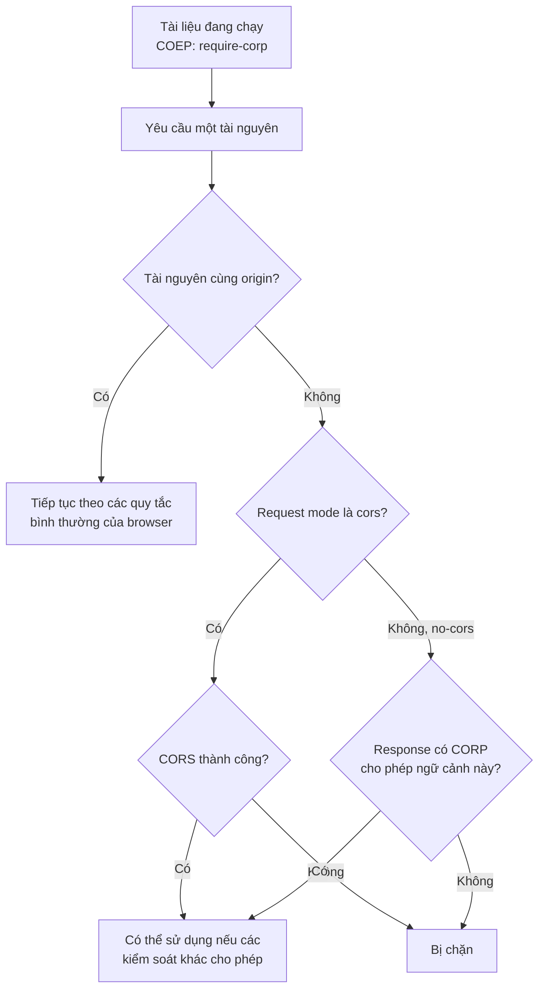

# Cross-Origin-Embedder-Policy và điều kiện tải tài nguyên

## 1. Khi trang vẫn tải được HTTP 200 nhưng tài nguyên không hiển thị

Trong module **SPRING_SECURITY_HTTP_PROTECTION**, người học áp dụng các lớp phòng vệ HTTP và trình duyệt trong Spring Security, từ CSRF, CORS, security headers, CSP, HSTS đến HTTP firewall và bảo vệ session cho cả **Servlet** lẫn **Reactive/WebFlux**. Ở chương **Quyền và cô lập trình duyệt**, **Cross-Origin-Embedder-Policy (COEP)** giải quyết một vấn đề khác với chính sách chống iframe hoặc chính sách cho phép JavaScript gọi API: *một tài liệu có được phép nạp và nhúng tài nguyên từ origin khác trong những chế độ request cụ thể hay không?*

Giả sử nền tảng học trực tuyến ở `https://learn.example.com` cần chạy một công cụ mô phỏng hiệu năng cao. Công cụ này:

- Tải script và hình ảnh từ `https://assets.partner.example`.
- Gọi API dữ liệu tại `https://api.partner.example`.
- Tải một vài tài nguyên cùng origin từ `https://learn.example.com`.
- Muốn dùng `SharedArrayBuffer` ở những trình duyệt yêu cầu **cross-origin isolation**.

Nhóm phát triển thêm:

```http
Cross-Origin-Opener-Policy: same-origin
Cross-Origin-Embedder-Policy: require-corp
```

Sau đó script hoặc ảnh từ CDN ngừng hoạt động dù tab Network đôi khi vẫn cho thấy request có phản hồi HTTP thành công. Lý do có thể là: **COEP `require-corp` yêu cầu tài nguyên cross-origin được nạp theo cách mà tài nguyên đó cho phép, thông qua CORS hoặc Cross-Origin-Resource-Policy (CORP) trong những trường hợp áp dụng**.

Đây không phải lý do để tắt toàn bộ security headers. Cần hiểu tài nguyên nào đang bị giới hạn, **ai sở hữu response**, request dùng chế độ `cors` hay `no-cors`, và thay đổi ở đâu để chỉ tài nguyên đáng tin được tải.

### Mục tiêu học tập

Sau bài này, bạn sẽ có thể:

1. Giải thích COEP và phân biệt nó với **COOP, CORP, CORS, CSP** và quyền truy cập dữ liệu.
2. Phân tích `require-corp`, `credentialless`, `unsafe-none` cùng điều kiện tải tài nguyên theo **request mode**.
3. Chẩn đoán khi ảnh, script, font, worker hoặc iframe không còn hoạt động sau khi bật COEP.
4. Cấu hình COEP theo route trên **Spring Security Servlet** và **Reactive/WebFlux** mà không vô hiệu hóa các header khác.
5. Kiểm thử response header bằng **MockMvc/WebTestClient**, đồng thời xác nhận việc browser thực thi trong một bài lab hai origin.

## 2. COEP là chính sách của tài liệu *nhúng/tải* tài nguyên

**`Cross-Origin-Embedder-Policy`** là một HTTP response header được áp dụng cho tài liệu (và những ngữ cảnh liên quan) nhằm đặt điều kiện về cách tài nguyên từ origin khác được đưa vào tài liệu đó. Chính sách tác động tới **khả năng nạp/nhúng cross-origin**, nhất là những request được thực hiện ở chế độ `no-cors`.

Ví dụ trang chính:

```http
HTTP/1.1 200 OK
Content-Type: text/html; charset=UTF-8
Cross-Origin-Embedder-Policy: require-corp
```

Trong HTML của trang:

```html

```

Nếu ảnh được tải cross-origin với request `no-cors` mà response không cho phép chia sẻ qua CORP theo yêu cầu, browser hỗ trợ COEP có thể **từ chối sử dụng ảnh**. Điều này khác với việc mã JavaScript cần đọc pixel ảnh: ngay cả nhu cầu **chỉ hiển thị ảnh** cũng có thể bị ảnh hưởng.

### COEP không tự quyết định ai được nhúng chính trang này

Một tài liệu có COEP không tự biến thành trang “không thể nhúng trong iframe”. Để quyết định website nào được đặt tài liệu hiện tại vào frame, cần quan tâm **CSP `frame-ancestors`** và **`X-Frame-Options`** trên response của tài liệu bị nhúng.

Tương tự:

- **CSP `frame-src`** trên trang cha giới hạn nguồn iframe mà trang cha được tải.
- **CORS** quy định việc cross-origin request theo chế độ CORS được server cho phép thế nào, đặc biệt là quyền script đọc response.
- **CORP** nằm trên **response của tài nguyên**, thể hiện tài nguyên có cho phép được tải cross-origin trong các ngữ cảnh không phải CORS hay không.
- **COEP** nằm trên **tài liệu yêu cầu/nhúng tài nguyên**, đặt điều kiện mà các tài nguyên được tải phải đáp ứng.

Vì vậy, câu hỏi về COEP không phải “website nào được phép nhúng tôi?” mà gần hơn với **“tài liệu của tôi chỉ được tải những tài nguyên cross-origin theo những cơ chế chia sẻ đã được cho phép nào?”**

## 3. Origin, site và request mode: ba khái niệm nền tảng

### 3.1. Origin và site không giống nhau

Một origin HTTP(S) thường được xác định bởi **scheme, host và port**.

| URL | Quan hệ với `https://learn.example.com` |
| --- | --- |
| `https://learn.example.com/courses/42` | Cùng origin |
| `https://learn.example.com:443/assets/app.js` | Cùng origin theo cổng HTTPS mặc định |
| `https://learn.example.com:8443/assets/app.js` | Khác origin vì port |
| `http://learn.example.com/assets/app.js` | Khác origin vì scheme |
| `https://static.learn.example.com/app.js` | Khác origin; có thể cùng site tùy ngữ cảnh |
| `https://assets.partner.example/app.js` | Khác origin và thường khác site |

**Same-site** là khái niệm khác, thường xét scheme và miền có thể đăng ký theo quy tắc của browser. Nó quan trọng đối với **`Cross-Origin-Resource-Policy: same-site`** và một số cơ chế cookie, nhưng không đồng nghĩa với `same-origin`.

### 3.2. Request `cors` và `no-cors`

Browser không tải mọi tài nguyên qua cùng một chế độ. Một số thẻ HTML truyền thống có thể tải cross-origin bằng **`no-cors`**; kết quả là JavaScript không được đọc nội dung của response như một CORS response bình thường. Một số request khác ở chế độ **`cors`**, yêu cầu server đích đáp ứng quy tắc CORS.

Ví dụ thực hành điển hình:

```html
<!-- Cross-origin image thường được tải theo chế độ no-cors. -->


<!-- Thêm crossorigin để yêu cầu dùng CORS cho hình ảnh. -->


<!-- Script cổ điển cross-origin, không khai báo crossorigin. -->
<script src="https://assets.partner.example/widget.js"></script>

<!-- Script cổ điển với crossorigin: cần response CORS phù hợp. -->
<script
  src="https://assets.partner.example/widget.js"
  crossorigin="anonymous"></script>
```

Các loại tài nguyên khác nhau có mặc định khác nhau. **Module scripts, font, `fetch`, workers, stylesheet hoặc iframe** có thể dùng những quy tắc và chế độ tải riêng; phải kiểm tra request cụ thể thay vì mặc định rằng “mọi request cross-origin đều là `no-cors`”.

### 3.3. Vì sao phân biệt mode lại quan trọng?

COEP `require-corp` đặc biệt quan tâm đến những tài nguyên cross-origin được tải theo `no-cors`:

- **`no-cors`:** tài nguyên cần **cho phép qua CORP** theo cách phù hợp để được sử dụng trong tài liệu có `COEP: require-corp`.
- **`cors`:** có thể đáp ứng bằng **CORS thành công** trên response; không cần suy ra rằng mọi response đã được CORS cho phép đều phải gửi thêm `CORP: cross-origin`.

Với `credentialless`, điều kiện lại khác: một số request cross-origin `no-cors` được gửi **không kèm credentials** để không cần resource opt-in qua CORP theo cùng cách `require-corp` đòi hỏi. Phần sau sẽ phân tích rõ.

## 4. Ba giá trị quan trọng của Cross-Origin-Embedder-Policy

### 4.1. `unsafe-none` — không cưỡng chế lớp COEP bổ sung

```http
Cross-Origin-Embedder-Policy: unsafe-none
```

Giá trị này không yêu cầu tài liệu phải thỏa mãn hạn chế COEP kiểu `require-corp`. Khi không có header COEP enforced, trạng thái mặc định thường có ý nghĩa tương ứng `unsafe-none`.

**Không được hiểu `unsafe-none` là vô hiệu hóa Same-Origin Policy, CORS hay CSP.** Những cơ chế đó vẫn có hiệu lực. `unsafe-none` chỉ không đặt thêm giới hạn của COEP theo cách `require-corp`/`credentialless`.

### 4.2. `require-corp` — yêu cầu nguồn cross-origin chủ động cho phép

```http
Cross-Origin-Embedder-Policy: require-corp
```

Trong tài liệu có `require-corp`, một tài nguyên cross-origin tải bằng `no-cors` thường cần khai báo mức chia sẻ phù hợp qua `Cross-Origin-Resource-Policy` của **resource server**, hoặc chuyển request sang `cors` và nhận CORS thành công nếu loại tài nguyên hỗ trợ.

Một tài nguyên công khai được phép dùng từ mọi origin có thể trả:

```http
Cross-Origin-Resource-Policy: cross-origin
```

Nhưng **chỉ server sở hữu tài nguyên** nên quyết định gửi header này. Không tự thêm `CORP: cross-origin` trên mọi API có dữ liệu riêng tư chỉ để một widget hoạt động.

### 4.3. `credentialless` — cách nạp một số tài nguyên không gửi credentials

```http
Cross-Origin-Embedder-Policy: credentialless
```

Với browser hỗ trợ, `credentialless` cho phép một số **tài nguyên cross-origin tải ở chế độ `no-cors`** được nạp mà không cần opt-in CORP, bằng cách thực hiện request **không kèm credentials** như cookie hoặc thông tin xác thực tương ứng; response cũng được xử lý theo các giới hạn liên quan.

Điều này hữu ích khi ứng dụng phải nạp tài nguyên công khai từ CDN không gửi CORP nhưng vẫn cần tiến tới cross-origin isolation. Tuy nhiên:

- `credentialless` **không phải** cách bỏ qua CORS cho request `cors`. Với CORS mode, server vẫn phải đáp ứng CORS.
- Một tài nguyên phụ thuộc session/cookie (ảnh riêng tư, script được phân phối theo user, API có phiên) có thể **không hoạt động** vì request không còn credentials.
- Kết quả phụ thuộc browser/version và ngữ cảnh request. Đừng chuyển cả website sang `credentialless` chỉ vì một ảnh bị chặn.
- Policy này không cấp cho JavaScript quyền đọc response cross-origin vốn không được SOP/CORS cho phép.

### Bảng lựa chọn

| Giá trị | Tác động chính | Khi nào cân nhắc |
| --- | --- | --- |
| `unsafe-none` | Không thêm lớp yêu cầu tài nguyên cross-origin theo COEP | Trang thông thường chưa cần cross-origin isolation, hoặc luồng legacy chưa sẵn sàng |
| `require-corp` | Cross-origin `no-cors` phải có opt-in phù hợp của tài nguyên; `cors` cần CORS thành công | Trang cần cô lập mạnh và kiểm soát rõ các resource server |
| `credentialless` | Một số cross-origin `no-cors` được tải không credentials; tránh phải có CORP trong trường hợp đó | Trang cần cô lập nhưng có CDN public không điều khiển được CORP, sau đánh giá browser/cookie |

**Nguyên tắc:** chọn chính sách dựa trên **tài liệu nào cần cô lập** và những loại tài nguyên mà nó tải, không dựa trên mong muốn “header càng chặt càng tốt” mà chưa đo tác động.

## 5. CORP nằm ở phía tài nguyên, không phải phía tài liệu nhúng

Header **`Cross-Origin-Resource-Policy` (CORP)** do máy chủ **phục vụ tài nguyên** gửi. Ba giá trị thường gặp:

| CORP trên response tài nguyên | Ý nghĩa chính |
| --- | --- |
| `same-origin` | Giới hạn việc tải tài nguyên theo những trường hợp áp dụng CORP ở cùng origin. |
| `same-site` | Cho phép theo quan hệ cùng site phù hợp với quy tắc của browser; khác `same-origin`. |
| `cross-origin` | Cho phép tải tài nguyên theo những ngữ cảnh CORP áp dụng từ origin khác. |

Ví dụ trang tại `https://learn.example.com` tải ảnh public:

```http
GET /diagrams/flow.png HTTP/1.1
Host: assets.partner.example
```

Từ server tài nguyên:

```http
HTTP/1.1 200 OK
Content-Type: image/png
Cross-Origin-Resource-Policy: cross-origin
```

Với ảnh `no-cors`, `CORP: cross-origin` là một opt-in cho phép tài nguyên được sử dụng cross-origin theo cơ chế áp dụng, kể cả trong trang `COEP: require-corp`.

### Khi nào không nên dùng CORP cross-origin?

Một endpoint trả dữ liệu tài khoản riêng tư hoặc nội dung theo cookie **không nên nhận `CORP: cross-origin` chỉ vì frontend cần một bức ảnh**. CORP không thay thế authentication hay phân quyền, nhưng `cross-origin` mở cách tài nguyên có thể được nhúng hơn mức hạn chế `same-origin`/`same-site`.

Nếu tài nguyên thực sự chỉ dành cho ứng dụng của chính bạn, cân nhắc:

1. Phục vụ từ **cùng origin**, giảm nhu cầu cross-origin.
2. Nếu loại request hỗ trợ `cors`, dùng CORS với allowlist origin rõ ràng và `crossorigin`/request mode phù hợp.
3. Nếu chia sẻ rộng một tài nguyên thực sự **công khai**, dùng CORP `cross-origin` chỉ cho tài nguyên đó hoặc nhóm public assets được xác nhận.

### CORP và CORS không thay thế nhau

Một response có:

```http
Access-Control-Allow-Origin: https://learn.example.com
```

chỉ có tác dụng đối với request thực sự dùng **CORS mode** và đáp ứng đầy đủ quy tắc CORS. Nếu một `` hoặc `<script>` cross-origin vẫn dùng `no-cors`, chỉ thêm ACAO **không tự biến request đó thành `cors`**; có thể cần `crossorigin="anonymous"` ở phần tử tương ứng hoặc dùng CORP cho tài nguyên.

Ngược lại, `CORP: cross-origin` trên tài nguyên **không** cho phép `fetch` với CORS mode đọc response nếu CORS không thành công.

## 6. Quy trình tải tài nguyên theo COEP



Sơ đồ **giản lược trường hợp tài nguyên con điển hình với `require-corp`**. Browser còn áp dụng CSP, mixed content, chính sách iframe, quy tắc MIME, module/worker, sandbox và những điều kiện khác. Với cross-origin iframe hoặc worker, cần kiểm tra thêm ràng buộc của **chính tài liệu/frame/worker đích**; không lấy nhánh tải ảnh trong sơ đồ để suy ra mọi iframe đều hoạt động như ``.

### Một request 200 không có nghĩa tài nguyên đã được dùng

Trong DevTools Network, request có thể nhận HTTP `200 OK` nhưng browser vẫn từ chối đưa nội dung vào tài liệu vì policy không cho phép. Ở Console có thể xuất hiện thông báo liên quan đến `Cross-Origin-Embedder-Policy` hoặc `Cross-Origin-Resource-Policy`.

Phân biệt:

- **HTTP status:** server có trả một response hay không.
- **Network/policy blocking:** browser có cho phép response được sử dụng trong ngữ cảnh hiện tại hay không.
- **DOM/render:** ảnh, script hay frame có hiển thị/chạy đúng không.

Một tài nguyên không hiển thị có thể do 404, CSP, CORS, CORP, COEP, lỗi MIME, redirect hoặc lỗi ứng dụng. **Đừng chỉ nhìn ô ảnh trắng để kết luận COEP đang hoạt động.**

## 7. COEP, COOP và điều kiện để đạt cross-origin isolation

Một số tính năng web có yêu cầu an toàn cao, ví dụ khả năng sử dụng `SharedArrayBuffer` trên các browser áp dụng quy tắc cross-origin isolation. Một cấu hình phổ biến cho tài liệu top-level là:

```http
Cross-Origin-Opener-Policy: same-origin
Cross-Origin-Embedder-Policy: require-corp
```

Hoặc, nếu browser hỗ trợ và các điều kiện tương ứng phù hợp:

```http
Cross-Origin-Opener-Policy: same-origin
Cross-Origin-Embedder-Policy: credentialless
```

**COOP và COEP giải quyết hai hướng khác nhau:**

- **COOP (Cross-Origin-Opener-Policy)** chi phối quan hệ giữa các cửa sổ cấp cao, nhóm browsing context và `window.opener`.
- **COEP (Cross-Origin-Embedder-Policy)** chi phối điều kiện tải/nhúng tài nguyên từ các origin khác.

Để một tài liệu trở thành cross-origin isolated, còn cần **secure context** và những điều kiện liên quan đến browser, môi trường nhúng và có thể cả Permissions-Policy. Vì vậy:

```javascript
console.log("Secure context:", window.isSecureContext);
console.log("Cross-origin isolated:", window.crossOriginIsolated);
```

Kết quả `true` của `crossOriginIsolated` trong ngữ cảnh phù hợp là dấu hiệu hữu ích; `false` **không tự chứng minh** rằng COEP header bị thiếu. Cần kiểm tra COOP, COEP, ancestor/frame, hỗ trợ browser và các điều kiện môi trường.

### Vì sao không bật COOP/COEP toàn hệ thống ngay lập tức?

COOP `same-origin` có thể ảnh hưởng popup OAuth/thanh toán phụ thuộc `window.opener`. COEP `require-corp` có thể làm script analytics, hình ảnh CDN, stylesheet hoặc widget ngoài origin ngừng tải. Nếu bật đồng thời trên toàn bộ website, nhiều chức năng không liên quan đến mô phỏng hiệu năng cao có thể bị gián đoạn.

**Thiết kế theo phạm vi:** ưu tiên dùng một route hoặc ứng dụng chuyên dụng cho tính năng cần isolation, rồi mở rộng sau khi kiểm kê tài nguyên và các luồng popup liên quan.

## 8. Quan hệ với CSP, CORS và các chính sách iframe

| Cơ chế | Nằm trên response của ai? | Câu hỏi chính |
| --- | --- | --- |
| `Cross-Origin-Embedder-Policy` | Trang/tài liệu yêu cầu tài nguyên | Trang này có được nhúng các tài nguyên cross-origin theo những điều kiện nào? |
| `Cross-Origin-Resource-Policy` | Server phục vụ tài nguyên con | Tài nguyên này có cho phép được sử dụng cross-origin trong trường hợp CORP áp dụng không? |
| `Cross-Origin-Opener-Policy` | Tài liệu cấp cao | Tài liệu có chia sẻ quan hệ cửa sổ/opener với những top-level document khác không? |
| `Access-Control-Allow-Origin` | Response tài nguyên/API trong trường hợp CORS | Origin của request `cors` có được phép truy cập response không? |
| CSP `script-src`/`img-src`/`connect-src` | Trang phát sinh tải tài nguyên | Nguồn script/ảnh/kết nối nào được phép? |
| CSP `frame-src` | Trang cha tạo iframe | Trang cha được tải iframe từ nguồn nào? |
| CSP `frame-ancestors` và XFO | Trang con bị nhúng | Ai có quyền nhúng tài liệu này? |
| `Permissions-Policy` | Tài liệu và chính sách kế thừa | Document/frame có thể sử dụng tính năng browser nào? |

**Các chính sách cùng áp dụng, không triệt tiêu nhau.** Ví dụ:

```http
Content-Security-Policy: img-src 'self' https://assets.partner.example
Cross-Origin-Embedder-Policy: require-corp
```

`img-src` cho phép nguồn ảnh từ CDN, nhưng COEP vẫn có thể chặn ảnh `no-cors` nếu tài nguyên đó thiếu opt-in CORP. Ngược lại, CDN có `CORP: cross-origin` không thể buộc một trang với `img-src 'self'` cho phép nạp ảnh từ CDN.

Tương tự, `fetch("https://api.partner.example/data")` có thể cần **CSP `connect-src`**, **CORS** và **authorization**. COEP không tự tạo quyền đọc response hoặc bỏ qua CSRF.

## 9. Chọn cấu hình theo loại tài nguyên

Trước khi đặt COEP `require-corp`, hãy kiểm kê **tất cả tài nguyên tải bởi tính năng** và ghi rõ cách request được thực hiện.

| Tài nguyên | Ví dụ request | Khi trang bật `require-corp` |
| --- | --- | --- |
| Ảnh cùng origin | `` | Không cần opt-in cross-origin của CORP vì cùng origin; CSP vẫn phải cho phép. |
| Ảnh public CDN khác origin | `` | Thường cần CORP phù hợp ở CDN hoặc chuyển sang CORS mode và CORS thành công. |
| Script cổ điển khác origin | `<script src="https://cdn.example.net/app.js">` | Xem `no-cors` mặc định và CORP; hoặc `crossorigin` + CORS thành công. |
| Module script khác origin | `<script type="module" src="...">` | Thường theo yêu cầu CORS của module; kiểm tra `Access-Control-Allow-Origin` và graph import. |
| Font web khác origin | `@font-face` từ CDN | Font thường chịu CORS; kiểm tra stylesheet, CORS và các tài nguyên font. |
| API qua `fetch` | `fetch("https://api.example.net/data")` | Xem CSP `connect-src` và CORS; không thể thay CORS bằng CORP. |
| Worker | `new Worker("/worker.js")` | Kiểm tra script, CSP `worker-src`, các ràng buộc COEP/COOP tương ứng và môi trường browser. |
| Iframe của dịch vụ ngoài | `<iframe src="https://widget.example.net">` | Ngoài COEP, kiểm tra CSP `frame-src` của cha, CSP `frame-ancestors`/XFO của con và quy tắc embedder policy trên tài liệu con. |

**Bảng là hướng phân tích, không phải một câu lệnh “mọi tài nguyên chỉ cần CORP”**. Những loại request có đặc tính riêng phải được thử trong browser mục tiêu. Một dependency có thể tải thêm nhiều URL sau khi script chính chạy; cần quan sát **toàn bộ Network**, không chỉ HTML ban đầu.

### Vì sao nên phân loại public và private assets?

Nếu `assets.partner.example` phục vụ hình ảnh công khai, `Cross-Origin-Resource-Policy: cross-origin` có thể phù hợp. Nhưng nếu cùng host còn phục vụ tài liệu theo cookie phiên, việc đặt header này trên toàn bộ response là một quyết định vượt quá yêu cầu của một bức ảnh.

Nên tách đường dẫn public và private, áp dụng header theo đúng lớp tài nguyên, tiếp tục kiểm tra authorization ở backend và phân tích tác động đến cache/CDN.

## 10. Spring Security Servlet: đặt COEP trên một nhóm URL xác định

Spring Security Servlet sử dụng `HttpSecurity` và `SecurityFilterChain`. Để giữ ví dụ rõ ràng qua những phiên bản có thể khác nhau về DSL chuyên dụng, ta dùng `StaticHeadersWriter` ghi các HTTP headers cố định.

### 10.1. Cấu hình một chain cho vùng cần isolation

Giả sử chỉ `/isolated/**` yêu cầu COEP; phần còn lại có nhu cầu popup/CDN riêng và chưa bật COEP.

```java
import org.springframework.context.annotation.Bean;
import org.springframework.context.annotation.Configuration;
import org.springframework.core.annotation.Order;
import org.springframework.security.config.annotation.web.builders.HttpSecurity;
import org.springframework.security.config.annotation.web.configuration.EnableWebSecurity;
import org.springframework.security.web.SecurityFilterChain;
import org.springframework.security.web.header.writers.StaticHeadersWriter;

@Configuration
@EnableWebSecurity
public class IsolationSecurityConfig {

    @Bean
    @Order(1)
    SecurityFilterChain isolatedPages(HttpSecurity http) throws Exception {
        return http
            .securityMatcher("/isolated/**")
            .authorizeHttpRequests(auth -> auth
                .anyRequest().authenticated())
            .headers(headers -> headers
                .addHeaderWriter(new StaticHeadersWriter(
                    "Cross-Origin-Opener-Policy", "same-origin"))
                .addHeaderWriter(new StaticHeadersWriter(
                    "Cross-Origin-Embedder-Policy", "require-corp")))
            .build();
    }

    @Bean
    @Order(2)
    SecurityFilterChain remainingPages(HttpSecurity http) throws Exception {
        return http
            .authorizeHttpRequests(auth -> auth
                .anyRequest().authenticated())
            .build();
    }
}
```

Trong ví dụ:

1. `securityMatcher("/isolated/**")` **chọn chain phát COOP/COEP**; `@Order(1)` bảo đảm chain này được xét trước chain còn lại.
2. `remainingPages` không tự phát COEP `require-corp`, nhưng vẫn giữ các HTTP security headers mặc định của Spring Security khi được bật.
3. `authenticated()` chỉ minh họa kiểm soát truy cập. Dự án thật phải có login, phân quyền, kiểm soát dữ liệu theo tenant và CSRF thích hợp.
4. **Không đặt `headers(headers -> headers.disable())` để sửa lỗi ảnh/script**: thao tác đó vô hiệu hóa những security headers khác của chain.
5. Nếu ứng dụng đã có COOP, COEP hoặc CSP tại gateway, phải thống nhất **một nơi chịu trách nhiệm**; không gửi nhiều policy mâu thuẫn rồi kỳ vọng browser tự hợp nhất theo hướng mở.

### 10.2. Không nên nhầm header trên tài liệu với header trên resource server

Giả sử trang `/isolated/demo` tải `https://assets.partner.example/chart.png`. Cấu hình COEP ở **ứng dụng tài liệu** có thể chưa đủ:

```http
Cross-Origin-Embedder-Policy: require-corp
```

Server **phục vụ ảnh** mới là nơi cần gửi, nếu ảnh được dùng cross-origin theo `no-cors`:

```http
Cross-Origin-Resource-Policy: cross-origin
```

**Không thêm CORP của CDN vào response của `/isolated/demo` rồi nghĩ rằng ảnh bên ngoài đã opt-in.** Header CORP phải xuất hiện trên **response ảnh**, không phải chỉ response HTML yêu cầu ảnh.

Nếu bạn không quản lý CDN, có thể cân nhắc `crossorigin="anonymous"` trên tài nguyên hỗ trợ và yêu cầu nhà cung cấp cấu hình CORS, hoặc chuyển tài nguyên sang cùng origin sau khi đánh giá bản quyền, bảo mật, cache và vận hành.

### 10.3. Nếu thật sự cần credentialless

Thay giá trị **chỉ ở chain đã xác định**:

```java
.addHeaderWriter(new StaticHeadersWriter(
    "Cross-Origin-Embedder-Policy", "credentialless"))
```

Đây là đoạn trích của `headers(...)`, không phải một chương trình Java độc lập. Khi dùng `credentialless`, kiểm tra các request `no-cors` cross-origin có đang phụ thuộc cookie, authorization hay nội dung cá nhân hóa không. Test trên tập trình duyệt được hỗ trợ; nếu browser không hỗ trợ giá trị này, không được khẳng định tài liệu đã đạt isolation.

## 11. Spring Security Reactive / WebFlux

Trong **WebFlux**, HTTP response header có ý nghĩa giống Servlet. Khác biệt nằm ở `ServerHttpSecurity`, `SecurityWebFilterChain` và header writer Reactive.

```java
import org.springframework.context.annotation.Bean;
import org.springframework.context.annotation.Configuration;
import org.springframework.core.annotation.Order;
import org.springframework.security.config.annotation.web.reactive.EnableWebFluxSecurity;
import org.springframework.security.config.web.server.ServerHttpSecurity;
import org.springframework.security.web.server.SecurityWebFilterChain;
import org.springframework.security.web.server.header.StaticServerHttpHeadersWriter;
import org.springframework.security.web.server.util.matcher.PathPatternParserServerWebExchangeMatcher;

@Configuration
@EnableWebFluxSecurity
public class ReactiveIsolationSecurityConfig {

    @Bean
    @Order(1)
    SecurityWebFilterChain isolatedPages(ServerHttpSecurity http) {
        return http
            .securityMatcher(
                new PathPatternParserServerWebExchangeMatcher("/isolated/**"))
            .authorizeExchange(auth -> auth
                .anyExchange().authenticated())
            .headers(headers -> headers
                .addWriter(new StaticServerHttpHeadersWriter(
                    "Cross-Origin-Opener-Policy", "same-origin"))
                .addWriter(new StaticServerHttpHeadersWriter(
                    "Cross-Origin-Embedder-Policy", "require-corp")))
            .build();
    }

    @Bean
    @Order(2)
    SecurityWebFilterChain remainingPages(ServerHttpSecurity http) {
        return http
            .authorizeExchange(auth -> auth
                .anyExchange().authenticated())
            .build();
    }
}
```

`PathPatternParserServerWebExchangeMatcher` chọn những request thuộc vùng `/isolated/**`; chain mặc định bao phủ phần còn lại. Trong triển khai thật, rà soát **các route HTML đang cần isolation**: matcher quá rộng có thể vô tình làm hỏng những widget chưa sẵn sàng, còn matcher quá hẹp không bảo vệ tài liệu mong muốn.

Các lớp header writer minh họa việc viết header trực tiếp. Khi Spring Security đang dùng có DSL COOP/COEP chuyên dụng, có thể dùng DSL tương ứng **nếu được phiên bản đó hỗ trợ**; không cấu hình song song nhiều writer phát cùng header mà chưa kiểm tra HTTP response cuối.

### Giữ những kiểm soát khác độc lập

COEP không:

- Tự cấp quyền cho user tải `/isolated/**`.
- Tự chặn POST trái phép hoặc thay CSRF token.
- Tự giới hạn `connect-src`, `script-src` của CSP.
- Tự mở quyền camera/microphone từ Permissions-Policy.
- Tự bảo đảm nội dung CDN tin cậy hoặc không có XSS.

Vì thế hãy duy trì xác thực, phân quyền, CSRF, session cookie, HTTP firewall và CSP phù hợp với nghiệp vụ. Ví dụ chain ở trên chỉ tập trung vào **COEP/COOP**, không phải cấu hình bảo mật hoàn chỉnh của ứng dụng production.

## 12. Thực hành hai origin: ảnh bị chặn hay được tải?

Thực hành trên các server do bạn kiểm soát:

- **Trang HTML** tại `http://localhost:8080/isolated/demo`.
- **Ảnh public từ server khác origin** tại `http://localhost:9090/public/chart.png`.

Hai port khác nhau làm hai URL **khác origin**. Dùng `localhost` cho lab là thuận tiện, nhưng production nên sử dụng HTTPS và thử với hostname thật.

### 12.1. Trang HTML

Trang demo từ port 8080:

```html
<!doctype html>
<html lang="vi">
<head>
  <meta charset="utf-8">
  <title>COEP resource loading lab</title>
</head>
<body>
  <h1>Kiểm thử ảnh cross-origin</h1>
  <p>Ảnh này dùng request no-cors điển hình:</p>
  

  <p>Ảnh này yêu cầu CORS:</p>
  

  <script>
    for (const id of ["plainImage", "corsImage"]) {
      const image = document.getElementById(id);
      image.addEventListener("load", () =>
        console.log(id + ": loaded"));
      image.addEventListener("error", () =>
        console.log(id + ": blocked or load error"));
    }
  </script>
</body>
</html>
```

Trên response của **trang 8080**, đặt:

```http
Cross-Origin-Opener-Policy: same-origin
Cross-Origin-Embedder-Policy: require-corp
```

Trên response **ảnh 9090**, thử ba lần độc lập, giữ URL và nội dung ảnh hợp lệ không đổi:

**Lần A — chỉ trả ảnh, không có CORP/CORS:**

```http
HTTP/1.1 200 OK
Content-Type: image/png
```

Kỳ vọng: ảnh `plainImage` tải `no-cors` bị COEP chặn; `corsImage` cũng không tải được vì server chưa cho phép CORS.

**Lần B — thêm CORP vào ảnh:**

```http
HTTP/1.1 200 OK
Content-Type: image/png
Cross-Origin-Resource-Policy: cross-origin
```

Kỳ vọng: ảnh `plainImage` có thể hiển thị nhờ CORP; ảnh `corsImage` vẫn cần **CORS thành công** vì request của nó đã được chuyển sang `cors`.

**Lần C — thay bằng CORS cho ảnh (không có CORP):**

```http
HTTP/1.1 200 OK
Content-Type: image/png
Access-Control-Allow-Origin: http://localhost:8080
```

Kỳ vọng: ảnh `corsImage` có thể hiển thị nếu CORS phù hợp; ảnh `plainImage` vẫn có thể bị chặn khi dùng `no-cors` vì ACAO **không tự đổi chế độ request** và không thay thế CORP.

**Lưu ý:** nếu server 9090 gửi cả CORP và CORS hợp lệ, cả hai cách tải có thể hoạt động. Đừng kết luận chỉ từ request `200`; xác minh sự kiện `load`/`error`, hình ảnh hiển thị và Console.

### 12.2. Thử `credentialless`

Đổi response của **trang 8080** thành:

```http
Cross-Origin-Opener-Policy: same-origin
Cross-Origin-Embedder-Policy: credentialless
```

Với browser hỗ trợ, ảnh `no-cors` cross-origin public **có thể tải dù server 9090 không trả CORP**, bởi request không gửi credentials. Tuy nhiên ảnh `corsImage` vẫn phải đáp ứng quy tắc CORS; nếu ảnh 9090 yêu cầu cookie phiên để trả nội dung, request credentialless có thể nhận ảnh lỗi hoặc response khác.

### 12.3. Ma trận kết quả theo chính sách

| COEP ở 8080 | Ảnh 9090 | Request `no-cors` | Request `cors` có `crossorigin` |
| --- | --- | --- | --- |
| `require-corp` | Không CORP, không CORS | Bị chặn | Bị chặn vì CORS |
| `require-corp` | `CORP: cross-origin` | Có thể tải | Vẫn cần CORS; chỉ CORP chưa đủ |
| `require-corp` | ACAO cho 8080, không CORP | Vẫn bị COEP chặn | Có thể tải |
| `credentialless` | Không CORP, không CORS, tài nguyên public | Có thể tải không credentials ở browser hỗ trợ | Vẫn cần CORS |
| `unsafe-none` | Không CORP, không CORS | Thường có thể tải như ảnh thông thường | Vẫn cần CORS |

Đây là **ma trận dự kiến** cho hai phần tử ảnh đã mô tả, không phải khẳng định mọi loại tài nguyên hoặc mọi browser đều có hành vi giống hệt. Kiểm chứng bằng DevTools với phiên bản trình duyệt mục tiêu.

## 13. Kiểm thử HTTP headers bằng MockMvc và WebTestClient

Kiểm thử HTTP phía Spring Security chứng minh rằng ứng dụng **phát đúng header theo endpoint**. Những test này **không mô phỏng browser thực thi COEP**, vì không tạo điều kiện nạp ảnh cross-origin hoặc browsing context.

### 13.1. Servlet — MockMvc

Giả sử có handler `/isolated/demo` và `/courses/42` trả `200 OK` cho user `learner`:

```java
mockMvc.perform(get("/isolated/demo").with(user("learner")))
    .andExpect(status().isOk())
    .andExpect(header().string(
        "Cross-Origin-Opener-Policy", "same-origin"))
    .andExpect(header().string(
        "Cross-Origin-Embedder-Policy", "require-corp"));

mockMvc.perform(get("/courses/42").with(user("learner")))
    .andExpect(status().isOk())
    .andExpect(header().doesNotExist(
        "Cross-Origin-Embedder-Policy"));
```

Đây là **phần thân test minh họa**; cần fixture `MockMvc`, controller, `spring-security-test` và static import `get`, `user`, `status`, `header`. Điều kiện **không có COEP** trên route thường chỉ đúng nếu chính thiết kế của ứng dụng không thêm header từ cấu hình khác; nếu COEP được phát tại gateway, test MockMvc không thể quan sát tầng đó.

### 13.2. Reactive — WebTestClient

```java
webTestClient.mutateWith(mockUser("learner"))
    .get().uri("/isolated/demo")
    .exchange()
    .expectStatus().isOk()
    .expectHeader().valueEquals(
        "Cross-Origin-Opener-Policy", "same-origin")
    .expectHeader().valueEquals(
        "Cross-Origin-Embedder-Policy", "require-corp");

webTestClient.mutateWith(mockUser("learner"))
    .get().uri("/courses/42")
    .exchange()
    .expectStatus().isOk()
    .expectHeader().doesNotExist(
        "Cross-Origin-Embedder-Policy");
```

`mockUser` có thể import từ `SecurityMockServerConfigurers` của `spring-security-test`. Nếu route public, điều chỉnh security và fixture theo yêu cầu thực. Các test phải xác nhận response **tài liệu HTML phù hợp**, không nhầm redirect đăng nhập với trang cần isolation.

### 13.3. Kiểm tra server ảnh

Với CDN do bạn sở hữu, kiểm tra CORP/CORS ngay trên **response ảnh**:

```bash
curl -i http://localhost:8080/isolated/demo
curl -i http://localhost:9090/public/chart.png
```

`curl` cho biết header và status của từng server; nó **không mô phỏng browser nạp ảnh** hay tự tạo request theo chế độ `cors`/`no-cors`. Đừng khẳng định tài nguyên đã vượt COEP chỉ dựa trên output `curl`.

## 14. DevTools và kiểm thử trình duyệt: tìm đúng nguyên nhân

Trong một phiên browser test với `COEP: require-corp`:

1. **Network → Document:** chọn response của trang `/isolated/demo`; xác nhận `Cross-Origin-Embedder-Policy` và `Cross-Origin-Opener-Policy`.
2. **Network → Resource:** chọn request ảnh/script/font đang lỗi; xác định URL thực, status, response headers `Cross-Origin-Resource-Policy`/`Access-Control-Allow-Origin` và chế độ request nếu DevTools có hiển thị.
3. **Console:** đọc thông báo chặn do COEP/CORP hoặc CORS. Phân biệt lỗi CSP `img-src`, `script-src`, `connect-src`, MIME hoặc mixed content.
4. **Thử dương tính:** một ảnh cùng origin hoặc ảnh cross-origin có opt-in phù hợp phải tải thành công, tránh việc mọi tài nguyên đều lỗi rồi test chặn vẫn PASS.
5. **Thử âm tính:** ảnh `no-cors` khác origin không có CORP không được hiển thị dưới `require-corp`.
6. **Thử credentialless riêng:** xác minh những request cần cookie/credentials có bị ảnh hưởng không; không dùng dữ liệu nhạy cảm thật.
7. **Qua proxy/CDN:** so sánh response thực tế sau cache, redirect và header bổ sung; chạy trên browser trong phạm vi sản phẩm hỗ trợ.

Nếu mục tiêu là cross-origin isolation:

```javascript
console.table({
  secureContext: window.isSecureContext,
  crossOriginIsolated: window.crossOriginIsolated
});
```

**Không dùng một cờ duy nhất để chẩn đoán.** COOP có thể không đúng, tài liệu có thể bị nhúng trong một trang ancestor không phù hợp, COEP có thể không được browser hỗ trợ hoặc còn điều kiện khác. Cần xem toàn bộ chính sách và các request đã bị chặn.

### Gợi ý kiểm thử E2E bằng Playwright

Với hai server lab đang chạy và ảnh có nội dung hợp lệ, có thể kiểm tra việc tải ảnh. Mẫu TypeScript dưới đây tập trung vào **tín hiệu hiển thị**, không thay thế test HTTP/CORS:

```typescript
import { test, expect } from "@playwright/test";

test("COEP cho tải ảnh khi CORP đáp ứng", async ({ page }) => {
  await page.goto("http://localhost:8080/isolated/demo");

  const image = page.locator("#plainImage");
  await expect(image).toBeVisible();
  await expect.poll(async () => image.evaluate(
    element => element instanceof HTMLImageElement &&
               element.complete && element.naturalWidth > 0
  )).toBe(true);
});
```

Test chỉ đúng khi server `9090` thực sự phát `CORP: cross-origin` trong kịch bản này. Với phép thử chặn, có thể kiểm tra `naturalWidth === 0` kết hợp với **assertion response header** và lỗi Console; nếu chỉ kiểm tra `naturalWidth === 0`, lỗi 404 hoặc URL sai cũng khiến test “chặn” báo đúng sai lệch.

## 15. Report-Only, chiến lược triển khai và khôi phục

Đối với ứng dụng lớn, bật `require-corp` ngay trên toàn site có thể làm gián đoạn ảnh CDN, analytics, font, SDK hoặc worker. Nên triển khai theo **giai đoạn**.

Một số browser hỗ trợ header dạng:

```http
Cross-Origin-Embedder-Policy-Report-Only: require-corp
```

Đây là **policy theo dõi**, không phải COEP enforced tương đương `Cross-Origin-Embedder-Policy: require-corp`. Việc **thu thập báo cáo vi phạm** còn phụ thuộc hỗ trợ browser và cấu hình Reporting API/endpoint; chỉ thêm header Report-Only không tự tạo dashboard hay chắc chắn nhận report.

Quy trình đề xuất:

1. **Kiểm kê:** ghi danh sách origin CDN, API, font, worker, iframe và popup dùng bởi vùng sẽ bật COEP.
2. **Chia scope:** chọn route hoặc ứng dụng con có nhu cầu cross-origin isolation thật; tránh ảnh hưởng trang đăng nhập, thanh toán, admin không liên quan.
3. **Theo dõi:** thử COEP Report-Only và quan sát DevTools/telemetry phù hợp trước khi bật enforced, nếu browser hỗ trợ.
4. **Chuẩn hóa resource:** phục vụ cùng origin khi có thể; bổ sung CORP cho public no-cors assets do bạn quản lý; hoặc chuyển sang CORS mode với origin allowlist.
5. **Bật enforced ở staging:** thử `require-corp` và các luồng người dùng cùng asset graph, bao gồm lỗi redirect/404 và các phiên bản browser mục tiêu.
6. **Đánh giá credentialless riêng:** khi có lý do rõ, kiểm tra ảnh hưởng đến cookie, nội dung cá nhân hóa và browser support.
7. **Phát hành dần:** theo dõi lỗi tài nguyên và khả năng sử dụng `SharedArrayBuffer`/tính năng cần isolation; có phương án quay lại policy trước đó **trên đúng route** nếu không đạt tiêu chí.
8. **Rà soát thường xuyên:** khi thêm CDN/widget mới, yêu cầu đánh giá lại COEP/CORP/CORS/CSP trong review tích hợp.

**Không dùng rollback bằng cách tắt toàn bộ security headers**. Nếu cần dừng COEP trong vùng thử nghiệm, điều chỉnh riêng header COEP theo scope, giữ nguyên authentication, CSRF, CSP, COOP/XFO và những bảo vệ khác theo thiết kế.

## 16. Chẩn đoán các lỗi triển khai phổ biến

### “CDN trả HTTP 200 nhưng ảnh vẫn không hiển thị”

Kiểm tra `COEP: require-corp` trên trang **yêu cầu ảnh**, mode của request ảnh, và `Cross-Origin-Resource-Policy` trên **response ảnh**. Nếu ảnh dùng `no-cors` nhưng không có CORP cho phép, browser có thể từ chối dùng ảnh. Đừng thêm `CORP: cross-origin` vào HTML rồi nghĩ đã sửa ảnh.

### “Đã thêm Access-Control-Allow-Origin nhưng script vẫn bị chặn”

Với script cổ điển không có `crossorigin`, browser có thể tải theo `no-cors`. Khi đó ACAO không tự chuyển mode; cần CORP phù hợp ở response script **hoặc** chuyển script sang CORS mode `crossorigin="anonymous"` và cho phép CORS ở server đích. Đồng thời kiểm tra CSP `script-src` và các import phát sinh.

### “Dùng credentialless rồi hình ảnh theo tài khoản không còn đúng”

`credentialless` có thể loại bỏ credentials trong cross-origin `no-cors` requests; ảnh/API theo cookie có thể trả nội dung mặc định, lỗi 401 hoặc hình ảnh không như mong đợi. Không dùng `credentialless` nếu không đánh giá các tài nguyên cá nhân hóa; cân nhắc same-origin, CORS có kiểm soát và phân quyền chính xác.

### “crossOriginIsolated vẫn false dù đã thêm COEP”

Cross-origin isolation thường còn cần **`COOP: same-origin`**, secure context, browser support và những điều kiện liên quan. Xác minh response tài liệu top-level, các frame/ancestor, COEP enforced, không nhầm với Report-Only, và những chính sách khác có thể tác động. Một header COEP đơn lẻ không bảo đảm `crossOriginIsolated`.

### “Popup đăng nhập ngừng hoạt động sau khi bật isolation”

Đây có thể là **tác động của COOP `same-origin`** chứ không phải riêng COEP. COOP có thể cắt `window.opener` của popup khác origin. Kiểm tra luồng OAuth/SSO, `state`/PKCE và kênh callback; cân nhắc thay luồng giao tiếp hoặc chọn scope COOP/COEP phù hợp, không mở `unsafe-none` toàn bộ website một cách mù quáng.

### “Iframe bị chặn dù resource đã có CORP”

Một iframe là **tài liệu với nhiều chính sách của chính nó**, không chỉ ảnh public. Kiểm tra CSP `frame-src` của cha, CSP `frame-ancestors`/XFO của con, header COEP của tài liệu con, các ancestor, sandbox và xác thực. CORP trên một ảnh bên trong iframe không tự cho phép iframe đó hiển thị.

### “Test Spring Security PASS nhưng production vẫn lỗi”

Một proxy/CDN có thể thêm COEP global, ghi đè COOP, thay CORP của static assets hoặc phục vụ response ngoài security chain. Kiểm tra **response cuối của cả trang và tài nguyên**, gồm redirect, cache và nội dung theo hostname. Không suy ra chính sách production chỉ từ kết quả MockMvc/WebTestClient.

### “Trang không bật COEP nhưng script vẫn bị CSP chặn”

`COEP: unsafe-none` không vô hiệu hóa `script-src`, CORS hay những kiểm soát khác. Kiểm tra directive CSP, request mode, MIME type và nội dung response. Giải quyết nguyên nhân thực thay vì tắt đồng loạt các bảo vệ.

## 17. Bài tập tự đánh giá

**Bài A — CORS và CORP.** Trang tại `https://learn.example.com` bật `COEP: require-corp`. Một ảnh public từ `https://cdn.example.net/a.png` không trả CORP nhưng có `Access-Control-Allow-Origin: https://learn.example.com`. Hãy dự đoán sự khác biệt giữa `` và ``.

**Bài B — Không nới quyền toàn CDN.** Một server CDN có ảnh public và tài liệu riêng theo cookie. Chỉ ảnh public cần hiển thị trong trang có COEP. Hãy đề xuất phạm vi cấu hình CORP và cách kiểm tra tài liệu riêng không bị mở quá rộng.

**Bài C — Credentialless.** Một trang bật `COEP: credentialless`; ảnh `no-cors` cross-origin từ CDN công khai tải được, nhưng ảnh hồ sơ của user lại thất bại. Hãy giải thích hiện tượng và đề xuất hai phương án tránh phụ thuộc credentials ở `no-cors`.

**Bài D — Cross-origin isolation.** Trang trả `COEP: require-corp` nhưng chưa gửi COOP, và `window.crossOriginIsolated` là `false`. Những điều kiện nào cần kiểm tra tiếp theo? Vì sao việc chỉnh CORS cho một ảnh không thể thay thế toàn bộ cấu hình COOP?

**Bài E — Phạm vi Spring Security.** Chỉ `/isolated/**` cần COOP/COEP còn `/billing/**` dùng popup thanh toán. Hãy thiết kế hai `SecurityFilterChain` Servlet hoặc `SecurityWebFilterChain` Reactive, và mô tả kiểm thử HTTP cùng browser để bảo đảm không vô tình thay policy của billing.

**Bài F — Nhiều nguồn chính sách.** Spring Security trả COEP `require-corp` cho tài liệu, nhưng reverse proxy thay header thành `unsafe-none`. Test MockMvc PASS còn trình duyệt vẫn tải mọi ảnh. Bạn sẽ tìm nguồn khác biệt ở đâu và xác nhận bằng cách nào?

**Gợi ý trả lời:** A — `no-cors` thiếu CORP có thể bị chặn, `cors` với ACAO hợp lệ có thể tải; B — chỉ cấu hình public assets thực sự được chia sẻ, giữ private tài nguyên có phân quyền/CORP hẹp; C — credentialless không gửi cookie cho no-cors cross-origin, nên chuyển cùng origin hoặc dùng CORS có kiểm soát khi phù hợp; D — COOP `same-origin`, secure context, browser/frame/permissions conditions; E — chain `/isolated/**` với `COOP: same-origin` và `COEP: require-corp`, chain còn lại không áp dụng COEP ngoài ý muốn; F — kiểm tra response cuối qua gateway/CDN bằng DevTools và request thực tế.

## 18. Tổng kết và tài liệu đối chiếu

**`Cross-Origin-Embedder-Policy` là chính sách ở phía tài liệu muốn tải/nhúng tài nguyên.** Với `require-corp`, tài nguyên cross-origin tải `no-cors` thường cần được server tài nguyên cho phép qua CORP; tài nguyên tải `cors` cần CORS thành công. `credentialless` là lựa chọn khác, cho phép một số `no-cors` cross-origin resources mà không gửi credentials, nhưng có thể làm hỏng các tài nguyên cần cookie. `unsafe-none` không áp thêm yêu cầu COEP tương tự.

Để đạt **cross-origin isolation** ở trình duyệt phù hợp, COEP thường cần phối hợp với **`Cross-Origin-Opener-Policy: same-origin`**, secure context và những điều kiện liên quan. **COEP không thay CSP, CORS, CORP, XFO, Permissions-Policy, CSRF hoặc xác thực/phân quyền**. Trong Spring Security Servlet và Reactive, nên đặt COEP trên **đúng nhóm tài liệu thực sự cần tính năng**, kiểm kê toàn bộ resource graph, xác minh cả **response trang** lẫn **response tài nguyên**, và kết hợp test header với kiểm thử thực trong browser.

Tài liệu tham khảo để đối chiếu trước khi đưa vào production:

- [MDN — Cross-Origin-Embedder-Policy](https://developer.mozilla.org/en-US/docs/Web/HTTP/Reference/Headers/Cross-Origin-Embedder-Policy): các giá trị, tài nguyên cross-origin và mục đích cô lập.
- [MDN — Cross-Origin-Resource-Policy](https://developer.mozilla.org/en-US/docs/Web/HTTP/Reference/Headers/Cross-Origin-Resource-Policy): CORP trên resource response và các phạm vi chia sẻ.
- [MDN — Cross-Origin-Opener-Policy](https://developer.mozilla.org/en-US/docs/Web/HTTP/Reference/Headers/Cross-Origin-Opener-Policy): quan hệ cửa sổ và COOP.
- [MDN — Cross-Origin Resource Sharing](https://developer.mozilla.org/en-US/docs/Web/HTTP/Guides/CORS): CORS và request mode.
- [MDN — Cross-origin isolation](https://developer.mozilla.org/en-US/docs/Web/API/Window/crossOriginIsolated): điều kiện và cách quan sát `crossOriginIsolated`.
- [Spring Security — Servlet HTTP Response Headers](https://docs.spring.io/spring-security/reference/servlet/exploits/headers.html): cấu hình headers ở Servlet.
- [Spring Security — Reactive HTTP Response Headers](https://docs.spring.io/spring-security/reference/reactive/exploits/headers.html): cấu hình tương ứng cho WebFlux.
