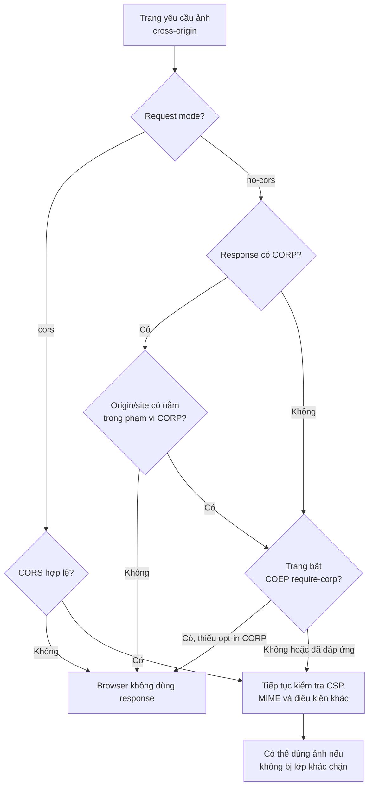

# Cross-Origin-Resource-Policy và phạm vi dùng tài nguyên

## 1. Bài toán: tài nguyên của ứng dụng được phép xuất hiện ở website nào?

Trong module **SPRING_SECURITY_HTTP_PROTECTION**, người học triển khai nhiều lớp phòng vệ HTTP và trình duyệt bằng Spring Security: CSRF, CORS, security headers, CSP, HSTS, HTTP firewall và bảo vệ session, cho cả **Servlet** và **Reactive/WebFlux**. Ở chương **Quyền và cô lập trình duyệt**, **Cross-Origin-Resource-Policy (CORP)** là một cơ chế giúp máy chủ phục vụ tài nguyên giới hạn nơi tài nguyên đó có thể được nạp ở **chế độ `no-cors`**.

Giả sử hệ thống học tập tại `https://learn.example.com` có ba loại tài nguyên:

- Ảnh đại diện của học viên ở `/account/avatar.png`, chỉ người có quyền mới được xem.
- Ảnh biểu trưng thương hiệu công khai ở `/assets/public/logo.png`, cần hiển thị trên nhiều website.
- Biểu đồ dùng chung trong các ứng dụng thuộc những subdomain của tổ chức ở `/assets/team/chart.png`.

Nhóm phát triển phải trả lời những câu hỏi khác nhau: tài nguyên nào thực sự công khai, tài nguyên nào chỉ dành cho cùng origin, và có tài nguyên nào được phép nhúng từ một origin khác nhưng vẫn cùng site? Đặt cùng một giá trị CORP cho cả ba nhóm có thể gây **hỏng chức năng hoặc mở khả năng nhúng rộng hơn ý định**.

Ví dụ response của một ảnh riêng tư:

```http
HTTP/1.1 200 OK
Content-Type: image/png
Cross-Origin-Resource-Policy: same-origin
```

Với trình duyệt hỗ trợ, header này hướng dẫn browser **chặn việc sử dụng response ảnh bởi những request `no-cors` đến từ origin khác**. Nó không tự xác thực người dùng, không biến ảnh thành một tài nguyên bí mật và không chặn mọi cách tải bằng HTTP.

**Mục tiêu chính:** chọn `same-origin`, `same-site` hoặc `cross-origin` theo **phạm vi sử dụng thực của từng tài nguyên**, kết hợp các lớp bảo vệ truy cập khác và kiểm thử trên browser.

Sau bài này, bạn có thể:

1. Xác định đúng **CORP nằm trên response tài nguyên**, không phải một chính sách tùy ý đặt trên trang cha.
2. Phân biệt ba giá trị CORP, quan hệ **origin/site** và điều kiện request `no-cors`.
3. Giải thích cách **COEP `require-corp`** phối hợp với CORP hoặc CORS để tải tài nguyên.
4. Cấu hình CORP theo URL trong **Spring Security Servlet** và **Reactive/WebFlux**.
5. Thiết kế bài thử dương tính/âm tính, chẩn đoán sự cố từ CDN, cache, CSP, CORS hoặc reverse proxy.

## 2. CORP bảo vệ response của tài nguyên nào?

**`Cross-Origin-Resource-Policy`** là **HTTP response header** được gửi từ máy chủ phục vụ một tài nguyên như ảnh, script, stylesheet, media hoặc một response có thể được nhúng trong các trường hợp áp dụng.

Ví dụ tài liệu trên `https://app.example.net` chứa:

```html

```

Request tải ảnh ở ví dụ thông thường có thể dùng chế độ `no-cors`. Nếu **response ảnh** gửi:

```http
Cross-Origin-Resource-Policy: same-origin
```

trình duyệt có thể từ chối cung cấp response đó cho ngữ cảnh nhúng ở `app.example.net`, vì nguồn yêu cầu không cùng origin với ảnh.

Nếu đặt header này **chỉ trên response HTML của `app.example.net`** mà không có CORP ở response ảnh, không thể coi ảnh đã được bảo vệ bằng CORP. Điều quan trọng là **response nào được browser sử dụng làm tài nguyên con**.

### Rủi ro nào được giảm thiểu?

Một trang độc hại có thể cố nhúng các tài nguyên mà người dùng đang có phiên đăng nhập, ví dụ ảnh riêng tư hoặc response mang trạng thái cá nhân. Dù Same-Origin Policy ngăn script của attacker đọc trực tiếp byte của một response `no-cors` cross-origin, việc tài nguyên tải thành công đôi khi vẫn tạo ra **dấu hiệu quan sát được**: thời điểm tải, sự kiện `load`/`error`, kích thước hình ảnh hoặc khác biệt hiển thị. Những kỹ thuật suy luận này thuộc nhóm **cross-site leaks (XS-Leaks)**.

CORP giúp hạn chế một lớp bề mặt như vậy bằng cách yêu cầu browser **không cung cấp tài nguyên `no-cors` cho origin không được phép**. Tuy nhiên, nó **không phải biện pháp chống mọi XS-Leaks**: ứng dụng vẫn cần kiểm soát authorization, cookie, CORS, cache, CSP và thiết kế phản hồi.

### CORP không làm được điều gì?

- Không tự từ chối request HTTP trực tiếp bằng `curl` hoặc công cụ không thực thi CORP.
- Không thay thế **xác thực hoặc phân quyền** của controller/service.
- Không cấp quyền JavaScript đọc response cross-origin như CORS.
- Không quyết định website nào được nhúng **tài liệu HTML** qua `frame-ancestors`/XFO.
- Không đặt giới hạn nguồn script/ảnh mà tài liệu **được phép yêu cầu** như CSP `script-src`/`img-src`.
- Không bảo đảm mọi trình duyệt và mọi loại request đều thực thi CORP giống nhau.

CORP là một **quy tắc về việc browser sử dụng response tài nguyên**, không phải một hệ thống kiểm soát truy cập thay cho backend.

## 3. Ba giá trị của Cross-Origin-Resource-Policy

CORP sử dụng ba giá trị chính:

```http
Cross-Origin-Resource-Policy: same-origin
```

```http
Cross-Origin-Resource-Policy: same-site
```

```http
Cross-Origin-Resource-Policy: cross-origin
```

| Giá trị | Phạm vi mà tài nguyên chủ động cho phép đối với trường hợp CORP áp dụng | Ứng dụng điển hình |
| --- | --- | --- |
| `same-origin` | Chỉ các request phù hợp **cùng origin** với tài nguyên | Response cần được giới hạn việc nhúng từ origin bên ngoài; lựa chọn phòng vệ cho tài nguyên nội bộ |
| `same-site` | Các request thuộc **cùng site** theo thuật toán browser, có thể khác subdomain/origin | Tài nguyên dùng chung giữa các subdomain thuộc một site mà mọi origin liên quan đều đáng tin |
| `cross-origin` | Cho phép các ngữ cảnh cross-origin sử dụng tài nguyên theo những trường hợp CORP áp dụng | Ảnh, script hoặc asset **thực sự công khai**, được thiết kế cho website ngoài nhúng |

**Không có giá trị `none` hoặc `*` theo cú pháp CORP thông dụng.** Để chọn “chỉ cùng origin” dùng `same-origin`; muốn cho phép cross-origin theo CORP dùng `cross-origin`. `cross-origin` không đồng nghĩa với `Access-Control-Allow-Origin: *`.

### 3.1. `same-origin` là gì?

Một **origin** HTTP(S) được xác định bằng **scheme, host và port**. Ví dụ tài nguyên `https://learn.example.com/assets/private.png`:

| Trang yêu cầu tài nguyên | Cùng origin? |
| --- | --- |
| `https://learn.example.com/course/42` | Có |
| `https://learn.example.com:443/course/42` | Có (cổng HTTPS mặc định) |
| `https://learn.example.com:8443/course/42` | Không (khác port) |
| `http://learn.example.com/course/42` | Không (khác scheme) |
| `https://portal.example.com/course/42` | Không (khác hostname) |

Với `same-origin`, các request `no-cors` cross-origin thuộc phạm vi kiểm tra CORP có thể bị chặn. **Cùng tổ chức hoặc cùng họ tên miền không tự tạo cùng origin.**

### 3.2. `same-site` rộng hơn `same-origin`

**Site** thường được xác định theo *schemeful site*: scheme và phần miền có thể đăng ký (registrable domain), dựa trên các quy tắc như Public Suffix List; với hostname đặc biệt hoặc IP, browser dùng thuật toán tương ứng.

Ví dụ hai trang:

```text
https://learn.example.com
https://static.example.com
```

Chúng **khác origin** vì khác hostname, nhưng thường **cùng site** nếu cùng scheme và miền có thể đăng ký `example.com`. Khi `static.example.com` phục vụ tài nguyên với `CORP: same-site`, tài liệu tại `learn.example.com` có thể nhúng tài nguyên `no-cors` theo chính sách này.

Tuy nhiên, `https://learn.example.com` và `http://static.example.com` có thể **khác site** trong mô hình schemeful site vì khác scheme. `same-site` không có nghĩa “cùng công ty” hoặc “cùng dải IP”.

**Rủi ro:** nếu ứng dụng có subdomain phục vụ nội dung do người dùng tạo, subdomain không tin cậy hoặc hệ thống ít được bảo trì, `same-site` có thể rộng hơn mức cần thiết. Chỉ dùng sau khi kiểm kê những origin cùng site và mức độ tin cậy của chúng.

### 3.3. `cross-origin` là opt-in cho việc nhúng tài nguyên

Một ảnh logo công khai có thể được phục vụ như sau:

```http
HTTP/1.1 200 OK
Content-Type: image/png
Cache-Control: public, max-age=3600
Cross-Origin-Resource-Policy: cross-origin
```

Điều này cho phép hình ảnh được dùng cross-origin trong các trường hợp CORP áp dụng, ví dụ tài liệu ngoài origin có COEP `require-corp` và tải ảnh bằng `no-cors`.

**`cross-origin` không tự cho phép JavaScript đọc byte qua `fetch` ở chế độ CORS.** Một script muốn đọc dữ liệu từ response cross-origin vẫn cần điều kiện CORS hoặc cơ chế phù hợp khác. Đồng thời, server vẫn phải xác định rõ tài nguyên công khai hay riêng tư ở lớp nghiệp vụ.

## 4. Phân biệt CORP với CORS ở mức request mode

Điều dễ nhầm nhất là nghĩ `Cross-Origin-Resource-Policy` và `Access-Control-Allow-Origin` có thể thay cho nhau. Thực tế, chúng phục vụ những đường kiểm tra khác nhau.

### 4.1. Một ảnh thông thường có thể dùng `no-cors`

```html

```

Với ảnh cross-origin tải theo kiểu thông thường, browser có thể dùng `no-cors`. Dù ảnh hiển thị, JavaScript ở trang cha không được tự đọc pixel qua canvas nếu không thỏa mãn các điều kiện an toàn cần thiết.

Nếu **response ảnh** có `CORP: same-origin` nhưng trang cha khác origin, browser hỗ trợ CORP có thể **chặn hẳn việc sử dụng ảnh**, không chỉ giới hạn quyền đọc canvas.

### 4.2. Chuyển ảnh sang CORS mode bằng `crossorigin`

```html

```

Khi request dùng `cors`, server ảnh phải trả response CORS hợp lệ:

```http
Access-Control-Allow-Origin: https://learn.example.com
```

Khi **CORS thành công**, request có thể được sử dụng theo quy tắc CORS; **không nhất thiết phải gửi `CORP: cross-origin`** chỉ để đáp ứng COEP `require-corp` cho request đó.

Ngược lại, nếu ảnh vẫn ở `no-cors`, thêm `Access-Control-Allow-Origin` trên server **không tự chuyển mode** của request từ `no-cors` sang `cors`.

### 4.3. `fetch` không được cấp quyền đọc chỉ nhờ CORP

```javascript
// Request cross-origin theo chế độ CORS mặc định.
fetch("https://api.partner.example/data")
  .then(response => response.json())
  .then(data => console.log(data))
  .catch(error => console.error("Request failed:", error));
```

Nếu API không trả CORS phù hợp, JavaScript không thể đọc response chỉ vì API có:

```http
Cross-Origin-Resource-Policy: cross-origin
```

Thử:

```javascript
fetch("https://api.partner.example/data", { mode: "no-cors" })
  .then(response => console.log(response.type));
```

không phải một cách vượt CORS. Response `no-cors` cross-origin thường là **opaque**: JavaScript không được đọc body/headers như response CORS. CORP có thể tiếp tục giới hạn request `no-cors`; không dùng `mode: "no-cors"` như một “cách sửa CORS”.

### Bảng đối chiếu

| Cơ chế | Nơi phát | Câu hỏi chính |
| --- | --- | --- |
| `Cross-Origin-Resource-Policy` | **Resource response** | Browser có thể dùng tài nguyên theo request `no-cors` từ ngữ cảnh khác origin/site không? |
| `Access-Control-Allow-Origin` | Response tài nguyên/API | Request **CORS** từ origin đó có được phép nhận/đọc response không? |
| CSP `img-src`/`script-src` | Response của **tài liệu yêu cầu tài nguyên** | Tài liệu được phép yêu cầu ảnh/script từ nguồn nào? |
| `Cross-Origin-Embedder-Policy` | Response **tài liệu nhúng/yêu cầu tài nguyên** | Tài liệu yêu cầu những tài nguyên cross-origin opt-in hoặc được tải theo cơ chế đặc biệt nào? |
| CSP `frame-ancestors` / XFO | Response **tài liệu bị nhúng** | Ai được phép hiển thị tài liệu đó trong iframe? |
| `Permissions-Policy` | Tài liệu và các chính sách kế thừa | Document/frame có thể dùng những API trình duyệt nào? |

Các kiểm soát này **cộng dồn**, không triệt tiêu nhau. Một hình ảnh có `CORP: cross-origin` vẫn có thể bị chặn nếu trang cha gửi `Content-Security-Policy: img-src 'self'`.

## 5. CORP hoạt động độc lập và khi kết hợp COEP

Không nên coi CORP chỉ có tác dụng khi ứng dụng bật `Cross-Origin-Embedder-Policy`. CORP có thể ngăn sử dụng tài nguyên trong các request `no-cors` **ngay cả khi trang yêu cầu không gửi COEP**.

### 5.1. Khi trang yêu cầu không bật COEP chặt

Trang ở `https://portal.other.example`:

```html

```

Response avatar:

```http
Cross-Origin-Resource-Policy: same-origin
```

Nếu request tải ảnh là cross-origin `no-cors`, browser thực thi CORP có thể từ chối sử dụng response. Điều này không phụ thuộc vào việc portal có COEP `require-corp` hay không.

### 5.2. Khi trang yêu cầu có `COEP: require-corp`

Một tài liệu cần **cross-origin isolation** có thể gửi:

```http
Cross-Origin-Opener-Policy: same-origin
Cross-Origin-Embedder-Policy: require-corp
```

Trong tài liệu đó, một số tài nguyên cross-origin tải qua `no-cors` cần **được server tài nguyên opt-in qua CORP phù hợp**. Chẳng hạn:

```http
Cross-Origin-Resource-Policy: cross-origin
```

Nếu không có CORP phù hợp, browser có thể chặn tài nguyên. Thay vào đó, với loại tài nguyên hỗ trợ `cors`, có thể chuyển request sang CORS mode và cấu hình CORS đúng ở server tài nguyên.

**Điều cần nhớ:** COEP nằm ở **trang muốn nhúng**, còn CORP nằm ở **tài nguyên được nhúng**. Thêm COEP trên ảnh không thay cho việc thêm CORP trên ảnh; thêm CORP trên HTML trang cha không tự làm một ảnh CDN khác origin được chia sẻ.

### 5.3. Khi trang yêu cầu có `COEP: credentialless`

```http
Cross-Origin-Embedder-Policy: credentialless
```

Với browser hỗ trợ, một số request cross-origin `no-cors` được tải **không kèm credentials** và có thể không cần resource opt-in CORP như dưới `require-corp` nếu response không có hạn chế khác.

Nhưng **`credentialless` không xóa một hạn chế CORP được phát tường minh trên resource response**. Nếu tài nguyên có `CORP: same-origin`, không được mặc định `credentialless` sẽ cho một trang ngoài origin nhúng nó.

Lưu ý: `credentialless` có thể khiến ảnh, media hoặc tài nguyên cá nhân hóa theo cookie bị lỗi hoặc trả nội dung khác. Không dùng `credentialless` để “vượt” chính sách của tài nguyên riêng tư.

### 5.4. Vì sao phải xét COOP và điều kiện isolation?

Một số tính năng như `SharedArrayBuffer` có thể cần **cross-origin isolation** ở trình duyệt hiện đại. Để đạt điều kiện này, một cấu hình thường dùng là:

```http
Cross-Origin-Opener-Policy: same-origin
Cross-Origin-Embedder-Policy: require-corp
```

Ngoài ra còn cần secure context, browser support và những điều kiện liên quan. CORP trên các resource phụ chỉ là **một phần** của bức tranh: nó không thay thế COOP hoặc tự làm `window.crossOriginIsolated` thành `true`.

```javascript
console.table({
  secureContext: window.isSecureContext,
  isolated: window.crossOriginIsolated
});
```

Nếu `isolated` là `false`, không thể kết luận chỉ từ đó rằng CORP sai. Hãy xem response của tài liệu, COOP/COEP, iframe/ancestor, secure context và các tài nguyên đang tải.

## 6. Sơ đồ quyết định cho tài nguyên ảnh cross-origin



Sơ đồ cố ý giản lược trường hợp **ảnh** dưới `COEP: require-corp` hoặc không có COEP chặt. `COEP: credentialless` có thêm cách xử lý request `no-cors` không credentials và phải được phân tích riêng. Những loại tài nguyên như **module scripts, font, worker và iframe** có quy tắc tải đặc thù; không sử dụng sơ đồ này như thuật toán chung cho mọi request.

### Tại sao HTTP 200 vẫn có thể không hiển thị?

Server có thể hoàn thành response:

```http
HTTP/1.1 200 OK
Content-Type: image/png
Cross-Origin-Resource-Policy: same-origin
```

nhưng browser **từ chối sử dụng response đó** trong một tài liệu cross-origin tải `no-cors`. DevTools có thể cho thấy request đã gửi và nhận response, đồng thời báo bị chặn vì policy. **HTTP status không phải bằng chứng CORP đã cho phép tài nguyên được dùng.**

## 7. Chọn CORP theo loại tài nguyên và mức độ nhạy cảm

Một chính sách tốt phải đi từ **phân loại dữ liệu**, không phải “mọi URL có một giá trị cho dễ”.

| Nhóm tài nguyên | Ví dụ URL | Mức khuyến nghị ban đầu | Giải thích |
| --- | --- | --- | --- |
| Hình ảnh theo tài khoản | `/account/avatar.png` | `same-origin` | Hạn chế bị nhúng từ origin ngoài theo `no-cors`; **vẫn bắt buộc kiểm tra quyền**. |
| Báo cáo hoặc file riêng theo tenant | `/reports/tenant-42/chart.png` | `same-origin` | Ngăn nhúng ngoài origin theo cơ chế áp dụng; không để URL tài nguyên trở thành credential. |
| Logo/logo sản phẩm công khai | `/assets/public/logo.png` | `cross-origin` nếu thật sự cần website ngoài nhúng | Cho phép sử dụng public asset từ nhiều origin. |
| Asset chung cho các subdomain cùng site đã kiểm duyệt | `/assets/team/chart.png` | `same-site` khi chứng minh đủ điều kiện | Rộng hơn same-origin; yêu cầu kiểm kê các subdomain được tin cậy. |
| File JavaScript CDN công khai | `/assets/public/widget.js` | `cross-origin` nếu được thiết kế cho embedding | Kiểm tra tính toàn vẹn nguồn, CSP/SRI khi phù hợp; CORP không bảo đảm script an toàn. |
| API JSON có thông tin người dùng | `/api/me` | `same-origin` có thể là defense in depth; quan trọng nhất là authorization/CORS | CORP không ngăn HTTP trực tiếp hoặc request `cors` được cho phép. |
| Static HTML trang đăng nhập | `/login` | Không dùng CORP thay cho CSP `frame-ancestors`/XFO | Chống clickjacking là một quyết định độc lập. |

### Không coi `same-site` là danh sách tin cậy tuyệt đối

Giả sử các origin sau cùng site:

```text
https://learn.example.com
https://wiki.example.com
https://uploads.example.com
```

Nếu `uploads.example.com` có thể phục vụ HTML tùy ý do người dùng tải lên, việc gửi `CORP: same-site` trên một tài nguyên nhạy cảm có thể cho phép website không đáng tin cậy tại subdomain đó tải tài nguyên theo `no-cors` trong những ngữ cảnh CORP áp dụng. Về mặt browser, **same-site không đồng nghĩa các tài liệu có cùng mức tin cậy**.

Đối với tài nguyên nhạy cảm, ưu tiên **same-origin** cùng xác thực/phân quyền chặt; tách nội dung không đáng tin cậy ra khỏi các origin/site nhạy cảm nếu có thể.

### Không coi `cross-origin` là lời tuyên bố mọi dữ liệu đều công khai

`CORP: cross-origin` chỉ là mức **opt-in về khả năng browser sử dụng response trong những ngữ cảnh áp dụng**, không phải một hệ thống phân quyền. Nếu server vẫn yêu cầu xác thực, người dùng không có quyền không vì CORP mà được tải dữ liệu.

Tuy nhiên, **không nên phát `cross-origin` trên response cá nhân hóa một cách vô ý**. Một response có cookie, cache hoặc điều kiện truy cập sai có thể tạo thêm bề mặt suy luận dữ liệu. Hãy kết hợp kiểm tra quyền, `Cache-Control`, CSP/CORS và audit tài nguyên.

## 8. Phân tách hướng nhúng và hướng chia sẻ bằng các ví dụ

### 8.1. Trang cha chỉ cho phép tải ảnh từ một CDN

Trên trang bài học:

```http
Content-Security-Policy: img-src 'self' https://assets.partner.example
```

Trên ảnh CDN:

```http
Cross-Origin-Resource-Policy: cross-origin
```

CSP `img-src` và CORP cùng góp phần quyết định ảnh có dùng được không. **CSP ở trang cha** xác định nguồn ảnh mà trang được phép yêu cầu; **CORP ở ảnh** xác định mức cho phép dùng ảnh trong những request thuộc phạm vi CORP.

### 8.2. Script ngoài origin cho tài liệu isolated

```html
<script
  src="https://cdn.partner.example/widget.js"
  crossorigin="anonymous"></script>
```

Nếu tài liệu dùng COEP `require-corp`, chuyển script cổ điển sang `cors` với `crossorigin` có thể là một hướng phù hợp. Nhưng server CDN phải trả CORS hợp lệ, đồng thời CSP `script-src` của tài liệu phải cho phép nguồn script đó. **CORP không bảo đảm mã JavaScript đáng tin hoặc không bị thay đổi.**

Đối với script quan trọng, hãy xem xét quản lý dependency, giới hạn CSP và Subresource Integrity (SRI) khi thích hợp.

### 8.3. Một iframe không giống một ảnh

```html
<iframe
  src="https://partner.example.net/meeting"
  title="Phòng họp"></iframe>
```

Nếu iframe không hiển thị, không vội kết luận do CORP. Các nguyên nhân có thể gồm:

- **CSP `frame-src`** của trang cha không cho nguồn iframe.
- **CSP `frame-ancestors` hoặc XFO** của tài liệu iframe không cho phép bị nhúng.
- **COEP** của trang cha hoặc tài liệu con đưa ra yêu cầu bổ sung về embedding.
- Redirect đến login, cookie `SameSite`, third-party cookie, sandbox hoặc authorization.

**Đặt `CORP: cross-origin` trên một ảnh bên trong iframe không tự cho phép toàn bộ iframe được nhúng.** Một tài liệu/frame có chính sách riêng và cần được đánh giá như một tài liệu, không phải như ảnh `no-cors`.

## 9. Spring Security Servlet: phát CORP đúng nhóm URL

Trong Spring Security Servlet, `HttpSecurity` và `SecurityFilterChain` có thể cấu hình HTTP response headers. Trong các cấu hình tiêu chuẩn, không nên giả định Spring Security sẽ tự chọn CORP phù hợp với dữ liệu của ứng dụng. Hãy **chủ động xác định phân loại resource và viết header tường minh**.

Ví dụ một service cung cấp:

1. `/assets/public/**`: file công khai dùng cả ở website ngoài — `cross-origin`.
2. `/assets/team/**`: tài nguyên không chứa dữ liệu nhạy cảm nhưng chỉ được thiết kế cho các ứng dụng cùng site — `same-site`.
3. Các URL còn lại: mặc định `same-origin` như một lớp bảo vệ bổ sung; **authorization vẫn được kiểm tra**.

### 9.1. Ba SecurityFilterChain theo thứ tự

```java
import org.springframework.context.annotation.Bean;
import org.springframework.context.annotation.Configuration;
import org.springframework.core.annotation.Order;
import org.springframework.http.HttpMethod;
import org.springframework.security.config.annotation.web.builders.HttpSecurity;
import org.springframework.security.config.annotation.web.configuration.EnableWebSecurity;
import org.springframework.security.web.SecurityFilterChain;
import org.springframework.security.web.header.writers.StaticHeadersWriter;

@Configuration
@EnableWebSecurity
public class ResourcePolicySecurityConfig {

    @Bean
    @Order(1)
    SecurityFilterChain publicAssets(HttpSecurity http) throws Exception {
        return http
            .securityMatcher("/assets/public/**")
            .authorizeHttpRequests(auth -> auth
                .requestMatchers(HttpMethod.GET, "/assets/public/**")
                    .permitAll()
                .anyRequest().denyAll())
            .headers(headers -> headers
                .addHeaderWriter(new StaticHeadersWriter(
                    "Cross-Origin-Resource-Policy", "cross-origin")))
            .build();
    }

    @Bean
    @Order(2)
    SecurityFilterChain teamAssets(HttpSecurity http) throws Exception {
        return http
            .securityMatcher("/assets/team/**")
            .authorizeHttpRequests(auth -> auth
                .requestMatchers(HttpMethod.GET, "/assets/team/**")
                    .permitAll()
                .anyRequest().denyAll())
            .headers(headers -> headers
                .addHeaderWriter(new StaticHeadersWriter(
                    "Cross-Origin-Resource-Policy", "same-site")))
            .build();
    }

    @Bean
    @Order(3)
    SecurityFilterChain remainingRoutes(HttpSecurity http) throws Exception {
        return http
            .authorizeHttpRequests(auth -> auth
                .anyRequest().authenticated())
            .headers(headers -> headers
                .addHeaderWriter(new StaticHeadersWriter(
                    "Cross-Origin-Resource-Policy", "same-origin")))
            .build();
    }
}
```

Các security chain tạo header:

| Response | CORP mong đợi | Quyền HTTP minh họa |
| --- | --- | --- |
| `GET /assets/public/logo.png` | `cross-origin` | Public asset được phép GET |
| `GET /assets/team/chart.png` | `same-site` | Public asset được phép GET nhưng giới hạn ngữ cảnh `no-cors` |
| `GET /account/avatar.png` | `same-origin` | Cần xác thực; controller còn phải kiểm tra quyền xem |
| `GET /admin/users` | `same-origin` | Cần xác thực và phân quyền theo role trong ứng dụng thực tế |

**Đặc biệt quan trọng:** `permitAll()` trong hai chain asset chỉ phù hợp vì ví dụ giả định chúng là **tài nguyên công khai**. `CORP: same-site` **không tạo bảo vệ truy cập ở server**: người dùng ngoài site vẫn có thể gọi URL trực tiếp bằng HTTP client. Không dùng `permitAll()` cho tài nguyên theo tài khoản, tenant hoặc nhóm kín chỉ vì CORP hạn chế việc nhúng.

### 9.2. Vì sao phải dùng `securityMatcher`?

`securityMatcher(...)` quyết định **chain nào xử lý request**, do đó quyết định header được viết. Một `requestMatchers("/assets/public/**").permitAll()` **bên trong `authorizeHttpRequests`** chỉ ảnh hưởng authorization, không tự chuyển CORP từ `same-origin` thành `cross-origin`.

Trường hợp có nhiều security chain, `@Order` bảo đảm chain cụ thể được xét trước chain mặc định. Nếu chain mặc định được xét trước, ngoại lệ có thể không bao giờ có hiệu lực.

### 9.3. Tránh cấu hình chồng chéo

Không dùng:

```java
// Không tắt mọi security header chỉ để sửa một ảnh CDN.
http.headers(headers -> headers.disable());
```

Lệnh trên có thể vô hiệu hóa X-Content-Type-Options, X-Frame-Options, HSTS và các header bảo vệ khác do Spring Security quản lý. Nếu cần đổi CORP, **chỉ thay CORP trên nhóm response liên quan**.

Nếu ứng dụng đã có CORP writer chuyên dụng, hoặc proxy/CDN đang thêm `Cross-Origin-Resource-Policy`, cần **chọn một nguồn phát chính sách**. Không chủ động tạo hai giá trị `same-origin` và `cross-origin` trên cùng response rồi dựa vào cách browser xử lý header trùng.

## 10. Spring Security Reactive / WebFlux: cùng chính sách, khác API

Ứng dụng Reactive dùng `ServerHttpSecurity` và `SecurityWebFilterChain`. Ý nghĩa HTTP header không thay đổi giữa Servlet và WebFlux, nhưng API xây dựng chain khác nhau.

```java
import org.springframework.context.annotation.Bean;
import org.springframework.context.annotation.Configuration;
import org.springframework.core.annotation.Order;
import org.springframework.http.HttpMethod;
import org.springframework.security.config.annotation.web.reactive.EnableWebFluxSecurity;
import org.springframework.security.config.web.server.ServerHttpSecurity;
import org.springframework.security.web.server.SecurityWebFilterChain;
import org.springframework.security.web.server.header.StaticServerHttpHeadersWriter;
import org.springframework.security.web.server.util.matcher.PathPatternParserServerWebExchangeMatcher;

@Configuration
@EnableWebFluxSecurity
public class ReactiveResourcePolicyConfig {

    @Bean
    @Order(1)
    SecurityWebFilterChain publicAssets(ServerHttpSecurity http) {
        return http
            .securityMatcher(
                new PathPatternParserServerWebExchangeMatcher(
                    "/assets/public/**"))
            .authorizeExchange(auth -> auth
                .pathMatchers(HttpMethod.GET, "/assets/public/**")
                    .permitAll()
                .anyExchange().denyAll())
            .headers(headers -> headers
                .addWriter(new StaticServerHttpHeadersWriter(
                    "Cross-Origin-Resource-Policy", "cross-origin")))
            .build();
    }

    @Bean
    @Order(2)
    SecurityWebFilterChain teamAssets(ServerHttpSecurity http) {
        return http
            .securityMatcher(
                new PathPatternParserServerWebExchangeMatcher(
                    "/assets/team/**"))
            .authorizeExchange(auth -> auth
                .pathMatchers(HttpMethod.GET, "/assets/team/**")
                    .permitAll()
                .anyExchange().denyAll())
            .headers(headers -> headers
                .addWriter(new StaticServerHttpHeadersWriter(
                    "Cross-Origin-Resource-Policy", "same-site")))
            .build();
    }

    @Bean
    @Order(3)
    SecurityWebFilterChain remainingRoutes(ServerHttpSecurity http) {
        return http
            .authorizeExchange(auth -> auth
                .anyExchange().authenticated())
            .headers(headers -> headers
                .addWriter(new StaticServerHttpHeadersWriter(
                    "Cross-Origin-Resource-Policy", "same-origin")))
            .build();
    }
}
```

Những ví dụ này dùng header writer cố định để thể hiện **giá trị HTTP cần phát**. Khi dự án khóa phiên bản Spring Security có DSL/header writer chuyên dụng, có thể dùng API tương ứng; luôn kiểm tra **response thực tế** để tránh header trùng hoặc cấu hình không được phiên bản đó hỗ trợ.

### Lưu ý với tài nguyên static và reverse proxy

Nếu `/assets/public/**` thực tế được phục vụ **trực tiếp bởi CDN/Nginx** mà request không đi qua ứng dụng Spring, cả `SecurityFilterChain` lẫn `SecurityWebFilterChain` nói trên **không có cơ hội viết header**. Khi đó CORP phải được cấu hình đúng ở **tầng đang phục vụ response ảnh/script**.

Mặt khác, nếu file được phục vụ bởi Spring nhưng route bị chuyển tiếp hoặc rewrite ở gateway, matcher phải khớp đường dẫn mà Spring thực sự nhìn thấy. Không dựa hoàn toàn vào URL ngoài trình duyệt nếu gateway thay path.

### Không bỏ qua authorization ở tài nguyên riêng

Giả sử tài nguyên `/account/avatar.png` trả ảnh theo người dùng đang đăng nhập. Chain `remainingRoutes` yêu cầu xác thực, nhưng controller còn cần kiểm tra quyền và không cho user A đọc ảnh user B chỉ bằng cách sửa ID trong URL. Nếu ảnh là dữ liệu nhạy cảm, cần thêm chính sách cache như `Cache-Control: private, no-store` theo trường hợp.

CORP hỗ trợ giảm rủi ro nhúng `no-cors` ngoài origin, **không thay authorization, CSRF, bảo vệ session hoặc cache riêng tư**.

## 11. Thực hành trên browser: same-origin, same-site và cross-origin

Để minh họa rõ, dùng ba nguồn tài liệu/tài nguyên do bạn quản lý:

| Vai trò | URL thử nghiệm | Đặc điểm |
| --- | --- | --- |
| Trang cha A | `http://localhost:8080/lab/corp-parent` | Origin A |
| Server tài nguyên B | `http://localhost:9090/assets/demo.png` | Khác origin A vì port |
| Trang cha C | `http://127.0.0.1:8080/lab/corp-parent` | Khác hostname với B; có thể dùng để minh họa khác site trong browser phù hợp |

**Quan trọng:** `localhost:8080` và `localhost:9090` **khác origin nhưng có thể cùng site**. Vì vậy nếu chỉ dùng hai port `localhost` để kiểm thử `same-site`, bạn chưa chứng minh được tài nguyên bị chặn với một **website khác site thực sự**. Trang mở từ `127.0.0.1` và tài nguyên ở `localhost` thường được xử lý là site khác, nhưng cần xác nhận chính xác trong browser mục tiêu; ở staging có thể dùng hostname HTTPS rõ ràng trên hai miền có thể đăng ký khác nhau.

### 11.1. Tạo trang thử nghiệm HTML ở A

```html
<!doctype html>
<html lang="vi">
<head>
  <meta charset="utf-8">
  <title>Thử nghiệm Cross-Origin-Resource-Policy</title>
</head>
<body>
  <h1>Kiểm tra CORP cho ảnh cross-origin</h1>

  <p>Ảnh no-cors thông thường:</p>
  

  <p>Ảnh dùng CORS:</p>
  

  <pre id="result"></pre>

  <script>
    for (const id of ["plainImage", "corsImage"]) {
      const img = document.getElementById(id);
      const result = document.getElementById("result");
      img.addEventListener("load", () => {
        result.textContent += id + ": loaded\n";
      });
      img.addEventListener("error", () => {
        result.textContent += id + ": failed\n";
      });
    }
  </script>
</body>
</html>
```

Server B phải phục vụ **một ảnh PNG thật và hợp lệ**. Nếu URL trả `404`, HTML lỗi hoặc MIME sai, test có thể nhầm lỗi tài nguyên với việc CORP chặn. Có thể tắt cache trong DevTools khi thay đổi header để quan sát request mới.

### 11.2. Thử `CORP: same-origin` trên ảnh B

Response B:

```http
HTTP/1.1 200 OK
Content-Type: image/png
Cross-Origin-Resource-Policy: same-origin
```

Dù A và B cùng hostname `localhost`, chúng **khác origin do port**. Trong trường hợp ảnh `plainImage` tải `no-cors`, CORP `same-origin` phải làm browser hỗ trợ **từ chối sử dụng response ảnh**.

Ảnh `corsImage` cần CORS thành công từ B. Nếu B không có CORS header, ảnh đó cũng không hiển thị, **nhưng nguyên nhân là lỗi CORS**, không thể dùng để chứng minh CORP có hiệu lực.

### 11.3. Thử `CORP: same-site` trên ảnh B

Response B:

```http
Cross-Origin-Resource-Policy: same-site
```

Với browser coi hai trang HTTP `localhost` khác port là **cùng site**, ảnh `plainImage` có thể hiển thị khi được tải từ A. Đây là khác biệt quan trọng so với `same-origin`.

Sau đó mở trang cha bằng `http://127.0.0.1:8080/lab/corp-parent` nhưng giữ `img.src` ở `http://localhost:9090`. Nếu hai URL được coi **khác site**, ảnh `no-cors` sẽ bị `same-site` chặn. Khi cần kết quả không phụ thuộc cách browser xử lý local hostname, thực hiện trên hai site HTTPS khác miền có thể đăng ký.

### 11.4. Thử `CORP: cross-origin` trên ảnh B

Response B:

```http
Cross-Origin-Resource-Policy: cross-origin
```

Ảnh `plainImage` có thể hiển thị từ cả trang cùng site khác origin hoặc trang ngoài site, nếu các chính sách khác cho phép.

**Điều đó không làm ảnh `corsImage` tự được phép.** `corsImage` vẫn cần B trả CORS hợp lệ như:

```http
Access-Control-Allow-Origin: http://localhost:8080
```

Nếu trang cha C ở `http://127.0.0.1:8080` cũng cần dùng `corsImage`, server B phải đánh giá **origin đó** riêng theo CORS; một giá trị ACAO dành cho `localhost:8080` không tự cho `127.0.0.1:8080`.

### 11.5. Ma trận dự đoán cho ảnh `no-cors`

| CORP ảnh ở B | Cha cùng origin với B | Cha A khác origin nhưng cùng site | Cha C khác site |
| --- | --- | --- | --- |
| `same-origin` | Cho phép theo CORP | Chặn | Chặn |
| `same-site` | Cho phép theo CORP | Cho phép theo CORP | Chặn |
| `cross-origin` | Cho phép theo CORP | Cho phép theo CORP | Cho phép theo CORP |

Trong bảng, “cho phép theo CORP” chỉ có nghĩa **CORP không cấm**; tài nguyên vẫn có thể bị CSP, COEP, MIME, mixed content hoặc lỗi mạng chặn. “Chặn” là hành vi kỳ vọng ở browser thực thi CORP khi request cross-origin `no-cors` thuộc phạm vi áp dụng.

## 12. Bổ sung COEP require-corp vào bài lab

Ở response của **trang A**, thêm:

```http
Cross-Origin-Opener-Policy: same-origin
Cross-Origin-Embedder-Policy: require-corp
```

Ở response ảnh B, thử:

| Header trên ảnh B | `plainImage` (no-cors) | `corsImage` (cors) |
| --- | --- | --- |
| Không CORP, không CORS | COEP có thể chặn | CORS không thành công |
| `CORP: cross-origin` | Có thể hiển thị | Vẫn cần CORS thành công |
| ACAO cho A, không CORP | Vẫn có thể bị chặn theo `require-corp` | Có thể hiển thị nếu CORS hợp lệ |
| `CORP: same-origin` | Bị chặn khi A khác origin | Có thể hiển thị nếu CORS thành công |

Như vậy, có **hai cách hợp lệ thường dùng** để đáp ứng tài liệu `COEP: require-corp`:

1. Tài nguyên `no-cors` công khai phát **CORP phù hợp**, ví dụ `cross-origin`.
2. Tài nguyên được tải bằng `cors` và server tài nguyên **cho phép CORS** một cách hợp lệ.

Đừng áp `CORP: cross-origin` trên toàn bộ API nhạy cảm chỉ vì một CDN ảnh thiếu opt-in. Cần sửa đúng phía tài nguyên hoặc điều chỉnh request mode theo thiết kế.

### Trường hợp `COEP: credentialless`

Đổi COEP của tài liệu thành `credentialless` trên browser hỗ trợ; một tài nguyên `no-cors` cross-origin **không có CORP** có thể tải được mà không gửi credentials. Nhưng nếu ảnh B gửi **CORP `same-origin`** thì không được mặc định tính năng credentialless sẽ bỏ qua giới hạn đó.

Khi so sánh, tách riêng kịch bản:

- **Không có CORP ở B, tài nguyên công khai:** quan sát khả năng nạp credentialless.
- **Có CORP hạn chế ở B:** kiểm tra CORP vẫn được tôn trọng.
- **Tài nguyên cần cookie:** kiểm tra hành vi khi credentials bị lược bỏ; không dùng dữ liệu thật.

## 13. Kiểm thử HTTP header bằng MockMvc

MockMvc xác minh **header mà Spring Security Servlet viết trên response của endpoint**. Nó **không mô phỏng browser thực thi CORP** từ một trang cha ở origin khác.

Giả sử các route thử nghiệm có handler hoặc static resource trả `200 OK`, và `/account/avatar.png` thuộc user `learner` trong fixture test:

```java
mockMvc.perform(get("/assets/public/logo.png"))
    .andExpect(status().isOk())
    .andExpect(header().string(
        "Cross-Origin-Resource-Policy", "cross-origin"));

mockMvc.perform(get("/assets/team/chart.png"))
    .andExpect(status().isOk())
    .andExpect(header().string(
        "Cross-Origin-Resource-Policy", "same-site"));

mockMvc.perform(get("/account/avatar.png").with(user("learner")))
    .andExpect(status().isOk())
    .andExpect(header().string(
        "Cross-Origin-Resource-Policy", "same-origin"));
```

Đây là **phần thân các test minh họa**, cần fixture `MockMvc`, `spring-security-test`, các controller/resource tương ứng và static import `get`, `user`, `status`, `header`.

Nên thêm kiểm thử âm tính cho ranh giới matcher. Ví dụ `/assets/publicity/report.png` **không** thuộc `/assets/public/**`:

```java
mockMvc.perform(
        get("/assets/publicity/report.png").with(user("learner")))
    .andExpect(header().string(
        "Cross-Origin-Resource-Policy", "same-origin"));
```

Test ranh giới trên giả định request được xử lý và security chain mặc định thêm header, **không** bắt buộc URL đó phải tồn tại hoặc trả `200`. Tùy handler/404 của ứng dụng, cần kiểm tra rằng response cuối thực sự được tạo qua security chain tương ứng.

### Kiểm thử quyền riêng biệt

Đừng chỉ assert CORP mà bỏ qua authorization:

```java
mockMvc.perform(get("/account/avatar.png"))
    .andExpect(status().is3xxRedirection());
```

Assertion này chỉ phù hợp nếu cấu hình xác thực của fixture **thực sự redirect user chưa đăng nhập** (ví dụ form login). Với API trả `401`, hãy assert `401`. Mục tiêu là chứng minh **truy cập trái phép vẫn bị chặn**, độc lập với `CORP: same-origin`.

## 14. Kiểm thử HTTP header bằng WebTestClient

Với WebFlux và `spring-security-test`:

```java
webTestClient.get().uri("/assets/public/logo.png")
    .exchange()
    .expectStatus().isOk()
    .expectHeader().valueEquals(
        "Cross-Origin-Resource-Policy", "cross-origin");

webTestClient.get().uri("/assets/team/chart.png")
    .exchange()
    .expectStatus().isOk()
    .expectHeader().valueEquals(
        "Cross-Origin-Resource-Policy", "same-site");

webTestClient.mutateWith(mockUser("learner"))
    .get().uri("/account/avatar.png")
    .exchange()
    .expectStatus().isOk()
    .expectHeader().valueEquals(
        "Cross-Origin-Resource-Policy", "same-origin");
```

`mockUser` có thể import từ `SecurityMockServerConfigurers` thuộc `spring-security-test`. Cũng như MockMvc, `WebTestClient` không tạo ra một tài liệu trình duyệt có origin A rồi thử tải ảnh từ B. Sau khi test header PASS, **vẫn cần browser test** để chứng minh CORP được thực thi ở các ngữ cảnh mong đợi.

### Header có thể nằm ở server tài nguyên khác

Nếu tài liệu ở Spring Boot 8080 nhưng ảnh nằm ở CDN 9090, kiểm thử `MockMvc`/`WebTestClient` của **service 8080** không chứng minh CDN đã phát CORP. Hãy kiểm tra response **chính ảnh** từ CDN:

```bash
curl -i http://localhost:9090/assets/demo.png
curl -i http://localhost:8080/assets/public/logo.png
```

Lệnh `curl` chỉ quan sát HTTP; nó không tạo `Request.mode` và không tự áp dụng CORP như browser.

## 15. Kiểm thử end-to-end với Playwright

Khi có trang lab ở 8080 và server ảnh ở 9090, kiểm thử E2E giúp xác nhận tài nguyên thật sự được browser dùng. Ví dụ TypeScript sau giả định ảnh `#plainImage` có nguồn hợp lệ và server 9090 đang phát `CORP: cross-origin`:

```typescript
import { test, expect } from "@playwright/test";

test("ảnh cross-origin được hiển thị khi CORP cho phép", async ({ page }) => {
  await page.goto("http://localhost:8080/lab/corp-parent");

  const image = page.locator("#plainImage");
  await expect(image).toBeVisible();
  await expect.poll(async () => image.evaluate(
    element => element instanceof HTMLImageElement &&
               element.complete && element.naturalWidth > 0
  )).toBe(true);
});
```

Trong một lần chạy khác, cấu hình **resource server 9090** trả `CORP: same-origin`, rồi kiểm tra `naturalWidth === 0` khi A khác origin. Kết quả đó phải được xác minh kèm:

1. URL ảnh có thật và có thể tải trực tiếp.
2. Resource response trả `200` và đúng `Content-Type: image/png`.
3. Header `Cross-Origin-Resource-Policy` đúng ở response ảnh.
4. Console/Network có lý do chặn tương ứng, không phải `404` hoặc CSP `img-src`.
5. Có ít nhất một trường hợp **được phép** với cùng ảnh để tránh test âm tính giả.

Không nên chỉ assert “ảnh không hiện” rồi kết luận CORP hoạt động: một URL sai hoặc server 9090 đang tắt cũng tạo ra kết quả tương tự.

### Kiểm thử cross-site thật

Để chứng minh `same-site` khác `cross-origin`, cần thử một trang cha **khác site**, không chỉ khác port. Sử dụng staging HTTPS với hai miền đăng ký khác nhau hoặc tên miền dev được kiểm soát theo cấu hình browser mục tiêu. Việc nhận định `localhost` và `127.0.0.1` có phải cùng site trong browser cụ thể cần được kiểm tra thay vì giả định tuyệt đối.

## 16. Chẩn đoán các lỗi phổ biến

### “Ảnh cùng công ty vẫn bị chặn”

Kiểm tra ảnh có `CORP: same-origin` hay không. Hai subdomain `learn.example.com` và `static.example.com` **khác origin** dù thường cùng site. Nếu ảnh thực sự phải được chia sẻ trong các ứng dụng cùng site, cân nhắc `same-site` sau khi kiểm kê các subdomain; nếu ảnh có dữ liệu riêng tư, không mở rộng chỉ để chữa một lỗi UI.

### “Đã bật CORS nhưng ảnh no-cors vẫn bị chặn”

Một `` không có `crossorigin` thường dùng `no-cors`. `Access-Control-Allow-Origin` trên response không tự đổi request mode. Có thể dùng `crossorigin="anonymous"` với CORS hợp lệ hoặc cho phép bằng CORP **nếu tài nguyên được thiết kế chia sẻ**.

### “`CORP: cross-origin` rồi mà fetch vẫn lỗi CORS”

CORP không cấp quyền đọc response cross-origin cho JavaScript. `fetch` dùng CORS mode vẫn cần ACAO và những điều kiện CORS khác. Nếu API chứa dữ liệu nhạy cảm, kiểm tra credentials, origin allowlist và authorization ở server.

### “HTML bị nhúng vào iframe dù đã dùng CORP”

Không sử dụng CORP thay cho **CSP `frame-ancestors` hoặc `X-Frame-Options`**. Điều kiện chống clickjacking của tài liệu HTML phải được giải quyết bằng chính sách framing phù hợp. COEP và CORP có thể bổ sung yêu cầu tải tài nguyên, nhưng đó không phải cùng một quyết định.

### “Trang isolated vẫn không tải được thư viện từ CDN”

Kiểm tra `COEP: require-corp` trên trang, mode của request script, CSP `script-src`, CORP hoặc CORS từ CDN và những import phát sinh. Nếu CDN phục vụ public script không có CORP, có thể yêu cầu CORP phù hợp hoặc chuyển sang CORS mode nếu script và server hỗ trợ. Không thêm `CORP: cross-origin` trên mọi tài nguyên riêng chỉ để một script hoạt động.

### “Một số avatar không hiển thị dù cùng origin”

Kiểm tra redirect ảnh đến CDN khác origin, cookie, authorization, cache hoặc CSP. URL ban đầu nhìn có vẻ cùng origin nhưng **response cuối sau redirect có thể đến origin khác**. Header CORP của response thực sự phục vụ ảnh phải được kiểm tra.

### “Chỉ staging lỗi, local vẫn chạy”

Ở local, các port `localhost` khác nhau có thể là **cùng site**; ở staging, asset host có thể nằm trên miền khác site hoặc HTTPS khác scheme. Chuyển từ `same-site` sang `cross-origin` chỉ khi asset công khai thật sự cần được nhúng rộng, và phải rà soát CSP/CORS/cookie.

### “CDN đã thêm CORP, nhưng ứng dụng không nhìn thấy”

Kiểm tra response cuối qua CDN, các cache key, response `304`, redirect, nội dung lỗi và quy tắc header ở từng location. Một static file có thể bypass Spring Security. Không suy ra giá trị cuối từ config Java hoặc Nginx riêng lẻ.

### “Bật `cross-origin` làm rò dữ liệu cá nhân?”

`cross-origin` **không tự cấp quyền truy cập backend**, nhưng có thể mở đường sử dụng tài nguyên trong request `no-cors` ở origin ngoài. Nếu dữ liệu đáng lẽ riêng tư, giải pháp là **không phát `cross-origin` bừa bãi**, giữ xác thực/phân quyền, kiểm soát cache, cookie và đánh giá các kênh suy luận từ việc nhúng.

## 17. Quy trình triển khai trong hệ thống nhiều service

Khi ứng dụng dùng Spring Boot + gateway + CDN, một thay đổi CORP nên đi qua các bước sau:

1. **Kiểm kê tài nguyên:** ảnh, JS, CSS, font, media, API, widget, worker; xác định tài nguyên nào được tải `no-cors` và tài nguyên nào dùng `cors`.
2. **Phân loại dữ liệu:** public, dùng trong cùng site, riêng tư theo user/tenant; xác định owner cho từng prefix.
3. **Chọn chính sách nhỏ nhất:** `same-origin` cho tài nguyên không cần bên ngoài; `same-site` chỉ khi tất cả origin cùng site dự kiến đáng tin; `cross-origin` cho public asset cần nhúng từ nhiều site.
4. **Chọn tầng phát header:** Spring Security, service tài nguyên hoặc CDN. Resource được phục vụ ở đâu thì header phải xuất hiện **trên response cuối của resource đó**.
5. **Giữ các lớp khác:** phân quyền, CSRF, CORS, CSP, XFO, COOP/COEP, HSTS và quản lý session độc lập với CORP.
6. **Kiểm thử HTTP:** MockMvc/WebTestClient cho các route qua Spring; HTTP trực tiếp qua gateway/CDN để xác minh giá trị cuối.
7. **Kiểm thử browser:** cả cùng origin, khác origin cùng site và khác site; kiểm tra `no-cors` và `cors` với tài nguyên hợp lệ.
8. **Triển khai theo phạm vi:** phát hành trước cho nhóm asset đã rõ owner, quan sát lỗi Console/Network, sau đó mới mở rộng.
9. **Theo dõi cache và hồi quy:** bảo đảm private assets không bị cache dùng chung; chạy lại khi đổi CDN, đường dẫn, proxy hoặc phiên bản browser.

### Checklist trước khi chấp nhận

| Câu hỏi | Điều kiện đạt |
| --- | --- |
| Tài nguyên nào thực sự cần cross-origin? | Có danh sách URL/prefix và người chịu trách nhiệm. |
| `cross-origin` chỉ dùng cho asset public? | Không áp rộng cho endpoint dữ liệu user/tenant. |
| `same-site` có làm lộ sang subdomain không tin cậy? | Đã kiểm kê các subdomain và content-hosting. |
| CORP có nằm trên response tài nguyên? | Đã kiểm tra qua DevTools hoặc HTTP trực tiếp. |
| Request dùng mode nào? | Đã phân biệt `cors` và `no-cors` trên từng loại tài nguyên. |
| COEP của trang cha có phù hợp? | Đã thử `require-corp`/`credentialless` nếu sử dụng, kiểm tra resource graph. |
| Có tài nguyên sau redirect không? | Đã kiểm tra URL, header và origin cuối cùng. |
| Các lớp truy cập khác còn nguyên? | Authorization, CORS, CSP, CSRF, cookie, cache được kiểm tra riêng. |
| Browser test có ca dương và âm? | Không dùng 404/lỗi mạng làm bằng chứng bị CORP chặn. |

## 18. Bài tập ứng dụng

**Bài A — Chọn chính sách.** Một hệ thống có `/assets/public/logo.png`, `/account/avatar.png` và `/assets/team/dashboard.png`. Logo được nhúng ở website bên ngoài, avatar chỉ dành cho tài khoản và dashboard dùng trong các subdomain nội bộ. Hãy đề xuất CORP ban đầu cho từng tài nguyên, kèm các giả định về quyền truy cập và mức tin cậy của subdomain.

**Bài B — Phân biệt cùng origin và cùng site.** Một ảnh ở `https://static.example.com/chart.png` có `CORP: same-site`. Các trang cha `https://learn.example.com`, `https://other.example.net` và `http://learn.example.com` muốn tải ảnh ở chế độ `no-cors`. Dự đoán kết quả về CORP theo quy tắc schemeful site, nêu điều cần kiểm tra trên browser thực.

**Bài C — CORP không sửa fetch.** API gửi `Cross-Origin-Resource-Policy: cross-origin` nhưng SPA khác origin vẫn lỗi CORS. Giải thích vì sao và đề xuất cách sửa **không làm mất authorization**.

**Bài D — COEP require-corp.** Tài liệu có `COEP: require-corp` tải một ảnh CDN bằng ``. CDN chỉ trả `Access-Control-Allow-Origin` nhưng không có CORP. Hãy phân tích vì sao ảnh có thể bị chặn, rồi đưa ra hai hướng xử lý có kiểm soát.

**Bài E — Giới hạn same-site.** Tổ chức dùng `CORP: same-site` cho ảnh chứa dữ liệu nội bộ, nhưng subdomain `uploads.example.com` cho phép người dùng đăng HTML tùy ý. Nêu rủi ro, vì sao cùng site không đồng nghĩa đáng tin và một phương án giảm phạm vi.

**Bài F — Kiểm thử hồi quy.** MockMvc PASS với `CORP: cross-origin` ở `/assets/public/logo.png` nhưng browser vẫn bị chặn khi lấy ảnh. Hãy lập trình tự kiểm tra từ response ảnh thật, request mode, CSP/COEP, CORS đến CDN/redirect, và nêu cách tránh dương tính giả khi server trả 404.

**Gợi ý trả lời:** A — public logo `cross-origin`; avatar `same-origin` + quyền user; team dashboard `same-site` chỉ sau khi duyệt subdomain, nếu nhạy cảm ưu tiên `same-origin`. B — `https://learn.example.com` thường cùng site; `other.example.net` khác site; `http://learn.example.com` có thể khác schemeful site. C — CORP không thay ACAO cho request CORS, phải cấu hình allowlist hợp lệ và quyền server. D — dùng CORP phù hợp trên ảnh công khai hoặc tải qua `cors` với `crossorigin` + CORS. E — tách origin không đáng tin cậy và giảm thành `same-origin` cho tài nguyên nhạy cảm. F — HTTP header phải ở resource cuối, kiểm tra URL và ảnh hợp lệ, request mode, CSP/COEP/CORS, cache và browser Console.

## 19. Kết luận và tài liệu đối chiếu

**`Cross-Origin-Resource-Policy` là chính sách của resource server nhằm giới hạn cách browser dùng tài nguyên, đặc biệt với request `no-cors` cross-origin.** `same-origin` hạn chế mạnh nhất theo origin; `same-site` cho phép chia sẻ trong phạm vi site được browser xác định; `cross-origin` chủ động cho phép sử dụng từ các origin khác trong những trường hợp CORP áp dụng.

Khi tài liệu bật **`Cross-Origin-Embedder-Policy: require-corp`**, tài nguyên `no-cors` cross-origin thường cần CORP opt-in phù hợp, trong khi request `cors` cần CORS thành công. **CORP không thay thế CORS, CSP, COEP, XFO, xác thực, phân quyền hoặc CSRF**. Ở cả **Spring Security Servlet** và **Reactive/WebFlux**, hãy đặt CORP trên **đúng response tài nguyên**, chọn phạm vi theo mức độ nhạy cảm, xác minh hoạt động qua gateway/CDN và kết hợp HTTP tests với browser tests có ca dương/âm tính.

Tài liệu tham khảo để đối chiếu:

- [MDN — Cross-Origin-Resource-Policy](https://developer.mozilla.org/en-US/docs/Web/HTTP/Reference/Headers/Cross-Origin-Resource-Policy): ba giá trị CORP và giới hạn trên response tài nguyên.
- [MDN — Cross-Origin-Embedder-Policy](https://developer.mozilla.org/en-US/docs/Web/HTTP/Reference/Headers/Cross-Origin-Embedder-Policy): quan hệ giữa COEP, CORP và CORS.
- [MDN — Cross-Origin Resource Sharing](https://developer.mozilla.org/en-US/docs/Web/HTTP/Guides/CORS): điều kiện cho request `cors` và quyền đọc response.
- [MDN — Same-origin policy](https://developer.mozilla.org/en-US/docs/Web/Security/Same-origin_policy): định nghĩa origin và những giới hạn cross-origin.
- [WHATWG Fetch Standard](https://fetch.spec.whatwg.org/): các cơ chế request mode, CORP và kiểm tra response.
- [Spring Security — Servlet HTTP Response Headers](https://docs.spring.io/spring-security/reference/servlet/exploits/headers.html): cấu hình security headers trong `HttpSecurity`.
- [Spring Security — Reactive HTTP Response Headers](https://docs.spring.io/spring-security/reference/reactive/exploits/headers.html): cấu hình security headers cho `ServerHttpSecurity`.
