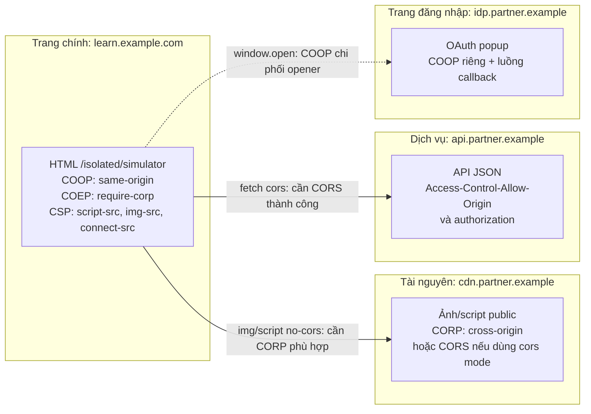
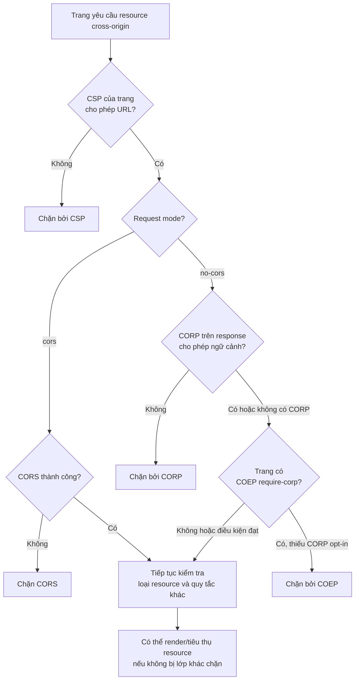

# Phối hợp COOP, COEP, CORP với CORS

## 1. Vì sao phải phối hợp bốn cơ chế thay vì chỉ bật một header?

Trong module **SPRING_SECURITY_HTTP_PROTECTION**, người học áp dụng các lớp phòng vệ HTTP và trình duyệt bằng Spring Security, từ CSRF, CORS, security headers, CSP, HSTS cho đến HTTP firewall và bảo vệ session ở cả **Servlet** và **Reactive/WebFlux**. Chủ đề **Quyền và cô lập trình duyệt** tập trung vào một câu hỏi then chốt: *làm thế nào cô lập trang web với môi trường bên ngoài mà vẫn tải được tài nguyên và gọi API hợp lệ?*

Giả sử `https://learn.example.com` có trang mô phỏng đồ họa `/isolated/simulator`. Trang này cần:

- Dùng API hiệu năng cao mà môi trường trình duyệt có thể yêu cầu **cross-origin isolation**, chẳng hạn `SharedArrayBuffer`.
- Tải logo và thư viện công khai từ `https://cdn.partner.example`.
- Gọi một API JSON ở `https://api.partner.example` bằng `fetch`.
- Không bị một popup khác origin giữ quan hệ cửa sổ ngoài dự định.
- Vẫn duy trì luồng đăng nhập OAuth popup **ở một trang riêng** khi có nhu cầu.

Nhóm phát triển thêm hai header:

```http
Cross-Origin-Opener-Policy: same-origin
Cross-Origin-Embedder-Policy: require-corp
```

Ngay lập tức, một số ảnh/script CDN không xuất hiện, API vẫn báo lỗi CORS và callback OAuth popup không liên lạc được với tab chính. Không phải browser “chặn nhầm”: các cơ chế bảo vệ **đang giải quyết những câu hỏi khác nhau**. Ta cần biết policy nào nằm trên response nào và request được tạo với chế độ nào.

**Bốn khái niệm chính** của bài:

1. **COOP (Cross-Origin-Opener-Policy):** quan hệ giữa các cửa sổ/tab cấp cao và *browsing context group*.
2. **COEP (Cross-Origin-Embedder-Policy):** điều kiện mà một tài liệu đặt ra đối với những tài nguyên/ngữ cảnh được nhúng hoặc tải vào nó.
3. **CORP (Cross-Origin-Resource-Policy):** quyền sử dụng một **response tài nguyên** theo những request `no-cors` từ origin/site khác.
4. **CORS (Cross-Origin Resource Sharing):** cơ chế để server đích cho phép những request thuộc chế độ CORS của browser, đặc biệt khi JavaScript muốn đọc response cross-origin.

### Mục tiêu sau bài

Bạn có thể vẽ được luồng tải tài nguyên và phân biệt phía trang với phía tài nguyên; dự đoán trường hợp `no-cors`/`cors` nào thành công; cấu hình Spring Security Servlet và WebFlux theo đúng route; kiểm thử bằng MockMvc, WebTestClient và browser; phát hiện trường hợp OAuth popup, CDN, cookie và proxy xung đột với chính sách cô lập.

## 2. Bản đồ tổng quan: mỗi policy nằm ở đâu?



| Cơ chế | Header điển hình | Response chứa header | Quyết định chính |
| --- | --- | --- | --- |
| **COOP** | `Cross-Origin-Opener-Policy: same-origin` | Tài liệu cấp cao | Tách hay duy trì quan hệ cửa sổ với top-level document khác. |
| **COEP** | `Cross-Origin-Embedder-Policy: require-corp` | Tài liệu muốn tải/nhúng nội dung | Những tài nguyên cross-origin được phép tham gia tài liệu theo điều kiện nào. |
| **CORP** | `Cross-Origin-Resource-Policy: cross-origin` | **Chính response tài nguyên** (ảnh, script, v.v.) | Resource có cho ngữ cảnh cross-origin/same-site sử dụng khi CORP được kiểm tra hay không. |
| **CORS** | `Access-Control-Allow-Origin: https://learn.example.com` | Response API/tài nguyên **đích** | Origin của request `cors` có được server chấp thuận hay không. |

Đừng coi bốn header là bốn cách viết của một “allowlist origin”. **Một response ảnh có CORP không làm trang chính có COEP**, và **CORS thành công không tự tạo quan hệ `window.opener`**. Các cơ chế áp dụng đồng thời theo thứ tự và ngữ cảnh riêng.

## 3. Phân biệt origin, site và chế độ request

### 3.1. Origin là scheme + host + port

Với `https://learn.example.com/course/42`:

| URL so sánh | Cùng origin? | Giải thích |
| --- | --- | --- |
| `https://learn.example.com/assets/a.png` | Có | Cùng scheme, host và cổng HTTPS mặc định. |
| `https://learn.example.com:8443/a.png` | Không | Khác port. |
| `http://learn.example.com/a.png` | Không | Khác scheme. |
| `https://static.example.com/a.png` | Không | Khác hostname. |
| `https://cdn.partner.example/a.png` | Không | Host khác. |

**Site** là một khái niệm rộng hơn, được browser đánh giá theo mô hình *schemeful site* với registrable domain hoặc quy tắc cho host đặc biệt. Hai subdomain như `https://learn.example.com` và `https://static.example.com` thường **khác origin nhưng cùng site**. Tuy nhiên, một subdomain cùng site vẫn có thể phục vụ nội dung không đáng tin cậy; `same-site` không phải nhãn “an toàn”.

Trong lab, `http://localhost:8080` và `http://localhost:9090` **khác origin** do port, nhưng có thể **cùng site**. Vì vậy bài thử khác port phù hợp để chứng minh `same-origin`, nhưng không thay được bài thử **khác site thực sự** cho `CORP: same-site`.

### 3.2. `no-cors` không giống `cors`

Một số phần tử HTML tải tài nguyên cross-origin trong `no-cors` mode, ví dụ ảnh hoặc classic script không khai báo `crossorigin`. Response có thể hiển thị/được sử dụng theo những quy tắc riêng, nhưng JavaScript không tự được đọc nội dung response cross-origin.

```html
<!-- Ảnh cross-origin thường tải bằng no-cors. -->


<!-- Thuộc tính crossorigin chuyển request ảnh sang CORS mode. -->


<!-- Classic script: thường no-cors nếu thiếu crossorigin. -->
<script src="https://cdn.partner.example/widget.js"></script>

<!-- Classic script với crossorigin: yêu cầu CORS phù hợp. -->
<script
  src="https://cdn.partner.example/widget.js"
  crossorigin="anonymous"></script>
```

Mỗi loại tài nguyên có quy tắc riêng: **module script, font, fetch, stylesheet, worker, iframe** không được suy đoán dựa trên mặc định của ``. Hãy quan sát request thật trong DevTools và tham chiếu đặc tả/browser mục tiêu.

Một `fetch` tới URL cross-origin mặc định thường dùng `cors`:

```javascript
fetch("https://api.partner.example/catalog")
  .then(response => response.json())
  .then(data => console.log(data))
  .catch(error => console.error(error));
```

**Đổi `fetch` thành `mode: "no-cors"` không chữa lỗi CORS.** Response cross-origin `no-cors` thường trở thành **opaque** đối với JavaScript: không đọc được JSON/body/headers như mong muốn.

## 4. COOP: cô lập quan hệ cửa sổ, không điều khiển ảnh hoặc fetch

**`Cross-Origin-Opener-Policy`** được trình duyệt xét trong quan hệ giữa các **top-level browsing contexts**. Giá trị thường dùng:

| Giá trị COOP | Ý nghĩa sử dụng |
| --- | --- |
| `unsafe-none` | Không yêu cầu tách biệt COOP bổ sung như `same-origin`. |
| `same-origin` | Tách top-level document khỏi những tài liệu không tương thích về origin/COOP; thường cắt opener của popup khác origin. |
| `same-origin-allow-popups` | Ngoại lệ có thể duy trì quan hệ với một số popup mang COOP `unsafe-none`; cần kiểm thử luồng thật. |

Một response dành cho trang mô phỏng không cần popup ngoài có thể gửi:

```http
Cross-Origin-Opener-Policy: same-origin
```

Khi trang này mở một cửa sổ khác origin, browser hỗ trợ COOP có thể đưa chúng vào **browsing context group** khác nhau. `window.opener` trong popup có thể là `null`; một `WindowProxy` ở opener có thể phản ánh trạng thái tách nhóm (ví dụ thuộc tính `closed`) dù popup vẫn đang mở.

**Không nhầm với SOP:** Same-Origin Policy vốn đã hạn chế quyền đọc DOM cross-origin. COOP bổ sung ranh giới quan hệ cửa sổ, không cấp hoặc thu hồi quyền đọc JSON từ `fetch`.

### OAuth popup là ngoại lệ cần thiết kế riêng

Nếu trang `/auth/popup-launcher` thực sự phụ thuộc việc callback gọi `window.opener.postMessage(...)`, `COOP: same-origin` trên **trang mở popup** có thể cắt kênh liên lạc. Khi cần, cân nhắc `same-origin-allow-popups` ở đúng trang opener, kiểm tra COOP của IdP và response sau redirect.

```http
Cross-Origin-Opener-Policy: same-origin-allow-popups
```

Ngoại lệ này **không** có nghĩa mọi popup đều giữ opener hoặc cùng origin. Một popup tự đặt `COOP: same-origin` vẫn có thể bị tách. Nếu cần cross-origin isolation cho trang mô phỏng, nên **tách route mô phỏng khỏi trang launcher OAuth** thay vì nới COOP của toàn bộ website.

Khi mở một liên kết ngoài chỉ để xem, sử dụng:

```html
<a href="https://docs.partner.example"
   target="_blank"
   rel="noopener noreferrer">
  Tài liệu đối tác
</a>
```

`noopener` ngăn trao quan hệ opener không cần thiết; `noreferrer` còn giảm thông tin referrer. Đây là biện pháp bổ sung, không thay thế COOP trên tài liệu nhạy cảm.

## 5. COEP: chính sách của tài liệu muốn tải/nhúng nội dung

**`Cross-Origin-Embedder-Policy`** áp dụng lên tài liệu yêu cầu tài nguyên, nhằm quy định điều kiện dùng các tài nguyên cross-origin.

| Giá trị COEP | Ảnh hưởng chính |
| --- | --- |
| `unsafe-none` | Không thêm hạn chế COEP enforced theo kiểu `require-corp`. |
| `require-corp` | Cross-origin `no-cors` resource thường phải opt-in bằng **CORP** phù hợp; request `cors` phải có **CORS thành công**. |
| `credentialless` | Với browser hỗ trợ, một số cross-origin `no-cors` resource được tải **không kèm credentials**, có thể không cần CORP opt-in theo cơ chế `require-corp`; không thay CORS cho `cors`. |

Ví dụ trang mô phỏng:

```http
Cross-Origin-Embedder-Policy: require-corp
```

Nếu trang tải ảnh từ CDN khác origin mà ảnh thiếu CORP, browser có thể từ chối dùng ảnh `no-cors` dù server trả `200`.

### COEP và `credentialless` không phải cách vượt quyền

`COEP: credentialless` có thể cho phép nạp một số tài nguyên `no-cors` công khai mà không gửi cookie/credentials. **Nó không cho phép JavaScript đọc response CORS bị từ chối**, không biến tài nguyên có session thành công khai, và không nên được coi là cơ chế bỏ qua CORP hạn chế được phát tường minh trên resource.

Ảnh cá nhân hóa theo cookie có thể bị lỗi hoặc trả nội dung khác khi credentials bị lược bỏ. Đánh giá tính tương thích browser và nghiệp vụ trước khi dùng `credentialless`.

### Tài liệu iframe không đơn giản là ảnh

Đối với cross-origin iframe, ngoài yêu cầu embedder policy và các điều kiện của browser, phải kiểm tra:

- **CSP `frame-src`** ở trang cha: có cho phép nguồn iframe?
- **CSP `frame-ancestors` / X-Frame-Options** ở trang con: trang con có cho phép bị nhúng?
- **COEP** của các tài liệu/frame: có tương thích với yêu cầu của embedder không?
- Cookie `SameSite`, quyền đăng nhập, `sandbox` và redirect.

Chỉ thêm `CORP: cross-origin` vào một ảnh trong iframe không khiến toàn bộ tài liệu iframe tự được nhúng. Cũng không nên coi một HTML iframe và ảnh `no-cors` có thuật toán tải hoàn toàn giống nhau.

## 6. CORP: opt-in nằm trên chính response tài nguyên

**`Cross-Origin-Resource-Policy`** được phát bởi **máy chủ sở hữu tài nguyên**, không phải mặc định bởi trang cha:

```http
Cross-Origin-Resource-Policy: same-origin
```

```http
Cross-Origin-Resource-Policy: same-site
```

```http
Cross-Origin-Resource-Policy: cross-origin
```

| Giá trị CORP | Ý định | Ví dụ cần cân nhắc |
| --- | --- | --- |
| `same-origin` | Giới hạn việc dùng tài nguyên trong các trường hợp CORP áp dụng về cùng origin. | Avatar, biểu đồ riêng tư, response có tính cá nhân. |
| `same-site` | Cho phép dùng trong phạm vi cùng site, rộng hơn origin. | Asset chia sẻ giữa những subdomain đã được thẩm định. |
| `cross-origin` | Cho phép cross-origin sử dụng theo cơ chế CORP trong những ngữ cảnh áp dụng. | Ảnh, script public được thiết kế để nhúng từ website khác. |

Điểm quan trọng:

- **CORP hoạt động độc lập với COEP** đối với request `no-cors` thuộc phạm vi nó điều khiển. Không cần trang cha gửi `COEP: require-corp` thì `CORP: same-origin` mới có ý nghĩa.
- `CORP: cross-origin` **không tự cấp quyền đọc response cho `fetch` cross-origin**. JavaScript vẫn cần CORS nếu request dùng `cors`.
- `CORP: same-origin` không thay xác thực/phân quyền. Người không được phép vẫn phải bị backend từ chối; client HTTP trực tiếp không vì header này mà nhận `403`.
- Với `COEP: require-corp`, một resource cross-origin `no-cors` cần CORP cho phép theo origin/site phù hợp; chỉ thêm CORP trên response HTML **của trang cha** không sửa được response ảnh CDN thiếu CORP.

Ví dụ ảnh public CDN:

```http
HTTP/1.1 200 OK
Content-Type: image/png
Cross-Origin-Resource-Policy: cross-origin
```

Ví dụ ảnh tài khoản riêng:

```http
HTTP/1.1 200 OK
Content-Type: image/png
Cross-Origin-Resource-Policy: same-origin
Cache-Control: private, no-store
```

Header `private, no-store` là ví dụ bảo vệ cache; cần lựa chọn theo mức nhạy cảm thực tế. **Không đặt `cross-origin` đại trà lên tài nguyên mang dữ liệu theo user/tenant** chỉ để khắc phục một lỗi giao diện.

## 7. CORS: lựa chọn cho request cần đọc dữ liệu cross-origin

Khi JavaScript ở `https://learn.example.com` gọi:

```javascript
fetch("https://api.partner.example/catalog");
```

browser thực thi CORS cho request cross-origin phù hợp. Server API phải cho phép origin bằng response header:

```http
Access-Control-Allow-Origin: https://learn.example.com
Vary: Origin
```

Với response động theo origin, `Vary: Origin` giúp cache phân biệt những response được phát cho origin yêu cầu khác nhau; các proxy cần được cấu hình chính xác.

### Nếu request có cookies hoặc credentials

Ví dụ luồng thật sự cần phiên cross-origin:

```javascript
fetch("https://api.partner.example/account", {
  credentials: "include"
});
```

Response CORS phù hợp có thể yêu cầu:

```http
Access-Control-Allow-Origin: https://learn.example.com
Access-Control-Allow-Credentials: true
Vary: Origin
```

**Không sử dụng `Access-Control-Allow-Origin: *` khi muốn cho phép credentials theo quy tắc CORS.** Đồng thời, CORS thành công **không tự bảo đảm cookie được gửi**: còn có `SameSite`, `Secure`, quyền riêng tư của browser và chính sách third-party cookies. Server vẫn phải kiểm tra CSRF và authorization cho thao tác tương ứng.

Không bật `allowCredentials(true)` cho API công khai không cần cookies chỉ vì cấu hình như vậy từng được dùng trong một ứng dụng cũ.

### Preflight và lỗi OPTIONS

Một request có method/header thuộc trường hợp cần preflight có thể khiến browser gửi:

```http
OPTIONS /api/public/catalog HTTP/1.1
Origin: https://learn.example.com
Access-Control-Request-Method: GET
Access-Control-Request-Headers: x-client-version
```

Server phải trả lời preflight theo CORS trước khi kiểm tra request thực tế theo luồng phù hợp. Với Spring Security, hãy đưa CORS vào đúng vị trí xử lý để preflight không bị hiểu nhầm là request chưa xác thực hoặc bị CSRF từ chối.

**CORP không thay thế phản hồi preflight.** Tương tự, `COEP: require-corp` ở trang nguồn không biến một response API thiếu CORS thành response mà JavaScript đọc được.

## 8. Ma trận quyết định cho tài nguyên cross-origin

Giả sử trang A có `COEP: require-corp`. Máy chủ B phục vụ **ảnh PNG công khai hợp lệ**. Trang A thử hai cách tải:

```html


```

| Header trên response ảnh B | `plain` (no-cors) | `cors` (CORS mode) | Vì sao |
| --- | --- | --- | --- |
| Không có CORP, không có CORS | **Bị chặn** | **Bị chặn** | `require-corp` thiếu opt-in cho `no-cors`; CORS mode thất bại. |
| `CORP: cross-origin`, không có CORS | **Có thể tải** | **Bị chặn** | CORP cho phép `no-cors`, không cấp quyền CORS. |
| ACAO đúng origin A, không có CORP | **Bị chặn** | **Có thể tải** | ACAO không tự đổi `no-cors` thành `cors`. |
| CORP cho A và CORS hợp lệ | **Có thể tải** | **Có thể tải** | Hai đường kiểm tra được đáp ứng độc lập. |
| `CORP: same-origin`, A khác origin, CORS hợp lệ | **Bị chặn** | **Có thể tải** | CORP giới hạn `no-cors`; request `cors` hợp lệ đi theo quy tắc CORS. |

“Có thể tải” nghĩa là **vượt qua cơ chế đang xét**; CSP `img-src`, MIME type, mixed content, lỗi 404 hoặc quyền truy cập vẫn có thể chặn.

Với `COEP: credentialless`, một số `no-cors` cross-origin requests **không có CORP** có thể được tải **không credentials** trên browser hỗ trợ; request CORS vẫn cần CORS thành công. Nếu resource phát **CORP hạn chế** (ví dụ `same-origin`), không được mặc định credentialless vô hiệu hóa hạn chế đó.

### Ma trận ngắn theo vai trò header

| Tình huống | Header/cấu hình cần xem đầu tiên |
| --- | --- |
| Popup OAuth mất `window.opener` | **COOP của opener và popup**, redirect, noopener. |
| Ảnh CDN `no-cors` bị chặn dưới `require-corp` | **COEP của trang**, **CORP ở response ảnh**, CSP `img-src`. |
| `fetch` cross-origin không đọc được JSON | **CORS ở API**, request `Origin`, credential/preflight, CSP `connect-src`. |
| Một resource public cần dùng từ mọi website | **CORP ở resource** nếu tải `no-cors`; thêm CORS khi request `cors` cần đọc. |
| Cần `crossOriginIsolated` để dùng API nhạy cảm | **COOP + COEP** của tài liệu, HTTPS, ngữ cảnh/frame và browser support. |
| Iframe của đối tác không hiển thị | **CSP `frame-src` / `frame-ancestors` / XFO**, COEP tương thích, đăng nhập. |

## 9. Sơ đồ kiểm tra: browser chặn ở tầng nào?



**Phạm vi sơ đồ:** đây là mô hình giải thích cho **resource con kiểu ảnh/script điển hình**, không phải thuật toán đầy đủ của Fetch Standard. Với `COEP: credentialless`, iframe, module, worker, service worker, redirect và môi trường sandbox, cần phân tích những quy tắc riêng. Đặc biệt, browser có thể từ chối response **sau khi HTTP đã trả `200 OK`**; mã trạng thái không chứng minh tài nguyên được đưa vào trang.

## 10. COOP + COEP và trạng thái cross-origin isolation

Một cấu hình thường gặp cho **tài liệu cấp cao cần cô lập**:

```http
Cross-Origin-Opener-Policy: same-origin
Cross-Origin-Embedder-Policy: require-corp
```

Với browser phù hợp, sau khi đáp ứng **secure context** và những điều kiện liên quan, tài liệu có thể trở thành *cross-origin isolated*. Kiểm tra:

```javascript
console.table({
  secureContext: window.isSecureContext,
  isolated: window.crossOriginIsolated
});
```

**Không kết luận chỉ từ sự có mặt của hai header rằng `crossOriginIsolated` nhất định là `true`.** Cần kiểm tra chính sách của tài liệu top-level, khả năng hỗ trợ browser, Permissions-Policy liên quan, ngữ cảnh nhúng và những điều kiện khác.

**COOP và COEP bổ sung hai ranh giới:**

- COOP giảm tương tác không mong muốn giữa các **cửa sổ cấp cao**.
- COEP yêu cầu tài nguyên được tải đáp ứng **quy tắc chia sẻ/nhúng** tương ứng.

**CORP và CORS là cách phía resource tham gia vào điều kiện tải.** Bật COOP `same-origin` không khiến CDN tự phát CORP; bật COEP `require-corp` không tự cấu hình CORS trên API.

### Tại sao không nên bật trên toàn site một cách vội vàng?

COOP `same-origin` có thể làm hỏng OAuth popup hoặc SDK thanh toán dùng `window.opener`; COEP `require-corp` có thể chặn ảnh, script, worker hoặc widget ngoài origin chưa opt-in. Vì vậy nên **cô lập route/ứng dụng thật sự cần API yêu cầu isolation**, giữ các trang đăng nhập/thanh toán riêng và có test hồi quy sau proxy.

## 11. Thiết kế một hệ thống ví dụ nhất quán

Giả sử một ứng dụng Spring Boot chủ yếu ở `https://learn.example.com` có những nhóm response:

| URL | Vai trò | Chính sách được đề xuất trong bài |
| --- | --- | --- |
| `/isolated/**` | Trang HTML mô phỏng cần isolation | `COOP: same-origin` + `COEP: require-corp`. |
| `/assets/public/**` | Ảnh và script **thực sự công khai**, được website khác dùng `no-cors` | `CORP: cross-origin`. |
| `/assets/private/**` | Tài nguyên có xác thực theo người dùng | `CORP: same-origin` + authorization + cache riêng. |
| `/api/public/**` | API JSON public cho một frontend đã xác định ở origin khác | CORS allowlist cụ thể, ví dụ `https://dashboard.partner.example`. |
| `/auth/popup-launcher` | Trang mở OAuth popup cần quan hệ opener được xác minh | Có thể cần `COOP: same-origin-allow-popups`, **không** áp COEP `require-corp` nếu không có nhu cầu. |
| Các trang còn lại | Không có nhu cầu isolation đặc biệt | Giữ security headers khác và phân quyền; không áp COEP chỉ vì một route cần. |

Để giải thích rõ:

- CORP ở `/assets/public/**` **không đảm bảo** API `/api/public/**` có CORS.
- API public không nhất thiết phải phát CORP `cross-origin`: nếu API được gọi qua `fetch` `cors` thì CORS là cơ chế kiểm tra quan trọng.
- Tài nguyên riêng `/assets/private/**` cần kiểm tra quyền ở server; CORP là lớp defense in depth.
- Trên trang `/isolated/**`, CSP `img-src`, `script-src`, `connect-src` vẫn phải cho phép các nguồn thực sự dùng.
- Các ví dụ bảo mật dưới đây **tập trung vào các header liên quan**; trong production còn phải có xác thực, phân quyền, CSRF, session và CSP tương thích.

## 12. Spring Security Servlet: phối hợp các chain và cấu hình CORS

Ứng dụng Servlet dùng `HttpSecurity` và `SecurityFilterChain`. Ví dụ sau tạo chính sách **theo đúng nhóm URL**, tránh đặt COEP `require-corp` lên toàn bộ website.

### 12.1. Cấu hình Servlet

```java
import java.util.List;

import org.springframework.context.annotation.Bean;
import org.springframework.context.annotation.Configuration;
import org.springframework.core.annotation.Order;
import org.springframework.http.HttpMethod;
import org.springframework.security.config.annotation.web.builders.HttpSecurity;
import org.springframework.security.config.annotation.web.configuration.EnableWebSecurity;
import org.springframework.security.web.SecurityFilterChain;
import org.springframework.security.web.header.writers.StaticHeadersWriter;
import org.springframework.web.cors.CorsConfiguration;
import org.springframework.web.cors.CorsConfigurationSource;
import org.springframework.web.cors.UrlBasedCorsConfigurationSource;

@Configuration
@EnableWebSecurity
public class HttpIsolationSecurityConfig {

    @Bean
    CorsConfigurationSource apiCorsSource() {
        CorsConfiguration config = new CorsConfiguration();
        config.setAllowedOrigins(List.of(
            "https://dashboard.partner.example"));
        config.setAllowedMethods(List.of("GET", "OPTIONS"));
        config.setAllowedHeaders(List.of("Content-Type", "X-Client-Version"));
        config.setAllowCredentials(false);
        config.setMaxAge(3600L);

        UrlBasedCorsConfigurationSource source =
            new UrlBasedCorsConfigurationSource();
        source.registerCorsConfiguration("/api/public/**", config);
        return source;
    }

    @Bean
    @Order(1)
    SecurityFilterChain isolatedPages(HttpSecurity http)
            throws Exception {
        return http
            .securityMatcher("/isolated/**")
            .authorizeHttpRequests(auth -> auth
                .anyRequest().authenticated())
            .headers(headers -> headers
                .addHeaderWriter(new StaticHeadersWriter(
                    "Cross-Origin-Opener-Policy", "same-origin"))
                .addHeaderWriter(new StaticHeadersWriter(
                    "Cross-Origin-Embedder-Policy", "require-corp")))
            .build();
    }

    @Bean
    @Order(2)
    SecurityFilterChain publicAssets(HttpSecurity http)
            throws Exception {
        return http
            .securityMatcher("/assets/public/**")
            .authorizeHttpRequests(auth -> auth
                .requestMatchers(HttpMethod.GET, "/assets/public/**")
                    .permitAll()
                .anyRequest().denyAll())
            .headers(headers -> headers
                .addHeaderWriter(new StaticHeadersWriter(
                    "Cross-Origin-Resource-Policy", "cross-origin")))
            .build();
    }

    @Bean
    @Order(3)
    SecurityFilterChain privateAssets(HttpSecurity http)
            throws Exception {
        return http
            .securityMatcher("/assets/private/**")
            .authorizeHttpRequests(auth -> auth
                .anyRequest().authenticated())
            .headers(headers -> headers
                .addHeaderWriter(new StaticHeadersWriter(
                    "Cross-Origin-Resource-Policy", "same-origin")))
            .build();
    }

    @Bean
    @Order(4)
    SecurityFilterChain publicApi(HttpSecurity http,
                                  CorsConfigurationSource apiCorsSource)
            throws Exception {
        return http
            .securityMatcher("/api/public/**")
            .cors(cors -> cors.configurationSource(apiCorsSource))
            .authorizeHttpRequests(auth -> auth
                .requestMatchers(HttpMethod.GET, "/api/public/**")
                    .permitAll()
                .requestMatchers(HttpMethod.OPTIONS, "/api/public/**")
                    .permitAll()
                .anyRequest().denyAll())
            .build();
    }

    @Bean
    @Order(5)
    SecurityFilterChain remainingPages(HttpSecurity http)
            throws Exception {
        return http
            .authorizeHttpRequests(auth -> auth
                .anyRequest().authenticated())
            .build();
    }
}
```

**Quan trọng về phạm vi:**

1. `securityMatcher` quyết định **chain nào xử lý request** và header nào được thêm. `requestMatchers` trong authorization **không tự đổi COEP/CORP/CORS**.
2. `@Order` đặt matcher cụ thể trước chain mặc định. Nếu chain mặc định bắt mọi URL quá sớm, ngoại lệ không được sử dụng.
3. `permitAll()` ở `/assets/public/**` và `/api/public/**` chỉ phù hợp vì ví dụ tuyên bố đó là **public content**. Không dùng cho API/tài nguyên cá nhân hóa.
4. CORS source chỉ đăng ký `/api/public/**`. CORS không được mở toàn site cho mọi origin.
5. `OPTIONS` được xử lý trong cấu hình CORS phù hợp; kiểm tra preflight thật, không giả định mọi request OPTIONS tự được chấp thuận.
6. Chính sách CSRF, login, authorization chi tiết và CSP vẫn cần được cấu hình theo sản phẩm; không coi năm chain này là cấu hình bảo mật hoàn chỉnh.

### 12.2. Tại sao không viết COEP vào chain public assets?

**COEP là yêu cầu của tài liệu nhúng/tải tài nguyên**. Một response ảnh ở `/assets/public/logo.png` cần CORP để website khác có COEP `require-corp` có thể dùng ảnh `no-cors`. Chỉ thêm `COEP: require-corp` vào response PNG **không tương đương** với `CORP: cross-origin`.

Tương tự, thêm `CORP: cross-origin` trên `/isolated/simulator` **không thay thế** việc resource CDN ngoài origin phải gửi CORP của riêng chúng.

### 12.3. Cẩn thận với cache và credentials

Nếu API public trả response CORS cho origin cụ thể, bảo đảm cache không lẫn ACAO giữa origin khác nhau. Với tài nguyên theo user/tenant, sử dụng authorization và cache-control phù hợp. Đừng dùng `allowCredentials(true)` và wildcard origin tùy tiện chỉ vì frontend có cookies.

## 13. Spring Security Reactive/WebFlux: ý nghĩa giống Servlet

Trong WebFlux, các chain tương ứng dùng `ServerHttpSecurity`, `SecurityWebFilterChain`, matcher Reactive và CORS configuration source thuộc package Reactive. Đoạn sau là **phương án thay thế** cho ứng dụng Reactive, không đăng ký đồng thời với cấu hình Servlet trong một application.

```java
import java.util.List;

import org.springframework.context.annotation.Bean;
import org.springframework.context.annotation.Configuration;
import org.springframework.core.annotation.Order;
import org.springframework.http.HttpMethod;
import org.springframework.security.config.annotation.web.reactive.EnableWebFluxSecurity;
import org.springframework.security.config.web.server.ServerHttpSecurity;
import org.springframework.security.web.server.SecurityWebFilterChain;
import org.springframework.security.web.server.header.StaticServerHttpHeadersWriter;
import org.springframework.security.web.server.util.matcher.PathPatternParserServerWebExchangeMatcher;
import org.springframework.web.cors.CorsConfiguration;
import org.springframework.web.cors.reactive.CorsConfigurationSource;
import org.springframework.web.cors.reactive.UrlBasedCorsConfigurationSource;

@Configuration
@EnableWebFluxSecurity
public class ReactiveIsolationSecurityConfig {

    @Bean
    CorsConfigurationSource apiCorsSource() {
        CorsConfiguration config = new CorsConfiguration();
        config.setAllowedOrigins(List.of(
            "https://dashboard.partner.example"));
        config.setAllowedMethods(List.of("GET", "OPTIONS"));
        config.setAllowedHeaders(List.of("Content-Type", "X-Client-Version"));
        config.setAllowCredentials(false);
        config.setMaxAge(3600L);

        UrlBasedCorsConfigurationSource source =
            new UrlBasedCorsConfigurationSource();
        source.registerCorsConfiguration("/api/public/**", config);
        return source;
    }

    @Bean
    @Order(1)
    SecurityWebFilterChain isolatedPages(ServerHttpSecurity http) {
        return http
            .securityMatcher(
                new PathPatternParserServerWebExchangeMatcher("/isolated/**"))
            .authorizeExchange(auth -> auth
                .anyExchange().authenticated())
            .headers(headers -> headers
                .addWriter(new StaticServerHttpHeadersWriter(
                    "Cross-Origin-Opener-Policy", "same-origin"))
                .addWriter(new StaticServerHttpHeadersWriter(
                    "Cross-Origin-Embedder-Policy", "require-corp")))
            .build();
    }

    @Bean
    @Order(2)
    SecurityWebFilterChain publicAssets(ServerHttpSecurity http) {
        return http
            .securityMatcher(
                new PathPatternParserServerWebExchangeMatcher(
                    "/assets/public/**"))
            .authorizeExchange(auth -> auth
                .pathMatchers(HttpMethod.GET, "/assets/public/**")
                    .permitAll()
                .anyExchange().denyAll())
            .headers(headers -> headers
                .addWriter(new StaticServerHttpHeadersWriter(
                    "Cross-Origin-Resource-Policy", "cross-origin")))
            .build();
    }

    @Bean
    @Order(3)
    SecurityWebFilterChain privateAssets(ServerHttpSecurity http) {
        return http
            .securityMatcher(
                new PathPatternParserServerWebExchangeMatcher(
                    "/assets/private/**"))
            .authorizeExchange(auth -> auth
                .anyExchange().authenticated())
            .headers(headers -> headers
                .addWriter(new StaticServerHttpHeadersWriter(
                    "Cross-Origin-Resource-Policy", "same-origin")))
            .build();
    }

    @Bean
    @Order(4)
    SecurityWebFilterChain publicApi(ServerHttpSecurity http,
                                    CorsConfigurationSource apiCorsSource) {
        return http
            .securityMatcher(
                new PathPatternParserServerWebExchangeMatcher(
                    "/api/public/**"))
            .cors(cors -> cors.configurationSource(apiCorsSource))
            .authorizeExchange(auth -> auth
                .pathMatchers(HttpMethod.GET, "/api/public/**")
                    .permitAll()
                .pathMatchers(HttpMethod.OPTIONS, "/api/public/**")
                    .permitAll()
                .anyExchange().denyAll())
            .build();
    }

    @Bean
    @Order(5)
    SecurityWebFilterChain remainingPages(ServerHttpSecurity http) {
        return http
            .authorizeExchange(auth -> auth
                .anyExchange().authenticated())
            .build();
    }
}
```

**Lưu ý tương thích:** các ví dụ dùng API của Spring Security hiện đại theo kiểu lambda. Khi dự án khóa phiên bản cụ thể, cần đối chiếu DSL `cors`, `addWriter` và security matcher của phiên bản đó. Nếu ứng dụng có web filter CORS hoặc gateway CORS khác, phải tránh cấu hình chồng chéo.

**Static files do CDN/Nginx phục vụ không đi qua WebFlux/Servlet chain**: muốn phát CORP ở ảnh CDN, cấu hình server **thực sự trả ảnh**, không chỉ Java service phía trước. Kiểm tra `Vary: Origin`, response lỗi, redirect, các route rewrite và cache ở tầng cuối.

### Trường hợp cần cookie cho API

Trong ví dụ cả Servlet và Reactive, `allowCredentials(false)` là lựa chọn cho API public. Nếu thật sự có endpoint cần cookies cross-origin, hãy tách cấu hình sang route rõ ràng, chỉ liệt kê origin được duyệt, bật credentials khi cần, xem xét CSRF token, SameSite/Secure và phân quyền. **Không nới cấu hình public API thành endpoint tài khoản chỉ bằng cách bật credentials.**

## 14. Kiểm thử HTTP: xác minh policy xuất phát từ server nào

**MockMvc/WebTestClient xác minh việc Spring Security phát header.** Chúng không tạo trang web và request mode của browser. Vì vậy cần hai lớp kiểm thử: HTTP response và E2E.

### 14.1. Servlet với MockMvc

Giả sử có các controller/static resources thử nghiệm trả `200 OK`, và `viewer` có quyền xem tài nguyên riêng:

```java
mockMvc.perform(get("/isolated/simulator").with(user("viewer")))
    .andExpect(status().isOk())
    .andExpect(header().string(
        "Cross-Origin-Opener-Policy", "same-origin"))
    .andExpect(header().string(
        "Cross-Origin-Embedder-Policy", "require-corp"));

mockMvc.perform(get("/assets/public/logo.png"))
    .andExpect(status().isOk())
    .andExpect(header().string(
        "Cross-Origin-Resource-Policy", "cross-origin"));

mockMvc.perform(get("/assets/private/avatar.png").with(user("viewer")))
    .andExpect(status().isOk())
    .andExpect(header().string(
        "Cross-Origin-Resource-Policy", "same-origin"));

mockMvc.perform(get("/api/public/catalog")
        .header("Origin", "https://dashboard.partner.example"))
    .andExpect(status().isOk())
    .andExpect(header().string(
        "Access-Control-Allow-Origin",
        "https://dashboard.partner.example"));
```

Đây là **phần thân test**: cần `MockMvc`, controller/asset fixture, `spring-security-test` và static import `get`, `user`, `status`, `header`.

**Kiểm thử preflight CORS** (đường dẫn và headers phù hợp cấu hình):

```java
mockMvc.perform(options("/api/public/catalog")
        .header("Origin", "https://dashboard.partner.example")
        .header("Access-Control-Request-Method", "GET")
        .header("Access-Control-Request-Headers", "X-Client-Version"))
    .andExpect(status().isOk())
    .andExpect(header().string(
        "Access-Control-Allow-Origin",
        "https://dashboard.partner.example"));
```

Đừng quên test **origin bị từ chối**: với `https://untrusted.example.net` không được cấu hình, server không được cấp ACAO cho origin đó. Status trả về có thể phụ thuộc CORS processor/framework, nên xác minh cả status lẫn sự **vắng mặt của quyền CORS mong muốn** theo fixture.

### 14.2. Reactive với WebTestClient

```java
webTestClient.mutateWith(mockUser("viewer"))
    .get().uri("/isolated/simulator")
    .exchange()
    .expectStatus().isOk()
    .expectHeader().valueEquals(
        "Cross-Origin-Opener-Policy", "same-origin")
    .expectHeader().valueEquals(
        "Cross-Origin-Embedder-Policy", "require-corp");

webTestClient.get().uri("/assets/public/logo.png")
    .exchange()
    .expectStatus().isOk()
    .expectHeader().valueEquals(
        "Cross-Origin-Resource-Policy", "cross-origin");

webTestClient.get().uri("/api/public/catalog")
    .header("Origin", "https://dashboard.partner.example")
    .exchange()
    .expectStatus().isOk()
    .expectHeader().valueEquals(
        "Access-Control-Allow-Origin",
        "https://dashboard.partner.example");
```

`mockUser` là tiện ích từ `SecurityMockServerConfigurers` thuộc `spring-security-test`. Các HTTP test này **không thể chứng minh** ảnh `no-cors` tải được dưới COEP hoặc browser đã tách popup bằng COOP.

### 14.3. Đúng response, đúng URL, đúng tầng

Với tài nguyên thực từ CDN khác host, test Spring ở `learn.example.com` **không đủ**. Kiểm tra response **tài nguyên CDN** qua môi trường thực:

```bash
curl -i https://learn.example.com/isolated/simulator
curl -i https://cdn.partner.example/logo.png
curl -i -H "Origin: https://learn.example.com" \
  https://api.partner.example/catalog
```

Đây là lệnh quan sát header của các server bạn có quyền kiểm thử; `curl` **không áp dụng CORS/COEP/CORP như browser**. Một status `200` không chứng minh tài nguyên được sử dụng hoặc JavaScript được quyền đọc.

## 15. Lab trình duyệt: hai origin, ba đường kiểm tra

Dùng môi trường lab do bạn kiểm soát, không đưa cookie/token thật vào dữ liệu giả:

- **Origin A:** `http://localhost:8080`, trang `/isolated/lab` gửi `COOP: same-origin` và `COEP: require-corp`.
- **Origin B:** `http://localhost:9090`, phục vụ ảnh `/public/logo.png` và API `/api/public/catalog`.

Hai port khác nhau là **khác origin**. `localhost` thường được xem là nguồn đáng tin cho phát triển, nhưng production vẫn nên dùng HTTPS và các hostname thật.

### 15.1. HTML trang A

```html
<!doctype html>
<html lang="vi">
<head>
  <meta charset="utf-8">
  <title>COOP COEP CORP CORS Lab</title>
</head>
<body>
  <h1>Kiểm thử cross-origin policies</h1>

  <p>Ảnh thông thường, no-cors:</p>
  

  <p>Ảnh dùng CORS mode:</p>
  

  <button id="callApi" type="button">Gọi API khác origin</button>
  <pre id="result"></pre>

  <script>
    document.getElementById("callApi").addEventListener("click", async () => {
      const output = document.getElementById("result");
      try {
        const response = await fetch(
          "http://localhost:9090/api/public/catalog");
        if (!response.ok) throw new Error("HTTP " + response.status);
        output.textContent = JSON.stringify(await response.json());
      } catch (error) {
        output.textContent = "Lỗi API: " + error.message;
      }
    });
  </script>
</body>
</html>
```

Để tránh nhầm lẫn, đảm bảo server 9090 **thật sự trả PNG hợp lệ** và `/api/public/catalog` trả JSON công khai hợp lệ. Trước khi bật policy, thử mở trực tiếp hai URL trong tab để xác nhận không có `404` hay lỗi server.

### 15.2. Kịch bản A: không có CORP/CORS ở server B

Response ảnh chỉ trả:

```http
HTTP/1.1 200 OK
Content-Type: image/png
```

Response API chỉ trả JSON, không ACAO.

Kỳ vọng: `plain` bị COEP `require-corp` chặn; `cors` thất bại vì CORS; `fetch` API thất bại vì CORS. Ba kết quả âm tính này có **hai nguyên nhân bảo mật khác nhau**, phải kiểm tra Console/Network để phân biệt.

### 15.3. Kịch bản B: chỉ thêm CORP cho ảnh công khai

Response ảnh:

```http
Cross-Origin-Resource-Policy: cross-origin
```

Kỳ vọng: `plain` có thể hiển thị; `cors` vẫn cần ACAO và `fetch` JSON vẫn cần CORS. **CORP không thay thế CORS.**

### 15.4. Kịch bản C: chỉ thêm CORS cho ảnh và API

Response ảnh:

```http
Access-Control-Allow-Origin: http://localhost:8080
```

Response API:

```http
Access-Control-Allow-Origin: http://localhost:8080
Vary: Origin
```

Kỳ vọng: `cors` và `fetch` có thể thành công nếu các điều kiện khác đạt; `plain` vẫn bị COEP `require-corp` chặn vì request của nó đang là `no-cors` và resource không có CORP opt-in.

### 15.5. Kịch bản D: CORP + CORS cùng hợp lệ

Ảnh công khai ở 9090 có thể trả đồng thời:

```http
Cross-Origin-Resource-Policy: cross-origin
Access-Control-Allow-Origin: http://localhost:8080
Vary: Origin
```

API có CORS phù hợp. Lúc này cả ảnh `plain`, `cors` và lời gọi `fetch` có thể thành công **nếu CSP, MIME, quyền truy cập và mạng cũng cho phép**.

### 15.6. Thử thêm COEP credentialless

Ở response trang A, thay `require-corp` bằng:

```http
Cross-Origin-Embedder-Policy: credentialless
```

Trên browser hỗ trợ, ảnh `plain` từ B **không CORP và không cần cookie** có thể tải được qua `no-cors` không credentials; `cors` và `fetch` vẫn cần CORS. Thử riêng trường hợp B gửi CORP hạn chế và trường hợp tài nguyên cần cookie để xác minh giới hạn. Đừng sử dụng `credentialless` làm cách vượt quyền tài nguyên riêng.

### 15.7. Kiểm tra isolation

Tại Console của trang A:

```javascript
console.log("isSecureContext:", window.isSecureContext);
console.log("crossOriginIsolated:", window.crossOriginIsolated);
```

Kiểm tra chính response của trang A và các điều kiện browser/iframe trước khi kết luận. Nếu A là một iframe bên trong tài liệu khác, kết quả có thể phụ thuộc chính sách ancestor và Permissions-Policy liên quan.

## 16. Playwright: dương tính và âm tính đều cần bằng chứng

HTTP test không mô phỏng COEP/CORP enforcement. Một browser test có thể xác nhận ảnh **hiển thị được** và ảnh **bị chặn khi đúng nguyên nhân**. Ví dụ TypeScript, giả định hai server lab đã chạy và B đang trả CORP cho ảnh public:

```typescript
import { test, expect } from "@playwright/test";

test("ảnh no-cors tải được khi CDN cho phép qua CORP", async ({ page }) => {
  await page.goto("http://localhost:8080/isolated/lab");

  const image = page.locator("#plain");
  await expect(image).toBeVisible();

  await expect.poll(async () => image.evaluate(
    element => element instanceof HTMLImageElement &&
               element.complete && element.naturalWidth > 0
  )).toBe(true);
});

test("API dùng CORS được đọc khi origin hợp lệ", async ({ page }) => {
  await page.goto("http://localhost:8080/isolated/lab");
  await page.locator("#callApi").click();
  await expect(page.locator("#result")).not.toContainText("Lỗi API");
  await expect(page.locator("#result")).not.toBeEmpty();
});
```

Hai test trên chỉ nên chạy ở **kịch bản D** khi response PNG và API thật sự tồn tại và cho phép; assertions cần được mở rộng để kiểm tra dữ liệu JSON dự kiến trong fixture.

Với kịch bản A hoặc B, có thể kiểm tra `naturalWidth === 0` và sự kiện lỗi, nhưng **phải đối chiếu response ảnh, HTTP status và Console**. Nếu ảnh trả `404`, server tắt hoặc `img-src` không cho URL, ảnh cũng không xuất hiện và test âm tính có thể **PASS giả**.

### Kiểm thử COOP bằng popup là một nhánh riêng

Nếu cần test opener, tạo trang A `/isolated/opener-lab` với `COOP: same-origin` và popup B khác origin. Dùng `window.open()` từ thao tác click thật, quan sát `window.opener` trong popup. **Không kết luận COOP được thực thi chỉ từ việc popup không mở**, vì browser có thể chặn popup theo cơ chế người dùng hoặc URL bị lỗi.

Với trang OAuth thực tế, kiểm thử cả callback sau redirect, `state`/PKCE và thông điệp `postMessage` có kiểm tra `event.origin`. **COOP chỉ bảo vệ ranh giới cửa sổ, không thay thế xác thực OAuth.**

## 17. Chẩn đoán lỗi theo triệu chứng

| Triệu chứng | Kiểm tra đầu tiên | Không nên làm |
| --- | --- | --- |
| Ảnh CDN bị chặn sau khi bật `require-corp` | COEP ở HTML, request mode, CORP ở ảnh, CSP `img-src` | Tắt toàn bộ security headers. |
| `fetch` báo CORS nhưng ảnh `no-cors` hiển thị | ACAO của API, `Origin`, preflight/credentials | Dùng `mode: "no-cors"` để đọc JSON. |
| Ảnh CORS mode lỗi dù có `CORP: cross-origin` | ACAO trên ảnh, credentials, request `crossorigin` | Giả định CORP đã cấp quyền CORS. |
| Ảnh `no-cors` vẫn lỗi dù có ACAO | CORP hoặc COEP `require-corp`, mode `no-cors` | Chỉ thêm ACAO lặp lại. |
| `crossOriginIsolated === false` | COOP + COEP ở top-level, secure context, browser/frame/permissions | Suy ra duy nhất rằng CDN thiếu CORP. |
| OAuth popup mất `window.opener` | COOP của opener/popup, `noopener`, redirect | Đặt `unsafe-none` toàn bộ hệ thống. |
| Iframe đối tác trắng | CSP `frame-src`/`frame-ancestors`, XFO, COEP, login | Coi iframe giống ảnh `no-cors`. |
| API CORS chạy local nhưng fail production | Origin HTTPS/port, proxy, Vary/credentials, preflight | Dùng wildcard không giới hạn. |
| Test Spring PASS nhưng CDN vẫn lỗi | Response asset thực qua CDN, cache, redirects, headers cuối | Cho rằng Spring kiểm soát static file ngoài app. |
| Script được tải nhưng chức năng không chạy | CSP, MIME, CORS/CORP/COEP, lỗi runtime/imports | Chỉ dựa trên HTTP `200`. |

### 17.1. Lỗi sau redirect

Một URL tài nguyên có vẻ cùng origin nhưng trả `302` sang CDN khác origin hoặc trang đăng nhập. Khi đó cần kiểm tra **response cuối**, origin thực, policy và body. Ảnh trắng có thể do redirect đến HTML login chứ không do CORP.

### 17.2. Nhiều nguồn phát header

Spring Security có thể gửi COEP `require-corp` trong khi gateway thêm `unsafe-none` hoặc CDN thay CORP. Nhiều tầng viết header trùng/mâu thuẫn tạo hành vi không mong đợi. Cần chỉ định **chủ sở hữu từng header** và kiểm tra response đến browser thay vì chỉ đọc cấu hình Java.

### 17.3. CORS credentials và cookie SameSite

Nếu frontend dùng `credentials: "include"` mà API phản hồi `Access-Control-Allow-Origin: *`, browser không chấp thuận theo quy tắc CORS cho credentialed request. Sửa bằng origin allowlist rõ ràng khi nghiệp vụ cho phép và cân nhắc `Access-Control-Allow-Credentials: true`; sau đó vẫn phải xem cookie `SameSite`, `Secure`, chống CSRF và quyền user.

### 17.4. Không đánh đồng lỗi resource với lỗi iframe

COEP có thể ảnh hưởng việc nhúng cross-origin, nhưng một iframe còn chịu CSP `frame-src` của cha, `frame-ancestors`/XFO của con, sandbox và quyền đăng nhập. **CORP `cross-origin` trên response ảnh bên trong iframe không cấp quyền nhúng cả trang iframe.**

## 18. Chiến lược triển khai theo giai đoạn

1. **Kiểm kê resource graph:** HTML, script, module imports, font, ảnh, media, worker, iframe, API, SDK OAuth/thanh toán. Ghi origin, request mode và chủ sở hữu response.
2. **Xác định tính năng cần isolation:** chỉ các route thực sự cần `SharedArrayBuffer` hoặc yêu cầu tương đương mới phải chịu đánh đổi COOP/COEP.
3. **Phân loại tài nguyên:** public asset có thể dùng CORP `cross-origin`; tài nguyên riêng giữ CORP hẹp và authorization; API dùng CORS theo origin hợp lệ.
4. **Đặt COOP/COEP theo route:** không lan `require-corp` sang trang login, payment hoặc dashboard chưa được kiểm kê.
5. **Kiểm tra phía đối tác:** yêu cầu CDN phát CORP đúng cho `no-cors` hoặc CORS đúng cho `cors`; không chỉ cấu hình một phía.
6. **Theo dõi trước enforced khi hỗ trợ:** có thể nghiên cứu `Cross-Origin-Embedder-Policy-Report-Only` cùng Reporting API, nhưng report-only **không tự chặn** và không chắc browser nào cũng tạo báo cáo.
7. **Chạy regression đa lớp:** MockMvc/WebTestClient cho headers, browser cho việc tải tài nguyên, API CORS, popup OAuth, iframe, `crossOriginIsolated`.
8. **Xác minh qua CDN/proxy:** response cuối, redirect, cache, error response, nhiều header, cấu hình `Vary: Origin` và các hostname production.
9. **Rollback hẹp:** khi cần giảm COEP trên một route, chỉ thay đúng header và đúng vùng chức năng; giữ nguyên CSP, CSRF, HSTS, XFO và phân quyền.

### Checklist tiêu chí chấp nhận

| Tiêu chí | Bằng chứng mong đợi |
| --- | --- |
| Header đúng response | COOP/COEP trên HTML thích hợp; CORP trên ảnh/script; ACAO trên API. |
| API chỉ mở CORS đúng origin | Origin ngoài allowlist không nhận quyền; preflight được kiểm tra. |
| Public assets tải được | `no-cors` với CORP hợp lệ hoặc `cors` với CORS thành công. |
| Private assets còn được bảo vệ | Authorization, cache-control, CORP hẹp; user khác không đọc được. |
| Isolation hoạt động khi cần | Kiểm tra `crossOriginIsolated` ở ngữ cảnh, browser và chính sách phù hợp. |
| Không làm hỏng OAuth | Trang launcher, popup và callback được kiểm thử với COOP thực tế. |
| Iframe hoạt động đúng thiết kế | CSP framing, XFO, COEP, cookie và sandbox được kiểm tra riêng. |
| Không cấu hình trùng qua proxy | Response cuối phản ánh chính sách duy nhất, nhất quán. |

## 19. Bài tập tình huống

**Bài A — Ảnh CDN.** Trang `https://learn.example.com/isolated/demo` dùng `COEP: require-corp`, tải `https://cdn.partner.example/logo.png` bằng ``. CDN chỉ trả `Access-Control-Allow-Origin: https://learn.example.com` nhưng ảnh bị chặn. Giải thích vì sao; đề xuất hai cách sửa có phạm vi kiểm soát.

**Bài B — API JSON.** API `https://api.partner.example/catalog` trả `CORP: cross-origin` nhưng `fetch` từ `learn.example.com` bị browser chặn. Thiếu cơ chế nào? Tại sao đổi `fetch` sang `no-cors` không phù hợp nếu cần parse JSON?

**Bài C — Dữ liệu riêng.** Một đội muốn thêm `CORP: cross-origin` lên tất cả response, kể cả `/account/avatar.png` có cookie. Phân tích rủi ro và thiết kế lại phân loại tài nguyên, authorization và cache.

**Bài D — OAuth popup và isolation.** Sau khi thêm `COOP: same-origin` cho mọi trang, callback OAuth không thể gửi thông điệp cho opener. Đề xuất thiết kế route theo chức năng và các bước kiểm tra header/redirect mà không tắt toàn bộ COOP.

**Bài E — CORS credentialed request.** Frontend gọi API bằng `credentials: "include"`; API trả `Access-Control-Allow-Origin: *`. Giải thích lỗi, đề xuất headers hợp lệ và các kiểm tra cookie/CSRF cần duy trì.

**Bài F — Cross-origin isolation.** Trang đã gửi `COOP: same-origin` và `COEP: require-corp` nhưng `crossOriginIsolated` vẫn `false`. Lập danh sách các yếu tố cần kiểm tra và vì sao không thể quy nguyên nhân ngay cho CORP.

**Bài G — Sửa lỗi theo tầng.** MockMvc khẳng định `COEP: require-corp` ở HTML; DevTools lại báo thiếu CORP trên một ảnh CDN. Trình bày luồng tìm đúng server cần sửa, xác nhận request mode và cách viết test tránh âm tính giả khi URL sai.

**Gợi ý đáp án:** A — `` thông thường dùng `no-cors`, ACAO chưa đủ; thêm CORP trên ảnh public hoặc `crossorigin="anonymous"` với CORS hợp lệ. B — CORS trên API; opaque response `no-cors` không đọc JSON. C — chỉ public assets cần cross-origin, private assets dùng `same-origin` và quyền server/cache phù hợp. D — tách trang launcher, cân nhắc `same-origin-allow-popups` đúng opener khi cần, kiểm tra policy của popup và `state`/PKCE. E — dùng origin cụ thể và `Access-Control-Allow-Credentials: true` khi được phê duyệt, kiểm tra SameSite/Secure/CSRF. F — COOP/COEP response top-level, secure context, browser support, iframe/ancestor/Permissions-Policy và resource graph. G — CORP phải xuất hiện trên **response ảnh CDN**, không chỉ HTML; test có cả kịch bản ảnh hợp lệ tải thành công.

## 20. Tổng kết

**COOP, COEP, CORP và CORS tạo thành các lớp bảo vệ bổ sung, không phải bốn lựa chọn có thể thay thế nhau.**

- **COOP** quản lý quan hệ giữa những cửa sổ/tab cấp cao và `window.opener`.
- **COEP** là điều kiện ở phía tài liệu muốn nhúng/tải tài nguyên; `require-corp` đòi hỏi cách chia sẻ hợp lệ cho resource cross-origin.
- **CORP** là lựa chọn của server **phục vụ tài nguyên**, chủ yếu giới hạn sử dụng response `no-cors` theo origin/site.
- **CORS** là cơ chế của browser và server cho request `cors`, đặc biệt quan trọng khi JavaScript cần đọc response API cross-origin.

Với Spring Security **Servlet** và **Reactive/WebFlux**, quy trình an toàn là **chọn đúng tầng phát header → giới hạn theo endpoint/origin có nhu cầu → duy trì CSRF, xác thực và phân quyền độc lập → xác minh HTTP response → kiểm thử trình duyệt với request mode thật → kiểm tra lại qua gateway/CDN**. Khi cần cross-origin isolation, phối hợp COOP/COEP mà không vô tình mở public data hoặc phá OAuth popup; khi ảnh/script/API bị chặn, sửa **đúng cơ chế, đúng response** thay vì tắt toàn bộ security headers.

### Tài liệu tham khảo để đối chiếu khi triển khai

- [MDN — Cross-Origin-Opener-Policy](https://developer.mozilla.org/en-US/docs/Web/HTTP/Reference/Headers/Cross-Origin-Opener-Policy): quan hệ popup, browsing context group và các giá trị COOP.
- [MDN — Cross-Origin-Embedder-Policy](https://developer.mozilla.org/en-US/docs/Web/HTTP/Reference/Headers/Cross-Origin-Embedder-Policy): `require-corp`, `credentialless` và điều kiện tài nguyên cross-origin.
- [MDN — Cross-Origin-Resource-Policy](https://developer.mozilla.org/en-US/docs/Web/HTTP/Reference/Headers/Cross-Origin-Resource-Policy): `same-origin`, `same-site`, `cross-origin` ở response tài nguyên.
- [MDN — Cross-Origin Resource Sharing](https://developer.mozilla.org/en-US/docs/Web/HTTP/Guides/CORS): điều kiện CORS, preflight và credentials.
- [MDN — Window.crossOriginIsolated](https://developer.mozilla.org/en-US/docs/Web/API/Window/crossOriginIsolated): quan sát trạng thái isolation.
- [WHATWG Fetch Standard](https://fetch.spec.whatwg.org/): request mode, kiểm tra CORS/CORP/COEP và những ràng buộc tương ứng.
- [Spring Security — Servlet HTTP Response Headers](https://docs.spring.io/spring-security/reference/servlet/exploits/headers.html): cấu hình HTTP headers ở `HttpSecurity`.
- [Spring Security — Reactive HTTP Response Headers](https://docs.spring.io/spring-security/reference/reactive/exploits/headers.html): cấu hình tương ứng trong `ServerHttpSecurity`.
