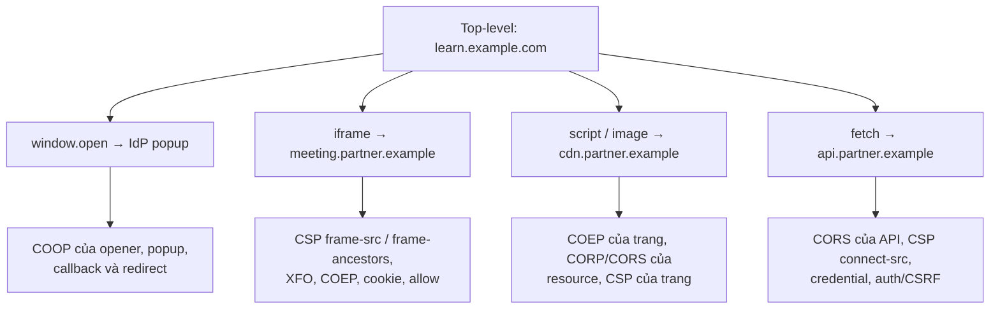
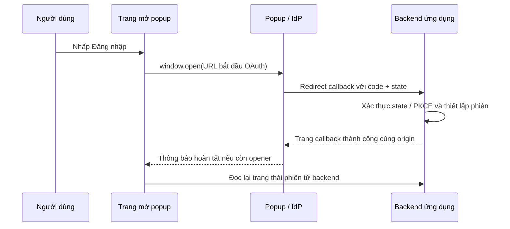

# Ảnh hưởng của cô lập đến popup, đăng nhập ngoài và thư viện nhúng

## 1. Bối cảnh: một thay đổi security headers có thể làm hỏng ba tính năng khác nhau

Trong module **SPRING_SECURITY_HTTP_PROTECTION**, chúng ta áp dụng các lớp phòng vệ HTTP và trình duyệt bằng Spring Security, từ CSRF, CORS, security headers, CSP và HSTS đến HTTP firewall, session, cho cả **Servlet** lẫn **Reactive/WebFlux**. Chủ đề thuộc chương **Quyền và cô lập trình duyệt** này tập trung vào những **tác động nghiệp vụ** khi bật chính sách cô lập mạnh hơn: popup, đăng nhập với nhà cung cấp bên ngoài và các thư viện/widget nhúng.

Hãy xét nền tảng học trực tuyến `https://learn.example.com`:

- Trang `/isolated/simulator` dùng WebAssembly và những API có thể yêu cầu **cross-origin isolation**, tải ảnh/script từ CDN.
- Trang `/auth/popup-launcher` mở popup tới nhà cung cấp danh tính `https://idp.partner.example`, rồi chờ callback thông báo đăng nhập xong.
- Trang `/classroom/live` nhúng một widget họp video từ `https://meeting.partner.example` bằng iframe.
- Trang `/reports` tải font, biểu đồ và SDK analytics từ nhiều origin.

Nhóm kỹ thuật bật đồng loạt:

```http
Cross-Origin-Opener-Policy: same-origin
Cross-Origin-Embedder-Policy: require-corp
```

Sau triển khai, popup OAuth vẫn mở nhưng mã ở tab chính không nhận callback; hình ảnh hoặc script CDN không tải được dù request HTTP trả `200`; iframe cuộc họp bị trắng. Tình huống này minh họa **ba loại ranh giới khác nhau**, không nhất thiết cùng một lỗi:

1. **COOP** có thể cắt **quan hệ `window.opener`** giữa các cửa sổ.
2. **COEP** có thể từ chối **tài nguyên cross-origin** chưa đáp ứng điều kiện nhúng.
3. **CSP framing, cookie, sandbox và quyền browser** còn có thể chặn iframe hoặc chức năng bên trong nó, ngay cả khi COOP/COEP phù hợp.

**Mục tiêu của bài:** phân tích các đường tương tác thật, chọn ngoại lệ nhỏ nhất theo chức năng, cấu hình Spring Security Servlet/WebFlux và kiểm thử trước khi thay đổi chính sách sản xuất.

Sau bài học, người học có thể giải thích vì sao popup mất opener, thiết kế luồng đăng nhập không phụ thuộc vào tham chiếu cửa sổ khi có thể, kiểm kê dependency của thư viện nhúng, phân biệt lỗi CORP/CORS/CSP và viết các bài kiểm thử hồi quy.

## 2. Bản đồ chính sách: một tình huống, nhiều điểm phát header



| Cơ chế | Header/thiết lập | Nằm ở đâu? | Khi nào phải kiểm tra? |
| --- | --- | --- | --- |
| **COOP** | `Cross-Origin-Opener-Policy` | Response của tài liệu cấp cao | Popup mất opener; trang cần cross-origin isolation. |
| **COEP** | `Cross-Origin-Embedder-Policy` | Response của tài liệu muốn nhúng/tải | Ảnh, script, worker, iframe lỗi sau khi siết cô lập. |
| **CORP** | `Cross-Origin-Resource-Policy` | **Response của tài nguyên** | `no-cors` resource bị chặn bởi CORP/COEP. |
| **CORS** | `Access-Control-Allow-Origin` cùng các header liên quan | Response API hoặc resource dùng CORS mode | `fetch`/module/font hoặc resource `crossorigin` bị lỗi CORS. |
| **CSP** | `script-src`, `img-src`, `connect-src`, `frame-src` | Response của trang yêu cầu tài nguyên | URL tải tài nguyên có nằm trong nguồn được phép? |
| **CSP framing/XFO** | `frame-ancestors`, `X-Frame-Options` | Response tài liệu **bị nhúng** | Website khác có được đặt tài liệu vào iframe? |
| **Permissions-Policy** | Ví dụ `camera`, `microphone` | Tài liệu và chính sách kế thừa qua iframe | Widget hiện ra nhưng không thể xin quyền thiết bị. |
| **Cookie/session** | `SameSite`, `Secure`, chính sách third-party cookies | Cookie và browser | Popup/iframe chuyển hướng login hoặc không giữ phiên. |

Không có header nào ở bảng trên **thay thế xác thực, phân quyền hoặc CSRF protection**. Đặc biệt, CORS không cấp quyền đăng nhập; CORP không tự bảo vệ API trả dữ liệu nhạy cảm; COOP không làm script đang chạy cùng origin trở nên đáng tin.

## 3. Hiểu đúng COOP và quan hệ giữa các cửa sổ

Một trang có thể mở popup:

```javascript
const popup = window.open(
  "https://idp.partner.example/authorize",
  "authPopup",
  "width=520,height=650"
);
```

Khi không bị tách quan hệ, popup có thể thấy `window.opener` và trang chính có thể giữ `WindowProxy` trả về bởi `window.open()`. **Same-Origin Policy** hạn chế khả năng đọc/ghi DOM của cửa sổ khác origin, nhưng không loại bỏ mọi phương thức tương tác cửa sổ, chẳng hạn điều hướng trong những điều kiện phù hợp hoặc trao đổi `postMessage`.

**Cross-Origin-Opener-Policy** là một response header dùng để quyết định khi điều hướng một tài liệu cấp cao, browser có thể giữ hai tài liệu trong cùng *browsing context group* (BCG) hay phải tách chúng.

| Giá trị COOP | Tác động khái quát |
| --- | --- |
| `unsafe-none` | Không yêu cầu mức tách nhóm bổ sung như `same-origin`. |
| `same-origin` | Tách top-level document khỏi những cửa sổ khác origin/không tương thích chính sách; thường cắt opener. |
| `same-origin-allow-popups` | Có thể giữ mối quan hệ với một số popup có COOP `unsafe-none`, phục vụ những luồng popup cần kết nối. |

Ví dụ trang nhạy cảm không cần popup ngoài:

```http
Cross-Origin-Opener-Policy: same-origin
```

Trên trình duyệt hỗ trợ, popup khác origin có thể chuyển sang nhóm khác; `window.opener` có thể thành `null`. Đoạn mã trên trang chính cũng có thể thấy `popup.closed` là `true` sau khi quan hệ bị tách, **dù người dùng vẫn nhìn thấy popup đang mở**.

```javascript
const popup = window.open(
  "https://other.example.net/info",
  "_blank",
  "width=500,height=400"
);
console.log("WindowProxy:", popup);
console.log("Có vẻ đóng?", popup?.closed);
```

**Không coi `closed === true` là bằng chứng duy nhất người dùng đã đóng popup.** Kết quả còn phụ thuộc COOP, `noopener`, browser và các lần điều hướng.

### Cần xét policy của cả opener và popup

| COOP opener | COOP popup cuối | Quan hệ opener thường được kỳ vọng |
| --- | --- | --- |
| `unsafe-none` | `unsafe-none` | Có thể được giữ, vẫn bị SOP giới hạn. |
| `same-origin` | `unsafe-none` khác origin | Thường bị tách. |
| `same-origin-allow-popups` | `unsafe-none` khác origin | Có thể được giữ khi các điều kiện tương thích. |
| `same-origin-allow-popups` | `same-origin` khác origin | Popup có thể tự yêu cầu tách nhóm. |
| `same-origin` | `same-origin` cùng origin | Có thể duy trì nếu chính sách tương thích. |

Bảng chỉ mô tả **trường hợp thường gặp**, không phải cam kết tương thích mọi browser. Một popup OAuth còn **đi qua redirect** từ ứng dụng đến IdP và từ IdP về callback, vì vậy phải kiểm tra các tài liệu thực sự được browser tải, không chỉ hai URL ban đầu.

## 4. Vòng đời popup đăng nhập ngoài: điểm nào bị ảnh hưởng?

Một luồng đăng nhập thông dụng có các bước:



Các điểm dễ hỏng:

1. **Popup blocker:** `window.open()` không chạy từ thao tác người dùng nên browser chặn trước khi COOP có ý nghĩa.
2. **COOP của trang launcher:** `same-origin` có thể cắt opener khi popup chuyển sang IdP khác origin.
3. **COOP của popup/redirect:** chính IdP hoặc trang callback có thể gửi policy buộc tách nhóm, ngay cả khi launcher đã dùng `same-origin-allow-popups`.
4. **`noopener`:** cách mở cửa sổ hoặc `rel="noopener"` đã cố ý không trao quan hệ opener.
5. **`postMessage`:** thông điệp được gửi nhưng handler nhận sai origin, sai `event.source` hoặc sai định dạng.
6. **Session và cookie:** backend đã hoặc chưa thiết lập phiên; callback qua redirect có thể chịu quy tắc cookie khác với popup communication.
7. **CSP:** trang launcher hoặc callback có thể chặn script, kết nối hoặc điều hướng cần thiết.

**Không sửa lỗi bằng cách xóa CSRF/`state`, bỏ PKCE hoặc mở CORS toàn bộ hệ thống.** Nếu quan hệ `window.opener` đã bị cắt do COOP, một response `Access-Control-Allow-Origin` từ IdP không thể khôi phục tham chiếu cửa sổ.

## 5. Ba cách thiết kế đăng nhập: chọn theo nhu cầu thật

| Phương án | Ưu điểm | Đánh đổi/cần kiểm tra |
| --- | --- | --- |
| **Redirect top-level** tới IdP rồi quay về ứng dụng | Không phụ thuộc `window.opener`; luồng OAuth/OIDC dễ xác định hơn | Trang thay đổi điều hướng; cần khôi phục trạng thái giao diện sau đăng nhập. |
| **Popup giữ opener** có ngoại lệ COOP hẹp | Giữ UX hiện tại và cơ chế callback popup | Dễ bị ảnh hưởng bởi COOP của IdP/callback, browser, `noopener` và các redirect. |
| **Popup không dựa vào opener**, hoàn tất qua backend | Có thể giữ UX popup mà không cần giả định quan hệ cửa sổ luôn tồn tại | Cần cơ chế nhận biết trạng thái phía server, giới hạn polling/timeouts, session và bảo vệ trạng thái. |

### 5.1. Ưu tiên redirect top-level khi không cần popup

Với Authorization Code Flow + PKCE (trong ngữ cảnh phù hợp), ứng dụng có thể chuyển hướng trang chính đến IdP và nhận callback cùng origin. Sau đó backend xác thực `state`, ràng buộc PKCE, dữ liệu nhà cung cấp và thiết lập session theo thiết kế.

Ưu điểm quan trọng: **không cần truyền thông tin xác thực qua `window.opener`**. Điều này thường dễ phối hợp với những trang ứng dụng khác đang yêu cầu COOP `same-origin`. Tuy nhiên vẫn phải duy trì chống login CSRF, kiểm soát redirect URI, xác thực token ở phía phù hợp và quyền truy cập.

### 5.2. Giữ popup chỉ trên trang launcher được phê duyệt

Nếu SDK/luồng cũ thực sự cần callback popup, một chính sách có thể được thử **trên trang làm opener**:

```http
Cross-Origin-Opener-Policy: same-origin-allow-popups
```

Trong khi đó, trang mô phỏng cần isolation vẫn giữ:

```http
Cross-Origin-Opener-Policy: same-origin
Cross-Origin-Embedder-Policy: require-corp
```

Điểm quan trọng là **không mở ngoại lệ trên toàn bộ tài khoản/admin** chỉ vì một launcher cần nó. Nếu trang mô phỏng tự gọi `window.open`, trình duyệt vẫn dùng policy của **chính trang mô phỏng**, không tự lấy ngoại lệ ở một URL launcher khác.

`same-origin-allow-popups` cũng **không bảo đảm** luồng OAuth hoạt động với mọi IdP. Nếu IdP phát COOP không tương thích, quan hệ vẫn có thể bị tách. Cần kiểm thử toàn bộ redirect thực tế.

### 5.3. Popup không phụ thuộc opener

Một phương án là để **backend xử lý callback và trạng thái đăng nhập**, còn trang chính đọc lại trạng thái bằng request **cùng origin** đã được bảo vệ, có giới hạn thời gian và tần suất:

```text
Trang A (tab chính)
  │ mở popup tới luồng đăng nhập
  │
  ├── đọc trạng thái giao dịch đăng nhập từ backend
  │   (theo session/state được ràng buộc an toàn)
  │
Popup/IdP
  └── redirect callback → backend xác thực → đánh dấu hoàn tất

Trang A
  └── nhận trạng thái hoàn tất → tải lại dữ liệu user/phiên
```

Cách này cần thiết kế cẩn thận: `state` phải khó đoán và ràng buộc với giao dịch; endpoint trạng thái phải được phân quyền, chống lộ dữ liệu, có expiration/rate limiting; không dựa vào việc client gửi `success=true` là đã xác thực. Không dùng token bí mật dài hạn trong query string hoặc để trạng thái đăng nhập người này bị đọc bởi người khác.

Một cách trao đổi sự kiện **cùng origin** như `BroadcastChannel` có thể hữu ích sau callback ở cùng origin, nhưng cũng phải xét storage partition, browser support và vòng đời tài liệu. Nó không phải cơ chế trao đổi tin cậy trực tiếp từ IdP khác origin và không thay kiểm tra backend.

## 6. Mẫu postMessage cho popup còn opener

Khi lựa chọn giữ popup, `postMessage` là một cơ chế giao tiếp được thiết kế cho các cửa sổ, nhưng **không tự cung cấp xác thực cho payload**.

Giả sử ứng dụng phục vụ launcher ở `https://learn.example.com/auth/popup-launcher`; người dùng nhấn nút thật để mở:

```html
<button id="login" type="button">Đăng nhập với đối tác</button>
<p id="loginStatus" aria-live="polite"></p>

<script>
  let authPopup = null;
  const statusEl = document.getElementById("loginStatus");

  document.getElementById("login").addEventListener("click", () => {
    authPopup = window.open(
      "/oauth2/authorization/partner",
      "partnerLogin",
      "popup,width=520,height=650"
    );
    statusEl.textContent = authPopup
      ? "Đã yêu cầu mở cửa sổ đăng nhập"
      : "Cửa sổ có thể bị browser chặn";
  });

  window.addEventListener("message", event => {
    if (event.origin !== "https://learn.example.com") return;
    if (!authPopup || event.source !== authPopup) return;
    if (!event.data || event.data.type !== "oauth-finished") return;

    // Không tin event để tự cấp quyền: hỏi backend về session thật.
    window.location.assign("/account");
  });
</script>
```

Trên trang callback **cùng origin** (sau khi backend đã xác thực `code`, `state`, PKCE và tạo phiên thích hợp), có thể phát tín hiệu **không chứa access token**:

```html
<script>
  if (window.opener && !window.opener.closed) {
    window.opener.postMessage(
      { type: "oauth-finished" },
      "https://learn.example.com"
    );
  }
  window.close();
</script>
```

**Hai đoạn này chỉ minh họa kênh thông báo, không phải triển khai OAuth hoàn chỉnh.** Cần lưu ý:

- Kiểm tra `event.origin`, `event.source` khi còn tham chiếu đáng tin và schema thông điệp. Với dữ liệu quan trọng, dùng thêm trạng thái giao dịch được xác minh phía server.
- Chỉ dùng **`targetOrigin` cụ thể**, không dùng `"*"` cho thông điệp chứa thông tin nhạy cảm.
- Không gửi access token, refresh token hoặc dữ liệu session qua `postMessage` một cách tùy tiện.
- Nếu COOP/`noopener` đã cắt opener, `window.opener` có thể là `null` và callback **không thể chỉ bằng JavaScript khôi phục lại quan hệ đã mất**.
- `window.close()` còn chịu hạn chế của browser, nhất là khi cửa sổ không được mở bằng script.
- Nếu `window.open` trả `null`, đừng giả định nguyên nhân là COOP: popup blocker cũng có thể là nguyên nhân.

## 7. Đăng nhập ngoài trong iframe: vấn đề còn lớn hơn COOP

Đôi khi ứng dụng cũ dùng một iframe ẩn để kiểm tra đăng nhập hoặc làm mới phiên, hoặc đặt màn hình IdP trong một iframe:

```html
<iframe
  src="https://idp.partner.example/authorize"
  title="Đăng nhập đối tác">
</iframe>
```

Hướng này thường không phù hợp để coi là giải pháp đăng nhập phổ quát, vì:

1. IdP có thể cấm framing bằng **CSP `frame-ancestors`** hoặc **X-Frame-Options**.
2. **Cookie third-party** có thể bị hạn chế, phân vùng hoặc chặn; `SameSite` và `Secure` ảnh hưởng việc gửi cookie theo ngữ cảnh.
3. Browser có thể áp dụng quy tắc sandbox/permissions và cơ chế chống tracking khác nhau.
4. Chính sách **COEP** của trang cha có thể đưa thêm điều kiện với tài liệu nhúng cross-origin.
5. Một luồng đăng nhập nhạy cảm trong iframe còn có rủi ro UI redressing/clickjacking và vấn đề kiểm soát trải nghiệm.

**CORS không mở được iframe bị cấm bởi CSP `frame-ancestors`**, và `COOP: same-origin-allow-popups` liên quan **top-level popup**, không phải một lệnh cho phép nhúng login vào iframe. Khi di trú SSO cũ, ưu tiên luồng **top-level redirect hoặc cơ chế do IdP hiện hành hỗ trợ**, thay vì nới hàng loạt security headers.

## 8. Thư viện nhúng: phải biết tài nguyên tải theo mode nào

Khi bật **COEP `require-corp`** trên trang, sự cố thường bộc lộ trong các thư viện giao diện, analytics, video, biểu đồ hoặc editor có nhiều dependency.

Ví dụ một thư viện biểu đồ:

```html
<script src="https://cdn.partner.example/charts.js"></script>

```

Nếu cả hai request cross-origin dùng `no-cors`, COEP `require-corp` có thể yêu cầu các **response tài nguyên tương ứng** chủ động cho phép bằng **CORP**, ví dụ:

```http
Cross-Origin-Resource-Policy: cross-origin
```

Header này phải được CDN phát **trên response của `charts.js` hoặc `logo.png`**, không chỉ trên response HTML trang chính.

### 8.1. Đường đi qua CORS cho những tài nguyên hỗ trợ

Với classic script và ảnh hỗ trợ thuộc tính `crossorigin`:

```html
<script
  src="https://cdn.partner.example/charts.js"
  crossorigin="anonymous"></script>


```

Khi đó response CDN cần đáp ứng CORS theo ngữ cảnh:

```http
Access-Control-Allow-Origin: https://learn.example.com
Vary: Origin
```

Nếu request thực sự ở **`cors` mode và CORS thành công**, đây là một hướng đáp ứng điều kiện tải tài nguyên dưới COEP `require-corp`. Nhưng nếu script/ảnh vẫn ở **`no-cors` mode**, chỉ thêm ACAO **không tự đổi mode** của request.

### 8.2. Phân biệt các dependency hay bị bỏ sót

| Tài nguyên của thư viện | Vấn đề thường gặp sau khi bật COEP | Việc cần xem |
| --- | --- | --- |
| Ảnh/icon CDN | `no-cors`, CDN thiếu CORP | CORP trên ảnh hoặc `crossorigin` + CORS phù hợp. |
| Classic script | `no-cors` nếu không có `crossorigin` | Response script, CORP hoặc chuyển sang CORS mode. |
| Module script và import graph | Các module từ origin ngoài có quy tắc CORS | ACAO trên module và các import, CSP `script-src`. |
| Font qua stylesheet | Font cross-origin thường chịu CORS | CORS ở response font, CSP `font-src`. |
| Worker / WebAssembly | Worker, script, import và isolation có yêu cầu riêng | Worker URL, COEP/COOP, CSP `worker-src`, resource graph. |
| `fetch` gọi API | CORS/preflight hoặc CSP `connect-src` | CORS ở API, credential, authorization. |
| iframe widget | Framing, COEP, cookie, sandbox | `frame-src`, `frame-ancestors`, XFO, policy của iframe. |
| Plugin cũ tạo `about:blank`/`srcdoc` iframe | Không nhất thiết có response HTML riêng để gắn header | DOM runtime, sandbox, inheritance, lỗi script. |

**Không đoán mode của module, font hoặc worker từ hành vi ``**. Trình duyệt áp dụng những thuật toán khác nhau; hãy quan sát request thật và phụ thuộc phát sinh sau khi thư viện khởi tạo.

### 8.3. `COEP: credentialless` không phải nút “sửa mọi CDN”

Với browser hỗ trợ:

```http
Cross-Origin-Embedder-Policy: credentialless
```

có thể cho phép một số tài nguyên cross-origin `no-cors` **không có CORP** được tải **không kèm credentials**. Điều này có thể hữu ích với ảnh/script public từ CDN không do ứng dụng kiểm soát.

Nhưng:

- `fetch` ở `cors` mode **vẫn cần CORS**.
- Tài nguyên được bảo vệ bằng cookie/phiên có thể trả dữ liệu lỗi hoặc nội dung khác do request không mang credentials.
- Không được suy ra `credentialless` vượt một `CORP: same-origin` tường minh trên resource.
- Các phiên bản/browser có thể hỗ trợ khác nhau. Không dựa vào tính năng này nếu sản phẩm cần tương thích với client chưa hỗ trợ.

Nếu mục tiêu không thật sự đòi hỏi isolation, việc **không áp COEP chặt trên trang thường** có thể thích hợp hơn việc làm suy yếu cơ chế tải dữ liệu chỉ để giữ một SDK cũ.

## 9. Iframe hội nghị và widget: ba tầng cần thông qua

Ví dụ:

```html
<iframe
  src="https://meeting.partner.example/room/42"
  title="Phòng học trực tuyến"
  allow="camera; microphone; fullscreen"
  width="960"
  height="600"></iframe>
```

Để widget thực sự dùng được, phải phân biệt:

**Tầng 1 — Được phép nhúng?**

- CSP `frame-src` của **trang cha** có cho phép `meeting.partner.example`?
- CSP `frame-ancestors` hoặc XFO của **trang widget** có cho phép trang cha nhúng?
- Có redirect đến trang login hoặc URL khác không?

**Tầng 2 — Đáp ứng điều kiện nhúng/tải?**

- Trang cha có `COEP: require-corp` hoặc `credentialless` không?
- Tài liệu iframe có chính sách COEP tương thích trong những trường hợp cần opt-in không?
- Các script, ảnh, font hoặc worker bên trong widget có đang bị CORP/CORS/COEP/CSP chặn không?

**Tầng 3 — Có sử dụng được tính năng?**

- `Permissions-Policy` của trang cha và chính sách kế thừa có cho phép camera/microphone cho origin iframe không?
- Thuộc tính `allow` trên iframe đã ủy quyền phù hợp chưa?
- Browser có secure context, người dùng cấp quyền thiết bị và session hợp lệ không?

**Một iframe có thể tải được HTML nhưng không có video** vì thiếu quyền camera; cũng có thể không tải được HTML vì CSP framing; hoặc tải HTML nhưng thiếu script do COEP/CORP. Không dùng một loại header để chữa cả ba.

## 10. Ma trận tác động khi bật isolation

| Trường hợp | COOP `same-origin` | COEP `require-corp` | Hướng xử lý |
| --- | --- | --- | --- |
| Trang tài khoản chỉ hiển thị nội dung nội bộ | Giảm quan hệ cửa sổ ngoài không cần thiết | Có thể không cần | Giữ COOP chặt nếu không cần popup; không bắt buộc COEP. |
| OAuth popup cần `window.opener` | Có thể cắt opener | Không phải nguyên nhân chính của opener | Tách launcher, cân nhắc `same-origin-allow-popups` hoặc bỏ phụ thuộc opener. |
| Ảnh CDN public tải `no-cors` | Không trực tiếp quyết định tải ảnh | Có thể chặn nếu thiếu CORP | Thêm CORP tại CDN hoặc chuyển sang CORS mode hợp lệ. |
| `fetch` gọi API JSON cross-origin | Không cấp quyền đọc response | Không tự cấp quyền CORS | CORS đúng ở API, CSP `connect-src`, auth/CSRF. |
| Widget iframe từ nhà cung cấp | Không phải chính sách chống framing | Có thể bổ sung yêu cầu với iframe/resource con | Xem framing, COEP, cookie, Permissions-Policy. |
| Trang cần `SharedArrayBuffer` | Thường là thành phần của isolation | Thường cần kết hợp phù hợp | Kiểm tra HTTPS, `crossOriginIsolated` và điều kiện browser. |
| SDK analytics cũ từ nhiều CDN | Ít liên quan nếu không mở popup | Resource graph có thể thiếu opt-in | Kiểm kê request, CORP/CORS; thay SDK nếu không tương thích. |
| Đăng nhập ẩn trong iframe | COOP không phải giải pháp | Có thể thêm hạn chế nhúng | Đánh giá luồng top-level và chính sách IdP/cookie. |

“Có thể” trong bảng phản ánh browser, policy thực tế và đặc điểm request; **không phải mọi SDK hay browser sẽ có cùng triệu chứng**.

## 11. Phân vùng chính sách theo chức năng

Một thiết kế hợp lý không áp đồng nhất COOP/COEP trên toàn ứng dụng:

| Nhóm đường dẫn | Mục tiêu | Header minh họa |
| --- | --- | --- |
| `/isolated/**` | Trang thật sự cần cross-origin isolation | `COOP: same-origin`; `COEP: require-corp`. |
| `/account/**`, `/admin/**` | Trang nhạy cảm không cần popup ngoài | `COOP: same-origin`; không tự bật COEP. |
| `/auth/popup-launcher` | Trang làm opener của OAuth popup có giao tiếp | `COOP: same-origin-allow-popups`, sau khi kiểm thử IdP. |
| `/login/oauth2/code/**` và luồng callback | Xử lý OAuth an toàn | Policy phải phù hợp với luồng; kiểm tra filter/redirect và tài liệu callback thật. |
| `/assets/public/**` | Asset công khai cần được website khác nhúng `no-cors` | `CORP: cross-origin` trên **response asset**. |
| `/classroom/live` | Iframe họp trực tuyến | Cân nhắc không đặt COEP chặt nếu widget chưa tương thích; giữ CSP framing/Permissions-Policy đúng. |
| Các URL còn lại | Tránh thay đổi không cần thiết | Giữ chính sách bảo vệ hiện hữu; phân loại thêm trước khi áp COEP toàn site. |

**Không dùng `/auth/**` làm ngoại lệ rộng chỉ vì một trang launcher cần giữ opener**. Những route khác, đặc biệt trang quản lý token hoặc tài khoản, cần được đánh giá riêng. Đồng thời, nếu launcher nằm sau một shell ứng dụng có COOP `same-origin` và chính shell mới gọi `window.open()`, thay header chỉ ở URL launcher **không giải quyết đúng trang opener**.

### Quy tắc thiết kế cho callback

Đoạn callback OAuth thực sự có thể do Spring Security xử lý ở `/login/oauth2/code/{registrationId}` hoặc URL đã cấu hình khác. Đừng tạo một security chain mới bắt URL callback rồi vô tình **bỏ mất filter xử lý OAuth**. Nếu cần policy riêng ở callback, thiết kế nó cùng chain xác thực hiện hữu và kiểm tra response HTML cuối. Bài này minh họa **header policy**, không thay thế toàn bộ cấu hình `oauth2Login`, `state`/PKCE, session và success handler của dự án.

## 12. Spring Security Servlet: route cô lập và route popup khác nhau

Ở ứng dụng Servlet, cấu hình header qua `HttpSecurity` và `SecurityFilterChain`. Ví dụ dưới đây dùng `StaticHeadersWriter` để thể hiện trực tiếp giá trị HTTP, đồng thời giữ nguyên các security headers khác.

```java
import org.springframework.context.annotation.Bean;
import org.springframework.context.annotation.Configuration;
import org.springframework.core.annotation.Order;
import org.springframework.security.config.annotation.web.builders.HttpSecurity;
import org.springframework.security.config.annotation.web.configuration.EnableWebSecurity;
import org.springframework.security.web.SecurityFilterChain;
import org.springframework.security.web.header.writers.StaticHeadersWriter;

@Configuration
@EnableWebSecurity
public class BrowserIsolationSecurityConfig {

    @Bean
    @Order(1)
    SecurityFilterChain simulator(HttpSecurity http) throws Exception {
        return http
            .securityMatcher("/isolated/**")
            .authorizeHttpRequests(auth -> auth
                .anyRequest().authenticated())
            .headers(headers -> headers
                .addHeaderWriter(new StaticHeadersWriter(
                    "Cross-Origin-Opener-Policy", "same-origin"))
                .addHeaderWriter(new StaticHeadersWriter(
                    "Cross-Origin-Embedder-Policy", "require-corp")))
            .build();
    }

    @Bean
    @Order(2)
    SecurityFilterChain popupLauncher(HttpSecurity http) throws Exception {
        return http
            .securityMatcher("/auth/popup-launcher")
            .authorizeHttpRequests(auth -> auth
                .anyRequest().permitAll())
            .headers(headers -> headers
                .addHeaderWriter(new StaticHeadersWriter(
                    "Cross-Origin-Opener-Policy",
                    "same-origin-allow-popups")))
            .build();
    }

    @Bean
    @Order(3)
    SecurityFilterChain sensitivePages(HttpSecurity http)
            throws Exception {
        return http
            .securityMatcher("/account/**", "/admin/**")
            .authorizeHttpRequests(auth -> auth
                .anyRequest().authenticated())
            .headers(headers -> headers
                .addHeaderWriter(new StaticHeadersWriter(
                    "Cross-Origin-Opener-Policy", "same-origin")))
            .build();
    }

    @Bean
    @Order(4)
    SecurityFilterChain otherPages(HttpSecurity http) throws Exception {
        return http
            .authorizeHttpRequests(auth -> auth
                .anyRequest().authenticated())
            .build();
    }
}
```

**Giải thích chính xác phạm vi:**

1. `securityMatcher` chọn **security chain** viết header. `requestMatchers` trong `authorizeHttpRequests` không tự thay COOP.
2. `@Order` bảo đảm route cụ thể được xét trước chain dự phòng.
3. `/isolated/**` có **COOP `same-origin` + COEP `require-corp`**, nhưng vẫn phải sửa tài nguyên bên ngoài cho tương thích.
4. `/auth/popup-launcher` có **COOP `same-origin-allow-popups`**; đây không phải quyền đăng nhập, không tự bật OAuth và không đảm bảo callback làm việc qua mọi redirect.
5. `/account/**` và `/admin/**` không bị nới policy theo launcher.
6. Chain còn lại **không cố tình thêm COEP chặt**, giúp tránh phá những giao diện/luồng chưa được kiểm kê. Điều đó không có nghĩa bỏ xác thực, CSP, HSTS hay XFO.

**Đây là mẫu cấu hình header**, không phải một ứng dụng OAuth hoàn chỉnh. Trong dự án thật, cần tích hợp những chain này vào **cấu hình xác thực/OAuth2 hiện có**, bảo đảm filter `oauth2Login` áp dụng lên authorization request và callback; cấu hình permit/entrypoint phù hợp từng route. Nếu chỉ copy `authenticated()` mà thiếu phương thức đăng nhập, những route bảo vệ có thể không hoạt động như mong muốn.

### Không vô hiệu hóa mọi header để chữa lỗi SDK

```java
// Tránh giải pháp này cho toàn bộ website.
http.headers(headers -> headers.disable());
```

Lệnh trên có thể tắt nhiều lớp bảo vệ không liên quan như XFO, HSTS và X-Content-Type-Options. Nếu một widget không tương thích COEP, hãy **điều chỉnh riêng COEP trên trang sử dụng widget** hoặc sửa resource server, không tắt mọi security header.

### Tài nguyên public do chính ứng dụng phục vụ

Nếu `/assets/public/**` thực sự là tài nguyên công khai được dùng cross-origin bằng `no-cors`, có thể tạo chain riêng với `CORP: cross-origin`:

```java
// Đoạn minh họa đặt vào một chain riêng có securityMatcher hẹp.
.headers(headers -> headers
    .addHeaderWriter(new StaticHeadersWriter(
        "Cross-Origin-Resource-Policy", "cross-origin")))
```

Chỉ áp dụng cho asset đã xác nhận **không chứa dữ liệu riêng theo user/tenant**. Nếu ảnh/script được phục vụ trực tiếp bởi CDN không đi qua Spring, phải đặt CORP trên **CDN response**; thêm header tại trang HTML của Spring không sửa được response CDN.

## 13. Spring Security Reactive/WebFlux: cùng nguyên tắc, API khác

Với WebFlux, chính sách gửi tới browser có cùng ý nghĩa, nhưng dùng `ServerHttpSecurity`, `SecurityWebFilterChain` và header writer tương ứng:

```java
import org.springframework.context.annotation.Bean;
import org.springframework.context.annotation.Configuration;
import org.springframework.core.annotation.Order;
import org.springframework.security.config.annotation.web.reactive.EnableWebFluxSecurity;
import org.springframework.security.config.web.server.ServerHttpSecurity;
import org.springframework.security.web.server.SecurityWebFilterChain;
import org.springframework.security.web.server.header.StaticServerHttpHeadersWriter;
import org.springframework.security.web.server.util.matcher.PathPatternParserServerWebExchangeMatcher;

@Configuration
@EnableWebFluxSecurity
public class ReactiveBrowserIsolationConfig {

    @Bean
    @Order(1)
    SecurityWebFilterChain simulator(ServerHttpSecurity http) {
        return http
            .securityMatcher(
                new PathPatternParserServerWebExchangeMatcher("/isolated/**"))
            .authorizeExchange(auth -> auth
                .anyExchange().authenticated())
            .headers(headers -> headers
                .addWriter(new StaticServerHttpHeadersWriter(
                    "Cross-Origin-Opener-Policy", "same-origin"))
                .addWriter(new StaticServerHttpHeadersWriter(
                    "Cross-Origin-Embedder-Policy", "require-corp")))
            .build();
    }

    @Bean
    @Order(2)
    SecurityWebFilterChain popupLauncher(ServerHttpSecurity http) {
        return http
            .securityMatcher(
                new PathPatternParserServerWebExchangeMatcher(
                    "/auth/popup-launcher"))
            .authorizeExchange(auth -> auth
                .anyExchange().permitAll())
            .headers(headers -> headers
                .addWriter(new StaticServerHttpHeadersWriter(
                    "Cross-Origin-Opener-Policy",
                    "same-origin-allow-popups")))
            .build();
    }

    @Bean
    @Order(3)
    SecurityWebFilterChain sensitivePages(ServerHttpSecurity http) {
        return http
            .securityMatcher(
                new PathPatternParserServerWebExchangeMatcher("/account/**"))
            .authorizeExchange(auth -> auth
                .anyExchange().authenticated())
            .headers(headers -> headers
                .addWriter(new StaticServerHttpHeadersWriter(
                    "Cross-Origin-Opener-Policy", "same-origin")))
            .build();
    }

    @Bean
    @Order(4)
    SecurityWebFilterChain otherPages(ServerHttpSecurity http) {
        return http
            .authorizeExchange(auth -> auth
                .anyExchange().authenticated())
            .build();
    }
}
```

Đoạn Reactive bảo vệ `/account/**` như ví dụ; nếu ứng dụng có `/admin/**`, cần thêm một matcher/chain rõ ràng với COOP `same-origin`, không suy ra rằng code đã bảo vệ mọi route admin. Trong thực tế, phối hợp các chain trên với cấu hình OAuth2 login, session, authentication/authorization và xử lý callback đang có.

**Không khai báo đồng thời ví dụ Servlet và WebFlux trong cùng application**. Khi dùng phiên bản Spring Security khác, đối chiếu API `addHeaderWriter`/`addWriter` và khả năng matcher phù hợp; kiểm thử response đúng endpoint sau khi build và tích hợp.

## 14. COEP/CORP/CORS: quy trình gỡ lỗi khi thư viện ngoài bị hỏng

Trước khi sửa code Java, hãy xác định URL mà browser đang tải và **ai sở hữu response tài nguyên**:

1. Chọn tài liệu đang lỗi; kiểm tra response `Cross-Origin-Embedder-Policy` và CSP của **trang đó**.
2. Chọn request script/ảnh/font/API bị lỗi; xác định **request mode** nếu DevTools cho phép.
3. Với `no-cors` cross-origin dưới `require-corp`, xem **`Cross-Origin-Resource-Policy` trên response resource**.
4. Với `cors`, kiểm tra **CORS ở resource/API**: ACAO, preflight, credentials và sự phù hợp origin.
5. Kiểm tra thêm CSP `script-src`, `img-src`, `font-src`, `connect-src`; CORP/CORS không vượt được CSP.
6. Kiểm tra redirect: URL ban đầu cùng origin có thể chuyển qua CDN hoặc login ở origin khác.
7. Xác minh response cuối qua **reverse proxy/CDN**, không chỉ kết quả test unit ở Spring.

### Ma trận ảnh cross-origin dưới `require-corp`

Giả sử trang A tải một ảnh public từ B theo hai cách:

```html


```

| Response từ CDN | Ảnh `no-cors` | Ảnh `cors` |
| --- | --- | --- |
| Không CORP, không CORS | Bị chặn theo COEP | Bị chặn vì CORS. |
| `CORP: cross-origin` | Có thể tải | Vẫn cần CORS hợp lệ. |
| ACAO hợp lệ, không CORP | Vẫn có thể bị COEP chặn | Có thể tải. |
| CORP cho phép và ACAO hợp lệ | Có thể tải | Có thể tải. |
| `CORP: same-origin`, trang A khác origin, ACAO hợp lệ | Bị chặn theo CORP | Có thể tải theo CORS. |

“Có thể tải” nghĩa là vượt qua điều kiện đang xét, **không cam kết** CSP, MIME, network, auth hoặc các chính sách khác sẽ cho phép. Một response `200` vẫn có thể bị browser từ chối sử dụng.

## 15. Bài lab: tái hiện popup bị tách và CDN bị chặn

Chỉ sử dụng server do bạn kiểm soát, dữ liệu giả và browser thử nghiệm:

- **Origin A:** `http://localhost:8080`, ứng dụng Spring Boot.
- **Origin B:** `http://localhost:9090`, popup thử nghiệm và tài nguyên public.

Hai URL **khác origin** do port. Chúng có thể **cùng site** theo quy tắc của browser; không dùng lab này làm bằng chứng về cookie third-party trên hai site khác nhau. Production cần thử với hostname HTTPS thật.

### 15.1. Trang A mở popup

Tạo một trang HTML tại `/lab/popup-launcher`:

```html
<!doctype html>
<html lang="vi">
<head>
  <meta charset="utf-8">
  <title>COOP popup lab</title>
</head>
<body>
  <button id="open" type="button">Mở popup thử nghiệm</button>
  <button id="check" type="button">Kiểm tra tham chiếu</button>
  <pre id="status"></pre>
  <script>
    let popup = null;
    const status = document.getElementById("status");

    document.getElementById("open").addEventListener("click", () => {
      popup = window.open(
        "http://localhost:9090/popup.html",
        "demoPopup",
        "width=520,height=420"
      );
      status.textContent = popup
        ? "window.open đã trả tham chiếu"
        : "Popup có thể bị chặn";
    });

    document.getElementById("check").addEventListener("click", () => {
      status.textContent = popup
        ? "popup.closed = " + popup.closed
        : "Không có WindowProxy";
    });
  </script>
</body>
</html>
```

Server B phục vụ `/popup.html`:

```html
<!doctype html>
<html lang="vi">
<head><meta charset="utf-8"><title>Popup B</title></head>
<body>
  <pre id="result"></pre>
  <script>
    document.getElementById("result").textContent =
      "window.opener === null: " + (window.opener === null);
  </script>
</body>
</html>
```

Thử ba giá trị COOP của **response trang A**:

| Header COOP ở A | COOP B | Điều kỳ vọng quan sát |
| --- | --- | --- |
| `unsafe-none` hoặc không có COOP | `unsafe-none` | Opener có thể được giữ. |
| `same-origin` | `unsafe-none` | Opener thường bị cắt khi B khác origin. |
| `same-origin-allow-popups` | `unsafe-none` | Quan hệ có thể được giữ, tùy các điều kiện tương thích. |

Chạy `window.open` từ **click thật** để tránh popup blocker; kiểm tra B đã tải HTML thành công. Nếu B trả `COOP: same-origin`, thử lại: ngoại lệ `same-origin-allow-popups` ở A không nhất thiết giữ được opener.

### 15.2. Trang A tải tài nguyên B dưới COEP

Trang `/lab/resource-loader` từ A:

```html
<!doctype html>
<html lang="vi">
<head><meta charset="utf-8"><title>COEP resource lab</title></head>
<body>
  
  
  <script>
    for (const id of ["plain", "cors"]) {
      const image = document.getElementById(id);
      image.addEventListener("load", () =>
        console.log(id + ": loaded"));
      image.addEventListener("error", () =>
        console.log(id + ": load error"));
    }
  </script>
</body>
</html>
```

Trên response A:

```http
Cross-Origin-Opener-Policy: same-origin
Cross-Origin-Embedder-Policy: require-corp
```

Server B phải phục vụ **PNG hợp lệ**. Thử từng trường hợp:

1. Không gửi CORP/CORS ở B: `plain` có thể bị COEP chặn; `cors` bị CORS chặn.
2. B thêm `Cross-Origin-Resource-Policy: cross-origin`: `plain` có thể tải; `cors` vẫn cần CORS.
3. B chỉ thêm `Access-Control-Allow-Origin: http://localhost:8080`: `cors` có thể tải; `plain` vẫn có thể bị chặn theo COEP.
4. B thêm cả CORP và CORS hợp lệ: cả hai ảnh có thể tải nếu những lớp khác không chặn.

Không dùng `naturalWidth === 0` hoặc hình ảnh trắng làm bằng chứng duy nhất của COEP: ảnh `404` hoặc PNG không hợp lệ cũng cho triệu chứng tương tự.

## 16. Kiểm thử HTTP bằng MockMvc và WebTestClient

Kiểm thử phía server xác nhận response đúng header theo route, nhưng **không tạo quan hệ popup hoặc browser resource requests**. Vì vậy cần kết hợp HTTP tests với kiểm thử browser.

### 16.1. Servlet với MockMvc

Giả sử fixture có các handler `/isolated/demo`, `/auth/popup-launcher` và `/account/security`; user `viewer` được cấp quyền:

```java
mockMvc.perform(get("/isolated/demo").with(user("viewer")))
    .andExpect(status().isOk())
    .andExpect(header().string(
        "Cross-Origin-Opener-Policy", "same-origin"))
    .andExpect(header().string(
        "Cross-Origin-Embedder-Policy", "require-corp"));

mockMvc.perform(get("/auth/popup-launcher"))
    .andExpect(status().isOk())
    .andExpect(header().string(
        "Cross-Origin-Opener-Policy", "same-origin-allow-popups"))
    .andExpect(header().doesNotExist(
        "Cross-Origin-Embedder-Policy"));

mockMvc.perform(get("/account/security").with(user("viewer")))
    .andExpect(status().isOk())
    .andExpect(header().string(
        "Cross-Origin-Opener-Policy", "same-origin"));
```

Đây là **phần thân test minh họa**, cần `MockMvc`, controller/fixture, `spring-security-test` và static import `get`, `user`, `status`, `header`. Kiểm thử **không có COEP** ở launcher chỉ đúng nếu ứng dụng/gateway không tự thêm COEP tại tầng khác.

### 16.2. Reactive với WebTestClient

```java
webTestClient.mutateWith(mockUser("viewer"))
    .get().uri("/isolated/demo")
    .exchange()
    .expectStatus().isOk()
    .expectHeader().valueEquals(
        "Cross-Origin-Opener-Policy", "same-origin")
    .expectHeader().valueEquals(
        "Cross-Origin-Embedder-Policy", "require-corp");

webTestClient.get().uri("/auth/popup-launcher")
    .exchange()
    .expectStatus().isOk()
    .expectHeader().valueEquals(
        "Cross-Origin-Opener-Policy", "same-origin-allow-popups")
    .expectHeader().doesNotExist(
        "Cross-Origin-Embedder-Policy");
```

`mockUser` có thể lấy từ `SecurityMockServerConfigurers` trong `spring-security-test`. Mẫu Reactive cần bổ sung test cho những route khác (ví dụ `/account/**` và `/admin/**` nếu có) theo chính sách cuối cùng của ứng dụng.

### 16.3. Không chỉ kiểm thử `200 OK`

Nếu yêu cầu chưa đăng nhập làm server trả `302` đến login, hãy kiểm tra **tài liệu HTML sau redirect**. Một trang launcher nhận `302` không tự chứng minh rằng browser đã tải trang có `same-origin-allow-popups`; một popup có `200` vẫn có thể mất opener do COOP của tài liệu cuối.

Tương tự, test MockMvc ở Spring **không thấy CDN trả CORP gì** nếu CDN phục vụ trực tiếp ngoài ứng dụng. Kiểm tra tài nguyên ở URL thực, cùng cache/redirect/reverse proxy.

## 17. Playwright: kiểm thử popup và trạng thái tài nguyên

E2E bằng browser thật giúp phát hiện trường hợp header đúng nhưng hành vi không tương thích với luồng.

Ví dụ TypeScript cho lab popup, giả định A dùng COOP `same-origin` và B khác origin dùng `unsafe-none`:

```typescript
import { test, expect } from "@playwright/test";

test("COOP same-origin tách opener của popup khác origin",
  async ({ page }) => {
    await page.goto("http://localhost:8080/lab/popup-launcher");

    const popupEvent = page.waitForEvent("popup");
    await page.locator("#open").click();
    const popup = await popupEvent;
    await popup.waitForLoadState("load");

    const openerAbsent = await popup.evaluate(
      () => window.opener === null
    );
    expect(openerAbsent).toBe(true);
  }
);
```

Test phải xác nhận popup đã **thực sự mở và tải tài liệu B**. Một popup bị browser chặn, response sai hoặc URL 9090 lỗi không được tính là “COOP chặn đúng”.

Với ảnh CDN ở `/lab/resource-loader` khi B có `CORP: cross-origin`:

```typescript
import { test, expect } from "@playwright/test";

test("ảnh no-cors public có CORP tải thành công",
  async ({ page }) => {
    await page.goto("http://localhost:8080/lab/resource-loader");
    const image = page.locator("#plain");

    await expect.poll(async () => image.evaluate(
      element => element instanceof HTMLImageElement &&
                 element.complete && element.naturalWidth > 0
    )).toBe(true);
  }
);
```

Thêm test âm tính cho ảnh thiếu CORP, nhưng phải đối chiếu **status `200`, `Content-Type: image/png`, response COEP/CORP và Console** để tránh nhầm một URL sai với việc chính sách chặn đúng.

Các test OAuth thực tế cần dùng **IdP kiểm thử** được cấp phép, kiểm tra `state`/PKCE, callback, phiên và quyền truy cập sau login. Đừng tự động đăng nhập hoặc kích hoạt camera/microphone thật của người dùng trong lab không có sự đồng ý.

## 18. Chẩn đoán sau triển khai: nhìn triệu chứng để tìm đúng tầng

| Triệu chứng | Kiểm tra | Hướng khắc phục thích hợp |
| --- | --- | --- |
| Popup mở nhưng không thông báo đăng nhập xong | COOP opener/popup/callback; `window.opener`; `noopener` | Thử ngoại lệ hẹp hoặc dùng redirect/server-side completion. |
| `popup.closed` báo `true` dù popup vẫn mở | COOP đã tách BCG; mã JS theo dõi popup | Không dùng `closed` làm dấu hiệu duy nhất. |
| OAuth callback báo sai `state` hoặc chưa có session | Backend OAuth, cookie, PKCE, redirect | **Không** nới COOP/CORS để che lỗi xác thực. |
| Ảnh CDN `200` nhưng không hiển thị | COEP của trang, CORP/CORS của ảnh, CSP `img-src` | Sửa response đúng asset/request mode. |
| `fetch` JSON lỗi CORS | ACAO, credentials, preflight, `connect-src` | CORS đúng origin, giữ CSRF/authorization. |
| Font hoặc module script thiếu | CORS trên font/module/import, CSP | Kiểm kê dependency graph, cấu hình CDN. |
| Iframe họp trắng | CSP framing, COEP, redirect, cookie | Chẩn đoán frame trước khi sửa quyền camera. |
| Iframe tải nhưng camera không bật | Permissions-Policy, iframe `allow`, HTTPS, permission user | Sửa quyền thiết bị có phạm vi, không tắt XFO. |
| `crossOriginIsolated` luôn `false` | COOP/COEP của tài liệu, secure context, browser, ancestor/permissions | Tìm điều kiện thiếu, không suy ra chỉ là CORP. |
| Local hoạt động, CDN production lỗi | Header cuối, cache, redirect, origin thật | Kiểm tra từng response qua gateway/CDN. |

### 18.1. Console và Network phải được đọc cùng nhau

Nếu DevTools Console báo COEP/CORP, xem **response asset**. Nếu Console báo framing, xem **tài liệu iframe bị nhúng** và CSP của cha. Nếu lỗi `NotAllowedError` khi gọi `getUserMedia`, kiểm tra policy/permission/secure context thay vì tự kết luận COOP. Nếu request API bị chặn bởi CORS, kiểm tra request `Origin` và response ACAO/preflight, không suy từ `CORP: cross-origin`.

### 18.2. Tránh header trùng hoặc chồng chéo

Ingress, CDN, Nginx hoặc Spring Security có thể cùng ghi COOP/COEP/CORP. Một tầng thêm COEP `require-corp` toàn site có thể làm ngoại lệ ở Java không còn ý nghĩa. Chọn **tầng chịu trách nhiệm** và kiểm tra response cuối; không giả định browser sẽ “hợp nhất” các header mâu thuẫn theo hướng mở.

## 19. Chiến lược phát hành và bảo trì ngoại lệ

1. **Lập baseline:** ghi nhận popup OAuth, callback, iframe, SDK, font, ảnh, API và browser được hỗ trợ trước khi bật isolation.
2. **Phân loại theo chức năng:** route cần isolation; route cần opener; route không cần COEP; resource public/private.
3. **Ưu tiên thiết kế loại bỏ phụ thuộc:** redirect top-level thay cho popup legacy khi phù hợp; bỏ iframe SSO cũ; nâng cấp SDK không tương thích.
4. **Cấp chính sách nhỏ nhất:** COOP `same-origin` cho trang nhạy cảm không cần opener; `same-origin-allow-popups` chỉ cho opener được xác minh; COEP `require-corp` chỉ ở route cần.
5. **Làm rõ chủ tài nguyên:** CDN phát CORP/CORS ở asset; API phát CORS đúng; trang chính phát COOP/COEP và CSP.
6. **Thử Report-Only khi phù hợp:** browser có thể hỗ trợ COOP/COEP Report-Only cùng Reporting API; chính sách theo dõi không thay cho kiểm thử trực tiếp và không tự phát báo cáo nếu thiếu cấu hình.
7. **Chạy ma trận hồi quy:** positive/negative cho opener, popup, callback, ảnh, module/font, API, iframe, `crossOriginIsolated` và phân quyền.
8. **Kiểm tra sản xuất qua proxy:** redirect, cache, error pages, response cuối và browser thực tế, không chỉ unit tests.
9. **Rollback hẹp:** nếu một widget không chạy, chỉ thay policy ở route đã xác định hoặc sửa resource server; không tắt toàn bộ security headers.
10. **Theo dõi và thu hồi:** ngoại lệ có owner, lý do, test, thời hạn và điều kiện xóa khi thư viện/luồng cũ được thay.

### Tiêu chí chấp nhận phát hành

| Kiểm tra | PASS khi |
| --- | --- |
| Trang isolated | Nhận COOP/COEP đúng, tính năng mục tiêu hoạt động trong browser hỗ trợ. |
| Trang đăng nhập popup | Opener/callback hoạt động theo thiết kế, hoặc có cơ chế hoàn tất không cần opener. |
| Trang tài khoản | Không nới COOP ngoài nhu cầu và vẫn bảo vệ quyền truy cập. |
| CDN assets | Tài nguyên public dùng được theo CORP/CORS; private resources vẫn bị phân quyền. |
| API cross-origin | CORS đúng origin/credential; không mở `*` cho dữ liệu phiên. |
| Iframe widget | Cả framing, COEP/resource và permissions/cookie đã được kiểm tra. |
| Reverse proxy/CDN | Response cuối không có policy trùng/mâu thuẫn. |
| Test âm tính | Có bằng chứng đúng nguyên nhân chặn, không dùng 404/network error thay thế. |

## 20. Bài tập vận dụng

**Bài A — Popup OAuth.** Trang `/login` đang dùng `window.open` để mở IdP khác origin. Sau khi bật `COOP: same-origin`, popup vẫn hiện nhưng `window.opener` là `null`. Giải thích nguyên nhân và đề xuất hai cách khắc phục không hạ bảo mật toàn site.

**Bài B — Callback an toàn.** Một callback gửi `window.opener.postMessage({ token: "..." }, "*")`. Hãy chỉ ra các vấn đề, đề xuất thông điệp tối thiểu và kiểm tra cần thực hiện ở backend và trang chính.

**Bài C — Ảnh CDN.** Trang `/isolated/simulator` có `COEP: require-corp` và ``. Response CDN không có CORP nhưng có `Access-Control-Allow-Origin` hợp lệ. Vì sao ảnh vẫn có thể bị chặn? Nêu hai phương án sửa.

**Bài D — Iframe cuộc họp.** Widget `meeting.partner.example` có iframe hợp lệ nhưng không xin được microphone. Bạn sẽ kiểm tra CSP framing, COEP/CORP, Permissions-Policy/`allow`, secure context và session theo thứ tự nào?

**Bài E — Route bảo mật.** Chỉ `/isolated/**` cần `COOP: same-origin` + `COEP: require-corp`, còn `/auth/popup-launcher` cần popup. Hãy thiết kế các chain Servlet hoặc WebFlux và một số assertions HTTP để bảo đảm COEP không bị áp sang launcher.

**Bài F — Di trú legacy.** Một SDK OAuth cũ chỉ hoạt động khi có `window.opener`. So sánh phương án giữ ngoại lệ `same-origin-allow-popups` với phương án chuyển sang top-level redirect hoặc hoàn tất qua backend.

**Bài G — Header sai tầng.** Spring Security đã phát `COEP: require-corp` đúng nhưng một ảnh từ CDN vẫn bị chặn. Một nhóm khác đề nghị thêm `CORP: cross-origin` vào response HTML của Spring. Vì sao không đúng? Bạn sẽ kiểm tra tài nguyên nào và test ra sao?

**Gợi ý:** A — COOP tách browsing context group; ngoại lệ hẹp trên trang opener hoặc không dựa opener. B — kiểm tra `event.origin`, `source`/schema, không gửi token, backend xác minh `state`/PKCE/phiên. C — ảnh `no-cors` cần CORP hoặc chuyển sang `cors` bằng `crossorigin` và CORS thành công. D — phân biệt frame bị chặn, tài nguyên con bị chặn và device permission. E — matcher route chính xác, `@Order`, test cả route protected và launcher. F — đánh giá tính tương thích và giảm phụ thuộc công nghệ cũ. G — CORP thuộc **response ảnh CDN**, không phải HTML yêu cầu ảnh.

## 21. Kết luận

**Cô lập trình duyệt đem lại lợi ích bảo mật, nhưng thay đổi cách các phần của ứng dụng tương tác.** COOP có thể tách quan hệ giữa các top-level windows; COEP có thể hạn chế việc nhúng resource từ origin khác; CORP và CORS là những cơ chế ở phía tài nguyên/API để đáp ứng điều kiện tải phù hợp. Iframe, OAuth popup và widget bên ngoài lại còn chịu CSP framing, cookie, Permissions-Policy, xác thực và quyền của người dùng.

Với **Spring Security Servlet và Reactive/WebFlux**, cách tiếp cận bền vững là **kiểm kê luồng thật → phân tách endpoint theo nhu cầu → viết chính sách đúng response → kiểm thử HTTP + browser → xác minh sau proxy/CDN → thu hẹp ngoại lệ theo thời gian**. Không mở `unsafe-none`, `cross-origin` hoặc CORS wildcard đại trà để “sửa cho hết lỗi”; cũng không làm yếu `state`/PKCE, CSRF hay authorization chỉ vì popup không còn `opener`.

### Tài liệu tham khảo

- [MDN — Cross-Origin-Opener-Policy](https://developer.mozilla.org/en-US/docs/Web/HTTP/Reference/Headers/Cross-Origin-Opener-Policy): phân nhóm cửa sổ và các giá trị COOP.
- [MDN — Window.opener](https://developer.mozilla.org/en-US/docs/Web/API/Window/opener): quan hệ opener, `noopener` và giới hạn cross-origin.
- [MDN — Cross-Origin-Embedder-Policy](https://developer.mozilla.org/en-US/docs/Web/HTTP/Reference/Headers/Cross-Origin-Embedder-Policy): `require-corp`/`credentialless` và điều kiện nhúng tài nguyên.
- [MDN — Cross-Origin-Resource-Policy](https://developer.mozilla.org/en-US/docs/Web/HTTP/Reference/Headers/Cross-Origin-Resource-Policy): phạm vi cho phép tài nguyên `no-cors`.
- [MDN — CORS](https://developer.mozilla.org/en-US/docs/Web/HTTP/Guides/CORS): request `cors`, preflight và credentials.
- [MDN — Permissions Policy](https://developer.mozilla.org/en-US/docs/Web/HTTP/Guides/Permissions_Policy): quyền API browser được kế thừa qua iframe.
- [MDN — Cross-origin isolation](https://developer.mozilla.org/en-US/docs/Web/API/Window/crossOriginIsolated): quan sát trạng thái `crossOriginIsolated`.
- [Spring Security — Servlet HTTP Response Headers](https://docs.spring.io/spring-security/reference/servlet/exploits/headers.html): cấu hình header trên `HttpSecurity`.
- [Spring Security — Reactive HTTP Response Headers](https://docs.spring.io/spring-security/reference/reactive/exploits/headers.html): cấu hình tương ứng trên `ServerHttpSecurity`.
