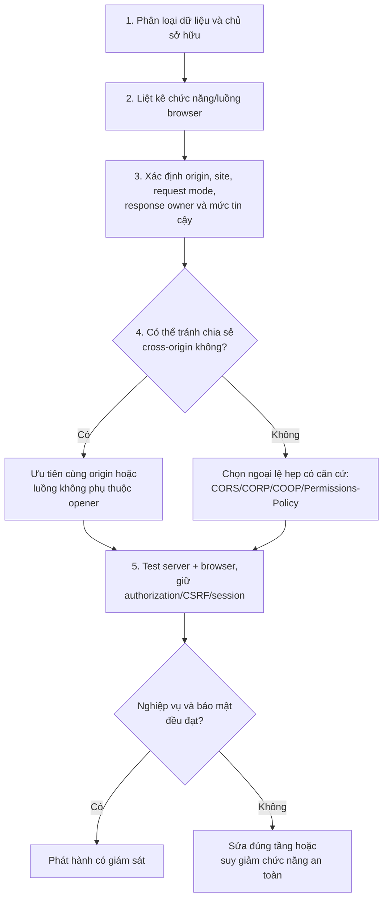
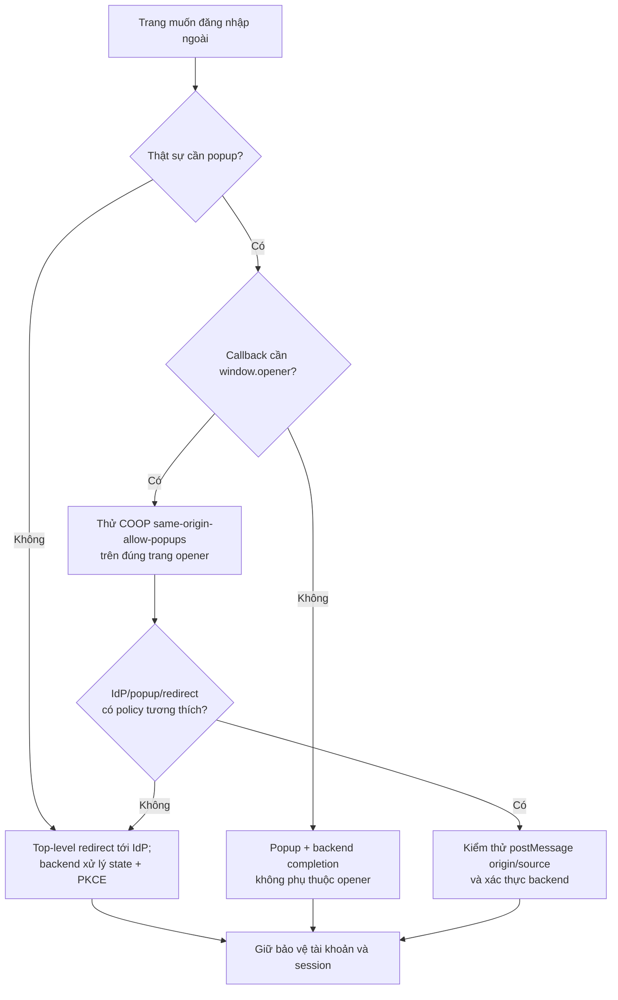

# Chọn chính sách theo dữ liệu cùng tính năng ứng dụng thực sự cần

## 1. Vấn đề cốt lõi: cấu hình mạnh nhất chưa chắc là cấu hình đúng nhất

Trong module **SPRING_SECURITY_HTTP_PROTECTION**, người học triển khai các lớp phòng vệ HTTP và trình duyệt bằng Spring Security: CSRF, CORS, security headers, CSP, HSTS, HTTP firewall, session và các cơ chế bảo vệ cho cả **Servlet** lẫn **Reactive/WebFlux**. Ở chương **Quyền và cô lập trình duyệt**, câu hỏi quan trọng nhất không phải “bật được bao nhiêu header?”, mà là:

> **Dữ liệu nào cần được bảo vệ, tính năng nào thật sự phải hoạt động, và trình duyệt được phép thực hiện tương tác nào để đạt mục tiêu đó?**

Xét nền tảng học trực tuyến `https://learn.example.com`:

1. Trang `/account/profile` hiển thị thông tin cá nhân, kết quả học và tài liệu riêng của học viên.
2. Trang `/courses/42` hiển thị nội dung cùng ảnh minh họa công khai từ CDN.
3. Trang `/classroom/live` nhúng dịch vụ họp video, cần camera/microphone nhưng **không** cần geolocation.
4. Trang `/auth/popup-launcher` mở popup OAuth đến nhà cung cấp danh tính khác origin.
5. Trang `/isolated/simulator` chạy mô phỏng có phiên bản đa luồng cần *cross-origin isolation*.
6. API `/api/me` trả dữ liệu người dùng theo session; API `/api/public/catalog` cung cấp danh mục công khai cho một frontend đối tác đã định danh.

Nếu đặt chung toàn hệ thống:

```http
Cross-Origin-Opener-Policy: same-origin
Cross-Origin-Embedder-Policy: require-corp
Permissions-Policy: camera=(), microphone=(), geolocation=()
Cross-Origin-Resource-Policy: cross-origin
Access-Control-Allow-Origin: *
```

thì có thể đồng thời **phá popup OAuth, chặn tài nguyên CDN, vô hiệu hóa camera của lớp học** và mở những cơ chế nhúng/chia sẻ vượt nhu cầu đối với response riêng tư. Ngược lại, bỏ hết headers để chức năng chạy lại cũng không chấp nhận được.

Bài học này xây dựng **quy trình chọn chính sách dựa trên dữ liệu và tính năng**, chứ không dùng một bộ headers sao chép từ ví dụ khác.

### Kết quả cần đạt

Sau bài này, bạn có thể:

- Phân loại dữ liệu thành **công khai, nội bộ, cá nhân/tenant và nhạy cảm**, đồng thời xác định những luồng truy cập thực tế.
- Lập bảng yêu cầu tính năng: popup, iframe, camera, API cross-origin, CDN, WebAssembly/SharedArrayBuffer.
- Chọn **COOP, COEP, CORP, CORS, Permissions-Policy, Referrer-Policy và CSP** ở đúng response và đúng phạm vi URL.
- Phân biệt **khả năng tải/nhúng ở browser** với **authentication, authorization, CSRF, session và cache** ở server.
- Hiện thực một thiết kế theo route trong **Spring Security Servlet và WebFlux**, có cả kiểm thử HTTP và hành vi trình duyệt.
- Phân tích các ngoại lệ có lý do, kiểm soát rollout, browser compatibility và cách xử lý suy giảm chức năng an toàn.

## 2. Bắt đầu từ tài sản dữ liệu, không bắt đầu từ tên header

Một chính sách hợp lý phải xuất phát từ **thông tin có giá trị gì, thuộc về ai và được phép xuất hiện ở đâu**.

### 2.1. Phân loại dữ liệu theo độ nhạy cảm

| Lớp dữ liệu | Ví dụ trong ứng dụng | Người được phép đọc | Hướng bảo vệ ban đầu |
| --- | --- | --- | --- |
| **Công khai** | Logo, ảnh hướng dẫn, catalog công khai | Bất kỳ ai theo nghiệp vụ | Cho phép chia sẻ đúng nhu cầu; vẫn bảo vệ integrity, cache và CSP. |
| **Nội bộ tổ chức** | Bảng điều khiển hỗ trợ, nội dung đào tạo nhân viên | Người/role được phê duyệt | Xác thực, phân quyền; không mở nhúng cross-origin chỉ vì cùng công ty. |
| **Dữ liệu cá nhân** | Hồ sơ học viên, điểm, avatar riêng | Chủ dữ liệu và nhân sự có quyền | Authorization theo đối tượng, session, cache riêng; giảm bề mặt nhúng ngoài origin. |
| **Dữ liệu theo tenant** | Báo cáo doanh nghiệp A/B | User thuộc tenant hợp lệ | Kiểm tra tenant ở backend; không tin đường dẫn hoặc header browser như ranh giới tenant. |
| **Dữ liệu nhạy cảm cao** | Token, callback OAuth, thông tin thanh toán, bí mật quản trị | Thành phần/actor được ủy quyền chặt | Hạn chế lưu trong URL/DOM, no-store khi phù hợp, kiểm soát truy cập và log. |

**CORP không xác minh vai trò của user.** Tài nguyên có `Cross-Origin-Resource-Policy: same-origin` vẫn cần controller/service kiểm tra quyền. Tương tự, tài nguyên có `CORP: cross-origin` không nhất thiết là dữ liệu công khai: nếu server vẫn yêu cầu xác thực, quyền đọc vẫn do server quyết định. Tuy vậy, đặt `cross-origin` cho tài nguyên riêng có thể mở rộng khả năng nhúng và tạo bề mặt suy luận ngoài ý muốn.

### 2.2. Phân loại theo đường đi của dữ liệu

Một ảnh avatar có thể đi qua:

```text
Người dùng đã đăng nhập
  → GET /account/avatar/123
  → Spring Security kiểm tra session
  → Service kiểm tra chủ sở hữu / tenant
  → Storage trả ảnh
  → HTTP response có cache headers và CORP
  → Browser sử dụng ảnh trong trang được phép
```

Với cùng một URL, phải xác định:

- **Điểm tạo response cuối:** Spring Boot, proxy, gateway, CDN hay object storage?
- **Giá trị theo user/tenant:** response có thay đổi theo cookie, token hoặc phiên không?
- **Cache:** có được chia sẻ giữa người dùng không, hay phải `Cache-Control: private, no-store` theo mức nhạy cảm?
- **Đối tượng nhận:** website cùng origin, subdomain cùng site, hoặc origin đối tác thật sự cần sử dụng?
- **Kiểu request:** `fetch`, ``, `<script>`, iframe hay window popup?

Nếu không xác định được **server nào phát resource response**, việc thêm CORP/CORS vào response HTML trang cha thường là sửa sai tầng.

## 3. Tính năng nào thật sự bắt buộc?

Sau dữ liệu, lập **feature inventory**. Mỗi tính năng phải trả lời: ai dùng, cần browser API nào, được phép kết nối origin nào, và có phương án thay thế không?

| Tính năng | Điều kiện kỹ thuật | Tài sản dữ liệu liên quan | Tính năng có thể giảm cấp? |
| --- | --- | --- | --- |
| Xem hồ sơ và điểm | Session, authorization theo user, DOM | Cá nhân/tenant | Không được giảm mức kiểm tra quyền. |
| Hiển thị tài liệu công khai | Ảnh/CDN, CSP `img-src` | Công khai | Có thể dùng asset nội bộ hoặc nội dung dạng văn bản. |
| Họp video iframe | CSP framing, COEP nếu có, Permissions-Policy, iframe `allow`, HTTPS và user consent | Âm thanh/hình ảnh | Có thể chuyển sang xem thụ động/chat nếu nghiệp vụ cho phép. |
| OAuth popup | `window.open`, COOP, callback, `postMessage` hoặc backend status | Dữ liệu xác thực/phiên | Có thể dùng top-level redirect hoặc completion không phụ thuộc opener. |
| Mô phỏng đa luồng | `crossOriginIsolated`, `SharedArrayBuffer` và các API liên quan | Nội dung mô phỏng | Có thể dùng basic mode nếu thuật toán tương đương và an toàn. |
| API catalog cho đối tác | CORS, exact origin allowlist, GET | Công khai | Có thể không cung cấp CORS cho origin không được duyệt. |
| API `/api/me` | Authentication, authorization, CSRF cho mutation | Cá nhân | Không được nới CORS/cookie chỉ để client ngoài truy cập. |

### Phân biệt “bắt buộc” và “tiện lợi”

Một thư viện analytics không tải dưới COEP là **sự cố phụ thuộc tùy chọn**, không phải lý do hợp lệ để tắt COEP trên trang mô phỏng cần isolation. Ngược lại, nếu lớp học trực tuyến thật sự cần microphone, chính sách `microphone=()` trên trang đó sẽ đi ngược yêu cầu nghiệp vụ.

Khi các yêu cầu xung đột, có ba hướng:

1. **Tách trang/chức năng:** trang isolated riêng, trang video riêng, OAuth launcher riêng.
2. **Thay công nghệ/luồng:** bỏ popup phụ thuộc opener; chuyển asset thành same-origin; cập nhật SDK đáp ứng COEP/CORS.
3. **Cho ngoại lệ hẹp, có kiểm thử:** chỉ trên trang opener hoặc origin iframe được phê duyệt, không nới cả website.

## 4. Mô hình quyết định năm bước

Một cách chọn chính sách có thể lặp lại:



### Năm câu hỏi quyết định

1. **Dữ liệu có thật sự được phép ra ngoài?** Nếu không, tuyệt đối không dùng một policy browser để thay quyền server.
2. **Chức năng nào cần tương tác?** Popup top-level, iframe, image `no-cors` và JavaScript `fetch` là các bài toán khác nhau.
3. **Origin nào đáng tin?** Cùng tổ chức không đồng nghĩa cùng origin hay cùng mức tin cậy; subdomain upload của người dùng có thể không đáng tin.
4. **Có đường thay thế an toàn không?** Top-level redirect, asset same-origin, basic mode, bảng thay biểu đồ.
5. **Ai sở hữu thay đổi và test?** App, resource service, IdP, partner iframe và CDN có thể do các team khác nhau quản lý.

**Nguyên tắc “ít đặc quyền nhất” cũng áp dụng cho browser features:** chỉ cho camera ở trang cần camera, chỉ cho external popup giữ opener khi flow thực sự yêu cầu, chỉ mở resource `cross-origin` khi tài nguyên được thiết kế để chia sẻ.

## 5. Đặt đúng chính sách ở đúng response

| Chính sách | Header/cấu hình ví dụ | Vị trí đặt | Không thay thế |
| --- | --- | --- | --- |
| **COOP** | `Cross-Origin-Opener-Policy: same-origin` | Tài liệu cấp cao đang tham gia quan hệ cửa sổ | SOP, OAuth validation, authorization. |
| **COEP** | `Cross-Origin-Embedder-Policy: require-corp` | Tài liệu yêu cầu/nhúng tài nguyên | CORP/CORS tại resource, CSP. |
| **CORP** | `Cross-Origin-Resource-Policy: same-origin` | **Response của tài nguyên** | Quyền backend, CORS cho `fetch`. |
| **CORS** | `Access-Control-Allow-Origin: https://dashboard.partner.example` | API hoặc resource đích của request `cors` | Authentication, CSRF, COOP. |
| **Permissions-Policy** | `camera=(), microphone=()` | Tài liệu kiểm soát các browser features và policy kế thừa | User consent, OS permission. |
| **Referrer-Policy** | `strict-origin-when-cross-origin` hoặc `no-referrer` | Response của trang phát sinh điều hướng/tải resource | Thiết kế URL không chứa secrets. |
| **CSP nguồn tài nguyên** | `script-src`, `img-src`, `connect-src`, `frame-src` | Response của trang yêu cầu tài nguyên | CORP/CORS ở response đích. |
| **CSP framing/XFO** | `frame-ancestors 'none'`, `X-Frame-Options: DENY` | Response của **trang bị nhúng** | Permissions-Policy và COOP của popup. |
| **HSTS** | `Strict-Transport-Security` | HTTPS response theo chính sách host | TLS, cookie Secure, xác thực. |

### Các chính sách browser không thay kiểm soát server

Một backend phải **tự kiểm tra quyền** trước khi trả profile, điểm, tài liệu tenant hoặc kết quả giao dịch. `CORS` có thể ngăn JavaScript ở một origin khác đọc response, nhưng không ngăn mọi cách gửi request. `CORP` kiểm soát cách browser sử dụng một số response `no-cors`; công cụ HTTP trực tiếp vẫn có thể gọi URL. `COOP` và `COEP` không tự bảo vệ CSRF hay session.

Do đó:

```text
Authentication + authorization + CSRF/session + data isolation
                           │
                           ▼
            Các lớp HTTP/browser bổ sung
     CSP, CORS, CORP, COEP, COOP, Permissions-Policy
                           │
                           ▼
             Tính năng được phép thực hiện
```

Không được đảo chiều để “có header rồi nên không cần authorization”.

## 6. Ma trận quyết định theo dữ liệu và chức năng

| Trường hợp thực tế | Chính sách chính nên xét | Tránh cách làm nào? | Bằng chứng chấp nhận |
| --- | --- | --- | --- |
| Trang profile chỉ ở same-origin | COOP `same-origin` khi không cần opener, CSP/referrer, quyền server; CORP hẹp cho ảnh riêng | `Access-Control-Allow-Origin: *` trên dữ liệu user | User ngoài quyền không đọc được; cross-origin `no-cors` không dùng được ảnh riêng. |
| Logo public phục vụ website ngoài | CORP `cross-origin` **trên ảnh**, CSP của trang dùng ảnh | Áp CORP `cross-origin` toàn API private | Ảnh public tải được từ origin ngoài trong mode dự kiến. |
| Biểu đồ shared giữa subdomain | CORP `same-site` **chỉ nếu** mọi origin cùng site đã đủ tin cậy | Đánh đồng same-site với same-origin và trusted | Test từ subdomain được phép và origin khác site. |
| API catalog JSON dùng `fetch` | CORS exact allowlist, preflight nếu có, CSP `connect-src` | Dùng CORP thay CORS; chuyển `fetch` sang `no-cors` | Origin được duyệt đọc JSON; origin ngoài bị từ chối. |
| API `/api/me` theo session | Authorization, cookie, CSRF cho mutation, hạn chế CORS | Phản chiếu `Origin` tùy ý, wildcard credentials | User/tenant không có quyền bị từ chối kể cả HTTP client trực tiếp. |
| Popup OAuth khác origin cần opener | COOP `same-origin-allow-popups` **ở trang opener**, nếu tương thích | `COOP: unsafe-none` toàn app; bỏ `state`/PKCE | Callback thực sự hoàn tất và backend xác minh phiên. |
| Link ngoài chỉ để đọc | `rel="noopener"`, cân nhắc `noreferrer` | Trao `window.opener` khi không cần | Link mở an toàn, không lệ thuộc opener. |
| Iframe lớp học cần camera/mic | CSP `frame-src` ở cha, `frame-ancestors` của con, Permissions-Policy origin cụ thể + `allow` | `camera=()` ở cha rồi kỳ vọng iframe `allow` mở được | Widget tải và browser xin quyền khi user tương tác. |
| Mô phỏng cần isolation | COOP `same-origin` + COEP `require-corp` hoặc phương án được browser hỗ trợ | Áp COEP trên toàn app trước khi kiểm kê CDN/SDK | `crossOriginIsolated` đúng nơi cần, thuật toán chạy đúng; fallback an toàn. |
| Tài nguyên CDN trong trang isolated | CORP opt-in cho `no-cors` hoặc CORS khi request `cors` | Chỉ thêm ACAO mà không đổi request mode `no-cors` | Test asset hợp lệ và response headers của CDN. |
| URL có thông tin nhạy cảm | Referrer-Policy phù hợp, **tránh secrets trong URL** | Trông đợi header sửa toàn bộ việc rò token URL | Đo `Referer` trên browser và không có secrets trong link. |

Bảng chỉ là **đề xuất khởi đầu**. Ví dụ `CORP: same-site` phải dựa trên đặc điểm *schemeful site* và các subdomain thực sự đáng tin; không tự động an toàn cho mọi subdomain trong tổ chức.

## 7. Quyết định 1: dữ liệu cá nhân và ranh giới same-origin

Một avatar cá nhân có thể được trình duyệt hiển thị bằng:

```html

```

Response gợi ý khi nội dung nhạy cảm:

```http
HTTP/1.1 200 OK
Content-Type: image/png
Cache-Control: private, no-store
Cross-Origin-Resource-Policy: same-origin
X-Content-Type-Options: nosniff
```

Ở đây:

1. **Backend kiểm tra session và quyền** với ảnh thuộc user/tenant.
2. `Cache-Control` ngăn lưu cache không mong muốn theo yêu cầu nghiệp vụ. Độ chặt thực tế tùy dữ liệu và hạ tầng.
3. `CORP: same-origin` giảm khả năng sử dụng response ảnh trong request `no-cors` từ origin ngoài.
4. `nosniff` bổ sung bảo vệ kiểu nội dung.

**Không dùng CORP làm ACL.** Một trang attacker không thể tự đọc DOM cross-origin vì Same-Origin Policy; CORP là lớp bổ sung chống một số bề mặt nhúng/suy luận. Nhưng nếu backend trả ảnh cho người không có quyền, việc gắn CORP không sửa được lỗi authorization.

### Vì sao same-site có thể quá rộng?

```text
https://learn.example.com      # ứng dụng chính
https://static.example.com     # CDN chính thức
https://uploads.example.com    # nội dung do người dùng tải lên
```

Những origin trên khác nhau; tùy scheme/registrable domain chúng có thể **cùng site**. Nếu `uploads.example.com` cho phép HTML/JavaScript do user đăng, `CORP: same-site` có thể rộng hơn mong muốn. Với dữ liệu cá nhân, **same-origin + authorization** thường là điểm khởi đầu dễ kiểm soát hơn.

## 8. Quyết định 2: chia sẻ dữ liệu cross-origin đúng cơ chế

### 8.1. Tài nguyên ảnh `no-cors`

Một trang từ `https://dashboard.partner.example` dùng logo công khai:

```html

```

Nếu trang đối tác có `COEP: require-corp`, ảnh `no-cors` thường cần resource server cho phép bằng:

```http
Cross-Origin-Resource-Policy: cross-origin
```

Header trên **response ảnh**, không phải một mình trên HTML trang đối tác.

### 8.2. API JSON `cors`

JavaScript của đối tác:

```javascript
const response = await fetch(
  "https://learn.example.com/api/public/catalog"
);
const catalog = await response.json();
```

Đây là request **CORS mode** điển hình. Server API có thể cho phép một origin cụ thể:

```http
Access-Control-Allow-Origin: https://dashboard.partner.example
Vary: Origin
```

Nếu API không được thiết kế để gọi từ origin ngoài, **không cấu hình CORS chỉ vì frontend khác origin đang gặp lỗi**. Cần xét có nên chuyển thành same-origin BFF hoặc thiết lập hợp đồng đối tác với endpoint riêng.

**Không sửa lỗi `fetch` bằng `mode: "no-cors"`**: JavaScript thường nhận opaque response và không thể đọc JSON. `CORP: cross-origin` cũng không cấp quyền JavaScript đọc response bị CORS từ chối.

### 8.3. API cần credentials là trường hợp riêng

Nếu có nghiệp vụ **thật sự cần cookie cross-origin**, request có thể dùng:

```javascript
fetch("https://api.partner.example/private/report", {
  credentials: "include"
});
```

Server phải xét **allowed origin cụ thể**, điều kiện `Access-Control-Allow-Credentials: true` khi phù hợp, `SameSite`, `Secure`, chính sách third-party cookies, authorization và chống CSRF. Không trả `Access-Control-Allow-Origin: *` cho credentialed CORS requests. Không phản chiếu tùy ý bất cứ `Origin` nào cùng credentials.

Nếu đối tác chỉ cần catalog public, **không bật credentials** chỉ để “cho chắc”.

## 9. Quyết định 3: popup OAuth hay cô lập cửa sổ?

COOP `same-origin` giúp một tài liệu top-level hạn chế quan hệ với cửa sổ khác origin, nhưng một số SDK đăng nhập popup cũ lại cần `window.opener`.



### Khi nào dùng `same-origin-allow-popups`?

Chỉ khi:

- Trang **thực sự làm opener**, không phải URL callback được gắn policy ngẫu nhiên.
- Popup/IdP thường có chính sách tương thích với ngoại lệ này.
- Có test đầy đủ các lần redirect, browser/version và tình huống popup bị chặn.
- Backend vẫn kiểm tra `state`, PKCE, redirect URI, phiên và quyền.
- Mọi thông điệp `postMessage` được kiểm tra `origin`, `source` và schema.

```http
Cross-Origin-Opener-Policy: same-origin-allow-popups
```

không có nghĩa popup khác origin được tự do đọc DOM hoặc chắc chắn giữ opener. Same-Origin Policy vẫn áp dụng và một popup với COOP không tương thích có thể tự tách nhóm.

### Hướng tốt hơn khi có thể

Nếu SDK cho phép, chuyển sang **top-level redirect** hoặc **backend completion** để không phụ thuộc `window.opener`. Một ứng dụng không nên hy sinh chính sách COOP của mọi trang nhạy cảm chỉ để giữ một cách mở popup có thể thay thế.

## 10. Quyết định 4: lớp học dùng camera không đồng nghĩa mở mọi feature

Một iframe lớp học:

```html
<iframe
  src="https://meeting.partner.example/room/42"
  title="Lớp học trực tuyến"
  allow="camera; microphone; fullscreen"
  width="960"
  height="600"></iframe>
```

Muốn dùng camera/microphone, phải phân biệt:

1. **Trang cha được phép tải iframe** từ đối tác bằng CSP `frame-src`.
2. **Tài liệu con cho phép bị nhúng** bằng chính sách `frame-ancestors`/XFO phù hợp của **chính đối tác**.
3. **Permissions-Policy** của cha không chặn tính năng đối với origin iframe.
4. Thuộc tính iframe `allow` ủy quyền những feature cần thiết trong phạm vi được cha cho phép.
5. Browser ở secure context, user đồng ý cấp quyền, OS/thiết bị hoạt động.
6. Đăng nhập/widget session và các ràng buộc cookie vẫn hợp lệ.

Ví dụ trên **trang cha lớp học**:

```http
Permissions-Policy: camera=(self "https://meeting.partner.example"), microphone=(self "https://meeting.partner.example"), geolocation=()
Content-Security-Policy: frame-src https://meeting.partner.example; object-src 'none'
```

**Không mặc định đây là toàn bộ CSP của production**: cần bổ sung `default-src`, `script-src`, `connect-src`, `img-src` và các directive khác theo ứng dụng. Header trên không vượt được `frame-ancestors`/XFO của trang con.

Với **trang không cần camera**:

```http
Permissions-Policy: camera=(), microphone=(), geolocation=()
```

Đây là chính sách phù hợp hơn là mở camera toàn hệ thống. Một iframe `allow="camera"` không thể tự vượt hạn chế `camera=()` đặt ở ancestor.

**Permissions-Policy không cấp quyền người dùng.** Nó đặt giới hạn mà browser hỗ trợ kiểm tra; dù policy cho phép, người dùng vẫn có thể từ chối `getUserMedia` hoặc thiết bị không tồn tại.

## 11. Quyết định 5: cần cross-origin isolation đến mức nào?

Một trang chạy tính năng chuyên biệt có thể cần môi trường cô lập để dùng một số API như `SharedArrayBuffer`.

Một cấu hình phổ biến cho top-level document:

```http
Cross-Origin-Opener-Policy: same-origin
Cross-Origin-Embedder-Policy: require-corp
```

Trong browser hỗ trợ, còn phải đáp ứng **secure context**, chính sách của các frame/ancestor và các điều kiện liên quan. Kiểm tra trong browser:

```javascript
const capability = {
  secure: window.isSecureContext === true,
  isolated: window.crossOriginIsolated === true,
  sharedBuffer: typeof SharedArrayBuffer === "function",
  worker: typeof Worker === "function"
};
console.table(capability);
```

**Có hai header không bảo đảm `crossOriginIsolated` luôn `true`**; cũng không bảo đảm resource CDN tự tải được.

### COEP `require-corp` khiến tài nguyên phụ bị chặn vì sao?

Nếu trang isolated tải:

```html

```

và request là cross-origin `no-cors`, response ảnh cần opt-in phù hợp qua `Cross-Origin-Resource-Policy`, ví dụ `cross-origin` cho **ảnh public**. Nếu chuyển ảnh sang CORS mode bằng `crossorigin="anonymous"`, server ảnh phải phản hồi CORS hợp lệ.

Một trang có `COEP: require-corp` không nên phụ thuộc thư viện không kiểm soát được mọi asset, worker, font và module imports mà chưa thử nghiệm.

### Khi nào cân nhắc `credentialless`?

```http
Cross-Origin-Embedder-Policy: credentialless
```

Trên browser hỗ trợ, giá trị này cho phép một số cross-origin `no-cors` resources được tải **không kèm credentials** mà không cần CORP opt-in theo cùng cách `require-corp` yêu cầu. Nhưng request `cors` vẫn cần CORS; tài nguyên theo cookie có thể thất bại. Không dùng `credentialless` như cách vượt `CORP: same-origin` của tài nguyên.

### Khi không cần isolation

Một trang thông thường không dùng API yêu cầu isolation **không có lý do mặc định phải bật `require-corp`**, đặc biệt khi nó tích hợp nhiều SDK, iframe hoặc popup ngoài origin. Hãy áp dụng **đúng route thật sự cần** thay vì áp đồng loạt rồi gỡ các lỗi phát sinh.

## 12. Referrer-Policy và CSP: giảm dữ liệu rò theo đường gián tiếp

Ngay cả khi một API được kiểm soát CORS, dữ liệu nhạy cảm vẫn có thể rò qua:

- URL chứa token hoặc mã giao dịch.
- Liên kết điều hướng ra ngoài có `Referer` quá chi tiết.
- Script bên thứ ba chạy trong DOM và đọc dữ liệu mà nó được cấp.
- Hình ảnh/CDN, log proxy và analytics nhận query parameters.

**Đầu tiên: tránh đặt secrets trong URL.** Referrer-Policy là lớp bổ sung, không sửa được mọi đường rò.

Chính sách phổ biến:

```http
Referrer-Policy: strict-origin-when-cross-origin
```

Với một trang đặc biệt nhạy cảm, có thể chọn:

```http
Referrer-Policy: no-referrer
```

Nếu liên kết ngoài không cần chia sẻ referrer:

```html
<a
  href="https://docs.partner.example"
  target="_blank"
  rel="noopener noreferrer">
  Tài liệu đối tác
</a>
```

**Phân biệt hai chức năng:** `noopener` giảm quan hệ opener không cần thiết; `noreferrer` ngăn gửi referrer theo thao tác liên kết và cũng có tác dụng noopener trong ngữ cảnh hỗ trợ.

### CSP không thay cho CORS/CORP

Ví dụ trang isolated:

```http
Content-Security-Policy: img-src 'self' https://cdn.partner.example; connect-src 'self' https://api.partner.example; object-src 'none'
```

`img-src` cho phép **URL ảnh**, nhưng nếu ảnh cross-origin `no-cors` thiếu CORP dưới `COEP: require-corp`, browser vẫn có thể chặn. `connect-src` cho phép yêu cầu tới API, nhưng **API vẫn phải trả CORS hợp lệ** nếu JavaScript cần đọc JSON cross-origin.

**Các policy bổ sung nhau**; không coi CSP `img-src` là lệnh buộc resource server cho phép chia sẻ ảnh.

## 13. Chính sách mẫu theo route, dữ liệu và trách nhiệm

Từ bảng phân loại, chọn một policy map như sau:

| Route | Loại response/dữ liệu | Header mục tiêu | Kiểm soát bổ sung |
| --- | --- | --- | --- |
| `/isolated/**` | HTML cần isolated context | COOP `same-origin`, COEP `require-corp`, Referrer-Policy | Phân quyền; kiểm kê script/ảnh/worker; fallback. |
| `/classroom/live` | HTML chứa iframe lớp học | Permissions-Policy allowlist đối tác, CSP `frame-src` | Đăng nhập, user permission, CSP các directive khác; không gắn COEP nếu widget chưa tương thích. |
| `/auth/popup-launcher` | HTML mở OAuth popup | COOP `same-origin-allow-popups` khi cần | OAuth `state`/PKCE; test IdP; có redirect fallback. |
| `/assets/public/**` | Asset thật sự public | CORP `cross-origin` khi cần chia sẻ | Cache và integrity; không chứa user data. |
| `/assets/private/**` | File/ảnh riêng | CORP `same-origin` | Authorization theo user/tenant; cache riêng. |
| `/api/public/**` | Catalog JSON | CORS origin allowlist | GET public thật; preflight đúng; không cấp cookie credentials. |
| `/account/**` | Trang tài khoản | COOP `same-origin`, referrer thích hợp | Authorization/CSRF/session; không nới COEP khi không cần. |
| Các route còn lại | Nghiệp vụ khác | Baseline Referrer-Policy, Permissions-Policy phù hợp | Security headers mặc định, kiểm soát riêng theo loại dữ liệu. |

### Lưu ý về nhiều security chain

Một request thường đi qua **security chain khớp đầu tiên**, không phải nhiều chain gộp lại. Vì vậy **header baseline ở chain fallback không tự xuất hiện trên các chain cụ thể**. Cần cấu hình baseline cho từng chain hoặc có một tầng trung tâm được thiết kế/kiểm thử rõ, không dựa vào giả định “tự kế thừa”.

Với các route như callback OAuth, **không tự tạo chain hẹp làm mất filter xử lý callback**. Hãy phối hợp với cấu hình xác thực thực tế của dự án.

## 14. Spring Security Servlet: hiện thực chính sách theo chức năng

Ví dụ dưới đây minh họa **cách phân chia chain và viết header** trong ứng dụng Servlet dùng Spring Security hiện đại. Đây **không phải** cấu hình OAuth và authorization production hoàn chỉnh; người học phải tích hợp login, `oauth2Login`, quyền tenant, CSRF, session và CSP đầy đủ theo ứng dụng.

```java
import java.util.List;

import org.springframework.context.annotation.Bean;
import org.springframework.context.annotation.Configuration;
import org.springframework.core.annotation.Order;
import org.springframework.http.HttpMethod;
import org.springframework.security.config.annotation.web.builders.HttpSecurity;
import org.springframework.security.config.annotation.web.configuration.EnableWebSecurity;
import org.springframework.security.web.SecurityFilterChain;
import org.springframework.security.web.header.writers.StaticHeadersWriter;
import org.springframework.web.cors.CorsConfiguration;
import org.springframework.web.cors.CorsConfigurationSource;
import org.springframework.web.cors.UrlBasedCorsConfigurationSource;

@Configuration
@EnableWebSecurity
public class RiskBasedServletSecurityConfig {

    @Bean
    CorsConfigurationSource publicCatalogCors() {
        CorsConfiguration cors = new CorsConfiguration();
        cors.setAllowedOrigins(List.of(
            "https://dashboard.partner.example"));
        cors.setAllowedMethods(List.of("GET", "OPTIONS"));
        cors.setAllowedHeaders(List.of("X-Client-Version"));
        cors.setAllowCredentials(false);
        cors.setMaxAge(3600L);

        UrlBasedCorsConfigurationSource source =
            new UrlBasedCorsConfigurationSource();
        source.registerCorsConfiguration("/api/public/**", cors);
        return source;
    }

    @Bean
    @Order(1)
    SecurityFilterChain isolated(HttpSecurity http) throws Exception {
        return http
            .securityMatcher("/isolated/**")
            .authorizeHttpRequests(auth -> auth
                .anyRequest().authenticated())
            .headers(headers -> headers
                .addHeaderWriter(new StaticHeadersWriter(
                    "Cross-Origin-Opener-Policy", "same-origin"))
                .addHeaderWriter(new StaticHeadersWriter(
                    "Cross-Origin-Embedder-Policy", "require-corp"))
                .addHeaderWriter(new StaticHeadersWriter(
                    "Referrer-Policy",
                    "strict-origin-when-cross-origin")))
            .build();
    }

    @Bean
    @Order(2)
    SecurityFilterChain classroom(HttpSecurity http) throws Exception {
        return http
            .securityMatcher("/classroom/live")
            .authorizeHttpRequests(auth -> auth
                .anyRequest().authenticated())
            .headers(headers -> headers
                .addHeaderWriter(new StaticHeadersWriter(
                    "Permissions-Policy",
                    "camera=(self \"https://meeting.partner.example\"), " +
                    "microphone=(self \"https://meeting.partner.example\"), " +
                    "geolocation=()"))
                .addHeaderWriter(new StaticHeadersWriter(
                    "Content-Security-Policy",
                    "frame-src https://meeting.partner.example; " +
                    "object-src 'none'")))
            .build();
    }

    @Bean
    @Order(3)
    SecurityFilterChain popupLauncher(HttpSecurity http)
            throws Exception {
        return http
            .securityMatcher("/auth/popup-launcher")
            .authorizeHttpRequests(auth -> auth
                .anyRequest().permitAll())
            .headers(headers -> headers
                .addHeaderWriter(new StaticHeadersWriter(
                    "Cross-Origin-Opener-Policy",
                    "same-origin-allow-popups")))
            .build();
    }

    @Bean
    @Order(4)
    SecurityFilterChain publicAssets(HttpSecurity http)
            throws Exception {
        return http
            .securityMatcher("/assets/public/**")
            .authorizeHttpRequests(auth -> auth
                .requestMatchers(HttpMethod.GET, "/assets/public/**")
                    .permitAll()
                .requestMatchers(HttpMethod.HEAD, "/assets/public/**")
                    .permitAll()
                .anyRequest().denyAll())
            .headers(headers -> headers
                .addHeaderWriter(new StaticHeadersWriter(
                    "Cross-Origin-Resource-Policy", "cross-origin")))
            .build();
    }

    @Bean
    @Order(5)
    SecurityFilterChain publicApi(HttpSecurity http,
                                  CorsConfigurationSource publicCatalogCors)
            throws Exception {
        return http
            .securityMatcher("/api/public/**")
            .cors(cors -> cors.configurationSource(publicCatalogCors))
            .authorizeHttpRequests(auth -> auth
                .requestMatchers(HttpMethod.GET, "/api/public/**")
                    .permitAll()
                .requestMatchers(HttpMethod.OPTIONS, "/api/public/**")
                    .permitAll()
                .anyRequest().denyAll())
            .build();
    }

    @Bean
    @Order(6)
    SecurityFilterChain remaining(HttpSecurity http) throws Exception {
        return http
            .authorizeHttpRequests(auth -> auth
                .anyRequest().authenticated())
            .headers(headers -> headers
                .addHeaderWriter(new StaticHeadersWriter(
                    "Referrer-Policy",
                    "strict-origin-when-cross-origin"))
                .addHeaderWriter(new StaticHeadersWriter(
                    "Permissions-Policy",
                    "camera=(), microphone=(), geolocation=()")))
            .build();
    }
}
```

### Ý nghĩa của thiết kế

- `securityMatcher` chọn **chain phát headers**; `requestMatchers` bên trong `authorizeHttpRequests` kiểm soát **quyền HTTP**.
- Chain `isolated` chỉ dành cho chức năng cần isolation; không bắt mọi trang chạy COEP `require-corp`.
- `classroom` mở tính năng camera/microphone **chỉ cho origin đối tác đã phê duyệt**, nhưng quyền user và policy của iframe vẫn áp dụng.
- `popupLauncher` cho phép ngoại lệ opener **ở đúng trang**; muốn nó thật sự khởi động OAuth thì cần tích hợp cấu hình và handler xác thực phù hợp.
- `publicAssets` chỉ dùng `permitAll()` vì ví dụ giả định nội dung hoàn toàn **công khai**; nếu đường dẫn chứa file riêng, không được dùng cấu hình này.
- `publicApi` dùng **CORS processor** thay vì một ACAO tĩnh, chỉ cho một origin và không bật credentials. Chỉ áp dụng cho catalog thật sự public.
- `remaining` chỉ là baseline minh họa; ứng dụng thật cần thêm các chain riêng cho asset private hoặc các route dữ liệu nhạy cảm nếu muốn đặt CORP/cache khác.

### Hai cảnh báo quan trọng

**Thứ nhất:** ví dụ không tự thêm quyền theo đối tượng/tenant. `authenticated()` khác với `hasAuthority(...)` hoặc kiểm tra owner ở service. Khi trả dữ liệu riêng, vẫn cần phân quyền sau khi xác thực.

**Thứ hai:** default security headers của Spring Security còn phụ thuộc version/cấu hình. Không dùng `headers(headers -> headers.disable())` để sửa một lỗi camera/CDN/popup; thao tác này tắt nhiều lớp phòng vệ không liên quan.

### Nếu private assets cần CORP riêng

Một chain `/assets/private/**` phải được đặt **trước** chain fallback và kết hợp:

```java
// Đoạn trích của chain dành cho tài nguyên riêng.
.securityMatcher("/assets/private/**")
.authorizeHttpRequests(auth -> auth
    .anyRequest().authenticated())
.headers(headers -> headers
    .addHeaderWriter(new StaticHeadersWriter(
        "Cross-Origin-Resource-Policy", "same-origin")))
```

Đồng thời controller phải kiểm tra quyền của user với từng tài nguyên, và cân nhắc cache riêng. Đoạn trích **không phải bean hoàn chỉnh**, chỉ minh họa thêm chính sách phù hợp vào chain tài nguyên.

## 15. Spring Security Reactive/WebFlux: giữ quyết định, đổi API

Với WebFlux, cách lựa chọn chính sách giống Servlet, nhưng dùng `ServerHttpSecurity`, `SecurityWebFilterChain`, `StaticServerHttpHeadersWriter` và `CorsConfigurationSource` Reactive. Ví dụ **thay thế** dưới đây tập trung vào bốn nhóm route; các route public asset và API có thể bổ sung bằng cách tương tự, sau khi xác minh phiên bản Spring Security.

```java
import org.springframework.context.annotation.Bean;
import org.springframework.context.annotation.Configuration;
import org.springframework.core.annotation.Order;
import org.springframework.security.config.annotation.web.reactive.EnableWebFluxSecurity;
import org.springframework.security.config.web.server.ServerHttpSecurity;
import org.springframework.security.web.server.SecurityWebFilterChain;
import org.springframework.security.web.server.header.StaticServerHttpHeadersWriter;
import org.springframework.security.web.server.util.matcher.PathPatternParserServerWebExchangeMatcher;

@Configuration
@EnableWebFluxSecurity
public class RiskBasedReactiveSecurityConfig {

    @Bean
    @Order(1)
    SecurityWebFilterChain isolated(ServerHttpSecurity http) {
        return http
            .securityMatcher(
                new PathPatternParserServerWebExchangeMatcher("/isolated/**"))
            .authorizeExchange(auth -> auth
                .anyExchange().authenticated())
            .headers(headers -> headers
                .addWriter(new StaticServerHttpHeadersWriter(
                    "Cross-Origin-Opener-Policy", "same-origin"))
                .addWriter(new StaticServerHttpHeadersWriter(
                    "Cross-Origin-Embedder-Policy", "require-corp"))
                .addWriter(new StaticServerHttpHeadersWriter(
                    "Referrer-Policy",
                    "strict-origin-when-cross-origin")))
            .build();
    }

    @Bean
    @Order(2)
    SecurityWebFilterChain classroom(ServerHttpSecurity http) {
        return http
            .securityMatcher(
                new PathPatternParserServerWebExchangeMatcher(
                    "/classroom/live"))
            .authorizeExchange(auth -> auth
                .anyExchange().authenticated())
            .headers(headers -> headers
                .addWriter(new StaticServerHttpHeadersWriter(
                    "Permissions-Policy",
                    "camera=(self \"https://meeting.partner.example\"), " +
                    "microphone=(self \"https://meeting.partner.example\"), " +
                    "geolocation=()"))
                .addWriter(new StaticServerHttpHeadersWriter(
                    "Content-Security-Policy",
                    "frame-src https://meeting.partner.example; " +
                    "object-src 'none'")))
            .build();
    }

    @Bean
    @Order(3)
    SecurityWebFilterChain popup(ServerHttpSecurity http) {
        return http
            .securityMatcher(
                new PathPatternParserServerWebExchangeMatcher(
                    "/auth/popup-launcher"))
            .authorizeExchange(auth -> auth
                .anyExchange().permitAll())
            .headers(headers -> headers
                .addWriter(new StaticServerHttpHeadersWriter(
                    "Cross-Origin-Opener-Policy",
                    "same-origin-allow-popups")))
            .build();
    }

    @Bean
    @Order(4)
    SecurityWebFilterChain publicAssets(ServerHttpSecurity http) {
        return http
            .securityMatcher(
                new PathPatternParserServerWebExchangeMatcher(
                    "/assets/public/**"))
            .authorizeExchange(auth -> auth
                .anyExchange().permitAll())
            .headers(headers -> headers
                .addWriter(new StaticServerHttpHeadersWriter(
                    "Cross-Origin-Resource-Policy", "cross-origin")))
            .build();
    }

    @Bean
    @Order(5)
    SecurityWebFilterChain remaining(ServerHttpSecurity http) {
        return http
            .authorizeExchange(auth -> auth
                .anyExchange().authenticated())
            .headers(headers -> headers
                .addWriter(new StaticServerHttpHeadersWriter(
                    "Referrer-Policy",
                    "strict-origin-when-cross-origin"))
                .addWriter(new StaticServerHttpHeadersWriter(
                    "Permissions-Policy",
                    "camera=(), microphone=(), geolocation=()")))
            .build();
    }
}
```

### Reactive public API với CORS cần một chain/cấu hình riêng

Nếu API WebFlux có `/api/public/**` được một origin đối tác gọi qua `fetch`, không dùng `StaticServerHttpHeadersWriter("Access-Control-Allow-Origin", "*")` như cách thay cho CORS processor.

Trong dự án Reactive, cấu hình `org.springframework.web.cors.reactive.UrlBasedCorsConfigurationSource` và `org.springframework.web.cors.reactive.CorsConfigurationSource`, rồi gắn vào `ServerHttpSecurity.cors(...)` ở chain API được xác định:

```java
// Minh họa API CORS bên trong chain Reactive /api/public/**.
.cors(cors -> cors.configurationSource(reactiveCorsSource))
```

`reactiveCorsSource` ở đây là bean/biến cấu hình Reactive do ứng dụng cung cấp, với origin và method được phê duyệt. `CorsConfiguration` vẫn cần xác định allowed origins, methods, headers, credentials và thời gian cache preflight. **Không dùng Servlet CORS source thay cho Reactive source.**

Tương tự, nếu public asset chỉ cho phép GET/HEAD, bổ sung matcher/method authorization phù hợp; `anyExchange().permitAll()` trong ví dụ rút gọn chỉ phù hợp với route **tài nguyên công khai không có thao tác thay đổi trạng thái** và cần được thu hẹp khi triển khai.

**Điểm bất biến:** browser không biết server dùng Servlet hay Reactive; chỉ đánh giá response cuối, origin, request mode và các điều kiện browser. Mẫu cấu hình phải giữ đúng hành vi chính sách ở cả hai stack.

## 16. Kiểm thử server: xác nhận đúng header, đúng route, đúng quyền

**MockMvc** và **WebTestClient** giúp kiểm tra Spring Security phát header theo matcher, nhưng không thực thi toàn bộ COOP/COEP/CORP/CORS như browser.

### 16.1. Servlet — MockMvc

Giả sử fixture có handler `/isolated/demo`, `/classroom/live`, `/auth/popup-launcher` và `/assets/public/logo.png`; user `learner` có quyền xem lớp:

```java
mockMvc.perform(get("/isolated/demo").with(user("learner")))
    .andExpect(status().isOk())
    .andExpect(header().string(
        "Cross-Origin-Opener-Policy", "same-origin"))
    .andExpect(header().string(
        "Cross-Origin-Embedder-Policy", "require-corp"));

mockMvc.perform(get("/classroom/live").with(user("learner")))
    .andExpect(status().isOk())
    .andExpect(header().string(
        "Permissions-Policy",
        "camera=(self \"https://meeting.partner.example\"), " +
        "microphone=(self \"https://meeting.partner.example\"), " +
        "geolocation=()"))
    .andExpect(header().doesNotExist(
        "Cross-Origin-Embedder-Policy"));

mockMvc.perform(get("/auth/popup-launcher"))
    .andExpect(status().isOk())
    .andExpect(header().string(
        "Cross-Origin-Opener-Policy",
        "same-origin-allow-popups"));

mockMvc.perform(get("/assets/public/logo.png"))
    .andExpect(status().isOk())
    .andExpect(header().string(
        "Cross-Origin-Resource-Policy", "cross-origin"));
```

Đây là **phần thân test minh họa**, cần `MockMvc`, `spring-security-test`, controller/asset fixture và static imports `get`, `user`, `status`, `header`. Test `doesNotExist` chỉ đúng khi không có tầng chung/proxy khác tự thêm COEP trong môi trường test.

### 16.2. Kiểm tra CORS và quyền truy cập riêng

```java
mockMvc.perform(get("/api/public/catalog")
        .header("Origin", "https://dashboard.partner.example"))
    .andExpect(status().isOk())
    .andExpect(header().string(
        "Access-Control-Allow-Origin",
        "https://dashboard.partner.example"));
```

Với origin **không được duyệt**, test phải xác minh API **không cấp** ACAO cho origin đó; kết quả status tùy CORS processor, không nên hard-code một mã lỗi khi fixture chưa xác định.

Với `/api/me`, phải có **kiểm thử authentication/authorization riêng**: unauthenticated không nhận dữ liệu cá nhân, user A không thể đọc tài nguyên của user B hoặc tenant khác. Không được xem test header `CORP: same-origin` là thay cho kiểm thử quyền.

### 16.3. Reactive — WebTestClient

```java
webTestClient.mutateWith(mockUser("learner"))
    .get().uri("/isolated/demo")
    .exchange()
    .expectStatus().isOk()
    .expectHeader().valueEquals(
        "Cross-Origin-Opener-Policy", "same-origin")
    .expectHeader().valueEquals(
        "Cross-Origin-Embedder-Policy", "require-corp");

webTestClient.mutateWith(mockUser("learner"))
    .get().uri("/classroom/live")
    .exchange()
    .expectStatus().isOk()
    .expectHeader().doesNotExist(
        "Cross-Origin-Embedder-Policy");

webTestClient.get().uri("/assets/public/logo.png")
    .exchange()
    .expectStatus().isOk()
    .expectHeader().valueEquals(
        "Cross-Origin-Resource-Policy", "cross-origin");
```

`mockUser` có thể import từ `SecurityMockServerConfigurers` của `spring-security-test`. Cần bổ sung test matcher `/isolated/**` không khớp nhầm `/isolated-legacy/**`, và verify những trang không có nhu cầu thật sự **không vô tình nhận COEP chặt**.

## 17. Kiểm thử trình duyệt: chức năng thật khác HTTP response

HTTP tests chứng minh header được phát, nhưng một policy đúng vẫn có thể:

- Không được browser/version hỗ trợ.
- Bị xung đột với SDK, iframe, popup, cookie hoặc cache.
- Tạo tình huống chức năng thất bại mà backend vẫn trả `200 OK`.

Vì vậy cần thử bằng browser mục tiêu (Chromium, Firefox, WebKit và Safari/thiết bị thật khi nằm trong phạm vi sản phẩm).

### 17.1. Tài nguyên public từ hai origin

Lab do bạn quản lý:

- Trang `http://localhost:8080/isolated/demo` có COOP `same-origin` và COEP `require-corp`.
- Ảnh `http://localhost:9090/public/chart.png` được server B phục vụ.

Trang A tải:

```html


```

| Header ở resource B | `plain` (`no-cors`) | `cors` (`cors`) |
| --- | --- | --- |
| Không CORP, không CORS | Có thể bị COEP chặn | Bị CORS chặn. |
| `CORP: cross-origin`, không có ACAO | Có thể tải | Vẫn cần CORS. |
| ACAO hợp lệ, không có CORP | Có thể vẫn bị COEP chặn | Có thể tải. |
| CORP và CORS đều hợp lệ | Có thể tải | Có thể tải. |

**Bắt buộc có ca dương tính.** Một ảnh `404` cũng có `naturalWidth === 0`. Trước khi kết luận browser chặn theo COEP, hãy xác minh PNG hợp lệ, status/headers trên **response ảnh**, và Console chỉ đúng cơ chế.

### 17.2. Popup OAuth

Kiểm tra trang thật sự gọi `window.open`, policy của IdP/popup sau redirect và trạng thái `window.opener`. Nếu `window.open()` trả `null`, đó có thể là popup blocker hoặc `noopener` chứ không chỉ COOP.

Khi popup không hoạt động, thử **top-level redirect** hoặc backend completion fallback. Không bỏ `state`/PKCE, không gửi token bằng `postMessage("*")` chỉ để test PASS.

### 17.3. Camera/microphone

Kiểm tra:

```javascript
const policy = document.permissionsPolicy ?? document.featurePolicy;
const canAskCamera =
  policy && typeof policy.allowsFeature === "function"
    ? policy.allowsFeature("camera")
    : null;

console.log("Camera policy:", canAskCamera);
```

`null` nghĩa là **không xác định qua API introspection đang dùng**, không phải “cho phép”. `true` chỉ nghĩa policy không chặn; user vẫn phải cấp quyền, browser/OS phải hỗ trợ thiết bị. Không tự bật camera hoặc micro thật trong CI nếu không có thiết lập test/permission rõ ràng.

### 17.4. Cross-origin isolation

```javascript
console.table({
  secureContext: window.isSecureContext,
  isolated: window.crossOriginIsolated,
  sharedArrayBuffer:
    typeof SharedArrayBuffer === "function"
});
```

Chỉ chạy engine yêu cầu SharedArrayBuffer khi **đầy đủ năng lực cần thiết**; nếu có basic mode được kiểm chứng thì chọn fallback. Không cho phép server gửi dữ liệu riêng chỉ vì JS báo `isolated: true`.

## 18. Playwright: kiểm thử hợp đồng chức năng

Ví dụ Playwright TypeScript cho một trang mô phỏng có lựa chọn engine:

```typescript
import { test, expect } from "@playwright/test";

test("chọn engine theo khả năng thật của browser", async ({ page }) => {
  await page.goto("http://localhost:8080/isolated/demo");

  const capability = await page.evaluate(() => ({
    secure: window.isSecureContext === true,
    isolated: window.crossOriginIsolated === true,
    sab: typeof SharedArrayBuffer === "function",
    worker: typeof Worker === "function"
  }));

  const advanced =
    capability.secure &&
    capability.isolated &&
    capability.sab &&
    capability.worker;

  await expect(page.locator("#engine-mode"))
    .toHaveText(advanced ? "parallel" : "basic");
});
```

Test giả định UI có `#engine-mode`, `parallel` và `basic`. **Điều kiện cần ở đây chưa bảo đảm thuật toán thực chạy đúng.** Phải test kết quả mô phỏng trên tập input xác định, so sánh basic/parallel mode và kiểm soát errors.

Nếu môi trường cam kết **bắt buộc có isolation**, thêm test riêng rằng `crossOriginIsolated === true`. Không dùng fallback làm cho test môi trường lỗi cấu hình vẫn PASS.

### Test tình huống camera và iframe

Chia thành ba nhóm assertions:

1. Trang cha có **`Permissions-Policy` và CSP `frame-src`** theo hợp đồng HTTP.
2. Browser thực tế có **render iframe** và tải script/resources được phép.
3. Trong môi trường test thiết bị giả/permission đã cấp có kiểm soát, widget dùng được media; khi user từ chối thì UI hiển thị trạng thái phù hợp.

**Không lấy một test “iframe visible” làm bằng chứng quyền camera hoạt động.** Cũng không tự kích hoạt phần cứng thật của người dùng khi chạy test.

## 19. Quy trình gỡ lỗi theo tầng thay vì nới policy bừa bãi

| Triệu chứng | Bước kiểm tra đầu tiên | Cách sửa thích hợp |
| --- | --- | --- |
| Popup mở nhưng callback không gửi được tin | COOP của opener/popup, `noopener`, redirect, `window.opener` | Ngoại lệ hẹp hoặc bỏ phụ thuộc opener. |
| `window.crossOriginIsolated` là `false` | COOP/COEP của top-level, HTTPS, iframe/ancestor và browser support | Sửa chính sách/tiền điều kiện của trang cần isolation. |
| Ảnh CDN `200` nhưng không hiển thị | COEP trang, CORP response ảnh, request mode, CSP `img-src` | CORP đúng trên public asset hoặc CORS mode hợp lệ. |
| `fetch` JSON lỗi CORS | ACAO, `Origin`, preflight, credentials, CSP `connect-src` | CORS processor đúng route; giữ authorization. |
| Iframe họp bị trắng | CSP `frame-src`, `frame-ancestors`/XFO, COEP, redirect | Xác định framing hay resource blocking. |
| Iframe hiện nhưng mic không hoạt động | Permissions-Policy, iframe `allow`, HTTPS, user/OS permission | Mở đúng origin/feature và xin quyền khi user thao tác. |
| Trang tài khoản hiển thị được ở origin ngoài | Backend auth, CSP `frame-ancestors`/XFO, CORP ảnh, cache | Phân quyền trước; chọn header đúng mục tiêu. |
| Test Java PASS nhưng production sai | Gateway/CDN/proxy, header trùng, cache, path rewrite | Xác minh response cuối nhận bởi browser. |
| UI đòi nới CORS cho API private | Nhu cầu business và trust boundary thực | Tách endpoint được phê duyệt hoặc dùng BFF; không phản chiếu Origin tùy ý. |

### HTTP 200 và “được sử dụng” là hai kết quả khác nhau

Với COEP/CORP/CORS/CSP, trình duyệt có thể nhận HTTP `200 OK` nhưng từ chối cung cấp response cho tài liệu. Ngược lại, một `404` hoặc lỗi MIME có thể làm tài nguyên không hiển thị mà **không liên quan policy**.

Để chứng minh enforcement:

- Có resource hợp lệ và một kịch bản **được phép tải thành công**.
- Có ca **bị chặn** với header/điều kiện đối chứng rõ ràng.
- DevTools Network và Console cho thấy nguyên nhân tương ứng.
- Test không phụ thuộc CDN bất ổn hoặc URL mẫu không tồn tại.

## 20. Quản trị ngoại lệ: bằng chứng, thời hạn và người chịu trách nhiệm

Một ngoại lệ chính sách là **quyết định bảo mật có chủ**, không phải một dòng config được copy rồi quên.

Mẫu hồ sơ ngoại lệ:

```text
ID: WEB-POLICY-EXAMPLE-01
Chức năng: OAuth popup của đối tác A
Route opener: /auth/popup-launcher
Dữ liệu liên quan: phiên xác thực, không gửi token qua postMessage
Chính sách chuẩn: COOP same-origin ở trang nhạy cảm
Ngoại lệ đề xuất: COOP same-origin-allow-popups ở đúng opener
Lý do: SDK hiện tại cần quan hệ opener
Origin đối tác: <origin thực tế đã phê duyệt>
Giảm thiểu: state + PKCE + backend validation + event.origin/source
Kiểm thử: browser matrix, redirect/callback, origin từ chối
Owner: <nhóm phụ trách>
Ngày xét lại: <mốc cụ thể>
Điều kiện thu hồi: đổi sang top-level redirect / backend completion
```

**Không xem ngoại lệ là vĩnh viễn.** Khi thư viện được thay thế hoặc tính năng không còn dùng, thu hồi cấu hình mở rộng, kiểm tra lại các route không còn phụ thuộc nó.

### Đối tác và hợp đồng resource

Nếu CDN của đối tác cần phục vụ một ảnh cho trang `COEP: require-corp`, thỏa thuận nên nói rõ:

- URL/prefix nào là **public assets**.
- Với request `no-cors`, response tài nguyên nào gửi `Cross-Origin-Resource-Policy: cross-origin`.
- Với `cors`, origin nào được ACAO cho phép.
- Cache, redirects và status lỗi có làm thay header không.
- Khi thay CDN host hoặc phiên bản SDK, ai chạy lại browser regression.

Không thể bảo đảm COEP bằng cách chỉ thay code Spring của **trang HTML** nếu tài nguyên đích do đối tác quản lý.

## 21. Phát hành theo giai đoạn và đo tác động

Quy trình triển khai gợi ý:

1. **Inventory dữ liệu:** public, nội bộ, user/tenant, secrets; xác định response owner.
2. **Inventory chức năng:** popup OAuth, camera/mic, iframe, API, CDN, worker, mô phỏng.
3. **Vẽ trust boundaries:** top-level, iframe, origin API, site/subdomain, CDN, IdP.
4. **Thiết kế policy map:** route nào phát header nào, tại sao, và chức năng nào được phép giảm cấp.
5. **Viết server tests:** Spring Security matcher, headers, quyền truy cập, CSRF và cache theo yêu cầu.
6. **Browser tests:** Chromium/Firefox/WebKit; Safari/iOS/thiết bị thật nếu sản phẩm cam kết hỗ trợ.
7. **Kiểm tra qua hạ tầng:** ingress, reverse proxy, CDN, redirects, response lỗi, cache, duplicated headers.
8. **Triển khai thử và theo dõi:** quan sát tỷ lệ popup login thành công, lỗi tải asset, `crossOriginIsolated` và lỗi thiết bị ở mức tổng hợp.
9. **Đánh giá lại ngoại lệ:** sửa đúng route hoặc resource owner; không tắt toàn bộ security headers.

### Telemetry nên và không nên ghi

**Có thể ghi ở mức phù hợp và tôn trọng quyền riêng tư:** browser engine/version, route nhóm chức năng, feature detection, số lỗi COEP/CORP/CORS, số lượt fallback basic mode, tỷ lệ OAuth completion.

**Không nên ghi:** token, code xác thực, cookie, session ID, URL/query chứa dữ liệu riêng tư, hình ảnh hay âm thanh người dùng. Việc thu thập dữ liệu quan sát phải tuân thủ chính sách bảo vệ dữ liệu của hệ thống.

### Rollback hẹp

Nếu một thư viện CDN tùy chọn không tương thích `require-corp`, có thể sửa resource hoặc bỏ riêng thư viện. Nếu **chức năng bắt buộc isolation**, không rollback bằng cách xóa COEP rồi vẫn chạy engine đòi hỏi isolation; cần dùng basic mode an toàn hoặc tạm ngừng chức năng đó.

Nếu popup OAuth mất opener, chỉ sửa **trang opener/flow** chứ không hạ COOP toàn bộ trang tài khoản và admin.

## 22. Anti-pattern cần tránh

### “Bật mọi policy nghiêm ngặt trên mọi URL”

Điều này có thể phá video/iframe/popup và SDK mà **không làm dữ liệu cá nhân an toàn hơn** nếu authorization backend còn sai. Hãy bắt đầu từ data/feature map.

### “Dùng `CORP: cross-origin` để sửa lỗi `fetch` CORS”

CORP chủ yếu ảnh hưởng một số request `no-cors`; `fetch` CORS vẫn cần CORS thành công. Không thay ACAO bằng CORP.

### “Đặt `Permissions-Policy: camera=()` rồi trông đợi `allow="camera"` hoạt động”

Iframe không thể vượt hạn chế từ ancestor. Cho phép **đúng origin và feature** ở trang cha, tiếp tục yêu cầu user consent.

### “Cho `Access-Control-Allow-Origin: *` và credentials trên API riêng”

Credentialed CORS không chấp nhận wildcard ACAO, và việc mở origin rộng gây rủi ro. CORS không thay kiểm tra quyền; cần endpoint/method/origin cụ thể và CSRF/session phù hợp.

### “Chỉ cần COOP+COEP là mọi tài nguyên CDN tải được”

COEP `require-corp` yêu cầu resource cross-origin chia sẻ theo đường đúng (CORP hoặc CORS trong trường hợp áp dụng). Phải kiểm tra **response của resource** và request mode.

### “Browser hỗ trợ header tức là chức năng đã an toàn”

Browser còn cần HTTPS, cookie, permission, khả năng API, policy của iframe và hành vi JS. Test HTTP header không thay browser tests.

### “Khi có lỗi thì disable() mọi security headers”

Không phù hợp. `headers(...disable())` có thể tắt HSTS, XFO, nosniff và phòng vệ khác. Sửa **đúng header, đúng route hoặc đúng resource owner**.

## 23. Bài tập tình huống

**Bài A — Phân loại và chọn scope.** Một nền tảng có logo công khai, avatar theo user, báo cáo tenant và catalog JSON cho đối tác. Hãy chọn CORP/CORS cho từng loại, đồng thời xác định chỗ nào phải có authorization và cache riêng.

**Bài B — OAuth xung đột isolation.** Trang `/isolated/simulator` cần COOP `same-origin`, nhưng một nút ở chính trang này gọi `window.open` để đăng nhập IdP khác origin. Vì sao chỉ đặt `same-origin-allow-popups` ở URL callback không khôi phục được opener? Hãy đề xuất cách thay đổi kiến trúc hoặc flow.

**Bài C — Lớp học camera.** Trang cha gửi `Permissions-Policy: camera=()` và có iframe `allow="camera"`. Vì sao widget không thể dùng camera theo chính sách này? Viết header allowlist cho origin đối tác và nêu những điều kiện còn phải kiểm tra.

**Bài D — CDN dưới COEP.** Trang isolated tải PNG cross-origin `no-cors`; CDN chỉ trả `Access-Control-Allow-Origin`. Hãy giải thích lỗi và hai phương án sửa đúng cơ chế. Vì sao không nên thêm `CORP: cross-origin` lên toàn bộ API tài khoản?

**Bài E — API theo session.** Một SPA đối tác muốn gọi `/api/me` bằng cookies. Hãy liệt kê câu hỏi về dữ liệu, trust boundary, cookies, CORS credentials, CSRF và authorization trước khi chấp thuận.

**Bài F — Same-site có an toàn?** Hệ thống có `static.example.com` và `uploads.example.com`; subdomain uploads cho user đăng HTML tùy ý. Đối với ảnh tài khoản, vì sao `CORP: same-site` có thể rộng hơn mong muốn?

**Bài G — Kiểm thử.** MockMvc xác nhận `COEP: require-corp` trên `/isolated/**` nhưng browser vẫn báo ảnh CDN bị chặn. Hãy thiết kế kiểm thử âm/dương và xác định server nào cần thay đổi.

**Bài H — Kiến trúc Servlet/Reactive.** Một module Servlet đặt `COOP: same-origin-allow-popups` lên `/auth/popup-launcher`. Hãy chuyển ý định sang WebFlux bằng các thành phần tương ứng; phân biệt header writer và matcher.

**Bài I — Rollback.** Sau khi bật COEP, SDK analytics lỗi ở mọi browser; mô phỏng cần isolation vẫn chạy. Kế hoạch giảm tác động nào bảo vệ được tính năng chính mà không tắt COEP cho toàn site?

### Gợi ý lời giải

- **A:** logo public có thể `CORP: cross-origin`; avatar/báo cáo có thể `same-origin` và phải kiểm tra quyền user/tenant, cache phù hợp; catalog dùng CORS allowlist cho `fetch`.
- **B:** COOP ở trang **thực sự làm opener** quyết định quan hệ cửa sổ; chuyển sang top-level OAuth redirect, backend completion hoặc trang launcher được xét riêng.
- **C:** `camera=()` của ancestor chặn iframe; dùng allowlist `camera=(self "https://meeting.partner.example")` và `allow`, kiểm tra HTTPS, user/OS permission.
- **D:** `no-cors` cần CORP cho phép ở response PNG, hoặc chuyển sang `cors` với `crossorigin` và ACAO hợp lệ; không mở private API.
- **E:** dữ liệu cá nhân cần quyền backend; CORS origin cụ thể và credentials nếu thật sự cần; xem SameSite, third-party cookies, Secure và CSRF.
- **F:** cùng site có thể gồm subdomain kém tin cậy; dữ liệu riêng ưu tiên `same-origin` và server authorization.
- **G:** xác nhận PNG hợp lệ, HTTP 200, response CDN, mode và Console; tạo ca tải được với CORP/CORS đúng để đối chứng.
- **H:** dùng `ServerHttpSecurity`, `SecurityWebFilterChain`, `StaticServerHttpHeadersWriter` và `PathPatternParserServerWebExchangeMatcher`.
- **I:** bỏ/đổi riêng SDK analytics, chuyển resource tương thích CORP/CORS hoặc giảm cấp chức năng không bắt buộc; giữ isolation nơi thật sự cần.

## 24. Checklist chấp nhận chính sách

| Điều kiện | Bằng chứng cần có |
| --- | --- |
| Dữ liệu đã được phân loại | Owner, độ nhạy cảm, tenant/user và điểm phát response. |
| Chức năng đã được xác định | Nhu cầu popup, iframe, API, camera, CDN, worker, isolation và fallback. |
| Chính sách nằm đúng nơi | COOP/COEP ở tài liệu; CORP ở resource; CORS ở API; Permissions-Policy ở trang liên quan. |
| Không mở quá rộng | Không wildcard credentialed CORS; không `CORP: cross-origin` đại trà cho private; không mở camera mọi trang. |
| Backend vẫn là ranh giới quyền | Authorization theo object/tenant, CSRF, session, cache đã được kiểm thử riêng. |
| Chain khớp đúng | Matcher, thứ tự và response headers kiểm tra bằng MockMvc/WebTestClient. |
| Hành vi browser đúng | Popup/callback, iframe, camera, `crossOriginIsolated`, tài nguyên CDN trong các browser mục tiêu. |
| Test có ca dương/âm | Không dùng ảnh 404 hoặc popup blocker làm bằng chứng policy chặn. |
| Có quyết định về compatibility | Đã xác định browser/version hỗ trợ, fallback hoặc fail closed. |
| Có chủ sở hữu ngoại lệ | Lý do, phạm vi URL/origin, kiểm thử, thời hạn xét lại và tiêu chí thu hồi. |
| Proxy/CDN không mâu thuẫn | Đã xem response cuối sau redirect, cache, CDN, không có header trùng ngoài ý muốn. |
| Rollback hẹp | Có thể điều chỉnh đúng feature/route mà không tắt các phòng vệ cốt lõi. |

## 25. Tổng kết

**Chọn security policy dựa trên dữ liệu và chức năng thực sự cần là bước thiết kế bảo mật quan trọng hơn việc sao chép một danh sách headers.**

Một hệ thống có thể cần COOP `same-origin` cho trang mô phỏng, ngoại lệ `same-origin-allow-popups` cho một trang OAuth launcher, COEP `require-corp` cho vùng isolated, CORP `cross-origin` cho ảnh công khai, CORP `same-origin` cho ảnh riêng, CORS origin allowlist cho API catalog và Permissions-Policy cho camera/microphone **chỉ ở lớp học**. Không có lý do để áp tất cả các giá trị đó lên mọi URL.

Với **Spring Security Servlet và Reactive/WebFlux**, thực hiện theo chuỗi: **phân loại dữ liệu → xác định luồng và origin → chọn chính sách tối thiểu theo response → cấu hình đúng security chain → giữ authentication/authorization/CSRF/session → kiểm thử HTTP và browser → giám sát, thu hẹp ngoại lệ**.

Điều không thay đổi trong mọi trường hợp: **browser headers là các lớp phòng vệ bổ sung, không thay thế quyền truy cập server và không cho phép bỏ các bước bảo mật cốt lõi để chữa lỗi chức năng**.

### Tài liệu đối chiếu

- [Spring Security — Servlet HTTP Response Headers](https://docs.spring.io/spring-security/reference/servlet/exploits/headers.html): security headers và cách cấu hình với `HttpSecurity`.
- [Spring Security — Reactive HTTP Response Headers](https://docs.spring.io/spring-security/reference/reactive/exploits/headers.html): header writer và cấu hình `ServerHttpSecurity`.
- [MDN — Cross-Origin-Opener-Policy](https://developer.mozilla.org/en-US/docs/Web/HTTP/Reference/Headers/Cross-Origin-Opener-Policy): quan hệ giữa các top-level windows.
- [MDN — Cross-Origin-Embedder-Policy](https://developer.mozilla.org/en-US/docs/Web/HTTP/Reference/Headers/Cross-Origin-Embedder-Policy): tài nguyên cross-origin và isolation.
- [MDN — Cross-Origin-Resource-Policy](https://developer.mozilla.org/en-US/docs/Web/HTTP/Reference/Headers/Cross-Origin-Resource-Policy): chính sách trên response resource.
- [MDN — CORS](https://developer.mozilla.org/en-US/docs/Web/HTTP/Guides/CORS): request `cors`, preflight và credentials.
- [MDN — Permissions-Policy](https://developer.mozilla.org/en-US/docs/Web/HTTP/Reference/Headers/Permissions-Policy): kiểm soát tính năng browser theo document/iframe.
- [MDN — Referrer-Policy](https://developer.mozilla.org/en-US/docs/Web/HTTP/Reference/Headers/Referrer-Policy): giới hạn thông tin URL nguồn.
- [MDN — Content Security Policy](https://developer.mozilla.org/en-US/docs/Web/HTTP/Guides/CSP): script, image, frame, connect và chính sách theo ngữ cảnh.
- [MDN — Window.crossOriginIsolated](https://developer.mozilla.org/en-US/docs/Web/API/Window/crossOriginIsolated): kiểm tra điều kiện cô lập trong browser.
