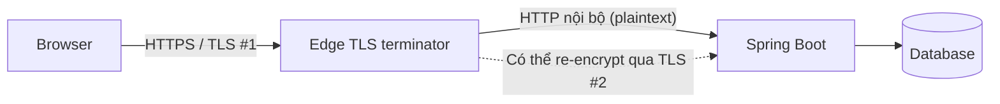
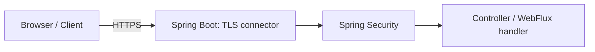
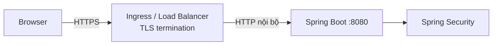
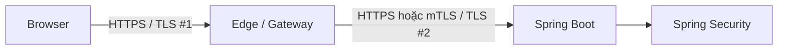
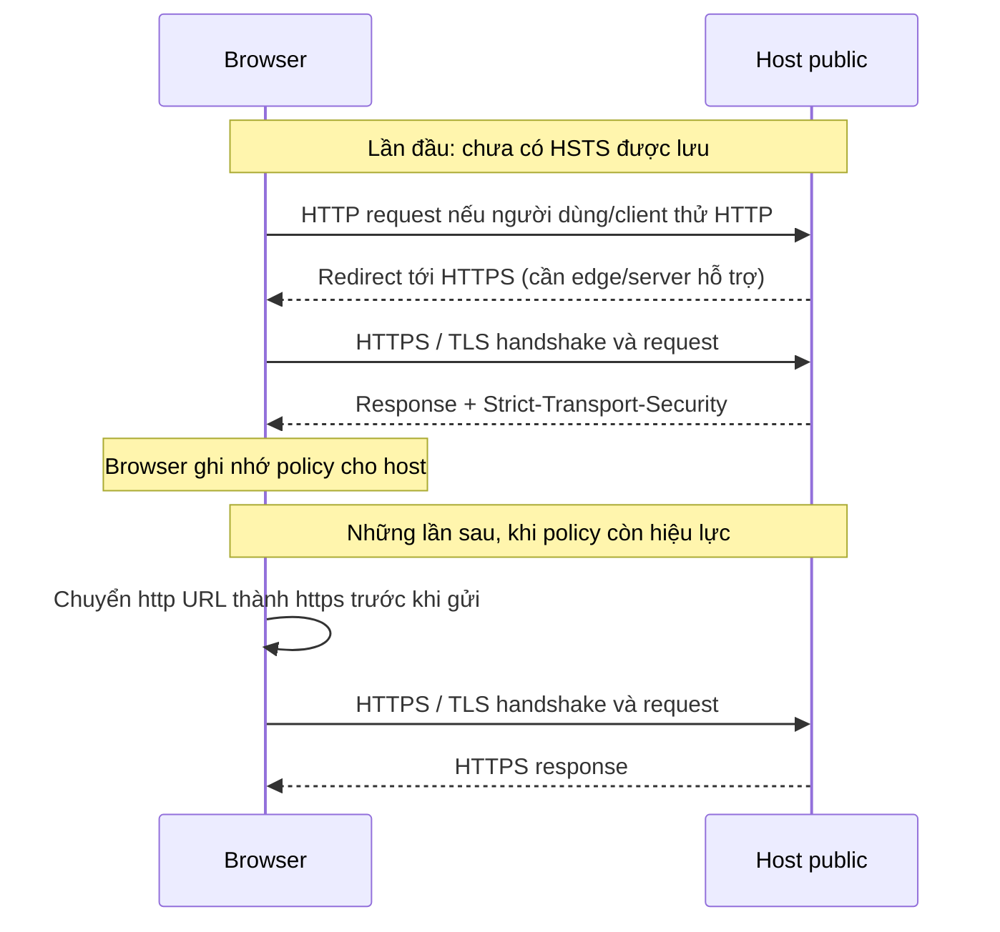

# Mã hóa đường truyền và ranh giới cấu hình của Spring Security

> **Chương:** HTTPS và HSTS  
> **Học phần:** `SPRING_SECURITY_HTTP_PROTECTION` — triển khai các lớp phòng vệ HTTP và trình duyệt trong Spring Security, bao gồm CSRF, CORS, security headers, CSP, HSTS, HTTP firewall và session. Bài này đi sâu vào **mã hóa đường truyền**, **điểm kết thúc TLS**, **năng lực và giới hạn của Spring Security**, đồng thời đối chiếu **Servlet** với **Reactive WebFlux**, kiểm thử qua trình duyệt và reverse proxy.

## 1. Tình huống mở đầu: đã bật Spring Security thì kết nối có được mã hóa chưa?

Một ứng dụng ngân hàng có cấu hình:

```java
@Bean
SecurityFilterChain securityFilterChain(HttpSecurity http)
        throws Exception {
    return http
        .authorizeHttpRequests(auth -> auth
            .anyRequest().authenticated())
        .formLogin(Customizer.withDefaults())
        .build();
}
```

Lập trình viên truy cập `http://localhost:8080`, đăng nhập thành công và thấy trang cần xác thực. **Điều đó không chứng minh kết nối đã được mã hóa**. Spring Security có thể xác thực người dùng và kiểm tra quyền ngay trên một request HTTP không được bảo vệ bằng TLS, nếu ứng dụng/hạ tầng cho phép HTTP.

Tương tự, thêm header `Strict-Transport-Security` vào response **không tự dựng chứng chỉ TLS**, không chuyển cổng backend sang HTTPS và không bảo vệ hop nội bộ giữa reverse proxy với ứng dụng.

Cần phân biệt ba nhiệm vụ:

1. **Thiết lập HTTPS:** HTTP server, servlet container, reactive runtime hoặc proxy thực hiện TLS handshake, sử dụng chứng chỉ/khóa riêng hợp lệ.
2. **Áp dụng chính sách ở tầng HTTP:** Spring Security có thể yêu cầu kết nối secure, chuyển hướng request không secure và thêm các response headers như HSTS tùy phiên bản/cấu hình.
3. **Bảo vệ chức năng sau khi kết nối được thiết lập:** Spring Security xác thực, phân quyền, kiểm tra CSRF, quản lý context/session; service kiểm tra quyền thực tế trên tài nguyên.

**Không được đồng nhất ba nhiệm vụ này.** Đây là điểm xuất phát để học HTTPS/HSTS đúng.

### Mục tiêu học tập

Sau bài học, người học có thể:

- Giải thích chính xác TLS bảo vệ điều gì, không bảo vệ điều gì và tại sao từng **hop mạng** phải được xem xét.
- Vẽ ranh giới TLS trong các kiến trúc Spring Boot trực tiếp phục vụ HTTPS, edge TLS termination và re-encryption/mTLS nội bộ.
- Phân biệt cấu hình TLS ở Spring Boot/HTTP server/proxy với **channel security, HSTS header writer và authentication/authorization** của Spring Security.
- Giải thích điều kiện trình duyệt nhận và thực thi HSTS, giới hạn “lần truy cập đầu tiên”, `includeSubDomains`, `preload` và quy trình rollback.
- Cấu hình minh họa cho Servlet và WebFlux có xét tới reverse proxy và **trusted forwarded headers**.
- Kiểm thử HTTPS, chứng chỉ, HSTS, redirect, cookie `Secure`, mixed content và session trên đường đi thực.
- Chẩn đoán khi localhost hoạt động nhưng production thiếu HSTS, vòng lặp redirect, sai scheme hoặc xuất hiện cookie/URL không an toàn.

## 2. Threat model: kẻ tấn công đang đứng ở đâu?

Xét người dùng đăng nhập ở `https://portal.example.com` và gửi một yêu cầu cập nhật thông tin cá nhân đến `https://api.example.com`.

Một attacker có thể kiểm soát Wi-Fi công cộng, thiết bị mạng trung gian hoặc một proxy không đáng tin. Nếu HTTP được gửi **không qua TLS**, attacker có thể quan sát hoặc sửa request/response trên đường đi, bao gồm nội dung form, dữ liệu API, cookie phiên và những thông tin nhạy cảm khác.

Với HTTPS được triển khai và xác minh đúng, TLS góp phần đảm bảo:

- **Bí mật trên kết nối:** bên nghe lén trên tuyến không đọc được HTTP payload ở dạng rõ.
- **Toàn vẹn trên kết nối:** các sửa đổi trái phép vào dữ liệu được bảo vệ sẽ bị phát hiện trong quá trình xử lý TLS.
- **Xác thực endpoint:** browser xác minh chứng chỉ của server phù hợp hostname và chuỗi tin cậy, qua đó giảm nguy cơ giả mạo máy chủ.

Tuy nhiên TLS **không** đảm bảo rằng phần mềm ở hai đầu kết nối an toàn. Browser nhiễm mã độc, XSS chạy trong origin, server bị chiếm, credential bị lộ ở log, hoặc API thiếu phân quyền vẫn có thể gây hại.

| Mối nguy | HTTPS/TLS giúp gì? | Cơ chế cần bổ sung |
| --- | --- | --- |
| Nghe lén form/password/cookie trên đường truyền | Mã hóa dữ liệu trên hop có TLS | Không gửi secret vào URL/log; cookie và session an toàn |
| Attacker sửa HTML hoặc redirect khi truyền HTTP | TLS bảo vệ toàn vẹn response trên kết nối đã xác thực | HSTS, redirect HTTPS, CSP, chống XSS |
| Trang độc hại kích hoạt POST dùng cookie của user | TLS **không** xác nhận ý định của request | CSRF protection, `SameSite` và authorization |
| User A truy cập tài nguyên của user B | TLS **không** biết ownership | Object-level authorization, tenant/ACL |
| Script XSS chạy trong trang HTTPS | TLS vẫn có thể hoàn toàn hợp lệ | Output encoding/sanitization, CSP |
| CDN trả nhầm dữ liệu tài khoản | TLS chỉ mã hóa **dữ liệu CDN đã chọn trả** | Cache-Control, cache partition và test A/B user |
| Backend HTTP sau TLS proxy bị nghe lén trên mạng nội bộ | TLS giữa browser và edge **không** mã hóa hop nội bộ | TLS/mTLS hoặc network trust có đánh giá rõ |
| Reverse proxy giả mạo `X-Forwarded-Proto` | TLS không tự xác minh nội dung header này | Trusted proxy, overwrite headers, network isolation |
| Request path lạ vượt matcher | TLS không giải quyết parse/normalization | HTTP firewall, thống nhất URL và object authorization |

**Bất biến cần xác nhận:** không có thông tin xác thực hoặc dữ liệu nhạy cảm đi qua một hop không đáp ứng mức bảo vệ đã thiết kế, và mọi request vẫn chịu authentication/authorization thích hợp dù được gửi qua HTTPS.

## 3. TLS hoạt động ở đâu trong kiến trúc HTTP?

### 3.1. HTTP và HTTPS

HTTP là giao thức ứng dụng. HTTPS là HTTP được truyền qua TLS. Với một kết nối HTTPS thông thường:

1. Client kết nối đến hostname/cổng của TLS endpoint.
2. Hai bên thương lượng phiên TLS và xác lập khóa phiên theo giao thức đã hỗ trợ.
3. Server cung cấp thông tin chứng chỉ; client kiểm tra hostname, hiệu lực và chuỗi tin cậy theo chính sách của mình.
4. Khi handshake thành công, HTTP request/response được truyền trong kênh TLS.
5. Endpoint TLS giải mã HTTP trước khi web server hoặc reverse proxy xử lý nó.

TLS là một **ranh giới kết nối**, không phải một “cờ đã mã hóa” gắn với request cho toàn hệ thống. Khi proxy giải mã và tạo kết nối mới tới backend, cần xác định kết nối mới là HTTP hay HTTPS.

### 3.2. Một URL HTTPS không cho biết toàn bộ đường đi nội bộ

Một browser có thể hiển thị biểu tượng kết nối bảo mật cho `https://api.example.com` ngay cả khi reverse proxy chuyển tiếp HTTP đến `http://api-service:8080`.



Trong sơ đồ, đường nét đứt là **phương án thay thế** cho hop HTTP nội bộ, không phải cả hai đường mặc nhiên chạy đồng thời.

### 3.3. TLS không thay quyền nghiệp vụ

Một endpoint `GET /api/accounts/42` có TLS hợp lệ vẫn phải xác định:

- Caller là ai?
- Session/JWT còn hiệu lực không?
- Caller có authority đọc tài khoản không?
- Tài khoản 42 có thuộc caller/tenant không?
- Response có được cache hoặc phát lại cho người khác không?

HTTPS chỉ giúp bảo vệ **kết nối vận chuyển** chứa request/response đó. Đây là lý do học phần `SPRING_SECURITY_HTTP_PROTECTION` phải kết hợp HTTPS với CSRF, security headers, HTTP firewall, session và authorization.

## 4. Ba topology TLS thường gặp

### 4.1. Mô hình A — TLS kết thúc trực tiếp tại Spring Boot



Trong mô hình này, HTTP runtime bên trong Spring Boot (Tomcat/Jetty/Undertow hoặc Reactor Netty tùy stack/runtime) xử lý TLS. Khi request đến lớp security, ứng dụng thường có đủ thông tin để nhận biết request đến qua HTTPS.

Ưu điểm: ranh giới TLS rõ, dễ kiểm tra ở môi trường một service, ít lệ thuộc vào forwarded headers. Hạn chế: phải quản lý chứng chỉ/khóa riêng và cấu hình TLS ở mỗi ứng dụng; load balancing và certificate rotation cần giải pháp vận hành phù hợp.

### 4.2. Mô hình B — TLS termination tại reverse proxy



Proxy quản lý chứng chỉ và giải mã request. Backend có thể chỉ thấy HTTP. Kiến trúc có thể hợp lý nếu hop nội bộ được cách ly, nhưng cần đánh giá rủi ro cụ thể: mạng riêng không tự động có cùng tính bí mật/toàn vẹn như một kết nối TLS được xác thực.

**Lỗi tích hợp đặc trưng:** ứng dụng sinh redirect `http://...`, không phát HSTS vì nhận diện request là HTTP, hoặc rơi vào vòng lặp redirect HTTPS khi không hiểu external scheme.

### 4.3. Mô hình C — TLS tại edge và TLS/mTLS tới backend



Hai kết nối TLS **độc lập** bảo vệ hai hop. mTLS giữa edge và backend có thể xác thực cả client service lẫn server service tùy chính sách. Điều này thường phù hợp khi có yêu cầu bảo mật mạng nội bộ cao, zero-trust/service mesh hoặc audit về luồng dữ liệu.

Cần phân biệt:

- Chứng chỉ browser kiểm tra cho host public.
- Chứng chỉ/identity của backend được edge/service mesh kiểm tra trên hop nội bộ.
- Identity của **người dùng ứng dụng** do Spring Security/IdP xác thực.

mTLS xác thực proxy hoặc workload **không tự biến workload identity thành quyền nghiệp vụ của người dùng cuối**.

## 5. Chính xác Spring Security cấu hình được những gì?

| Công việc | Chủ thể thực hiện chính | Phần Spring Security hỗ trợ |
| --- | --- | --- |
| Tạo khóa riêng và chứng chỉ | PKI/CA, platform, vận hành | Không tự phát hành chứng chỉ production |
| Thương lượng TLS, mã hóa luồng byte | Browser/client và TLS endpoint | Không thực hiện TLS handshake ở filter chain |
| Cấu hình cổng HTTPS và keystore | Spring Boot HTTP server hoặc reverse proxy | Không thay thế `server.ssl` hoặc TLS server config |
| Chuyển HTTP sang HTTPS | Proxy hoặc server; có thể qua security config | Có hỗ trợ channel security/redirect tùy stack và phiên bản |
| Phát HSTS | Edge hoặc HTTP response writer | Có hỗ trợ HSTS security header |
| Browser nâng request HTTP thành HTTPS theo HSTS | Browser | Không điều khiển browser ngoài chính sách response |
| Đánh dấu session cookie `Secure` | Container, Spring Session, WebSession/cookie resolver hoặc edge | Tích hợp session nhưng không tự quản mọi cookie attribute |
| Xác thực, phân quyền, CSRF, HTTP firewall | Spring Security và service | Các cơ chế cốt lõi |
| Xác minh host/scheme từ reverse proxy | Edge và HTTP framework/container | Phụ thuộc trusted forwarded headers trước chain |
| Bảo vệ browser trước XSS/frame injection | Ứng dụng và browser | Ghi CSP/frame headers; vẫn cần encode/sanitize |
| Bảo vệ dữ liệu sau TLS termination | Proxy, mạng nội bộ, TLS/mTLS hoặc service mesh | Không tự mã hóa lại mọi hop |

**Kết luận tạm thời:** Spring Security *có thể yêu cầu kênh an toàn và công bố chính sách HSTS*, nhưng **không phải TLS termination engine**. Nếu nhìn thấy URL `https://`, đừng suy ra mọi hop, mọi cookie và mọi API đều đã được bảo vệ.

## 6. TLS đúng phải bắt đầu bằng chứng chỉ và hostname đúng

Khi client truy cập `https://api.example.com`, kết nối chỉ có ý nghĩa nếu client xác minh server mà nó định kết nối. Những yêu cầu thường gặp:

- Chứng chỉ phải hợp lệ theo chính sách client, còn thời hạn và có chain tin cậy phù hợp.
- Tên miền yêu cầu phải khớp định danh trên chứng chỉ (thông thường trong Subject Alternative Name — SAN).
- Server cần phục vụ chứng chỉ đúng hostname, kể cả khi có nhiều host cùng địa chỉ IP (SNI).
- Khóa riêng phải được bảo vệ, tránh lưu trong source control hoặc log.
- Chính sách protocol/cipher và quy trình cập nhật cần phù hợp tiêu chuẩn bảo mật của tổ chức.
- Chứng chỉ phải được gia hạn/đổi trước khi hết hạn, có giám sát và bài kiểm thử sau rollout.
- Với mTLS nội bộ, cả hai phía phải kiểm tra identity và trust roots theo thiết kế, không chấp nhận mọi certificate chỉ để test qua lỗi.

### 6.1. Đừng bỏ qua lỗi chứng chỉ bằng client insecure mode

Trong môi trường học tập có thể gặp chứng chỉ tự ký. Việc dùng tùy chọn bỏ kiểm tra chứng chỉ (chẳng hạn `curl -k` hoặc trust-all TLS client) có thể làm bài thử “thành công” nhưng **không chứng minh endpoint đã được xác thực**.

Cách làm đúng:

1. Dùng một test CA phù hợp và thêm trust root vào **môi trường test**.
2. Dùng hostname phù hợp SAN của chứng chỉ, tránh truy cập một IP không có trong SAN.
3. Kiểm tra đường kết nối mà người dùng thực đi qua.
4. Không để trust-all verifier tồn tại trong production.

### 6.2. HTTPS bảo vệ hostname, không bảo vệ quyết định phía ứng dụng

Nếu attacker quản lý được một origin hợp lệ hoặc một script của ứng dụng, HTTPS có thể vẫn “xanh” trong khi dữ liệu người dùng bị lộ bởi lỗi XSS. Cần kết hợp CSP, cookie policy và object authorization.

## 7. Khi Spring Boot trực tiếp sở hữu TLS

Spring Boot có các thuộc tính cấu hình TLS tại HTTP server. Một ví dụ dùng PKCS#12 trong **môi trường thử nghiệm**:

```yaml
# application.yml minh họa cho backend trực tiếp nhận HTTPS.
server:
  port: 8443
  ssl:
    enabled: true
    key-store: classpath:tls/dev-server.p12
    key-store-type: PKCS12
    key-store-password: "__SET_VIA_SECURE_CONFIGURATION__"
```

Giải thích:

- TLS được kích hoạt ở **embedded HTTP server**, không phải ở `HttpSecurity` hoặc `ServerHttpSecurity`.
- File `dev-server.p12` chỉ là tên minh họa; bài này không cung cấp hoặc sinh khóa/chứng chỉ.
- Trong dự án thật, **không commit mật khẩu keystore** vào source. Sử dụng secret manager, môi trường triển khai hoặc cơ chế TLS bundle được Spring Boot phiên bản đang dùng hỗ trợ.
- Chứng chỉ cần khớp hostname mà client kết nối. Một file phát hành cho `localhost` không tự hợp lệ cho `api.example.com`.
- Spring Boot TLS bundles và những thuộc tính cấu hình chi tiết khác phụ thuộc phiên bản; đối chiếu tài liệu Boot đang sử dụng.

**Kiểm thử cần làm:** kết nối HTTPS thật tới cổng đã cấu hình với chứng chỉ tin cậy, kiểm tra Host/SAN, response và redirect. Chỉ thấy server khởi động ở cổng 8443 chưa chứng minh trình duyệt sẽ xác minh chứng chỉ thành công.

### 7.1. Có cần mở thêm cổng HTTP để redirect không?

Cổng HTTPS không tự cung cấp một HTTP listener riêng. Nếu muốn người dùng gõ `http://api.example.com` được chuyển sang `https://api.example.com`, phải có một endpoint HTTP có nhiệm vụ redirect ở edge/server, hoặc dựa vào HSTS đã được browser ghi nhớ/preload.

Với production sau ingress, đặt redirect ở edge thường giúp tránh chạy thêm một listener HTTP trong từng backend. Nhưng cần kiểm tra quy tắc redirect cho **mọi host public** và đường dẫn phù hợp.

## 8. Servlet: channel security và ranh giới của nó

Trong một số phiên bản Spring Security Servlet, có DSL yêu cầu request dùng HTTPS, ví dụ với `HttpSecurity`:

```java
@Bean
SecurityFilterChain servletSecurity(HttpSecurity http)
        throws Exception {
    return http
        // Ví dụ cú pháp cho Spring Security 6.x;
        // kiểm tra API tương ứng version đang dùng.
        .requiresChannel(channel -> channel
            .anyRequest().requiresSecure())
        .authorizeHttpRequests(auth -> auth
            .anyRequest().authenticated())
        .formLogin(Customizer.withDefaults())
        .build();
}
```

**Quan trọng:**

1. Tùy phiên bản, API `requiresChannel` có thể khác hoặc được định hướng sang cơ chế redirect HTTPS mới; cần đối chiếu tài liệu của dependency đã ghim.
2. Spring Security xử lý request **sau khi HTTP connector/proxy đã nhận** request. Rule trên không tự cấu hình chứng chỉ TLS hoặc mở HTTPS port.
3. Khi ứng dụng chạy sau TLS termination và chỉ nhận HTTP nội bộ, security layer có thể cho rằng mọi request đều không secure, rồi redirect vòng lặp nếu thiếu trusted forwarding hoặc không thống nhất redirect ownership.
4. Đừng đồng thời áp redirect HTTP→HTTPS ở nhiều lớp mà không hiểu `Host`, cổng và `X-Forwarded-Proto` thực tế.
5. Nếu edge đã redirect và backend chỉ được phép truy cập qua edge, có thể giữ redirect ở edge và để security chain tập trung authentication/authorization, CSRF và headers.

### 8.1. Phân biệt “chặn HTTP” với “chuyển hướng HTTP”

Một sản phẩm có thể muốn redirect HTTP GET tới HTTPS, nhưng không nên kỳ vọng HTTP request chứa **password hoặc cookie nhạy cảm** đã được bảo vệ chỉ vì response trả `301/302`. Thông tin có thể đã được gửi **trước redirect** nếu client cố tình kết nối HTTP.

- Không chuyển request có secret sang HTTP ngay từ frontend.
- Cookie phiên nên có `Secure`.
- Đường login/POST không nên được thiết kế dựa trên việc gửi credential qua HTTP rồi redirect.
- HSTS hỗ trợ browser ngăn lần truy cập HTTP sau khi đã nhận policy hợp lệ; với first visit vẫn cần TLS-first/redirect và cân nhắc preload.

## 9. Reactive WebFlux: yêu cầu HTTPS ở đâu?

WebFlux dùng `ServerHttpSecurity`, không dùng `HttpSecurity` của Servlet. Trong các phiên bản Spring Security Reactive hỗ trợ, cấu hình redirect HTTPS theo DSL ví dụ:

```java
@Bean
SecurityWebFilterChain reactiveSecurity(ServerHttpSecurity http) {
    return http
        .redirectToHttps(Customizer.withDefaults())
        .authorizeExchange(auth -> auth
            .anyExchange().authenticated())
        .httpBasic(Customizer.withDefaults())
        .build();
}
```

Đây là **mẫu DSL WebFlux cần đối chiếu version**, không phải cách dựng một TLS listener. Reactor Netty/HTTP runtime hoặc proxy vẫn chịu trách nhiệm cho TLS, chứng chỉ và port.

Trong WebFlux, request scheme/external host có thể được suy ra từ `ServerWebExchange` đã được xử lý forwarded metadata. Nếu dùng redirect ở tầng Spring Security mà `ServerWebExchange` không phản ánh HTTPS của client sau TLS termination, vẫn có khả năng loop hoặc tạo URL sai.

### 9.1. Giống Servlet về threat model, khác API triển khai

| Vấn đề | Servlet | Reactive WebFlux |
| --- | --- | --- |
| Spring Security config | `HttpSecurity` | `ServerHttpSecurity` |
| Chain | `SecurityFilterChain` | `SecurityWebFilterChain` |
| URL yêu cầu HTTPS | Channel security / HTTPS redirect tùy version | `redirectToHttps` và cơ chế tương ứng tùy version |
| Request thông tin secure | Servlet request/container + forwarded integration | `ServerWebExchange` + forwarded integration |
| Security context | `SecurityContextHolder` và cơ chế request/thread | `ReactiveSecurityContextHolder` trong Reactor context |
| Session | `HttpSession` | `WebSession` |
| HTTP test | `MockMvc` | `WebTestClient` |
| TLS termination | Container hoặc edge | Reactive server hoặc edge |

**Không thể** đưa `HttpServletRequest.isSecure()` vào một Reactive handler và mong nó hoạt động như trong Servlet. Tuy nhiên yêu cầu kiểm tra browser HTTPS và forwarded headers **là như nhau**.

## 10. Trusted forwarded headers: phần quan trọng khi TLS dừng ở proxy

Một yêu cầu ban đầu:

```http
GET /api/me HTTP/1.1
Host: api.example.com
```

đi qua HTTPS từ browser tới edge, nhưng edge gọi `http://backend:8080/api/me`. Để backend tạo redirect, URL tuyệt đối, cookie và HSTS phù hợp với **scheme bên ngoài**, edge có thể chuyển metadata:

```http
Forwarded: for=198.51.100.20;proto=https;host=api.example.com
X-Forwarded-Proto: https
X-Forwarded-Host: api.example.com
```

Các giá trị trên **chỉ là ví dụ**. `198.51.100.20` thuộc dải địa chỉ dùng cho minh họa tài liệu.

### 10.1. Header tự khai báo không phải bằng chứng tin cậy

Nếu backend nhận request trực tiếp từ Internet hoặc proxy giữ nguyên `X-Forwarded-Proto` do attacker tự gửi, ứng dụng có thể bị đánh lừa về scheme/host.

Hậu quả tùy cách dùng metadata:

- Redirect đến scheme hoặc hostname do attacker chọn.
- Phát absolute links/callback URLs không đúng.
- Đưa ra quyết định sai về request secure và header HSTS.
- Thiết lập cookie hoặc URL dựa trên `Host`/scheme bị giả mạo.

Cách phòng vệ:

1. Chỉ proxy đáng tin được phép kết nối backend (network ACL, private network, mTLS hoặc kết hợp).
2. **Proxy xóa/ghi đè** mọi forwarded headers do client gửi từ ranh giới không tin cậy, rồi tạo giá trị đúng từ kết nối thực.
3. Xác định số hop và cách xử lý chuỗi forwarded headers; tránh lấy phần tử do client tự đẩy vào.
4. Giới hạn hostname hợp lệ ở ingress và ứng dụng theo kiến trúc, tránh Host-header poisoning.
5. Kiểm thử spoof `X-Forwarded-Proto`/`X-Forwarded-Host` ở edge và cả đường truy cập backend trực tiếp nếu còn tồn tại.

### 10.2. Tích hợp Spring Boot với forwarding

Spring Boot có chiến lược xử lý forwarded headers, ví dụ:

```yaml
# Chỉ bật khi đã xây trust boundary đúng.
server:
  forward-headers-strategy: framework
```

Tùy môi trường, `framework` hoặc `native` của container/runtime thích hợp hơn. **Không có chiến lược nào tự biến forwarded headers từ Internet thành đáng tin**: việc lọc/gắn metadata và khóa đường truy cập backend là trách nhiệm hạ tầng.

Các lớp tương ứng trong Spring Framework gồm:

- **Servlet:** `ForwardedHeaderFilter` và cơ chế container integration.
- **Reactive:** `ForwardedHeaderTransformer` và cơ chế runtime integration.

Không coi bất kỳ một class nào ở trên là biện pháp TLS encryption. Chúng chỉ ảnh hưởng cách framework **diễn giải request URL/scheme/host**.

## 11. HSTS là gì và vì sao không đồng nghĩa HTTPS redirect?

**HTTP Strict Transport Security (HSTS)** là chính sách response mà một hostname có thể công bố **qua HTTPS hợp lệ**, để browser ghi nhớ rằng các kết nối tương lai tới hostname đó phải dùng HTTPS.

Ví dụ:

```http
Strict-Transport-Security: max-age=31536000
```

- `Strict-Transport-Security` là tên header.
- `max-age` là số giây browser ghi nhớ policy từ lần nhận gần nhất.
- Browser có thể nâng cấp URL HTTP thành HTTPS **trước khi phát request** tới hostname đã biết HSTS.
- Một header HSTS nhận qua HTTP không được browser tin để thiết lập HSTS.
- Client không phải browser có thể không hỗ trợ/không ghi nhớ HSTS.

### 11.1. Trình tự lần đầu và lần sau



Cần lưu ý:

- Lần HTTP đầu tiên **trước khi HSTS được biết** vẫn có khoảng trống để attacker can thiệp redirect, trừ các cơ chế đã biết trước như preload list/HTTPS-first behavior phù hợp của browser.
- Không được dùng HSTS để biện hộ cho việc cho client gửi login/password trước qua HTTP.
- Browser đã ghi nhớ HSTS thường **không cho người dùng bỏ qua lỗi chứng chỉ** theo cách nó có thể cho với một số host không HSTS; không nên kỳ vọng HSTS giải quyết sự cố chứng chỉ.
- HSTS phụ thuộc browser và policy còn hiệu lực; không thay kiểm tra TLS ở mọi ứng dụng gọi API.

### 11.2. Redirect và HSTS giải quyết hai thời điểm khác nhau

| Đặc tính | HTTP → HTTPS redirect | HSTS |
| --- | --- | --- |
| Ai quyết định? | Edge hoặc server khi nhận HTTP request | Browser dựa trên policy đã biết |
| Tác động trước khi gửi HTTP request? | Không, redirect là response cho HTTP request | Có, khi browser đã biết HSTS |
| Cần HTTPS/TLS hoạt động? | Có, để đích redirect thực sự an toàn | Có, để thiết lập policy và kết nối |
| Có giải quyết first visit chưa có policy? | Chỉ điều hướng sau request đầu | Không, trừ preload/known state |
| Có yêu cầu client thực thi policy? | HTTP client theo redirect | Trình duyệt/client hỗ trợ HSTS |
| Có tác động subdomain? | Theo từng host/rule redirect | Có thể, với `includeSubDomains` |
| Ai cung cấp header/rule? | Proxy/HTTP server/security config | Proxy hoặc security header writer |

## 12. HSTS max-age, includeSubDomains và preload: lựa chọn có rủi ro vận hành

HSTS tưởng đơn giản vì chỉ có một header, nhưng thay đổi policy có thể tác động nhiều hostname và kéo dài sau khi deploy đã rollback.

### 12.1. max-age

`max-age=31536000` là thời hạn khoảng một năm. Với một hostname đã được browser lưu HSTS, mỗi lần nhận policy hợp lệ có thể làm mới thời gian ghi nhớ.

Để yêu cầu browser xóa HSTS cho **hostname đang gửi header**, có thể gửi:

```http
Strict-Transport-Security: max-age=0
```

Nhưng:

- Header hủy policy vẫn cần được nhận qua HTTPS hợp lệ.
- Nếu trình duyệt không thể kết nối HTTPS vì chứng chỉ đã lỗi, việc phát `max-age=0` có thể không đến được client.
- Một hostname con vẫn có thể bị buộc dùng HTTPS do policy `includeSubDomains` từ **miền cha**, dù policy riêng của hostname con hết hạn.
- Nếu hostname nằm trong **preload list** của browser, việc gỡ khỏi preload cần quy trình riêng và phụ thuộc vòng phát hành browser; chỉ phát `max-age=0` không có nghĩa mọi browser bỏ preload ngay.

### 12.2. includeSubDomains

Ví dụ:

```http
Strict-Transport-Security: max-age=31536000; includeSubDomains
```

Khi một policy này được thiết lập cho `example.com`, browser có thể áp dụng yêu cầu HTTPS cho các subdomain của miền đó, bao gồm những dịch vụ không tham gia cấu hình Spring Security.

**Rủi ro cụ thể:** `legacy.example.com` hoặc `dev.example.com` vẫn dùng HTTP; người dùng đã nhận policy từ miền cha có thể không truy cập được chúng theo HTTP như trước.

Trước khi bật:

1. Liệt kê các subdomain có thể bị tác động, kể cả dịch vụ ngoài Spring Boot.
2. Xác nhận chứng chỉ/TLS/redirect của từng host.
3. Xác định ai có quyền phê duyệt thay đổi chính sách ở cấp miền.
4. Có kế hoạch khôi phục và thời hạn rollout.
5. Kiểm thử trên hostname thật trong browser có policy HSTS đã lưu.

### 12.3. preload

`preload` thường được đề cập trong bộ điều kiện đăng ký HSTS preload list, giúp một số browser biết chính sách trước lần truy cập đầu tiên. Nhưng:

- Gắn từ `preload` vào header **không đồng nghĩa** hostname đã có trong preload list.
- Việc đăng ký có tiêu chí HTTPS, redirect, thời hạn và includeSubDomains riêng; phải kiểm tra yêu cầu hiện hành từ chương trình preload.
- Xóa khỏi preload có thể chậm và không diễn ra tức thời trên mọi browser.
- Không dùng preload cho một miền gốc khi tổ chức chưa sẵn sàng duy trì HTTPS cho toàn bộ phạm vi cần thiết.

### 12.4. HSTS và môi trường staging

Không vô tình bật `includeSubDomains`/preload ở một miền cha dùng chung nhiều môi trường, khiến staging/legacy bị ảnh hưởng. Nếu cần thử HSTS, ưu tiên hostname riêng thuộc phạm vi kiểm soát và có chứng chỉ hợp lệ.

## 13. Spring Security phát HSTS như thế nào?

Spring Security có cơ chế **security headers**. Ở cấu hình web tiêu chuẩn, HSTS thường được áp dụng theo điều kiện **request được nhận diện là HTTPS/secure** và tùy version/configuration. Đây là cơ chế *phát HTTP header*, không phải cách triển khai TLS.

Một số lưu ý:

- Khi ứng dụng trực tiếp nhận TLS, request thường được đánh dấu secure đúng.
- Khi TLS dừng tại proxy, backend nhận HTTP và không được cung cấp trusted forwarding, Spring Security có thể không phát HSTS.
- Nếu edge được giao sở hữu HSTS, backend không cần phát cùng header một cách mâu thuẫn.
- Response do WAF, CDN hoặc gateway tự sinh có thể không đi qua security header writers của backend.
- Không tắt toàn bộ headers chỉ để thay đổi HSTS trên một đường dẫn; cần xem các header mặc định còn được sử dụng.
- Policy CSP, frame options, cache control và cookie attributes **khác HSTS về mục đích**.

### 13.1. Ví dụ cấu hình HSTS trong Servlet

Cú pháp minh họa với Spring Security Servlet 6.x:

```java
@Bean
SecurityFilterChain servletHeaders(HttpSecurity http)
        throws Exception {
    return http
        .headers(headers -> headers
            .httpStrictTransportSecurity(hsts -> hsts
                .includeSubDomains(false)
                .maxAgeInSeconds(31536000)
            )
        )
        .authorizeHttpRequests(auth -> auth
            .anyRequest().authenticated())
        .formLogin(Customizer.withDefaults())
        .build();
}
```

Giải thích:

- `includeSubDomains(false)` được chọn **có chủ đích** để tránh áp policy xuống các subdomain chưa được kiểm kê.
- `maxAgeInSeconds(31536000)` là ví dụ thời hạn dài; giai đoạn thử nghiệm có thể cần thời hạn ngắn hơn và kế hoạch rollout.
- Code minh họa API cần kiểm tra với phiên bản Spring Security đã ghim, nhất là sau các thay đổi DSL giữa những major versions.
- **HSTS chỉ có ý nghĩa khi browser nhận header trên HTTPS response hợp lệ.** Test chỉ assert header bằng mock request không thay kiểm tra TLS thật.
- Không tự tuyên bố response từ mọi proxy/error page sẽ có header giống response ứng dụng.

### 13.2. WebFlux: xác nhận HSTS thuộc reactive headers

WebFlux sử dụng `ServerHttpSecurity.headers(...)`, không dùng `HttpSecurity` của Servlet. Ở những phiên bản hỗ trợ, có thể giữ cấu hình security headers Reactive và quan sát HSTS trên response được coi là secure:

```java
@Bean
SecurityWebFilterChain reactiveHeaders(ServerHttpSecurity http) {
    return http
        .headers(Customizer.withDefaults())
        .authorizeExchange(auth -> auth
            .anyExchange().authenticated())
        .httpBasic(Customizer.withDefaults())
        .build();
}
```

Ví dụ cố ý không cố định các method điều chỉnh HSTS Reactive có thể khác giữa phiên bản. Nếu cần đổi `max-age`, subdomain hoặc preload, tra API `ServerHttpSecurity.HeaderSpec`/HSTS spec phù hợp phiên bản hoặc giao **edge sở hữu HSTS** một cách rõ ràng.

**Điều cần kiểm thử giống nhau ở cả hai stack:** client kết nối tới hostname public qua HTTPS hợp lệ và nhận chính xác `Strict-Transport-Security` theo policy đã chọn. Không đánh giá chỉ bằng việc bean được tạo.

## 14. HSTS không thể thay các HTTP security headers khác

Một hệ thống dùng HTTPS và HSTS vẫn có thể bị XSS, clickjacking, CSRF, cache dữ liệu nhạy cảm hoặc thiếu object authorization.

| Header/cơ chế | Bảo vệ chính | Vì sao HTTPS/HSTS không đủ |
| --- | --- | --- |
| `Content-Security-Policy` | Hạn chế script/resource/frame theo chính sách browser | TLS không kiểm tra code chạy trong document |
| `X-Frame-Options`/`frame-ancestors` | Giảm clickjacking | Trang HTTPS vẫn có thể bị nhúng nếu policy cho phép |
| `X-Content-Type-Options: nosniff` | Hạn chế MIME sniffing | TLS không quy định content type |
| `Cache-Control` | Kiểm soát lưu và dùng lại response | CDN có thể mã hóa TLS nhưng trả sai dữ liệu |
| `Referrer-Policy` | Giảm lộ thông tin qua referrer | HTTPS không tự xóa dữ liệu nhạy cảm trong URL |
| `Secure` cookie | Hạn chế gửi cookie qua HTTP | HSTS chưa có thể không bảo vệ request đầu; cookie vẫn cần policy |
| `SameSite` cookie + CSRF | Giảm request giả mạo dùng cookie | TLS bảo vệ kết nối nhưng không xác minh ý định user |
| HTTP firewall | Hạn chế path/method nhập nhằng | TLS không chuẩn hóa URL hay kiểm tra matcher |
| Authorization | Xác định principal có quyền trên tài nguyên | TLS không biết owner/tenant |

Điều này lý giải vì sao `SPRING_SECURITY_HTTP_PROTECTION` bao gồm nhiều biện pháp phòng vệ, chứ không kết thúc ở việc bật HTTPS.

## 15. Session cookie cần được thiết kế cùng TLS

Một ứng dụng Servlet thường dùng cookie `JSESSIONID`; WebFlux có thể dùng cookie `SESSION` hoặc tên khác tùy cấu hình. Cookie là phương tiện browser lưu và gửi một giá trị liên quan tới session, không phải chính session state ở server.

Ví dụ:

```http
Set-Cookie: SESSION=<opaque-session-value>; Path=/; Secure; HttpOnly; SameSite=Lax
```

Đây là **cookie minh họa**, không có nghĩa Spring Security sẽ tự thêm đủ attributes ở mọi runtime.

### 15.1. Secure

`Secure` yêu cầu browser chỉ gửi cookie trên các kết nối HTTPS phù hợp (có một số quy tắc đặc biệt với localhost theo browser). Không nên tận dụng ngoại lệ localhost để thiết kế production.

Cookie không có `Secure` có thể bị gửi qua HTTP theo các điều kiện khác, đặc biệt trong những ngữ cảnh trước khi browser đã biết HSTS. Vì vậy HTTPS redirect và HSTS không thay việc cấu hình session cookie an toàn.

### 15.2. HttpOnly

`HttpOnly` hạn chế JavaScript đọc trực tiếp cookie, nhưng **không ngăn JavaScript XSS chạy ở origin hợp lệ gửi request kèm cookie**. Vẫn cần chống XSS ở nguồn và CSP.

### 15.3. SameSite

`SameSite` điều chỉnh khi browser gửi cookie trong ngữ cảnh same-site/cross-site. `https://portal.example.com` và `https://api.example.com` là **cross-origin**, nhưng có thể **same-site**. CORS và SameSite không phải một chính sách.

`SameSite=None` thường yêu cầu `Secure` trên browser hiện đại; chính sách third-party cookie có thể còn giới hạn thêm. `SameSite` hỗ trợ giảm CSRF nhưng không thay CSRF token trong ứng dụng cookie-session.

### 15.4. Session lifecycle

Ngoài TLS, cần kiểm tra:

- Session fixation protection sau login.
- Rotation hoặc thay session ID khi cần.
- Invalidation server-side khi logout.
- Timeout/hạn sử dụng và các phiên đồng thời theo threat model.
- Cookie clearing với Domain/Path tương ứng.
- Replay cookie cũ sau logout có còn truy cập được không.

Với WebFlux, các abstraction như `WebSession` và `ServerSecurityContextRepository` khác `HttpSession`/Servlet context; không sao chép API session management giữa hai stack tùy tiện.

## 16. Mixed content: HTML đã HTTPS nhưng tài nguyên con còn HTTP

Một trang tải tại `https://portal.example.com` có thể chứa:

```html
<!-- Ví dụ minh họa cấu hình không nên dùng trong production. -->
<script src="http://cdn.example.net/app.js"></script>

```

Trình duyệt hiện đại có những quy tắc mixed content: nhiều tài nguyên chủ động không an toàn bị chặn, một số loại có thể được tự động nâng cấp hoặc bị chặn tùy loại và browser.

**Vấn đề:** document chính có HTTPS không chứng minh mọi subresource hoặc WebSocket đều được tải qua kênh an toàn.

Kiểm tra:

1. Các script, CSS, ảnh, font, iframe và kết nối API được tham chiếu bằng HTTPS.
2. WebSocket dùng `wss://` thay vì `ws://` khi document cần kết nối an toàn.
3. Redirect của assets không quay về HTTP.
4. CSP có thể bổ sung `upgrade-insecure-requests` hoặc các directive phù hợp, nhưng không thay việc sửa URL nguồn và triển khai HTTPS tại đích.
5. Service worker, frontend build output và các tài nguyên phát từ CDN đều cần test trong browser.

**TLS không làm nội dung ứng dụng tự sạch XSS.** Một JavaScript hợp lệ được tải qua HTTPS nhưng chứa lỗi hoặc bị nguồn xuất bản xâm nhập vẫn gây hại.

## 17. CORS và CSRF vẫn cần dù API đã dùng HTTPS

Một SPA ở `https://portal.example.com` gọi API ở `https://api.example.com`. Hai origin khác nhau nên browser áp CORS, dù cả hai dùng HTTPS.

### 17.1. CORS: quyền đọc response trong browser

Browser có thể gửi preflight:

```http
OPTIONS /api/profile HTTP/1.1
Host: api.example.com
Origin: https://portal.example.com
Access-Control-Request-Method: PUT
Access-Control-Request-Headers: content-type,x-csrf-token
```

API/edge sở hữu CORS phải trả allowlist theo origin, method, headers và credentials chính xác. Preflight thường không mang cookie phiên, nên cần được xử lý **trước bước authentication có thể chặn vì thiếu cookie**.

Đừng suy ra HTTPS tự cho phép cross-origin fetch. CORS không xác thực user và không thể dùng thay authorization.

### 17.2. CSRF: server kiểm tra request thay đổi trạng thái dùng cookie

Nếu browser tự gửi cookie phiên, một website khác có thể tìm cách khởi tạo POST theo quy tắc cookie/browser. HTTPS bảo vệ kênh truyền nhưng không kiểm tra user có chủ ý khởi tạo POST đó.

- Servlet: `CsrfFilter` với repository/handler theo cấu hình.
- Reactive: `CsrfWebFilter` và repository Reactive.
- Frontend: gửi token CSRF đúng khi request nằm trong phạm vi cần bảo vệ.
- Service: kiểm tra user có quyền trên đối tượng và trạng thái.

Không tắt CSRF vì “API đã bật HTTPS”. Với bearer-only API có nguy cơ CSRF khác, cần đánh giá credential và chain cụ thể.

## 18. HTTP firewall và proxy: URL an toàn vẫn là yêu cầu độc lập

Một request qua HTTPS có thể chứa path không chuẩn:

```http
GET /api/resources/a%2Fb HTTP/1.1
Host: api.example.com
```

Trong một hệ thống nhiều hop, edge, container, Spring Security matcher và handler có thể hiểu khác nhau về `%2F`, `;`, `//`, backslash hoặc encoding đặc biệt. HTTP firewall giúp từ chối các dạng request có nguy cơ không nhất quán.

| Stack | Cơ chế |
| --- | --- |
| Servlet | `HttpFirewall` / `StrictHttpFirewall` |
| WebFlux | `ServerWebExchangeFirewall` / `StrictServerWebExchangeFirewall` |

**Chỉ sửa firewall sau khi có bằng chứng** đường dẫn hợp lệ bị chặn và các lớp parsing/authorization vẫn nhất quán. TLS không thay đối chiếu path và object authorization. Cần test request bất thường qua **cùng gateway** như production, không chỉ trực tiếp gọi backend.

## 19. Ai sở hữu chính sách khi có edge/CDN/WAF?

Một hệ thống có thể có nhiều thành phần cùng muốn thêm HSTS, CORS, CSP hoặc redirect. Nếu không có người sở hữu, xuất hiện lỗi:

- Edge phát HSTS với `includeSubDomains`, backend phát một policy khác.
- CDN ghi đè CSP trên HTML.
- API thêm CORS, gateway cũng thêm `Access-Control-Allow-Origin` khiến browser báo lỗi.
- Edge gửi redirect HTTPS nhưng backend cũng redirect do không nhận diện forwarded scheme.
- Trang lỗi `403/502` do WAF sinh không mang headers tương đương response ứng dụng.
- CDN cache một JSON profile sau khi TLS kết thúc và phát cho người dùng khác.

Một cách phân công mẫu:

| Quyết định | Lớp sở hữu được đề xuất | Cách xác minh |
| --- | --- | --- |
| Chứng chỉ public, TLS protocols | Edge / platform | TLS handshake từ browser |
| HTTP → HTTPS redirect public | Edge | Request HTTP, theo redirect đến HTTPS |
| HSTS trên hostname public | Edge hoặc app, chỉ một owner rõ | HTTPS response cuối, bao gồm lỗi/redirect |
| Trusted forwarding | Edge + backend | Không spoof được scheme/host từ client |
| Authentication/authorization/CSRF | Spring Security + service | Integration tests và state assertions |
| CSP của HTML SPA | Host thực sự phục vụ HTML | Browser nhận CSP trên document |
| Cookie attributes | Component phát `Set-Cookie` | Inspect login/logout response |
| Cache dữ liệu cá nhân | API + CDN | User A/B tests qua CDN |
| HTTP firewall/path normalization | Gateway + stack Spring Security | Encoded path tests trên cùng tuyến |

Bảng chỉ là **phân công tham khảo**. Kiến trúc cụ thể có thể giao trách nhiệm khác, nhưng mỗi policy phải có owner, một cách kiểm thử và quyết định xử lý response không đi qua backend.

## 20. Ma trận kiểm thử: từ unit test đến trình duyệt thật

**Cần phân biệt kiểm thử ba cấp độ:**

- **Security chain test:** xác minh filter/headers được framework áp dụng cho request giả lập.
- **TLS/edge integration test:** xác minh cổng, chứng chỉ, redirect, forwarded metadata và HSTS trên tuyến thật.
- **Browser end-to-end test:** xác minh HSTS/CORS/CSP/cookie/mixed content được browser áp dụng trong hành trình người dùng.

| Mã test | Kịch bản | Kỳ vọng | Nơi đo |
| --- | --- | --- | --- |
| TLS-01 | HTTPS tới hostname public | Chứng chỉ tin cậy, khớp hostname, TLS handshake thành công | Browser/CLI TLS client |
| TLS-02 | HTTP tới hostname public | Redirect tới đúng HTTPS host nếu đây là chính sách | Edge/server |
| TLS-03 | Client thử giả mạo `X-Forwarded-Proto` | Không làm thay đổi scheme/redirect theo ý attacker | Edge + app |
| TLS-04 | Hop edge→backend | TLS/mTLS hoặc mức bảo vệ mạng đúng thiết kế | Platform/infrastructure |
| HSTS-01 | HTTPS response từ host public | HSTS policy đúng max-age/subdomain | Response cuối |
| HSTS-02 | HTTP response phát HSTS | Browser không lấy policy HSTS từ HTTP | Browser |
| HSTS-03 | Browser đã lưu HSTS | Browser nâng request HTTP sang HTTPS trước khi gửi | Browser state/network |
| HSTS-04 | Subdomain chưa sẵn sàng HTTPS | Không bị policy cấp cha ảnh hưởng ngoài kế hoạch | Browser/test hostname |
| COOKIE-01 | Login qua HTTPS | `Secure`/`HttpOnly`/`SameSite` theo policy | Browser response |
| COOKIE-02 | Logout rồi replay session cũ | Không đọc/ghi được dữ liệu yêu cầu authn | API + session store |
| HTML-01 | Trang HTML có script HTTP | Browser chặn/nâng cấp theo chính sách; không tải script qua plaintext | Browser Console/Network |
| CORS-01 | Origin frontend hợp lệ | Preflight/actual response phù hợp | Browser |
| CSRF-01 | POST cookie thiếu token | Bị từ chối, nghiệp vụ không đổi | MockMvc/WebTestClient + DB |
| FW-01 | URL path bất thường | Không bypass authz; kết quả nhất quán qua proxy | Integration/E2E |
| CACHE-01 | A và B gọi cùng URL riêng tư | Không nhận chéo response | CDN + browser |

Test nào yêu cầu browser **không thể thay bằng** việc chỉ đọc header với `curl`. Test nào yêu cầu TLS certificate **không thể thay bằng** việc chỉ gọi `MockMvc` trên request giả lập.

## 21. Servlet: kiểm thử header khi request được xem là secure

Với `spring-security-test` và `MockMvc` được tích hợp security filter chain, có thể mô phỏng một request được đánh dấu secure:

```java
@Test
void servletSecureRequestHasHstsHeader() throws Exception {
    mvc.perform(get("/login").secure(true))
        .andExpect(header().exists("Strict-Transport-Security"));
}
```

Điều kiện: chain xử lý `/login` có HSTS header writer bật, và cách test request được xem là secure. Kết quả có thể khác khi cấu hình mặc định/header writers thay đổi.

**Giới hạn quan trọng:**

- `secure(true)` chỉ mô phỏng trạng thái secure trong Servlet request; nó **không thực hiện TLS handshake**.
- Test này không chứng minh chứng chỉ, ký số, SNI, cổng public, proxy hoặc browser HSTS state đã đúng.
- Nếu edge sở hữu HSTS thay vì ứng dụng, test MockMvc **không cần** yêu cầu app phát HSTS; hãy kiểm tra ở edge.
- Trong hệ thống có nhiều `SecurityFilterChain`, route test phải khớp chain có header writer dự kiến.

### 21.1. Test request bị coi là HTTP

```java
@Test
void servletHttpRequestDoesNotByItselfProveTlsSafety()
        throws Exception {
    mvc.perform(get("/login").secure(false));
    // Không coi mock result này là kiểm thử TLS.
    // Nếu có channel redirect, cần assert redirect theo policy.
}
```

Đoạn này minh họa cách chuẩn bị request, **không phải một test có assertion đủ**. Một test thực phải biết HTTP policy: redirect, reject hay edge xử lý; assertion phải phản ánh thiết kế.

## 22. WebFlux: kiểm thử header và redirect đúng giới hạn Reactive

Với `WebTestClient` đã tích hợp Spring Security, có thể cấu hình request URI mang HTTPS scheme cho integration/test theo khả năng test setup. Ví dụ mô hình test:

```java
// Minh họa khi test client thật sự xử lý URI secure
// và ứng dụng được cấu hình phát HSTS cho secure requests.
webTestClient.get()
    .uri("https://api.example.com/health")
    .exchange()
    .expectHeader()
    .exists("Strict-Transport-Security");
```

**Cần lưu ý:** cách `WebTestClient` bind tới application, base URL, host/scheme và security chain có thể ảnh hưởng việc exchange được nhận diện secure. Trên một test client bind-to-server, URI HTTPS còn phải thực sự có TLS; trên bind-to-application, HTTPS URI có thể chỉ là metadata mô phỏng. Vì vậy:

1. Xác minh trong test `ServerWebExchange` có scheme đúng như mong đợi.
2. Nếu dùng `redirectToHttps(...)`, kiểm tra response HTTP có redirect theo policy khi xử lý qua đúng chain.
3. Với HSTS do edge sở hữu, kiểm tra bằng một client kết nối edge qua HTTPS thật.
4. Không suy diễn một test MockWebFlux là bằng chứng browser đã ghi nhớ HSTS.

`WebTestClient` là công cụ đúng cho Reactive HTTP security tests; `MockMvc` dành cho Servlet. Test TLS/public hostname vẫn cần một cấp kiểm thử ngoài ứng dụng.

## 23. Kiểm tra tuyến HTTPS bằng công cụ HTTP và TLS

Các lệnh sau dùng để **quan sát**, không thực hiện cuộc tấn công; chỉ chạy với hostname và môi trường bạn được phép kiểm thử.

### 23.1. Xem response headers trên HTTPS

```bash
curl -v -I https://api.example.com/
```

Kiểm tra:

- TLS handshake và certificate verification thành công.
- Response status/redirect nếu có.
- `Strict-Transport-Security` có mặt đúng hostname.
- `Set-Cookie` chỉ khi endpoint thật có phát cookie.
- `Content-Security-Policy` nếu đây là response HTML cần chính sách.
- `Cache-Control` phù hợp độ nhạy cảm.

**Lưu ý:** HEAD `-I` có thể được server xử lý khác GET hoặc không hỗ trợ ở một số endpoint. Khi cần xác minh response thực tế, dùng GET, ví dụ:

```bash
curl -sS -D - -o /dev/null https://api.example.com/
```

Không dùng `-k`/`--insecure` trong phép thử cần khẳng định chứng chỉ hợp lệ.

### 23.2. Kiểm tra redirect từ HTTP

```bash
curl -I http://api.example.com/
```

Mong đợi chỉ rõ:

- Nếu chính sách cho phép truy cập HTTP để redirect, status/`Location` phải dẫn tới HTTPS host phù hợp.
- Nếu HTTP bị chặn hoàn toàn, đó có thể là thiết kế khác; test không mặc định thất bại.
- Không có vòng lặp redirect giữa edge và backend.
- Không gửi password/cookie thật trong HTTP test.

### 23.3. Kiểm tra chứng chỉ ở TLS endpoint

```bash
openssl s_client \
  -connect api.example.com:443 \
  -servername api.example.com \
  -verify_return_error
```

Công cụ này giúp quan sát handshake/certificate chain theo trust store được cấu hình cho `openssl`. Việc hostname validation có thể cần tùy chọn riêng theo phiên bản OpenSSL; không giả định handshake thành công tự chứng minh SAN khớp. Browser hoặc một HTTP client có **hostname verification** đúng vẫn là bằng chứng bổ sung cần thiết.

### 23.4. Xem header theo từng hop

Nếu có quyền kiểm thử backend và edge trong môi trường an toàn:

- Gọi edge public bằng HTTPS, ghi header (che token/cookie values).
- Gọi backend internal qua kết nối được phép, so sánh response.
- Xác định ai đã thêm/xóa HSTS, CSP, cache, CORS và redirect.
- Tránh thử truy cập backend production trực tiếp từ Internet hoặc mở firewall để phục vụ debug.

**Đừng đồng nhất `curl` với browser:** curl không mặc nhiên áp toàn bộ HSTS/CSP/CORS/cookie rules như trình duyệt; một số phiên bản curl có hỗ trợ HSTS khi được bật riêng, nhưng đây không phải mặc định để suy luận về browser state.

## 24. Chẩn đoán lỗi thường gặp

| Triệu chứng | Nguyên nhân có thể | Đường xác minh | Cách sửa có chủ đích |
| --- | --- | --- | --- |
| HTTPS ở browser nhưng Spring Security không phát HSTS | TLS dừng ở proxy, backend nhận HTTP | So sánh external scheme và backend request | Edge phát HSTS hoặc trusted forwarding đúng |
| Redirect HTTPS lặp vô hạn | Edge redirect, app cũng redirect vì hiểu scheme sai | Theo dõi `Location` từng hop | Thống nhất redirect owner và trusted scheme |
| URL sau login thành `http://...` | Backend không biết external host/scheme | Kiểm tra callback/`Forwarded` | Proxy overwrite và app nhận trusted headers |
| Browser báo chứng chỉ không hợp lệ | SAN/hostname/chain/expiry sai | Browser certificate details | Cấp lại/đổi chứng chỉ đúng |
| HSTS hiện trên HTTP nhưng browser không nhớ | HSTS qua HTTP không được chấp nhận | Kiểm tra HTTPS response | Gửi HSTS qua HTTPS hợp lệ |
| Bật HSTS rồi một subdomain không vào được | `includeSubDomains` quá rộng | Kiểm kê policy miền cha và hostname con | Rollout/rollback theo miền; xử lý TLS cho subdomain |
| Không thể tắt HSTS ngay | Browser còn cache hoặc preload list | Kiểm tra `max-age`, parent policy, preload | Thiết kế rollback, hiểu độ trễ preload |
| Mất `Secure` trên cookie khi deploy | Cookie writer/container thấy request HTTP hoặc config riêng | Inspect `Set-Cookie` sau edge | Cấu hình cookie ở nơi phát và trusted scheme |
| API HTTPS vẫn bị CSRF | TLS không bảo vệ ý định POST | Test POST thiếu token và quyền | Giữ CSRF cho cookie-based unsafe methods |
| Browser CORS lỗi dù HTTPS hợp lệ | Khác origin, preflight/config sai | Browser Network, `Origin`, allowlist | Sửa CORS; không mở all-origins |
| Trang HTTPS báo mixed content | Script/asset/WebSocket dùng URL HTTP | Browser Console/Network | Sửa HTTPS/WSS endpoints, CSP theo nhu cầu |
| Proxy/cache lộ dữ liệu người khác | CDN cache key/policy không phù hợp | A/B user test qua CDN | Chặn shared cache hoặc tách cache có kiểm chứng |
| Có HSTS ở backend nhưng mất trên `502` | Edge tự sinh response, không qua backend | Inspect response 502 từ gateway | Áp HSTS ở edge cho response cần thiết |
| Path lạ trả `400` | Parser/WAF/HTTP firewall từ chối | So sánh request ở từng hop | Chỉ nới rule khi có test an toàn |
| Cookie cũ dùng được sau logout | Session invalidation không đúng hoặc cache | Replay cookie qua nhiều node | Sửa session store/logout và cache |

### 24.1. Debug theo thứ tự “kênh → header → ứng dụng”

1. **Kênh:** browser có thật sự kết nối HTTPS tới hostname đúng, chứng chỉ hợp lệ không?
2. **Hop:** TLS dừng ở đâu, từ đó tới backend là HTTP/HTTPS/mTLS?
3. **Scheme:** backend nhận đúng host/scheme đáng tin không?
4. **Header:** response cuối có HSTS/cookie/CSP/cache policy tương ứng không?
5. **Security chain:** request đi vào Servlet/Reactive chain nào; có redirect/CSRF/authentication/authorization gì?
6. **Data:** service có kiểm tra quyền đối tượng; request bị từ chối có làm thay đổi dữ liệu không?
7. **Browser:** CORS/CSP/HSTS/mixed content/session cookies được browser thực thi thế nào?
8. **Regression:** sau sửa, giữ cả test request hợp lệ và request không hợp lệ.

Không dùng mã `200` hoặc biểu tượng khóa trên browser làm bằng chứng duy nhất cho toàn bộ ứng dụng.

## 25. Kịch bản thực hành: SPA + Spring Boot + TLS termination

### Môi trường

- SPA HTML: `https://portal.example.com`, được CDN phục vụ.
- API: `https://api.example.com`, được edge chuyển tới Spring Boot.
- Authentication: cookie-session.
- API có `GET /api/profile` và `POST /api/profile/email`.
- Service có quyền xem/sửa hồ sơ của chính người dùng.
- Spring Boot có thể là **Servlet hoặc WebFlux**.

### Bài toán A — Ai chịu trách nhiệm cho HTTPS/HSTS?

Học viên cần chọn một trong hai thiết kế:

**Thiết kế 1: Edge sở hữu public TLS, HTTP redirect và HSTS.**

- Edge cung cấp chứng chỉ và HTTPS hợp lệ.
- Edge redirect HTTP theo chính sách cho hostname public.
- Edge phát `Strict-Transport-Security` trên HTTPS response.
- Backend kiểm tra authentication/authorization/CSRF và phát các headers ứng dụng phù hợp.
- HSTS policy phải được giữ trên response lỗi do edge tạo.

**Thiết kế 2: Edge sở hữu TLS, Spring Security sở hữu HSTS.**

- Edge cung cấp chứng chỉ/TLS và trusted forwarding.
- Backend nhận biết request public là HTTPS đáng tin.
- Spring Security phát HSTS theo cấu hình.
- Đường lỗi/redirect do edge tạo cần được kiểm tra để không mất yêu cầu policy.
- Không có nguồn header HSTS khác mâu thuẫn.

Không có thiết kế nào tự thay trách nhiệm bảo vệ hop edge→backend.

### Bài toán B — Khi request từ SPA thất bại, tìm đúng nguyên nhân

`GET /api/profile` có thể thất bại vì:

- Cookie không được browser gửi (`SameSite`, `Secure`, Domain/Path, `fetch credentials`).
- Session hết hạn hoặc không được khôi phục sau proxy.
- CORS chặn JavaScript đọc response.
- Authorization từ chối vì principal chưa có quyền.

`POST /api/profile/email` còn cần CSRF token hợp lệ; nếu tắt CSRF để hết `403`, bạn có thể đã vô hiệu lớp phòng vệ đúng.

### Bài toán C — Lập ma trận kiểm thử

| Test ID | Action | Kỳ vọng |
| --- | --- | --- |
| A-01 | Mở SPA qua HTTPS | Chứng chỉ hợp lệ, HTML có CSP phù hợp |
| A-02 | Gọi API qua HTTPS | Certificate verification hợp lệ, response đúng |
| A-03 | Kiểm tra HSTS trên API/SPA | Header đúng từng host theo chính sách |
| A-04 | Gọi HTTP tới public host | Redirect/reject đúng policy, không loop |
| A-05 | Giả mạo `X-Forwarded-Proto` ở public edge | Không điều khiển được scheme backend |
| A-06 | Login thành công | Cookie có thuộc tính đúng và session tồn tại |
| A-07 | Cross-origin GET với credentials | CORS đúng và quyền trên hồ sơ vẫn được kiểm tra |
| A-08 | Cross-origin POST thiếu CSRF | Bị chặn, email không đổi |
| A-09 | POST có token nhưng sửa hồ sơ người khác | Bị object authorization từ chối |
| A-10 | Logout rồi replay cookie cũ | Không truy cập được profile |
| A-11 | Path bất thường qua edge | Không bypass firewall/authorization |
| A-12 | Browser tải script HTTP từ HTML HTTPS | Bị chặn/nâng cấp an toàn theo policy, không chạy script plaintext |
| A-13 | Edge tự sinh `502` | Security headers cần thiết vẫn đúng |
| A-14 | Hai tài khoản dùng chung URL qua CDN | Không nhận dữ liệu của nhau |

**Tiêu chí đạt:** nêu rõ bằng chứng lấy ở browser, TLS client, edge, application hay database. Một unit test Spring Security không thể thay mọi E2E test về TLS/HSTS.

## 26. Bài tập củng cố

### Bài 1 — Phân loại ranh giới

Với tuyến:

```text
Browser --HTTPS--> CDN --HTTPS--> Gateway --HTTP--> Spring Boot
```

Hãy trả lời:

1. Có bao nhiêu kết nối TLS độc lập?
2. Hop nào còn HTTP plaintext?
3. Có thể kết luận CDN/gateway “không tin cậy” chỉ vì nó kết thúc TLS không?
4. Nếu muốn bảo vệ hop cuối bằng mTLS, ai sở hữu certificate/identity của service?
5. Spring Security phải xác thực user/kiểm tra quyền ở đâu?

**Gợi ý:** Hai hop đầu có TLS riêng; hop cuối là HTTP. Việc tin cậy CDN/gateway phụ thuộc thiết kế, hợp đồng vận hành và mức bảo vệ; mTLS không thay user authorization.

### Bài 2 — HSTS trên miền cha

Miền `example.com` phát:

```http
Strict-Transport-Security: max-age=31536000; includeSubDomains
```

Nhưng `printer.example.com` chỉ có HTTP. Trình duyệt đã nhận policy từ miền cha sẽ xử lý request HTTP tới host con như thế nào? Việc đặt `max-age=0` riêng trên host con có đủ xóa policy miền cha không?

**Gợi ý:** Browser áp quy tắc HTTPS từ miền cha. Host con không thể tự xóa policy của miền cha bằng HSTS header riêng.

### Bài 3 — App nhận HTTP sau proxy nhưng có security chain yêu cầu HTTPS

Khi truy cập `https://api.example.com`, client thấy redirect vô hạn. Đề xuất quy trình:

1. Xác minh `Location` qua từng redirect.
2. Kiểm tra HTTP scheme trong backend.
3. Kiểm tra proxy đã loại bỏ forwarded headers từ client chưa.
4. Quyết định một owner cho redirect.
5. Test lại HTTPS GET và HTTP redirect theo chính sách.

### Bài 4 — Header có nhưng browser vẫn không an toàn

API JSON có HSTS và CSP, nhưng SPA HTML do CDN phục vụ không có CSP. Người dùng mở `https://portal.example.com` rồi gặp XSS trên màn hình nhận xét. Hãy phân biệt:

- HTTPS/HSTS bảo vệ điều gì?
- CSP cần xuất hiện trên response nào?
- Lỗi render XSS phải sửa ở đâu?
- Vì sao session cookie `HttpOnly` không làm XSS vô hại?

### Bài 5 — Đánh giá test giả

Một nhóm báo cáo “TLS PASS” chỉ vì:

```java
mvc.perform(get("/health").secure(true))
    .andExpect(status().isOk());
```

Hãy giải thích ít nhất **năm điều** test này chưa chứng minh.

**Gợi ý:** chứng chỉ, TLS handshake, hostname, cổng public, proxy termination, HSTS ở browser, redirect, cookie và mTLS nội bộ.

## 27. Checklist trước khi phát hành HTTPS/HSTS

- [ ] Tất cả hostname public quan trọng có TLS và chứng chỉ hợp lệ, đúng SAN/hostname.
- [ ] Có giám sát gia hạn chứng chỉ; private keys không nằm trong source control.
- [ ] TLS versions/cipher policy tuân thủ tiêu chuẩn vận hành hiện hành.
- [ ] Đã vẽ rõ mọi hop TLS/HTTP, including CDN, gateway, ingress, service mesh và backend.
- [ ] Kết nối nội bộ có bảo vệ tương xứng mức độ nhạy cảm; cân nhắc TLS/mTLS theo threat model.
- [ ] Chỉ có một chính sách HTTP→HTTPS redirect có chủ đích trên mỗi hostname/route.
- [ ] HSTS được phát trên **HTTPS response thực tế**, không chỉ test mock request.
- [ ] `max-age`, `includeSubDomains`, `preload` có owner và được phê duyệt theo phạm vi hostname.
- [ ] Đã kiểm kê subdomains/legacy/staging trước khi áp `includeSubDomains`.
- [ ] Có kế hoạch rollback HSTS, hiểu `max-age=0` và giới hạn preload removal.
- [ ] Edge loại bỏ/ghi đè forwarded headers từ client; backend chỉ tin proxy đáng tin.
- [ ] Redirect, OAuth2 callbacks, absolute URLs và `Secure` cookie đúng sau TLS termination.
- [ ] Session cookie có `Secure`/`HttpOnly`/`SameSite` phù hợp, và session cũ không dùng được sau logout.
- [ ] SPA không tải active resources qua HTTP; WebSocket dùng `wss://` khi cần.
- [ ] CORS, CSRF, CSP, cache và authorization vẫn có kiểm thử riêng; không coi HTTPS là bảo vệ thay thế.
- [ ] Servlet và WebFlux dùng đúng security chain/configurer và cách đọc scheme phù hợp.
- [ ] HTTP firewall/path normalization được kiểm thử qua gateway, không chỉ backend.
- [ ] Response lỗi/redirect do WAF/CDN tạo cũng được kiểm tra security headers cần thiết.
- [ ] Đã có test TLS/edge, browser và Spring Security chain với negative/positive scenarios.
- [ ] Không dùng trust-all TLS verifier hoặc bỏ qua chứng chỉ trong production test/report.
- [ ] Không log hoặc đính kèm mật khẩu, private key, session cookie, bearer token và CSRF token thật.

## 28. Câu hỏi tự kiểm tra

**1. Spring Security có tự mã hóa luồng HTTP hay tạo chứng chỉ TLS không?**  
Không. TLS handshake và mã hóa do HTTP server/TLS runtime hoặc proxy thực hiện. Spring Security xử lý chính sách HTTP/request, có thể redirect hoặc ghi HSTS theo cấu hình.

**2. HSTS và HTTP→HTTPS redirect khác nhau ở điểm mấu chốt nào?**  
Redirect được server trả sau khi client đã gửi request HTTP; browser có HSTS có thể nâng request sang HTTPS trước khi phát nó.

**3. HSTS có tác dụng ngay lần đầu khi browser chưa từng thấy site không?**  
Không theo cơ chế lưu policy thông thường; có thể có HSTS preload hoặc cơ chế HTTPS-first riêng của browser, nhưng không mặc nhiên áp dụng cho mọi host.

**4. Tại sao HSTS trên response HTTP không đủ?**  
Browser không tin HSTS được công bố qua HTTP không bảo vệ; cần nhận qua HTTPS hợp lệ.

**5. Tại sao HTTPS tới load balancer chưa chứng minh backend an toàn?**  
Vì hop load balancer→backend có thể là HTTP plaintext. Phải đánh giá và bảo vệ từng hop phù hợp.

**6. Tại sao không được tin `X-Forwarded-Proto` từ client?**  
Vì đó là HTTP header có thể giả mạo. Chỉ tin metadata do proxy đáng tin tạo sau khi loại bỏ input do client đặt.

**7. `Secure` cookie có còn cần khi đã bật HSTS không?**  
Có. `Secure` trực tiếp giới hạn cách browser gửi cookie; HSTS có giới hạn first visit, client support và policy lifetime.

**8. CSP có được HSTS thay thế không?**  
Không. HSTS xử lý HTTPS; CSP điều khiển script/resource/iframe trong HTML document.

**9. MockMvc `secure(true)` có kiểm chứng TLS handshake không?**  
Không. Nó mô phỏng trạng thái secure của request trong Servlet test.

**10. Vì sao `includeSubDomains` phải được đánh giá ở cấp tổ chức?**  
Vì policy của miền cha có thể buộc HTTPS cho các host con do nhóm khác vận hành, kể cả legacy/staging.

## 29. Tài liệu tham khảo để kiểm chứng phiên bản và chính sách

Các ví dụ Java/YAML trong bài có mục đích học tập. Khi triển khai, hãy kiểm tra phiên bản Spring Security, Spring Boot, HTTP server và policy browser cụ thể:

- [Spring Security — Servlet HTTP Security Headers](https://docs.spring.io/spring-security/reference/servlet/exploits/headers.html)
- [Spring Security — Reactive HTTP Security Headers](https://docs.spring.io/spring-security/reference/reactive/exploits/headers.html)
- [Spring Security — Servlet HTTPS Redirect](https://docs.spring.io/spring-security/reference/servlet/exploits/http.html)
- [Spring Security — Reactive HTTPS Redirect](https://docs.spring.io/spring-security/reference/reactive/exploits/http.html)
- [Spring Security — Servlet Architecture](https://docs.spring.io/spring-security/reference/servlet/architecture.html)
- [Spring Security — Reactive Architecture](https://docs.spring.io/spring-security/reference/reactive/architecture.html)
- [Spring Security — Servlet CSRF](https://docs.spring.io/spring-security/reference/servlet/exploits/csrf.html)
- [Spring Security — Reactive CSRF](https://docs.spring.io/spring-security/reference/reactive/exploits/csrf.html)
- [Spring Security — Servlet HTTP Firewall](https://docs.spring.io/spring-security/reference/servlet/exploits/firewall.html)
- [Spring Security — Reactive HTTP Firewall](https://docs.spring.io/spring-security/reference/reactive/exploits/firewall.html)
- [Spring Security — Servlet Session Management](https://docs.spring.io/spring-security/reference/servlet/authentication/session-management.html)
- [Spring Boot — SSL/TLS](https://docs.spring.io/spring-boot/reference/features/ssl.html)
- [Spring Boot — Embedded Web Servers](https://docs.spring.io/spring-boot/reference/web/servlet.html)
- [Spring Framework — Forwarded Headers (MVC)](https://docs.spring.io/spring-framework/reference/web/webmvc/filters.html#filters-forwarded-headers)
- [Spring Framework — Forwarded Headers (WebFlux)](https://docs.spring.io/spring-framework/reference/web/webflux/filters.html#webflux-filters-forwarded-headers)
- [MDN — HTTPS](https://developer.mozilla.org/en-US/docs/Glossary/HTTPS)
- [MDN — Strict-Transport-Security](https://developer.mozilla.org/en-US/docs/Web/HTTP/Headers/Strict-Transport-Security)
- [MDN — Mixed content](https://developer.mozilla.org/en-US/docs/Web/Security/Mixed_content)
- [MDN — Set-Cookie](https://developer.mozilla.org/en-US/docs/Web/HTTP/Headers/Set-Cookie)
- [RFC 6797 — HTTP Strict Transport Security](https://www.rfc-editor.org/rfc/rfc6797)

**Kết luận:** TLS bảo vệ dữ liệu **trên từng kết nối**; Spring Security áp dụng **chính sách cho HTTP request/response**; browser thực thi **HSTS và những quy tắc trình duyệt**. Để một ứng dụng thật an toàn, hãy xác định rõ TLS kết thúc ở đâu, ai có quyền quyết định hostname/scheme, HSTS nằm trên response nào, cookie/session được bảo vệ ra sao, và bằng chứng nào chứng minh điều đó trên cả **Servlet, WebFlux và tuyến browser–proxy–backend**.

