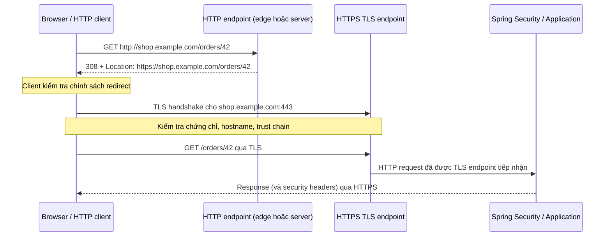
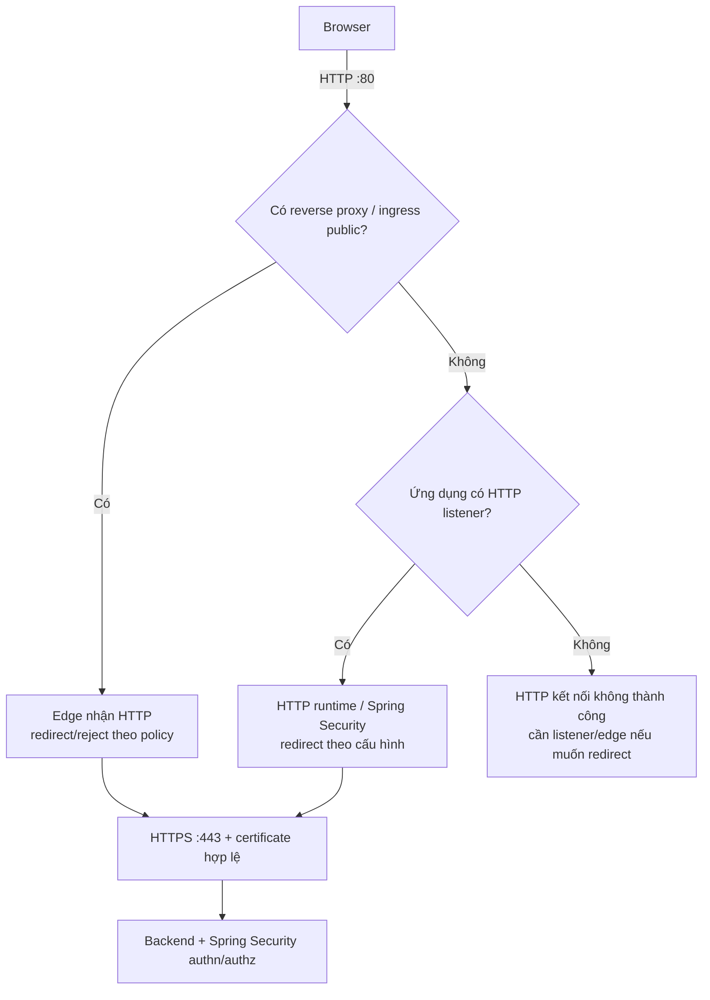
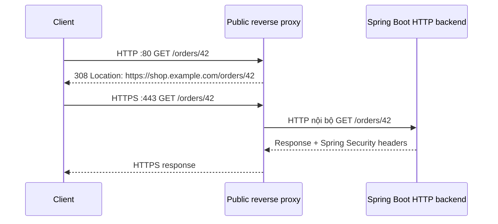
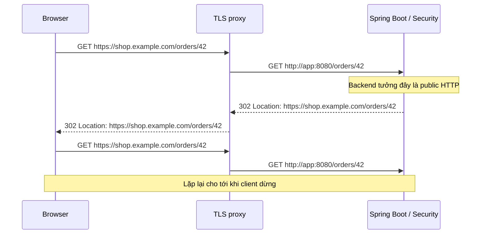

# Chuyển hướng yêu cầu HTTP sang HTTPS

> **Chương:** HTTPS và HSTS  
> **Học phần:** `SPRING_SECURITY_HTTP_PROTECTION` — áp dụng các lớp phòng vệ HTTP và trình duyệt trong Spring Security, từ CSRF, CORS, security headers, CSP, HSTS đến HTTP firewall và bảo vệ session. Bài đi sâu vào thiết kế **HTTP → HTTPS redirect** trên **Servlet** và **Reactive WebFlux**, phối hợp với reverse proxy/TLS termination, trình duyệt và các phép kiểm thử ngăn hồi quy bảo mật.

## 1. Bài toán: người dùng truy cập HTTP thì ứng dụng phải làm gì?

Giả sử trang quản lý đơn hàng được cung cấp tại `https://shop.example.com`. Người dùng nhập:

```text
http://shop.example.com/orders/42
```

Tổ chức muốn người dùng đến địa chỉ HTTPS tương ứng và từ đó chỉ trao đổi dữ liệu trên kết nối TLS hợp lệ. Một phản hồi chuyển hướng thường trông như sau:

```http
HTTP/1.1 308 Permanent Redirect
Location: https://shop.example.com/orders/42
Content-Length: 0
```

Sau khi nhận response, HTTP client có thể quyết định gửi **một request mới** đến địa chỉ trong `Location`. Khi kết nối đến `https://shop.example.com`, client cần xác thực chứng chỉ và thiết lập TLS trước khi trao đổi HTTP payload bảo mật.

Nhưng đây chỉ là một phần giải pháp. Hãy hình dung tình huống nguy hiểm hơn: một form login gửi thẳng:

```http
POST /login HTTP/1.1
Host: shop.example.com
Content-Type: application/x-www-form-urlencoded

username=alice&password=<secret>
```

Nếu request này đã đi **qua HTTP không mã hóa**, password có thể đã bị lộ trên đoạn đường trước khi server kịp trả `301`, `302`, `307` hoặc `308`. Redirect **không biến request HTTP đầu tiên thành HTTPS hồi tố**.

Vì vậy, mục tiêu của bài không chỉ là bật một DSL method. Chúng ta cần thiết kế **đường vào an toàn**, **chọn bên sở hữu redirect**, **hiểu tác dụng của status code**, **kết hợp HSTS/cookie/session**, và **kiểm tra response cuối mà người dùng thật nhận**.

### Mục tiêu học tập

Sau bài này, người học có thể:

1. Giải thích redirect HTTP→HTTPS hoạt động ở cấp HTTP và giới hạn bảo mật của **request đầu tiên**.
2. Phân biệt `301`, `302`, `303`, `307`, `308` theo tính lâu dài và quy tắc giữ/chuyển HTTP method.
3. Chọn redirect ở reverse proxy/ingress, HTTP server hoặc Spring Security; tránh trùng owner và redirect loop.
4. Viết cấu hình `HttpSecurity.redirectToHttps(...)` cho Servlet và `ServerHttpSecurity.redirectToHttps(...)` cho WebFlux theo API tương ứng phiên bản.
5. Xử lý trusted forwarded headers khi TLS kết thúc ở edge, mà không mở cửa cho header spoofing hoặc open redirect.
6. Phối hợp redirect với HSTS, cookie `Secure`, login/CSRF, CORS preflight, SPA, WebSocket và cache.
7. Thiết kế kiểm thử có cả request HTTP, HTTPS, các method khác nhau, hostname sai, path/query, reverse proxy và trình duyệt thật.

## 2. Mô hình đe dọa: redirect giải quyết nguy cơ nào?

Một attacker kiểm soát mạng Wi-Fi hoặc thiết bị trung gian có thể xem/sửa nội dung HTTP plaintext. Nếu người dùng mở `http://shop.example.com`, attacker trên tuyến HTTP có thể tìm cách can thiệp response **trước khi** client thấy redirect.

| Nguy cơ | Redirect HTTP→HTTPS giúp gì? | Giới hạn cần nhìn nhận |
| --- | --- | --- |
| Người dùng vô tình gõ `http://...` | Hướng dẫn client chuyển sang HTTPS | Request HTTP đầu tiên đã ra mạng |
| Bookmark/link cũ còn HTTP | Chuyển hướng đến canonical HTTPS URL | Client có thể không follow redirect hoặc cache redirect cũ |
| HTTP endpoint phục vụ nội dung nhạy cảm | Có thể không phục vụ nội dung qua HTTP | Redirect không xóa dữ liệu đã gửi trong HTTP request |
| Máy trung gian sửa response HTTP đầu | Không tự chống được khi response redirect chưa được bảo vệ | HSTS đã nhớ/preload, HTTPS-first, URL HTTPS trực tiếp |
| POST chứa mật khẩu được gửi qua HTTP | Không bảo vệ body đã gửi | Form phải submit trực tiếp tới HTTPS; cookie `Secure` |
| API thiếu phân quyền đối tượng | Không giải quyết | Authentication, route/object authorization |
| Request giả mạo dùng session cookie | Không xác minh ý định người dùng | CSRF và cookie policy |
| XSS trong trang HTTPS | Không ngăn code chạy trong document | Encode/sanitize dữ liệu và CSP |
| URL bất thường bypass matcher | Không chuẩn hóa request path | HTTP firewall và kiểm thử proxy |
| Data bị CDN cache sai | Không kiểm tra owner hoặc cache key | Cache-Control/CDN policy và test A/B user |

**Bất biến cần đạt:** request chứa credential và hành động nhạy cảm phải được tạo trực tiếp tới HTTPS (hoặc được browser nâng cấp **trước khi gửi**), không phải dựa vào redirect sau khi gửi HTTP.

## 3. Redirect là một chuỗi hai request, không phải đổi kết nối tại chỗ



Tại đây có **hai giao dịch HTTP**, có thể khác method, headers hoặc body tùy status code và client. Không thể đơn giản khẳng định mọi client sẽ gửi lại request y hệt.

Ba ý quan trọng:

- `Location` là **địa chỉ đích**, không phải bằng chứng đích có certificate hợp lệ.
- Client phải hỗ trợ và **quyết định follow redirect**; không phải mọi SDK/API client đều tự làm.
- TLS chỉ bắt đầu ở kết nối tới đích HTTPS; request trước đó đến nguồn HTTP đã xảy ra.

### 3.1. Vai trò của URL và HTTPS origin

Một origin được xác định bằng scheme, hostname và port. Chuyển `http://shop.example.com` sang `https://shop.example.com` là **đổi origin**, dù hostname giống nhau. Việc đổi scheme tác động đến:

- Cookie `Secure` và những quy tắc SameSite phụ thuộc scheme.
- Browser same-origin policy/CORS nếu trang và API khác scheme.
- Redirect URI đăng nhập liên kết (OAuth2/OIDC), absolute URLs và callback allowlist.
- CSP `connect-src`, WebSocket `ws://` so với `wss://`.
- Cache keys và canonical URLs của website.

**Đừng chỉ đổi chữ `http` thành `https` mà quên cổng, host, path và chính sách origin thực tế.**

## 4. Năm mã chuyển hướng cần phân biệt

HTTP redirect không đồng nghĩa một mã trạng thái cố định. Theo ngữ nghĩa HTTP, các mã thông dụng gồm:

| Status | Tính lâu dài | Cách xử lý method khi follow | Trường hợp thường gặp |
| --- | --- | --- | --- |
| **301 Moved Permanently** | Permanent | Client **có thể** đổi POST thành GET | Canonical URL dài hạn; cân nhắc cache |
| **302 Found** | Temporary | Client **có thể** đổi POST thành GET | Chuyển tạm thời, legacy browser flows |
| **303 See Other** | Temporary/đi tới representation khác | Client dùng GET/HEAD tới địa chỉ đích theo ngữ nghĩa 303 | Post/Redirect/Get **sau khi** xử lý POST |
| **307 Temporary Redirect** | Temporary | **Phải giữ nguyên method** khi tự động redirect | Cần bảo toàn method/body trong chuyển hướng tạm thời |
| **308 Permanent Redirect** | Permanent | **Phải giữ nguyên method** khi tự động redirect | Canonical HTTPS dài hạn, cần giữ method |

Với `301`/`302`, RFC 9110 cho phép user agent chuyển POST thành GET vì tương thích lịch sử; không được dựa vào hai mã này để bảo toàn POST body. `307`/`308` không cho đổi method khi tự động redirect, nhưng **không có nghĩa client luôn follow**; SDK có thể yêu cầu cấu hình riêng.

### 4.1. 307/308 giữ POST có làm request đầu tiên an toàn hơn không?

Không. Ví dụ:

```text
POST http://api.example.com/payments
    (body nhạy cảm đã đi qua HTTP)
       |
       v
HTTP 307 + Location: https://api.example.com/payments
       |
       v
POST https://api.example.com/payments
    (body có thể được gửi lại qua TLS)
```

Dù POST thứ hai dùng TLS, POST đầu **đã được truyền plaintext**. Với method có tác dụng phụ, client/proxy cũng cần ngăn xử lý nghiệp vụ trên HTTP ban đầu và cẩn trọng với khả năng gửi lặp.

**Nguyên tắc:** các client hợp lệ phải gọi trực tiếp HTTPS để tạo giao dịch nhạy cảm. Nếu HTTP POST đến public endpoint, một policy an toàn có thể **từ chối mà không xử lý**, thay vì khuyến khích gửi lại request có secret.

### 4.2. 303 không phải mã nâng HTTP thành HTTPS chuẩn cho mọi request

`303 See Other` hữu ích trong **Post/Redirect/Get** sau khi ứng dụng xử lý thành công POST và muốn client GET trang kết quả. Nó khác bài toán ép tất cả HTTP requests dùng HTTPS. Đừng nhầm hai loại redirect vì đều có header `Location`.

### 4.3. 301/308 có hiệu ứng cache và rollback

Redirect permanent có thể được client/browser/cache ghi nhớ, làm việc thay đổi host/port sau này khó dự đoán. Khi thử nghiệm một hostname mới, chọn chiến lược rollout phù hợp và tránh phát permanent redirect với host/port sai.

Không giả định xóa rule trên server sẽ xóa ngay redirect đã được một client hoặc cache lưu. Kiểm tra browser profile sạch và profile đã truy cập trước đó.

### 4.4. Có nhất thiết phải dùng 308?

Không có một mã duy nhất đúng cho mọi client. Quyết định phụ thuộc việc có muốn permanent hay temporary, có cần giữ method không, mức hỗ trợ client, cache semantics và cách xử lý HTTP unsafe methods. Với request có password/token, mục tiêu chính vẫn là **không bao giờ gửi chúng qua HTTP ban đầu**.

## 5. Redirect khác HSTS như thế nào?

HTTP redirect do **server/edge** gửi ra sau khi nhận HTTP request. **HTTP Strict Transport Security (HSTS)** là policy để **browser** ghi nhớ hostname phải dùng HTTPS trong các lần truy cập tiếp theo.

```http
Strict-Transport-Security: max-age=31536000
```

| Khía cạnh | HTTP→HTTPS redirect | HSTS |
| --- | --- | --- |
| Ai thực thi? | Server phát response; client quyết định follow | Browser đã biết policy tự nâng cấp HTTPS trước request |
| Bảo vệ request HTTP đầu tiên? | **Không** | Chỉ khi browser đã biết policy hoặc có preload tương ứng |
| Cần TLS hoạt động tại đích? | Có | Có; header chỉ được học từ HTTPS hợp lệ |
| Có áp dụng cho mọi HTTP client? | Tùy client có follow redirect | Không; chủ yếu các client/browser hỗ trợ HSTS |
| Có phạm vi subdomain? | Tùy các rule trên mỗi host | `includeSubDomains` có thể áp dụng |
| Có ảnh hưởng dài hạn? | Permanent redirect có thể cache | Browser giữ policy theo `max-age` hoặc preload |

HSTS trên response HTTP **không được trình duyệt tin** để thiết lập policy; cần response trên HTTPS hợp lệ. Sau khi đã ghi nhớ HSTS, browser có thể **không gửi request HTTP nào lên mạng** khi người dùng nhập một HTTP URL, vì nó nâng cấp trước request. Khi kiểm thử redirect server, dùng HTTP client thích hợp và phân biệt trạng thái HSTS của browser.

### 5.1. Lần truy cập đầu tiên vẫn cần kế hoạch

Cơ chế HSTS thông thường có khoảng trống lần truy cập đầu trước khi browser biết policy. Một số browser có cơ chế HTTPS-first hoặc HSTS preload, nhưng không giả định chúng áp dụng cho mọi host/client.

Biện pháp giảm rủi ro gồm:

- Chỉ phát link, QR code, email CTA và form action dạng HTTPS.
- Dùng `Secure` session cookies và tránh secret trong query string.
- Cấu hình HTTP listener chỉ redirect hoặc reject, **không phục vụ dữ liệu riêng tư**.
- Bật HSTS sau khi HTTPS ổn định; cân nhắc preload ở miền thực sự đủ điều kiện và có kế hoạch vận hành.

## 6. Ai phải sở hữu redirect: edge, HTTP server hay Spring Security?

Có ba lựa chọn hay gặp, không nên bật tất cả như những rule độc lập thiếu phối hợp.



| Kiến trúc | Vị trí redirect phù hợp | Lý do |
| --- | --- | --- |
| Spring Boot sau CDN/ingress public | Thường ở **edge/ingress** | Biết external scheme/host, có HTTP và HTTPS listeners |
| Spring Boot tự tiếp nhận cả HTTP và HTTPS | HTTP server hoặc **Spring Security** | Có request thật tới app để trả redirect |
| Chỉ mở HTTPS connector ở Spring Boot | Không thể redirect request mà không có HTTP listener | HTTP client có thể bị từ chối kết nối thay vì nhận 3xx |
| Nhiều dịch vụ chia sẻ tên miền | Gateway chung | Tránh mỗi app tạo redirect host/port không nhất quán |
| API machine-to-machine only | Có thể **reject HTTP** thay vì redirect | Client phải sử dụng HTTPS ngay từ đầu |

**Nguyên tắc quan trọng:** chọn một **đầu mối sở hữu canonical URL và redirect** trên mỗi hostname/path. Nếu backend chỉ nhận HTTP từ edge do TLS termination, việc backend tự redirect tất cả request bị nó coi là HTTP dễ tạo loop.

## 7. Mô hình A — Redirect tại edge/ingress



Edge sở hữu cả HTTP và HTTPS public endpoints. Backend có thể chỉ lắng nghe cổng HTTP nội bộ với quyền truy cập mạng bị giới hạn. Người dùng không được truy cập backend trực tiếp.

### 7.1. Ví dụ Nginx minh họa

```nginx
# Ví dụ mô hình, không phải cấu hình production dùng nguyên xi.
# Hostname đích được cố định để tránh dùng Host do client tự gửi.
server {
    listen 80;
    server_name shop.example.com;

    return 308 https://shop.example.com$request_uri;
}

server {
    listen 443 ssl;
    server_name shop.example.com;

    ssl_certificate     /secure/path/fullchain.pem;
    ssl_certificate_key /secure/path/private-key.pem;

    # Chỉ dùng includeSubDomains nếu toàn bộ phạm vi đã sẵn sàng.
    add_header Strict-Transport-Security "max-age=31536000" always;

    location / {
        proxy_pass http://127.0.0.1:8080;

        # Giả định đây là edge trực tiếp nhận request public và
        # upstream chỉ tin các headers do edge này ghi đè.
        proxy_set_header Host shop.example.com;
        proxy_set_header X-Forwarded-Host shop.example.com;
        proxy_set_header X-Forwarded-Proto https;
        proxy_set_header X-Forwarded-Port 443;
        proxy_set_header X-Forwarded-For $remote_addr;

        # Không chuyển nguyên Forwarded do client tự đặt.
        proxy_set_header Forwarded "";
    }
}
```

Điều kiện đi kèm:

1. Đường dẫn chứng chỉ ở ví dụ là **placeholder**, cần sử dụng secret/certificate management phù hợp.
2. Dùng `$request_uri` để giữ path/query nhưng phải đánh giá dữ liệu nhạy cảm trong URL; không đặt token/password trong query string.
3. Rule cố định hostname `shop.example.com`, tránh trực tiếp dựng `Location` bằng Host header chưa xác minh. Trong triển khai nhiều hostname, dùng allowlist/host canonicalization rõ ràng.
4. Backend `127.0.0.1:8080` chỉ là sơ đồ đơn máy; trên Kubernetes/service mesh cần route và network policy khác.
5. `Forwarded` và `X-Forwarded-*` phải được xây dựng từ trust boundary của **mọi hop**, không chỉ copy nguyên từ client.
6. HSTS ở đây do **edge sở hữu**; không phát chính sách mâu thuẫn từ backend.
7. Redirect 308 không giải quyết việc một **HTTP POST có credential đã đi qua hop HTTP**. Frontend và API clients phải gửi trực tiếp HTTPS.

### 7.2. Có nên redirect mọi HTTP request?

Đối với public website, redirect GET/HEAD là hành vi thường thấy. Với API ghi dữ liệu, tùy threat model có thể chọn từ chối các unsafe HTTP methods ngay ở edge và trả thông điệp sử dụng HTTPS. Nếu chọn redirect, **đừng xử lý side effect ở request HTTP** và phải biết cách client quản lý method/body.

Không nên tạo một redirect đến host người dùng không kiểm soát hoặc chuyển credential sang một hostname khác. Nếu host public có nhiều ứng dụng, chính sách path/host phải được phê duyệt từ gateway/platform team.

## 8. Mô hình B — Spring Boot trực tiếp kết thúc TLS

Trong kiến trúc đơn giản, Spring Boot có HTTPS connector. Ví dụ cấu hình server TLS:

```yaml
# application.yml - ví dụ test, không chứa secret thật.
server:
  port: 8443
  ssl:
    enabled: true
    key-store: classpath:tls/test-server.p12
    key-store-type: PKCS12
    key-store-password: "__INJECT_FROM_SECRET_MANAGER__"
```

**Điều cần phân biệt:** cấu hình trên cho phép HTTP runtime tiếp nhận HTTPS ở cổng 8443 nếu file/chứng chỉ hợp lệ. Nó **không tự mở thêm HTTP connector :8080 hay :80** để trả redirect.

Muốn browser gõ `http://localhost:8080` rồi đến `https://localhost:8443`, cần:

- Một HTTP listener ở edge/server để nhận request và trả 3xx, **hoặc**
- Cấu hình bổ sung một connector HTTP được quản lý đúng runtime và một redirect handler phù hợp.

Không trông chờ `redirectToHttps()` tạo thêm cổng HTTPS hoặc HTTP. Spring Security chỉ xử lý request **đã đến được security chain**.

### 8.1. Khi HTTPS dùng cổng không chuẩn

Trong production, HTTPS thường ở cổng 443. Nhưng môi trường dev/test có thể dùng 8443. Không tự giả định redirect sẽ biết đúng cổng 8443 nếu không cấu hình mapping/server metadata:

```text
HTTP  localhost:8080
HTTPS localhost:8443
```

Nếu redirect trả `https://localhost:8080` hoặc `https://localhost/` trong khi server chỉ nghe 8443, luồng sẽ thất bại. Ở môi trường có edge public 443, canonical `Location` nên trỏ tới **địa chỉ public 443**, không rò cổng container nội bộ.

## 9. Servlet: cấu hình redirect bằng HttpSecurity

Spring Security Servlet hiện đại có DSL `redirectToHttps(...)`. Ví dụ dưới đây minh họa yêu cầu chuyển request được xem là HTTP sang HTTPS:

```java
@Configuration
@EnableWebSecurity
class ServletHttpsRedirectConfig {

    @Bean
    SecurityFilterChain securityFilterChain(HttpSecurity http)
            throws Exception {
        return http
            .redirectToHttps(Customizer.withDefaults())
            .csrf(Customizer.withDefaults())
            .authorizeHttpRequests(auth -> auth
                .requestMatchers(HttpMethod.GET, "/health").permitAll()
                .anyRequest().authenticated()
            )
            .formLogin(Customizer.withDefaults())
            .build();
    }
}
```

**Đọc đúng ý nghĩa code:**

- `HttpSecurity.redirectToHttps(...)` cấu hình cơ chế **redirect HTTP request** mà Spring Security Servlet nhận được.
- Nó không tạo TLS listener, không cài chứng chỉ, không tự biết DNS/public port khi hạ tầng chưa cung cấp metadata đúng.
- `csrf(withDefaults())` giữ CSRF cho request thay đổi trạng thái dùng cookie/session; redirect không thể thay CSRF.
- `anyRequest().authenticated()` yêu cầu đăng nhập, nhưng không biết user có quyền trên **tài nguyên cụ thể**.
- Khi nằm sau TLS proxy chỉ chuyển HTTP nội bộ, phải có cách hiểu external HTTPS đáng tin, hoặc **không bật redirect trùng với edge**.
- Method và status code cụ thể mà security framework phát phải được **kiểm tra theo phiên bản và cấu hình**; không giả định ví dụ luôn trả 308.

Tài liệu Spring Security mới sử dụng `redirectToHttps`; một số project/phiên bản cũ vẫn dùng cấu hình `requiresChannel(...requiresSecure())`. **Không sao chép các DSL của những major version khác nhau mà không đối chiếu dependency thực tế.**

### 9.1. Có nên buộc redirect trước khi phân quyền?

Về mục tiêu, request được phép xử lý nghiệp vụ chỉ khi đã đến kênh an toàn. Nhưng thứ tự chính xác của HTTP filters do Spring Security quyết định theo configuration chain và version. Đừng giả định mọi `401/403` đều được thay bằng 3xx hoặc mọi request đều đi qua redirect.

Nên xây kiểm thử:

- HTTP GET chưa đăng nhập: HTTPS redirect hay authentication entry point nào được áp dụng theo thiết kế?
- HTTPS GET chưa đăng nhập: không redirect lại HTTP→HTTPS; tiếp tục authentication/authorization.
- HTTPS POST thiếu CSRF: bị từ chối mà không thực hiện nghiệp vụ.
- HTTP POST: không thực thi hành động; xác minh status và location theo policy.

Nếu edge đã redirect và backend không hề được phép thấy public HTTP request, có thể chọn **chỉ edge redirect** để hệ thống có một owner rõ ràng.

## 10. WebFlux: redirectToHttps trên ServerHttpSecurity

Reactive WebFlux có cấu hình tương ứng qua `ServerHttpSecurity` và `SecurityWebFilterChain`:

```java
@Configuration
@EnableWebFluxSecurity
class ReactiveHttpsRedirectConfig {

    @Bean
    SecurityWebFilterChain securityWebFilterChain(ServerHttpSecurity http) {
        return http
            .redirectToHttps(Customizer.withDefaults())
            .csrf(Customizer.withDefaults())
            .authorizeExchange(auth -> auth
                .pathMatchers(HttpMethod.GET, "/health").permitAll()
                .anyExchange().authenticated()
            )
            .formLogin(Customizer.withDefaults())
            .build();
    }
}
```

Trong WebFlux:

- `ServerHttpSecurity` cấu hình các `WebFilter`, không phải Servlet `Filter`.
- Request scheme/URI do `ServerWebExchange` biểu diễn sau khi runtime áp xử lý forwarding metadata phù hợp.
- Reactor Netty hoặc HTTP server phía trước vẫn chịu trách nhiệm **TLS handshake**.
- `csrf(...)` trên WebFlux dùng cơ chế `CsrfWebFilter` và repository Reactive.
- Authentication/session sử dụng `WebSession` cùng các component Reactive, không thay bằng `HttpSession` của Servlet.
- HSTS được ghi lên **HTTPS response** theo policy, browser mới thực thi.

### 10.1. Tùy chọn điều kiện redirect trong WebFlux

Một số phiên bản Spring Security WebFlux cho phép cấu hình điều kiện thông qua `httpsRedirectWhen(...)`. Ví dụ:

```java
.redirectToHttps(redirect -> redirect
    .httpsRedirectWhen(exchange ->
        exchange.getRequest().getHeaders()
            .containsKey("X-Forwarded-Proto")
    )
)
```

**Đây là minh họa API, không phải chính sách trust nên áp dụng nguyên xi.** Việc chỉ kiểm tra **sự tồn tại** của một header `X-Forwarded-Proto` do client có thể tự gửi sẽ không chứng minh request đi qua proxy đáng tin, hoặc scheme bên ngoài thực là HTTP/HTTPS. Cần thiết kế trust boundary tại edge, làm sạch header rồi xác định rule theo metadata đã được xác thực.

Đa số ứng dụng sau public ingress nên ưu tiên một redirect owner ở edge để giảm ambiguity. Nếu cần redirect trong WebFlux, kiểm tra cách framework nhận scheme sau proxy và có test cụ thể cho request HTTP/HTTPS.

## 11. Đối chiếu Servlet và WebFlux theo từng trách nhiệm

| Cần làm | Servlet / Spring MVC | Reactive / WebFlux |
| --- | --- | --- |
| Cấu hình Spring Security | `HttpSecurity` | `ServerHttpSecurity` |
| Chain | `SecurityFilterChain` | `SecurityWebFilterChain` |
| API HTTPS redirect hiện đại | `redirectToHttps(...)` | `redirectToHttps(...)` |
| Yêu cầu secure cũ | `requiresChannel(...)` ở những version cũ | Cấu hình redirect Reactive tương ứng |
| HTTP request abstraction | `HttpServletRequest` | `ServerWebExchange` |
| Đọc external scheme sau proxy | Container/`ForwardedHeaderFilter` nếu đã trust | `ForwardedHeaderTransformer`/runtime integration nếu đã trust |
| HSTS writer | Servlet security headers | Reactive security headers |
| Session cookie | `HttpSession` hoặc Spring Session | `WebSession`/cookie resolver |
| CSRF | `CsrfFilter` và Servlet repository | `CsrfWebFilter` và Reactive repository |
| HTTP firewall | `StrictHttpFirewall` | `StrictServerWebExchangeFirewall` |
| Integration test | `MockMvc` | `WebTestClient` |
| TLS server | Servlet container hoặc proxy | Reactive server hoặc proxy |

**Giống nhau về bất biến:** request nhạy cảm không được phát ra qua HTTP plaintext, đích HTTPS có certificate hợp lệ, redirect không loop/không đưa tới host lạ, và các cơ chế authn/CSRF/authz vẫn làm việc sau chuyển hướng.

## 12. TLS termination: nguyên nhân phổ biến của redirect loop

Giả sử trình duyệt dùng HTTPS đến edge nhưng backend dùng HTTP nội bộ:



Proxy và backend không nhất trí về **external scheme**: browser đã ở HTTPS nhưng backend không biết.

### 12.1. Những biểu hiện dễ nhận ra

- Browser báo `ERR_TOO_MANY_REDIRECTS`.
- `curl -L` báo vượt giới hạn redirect.
- `Location` luôn trỏ về đúng URL HTTPS hiện tại.
- Ứng dụng log thấy mọi request là HTTP, mặc dù browser kết nối HTTPS tới edge.
- HSTS có thể thiếu trên HTTPS response do Spring Security cho rằng request không secure.
- Absolute URL, OAuth2 redirect URI hoặc cookie attributes cũng có thể sai.

### 12.2. Hai cách kiến trúc thường dùng

**Cách A — Edge sở hữu redirect.** Edge chuyển HTTP công khai sang HTTPS; backend chỉ được gọi từ edge. Spring Security backend không cần lặp lại rule redirect public ở mỗi service. Edge có thể sở hữu luôn HSTS để phát trên các HTTPS response cuối.

**Cách B — Ứng dụng sở hữu redirect.** Proxy cung cấp external scheme/host/port **đáng tin**; Spring Framework/container khôi phục metadata trước khi Spring Security quyết định redirect. Cần kiểm tra request thực qua toàn tuyến.

Không nên kết hợp hai cách mà không định nghĩa điều kiện rõ ràng, vì những rule cùng mục đích có thể tự kích hoạt lẫn nhau.

## 13. Forwarded và X-Forwarded-* không tự trở thành nguồn sự thật

Reverse proxy có thể chuyển tiếp:

```http
Forwarded: for=198.51.100.25;proto=https;host=shop.example.com
X-Forwarded-Proto: https
X-Forwarded-Host: shop.example.com
X-Forwarded-Port: 443
```

Các header là **dữ liệu HTTP**. Nếu attacker có thể trực tiếp gửi tới backend hoặc proxy không ghi đè header do client đặt, chúng có thể bị giả mạo.

### 13.1. Vì sao scheme/host spoofing nguy hiểm?

Nếu ứng dụng dựng redirect bằng `Host`/`X-Forwarded-Host` chưa được kiểm tra, attacker có thể tìm cách tạo:

```http
HTTP/1.1 302 Found
Location: https://attacker-controlled.example.net/login
```

Đó là nguy cơ **open redirect/phishing** và trong một số luồng có thể làm hỏng OAuth2 callback hoặc rò rỉ mã/token qua đích sai.

Cần:

1. Giới hạn HTTP Host được phục vụ theo allowlist/virtual host.
2. Proxy xóa hoặc ghi đè forwarded headers từ client ở **trust boundary**.
3. Backend chỉ nhận traffic từ proxy đáng tin, không public trực tiếp cổng nội bộ.
4. Chỉ sử dụng metadata của **hop đã xác thực**, hiểu rõ proxy chain và thứ tự xử lý forwarding headers.
5. Với canonical redirect, cân nhắc dùng hostname tĩnh đã được cấu hình thay vì bất kỳ `Host` nào client gửi.

### 13.2. Spring Boot forwarded strategy

Trong môi trường có proxy tin cậy, Spring Boot có cấu hình minh họa:

```yaml
server:
  forward-headers-strategy: framework
```

Các lựa chọn `framework` và `native` có thể phù hợp các runtime khác nhau. Cấu hình này **không tự xác thực proxy** và không có nghĩa nên tin header từ Internet.

- Servlet có thể sử dụng `ForwardedHeaderFilter` hoặc xử lý forwarding của container.
- WebFlux có thể sử dụng `ForwardedHeaderTransformer` hoặc cơ chế runtime tương ứng.

Đừng “sửa loop” bằng cách thêm `X-Forwarded-Proto: https` từ phía frontend JavaScript. Frontend không được tự định nghĩa external scheme được backend tin cậy; proxy phải làm việc đó.

### 13.3. Kiểm tra nhiều hop

Với CDN → load balancer → ingress → backend, không phải hop nào cũng nên tin `X-Forwarded-For` hay `Forwarded` do upstream chuyển tiếp. Cần viết rõ:

- Hop nào tiếp xúc Internet?
- Hop nào được phép tạo/ghi đè external scheme?
- Hop nào chấm dứt TLS và tạo một kết nối mới?
- Backend kiểm tra nguồn kết nối/trust chain thế nào?
- `Location` cuối được tạo từ host/port nào?

## 14. Thiết kế canonical URL: không tạo redirect đến host bất ngờ

Một quy tắc HTTPS đúng không nên chỉ dựa vào “thay scheme”. Địa chỉ đích thường có chính sách riêng:

| Thành phần URL | Quyết định cần rõ | Lỗi thường thấy |
| --- | --- | --- |
| Scheme | Luôn `https` cho host public | Redirect quay lại `http` |
| Host | Canonical host trong allowlist | Host header poisoning/open redirect |
| Port | `443` public hoặc cổng test được công bố | Lộ `8080`, `8443` sai hoặc không có listener |
| Path | Giữ path hợp lệ theo mapping | Proxy thêm/bớt prefix, double slash |
| Query | Giữ tham số cần thiết nhưng tránh secret | Token xuất hiện trong URL/log/Referer |
| Fragment | Không được gửi trong HTTP request | Server không thể dựa vào `#fragment` để dựng `Location` |
| Userinfo | Không được dùng credentials trong URL | Phishing/credential handling bất thường |
| Internationalized hostname | Chuẩn hóa và kiểm tra | Host mismatch/certificate mismatch |

**Lưu ý fragment:** browser không gửi `#fragment` trong HTTP request nên server không nhìn thấy nó. Trong một số trường hợp browser có thể kế thừa fragment khi follow redirect theo chuẩn, nhưng không nên dùng fragment làm input cho chính sách redirect hoặc dựa vào nó để bảo vệ secret.

### 14.1. Chống vòng lặp nhiều bước

Không chỉ có loop giống `https → https`. Một loop khác:

```text
http://shop.example.com
 -> https://shop.example.com
 -> https://www.shop.example.com
 -> http://shop.example.com
 -> ...
```

Nguyên nhân có thể là rule canonical host, trailing slash, reverse proxy rewrite hoặc auth/login redirect không nhất quán. Khi debug, ghi lại **toàn bộ chuỗi status và Location**, không chỉ response cuối.

## 15. Không chuyển dữ liệu nhạy cảm qua HTTP trước khi redirect

Đây là yêu cầu vận hành quan trọng nhất.

### 15.1. Forms và links

Trang HTML nên dùng form action HTTPS trực tiếp hoặc đường dẫn tương đối khi document được phục vụ trên HTTPS:

```html
<form method="post" action="/api/orders/42/approve">
  <!-- Các field nghiệp vụ và CSRF token -->
  <button type="submit">Approve</button>
</form>
```

Nếu document ở HTTPS, action tương đối cùng origin sẽ dùng HTTPS. Với API khác origin, dùng explicit `https://api.example.com/...` và thiết kế CORS/CSRF phù hợp.

Đừng viết:

```html
<!-- Ví dụ KHÔNG an toàn cho dữ liệu nhạy cảm -->
<form method="post" action="http://api.example.com/login">
  <input type="password" name="password">
</form>
```

rồi kỳ vọng redirect HTTP→HTTPS sẽ cứu dữ liệu.

### 15.2. API clients, webhook và jobs

- Dùng base URL HTTPS ngay trong cấu hình SDK/worker.
- Không tự động follow redirect khi request có `Authorization` nếu chưa xác minh policies về forwarding credential sang host khác.
- Chỉ gửi lại request unsafe khi client hiểu quy tắc idempotency/retry.
- Với webhook, bên gửi phải cấu hình HTTPS callback URL; receiver có thể reject HTTP, không dựa vào redirect.
- Đừng log full URL có query secret hoặc `Authorization` khi debug redirect.

### 15.3. Cookie Secure

Cookie phiên nên có `Secure`:

```http
Set-Cookie: SESSION=<opaque-id>; Path=/; Secure; HttpOnly; SameSite=Lax
```

`Secure` làm browser chỉ gửi cookie qua kết nối HTTPS phù hợp (có ngoại lệ localhost theo browser). Redirect và HSTS **không thay việc đặt `Secure`**. `HttpOnly` giảm khả năng script đọc trực tiếp cookie, còn `SameSite` hỗ trợ điều chỉnh khi cookie đi theo cross-site requests; hai thuộc tính này không phải biện pháp mã hóa.

Một số browser có thể tự nâng HTTP nhờ HSTS/HTTPS-first; vẫn phải thiết kế cookie/session an toàn và tránh secret trong request HTTP đầu.

## 16. Phối hợp redirect với CSRF khi dùng form login/session

CSRF là cơ chế chống request giả mạo được browser gửi kèm **ambient credentials** như cookie. Nó không tự được giải quyết bằng việc chuyển HTTP sang HTTPS.

Ví dụ người dùng đã login:

```http
POST /api/orders/42/approve HTTP/1.1
Host: shop.example.com
Cookie: SESSION=<opaque-id>
X-CSRF-TOKEN: <token-value>
```

Nếu request đi qua HTTPS hợp lệ, vẫn phải kiểm tra:

- Token CSRF còn hiệu lực không?
- Principal đã được xác thực chưa?
- Người dùng có authority `ORDER_APPROVE` không?
- Có được duyệt đúng order 42 không?
- Order đang ở trạng thái cho phép không?

### 16.1. Login và logout cũng là hành động thay đổi trạng thái

Trong ứng dụng form login dùng session cookie, `POST /login` và `POST /logout` thường cần được tích hợp với CSRF theo cấu hình Spring Security đang dùng.

- Không gửi password trước qua HTTP để nhận redirect.
- Không tắt CSRF toàn cục vì một form sau redirect trả `403`.
- Nếu token CSRF/session thay đổi sau login/logout, frontend phải làm mới token.
- Nếu session hết hạn giữa lúc user điền form, app phải xử lý lỗi token/session đúng; không biến HTTP fallback thành đường bypass.

### 16.2. Cookie có thể không được gửi dù redirect tới HTTPS

Khi scheme/host/port thay đổi, browser đánh giá lại cookie `Domain`, `Path`, `SameSite` và `Secure`. Một POST sau redirect có thể khác cookie context ban đầu hoặc bị giới hạn do browser policy.

**Không suy từ redirect success thành session success.** Phải test cả login/logout và replay session ID cũ, không chỉ kiểm tra status 3xx.

## 17. CORS preflight và HTTPS redirect: tình huống dễ gây lỗi SPA

SPA từ `https://app.example.com` gọi API ở `https://api.example.com`. Nếu code frontend lại gọi `http://api.example.com`:

- Browser có thể **chặn mixed active content** từ trang HTTPS trước khi request đi đến HTTP endpoint.
- Nếu preflight được gửi và nhận redirect, một số browser/client/chuỗi redirect có thể không xử lý theo mong muốn.
- Host/scheme origin thay đổi khiến CORS decisions khác với dự kiến.
- Cookie `Secure` không được gửi trên HTTP.

### 17.1. Preflight không nên dựa vào redirect

```http
OPTIONS /api/orders/42/approve HTTP/1.1
Host: api.example.com
Origin: https://app.example.com
Access-Control-Request-Method: POST
Access-Control-Request-Headers: content-type,x-csrf-token
```

Preflight thường **không mang cookie**. Nếu nó bị redirect trước khi trả CORS response thích hợp, browser có thể báo CORS error; nếu nó gặp authentication trước CORS, có thể trả `401/403`.

**Cách làm đáng tin hơn:**

1. Frontend luôn dùng **HTTPS API base URL**.
2. Cho CORS policy xử lý preflight **tại HTTPS origin đích**, trước authentication có thể chặn preflight.
3. Chỉ khai báo allowlist origin/method/headers/credentials cần thiết.
4. CSRF token vẫn cần cho unsafe request dùng cookie.
5. Không mở `Access-Control-Allow-Origin: *` cho credentialed response.

### 17.2. CORS không phải redirect, và redirect không phải CORS

CORS điều chỉnh **quyền JavaScript của một origin đọc response cross-origin**. Redirect điều hướng HTTP client tới URL khác. Cả hai không cấp quyền nghiệp vụ, không thay authorization hoặc CSRF.

## 18. HTTPS redirect và nội dung phụ: mixed content, CSP, WebSocket

Trang HTML ở `https://shop.example.com` vẫn có thể tham chiếu những nguồn HTTP:

```html
<!-- Các ví dụ cần loại bỏ hoặc thay bằng HTTPS. -->
<script src="http://cdn.example.net/app.js"></script>

```

Browser hiện đại có những quy tắc mixed content, có thể chặn hoặc tự nâng cấp tùy loại tài nguyên. **Không nên trông chờ server của CDN redirect HTTP script sang HTTPS** để biến nội dung chủ động đó thành an toàn; browser có thể chặn trước khi redirect được gửi.

Cần:

- Dùng URL `https://` cho script, CSS, font, ảnh, iframe, API và file download.
- Dùng `wss://` cho WebSocket khi trang HTTPS cần kết nối an toàn.
- Kiểm tra `Content-Security-Policy` trên response HTML, đặc biệt `upgrade-insecure-requests` và `connect-src` nếu dùng.
- Kiểm tra assets của service worker, manifest, OAuth callbacks và scripts từ third-party.
- Không hiểu CSP là cách “mã hóa”: CSP là policy browser cho nội dung, TLS bảo vệ đường truyền.

Một số luồng như WebSocket sau handshake không tiếp tục chạy qua cùng cơ chế HTTP request authorization cho từng message; cần đánh giá message-level security riêng.

## 19. HSTS và redirect với nhiều subdomain

Giả sử tổ chức có:

```text
example.com
shop.example.com
api.example.com
legacy.example.com
staging.example.com
```

Một redirect ở `shop.example.com` chỉ áp những URL mà endpoint đó nhận và policy nó định nghĩa. Trong khi đó HSTS do `example.com` phát với `includeSubDomains` có thể buộc browser dùng HTTPS cho cả host con, kể cả legacy/staging.

Vì vậy:

- Redirect canonical host và HSTS **khác phạm vi**.
- `Strict-Transport-Security: max-age=31536000; includeSubDomains` không nên bật nếu còn subdomain HTTP-only.
- HSTS preload cần các điều kiện/đăng ký riêng; thêm từ `preload` trong header **không đồng nghĩa** đã vào browser preload list.
- Gỡ một host khỏi policy preload hoặc browser cache có thể mất thời gian; đừng thử nghiệm bừa trên miền tổ chức.
- `max-age=0` trên host con không xóa HSTS đang được **miền cha** áp dụng.

Trong môi trường staging, nên dùng tên miền riêng, TLS hợp lệ và HSTS duration có chiến lược thử nghiệm.

## 20. Bảo mật HTTP firewall không được bỏ qua trong redirect

Một URL như:

```text
http://shop.example.com/api/orders%2F42/approve
```

có thể bị proxy, parser hoặc firewall diễn giải khác nhau. Redirect thường giữ phần path/query hoặc biến đổi nó theo quy tắc edge; khi client truy cập HTTPS lần hai, backend lại parse URL.

Nếu auth matcher cho phép một path nhưng controller xử lý path khác sau decode, có nguy cơ bypass kiểm soát truy cập.

- Servlet dùng `StrictHttpFirewall`.
- Reactive dùng `StrictServerWebExchangeFirewall`.
- Edge cần có URL normalization/path validation nhất quán với backend.
- Redirect không thay object authorization; user B vẫn không được đọc order của user A sau khi theo HTTPS redirect.
- Đừng nới firewall chỉ để một path lạ qua được redirect; phải kiểm tra đường đi và ý nghĩa tài nguyên cuối.

### 20.1. Dấu hiệu cần có trong test

- URL bình thường được redirect tới canonical HTTPS đúng.
- URL có encoded slash, semicolon hoặc dot segments không dẫn tới route trái quyền.
- Redirect không nhân đôi hoặc bỏ mất tiền tố context path khi có gateway rewrite.
- Request chứa Host không hợp lệ bị từ chối hoặc chuyển tới host canonical do **server chọn**, không tới host attacker.

## 21. Kiểm thử Servlet bằng MockMvc: kiểm tra quyết định redirect

`MockMvc` kiểm tra Servlet filters trong môi trường test; nó không thực hiện TLS handshake. Với chain ở mục 9, có thể viết test mô phỏng HTTP request:

```java
@Test
void httpGetShouldRedirectToCanonicalHttps() throws Exception {
    mvc.perform(get("/health")
            .secure(false)
            .with(request -> {
                request.setServerName("shop.example.com");
                request.setServerPort(80);
                return request;
            }))
        .andExpect(status().is3xxRedirection())
        .andExpect(header().string(
            "Location", startsWith("https://shop.example.com/")));
}
```

Đoạn test dùng Hamcrest `startsWith` và cần import phù hợp. **Kỳ vọng chính xác** của `Location` phải dựa vào cấu hình host/port/redirect logic thực tế. Nếu test dùng port 8443, cần đặt port mapping/metadata nhất quán.

### 21.1. HTTPS request không nên redirect lại vì thiếu nhận diện scheme

```java
@Test
void secureGetMustNotLoopToTheSameHttpsUrl() throws Exception {
    mvc.perform(get("/health")
            .secure(true)
            .with(request -> {
                request.setServerName("shop.example.com");
                request.setServerPort(443);
                return request;
            }))
        .andExpect(status().isOk());
}
```

Giả định handler `GET /health` tồn tại và trả `200`, được `permitAll()` trong security chain. Nếu endpoint có hợp đồng khác, sửa assertion theo ứng dụng. Test này **không** chứng minh chứng chỉ hoặc TLS server đã cấu hình.

### 21.2. HTTP POST không được thực hiện tác động nghiệp vụ

```java
@Test
void httpPostMustNeverApproveOrder() throws Exception {
    mvc.perform(post("/api/orders/42/approve")
            .secure(false)
            .with(request -> {
                request.setServerName("shop.example.com");
                request.setServerPort(80);
                return request;
            }));

    assertThat(orderRepository.findById("42").orElseThrow()
            .getState())
        .isEqualTo(OrderState.PENDING);
}
```

Đây chỉ là **khung test về side effect**; để trở thành bằng chứng đầy đủ cần thêm assertion status/`Location` phù hợp redirect/reject policy, và kiểm tra fixture user/quyền để không nhầm với CSRF/authorization từ chối. Nếu test cố chứng minh chỉ HTTPS gate đã chặn hành động, cần bảo đảm request có đủ credential, CSRF token và quyền nếu các lớp đó có thể che kết quả.

Không chỉ test `is3xxRedirection()` rồi suy ra database đã an toàn.

### 21.3. Nếu edge là owner, không ép MockMvc chứng minh redirect public

Khi redirect do Nginx/ingress thực hiện, app backend có thể không hề phát 3xx cho HTTP nội bộ. Khi đó test đúng phải gọi **public edge HTTP listener**, còn `MockMvc` kiểm tra authn/CSRF/authz và headers thuộc backend.

## 22. Kiểm thử WebFlux bằng WebTestClient

`WebTestClient` là công cụ đúng cho Spring WebFlux. Với `SecurityWebFilterChain` tích hợp security và `redirectToHttps(...)`, ví dụ:

```java
@Test
void reactiveHttpGetShouldRedirectToHttps() {
    webTestClient.get()
        .uri("http://shop.example.com/health")
        .exchange()
        .expectStatus().is3xxRedirection()
        .expectHeader().exists("Location");
}
```

Để test **host/path** thay vì chỉ tồn tại `Location`, có thể dùng `expectHeader().valueMatches(...)` phù hợp URI canonical do policy sinh ra:

```java
webTestClient.get()
    .uri("http://shop.example.com/health")
    .exchange()
    .expectHeader()
    .valueMatches(
        "Location", "^https://shop\\.example\\.com(?:/|:443/).*"
    );
```

**Giới hạn test setup:** nếu `WebTestClient` được bind-to-application, scheme có thể là metadata mô phỏng; nếu bind-to-live-server, URL HTTPS phải thực sự có TLS. Đảm bảo request đi qua Reactive security chain và được đánh dấu insecure/secure đúng như mong đợi.

### 22.1. Không thể suy TLS từ một Reactive mock

Một test `WebTestClient` có `Location: https://...` không chứng minh:

- Server có cổng HTTPS đang mở.
- Certificate được browser tin và khớp hostname.
- Reverse proxy không gây redirect loop.
- HSTS có trên HTTPS response public.
- Cookie `Secure` và SameSite đúng.
- CORS preflight hoạt động với SPA thật.

Cần bổ sung TLS/client/browser/E2E tests cho các nội dung đó.

## 23. Kiểm thử qua edge bằng curl — không theo redirect trước khi quan sát

Chỉ chạy các lệnh sau với hệ thống bạn được phép kiểm thử. Không sử dụng token/password thật trong request HTTP.

### 23.1. Xem phản hồi HTTP ban đầu

```bash
curl -sS -D - -o /dev/null http://shop.example.com/health
```

Kiểm tra **status, Location và hostname/port**. Không dùng `-L` ở bước này vì nó có thể ẩn chuỗi redirect bằng cách tự follow.

### 23.2. Theo dõi chuỗi chuyển hướng cho GET công khai

```bash
curl -sS -L --max-redirs 10 \
  -D - -o /dev/null \
  https://shop.example.com/health
```

Để kiểm tra redirect từ HTTP, đổi URL ban đầu sang `http://shop.example.com/health` trong môi trường được phép; không kèm cookie/session/password hay token. Kiểm tra các response `Location` có dẫn trở lại HTTP hay cùng URL HTTPS lặp vô hạn không.

### 23.3. Xem chứng chỉ và phản hồi HTTPS

```bash
curl -v -D - -o /dev/null https://shop.example.com/health
```

Client phải xác minh được certificate và hostname, không dùng `-k`/`--insecure` trong test cần chứng minh TLS hợp lệ.

### 23.4. Kiểm tra HTTP methods mà không phát dữ liệu nhạy cảm

Dùng endpoint test không có side effect hoặc mock backend:

```bash
curl -sS -i -X POST http://shop.example.com/_redirect-test \
  -H 'Content-Type: text/plain' \
  --data 'test-only-no-secret'
```

Chỉ kiểm tra status/`Location`, **không tự theo redirect** trừ khi bạn đã thiết kế endpoint idempotent và biết rõ cách client xử lý method/body. Đừng gửi lệnh này tới endpoint duyệt đơn thật.

### 23.5. Browser có HSTS lưu sẵn có thể không truy cập HTTP

Nếu browser đã nhận HSTS, nó có thể nâng `http://shop.example.com` sang HTTPS trước request. Khi đó không thấy 3xx HTTP ở browser Network **không có nghĩa edge thiếu redirect**. Dùng một HTTP client chưa áp HSTS hoặc môi trường test mới để kiểm tra edge rule, và kiểm tra HSTS riêng trong browser.

## 24. Phép thử redirect nên bao phủ những nhánh nào?

| Test ID | Tình huống | Pass condition |
| --- | --- | --- |
| RD-01 | HTTP GET host hợp lệ | Redirect hoặc reject đúng policy, không trả dữ liệu riêng tư qua HTTP |
| RD-02 | Đích trong `Location` | Scheme HTTPS, canonical host/port/path đúng |
| RD-03 | HTTPS GET cùng URL | Không redirect về chính nó, tiếp tục authn/route logic |
| RD-04 | HTTP HEAD | Redirect/reject phù hợp, không lộ nội dung |
| RD-05 | HTTP POST không có secret (fixture test) | Không thực thi side effect; status/method handling đúng policy |
| RD-06 | POST HTTPS thiếu CSRF | Bị từ chối theo CSRF, state không đổi |
| RD-07 | POST HTTPS có CSRF và quyền | Thực hiện đúng một lần, audit hợp lệ |
| RD-08 | Host header không hợp lệ | Không open redirect đến host của attacker |
| RD-09 | HTTPS cổng public 443, backend 8080 | Không lộ cổng nội bộ trong `Location` |
| RD-10 | Path/query hợp lệ | Không mất hoặc nhân đôi context path, query không chứa secret |
| RD-11 | HTTPS qua TLS proxy | Không redirect loop, backend hiểu external scheme đúng |
| RD-12 | Client forged forwarded headers | Không thay đổi scheme/host theo giá trị attacker |
| RD-13 | HSTS trên HTTPS response | Policy đúng và thuộc owner đã chọn |
| RD-14 | Browser với HSTS đã lưu | Nâng cấp trước network; không nhầm với server redirect |
| RD-15 | CORS preflight trên HTTPS | Không bị redirect/auth chặn sai; CORS allowlist đúng |
| RD-16 | Mixed content trong SPA | Không tải secret/script qua HTTP, UI hợp lệ vẫn hoạt động |
| RD-17 | Cookie login/logout | `Secure`/`HttpOnly`/`SameSite` theo policy; session cũ vô hiệu |
| RD-18 | URL encoded/path lạ | Không bypass HTTP firewall hay object authorization |
| RD-19 | Response lỗi do edge sinh | Headers cần thiết theo policy vẫn hiện diện |
| RD-20 | Permanent redirect sau thay đổi rule | Không có cache “kẹt” ở host sai ngoài dự kiến |

Mỗi test cần ghi môi trường, frontend/backend version, proxy config và HTTP client/browser version thích hợp. Một test `MockMvc`/`WebTestClient` không thay toàn bộ test của edge.

## 25. Chẩn đoán theo triệu chứng

| Triệu chứng | Khả năng liên quan | Kiểm tra trước |
| --- | --- | --- |
| Browser báo quá nhiều redirects | Backend thấy HTTP sau TLS termination, hoặc canonical host loop | Theo dõi chuỗi `Location`, kiểm tra external scheme |
| `Location` trỏ `https://...:8080` | Backend sử dụng cổng nội bộ | Trusted forwarded host/port, canonical URL |
| `Location` chuyển tới host lạ | Host/Forwarded header chưa kiểm soát | Proxy allowlist, overwrite, backend direct access |
| HTTP trả `200` cho trang login | HTTP listener còn phục vụ nội dung | Rule edge/server, chain matcher và test request |
| HTTP POST bị `302` rồi thành GET | Client đổi method theo 301/302 | RFC semantics; không dựa vào redirect cho POST nhạy cảm |
| HTTP POST bị `307` nhưng API vẫn báo lỗi | Client giữ method, CSRF/cookie thay đổi, server reject | Debug từng bước, không gửi secrets qua HTTP |
| HTTPS redirect đến chính HTTPS URL | Backend tưởng public request là HTTP | Trusted forwarding, redirect owner |
| HSTS thiếu trên production HTTPS | Backend thấy HTTP hoặc edge không phát | Chọn HSTS owner, xem response cuối |
| Browser không thấy HTTP 3xx | HSTS đã nâng cấp trước network | Kiểm tra HSTS state/client HTTP khác |
| HTTPS có certificate error | SAN/chain/expiry/host sai | TLS client verify, không dùng trust-all |
| Cookie session mất sau redirect | Cookie `Secure`/SameSite/Domain/Path sai | Browser cookie diagnostics, scheme/host |
| SPA CORS lỗi sau chuyển HTTPS | API URL/preflight/allowlist chưa đúng | Gọi HTTPS trực tiếp, kiểm tra preflight trên HTTPS |
| Script HTTP không tải dù có redirect | Mixed content bị browser chặn trước redirect | Sửa asset URL thành HTTPS |
| OAuth callback có scheme HTTP | App không nhận external scheme | Trusted proxy, IdP redirect URI allowlist |
| Chỉ một số URL không redirect | Nhiều chains, matchers hoặc rules tại gateway | Mapping route/chain theo endpoint |
| HTTP 308 cũ bị cache dù rule đã đổi | Permanent redirect cache | Browser sạch, cache control/rollout |
| Firewall trả 400 cho URL mã hóa | Path/normalization không nhất quán | Xem edge/parser/firewall, không tự nới |
| Edge trả 502 không có HSTS | Edge tạo response, app không được gọi | Headers tại edge và `always` tương đương |

### 25.1. Quy trình xử lý redirect loop

1. Ghi lại **request URL ban đầu**, scheme, hostname, port và path.
2. Dùng HTTP client không tự theo redirect để lấy status/`Location` đầu tiên.
3. Theo dõi **từng hop** tới tối đa một số redirect giới hạn.
4. Tại edge, kiểm tra TLS thật sự kết thúc ở đâu, upstream dùng HTTP hay HTTPS.
5. Trong backend, xác nhận request external scheme/host/port sau trusted forwarding.
6. Xác định ai đang tạo mỗi redirect: edge, Spring Security, controller, login flow, OIDC hoặc proxy canonicalization.
7. Chỉ giữ lại các rule cần thiết, tránh một app tự redirect vì internal HTTP mà client đã HTTPS.
8. Chạy lại GET/POST test, test cookie/CSRF và browser HSTS; không kết luận dựa vào `200` cuối cùng duy nhất.

### 25.2. Tách lỗi redirect với lỗi đăng nhập

Một `302 Location: /login` trên **HTTPS** có thể là authentication entry point, **không phải HTTP→HTTPS redirect**. Khi điều tra `302` hãy đọc `Location`:

- `https://shop.example.com/orders/42`: có thể là chuyển scheme.
- `/login` hoặc `https://shop.example.com/login`: có thể là yêu cầu đăng nhập.
- `https://idp.example.net/authorize...`: có thể là OAuth/OIDC redirect.
- `http://...`: có thể là lỗi scheme hoặc một flow chủ động khác cần rà soát.

Không áp test “mọi 302 phải là HTTPS upgrade”. Chọn đúng loại redirect theo đường đi người dùng.

## 26. Bài tập xuyên suốt: checkout sau reverse proxy

### Bối cảnh

Một ứng dụng bán hàng triển khai:

- SPA `https://shop.example.com` ở CDN.
- API `https://api.example.com` ở ingress.
- Browser đăng nhập bằng session cookie.
- Checkout: `POST /api/orders/42/checkout`, có CSRF token.
- Edge TLS termination, backend Spring MVC hoặc WebFlux ở HTTP nội bộ.
- Edge có HTTP port 80 để redirect về HTTPS 443.
- `api.example.com` và `shop.example.com` có chính sách HSTS riêng.
- Một số URL cũ chứa query và context path `/api/v1`.

Sau khi deploy, nhóm QA phát hiện:

1. Người dùng nhập HTTP URL vào browser rồi đôi khi không thấy redirect 3xx.
2. `curl` từ mạng test lại thấy redirect.
3. SPA dùng `http://api.example.com` thì browser báo mixed content/CORS.
4. Browser vào API HTTPS rồi gặp redirect loop.
5. POST checkout thiếu token trả `403`.
6. Có test POST HTTP 308 giữ method, nhưng nhóm muốn coi đó là chứng cứ password đã được bảo vệ.
7. OAuth login callback đôi khi có `http://api.example.com`.
8. Một URL `/api/v1/orders%2F42` trả 400.
9. `Location` có lúc chứa port 8080.
10. CDN response 502 không có HSTS.

### 26.1. Phân tích theo đúng lớp

| Dấu hiệu | Lớp liên quan | Hướng xử lý |
| --- | --- | --- |
| Browser không thấy 3xx nhưng curl thấy | HSTS/HTTPS-first browser | Browser có thể upgrade trước khi gửi HTTP; xem HSTS state |
| SPA gọi URL HTTP | Frontend/mixed content/CORS | Đổi base URL sang HTTPS, kiểm tra CORS ở HTTPS |
| HTTPS redirect loop | Trusted forwarding/redirect owner | Edge và app phải nhất trí external scheme |
| POST thiếu CSRF 403 | Spring Security CSRF | Giữ bảo vệ, tích hợp token flow |
| 308 giữ method nhưng “an toàn” | Redirect semantics | Không bảo vệ HTTP request ban đầu; sửa client thành HTTPS-first |
| OAuth callback HTTP | Absolute URL/trusted scheme | Cấu hình IdP callback/host, proxy overwrite metadata |
| Encoded slash 400 | Parser/firewall/gateway | Đánh giá path normalization, không nới bừa |
| Port 8080 trong Location | Canonical host/port | Sửa proxy metadata hoặc redirect ở edge |
| 502 thiếu HSTS | Edge-generated response | Đặt HSTS tại edge theo policy cho response cần thiết |

### 26.2. Đề bài thực hành

1. Vẽ sơ đồ browser → CDN → ingress → backend và đánh dấu hop TLS/HTTP.
2. Chọn một redirect owner cho `shop.example.com` và `api.example.com`.
3. Viết rule chuyển `http://shop.example.com/catalog` sang canonical HTTPS URL, không lấy host đích từ header chưa đáng tin.
4. Quyết định HTTP unsafe methods bị reject hay redirect theo chính sách; **chứng minh chúng không gây side effect**.
5. Cấu hình Spring Security cho Servlet hoặc WebFlux và mô tả rõ khi nào **không cần** bật redirect ở backend sau edge.
6. Viết một test HTTP 3xx/`Location` và một test HTTPS không loop.
7. Viết test browser CORS preflight và cookie `Secure`/SameSite.
8. Viết test CSRF trên HTTPS POST và kiểm tra database không đổi khi bị chặn.
9. Kiểm tra HSTS trên HTTPS response cuối, không trên HTTP redirect.
10. Viết báo cáo phân biệt lỗi bảo mật với hành vi redirect cache/HSTS cache.

## 27. Mẫu báo cáo bằng chứng kiểm thử

```text
Feature: HTTP to HTTPS redirect for shop.example.com
Environment: staging via public ingress
Build/Config: [ghi phiên bản và proxy config thật]
Test ID: RD-02
Input: GET http://shop.example.com/health (không có token/cookie)
Expected: 3xx theo policy; Location dùng https + canonical host;
          không trả thông tin nhạy cảm qua HTTP.
Observed: [chỉ điền sau khi chạy thật]
Result: PASS / FAIL / BLOCKED
Limits: Chưa chứng minh HTTPS certificate, HSTS browser state,
        cookie attributes hoặc CSRF.
Owner: Platform/API
```

Đây là **mẫu trống**, không phải kết quả một test đã chạy. Khi ghi bằng chứng:

- Không đính kèm mật khẩu, cookie phiên, bearer token, CSRF token thật.
- Ghi cả chuỗi redirect nếu có nhiều hop, không chỉ status cuối.
- Phân biệt client tự follow 3xx với browser tự nâng URL do HSTS.
- Khi test POST/side effects, ghi trạng thái database/audit trước–sau.
- Ghi rõ redirect owner và đường đi thực, vì localhost và production có thể khác nhau.

## 28. Checklist cấu hình trước khi phát hành

- [ ] Client và form hợp lệ dùng HTTPS trực tiếp; không gửi credential qua HTTP rồi trông chờ redirect.
- [ ] HTTPS endpoint có certificate tin cậy, đúng SAN/hostname, cấu hình TLS an toàn.
- [ ] HTTP endpoint chỉ redirect hoặc reject theo chính sách; không trả dữ liệu riêng tư.
- [ ] Đã chọn redirect owner rõ ràng tại edge/server/Spring Security, không có rules mâu thuẫn.
- [ ] Đã hiểu `301/302` có thể biến POST thành GET; `307/308` giữ method khi follow.
- [ ] Mã 3xx permanent/temporary được chọn phù hợp cache và kế hoạch rollout.
- [ ] `Location` có scheme, host, port, path đúng và không chứa credential/query secret.
- [ ] Không tạo `Location` bằng Host/Forwarded headers do client tự kiểm soát.
- [ ] Proxy làm sạch/ghi đè forwarded metadata; backend chỉ tin proxy đáng tin.
- [ ] TLS termination ở đâu và hop edge→backend được bảo vệ theo threat model đã xác minh.
- [ ] Với Servlet, API redirect tương ứng phiên bản `HttpSecurity` được test.
- [ ] Với WebFlux, API `ServerHttpSecurity.redirectToHttps` được test đúng Reactive chain.
- [ ] Không giả định Spring Security tạo HTTP/HTTPS listener hoặc certificate.
- [ ] Đã kiểm tra redirect trên cổng public 443 và cổng test không chuẩn khi có.
- [ ] HTTPS request đã đúng scheme không bị redirect loop.
- [ ] HSTS chỉ được đánh giá trên HTTPS response; `includeSubDomains`/preload có owner và rollout.
- [ ] Session cookie có `Secure`/`HttpOnly`/`SameSite` phù hợp, logout làm phiên cũ mất hiệu lực.
- [ ] CORS preflight được xử lý tại HTTPS API; frontend không gọi HTTP URL từ trang HTTPS.
- [ ] POST HTTPS thiếu CSRF vẫn bị chặn; POST hợp lệ có quyền vẫn hoạt động.
- [ ] CSP/asset URLs/mixed content và `wss://` được kiểm tra trên browser thật.
- [ ] HTTP firewall/path normalization không bị bypass qua URL redirect/rewrite.
- [ ] Response 4xx/5xx/redirect do edge tạo có security headers cần thiết theo policy.
- [ ] Có test với HTTP client không follow, test follow chuỗi, TLS client, browser profile và staging proxy.
- [ ] Không dùng trust-all certificate verifier hoặc `--insecure` khi tuyên bố TLS PASS.
- [ ] Bằng chứng test ghi expected/observed và không lộ secrets.

## 29. Câu hỏi tự kiểm tra

**1. Redirect HTTP→HTTPS có mã hóa request HTTP đã gửi không?**  
Không. Redirect là HTTP response hướng client tạo request tiếp theo. Request đầu tiên có thể đã đi qua plaintext.

**2. 301 và 308 khác nhau gì khi redirect POST?**  
Với 301, client được phép đổi POST thành GET; 308 yêu cầu giữ method khi tự động follow. Dù vậy không nên gửi credential bằng POST qua HTTP ban đầu.

**3. Vì sao bật `server.ssl.enabled=true` chưa đủ để HTTP :80 tự redirect?**  
TLS connector không tự tạo HTTP listener. Nếu không có endpoint HTTP nhận request, không có nơi trả 3xx.

**4. Spring Security có thể cấu hình redirect trong Servlet và WebFlux không?**  
Có. Các phiên bản hiện đại hỗ trợ `HttpSecurity.redirectToHttps(...)` và `ServerHttpSecurity.redirectToHttps(...)` tương ứng; luôn đối chiếu version và topology.

**5. Vì sao HTTPS phía browser vẫn có redirect loop sau proxy?**  
Backend có thể chỉ thấy HTTP nội bộ và lặp lại HTTPS redirect. Cần thống nhất redirect owner hoặc trusted forwarding.

**6. Có thể tin `X-Forwarded-Proto: https` do browser tự gửi không?**  
Không. Proxy đáng tin phải kiểm soát các forwarded headers và đường truy cập backend.

**7. HSTS có làm browser không thấy redirect HTTP 3xx không?**  
Có thể. Khi browser đã lưu HSTS, nó nâng HTTP URL sang HTTPS trước khi gửi request. Edge vẫn cần policy cho client chưa có HSTS.

**8. CORS error khi gọi `http://api.example.com` từ trang HTTPS có nên sửa bằng redirect không?**  
Không nên dựa vào redirect. Sửa frontend dùng URL HTTPS, cấu hình CORS trên HTTPS API và kiểm tra mixed content.

**9. `302 Location: /login` có phải HTTPS upgrade không?**  
Không nhất thiết. Đó có thể là authentication redirect. Cần nhìn `Location` để phân biệt loại redirect.

**10. Một test `MockMvc` trả 3xx có chứng minh certificate đã hợp lệ không?**  
Không. Nó kiểm tra security chain và response logic mô phỏng; chứng chỉ/TLS cần test qua endpoint HTTPS thật.

## 30. Tài liệu tham khảo

Các ví dụ dùng Spring Security DSL hiện đại và HTTP semantics chuẩn. Đối chiếu với **phiên bản Spring Security/Spring Boot đã ghim** và cấu hình hạ tầng thật; đừng suy mọi ứng dụng hoặc proxy đều trả cùng status code.

- [Spring Security — Servlet: Redirect to HTTPS](https://docs.spring.io/spring-security/reference/servlet/exploits/http.html)
- [Spring Security — Reactive: Redirect to HTTPS](https://docs.spring.io/spring-security/reference/reactive/exploits/http.html)
- [Spring Security — Servlet architecture](https://docs.spring.io/spring-security/reference/servlet/architecture.html)
- [Spring Security — Reactive architecture](https://docs.spring.io/spring-security/reference/reactive/architecture.html)
- [Spring Security — Servlet security headers/HSTS](https://docs.spring.io/spring-security/reference/servlet/exploits/headers.html)
- [Spring Security — Reactive security headers/HSTS](https://docs.spring.io/spring-security/reference/reactive/exploits/headers.html)
- [Spring Security — Servlet CSRF](https://docs.spring.io/spring-security/reference/servlet/exploits/csrf.html)
- [Spring Security — Reactive CSRF](https://docs.spring.io/spring-security/reference/reactive/exploits/csrf.html)
- [Spring Security — Servlet CORS](https://docs.spring.io/spring-security/reference/servlet/integrations/cors.html)
- [Spring Security — Reactive CORS](https://docs.spring.io/spring-security/reference/reactive/integrations/cors.html)
- [Spring Security — Servlet HTTP firewall](https://docs.spring.io/spring-security/reference/servlet/exploits/firewall.html)
- [Spring Security — Reactive HTTP firewall](https://docs.spring.io/spring-security/reference/reactive/exploits/firewall.html)
- [Spring Boot — SSL/TLS](https://docs.spring.io/spring-boot/reference/features/ssl.html)
- [Spring Framework — Servlet forwarded headers](https://docs.spring.io/spring-framework/reference/web/webmvc/filters.html#filters-forwarded-headers)
- [Spring Framework — WebFlux forwarded headers](https://docs.spring.io/spring-framework/reference/web/webflux/filters.html#webflux-filters-forwarded-headers)
- [RFC 9110 — HTTP Semantics, Redirection 3xx](https://www.rfc-editor.org/rfc/rfc9110.html#name-redirection-3xx)
- [RFC 9205 — Building Protocols with HTTP, Redirection](https://www.rfc-editor.org/rfc/rfc9205.html#section-4.6.1)
- [RFC 6797 — HTTP Strict Transport Security](https://www.rfc-editor.org/rfc/rfc6797)
- [MDN — HTTP redirects](https://developer.mozilla.org/en-US/docs/Web/HTTP/Redirections)
- [MDN — Strict-Transport-Security](https://developer.mozilla.org/en-US/docs/Web/HTTP/Headers/Strict-Transport-Security)
- [MDN — Mixed content](https://developer.mozilla.org/en-US/docs/Web/Security/Mixed_content)
- [MDN — Set-Cookie](https://developer.mozilla.org/en-US/docs/Web/HTTP/Headers/Set-Cookie)

**Kết luận:** HTTPS redirect là **quyết định định tuyến HTTP sang một URL mới**, không phải cơ chế mã hóa lại request đã gửi. Một triển khai đúng phải bắt đầu từ **HTTPS-first clients**, sau đó phối hợp **redirect owner duy nhất, TLS hợp lệ, canonical `Location`, trusted forwarded metadata, HSTS và cookie/session/CSRF policies**. Điều cần chứng minh không phải chỉ là “có 3xx”, mà là **không có dữ liệu nhạy cảm hoặc tác động nghiệp vụ ngoài ý muốn trên HTTP, không có redirect loop/open redirect và hành trình hợp lệ hoạt động đúng trên Servlet, WebFlux và tuyến browser–proxy–backend**.

