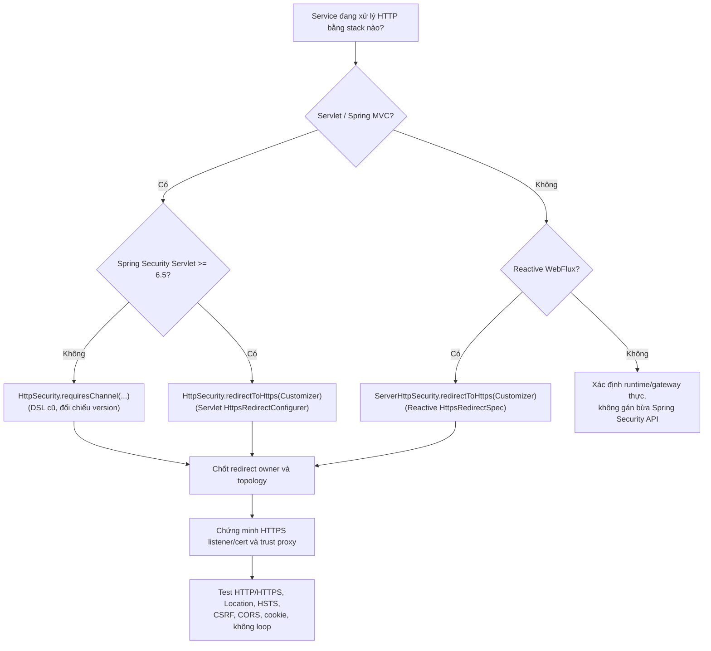
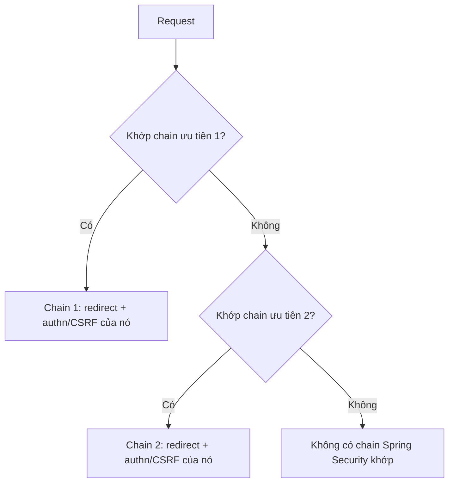
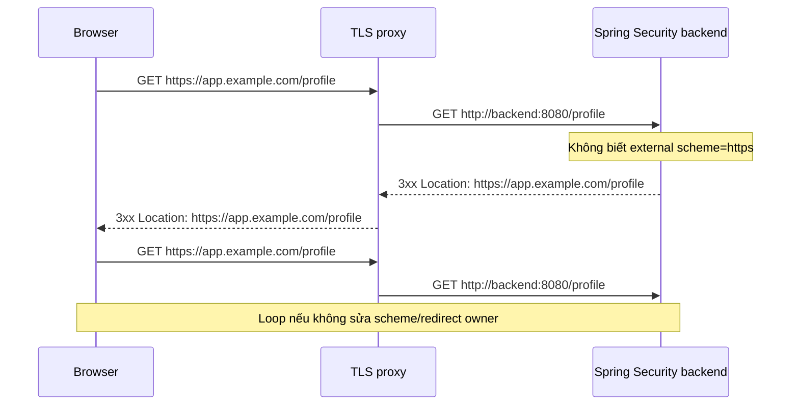
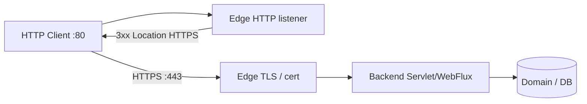

# redirectToHttps và API tương ứng theo dòng phiên bản

> **Chương:** HTTPS và HSTS  
> **Học phần:** `SPRING_SECURITY_HTTP_PROTECTION` — các lớp phòng vệ HTTP và trình duyệt trong Spring Security, từ CSRF, CORS, security headers, CSP, HSTS đến HTTP firewall và bảo vệ session. Bài tập trung vào **API chuyển hướng HTTP sang HTTPS theo phiên bản Spring Security**, đối chiếu **Servlet (Spring MVC)** với **Reactive WebFlux**, cách di trú giữa các DSL, cấu hình reverse proxy và kiểm thử an toàn.

## 1. Vì sao một tên API lại có thể tạo lỗi bảo mật khi nâng cấp?

Một nhóm phát triển duy trì ba dịch vụ:

- `billing-mvc` chạy Spring Security **5.8** và dùng `HttpSecurity.requiresChannel(...)`.
- `orders-mvc` đã nâng lên **6.5** và được đề xuất chuyển sang `HttpSecurity.redirectToHttps(...)`.
- `event-webflux` dùng Spring Security **7.x**, vẫn gọi `ServerHttpSecurity.redirectToHttps(...)` nhưng không còn kiểu chain method không tham số như code cũ.

Nếu chỉ tìm kiếm “bật HTTPS trong Spring Security” rồi chép một đoạn DSL bất kỳ, nhóm có thể gặp ba kết quả khác nhau:

1. **Không biên dịch được:** phương thức `redirectToHttps(Customizer)` của Servlet chưa có trong version cũ.
2. **Có warning hoặc API bị loại bỏ:** code dùng `requiresChannel`/`redirectToHttps()` dạng cũ không còn phù hợp đường di trú.
3. **Biên dịch, chạy được nhưng sai hành vi triển khai:** backend sau TLS proxy luôn nghĩ request là HTTP và tạo redirect loop; hoặc redirect sai cổng/host.

Vấn đề chính là **API + version + stack + topology** phải được xác định cùng lúc.

### Mục tiêu học tập

Sau bài này, người học có thể:

- Chọn đúng `requiresChannel` hoặc `redirectToHttps` theo **Servlet 5.x/6.0–6.4/6.5+/7.x** và chọn đúng overload `redirectToHttps` cho **WebFlux**.
- Hiểu vì sao API mang cùng tên trên `HttpSecurity` và `ServerHttpSecurity` không có cùng kiểu configurer, matcher hoặc filter.
- Phân biệt thay đổi **cấu hình source code** với thay đổi **hành vi thực tế** khi đi qua TLS termination, forwarded headers và nhiều security chains.
- Chuyển mã Java DSL cũ sang cấu hình hiện đại có kiểm thử; nhận diện legacy XML và các thay đổi redirect URI không nên nhầm với HTTPS upgrade.
- Kiểm thử request HTTP/HTTPS, cổng không chuẩn, method nguy hiểm, HSTS, CORS, CSRF, cookie session và các edge-generated responses.
- Viết một kế hoạch nâng cấp có điều kiện chấp nhận rõ ràng, tránh “sửa” vòng lặp redirect bằng cách tắt bảo vệ toàn hệ thống.

## 2. Đặt đúng ranh giới: Spring Security làm redirect, không tạo TLS

HTTP→HTTPS redirect là một **HTTP response** hướng client gửi **request mới** tới URL HTTPS. Ví dụ:

```http
HTTP/1.1 302 Found
Location: https://app.example.com/orders/42
```

Cơ chế này khác với:

- **TLS handshake:** do HTTP server/container, reactive runtime hoặc reverse proxy và client thực hiện.
- **HTTPS listener:** cổng/chứng chỉ phải được cấu hình ở server hoặc edge.
- **HSTS:** response policy để browser nhớ và ưu tiên HTTPS trong lần truy cập tiếp theo.
- **Authentication/authorization:** Spring Security quyết định principal có quyền truy cập chức năng và tài nguyên không.
- **CSRF:** Spring Security kiểm tra tính hợp lệ của request thay đổi trạng thái dựa cookie/session.
- **CORS/CSP:** chính sách mà browser thực thi khi dùng nhiều origin hoặc xử lý HTML.

Một dòng `redirectToHttps(withDefaults())` không cấp chứng chỉ TLS, không mở cổng 443, không làm một request HTTP chứa password đã được gửi trở thành an toàn và không tự bảo vệ đoạn kết nối proxy→backend.

### 2.1. Sơ đồ một request bị chuyển hướng

```mermaid
sequenceDiagram
    participant C as Browser/Client
    participant H as HTTP endpoint :80
    participant T as HTTPS endpoint :443
    participant S as Spring Security
    C->>H: GET http://app.example.com/orders/42
    H-->>C: 3xx + Location: https://app.example.com/orders/42
    C->>T: TLS handshake; xác minh certificate
    C->>T: GET /orders/42 qua HTTPS
    T->>S: Request đã tiếp nhận
    S-->>C: Authentication/authorization và response
```

Trên thực tế HTTP endpoint có thể nằm ở edge hoặc ở Spring Boot; TLS endpoint có thể cũng là edge. **Mỗi hop có chủ sở hữu khác nhau**, dù code Spring Security chạy trên backend không đổi.

## 3. Ma trận API theo dòng phiên bản — bảng cần tra đầu tiên

Đây là **ma trận rút ra từ Javadoc và hướng dẫn migration của Spring Security**, không phải quy tắc đoán dựa trên Spring Boot starter. Chọn đúng Javadoc của version đã ghim.

| Dòng Spring Security | Servlet: `HttpSecurity` | Reactive: `ServerHttpSecurity` | Ghi chú di trú |
| --- | --- | --- | --- |
| **5.x**, ví dụ 5.8 | Dùng `requiresChannel(channel -> channel.anyRequest().requiresSecure())`; chưa có Servlet `redirectToHttps(Customizer)` mới | Có `redirectToHttps()` kiểu DSL cũ; những bản 5.x muộn cũng có `redirectToHttps(Customizer)` | Không sao chép cấu hình Servlet 6.5+ vào Servlet 5.x |
| **6.0–6.4** | Vẫn dùng `requiresChannel(Customizer)`; API `redirectToHttps` kiểu Servlet mới **chưa xuất hiện** trong 6.4 | `redirectToHttps(Customizer)` sẵn có; `redirectToHttps()` không tham số bị deprecate từ 6.1 | Ưu tiên lambda/Customizer thay chaining `.and()` |
| **6.5** | **Thêm** `redirectToHttps(Customizer<HttpsRedirectConfigurer>)`, dùng `HttpsRedirectFilter`; `requiresChannel(Customizer)` được đánh dấu deprecated, hướng tới API mới | `redirectToHttps(Customizer<ServerHttpSecurity.HttpsRedirectSpec>)`; overload không tham số vẫn còn nhưng deprecated | Chuẩn bị di trú trước 7.x; không nhầm configurer Servlet với Reactive |
| **7.x** | `redirectToHttps(Customizer)` là lựa chọn phù hợp cho code mới; `requiresChannel(Customizer)` vẫn có thể tồn tại ở một số bản 7.x nhưng deprecated — kiểm tra Javadoc bản cụ thể | Dùng `redirectToHttps(Customizer)`; không dựa vào overload `redirectToHttps()` đã được lên kế hoạch loại bỏ | Xem thêm thay đổi request matchers và redirect URI khác loại |
| **Phiên bản tương lai** | **Không suy đoán** chữ ký, mặc định hoặc status trả về | **Không suy đoán** chữ ký, mặc định hoặc status trả về | Đọc Javadoc đúng artifact đang chạy và test HTTP response thực |

**Hai mốc đặc biệt đáng nhớ:**

- `HttpsRedirectConfigurer` của **Servlet** ghi `Since: 6.5`. Vì thế một dự án Servlet 6.4 không thể gọi API này chỉ vì cùng package `HttpSecurity`.
- `ServerHttpSecurity.HttpsRedirectSpec` của **WebFlux** ghi `Since: 5.1`. WebFlux có tên `redirectToHttps` từ trước **không đồng nghĩa** Servlet cũng có từ 5.x.

### 3.1. Không kết luận “Spring Security 7 đã loại bỏ hết requiresChannel”

Javadoc Spring Security 7.x vẫn có thể hiển thị `requiresChannel(Customizer)` ở trạng thái deprecated, hướng người dùng tới `redirectToHttps(Customizer)`. Điều đúng là **không nên phát triển cấu hình mới phụ thuộc API đã deprecated**, chứ không được tùy tiện tuyên bố mọi bản 7.x đều xóa phương thức ngay lập tức.

Điều bị loại bỏ theo lộ trình cũng khác nhau giữa **overload không tham số** và **overload dùng Customizer**. Học viên phải đọc đúng **chữ ký** và **annotation** thay vì chỉ nhìn một từ khóa trong bài blog.

### 3.2. Một dòng Boot version chưa đủ để chọn đoạn mã

Spring Boot quản lý tập dependency thông dụng, nhưng một ứng dụng có thể override Spring Security version hoặc có nhiều runtime/deployment. Trước khi thay API, phải xác nhận **phiên bản thực của `spring-security-config` và `spring-security-web`** ở service đó cùng stack Servlet/WebFlux.

Không dùng quy tắc “Boot đời X nghĩa là API Y chắc chắn có” thay cho việc xác minh dependency resolution. Chỉ chạy kiểm thử biên dịch khi được giao triển khai trong project; bài này tập trung hướng dẫn, không khẳng định đã chạy build cho dự án cụ thể.

## 4. Sơ đồ quyết định chọn API



**Điểm chặn an toàn:** API đúng nhưng **redirect owner sai** vẫn có thể tạo redirect loop. Bắt đầu bằng topology, không bắt đầu bằng copy/paste config.

## 5. Dòng 5.x và Servlet 6.0–6.4: requiresChannel

Trong phần lớn tài liệu Servlet Spring Security 5.x và 6.0–6.4, cách phổ biến để bắt request đi qua HTTPS là **channel security**:

```java
@Configuration
@EnableWebSecurity
class LegacyServletHttpsConfig {

    @Bean
    SecurityFilterChain securityFilterChain(HttpSecurity http)
            throws Exception {
        return http
            .requiresChannel(channel -> channel
                .anyRequest().requiresSecure()
            )
            .authorizeHttpRequests(auth -> auth
                .anyRequest().authenticated()
            )
            .formLogin(Customizer.withDefaults())
            .build();
    }
}
```

Đây là cấu hình **Servlet**, dùng `HttpSecurity`. Các đoạn ghép cần Java imports và user store/identity configuration phù hợp. Trong Spring Security 5.x rất cũ, phong cách `WebSecurityConfigurerAdapter` và chaining `.and()` phổ biến hơn; không nhất thiết phải giữ phong cách đó khi có thể chuyển sang bean `SecurityFilterChain` được hỗ trợ.

### 5.1. requiresChannel điều khiển gì?

`requiresChannel` liên quan tới `ChannelSecurityConfigurer` và cơ chế yêu cầu secure channel. Với mỗi request thuộc phạm vi chính sách, request được coi là HTTP không an toàn có thể bị chuyển tới địa chỉ HTTPS thích hợp.

```java
.requiresChannel(channel -> channel
    .anyRequest().requiresSecure()
)
```

Điều này **không** tự cung cấp HTTPS connector hoặc certificate.

### 5.2. Cẩn trọng khi chỉ bắt HTTPS cho một số URL

Một số mã lịch sử bảo vệ `/login/**` nhưng cho phép các đường khác dùng HTTP. Với session cookie, dữ liệu riêng tư, JS resources hoặc route phụ, cách làm đó rất dễ làm rò phiên và dữ liệu.

Tư duy mặc định cho ứng dụng hiện đại là **toàn bộ nội dung HTTP-facing cần được phục vụ qua HTTPS**. Nếu môi trường phát triển dùng HTTP local, nên tách policy theo môi trường/ingress và thiết kế rõ điều kiện, thay vì vô tình mở một phần production website.

### 5.3. API nào đã bị deprecated?

Ở **6.1+**, nhiều phương thức dạng **không nhận tham số** để cấu hình DSL được đánh dấu deprecated và hướng tới dạng `Customizer`. Riêng `requiresChannel(Customizer)` cũng được đánh dấu deprecated trong **6.5** vì đã có `redirectToHttps(Customizer)` thay thế.

Vì vậy, **hai khuyến nghị không mâu thuẫn**:

- Với Servlet 6.4 trở xuống: `requiresChannel(Customizer)` là API có sẵn thích hợp nếu project cần tự redirect.
- Với Servlet 6.5 trở lên: ưu tiên API mới `redirectToHttps(Customizer)` nếu project muốn cấu hình redirect ở Spring Security.

## 6. Dòng Servlet 6.5+: HttpsRedirectConfigurer và HttpsRedirectFilter

Kể từ Spring Security **6.5**, Servlet có `HttpsRedirectConfigurer` và `HttpsRedirectFilter`. Mặc định khi configurer này được thêm, nó chuyển các HTTP requests thuộc security chain sang HTTPS theo điều kiện của nó.

```java
import static org.springframework.security.config.Customizer.withDefaults;

@Configuration
@EnableWebSecurity
class ModernServletHttpsConfig {

    @Bean
    SecurityFilterChain securityFilterChain(HttpSecurity http)
            throws Exception {
        return http
            .redirectToHttps(withDefaults())
            .authorizeHttpRequests(auth -> auth
                .anyRequest().authenticated()
            )
            .formLogin(withDefaults())
            .build();
    }
}
```

Mẫu này phù hợp với Servlet Spring Security 6.5 và dòng 7.x có API tương ứng. **Không biên dịch trên Servlet 6.4** vì `HttpSecurity.redirectToHttps(...)` chưa tồn tại ở dòng đó.

### 6.1. Chữ ký và lớp cấu hình

Ý tưởng chữ ký là:

```java
HttpSecurity redirectToHttps(
    Customizer<HttpsRedirectConfigurer<HttpSecurity>> customizer
)
```

Tên triển khai **Servlet**:

- `org.springframework.security.config.annotation.web.builders.HttpSecurity`
- `org.springframework.security.config.annotation.web.configurers.HttpsRedirectConfigurer`
- `org.springframework.security.web.transport.HttpsRedirectFilter` (đối chiếu package với artifact đang dùng)

Không dùng trực tiếp các class này cho WebFlux: WebFlux cấu hình với `ServerHttpSecurity.HttpsRedirectSpec`.

### 6.2. requestMatchers của redirect configurer

Giả sử một môi trường đặc biệt chỉ muốn áp HTTPS redirect cho `/secure/**`. Javadoc cung cấp `HttpsRedirectConfigurer.requestMatchers(RequestMatcher...)`. Ví dụ dùng matcher Servlet phù hợp 6.5+/7.x:

```java
import org.springframework.security.web.servlet.util.matcher.PathPatternRequestMatcher;
import org.springframework.security.web.util.matcher.RequestMatcher;

@Bean
SecurityFilterChain securityFilterChain(HttpSecurity http)
        throws Exception {
    RequestMatcher secureArea =
        PathPatternRequestMatcher.withDefaults()
            .matcher("/secure/**");

    return http
        .redirectToHttps(https -> https
            .requestMatchers(secureArea)
        )
        .authorizeHttpRequests(auth -> auth
            .requestMatchers("/secure/**").authenticated()
            .anyRequest().permitAll()
        )
        .build();
}
```

**Đây là minh họa điều kiện route cho cơ chế redirect, không phải khuyến nghị để một phần website production dùng HTTP.** Trong hệ thống cookie/session, việc còn route HTTP có thể làm suy yếu an toàn phiên và tài nguyên phụ.

Đồng thời, với Spring Security 7, cách dựng `RequestMatcher` và quy tắc path matching có thay đổi; dùng `PathPatternRequestMatcher` theo Javadoc/migration, kiểm tra context path và đường dẫn sau proxy rewrite.

### 6.3. Khi nào dùng withDefaults và khi nào dùng customizer?

- `redirectToHttps(withDefaults())`: mong muốn redirect HTTP cho **phạm vi security chain** theo mặc định.
- `redirectToHttps(https -> https.requestMatchers(...))`: tự định nghĩa request matcher để giới hạn redirect theo nhu cầu đã kiểm chứng.
- Không cần tạo một bean `HttpsRedirectFilter` bằng tay nếu configurer đã cung cấp filter cho chain; tránh filter trùng và khó dự đoán.

## 7. Ba loại matcher rất dễ nhầm trong cùng HttpSecurity

Nhiều lỗi an ninh xuất hiện vì một developer thấy ba lần `requestMatchers` và tưởng chúng đều làm một việc.

| Cấp cấu hình | Ví dụ | Tác dụng |
| --- | --- | --- |
| **Chọn security chain** | `http.securityMatcher("/api/**")` | Chọn request nào được chain này xử lý |
| **Chọn request phải redirect** | `http.redirectToHttps(https -> https.requestMatchers(secureArea))` | Trong chain, chọn request HTTP nào cần chuyển HTTPS |
| **Phân quyền route** | `http.authorizeHttpRequests(auth -> auth.requestMatchers("/api/**").authenticated())` | Chọn yêu cầu authentication/authority sau khi request đến chain |

### 7.1. permitAll không tắt redirect

`permitAll()` ở authorization không đồng nghĩa mọi filter khác bị bỏ qua. Nếu một endpoint public `GET /health` nằm trong chain có `redirectToHttps(withDefaults())`, nó vẫn có thể được redirect từ HTTP sang HTTPS.

Tương tự, với cookie session, một `POST` route `permitAll` vẫn có thể bị CSRF protection chặn nếu không có token phù hợp.

### 7.2. Không khớp security chain là nguy cơ riêng



Nếu một route quan trọng không khớp security chain nào, `redirectToHttps` trong chain khác **không bảo vệ nó**. Một fallback chain từ chối route không phân loại hoặc bảo vệ tất cả requests theo policy giúp giảm khoảng trống.

### 7.3. Chọn đúng thứ tự khi có API và browser chains

Một ứng dụng có:

- `/api/**`: bearer token, resource server.
- Các trang còn lại: form login/session cookie.
- `/health`: health probe công khai.

Cần xác định rõ `@Order`/matcher của từng `SecurityFilterChain` hoặc `SecurityWebFilterChain`. HTTPS redirect ở một chain không tự áp dụng cho chain khác, còn edge redirect có thể bao phủ **toàn hostname** trước khi request tới bất kỳ chain nào.

## 8. PortMapper: vì sao test 8080→8443 khác production 80→443?

Khi Spring Security Servlet cần dựng URL HTTPS để redirect, nó có thể dùng `PortMapper` để đối chiếu cổng HTTP và HTTPS. Các giá trị mặc định được Javadoc `HttpSecurity` nêu bao gồm:

- HTTP `80` → HTTPS `443`.
- HTTP `8080` → HTTPS `8443`.

Ví dụ phục vụ môi trường test với cổng tùy chỉnh `9090` → `9443`:

```java
@Bean
SecurityFilterChain securityFilterChain(HttpSecurity http)
        throws Exception {
    return http
        .redirectToHttps(Customizer.withDefaults())
        .portMapper(ports -> ports
            .http(9090).mapsTo(9443)
        )
        .authorizeHttpRequests(auth -> auth
            .anyRequest().authenticated()
        )
        .build();
}
```

Điểm quan trọng:

1. `portMapper(...)` chỉ thiết lập **ánh xạ cổng khi tạo URL redirect**, không mở server port tương ứng.
2. Nếu backend sau proxy nhận `8080` nhưng browser truy cập host public tại `443`, đừng để `Location` phát ra `https://app.example.com:8443` chỉ vì port nội bộ.
3. Canonical host/scheme/port trong môi trường proxy cần do **trusted forwarding hoặc edge redirect** quyết định.
4. Bộ test phải có trường hợp localhost không chuẩn lẫn public hostname thực; chỉ test một port không chứng minh production đúng.

### 8.1. PortMapper của dòng cũ

Trong Servlet 5.x/6.4 dùng `requiresChannel(...)`, `portMapper(...)` vẫn là một cấu hình liên quan. Khi nâng sang 6.5, không nhất thiết xóa port mapping; hãy xác định liệu HTTPS redirect mới còn cần mapping trong topology đang dùng.

### 8.2. Không cấu hình PortMapper “cho đẹp”

Nếu tổ chức có ingress 80/443 và không expose cổng nội bộ, một cài đặt `portMapper(9090→9443)` trong backend có thể gây hại khi Spring Security vô tình sinh public URL sai. Chỉ thiết lập khi thực sự có một HTTP listener và một HTTPS listener tương ứng với địa chỉ mà **client có thể kết nối**.

## 9. XML namespace: đường di trú trong dự án lâu năm

Một số dự án Spring Security cấu hình bằng XML namespace:

```xml
<http>
    <intercept-url
        pattern="/**"
        access="ROLE_USER"
        requires-channel="https"/>
</http>
```

Đây là ví dụ cơ chế **channel requirement** truyền thống; cú pháp quyền/phân quyền và các thuộc tính khác phụ thuộc namespace schema/version.

Hướng dẫn migration trước 7.x của Spring Security có giới thiệu cách biểu diễn điều kiện redirect qua `redirect-to-https-request-matcher-ref` khi cần thiết:

```xml
<!-- Minh họa ý tưởng; cần bean matcher và namespace chính xác. -->
<http redirect-to-https-request-matcher-ref="secureMatcher">
    <intercept-url pattern="/secure/**" access="authenticated"/>
</http>
```

Để triển khai thật, `secureMatcher` phải là bean `RequestMatcher` hợp lệ đúng version và được khai báo; đoạn trên không phải file XML độc lập.

**Không chỉ tìm/replace `requires-channel` bằng một thuộc tính khác**. Cần đối chiếu migration guide, matcher type, security chain boundaries, path patterns và các test proxy/public URL.

## 10. WebFlux: redirectToHttps đã tồn tại trước API Servlet mới

Đây là khác biệt dễ nhầm nhất của chủ đề.

### 10.1. API và lớp của Reactive

- `ServerHttpSecurity` là builder Reactive.
- `SecurityWebFilterChain` là security chain.
- `ServerHttpSecurity.HttpsRedirectSpec` là cấu hình HTTPS redirect của Reactive, xuất hiện từ **5.1**.
- Các request được thể hiện bằng `ServerWebExchange`, không phải `HttpServletRequest`.
- Điều kiện custom có thể cấu hình bằng `httpsRedirectWhen(...)` trong `HttpsRedirectSpec`.

### 10.2. Phong cách WebFlux 5.x/6.x cũ

Mã lịch sử thường thấy:

```java
@Bean
SecurityWebFilterChain webFilterChain(ServerHttpSecurity http) {
    http
        .redirectToHttps()
        .and()
        .authorizeExchange()
            .anyExchange().authenticated();
    return http.build();
}
```

Đây là **mã legacy để nhận diện khi migration**, không khuyến nghị copy vào code mới. Trong một số bản 6.x, phương thức **không tham số** `redirectToHttps()` được đánh dấu deprecated từ 6.1 và định hướng loại bỏ khi nâng lên 7.x. Cả `.and()` theo builder DSL cũng thuộc phong cách cũ.

### 10.3. Phong cách WebFlux hiện đại — Customizer

```java
import static org.springframework.security.config.Customizer.withDefaults;

@Bean
SecurityWebFilterChain securityWebFilterChain(ServerHttpSecurity http) {
    return http
        .redirectToHttps(withDefaults())
        .authorizeExchange(auth -> auth
            .anyExchange().authenticated()
        )
        .httpBasic(withDefaults())
        .build();
}
```

Đây là mẫu phù hợp trên các phiên bản Reactive hỗ trợ overload `redirectToHttps(Customizer)`, bao gồm các bản 5.x muộn, 6.x và 7.x. **Khác Servlet:** việc có overload này ở WebFlux **không chứng minh** Servlet của cùng version có `HttpSecurity.redirectToHttps`.

### 10.4. Chữ ký Reactive

Ý tưởng chữ ký là:

```java
ServerHttpSecurity redirectToHttps(
    Customizer<ServerHttpSecurity.HttpsRedirectSpec> customizer
)
```

Đừng import `HttpsRedirectConfigurer` của Servlet để cấu hình WebFlux. Các hàm custom của Reactive làm việc với `ServerWebExchange` và Reactor context, không dùng Servlet Filter API.

## 11. WebFlux: httpsRedirectWhen và ranh giới trust

Reactive `HttpsRedirectSpec` hỗ trợ `httpsRedirectWhen(...)` để chọn điều kiện phải redirect. Ví dụ về một điều kiện **theo môi trường ứng dụng**, không phụ thuộc header do client tự cung cấp:

```java
@Bean
SecurityWebFilterChain securityWebFilterChain(
        ServerHttpSecurity http,
        Environment environment) {

    boolean requireHttps =
        environment.acceptsProfiles(Profiles.of("production"));

    return http
        .redirectToHttps(redirect -> redirect
            .httpsRedirectWhen(exchange -> {
                String scheme =
                    exchange.getRequest().getURI().getScheme();
                return requireHttps && !"https".equalsIgnoreCase(scheme);
            })
        )
        .authorizeExchange(auth -> auth
            .anyExchange().authenticated()
        )
        .build();
}
```

**Giả định:** `ServerWebExchange` ở đây đã nhận URL/scheme từ nguồn metadata đáng tin sau proxy transformation. Đây là ví dụ cách lựa chọn điều kiện, không phải thay thế hệ thống trust proxy.

### 11.1. Điều kiện dựa trên header cần cực kỳ thận trọng

Tài liệu Reactive có ví dụ dùng sự hiện diện `X-Forwarded-Proto` làm điều kiện kích hoạt redirect trong một số topology. Không nên copy ví dụ như một **quy tắc bảo mật** nếu header có thể do client Internet tự gửi.

Sai tư duy:

```java
// KHÔNG dùng như một tiêu chí xác minh proxy đáng tin:
.httpsRedirectWhen(exchange ->
    exchange.getRequest().getHeaders()
        .containsKey("X-Forwarded-Proto"))
```

Điều kiện chỉ chứng minh header tồn tại, **không** chứng minh giá trị do proxy tin cậy tạo, cũng không trực tiếp xác định request bên ngoài là HTTP hay HTTPS.

Cách tốt hơn:

1. Edge loại bỏ và tái tạo `Forwarded`/`X-Forwarded-*` từ thông tin kết nối thật.
2. Backend chỉ nhận request từ proxy tin cậy.
3. Reactive runtime/`ForwardedHeaderTransformer` diễn giải external scheme đúng.
4. Redirect decision dựa trên scheme đã được xác minh hoặc đưa toàn bộ public redirect về edge.
5. Test cả request client cố giả mạo header và request HTTPS thật sau proxy.

### 11.2. Customizer và no-arg khác nhau theo bản 7.x

Lỗi migration thường gặp:

```java
// Legacy: không nên phụ thuộc khi nâng 7.x
http.redirectToHttps().httpsRedirectWhen(myCondition);
```

Cách tiếp cận mới:

```java
http.redirectToHttps(redirect -> redirect
    .httpsRedirectWhen(myCondition)
);
```

`myCondition` phải có kiểu hàm/matcher đúng chữ ký mà `HttpsRedirectSpec` của version sử dụng hỗ trợ. Đừng đưa `javax.servlet` hoặc `jakarta.servlet` matcher vào một WebFlux callback.

## 12. So sánh API theo kiểu, không chỉ theo tên

| Khía cạnh | Servlet 6.5+/7.x | WebFlux 5.x–7.x (overload hiện đại) |
| --- | --- | --- |
| Builder | `HttpSecurity` | `ServerHttpSecurity` |
| Security chain | `SecurityFilterChain` | `SecurityWebFilterChain` |
| API chính | `redirectToHttps(Customizer<...>)` | `redirectToHttps(Customizer<...>)` |
| Configurer | `HttpsRedirectConfigurer<HttpSecurity>` | `ServerHttpSecurity.HttpsRedirectSpec` |
| Điều kiện tùy biến | `requestMatchers(RequestMatcher...)` | `httpsRedirectWhen(...)` |
| Request abstraction | `HttpServletRequest`, `RequestMatcher` | `ServerWebExchange`, Reactive matcher/function |
| Tầng filter | Servlet `HttpsRedirectFilter` | Reactive WebFilter cơ chế HTTPS redirect |
| Port handling | `PortMapper` tích hợp DSL | `HttpsRedirectSpec.portMapper(...)` khi phiên bản hỗ trợ |
| Response TLS | Servlet connector hoặc edge | Reactive HTTP server hoặc edge |
| Testing | `MockMvc`/Servlet integration | `WebTestClient`/Reactive integration |

**Một chữ ký trông giống nhau không làm hai class tương đương hoặc có thể hoán đổi.** Code review cần xem package imports, generic types, HTTP runtime và security chain do request thực đi qua.

## 13. Chuyển Servlet 6.4 → 6.5: thay đổi tối thiểu có kiểm chứng

### 13.1. Trước khi nâng (6.4)

```java
@Bean
SecurityFilterChain securityFilterChain(HttpSecurity http)
        throws Exception {
    return http
        .requiresChannel(channel -> channel
            .anyRequest().requiresSecure()
        )
        .authorizeHttpRequests(auth -> auth
            .anyRequest().authenticated()
        )
        .build();
}
```

### 13.2. Sau khi nâng (6.5+)

```java
@Bean
SecurityFilterChain securityFilterChain(HttpSecurity http)
        throws Exception {
    return http
        .redirectToHttps(Customizer.withDefaults())
        .authorizeHttpRequests(auth -> auth
            .anyRequest().authenticated()
        )
        .build();
}
```

**Ý định bảo mật giữ nguyên:** request HTTP tới các route do chain này bảo vệ phải tới HTTPS trước khi thực thi nghiệp vụ.

**Không mặc định rằng mọi chi tiết implementation giữ nguyên:** loại filter, matcher, status code, xây URL, thứ tự filter hoặc hành vi với cổng không chuẩn có thể khác. Hãy đo và so sánh **HTTP contract thực**.

### 13.3. Nâng cấp không có nghĩa bỏ mọi test cũ

Giữ các bất biến:

- HTTP GET cần redirect/reject theo policy.
- HTTPS GET không redirect vòng lặp.
- HTTPS POST thiếu CSRF bị từ chối nếu dùng cookie/session.
- HTTP POST không thực thi nghiệp vụ.
- Cookie `Secure` không bị gửi qua plaintext.
- External host/port trong `Location` đúng.
- HSTS trên HTTPS response đúng host.
- Redirect không đưa đến hostname attacker.

Nếu cấu hình cũ dùng `requiresInsecure()` cho một số route, cần **xem lại toàn bộ giả định**: thiết kế hiện đại ưu tiên HTTPS ở mọi nơi; không chuyển một yêu cầu downgrade HTTP sang config mới theo cách giữ lại điểm yếu.

## 14. Chuyển WebFlux 6.x → 7.x: thay overload và giữ logic

### 14.1. Dạng cũ nhận diện trong code

```java
http.redirectToHttps()
    .httpsRedirectWhen(exchange ->
        !"https".equalsIgnoreCase(
            exchange.getRequest().getURI().getScheme()));
```

### 14.2. Dạng Customizer

```java
http.redirectToHttps(redirect -> redirect
    .httpsRedirectWhen(exchange ->
        !"https".equalsIgnoreCase(
            exchange.getRequest().getURI().getScheme()))
);
```

**Chênh lệch chính ở chữ ký DSL:** code mới không dựa vào kiểu chaining không tham số của API cũ. Nhưng test phải tiếp tục xác minh rằng `scheme` được đọc từ `ServerWebExchange` **đã được proxy transformation đúng**.

### 14.3. Có nên giữ custom condition?

Nếu mọi HTTP request đều cần HTTPS, `redirectToHttps(Customizer.withDefaults())` có thể đơn giản và ít nguy cơ hơn custom condition. Duy trì custom predicate chỉ khi có lý do, chẳng hạn môi trường dev/test hoặc đặc thù request path, và phải có test chứng minh không mở ngoại lệ quá rộng.

Đừng đưa một check `containsKey("X-Forwarded-Proto")` vào production chỉ để hết một lỗi cụ thể mà không hiểu trust boundary.

## 15. Spring Security 7 và PathPatternRequestMatcher: ảnh hưởng redirect scope

Hướng dẫn migration Spring Security 7 nhấn mạnh việc chuyển các URL matchers trong Servlet về `PathPatternRequestMatcher`. Điều này có thể ảnh hưởng:

- Matcher của **HTTPS redirect** khi chỉ redirect một tập đường dẫn.
- Matcher chọn **security chain**.
- Matcher dùng cho **authorization**.
- Path sau proxy rewrite, servlet context path và base path của ứng dụng.

### 15.1. Cẩn thận với đường dẫn sau proxy

Ví dụ browser gọi:

```text
https://app.example.com/store/secure/order/42
```

nhưng ingress chuyển đến:

```text
http://backend:8080/secure/order/42
```

Nếu mã matcher viết `/store/secure/**` nhưng Spring Security thực tế chỉ thấy `/secure/**`, request có thể không nằm trong phạm vi redirect dự kiến. Điều tương tự áp dụng cho authorization và CSRF chain selection.

**Hãy test request theo đường public**, quan sát path thực tế sau rewrite và đối chiếu các matcher trên backend.

### 15.2. Tránh hiểu sai sự khác nhau giữa redirect URI login và redirect HTTPS

Tài liệu migration Spring Security 7 còn mô tả thay đổi việc ưu tiên **relative URI** cho **login redirect**. Đây là nhánh khác với HTTP→HTTPS upgrade:

```http
HTTP/1.1 302 Found
Location: /login
```

Khác:

```http
HTTP/1.1 302 Found
Location: https://app.example.com/orders/42
```

Một test khẳng định **mọi** header `Location` phải là absolute HTTPS URL sẽ thất bại sai khi gặp login redirect hợp lệ. Hãy phân loại loại redirect qua request, trạng thái authentication và `Location` thực tế.

## 16. HTTPS port mapping và Spring Boot TLS configuration là hai việc

Đặt `redirectToHttps(...)` trong Spring Security không làm server tự tạo HTTPS listener. Ví dụ Spring Boot trực tiếp kết thúc TLS có thể có:

```yaml
# Chỉ là ví dụ cấu hình server TLS cho môi trường thử nghiệm.
server:
  port: 8443
  ssl:
    enabled: true
    key-store: classpath:tls/dev-server.p12
    key-store-type: PKCS12
    key-store-password: "__LOAD_FROM_SECRET_STORE__"
```

Spring Boot/HTTP runtime quản lý TLS, chứng chỉ và cổng. Spring Security quản lý policy HTTP trên requests mà chain nhận.

### 16.1. Chỉ có HTTPS port không thể tự redirect HTTP

Nếu backend chỉ listen 8443, request đến port 8080 không được server này tiếp nhận. Không thể có `3xx` từ ứng dụng nếu không có một **HTTP listener** hoặc edge nhận request đó.

Chọn một trong các topology:

1. **Edge HTTP:80 + HTTPS:443:** edge redirect/reject HTTP, chuyển HTTPS traffic tới backend.
2. **Ứng dụng có cả HTTP và HTTPS connectors:** server nhận HTTP và Spring Security/handler chuyển hướng theo policy.
3. **Chỉ HTTPS endpoint:** client thử HTTP bị từ chối kết nối; không có redirect, nhưng client đúng phải biết URL HTTPS.

### 16.2. TLS không đồng nghĩa toàn hệ thống được bảo vệ

Khi edge terminate TLS và proxy sang HTTP nội bộ, kết nối edge→backend không có TLS dù browser thấy khóa HTTPS. Nếu dữ liệu/hạ tầng yêu cầu bảo vệ hop nội bộ, cần TLS/mTLS hoặc giải pháp tương đương phù hợp threat model.

Không dùng Spring Security redirect để “mã hóa hop nội bộ” — redirect chỉ điều hướng **client HTTP**, không tự tạo TLS giữa các dịch vụ.

## 17. Reverse proxy và forwarded headers: căn nguyên redirect loop

Ví dụ browser truy cập HTTPS, nhưng app chỉ thấy HTTP:



### 17.1. Hai cách kiến trúc hợp lệ

**A. Edge sở hữu redirect.** HTTP request công khai đến edge được redirect về HTTPS. Backend không cần tự redirect public HTTP, chỉ nhận traffic từ edge. Edge có thể sở hữu HSTS cho toàn hostname.

**B. Backend sở hữu redirect.** Edge truyền thông tin external scheme/host/port **đáng tin**, Spring Framework/container biến đổi request trước khi Spring Security quyết định redirect. Cần test cả HTTP và HTTPS qua edge thật.

Đừng bật cả hai một cách độc lập nếu điều đó khiến backend liên tục yêu cầu redirect sau một request vốn đã đến từ HTTPS.

### 17.2. Forwarded/X-Forwarded-* không phải dữ liệu đáng tin mặc định

Proxy có thể tạo:

```http
Forwarded: for=198.51.100.30;proto=https;host=app.example.com
X-Forwarded-Proto: https
X-Forwarded-Host: app.example.com
X-Forwarded-Port: 443
```

`198.51.100.30` là địa chỉ ví dụ. Nếu client Internet có thể tự gửi header trên và proxy giữ nguyên, backend có thể bị đánh lừa tạo redirect host sai hoặc nghĩ một HTTP request đã secure.

**Yêu cầu tối thiểu:**

- Edge **xóa/ghi đè** forwarded metadata từ client chưa được xác minh.
- Backend chỉ nhận request từ proxy đáng tin bằng network policy hoặc mTLS/biện pháp tương đương.
- Hostnames public được allowlist/canonicalize, không tự tạo `Location` từ host do client điều khiển.
- Đảm bảo số lượng proxy hops và cách xử lý forwarding lists nhất quán.
- Test request giả `X-Forwarded-Proto` và `X-Forwarded-Host` ở ingress.

### 17.3. Spring Framework có abstraction khác theo stack

| Servlet | Reactive |
| --- | --- |
| `ForwardedHeaderFilter` | `ForwardedHeaderTransformer` |
| Servlet container có cơ chế native | Reactive runtime có cơ chế tương ứng |
| Dùng `HttpServletRequest` sau xử lý forwarding | Dùng `ServerWebExchange`/request URI sau transformation |

Ví dụ Spring Boot trong topology đã có trust proxy:

```yaml
server:
  forward-headers-strategy: framework
```

`framework`/`native` tùy runtime, không phải “bật là tin cậy”. Nếu backend vẫn public và tiếp nhận client headers trực tiếp, thêm cấu hình này có thể làm tình hình tệ hơn.

## 18. Chọn redirect owner: không phải dự án nào cũng cần DSL Spring Security

Một thiết kế production có CDN/ingress thường chọn edge quản lý HTTP→HTTPS:



Lợi thế:

- Redirect có mặt ngay ở ingress, trước khi vào app.
- Có thể xử lý response lỗi do edge tạo, bao gồm HSTS policy.
- Backend không phải đoán public port/host từ internal port.
- Các service sử dụng một quy tắc canonical host chung.

Nhưng edge redirect **không tự bảo vệ API**; Spring Security vẫn phải thực thi CSRF/CORS/authorization và session policy trong backend, service vẫn phải kiểm tra object-level permissions.

### 18.1. Khi dùng DSL redirect tại ứng dụng

Có thể thích hợp khi:

- Spring Boot trực tiếp nhận HTTP và HTTPS trên listeners đã được cấu hình.
- Môi trường dev/test cần mô phỏng policy cùng application.
- Reverse proxy cung cấp metadata đáng tin và app được giao quyết định redirect riêng theo route.
- Không có một edge public thống nhất.

Cần ràng buộc: request có đi qua **đúng security chain**, phương thức/chữ ký tương ứng version, redirect URL đúng public origin và không có redirect loop.

### 18.2. Không thể bảo vệ request HTTP đầu tiên hồi tố

Dù Spring Security trả `301`/`302`/`307`/`308`, một POST chứa password gửi qua HTTP đã xảy ra trước redirect. Client/browser/form phải dùng HTTPS **ngay từ đầu**. HSTS đã được browser lưu hoặc preload có thể nâng HTTP URL trước khi gửi, nhưng không được dùng làm lý do cho frontend cố ý submit tới HTTP.

## 19. Phân biệt mã redirect và những điều không nên assert cứng

| Status | Ý nghĩa | Method khi client follow |
| --- | --- | --- |
| `301` | Permanent Redirect | Một số user agents có thể đổi POST→GET |
| `302` | Temporary Redirect | Một số user agents có thể đổi POST→GET |
| `303` | See Other | Thường chuyển sang GET theo ngữ nghĩa 303 |
| `307` | Temporary Redirect | Không được đổi method khi tự động follow |
| `308` | Permanent Redirect | Không được đổi method khi tự động follow |

**Không đưa ra lời khẳng định rằng mọi version của Spring Security dùng cùng một mã cụ thể**. Chọn test theo **hợp đồng ứng dụng**, rồi đo status thực của filter/edge/version. Nếu migration thay implementation filter, status hoặc `Location` có thể khác, nhưng bất biến chính vẫn là **không có nội dung nhạy cảm hoặc side effect trái phép trên HTTP**.

### 19.1. HTTP unsafe methods

Đối với POST/PUT/PATCH/DELETE:

- Không gửi dữ liệu nhạy cảm qua HTTP rồi trông chờ 307/308.
- Có thể lựa chọn **reject HTTP unsafe requests tại edge** theo threat model thay vì redirect để tránh replay/retry bất ngờ.
- Không để HTTP request cập nhật database rồi mới redirect.
- Sau khi chuyển HTTPS, vẫn kiểm tra CSRF nếu browser dùng cookie và quyền đối tượng trong service.

## 20. HSTS là lớp khác, không phải một overload của redirectToHttps

HSTS thường được Spring Security hỗ trợ trong security headers và bật theo cấu hình thông dụng khi request được coi là **secure**. HSTS chỉ có hiệu lực với browser sau khi nhận header trên **HTTPS response hợp lệ**.

```http
Strict-Transport-Security: max-age=31536000
```

- `redirectToHttps(...)`: server chuyển hướng HTTP request đã đến.
- `Strict-Transport-Security`: browser nhớ policy và có thể nâng request HTTP thành HTTPS **trước khi gửi** ở lần sau.
- `includeSubDomains`: có thể buộc HTTPS ở các host con của miền đã nhận policy.
- `preload`: đăng ký preload có điều kiện riêng; thêm từ khóa vào header không tự làm host có tên trong danh sách browser.
- `max-age=0`: hỗ trợ hủy policy riêng được lưu từ hostname qua HTTPS nhưng không luôn vô hiệu hóa policy miền cha/preload.

Không cần tăng `max-age` dài hoặc bật `includeSubDomains` để “làm redirectToHttps mạnh hơn” nếu tổ chức chưa kiểm kê toàn bộ miền. HSTS dài hạn là một quyết định vận hành riêng.

### 20.1. Khi edge sở hữu HSTS

Nếu backend chỉ thấy HTTP sau TLS termination, Spring Security có thể không phát HSTS. Đặt HSTS ở edge cho hostname public có thể rõ ràng hơn, nhất là với response 4xx/5xx do edge tự sinh.

**Kiểm tra response cuối từ browser**, không chỉ response giả lập trong `MockMvc`/`WebTestClient`.

## 21. CSRF, CORS, CSP và session vẫn độc lập với HTTPS redirect

| Cơ chế | Chức năng | Lỗi nếu nhầm redirect là đủ |
| --- | --- | --- |
| CSRF | Chặn request giả mạo khi browser dùng ambient credentials | POST HTTPS vẫn có thể là CSRF |
| CORS | Hạn chế JS khác origin đọc response | Browser có thể từ chối preflight dù URL đích HTTPS |
| CSP | Hạn chế script/resources/frame trong HTML | TLS không chặn XSS do app render sai |
| Session cookie `Secure` | Không gửi cookie qua HTTP phù hợp | Redirect không tự thêm `Secure` |
| `HttpOnly` | Hạn chế JavaScript đọc trực tiếp cookie | XSS vẫn có thể gửi request cùng origin |
| `SameSite` | Kiểm soát gửi cookie theo ngữ cảnh site | CORS/cookie behavior không suy từ scheme redirect |
| HTTP firewall | Chặn request path/method nhập nhằng | TLS không thống nhất URL normalization |
| Object authorization | Quyền theo tenant/owner/ACL | User đăng nhập HTTPS vẫn có thể vượt quyền |

### 21.1. CORS preflight không nên phụ thuộc HTTP redirect

SPA HTTPS nên gọi **HTTPS API origin trực tiếp**. Nếu frontend gọi `http://api.example.com`, browser có thể chặn mixed content trước khi redirect; các luồng preflight còn có các hạn chế liên quan đến redirect và cookie.

Preflight `OPTIONS` thường không mang session cookie. Hãy tích hợp CORS đúng chain (Servlet/Reactive) để preflight được xử lý trước authentication có thể từ chối request chưa có cookie, và định nghĩa origin/method/header/credentials allowlist phù hợp.

### 21.2. CSP nằm trên HTML chứ không chỉ API JSON

Nếu SPA HTML do CDN ở `https://portal.example.com` phát, CSP bảo vệ HTML phải nằm trên response của **portal**; một CSP được Spring Security thêm trên JSON API ở `https://api.example.com` không tự áp tới HTML document khác origin.

### 21.3. Session lifecycle qua redirect

Login/logout có thể đổi session ID hoặc làm token CSRF cũ hết hiệu lực. Một request chuyển HTTP→HTTPS không tự xử lý vòng đời token:

- Form submit và token cần được lấy/gửi trên HTTPS.
- Cookie cần `Secure`/`HttpOnly`/`SameSite` phù hợp.
- Logout phải invalidate server session, không chỉ redirect về login.
- Test replay cookie cũ sau logout và truy cập từ nhiều node/session store khi cần.

## 22. Kiểm thử Servlet: MockMvc với đúng version/configurer

Bài này không chạy test trên project cụ thể. Các đoạn dưới đây là **mẫu cần tích hợp** với ứng dụng đã có `MockMvc` và `spring-security-test`, cấu hình bảo mật thực, controller `GET /health` và một listener/port scheme thích hợp.

### 22.1. Test HTTP redirect

```java
@Test
void httpGetShouldRedirectToHttps() throws Exception {
    mvc.perform(get("/health")
            .secure(false)
            .with(request -> {
                request.setScheme("http");
                request.setServerName("app.example.com");
                request.setServerPort(80);
                return request;
            }))
        .andExpect(status().is3xxRedirection())
        .andExpect(header().string(
            "Location", startsWith("https://app.example.com/")));
}
```

`startsWith` ở đây là Hamcrest matcher và cần import. Nếu version trả `https://app.example.com:443/...` hoặc có hostname mapping khác, điều chỉnh expected URL theo policy thật. **Không coi test redirect MockMvc là TLS handshake test**.

### 22.2. Test HTTPS không tạo loop

```java
@Test
void secureRequestMustProceedToHandler() throws Exception {
    mvc.perform(get("/health")
            .secure(true)
            .with(request -> {
                request.setScheme("https");
                request.setServerName("app.example.com");
                request.setServerPort(443);
                return request;
            }))
        .andExpect(status().isOk());
}
```

Điều kiện: `GET /health` có thật, được permit và trả 200 trong test fixture. Nếu response contract là 204 hoặc redirect khác, cần thay assertion; điểm kiểm thử là **không chuyển hướng vô hạn về chính HTTPS URL**.

### 22.3. Kiểm tra đường chỉ redirect có giới hạn matcher

Với config `https.requestMatchers(secureArea)`, phải test ít nhất:

- `GET /secure/order/42` qua HTTP → redirect.
- `GET /secure/order/42` qua HTTPS → không HTTPS-redirect.
- Các route được cố ý không redirect không chứa credentials/data nhạy cảm.
- Request đi qua chain khác không bị bỏ bảo vệ do matcher/order sai.

### 22.4. PortMapper test

Khi dùng cổng 9090→9443, request mock phải đặt server port là 9090; test dự kiến `Location` sẽ dùng 9443 **theo đúng cấu hình của test**. Nếu test chạy sau public proxy, kiểm tra cổng bên ngoài qua E2E thay vì chỉ cổng nội bộ.

### 22.5. Test POST không có side effect

```java
@Test
void insecurePostMustNotApprove() throws Exception {
    mvc.perform(post("/api/orders/42/approve")
            .secure(false)
            .with(request -> {
                request.setScheme("http");
                request.setServerPort(80);
                request.setServerName("app.example.com");
                return request;
            }));

    assertThat(orderRepository.findById("42").orElseThrow()
            .getState())
        .isEqualTo(OrderState.PENDING);
}
```

Đây chỉ là phần **state assertion minh họa**, cần bổ sung status/`Location` theo policy và một fixture đủ authn/CSRF/authorization nếu muốn cô lập **HTTPS redirect** là nguyên nhân ngăn nghiệp vụ. Nếu thiếu token hoặc quyền, việc dữ liệu không đổi có thể do filter khác chặn và chưa chứng minh điều kiện HTTPS.

## 23. Kiểm thử WebFlux: WebTestClient và ServerWebExchange

Với WebFlux, cần `WebTestClient` tích hợp security chain Reactive. Ví dụ mẫu:

```java
@Test
void reactiveInsecureRequestMustRedirect() {
    webTestClient.get()
        .uri("http://app.example.com/health")
        .exchange()
        .expectStatus().is3xxRedirection()
        .expectHeader().exists("Location");
}
```

Để kiểm tra URL đích, thêm assertion:

```java
webTestClient.get()
    .uri("http://app.example.com/health")
    .exchange()
    .expectHeader()
    .valueMatches(
        "Location", "^https://app\\.example\\.com(?::443)?/health$"
    );
```

Cấu hình `WebTestClient` bind-to-application hoặc bind-to-server ảnh hưởng cách URI scheme/host được diễn giải. Cần xác minh exchange thực sự mang scheme HTTP và đi qua `SecurityWebFilterChain` dự kiến.

### 23.1. Test điều kiện custom httpsRedirectWhen

Nếu custom condition chỉ bật redirect trong production, cần:

- Test với profile/policy đã bật: HTTP redirect, HTTPS không loop.
- Test khi condition tắt: request phù hợp môi trường dev, **không suy rằng HTTP production cũng an toàn**.
- Test forged forwarded headers nếu điều kiện có liên quan đến proxy.
- Test đường API với HTTP methods và authentication khác nhau để không bỏ lọt route cần HTTPS.

### 23.2. WebTestClient không xác thực chứng chỉ trừ khi dùng TLS thật

Một mock exchange URI `https://...` không chứng minh:

- HTTPS listener thực có mặt.
- Certificate đúng SAN/hostname/chain.
- Public proxy dùng TLS đúng.
- HSTS đã được browser nhận.
- Cookie session có đủ `Secure` và `SameSite` trên response cuối.

Những mục đó cần test qua live HTTPS endpoint hoặc browser/E2E.

## 24. Ma trận kiểm thử bắt buộc khi nâng cấp redirect API

| Test ID | Điều kiện | Bằng chứng mong đợi | Áp dụng cho |
| --- | --- | --- | --- |
| V-01 | Compile config trên version thực | Có đúng overload/configurer, không gọi API chưa tồn tại | Servlet + Reactive |
| V-02 | HTTP GET host/cổng hợp lệ | 3xx/reject đúng policy; `Location` đúng HTTPS | Servlet + Reactive + edge |
| V-03 | HTTPS GET cùng resource | Không redirect lại chính URL | Servlet + Reactive + edge |
| V-04 | HTTP POST test không chứa secret | Không có tác dụng nghiệp vụ trước khi redirect/reject | End-to-end + DB |
| V-05 | HTTPS POST thiếu CSRF, cookie login | Bị chặn; state không đổi | Servlet/Reactive security |
| V-06 | HTTPS POST hợp lệ có quyền | Chức năng vẫn hoạt động | Integration + DB |
| V-07 | Public URL :443, backend :8080 | Không lộ port nội bộ trong `Location` | Edge |
| V-08 | Servlet custom 9090→9443 | PortMapper đúng | Servlet |
| V-09 | HTTPS qua TLS termination | Backend không tạo redirect loop | Edge + Servlet/Reactive |
| V-10 | Header `X-Forwarded-*` giả mạo | Không điều khiển được URL đích hoặc scheme | Edge/security |
| V-11 | Security chain matcher/order | Không có route quan trọng bỏ ngoài chain | Servlet + Reactive |
| V-12 | HTTP firewall encoded path | Không bypass matcher sau redirect/rewrite | Edge + stack |
| V-13 | HSTS trên HTTPS response cuối | Header policy đúng host | Browser/edge |
| V-14 | Browser đã lưu HSTS | Có thể nâng URL trước request; không kết luận sai vì thiếu 3xx | Browser |
| V-15 | CORS preflight SPA | Trên HTTPS, không bị auth chặn sai | Browser/edge |
| V-16 | Cookie login/logout | `Secure`/`HttpOnly`/`SameSite` và replay session cũ bị từ chối | Browser/integration |
| V-17 | Redirect login `/login` ở 7.x | Không nhầm relative login Location với HTTPS redirect | Servlet |
| V-18 | CSP của SPA HTML | HTML response đúng origin có policy | Browser |
| V-19 | Edge tự trả 4xx/5xx | Không mất security headers thuộc owner edge | Edge |
| V-20 | Permanent redirect cache | Client cũ không mắc kẹt sai host/port ngoài kế hoạch | Browser/E2E |

**Yêu cầu về kết luận test:** một `302` là dữ liệu quan sát, không tự đủ chứng minh an toàn. Bằng chứng về request bị từ chối nên có trạng thái dữ liệu, và bằng chứng về TLS phải có certificate verification trên endpoint thật.

## 25. Kiểm thử HTTP thực mà không làm rò secrets

### 25.1. Không tự theo redirect ở phép thử đầu

```bash
curl -sS -D - -o /dev/null http://app.example.com/health
```

Kiểm tra status, `Location` và hostname/port. Không gửi cookie, bearer token hoặc password qua HTTP trong test này.

### 25.2. Theo dõi chuỗi redirect với GET vô hại

```bash
curl -sS -L --max-redirs 8 -D - -o /dev/null \
  http://app.example.com/health
```

Theo dõi các `Location` và số lần redirect. Một loop có thể xảy ra giữa HTTP→HTTPS, canonical host, login entry point và proxy rewrite, không chỉ một filter.

### 25.3. Kiểm tra HTTPS và certificate

```bash
curl -v -D - -o /dev/null https://app.example.com/health
```

Client phải **xác minh chứng chỉ và hostname**. Không dùng `-k`/`--insecure` khi mục tiêu là chứng minh TLS hợp lệ.

### 25.4. Kiểm tra POST chỉ trên endpoint test an toàn

```bash
curl -i -X POST http://app.example.com/_redirect-test \
  -H 'Content-Type: text/plain' \
  --data 'test-only-no-secret'
```

Chỉ chạy với endpoint thử nghiệm **không có tác dụng tài chính, không chứa credential**. Không tự follow redirect của unsafe method khi chưa kiểm soát replay. Phân biệt các status 301/302/307/308 bằng client thực thay vì giả định mã từ DSL.

### 25.5. HSTS trong browser có thể che mất HTTP redirect

Một browser đã lưu HSTS có thể chuyển URL HTTP thành HTTPS **trước khi gửi request**, nên Network panel không có 3xx HTTP. Điều đó không chứng minh edge thiếu redirect. Dùng HTTP client không có HSTS state để test redirect; dùng browser profile/state để test HSTS riêng.

## 26. Chẩn đoán lỗi theo version và topology

| Triệu chứng | Nguyên nhân đáng xem | Cách phân biệt |
| --- | --- | --- |
| `Cannot resolve method redirectToHttps` trong Servlet | Đang dùng Spring Security Servlet ≤6.4 | Tra Javadoc/`spring-security-config` version; dùng `requiresChannel` ở nhánh cũ |
| WebFlux `redirectToHttps()` không biên dịch trên 7.x | Overload không tham số deprecated và bị loại bỏ theo lộ trình | Chuyển `redirectToHttps(Customizer.withDefaults())` |
| `requiresChannel` có warning sau nâng 6.5 | API Servlet đã có phương án mới | Chuyển sang `redirectToHttps` và chạy regression suite |
| Redirect filter không chạy ở một route | Request không vào chain hoặc custom matcher không khớp | Kiểm tra chain matcher/order, path rewrite |
| Browser HTTPS gặp redirect loop | App thấy HTTP sau TLS termination | Trusted forwarding hoặc edge sở hữu redirect |
| `Location` dùng cổng `8080` hoặc `8443` sai | PortMapper/internal port/external scheme | Kiểm tra public 443 và forwarded host/port |
| Redirect đến hostname lạ | Host/X-Forwarded-Host spoofing | Edge allowlist và overwrite metadata |
| HTTPS request không redirect mà vào login | Đây có thể là entry point authn | Đọc `Location: /login`, không nhầm HTTPS redirect |
| 301/302 khiến POST trở thành GET | HTTP client xử lý theo RFC | Chọn endpoint HTTPS trực tiếp; đừng gửi credential qua HTTP |
| CORS preflight bị lỗi sau redirect | SPA gọi HTTP API hoặc preflight/auth order sai | Đổi API base URL HTTPS, kiểm tra CORS trên HTTPS |
| HSTS thiếu dù redirect chạy | HSTS không phải redirect; app thấy HTTP nội bộ | Xem HTTPS response cuối, chọn HSTS owner |
| HTTPS vẫn bị CSRF | Kênh TLS không chứng minh ý định POST | Giữ CSRF cho cookie session |
| Path lạ bị `400` | HTTP parser/firewall từ chối đúng hoặc mismatch | Xem từng hop trước khi nới firewall |
| Login xong cookie không gửi | `Secure`/SameSite/Domain/Path và credentials | Browser cookie diagnostics |
| Code ở 7.x dùng AntPathRequestMatcher | Migration path matchers | Xem PathPatternRequestMatcher và context path |
| Test MockMvc pass nhưng production loop | Test không có proxy topology | Bổ sung E2E public HTTPS qua edge |

### 26.1. Checklist điều tra trong 15 phút đầu

Không cần đọc mọi source file ngay. Với một lỗi đã được xác định, kiểm tra lần lượt:

1. Spring Security version/stack thực: Servlet hay WebFlux?
2. Redirect owner: edge, server hay Spring Security?
3. HTTP/HTTPS listener và chứng chỉ có hoạt động ở public hostname?
4. Redirect filter thuộc **security chain nào** và matcher nào?
5. External scheme/host/port ở backend sau trusted forwarding có đúng?
6. `Location` trên từng 3xx là HTTPS upgrade, login redirect hay canonical host?
7. HTTP POST có lộ dữ liệu hoặc tạo side effect không?
8. HSTS/cookie/CORS/CSP có đúng trên browser-visible response?
9. Test local và staging khác nhau ở những hop nào?
10. Có regression test chứng minh fix không làm mất bảo vệ khác không?

## 27. Một case study nâng cấp đầy đủ

### 27.1. Bối cảnh

Service `accounts` dùng Spring MVC 6.4, có:

```java
http.requiresChannel(channel ->
    channel.anyRequest().requiresSecure());
```

Dịch vụ chạy sau một ingress có TLS ở public 443 nhưng upstream gọi HTTP 8080. Team dự kiến nâng Spring Security Servlet lên 7.x và thay:

```java
http.redirectToHttps(Customizer.withDefaults());
```

Trong môi trường local, test `MockMvc` có status 3xx. Sau deploy staging, người dùng gặp loop; `Location` lặp `https://accounts.example.com/login`.

### 27.2. Phân tích có kiểm chứng

**Bước 1:** xác định request của browser vốn đã HTTPS. Nếu ingress chuyển HTTP 8080 nội bộ, backend có thể thấy scheme HTTP.

**Bước 2:** kiểm tra forwarded metadata. Nếu edge không xóa/ghi đè `X-Forwarded-Proto` hoặc backend không khôi phục trusted scheme, filter có thể redirect HTTPS request bên ngoài vô hạn.

**Bước 3:** phân biệt `Location: /login` (authentication redirect) với `Location: https://accounts.example.com/login` (có thể là HTTPS upgrade/canonical redirect). Nhiều lớp có thể cùng tạo 3xx.

**Bước 4:** quyết định owner. Nếu ingress đã quản lý 80→443, bỏ rule redirect public trùng lặp trong backend hoặc cấu hình trusted forwarding đúng; không giải quyết bằng cách tắt security chain.

**Bước 5:** xác minh TLS certificate, HSTS response cuối và cookie attributes. Đây là trách nhiệm khác với API migration.

**Bước 6:** giữ test thiếu CSRF, test quyền tài khoản và replay cookie sau logout; redirect fix không được vô tình nới các cơ chế này.

### 27.3. Kết quả mong muốn, không phải kết quả đã chạy

| Điều kiện | Mong muốn |
| --- | --- |
| HTTP public GET `/login` | Edge redirect/reject đúng policy |
| HTTPS public GET `/login` | Không loop, trả trang login hợp lệ |
| HTTPS POST login có token hợp lệ | Login hoạt động, session cookie đúng attributes |
| HTTPS POST login thiếu token khi CSRF bắt buộc | Bị từ chối |
| HTTP POST chứa dữ liệu nhạy cảm | Client không được gửi; edge không thực thi nghiệp vụ |
| Anonymous GET tài khoản riêng | Bị authn từ chối |
| User B GET tài khoản A | Bị object authz từ chối |
| HTTPS response | HSTS đúng nếu được yêu cầu ở host |
| Logout | Cookie/session cũ không tiếp tục truy cập API |

**Không tự tuyên bố PASS**: bảng là tiêu chí nghiệm thu, phải điền observed evidence từ môi trường thực trước khi hoàn tất phát hành.

## 28. Bài tập thực hành theo các phiên bản

### Bài A — Chọn DSL đúng cho ba project

Cho ba bộ dependency:

- Project A: Spring Security Servlet 6.4.
- Project B: Spring Security Servlet 6.5.
- Project C: Spring Security Reactive 7.x.

Hãy viết cấu hình ép HTTPS cho cả ba. Ghi rõ method nào không có ở Project A, loại matcher của Project B và configurer của Project C.

**Đáp án cốt lõi:** A dùng `requiresChannel(Customizer)`; B dùng `HttpSecurity.redirectToHttps(Customizer)`; C dùng `ServerHttpSecurity.redirectToHttps(Customizer)`.

### Bài B — Port mapping

HTTP server test ở cổng 9090, HTTPS server test ở 9443; hai cổng thực sự đã được tạo. Hãy:

1. Viết cấu hình Servlet `portMapper(ports -> ports.http(9090).mapsTo(9443))`.
2. Tạo MockMvc request không secure, server port 9090.
3. Kiểm tra `Location` có scheme HTTPS và cổng 9443 theo policy.
4. Giải thích vì sao test không chứng minh server TLS 9443 có certificate hợp lệ.

### Bài C — Thay một dòng DSL mà hành vi sai

Một service WebFlux ở ingress đã xử lý HTTPS nhưng ứng dụng vẫn redirect loop. Đề xuất hai cách sửa kiến trúc khác nhau và ghi ưu/nhược:

- Edge sở hữu public redirect, app nhận HTTPS requests đã qua TLS termination.
- App sở hữu redirect với trusted forwarding và backend chỉ tin ingress.

Không cho phép thêm một điều kiện tin `X-Forwarded-Proto` do client tự gửi.

### Bài D — Kiểm tra matcher ba tầng

Code có:

```java
http.securityMatcher("/api/**")
    .redirectToHttps(https -> https
        .requestMatchers(secureArea))
    .authorizeHttpRequests(auth -> auth
        .requestMatchers("/api/admin/**").hasRole("ADMIN")
        .anyRequest().authenticated());
```

Câu hỏi: `securityMatcher`, `redirectToHttps.requestMatchers` và `authorizeHttpRequests.requestMatchers` ảnh hưởng đến request ở tầng nào? Điều gì xảy ra nếu `secureArea` không khớp `/api/admin/**`? Một chain fallback có cần không?

**Điểm phải trả lời:** authorization rule không tự quyết redirect; redirect rule không tự quyết quyền; request ngoài security chain không được chain đó bảo vệ.

### Bài E — Di trú XML

Một ứng dụng XML cũ có `requires-channel="https"` cho `/secure/**`. Hãy:

- Tra migration guide của Spring Security 6.5→7.
- Đề xuất matcher mới `PathPatternRequestMatcher` phù hợp.
- Kiểm tra những route khác vẫn HTTPS hay đã vô tình bị mở HTTP.
- Viết một test HTTP→HTTPS và một test không bypass object authorization.

### Bài F — Ba lớp redirect khác nhau

Hãy phân loại:

1. `302 Location: /login`.
2. `308 Location: https://app.example.com/orders/42`.
3. `302 Location: https://idp.example.net/authorize?...`.

Giải thích vì sao một test assert “mọi 302 đều phải chuyển HTTP→HTTPS” là sai. Mỗi loại có chủ sở hữu, trạng thái user và yêu cầu bảo vệ khác nhau.

## 29. Checklist nâng cấp an toàn qua các dòng phiên bản

- [ ] Đã xác minh Spring Security version thật, không suy từ Spring Boot version một cách máy móc.
- [ ] Đã xác định stack Servlet/Spring MVC hay Reactive/WebFlux của HTTP endpoint.
- [ ] Servlet ≤6.4 không gọi `HttpSecurity.redirectToHttps` chưa tồn tại.
- [ ] Servlet 6.5+/7.x ưu tiên `HttpSecurity.redirectToHttps(Customizer)` thay `requiresChannel` deprecated.
- [ ] WebFlux sử dụng `ServerHttpSecurity.redirectToHttps(Customizer)` thay overload legacy không tham số.
- [ ] Cấu hình `HttpsRedirectConfigurer` Servlet không bị trộn với `HttpsRedirectSpec` Reactive.
- [ ] Custom matchers dùng đúng API/phạm vi/kiểu và đã test path sau proxy rewrite.
- [ ] Đã rà lại security chain matcher và order, không để route quan trọng không được bảo vệ.
- [ ] `PortMapper` đúng với public/internal port; không lộ 8080/8443 ngoài ý muốn.
- [ ] HTTPS listener, certificate/TLS được kiểm tra riêng bằng kết nối thật.
- [ ] Chỉ có redirect owner phù hợp: edge hoặc app theo topology.
- [ ] Forwarded headers được lọc/ghi đè bởi proxy và backend không public trực tiếp.
- [ ] HTTP request có credential/secret không được dựa vào redirect để trở nên an toàn.
- [ ] HTTP unsafe methods không tạo side effect trái phép trước redirect/reject.
- [ ] HTTPS request không redirect vòng lặp khi TLS termination ở ingress.
- [ ] Không nhầm HTTPS redirect với login/OIDC/canonical host redirect.
- [ ] HSTS đúng trên HTTPS response cuối, thời hạn/subdomains có quyết định riêng.
- [ ] Cookie `Secure`/`HttpOnly`/`SameSite` đúng, logout invalidation hoạt động.
- [ ] CSRF vẫn có trên browser cookie-session unsafe requests.
- [ ] CORS preflight tại HTTPS origin không bị auth/redirect chặn sai.
- [ ] CSP xuất hiện trên HTML document đúng host, không chỉ JSON API.
- [ ] HTTP firewall và object authorization không bị bypass bởi path rewrite.
- [ ] Có MockMvc/WebTestClient tests **và** browser/edge tests ở nơi phù hợp.
- [ ] Không khẳng định status code cụ thể của mọi Spring Security version khi chưa đo.
- [ ] Không log token/cookie/password/PII trong dữ liệu kiểm thử.
- [ ] Có test hồi quy và kế hoạch rollback phù hợp với cache/HSTS/redirect permanent.

## 30. Câu hỏi tự đánh giá

**1. Servlet Spring Security 6.4 gọi `redirectToHttps(withDefaults())` được không?**  
Không. Configurer mới `HttpsRedirectConfigurer` của Servlet xuất hiện từ 6.5. Với 6.4, sử dụng API channel security `requiresChannel(...)` phù hợp version.

**2. WebFlux 5.x có `redirectToHttps` không?**  
Có. `ServerHttpSecurity.HttpsRedirectSpec` có từ 5.1; dạng Customizer cũng có trong những phiên bản 5.x về sau. Đừng suy Servlet cũng có method đó cùng thời điểm.

**3. Vì sao `requiresChannel(Customizer)` có thể vẫn compile trên 7.x?**  
Một số API 7.x còn giữ overload ở trạng thái deprecated. “Được định hướng thay thế” không luôn đồng nghĩa “đã xóa trên mọi bản 7.x”.

**4. Khi nào nên dùng `redirectToHttps(withDefaults())` thay vì custom matchers?**  
Khi toàn bộ HTTP requests đi qua chain đều phải HTTPS. Custom matcher chỉ nên thêm khi có yêu cầu đáng tin và kiểm thử rõ.

**5. `securityMatcher("/api/**")` có thay thế `redirectToHttps.requestMatchers` không?**  
Không. Cái đầu quyết định chain có xử lý request không; cái sau quyết định cơ chế redirect trong chain áp dụng cho request nào.

**6. `portMapper` có tạo cổng 9443 không?**  
Không. Nó hỗ trợ dựng HTTPS redirect URL; HTTPS listener/certificate được cấu hình ở server/edge.

**7. WebFlux có thể dùng `HttpsRedirectConfigurer<HttpSecurity>` của Servlet không?**  
Không. WebFlux sử dụng `ServerHttpSecurity.HttpsRedirectSpec` và `ServerWebExchange`.

**8. Tại sao sau nâng DSL ứng dụng bắt đầu loop trên ingress?**  
Backend có thể nhìn request HTTPS của browser thành HTTP nội bộ; cần thống nhất redirect owner và trusted forwarding.

**9. MockMvc test 302 chứng minh gì và không chứng minh gì?**  
Chứng minh một quyết định HTTP redirect trong security chain giả lập; không chứng minh TLS handshake/certificate, HSTS browser state hoặc proxy production đúng.

**10. HSTS có phải một hàm `redirectToHttps` khác không?**  
Không. HSTS là browser policy được học qua HTTPS; redirect là response server cho request HTTP đã đến.

**11. Tại sao CSRF vẫn cần sau khi chuyển HTTP sang HTTPS?**  
TLS bảo vệ dữ liệu trên kết nối, không chứng minh user cố ý tạo POST được browser gửi cùng cookie.

**12. Khi code nâng cấp không biên dịch, bước đầu tiên là gì?**  
Xác định chính xác stack, artifact và version, đối chiếu Javadoc của overload đang gọi. Không vội xóa HTTPS redirect hoặc tắt CSRF để build pass.

## 31. Tài liệu chính thức theo version và lớp API

Các nguồn bên dưới được nhóm theo đúng mục đích để tránh copy nhầm code từ một major version hoặc ngăn xếp khác. Không dựa vào hướng dẫn blog thiếu version để quyết định chữ ký API.

### 31.1. Spring Security 5.x và 6.0–6.4

- [Spring Security 5.8.3 — Javadoc HttpSecurity](https://docs.spring.io/spring-security/site/docs/5.8.3/api/org/springframework/security/config/annotation/web/builders/HttpSecurity.html): Servlet `requiresChannel` và `portMapper`.
- [Spring Security 6.4.x — Javadoc HttpSecurity](https://docs.spring.io/spring-security/site/docs/6.4.x/api/org/springframework/security/config/annotation/web/builders/HttpSecurity.html): Servlet `requiresChannel`, chưa có `redirectToHttps` mới.
- [Spring Security 5.8 milestone — Javadoc ServerHttpSecurity](https://docs.spring.io/spring-security/site/docs/5.8.0-M1/api/org/springframework/security/config/web/server/ServerHttpSecurity.html): WebFlux `redirectToHttps` overloads.
- [Spring Security 5.8 — HttpsRedirectSpec](https://docs.spring.io/spring-security/site/docs/5.8.0-RC1/api/org/springframework/security/config/web/server/ServerHttpSecurity.HttpsRedirectSpec.html): ghi `Since: 5.1`.

### 31.2. Spring Security 6.5 và migration sang 7

- [Spring Security 6.5 — Servlet Redirect to HTTPS](https://docs.spring.io/spring-security/reference/6.5/servlet/exploits/http.html): cấu hình `redirectToHttps(withDefaults())`.
- [Spring Security 6.5 — Javadoc HttpsRedirectConfigurer](https://docs.spring.io/spring-security/reference/6.5/api/java/org/springframework/security/config/annotation/web/configurers/HttpsRedirectConfigurer.html): ghi `Since: 6.5`, `requestMatchers` và `HttpsRedirectFilter`.
- [Spring Security 6.5 — Javadoc HttpSecurity](https://docs.spring.io/spring-security/reference/6.5/api/java/org/springframework/security/config/annotation/web/builders/HttpSecurity.html): `requiresChannel`/`redirectToHttps` và `portMapper`.
- [Spring Security 6.5 — Reactive Redirect to HTTPS](https://docs.spring.io/spring-security/reference/6.5/reactive/exploits/http.html): `ServerHttpSecurity.redirectToHttps`.
- [Spring Security 6.5 — Javadoc ServerHttpSecurity](https://docs.spring.io/spring-security/reference/6.5/api/java/org/springframework/security/config/web/server/ServerHttpSecurity.html): overload không tham số deprecated và overload Customizer.
- [Spring Security 6.5 — Web Migrations for 7](https://docs.spring.io/spring-security/reference/6.5/migration-7/web.html): `redirectToHttps` thay `requiresChannel`, PathPattern request matchers, login redirect URI.

### 31.3. Spring Security 7.x và các nhóm liên quan

- [Spring Security 7.0 — Servlet Redirect to HTTPS](https://docs.spring.io/spring-security/reference/7.0/servlet/exploits/http.html).
- [Spring Security 7.1 — Reactive Redirect to HTTPS](https://docs.spring.io/spring-security/reference/7.1/reactive/exploits/http.html).
- [Spring Security — HttpSecurity API hiện hành](https://docs.spring.io/spring-security/reference/api/java/org/springframework/security/config/annotation/web/builders/HttpSecurity.html).
- [Spring Security — ServerHttpSecurity API hiện hành](https://docs.spring.io/spring-security/reference/api/java/org/springframework/security/config/web/server/ServerHttpSecurity.html).
- [Spring Boot — SSL/TLS](https://docs.spring.io/spring-boot/reference/features/ssl.html): cấu hình TLS listener/certificate, **khác** Spring Security redirect.
- [Spring Framework — Forwarded Headers cho Servlet](https://docs.spring.io/spring-framework/reference/web/webmvc/filters.html#filters-forwarded-headers).
- [Spring Framework — Forwarded Headers cho WebFlux](https://docs.spring.io/spring-framework/reference/web/webflux/filters.html#webflux-filters-forwarded-headers).
- [RFC 9110 — HTTP redirection semantics](https://www.rfc-editor.org/rfc/rfc9110.html#name-redirection-3xx).
- [RFC 6797 — HTTP Strict Transport Security](https://www.rfc-editor.org/rfc/rfc6797).

**Kết luận:** Với cùng một yêu cầu “mọi HTTP request phải được chuyển đến HTTPS”, **Servlet 6.4 dùng `requiresChannel`, Servlet 6.5+ có `redirectToHttps` mới, còn WebFlux có `redirectToHttps` từ sớm nhưng chuyển dần từ overload không tham số sang `Customizer`**. Chọn đúng API theo version chỉ là bước đầu. Phải kiểm chứng thêm **redirect owner, TLS listener, trusted scheme/host, matcher/chain, HSTS, cookie/session/CSRF và HTTP contract thực tế** để không biến một thay đổi DSL thành redirect loop hoặc lỗ hổng bảo mật.

