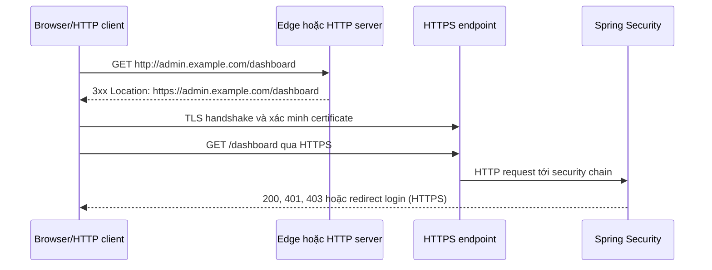
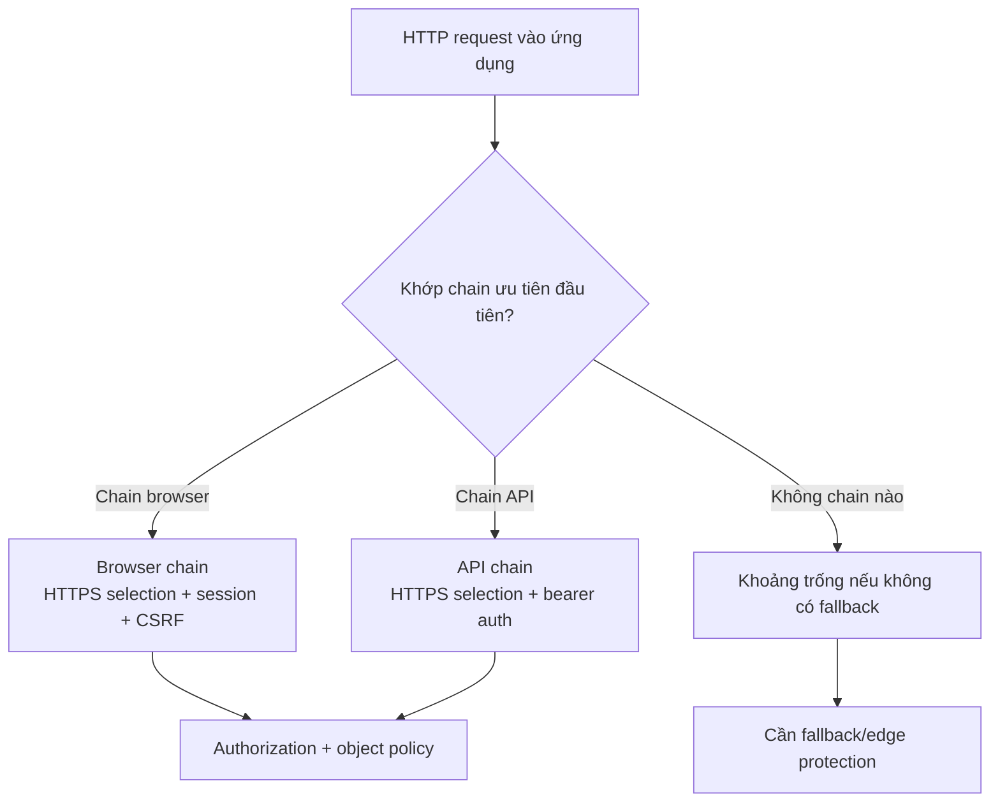
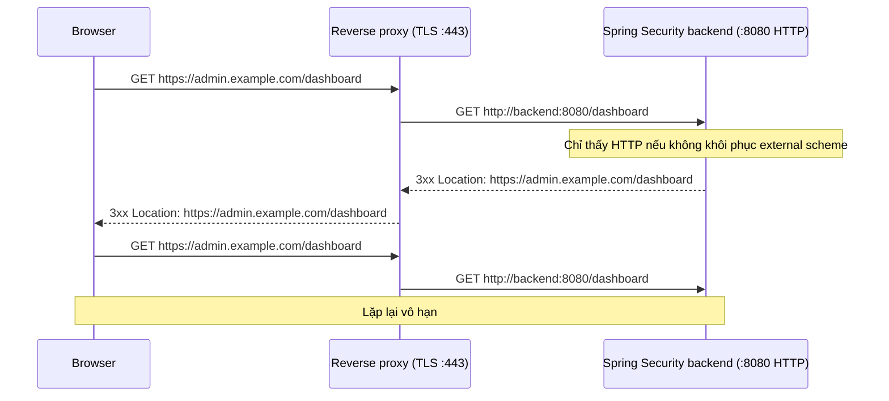
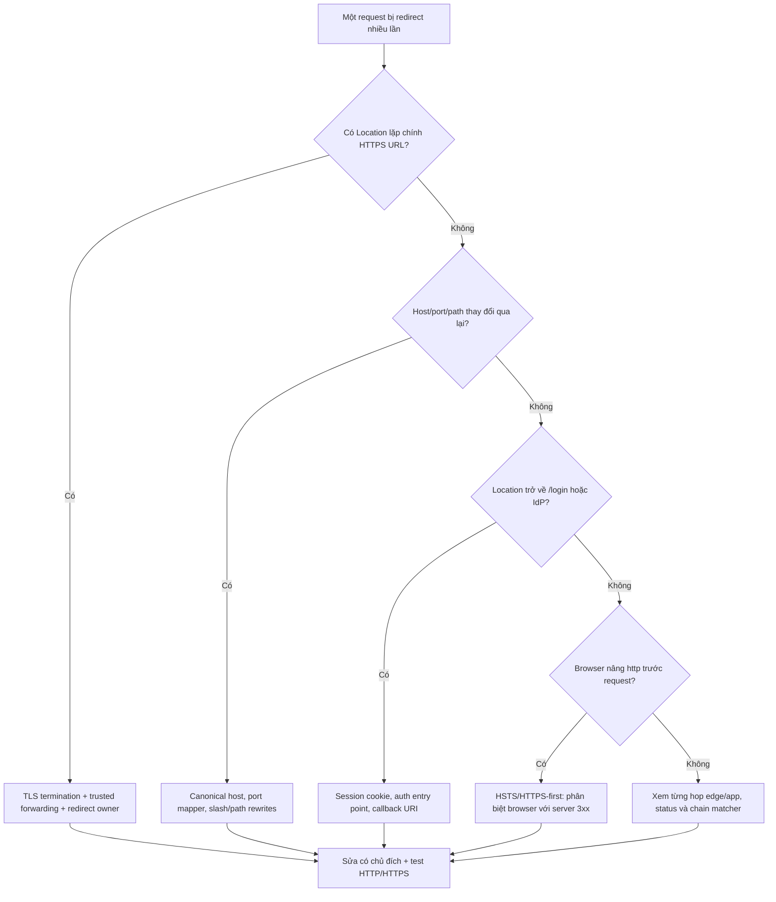

# Chọn yêu cầu cần chuyển hướng và tránh vòng lặp

> **Chương:** HTTPS và HSTS  
> **Học phần:** `SPRING_SECURITY_HTTP_PROTECTION` — cấu hình các lớp phòng vệ HTTP và trình duyệt trong Spring Security: CSRF, CORS, security headers, CSP, HSTS, HTTP firewall và bảo vệ session. Bài này tập trung vào **chọn đúng tập request phải đi qua HTTPS**, **tránh redirect loop** trên Servlet và Reactive WebFlux, và chứng minh hành vi sau reverse proxy bằng kiểm thử.

## 1. Vấn đề: chuyển hướng quá ít là lỗ hổng, chuyển hướng sai là vòng lặp

Hãy hình dung một hệ thống quản trị có hai địa chỉ:

- `https://admin.example.com`: browser truy cập HTML, đăng nhập bằng session cookie, sửa dữ liệu.
- `https://api.example.com`: API được gọi bởi browser và các service khác.

Kỹ sư thêm một rule “mọi HTTP request phải chuyển đến HTTPS”. Trong thử nghiệm localhost, rule hoạt động. Khi triển khai sau load balancer, browser liên tục nhận:

```http
HTTP/1.1 302 Found
Location: https://admin.example.com/dashboard
```

Mặc dù browser **đã đứng ở** `https://admin.example.com/dashboard`. Đây là vòng lặp: load balancer kết thúc TLS, gửi HTTP tới backend, còn backend tưởng người dùng đang dùng HTTP.

Nhóm khác gặp vấn đề ngược lại. Họ chỉ chuyển hướng `/login` sang HTTPS, còn `/api/accounts/**` vẫn có thể được gọi bằng HTTP. Dữ liệu tài khoản hoặc session có nguy cơ rò rỉ qua một đường không được yêu cầu bảo vệ.

**Có hai bất biến phải chứng minh đồng thời:**

1. **Không có đường đi ngoài ý muốn cho dữ liệu/credential nhạy cảm qua HTTP plaintext.**
2. **Một request đã đến đúng HTTPS origin không bị redirect lặp, đổi host hoặc đổi port sai.**

Cả hai liên quan đến `SPRING_SECURITY_HTTP_PROTECTION` nhưng không thể giải quyết chỉ bằng một câu gọi `redirectToHttps(...)`.

### Mục tiêu học tập

Sau bài này, người học có thể:

- Phân loại URL, HTTP method và loại client để quyết định **redirect, reject, hoặc xử lý trực tiếp qua HTTPS**.
- Phân biệt chọn **security chain**, chọn **HTTPS redirect matcher** và chọn **authorization rule**.
- Dùng đúng API **Servlet** và **WebFlux** theo version: `requiresChannel` ở các Servlet version cũ; `redirectToHttps` ở Servlet 6.5+ và WebFlux.
- Giải thích vì sao redirect loop xuất hiện qua TLS termination, forwarded headers, host canonicalization, port mapping, path rewrites, login/OIDC hoặc browser HSTS.
- Viết cấu hình chọn request có chủ đích mà không mở lỗ hổng do bỏ sót một security chain.
- Xây dựng phép thử cho HTTP/HTTPS, GET/POST/OPTIONS, host/port/path, Cookie/CSRF và response cuối cùng.
- Đọc một chuỗi `3xx` và xác định **hop nào sinh ra redirect**, không vội tắt HTTPS hay CSRF.

## 2. Redirect là HTTP response, không phải TLS handshake

Giả sử client thử GET qua HTTP:

```http
GET /dashboard HTTP/1.1
Host: admin.example.com
```

Server/edge có thể trả:

```http
HTTP/1.1 308 Permanent Redirect
Location: https://admin.example.com/dashboard
```

Client quyết định theo redirect, tạo **một request mới** sau khi kết nối TLS tới hostname đích. Phần HTTP response không tự tạo HTTPS listener hoặc chứng chỉ.



**Giới hạn an ninh quan trọng:** một POST chứa mật khẩu, cookie hoặc token đã gửi qua HTTP **không thể được mã hóa hồi tố** bằng response 3xx. Với request nhạy cảm, **client phải dùng HTTPS từ đầu**, hoặc browser phải nâng cấp URL trước request nhờ HSTS đã biết hay cơ chế HTTPS-first phù hợp.

### 2.1. Redirect và reject là hai quyết định khác nhau

- **Redirect:** trả 3xx với `Location` để client có thể gửi lại request.
- **Reject:** từ chối HTTP request, thường bằng status 4xx hoặc đóng/khoá đường HTTP theo policy, không khuyến khích gửi lại dữ liệu.
- **Chỉ HTTPS listener:** client kết nối HTTP vào cổng không mở có thể không nhận response; không có nơi nào tạo redirect.

Với một website nhiều người dùng, redirect GET/HEAD có thể hữu ích cho liên kết cũ. Với một API thanh toán chỉ phục vụ service-to-service, **reject HTTP** và yêu cầu SDK cấu hình HTTPS trực tiếp có thể phù hợp hơn. Cần quyết định theo threat model và hợp đồng client.

## 3. Ai thực sự nhận request đầu tiên?

Trước khi chọn matcher ở Spring Security, phải biết request HTTP ở public hostname **đến đâu**:

| Topology | HTTP public đi tới | HTTPS public đi tới | Nơi nên cân nhắc redirect |
| --- | --- | --- | --- |
| Spring Boot trực tiếp có hai listeners | HTTP connector của app | HTTPS connector của app | Edge/server hoặc Spring Security của app |
| Spring Boot chỉ có HTTPS connector | Không listener tại app | HTTPS của app | Phải có HTTP listener khác nếu cần 3xx |
| Ingress TLS termination | HTTP listener của ingress | HTTPS listener của ingress | **Thường ingress** |
| CDN → LB → backend HTTP | CDN/LB tùy DNS | CDN/LB, sau đó HTTP upstream | Edge public có thông tin host/scheme thật |
| Gateway mTLS tới backend | Gateway public | Gateway HTTPS, backend mTLS | Gateway public; backend kiểm tra các policy còn lại |
| Private health endpoint trên HTTP nội bộ | Chỉ network nội bộ đã giới hạn | Có thể không dùng | Policy nội bộ riêng, không nhầm thành ngoại lệ public |

**Điều nên ưu tiên:** nơi sở hữu redirect cần biết **scheme/host/port public** và có khả năng ngăn request HTTP chứa dữ liệu nhạy cảm được xử lý nghiệp vụ. Sau TLS termination, backend có thể không biết các giá trị đó nếu thiếu trusted forwarded metadata.

## 4. Phân loại request trước khi viết redirect matcher

Không phải mọi request mang method khác nhau đều nên xử lý một cách máy móc. Hãy chia thành các nhóm theo chủ thể, tài sản và tác dụng phụ:

| Nhóm request | Ví dụ | Quyết định nên cân nhắc tại public HTTP | Điều vẫn phải kiểm tra ở HTTPS |
| --- | --- | --- | --- |
| Browser navigation GET/HEAD | `GET /dashboard`, `HEAD /docs` | Redirect sang canonical HTTPS | Authn/authz, CSP, cache, HSTS |
| HTML public/static asset | `GET /`, `/assets/app.js` | Redirect sang HTTPS; tốt nhất liên kết HTTPS ngay | MIME, CSP, cache integrity |
| Login POST | `POST /login` | **Không dựa vào redirect**; client submit trực tiếp HTTPS, HTTP bị reject theo policy | Authentication, CSRF, session rotation |
| Business write | `POST /orders/42/approve`, PUT/PATCH/DELETE | Ưu tiên client dùng HTTPS; có thể reject HTTP unsafe methods | CSRF (nếu cookie), quyền đối tượng, transaction |
| CORS preflight | `OPTIONS /api/orders/42` | Browser SPA phải gọi HTTPS API trực tiếp | Preflight CORS trước auth chặn thiếu cookie |
| Machine-to-machine JWT API | `GET /v1/reports`, `POST /v1/jobs` | SDK phải dùng HTTPS; HTTP reject/redirect có chủ đích | JWT validation, scopes, object authorization |
| Webhook/callback | `POST /webhooks/provider` | Public callback URL phải HTTPS trực tiếp; không kỳ vọng sender follow 3xx | Chữ ký webhook, chống replay, idempotency |
| Public health probe | `GET /health` | Có thể redirect public; health nội bộ là policy riêng | Không làm lộ secret/config |
| ACME challenge/điểm xác minh | `/.well-known/acme-challenge/...` | Theo yêu cầu phương thức cấp chứng chỉ cụ thể | Chỉ mở phạm vi thật sự cần |
| gRPC/WebSocket handshake | HTTP/2/gRPC hoặc WebSocket Upgrade | Không giả định mọi client/protocol follow 3xx | TLS/h2 hoặc WSS, message auth riêng |

**Lưu ý:** “phương thức safe” theo HTTP gồm GET, HEAD, OPTIONS, TRACE, nhưng không có nghĩa phải bật TRACE hoặc mọi safe method đều cần redirect. GET không được thay đổi trạng thái nghiệp vụ; OPTIONS preflight cần xem bối cảnh browser riêng.

### 4.1. Chọn theo chính sách, không chỉ theo URL

Quyết định tốt thường là **ma trận request + môi trường + chủ sở hữu**, không phải `if path.startsWith("/secure")` ở một controller.

Ví dụ bất biến cho hệ thống:

- **P-01:** public `http://admin.example.com/**` không phục vụ dữ liệu riêng tư.
- **P-02:** GET/HEAD public chuyển tới `https://admin.example.com`, giữ path/query hợp lệ và canonical hostname.
- **P-03:** HTTP POST nhạy cảm không gọi business service, không chuyển credential sang hostname khác.
- **P-04:** HTTPS GET trên host/cổng chuẩn không có vòng lặp.
- **P-05:** Browser SPA luôn gọi `https://api.example.com`, preflight và POST có authn/CSRF/CORS phù hợp.
- **P-06:** Bất kỳ URL nào không khớp security chain cần được bảo vệ hoặc bị từ chối theo thiết kế.
- **P-07:** HSTS, cookies, CSP và cache đúng trên **response cuối** sau proxy.

## 5. HTTP method và status code ảnh hưởng cách follow redirect

Các mã 3xx thông dụng không hoàn toàn giống nhau:

| Status | Độ bền | Ý nghĩa khi client tự follow |
| --- | --- | --- |
| `301 Moved Permanently` | Permanent | Client có thể chuyển POST thành GET theo tương thích lịch sử |
| `302 Found` | Temporary | Client có thể chuyển POST thành GET |
| `303 See Other` | Thường dùng Post/Redirect/Get | Đích được truy cập bằng GET/HEAD theo semantics 303 |
| `307 Temporary Redirect` | Temporary | Không đổi method khi follow tự động |
| `308 Permanent Redirect` | Permanent | Không đổi method khi follow tự động |

Không được giả định mọi Spring Security version/config đều tạo **cùng một mã cụ thể**. Edge (Nginx/Ingress/CDN) cũng có thể tự sinh status khác.

**Với HTTP POST:** `307`/`308` giữ method nếu client follow, nhưng **body HTTP đầu tiên đã đi qua đường không mã hóa**. Nó không trở nên an toàn hơn chỉ vì POST thứ hai dùng HTTPS.

### 5.1. Cách chọn theo nhu cầu khách hàng

- Website có liên kết GET/HEAD cũ: redirect sang HTTPS là trải nghiệm hợp lý.
- API yêu cầu tính nguyên vẹn và không cho client replay POST: chính sách reject HTTP unsafe methods rõ ràng có thể đơn giản hơn.
- Khi thay canonical host lâu dài, chọn permanent redirect sau khi đã kiểm thử cache behavior và rollback.
- Khi test quy tắc mới, temporary redirect có thể tránh cache redirect sai quá lâu.
- Không dùng `303` chỉ để “ép HTTPS”; nó phù hợp hơn cho Post/Redirect/Get sau xử lý nghiệp vụ.

## 6. Phân biệt ba lớp matcher trong Spring Security

Một lỗi phổ biến: nhìn thấy nhiều `requestMatchers` nhưng không phân biệt **phạm vi của chúng**.

| Lớp | Servlet minh họa | Tác dụng |
| --- | --- | --- |
| **Security chain selection** | `http.securityMatcher("/api/**")` | Chain này xử lý request nào |
| **Redirect selection** | `http.redirectToHttps(r -> r.requestMatchers(myMatcher))` | Trong chain, những request nào thuộc điều kiện HTTPS redirect |
| **Authorization selection** | `http.authorizeHttpRequests(a -> a.requestMatchers("/api/admin/**").hasRole("ADMIN"))` | Khi đã vào chain, principal cần quyền gì |

`permitAll()` ở authorization **không đồng nghĩa** bypass CSRF, redirect, headers hoặc HTTP firewall. Ngược lại, redirect ở chain A **không bảo vệ** request chỉ khớp chain B.



Thứ tự trên minh họa quyết định chain; filter order thực do Spring Security định nghĩa theo cấu hình/phiên bản.

### 6.1. Phạm vi của redirect matcher chỉ có nghĩa trong chain hiện tại

Giả sử chain `@Order(1)` chỉ khớp `/api/**`. Nếu `redirectToHttps(...requestMatchers("/dashboard/**"))` được cấu hình **bên trong chain API**, matcher dashboard không bao giờ có tác dụng vì dashboard đã không đi vào chain đó.

Kiểm tra hai điều kiện riêng:

1. Request có đến chain mang filter HTTPS redirect hay không?
2. Trong chain đó, request có thỏa redirect matcher hay không?

Một test chỉ chứng minh `/api/a` có redirect chưa đủ cho `/dashboard`, `/download` hoặc route lỗi.

### 6.2. Fallback chain và edge policy

Nếu một ứng dụng có nhiều security chains, hãy có **fallback rõ ràng** hoặc một lớp edge chặn HTTP toàn hostname trước khi request tới backend. Tuy nhiên edge redirect toàn host **không thay** authentication/authorization của các routes: HTTPS bảo vệ kênh, không quyết định ai được đọc dữ liệu.

## 7. Servlet Spring Security: API thay đổi theo phiên bản

Với Servlet:

- Các dòng trước **6.5** thường dùng `HttpSecurity.requiresChannel(...)` để yêu cầu secure channel.
- Từ **6.5**, Spring Security thêm `HttpSecurity.redirectToHttps(Customizer)` cùng `HttpsRedirectConfigurer`/`HttpsRedirectFilter`.
- Trong các phiên bản mới, `requiresChannel` được định hướng thay thế; không suy rằng mọi phiên bản đều xóa overload cũ ngay.
- `PathPatternRequestMatcher` và các thay đổi matching theo Spring Security 7 cần đối chiếu với version cụ thể.

**Dù dùng API nào, Spring Security không tạo HTTPS listener hoặc chứng chỉ TLS.** Một HTTP request phải có đường đến filter nếu ứng dụng là nơi phát redirect.

## 8. Servlet 6.5+: redirect toàn bộ request trong một chain

Mẫu cơ sở nếu application được giao quyền redirect mọi HTTP requests mà security chain nhận:

```java
import static org.springframework.security.config.Customizer.withDefaults;

@Configuration
@EnableWebSecurity
class AllHttpsServletSecurity {

    @Bean
    SecurityFilterChain securityFilterChain(HttpSecurity http)
            throws Exception {
        return http
            .redirectToHttps(withDefaults())
            .csrf(withDefaults())
            .authorizeHttpRequests(auth -> auth
                .requestMatchers(HttpMethod.GET, "/health").permitAll()
                .anyRequest().authenticated()
            )
            .formLogin(withDefaults())
            .build();
    }
}
```

**Điều kiện sử dụng:**

1. Đúng stack Servlet và Spring Security version hỗ trợ `redirectToHttps` mới.
2. App có HTTP listener nhận request cần chuyển hướng, hoặc được proxy chuyển tiếp request với metadata external scheme/host đáng tin.
3. HTTPS listener/cert thật đã hoạt động tại địa chỉ client được chuyển đến.
4. Không có edge rule mâu thuẫn hoặc backend hiểu HTTPS public thành HTTP nội bộ.
5. Phạm vi chain đủ rộng hoặc có cấu hình cho các chain còn lại.

`permitAll()` cho GET health **không tự miễn HTTPS redirect**, vì đó là điều kiện **quyền truy cập**, không phải quyết định kênh.

## 9. Servlet 6.5+: chọn một tập path với requestMatchers

Một số môi trường yêu cầu biểu diễn rõ matcher redirect. Ví dụ **để học API**: chỉ áp redirect cho path `/browser/**`; đoạn này **không có nghĩa các path khác được khuyến nghị cho HTTP ở production**.

```java
import org.springframework.security.web.servlet.util.matcher.PathPatternRequestMatcher;
import org.springframework.security.web.util.matcher.RequestMatcher;

@Bean
SecurityFilterChain scopedRedirect(HttpSecurity http) throws Exception {
    RequestMatcher browserPaths =
        PathPatternRequestMatcher.withDefaults()
            .matcher("/browser/**");

    return http
        .redirectToHttps(https -> https
            .requestMatchers(browserPaths)
        )
        .authorizeHttpRequests(auth -> auth
            .requestMatchers("/browser/**").authenticated()
            .anyRequest().denyAll()
        )
        .build();
}
```

Giải thích:

- `browserPaths` quyết định redirect filter áp cho request nào **trong chain này**.
- `.requestMatchers("/browser/**").authenticated()` trong authorization là **quy tắc khác**.
- `anyRequest().denyAll()` làm các route ngoài chính sách không được xử lý nghiệp vụ, nhưng **denyAll không tự bật TLS** cho route ngoài redirect matcher.
- Nếu muốn **toàn ứng dụng public luôn HTTPS**, cách rõ nhất thường là redirect ở edge cho toàn hostname hoặc `redirectToHttps(withDefaults())` trên mọi chain cần thiết.
- Nếu service cần ngoại lệ health nội bộ, hãy giới hạn ngoại lệ bằng network policy/hostname riêng, không mặc nhiên mở public `/health` qua HTTP.

### 9.1. Khi nào chọn nhiều matcher?

Có thể gộp các paths thực sự cần redirect:

```java
RequestMatcher html =
    PathPatternRequestMatcher.withDefaults().matcher("/ui/**");
RequestMatcher docs =
    PathPatternRequestMatcher.withDefaults().matcher("/docs/**");

return http
    .redirectToHttps(https ->
        https.requestMatchers(html, docs))
    .authorizeHttpRequests(auth -> auth
        .anyRequest().authenticated())
    .build();
```

Điều kiện: version Servlet hỗ trợ API và matcher kiểu đó. Các đoạn này **là mảnh ghép cấu hình**, cần imports, enclosing method và security chain độc lập nếu dùng thực tế.

**Cẩn trọng:** không dùng một tập matcher quá hẹp chỉ vì thấy chức năng login hoạt động. Cookie session/CSRF token, files, error pages và API riêng tư vẫn cần được bảo vệ qua HTTPS.

### 9.2. PathPattern, context path và proxy rewrite

Giả sử browser gọi `https://app.example.com/store/ui/dashboard` nhưng proxy bỏ prefix `/store` trước khi gửi `/ui/dashboard` tới backend. Nếu bạn khai matcher `/store/ui/**` trong backend, request có thể không khớp.

Cần xác minh:

- Servlet context path và servlet path thực tế.
- Proxy rewrite, decode và normalize URL thế nào.
- Matcher hoạt động trên path backend nhìn thấy, không chỉ URL trình duyệt.
- Các request path lạ có bị HTTP firewall chặn trước khi matcher được dùng không.
- Sau upgrade Spring Security, cách match `PathPatternRequestMatcher` có thay đổi logic cũ hay không.

Test qua public ingress cần kết hợp với test request trực tiếp vào backend **trong môi trường được phép**, tránh điều chỉnh matcher chỉ theo một trong hai góc nhìn.

## 10. Servlet ≤6.4: requiresChannel với lựa chọn request

Trong Servlet Spring Security 6.4 trở xuống, API `redirectToHttps(Customizer)` mới chưa có. Có thể dùng:

```java
@Configuration
@EnableWebSecurity
class LegacyChannelSecurity {

    @Bean
    SecurityFilterChain securityFilterChain(HttpSecurity http)
            throws Exception {
        return http
            .requiresChannel(channel -> channel
                .anyRequest().requiresSecure()
            )
            .authorizeHttpRequests(auth -> auth
                .anyRequest().authenticated()
            )
            .build();
    }
}
```

Nếu project dùng cấu hình chọn route, có thể dùng các request matcher của `ChannelSecurityConfigurer` đúng version, ví dụ:

```java
.requiresChannel(channel -> channel
    .requestMatchers("/browser/**").requiresSecure()
)
```

Cú pháp và loại `RequestMatcher` cần đối chiếu với dependency thực; không suy mọi version 5.x/6.x có cùng DSL/path-matching behavior.

### 10.1. Không chuyển “requiresInsecure” sang cấu hình mới một cách máy móc

Một số cấu hình cũ từng yêu cầu một phần website dùng HTTP. Với trình duyệt hiện đại, session cookie, HSTS và các API nhạy cảm, cố ý chuyển **HTTPS trở lại HTTP** thường là yêu cầu cần được đánh giá lại — không phải một phần không đổi của migration.

### 10.2. Chọn API đúng nhưng không quên test

Sau di trú `requiresChannel` sang `redirectToHttps`, một implementation khác có thể thay đổi status code, cách dựng `Location`, port mapping hoặc matcher. Điều cần giữ là **security invariant**, không phải giả định mọi byte response giống hệt bản cũ.

## 11. WebFlux: chọn HTTPS redirect bằng httpsRedirectWhen

Reactive WebFlux dùng `ServerHttpSecurity` và `SecurityWebFilterChain`; API `redirectToHttps(...)` có từ trước khi bản Servlet mới xuất hiện.

Mẫu redirect mặc định ở Reactive:

```java
import static org.springframework.security.config.Customizer.withDefaults;

@Configuration
@EnableWebFluxSecurity
class ReactiveHttpsSecurity {

    @Bean
    SecurityWebFilterChain webFilterChain(ServerHttpSecurity http) {
        return http
            .redirectToHttps(withDefaults())
            .csrf(withDefaults())
            .authorizeExchange(auth -> auth
                .pathMatchers(HttpMethod.GET, "/health").permitAll()
                .anyExchange().authenticated()
            )
            .formLogin(withDefaults())
            .build();
    }
}
```

`ServerHttpSecurity.HttpsRedirectSpec` có hook `httpsRedirectWhen(...)` nhận **Reactive exchange matcher** để tùy biến điều kiện. Đừng nhầm với Servlet `HttpsRedirectConfigurer.requestMatchers(...)`.

### 11.1. Tránh matcher chỉ kiểm tra path mà quên scheme

Một matcher custom quá rộng có thể trả “match” trên cả request HTTPS. Nếu redirect filter tin matcher đó và tiếp tục tạo HTTPS redirect, có thể tạo vòng lặp. Trong ví dụ dưới đây, ta **chỉ match request thực sự có scheme HTTP và path được chọn**:

```java
@Bean
SecurityWebFilterChain scopedHttps(ServerHttpSecurity http) {
    ServerWebExchangeMatcher httpBrowserArea = exchange -> {
        String scheme = exchange.getRequest().getURI().getScheme();
        String path = exchange.getRequest()
            .getPath().pathWithinApplication().value();

        boolean isHttp = "http".equalsIgnoreCase(scheme);
        boolean isBrowserArea =
            path.equals("/browser") || path.startsWith("/browser/");

        return (isHttp && isBrowserArea)
            ? ServerWebExchangeMatcher.MatchResult.match()
            : ServerWebExchangeMatcher.MatchResult.notMatch();
    };

    return http
        .redirectToHttps(redirect ->
            redirect.httpsRedirectWhen(httpBrowserArea)
        )
        .authorizeExchange(auth -> auth
            .pathMatchers("/browser/**").authenticated()
            .anyExchange().denyAll()
        )
        .build();
}
```

**Các điều kiện của ví dụ:**

- Đây là **minh họa matcher**. Ứng dụng thật nên chọn matcher route chính thức của WebFlux phù hợp version, thay kiểm tra prefix thô nếu path semantics phức tạp.
- `scheme` phải phản ánh **external scheme đáng tin** khi sau proxy, không phải giá trị `X-Forwarded-Proto` tự do do client gắn.
- Rule không tự bảo vệ các routes ngoài `/browser/**` bằng HTTPS; `denyAll` cũng không thay cơ chế mã hóa. Tốt hơn nên bảo vệ toàn public hostname tại edge.
- Các class `ServerWebExchangeMatcher` và `MatchResult` là Reactive abstractions; không dùng Servlet `RequestMatcher`.
- Dù matcher không match HTTPS, cần test trên exchange URI/scheme thật và cả deployment topology.

### 11.2. Không dùng containsKey(X-Forwarded-Proto) làm “trust check”

Sai lầm dễ thấy:

```java
// Chỉ kiểm tra header tồn tại; KHÔNG chứng minh proxy đáng tin.
.httpsRedirectWhen(exchange ->
    exchange.getRequest().getHeaders()
        .containsKey("X-Forwarded-Proto")
        ? ServerWebExchangeMatcher.MatchResult.match()
        : ServerWebExchangeMatcher.MatchResult.notMatch())
```

Client có thể gửi header đó nếu edge không xóa/ghi đè. Một custom condition như vậy có thể định tuyến sai, tạo loop hoặc phản ánh thông tin hostname không đáng tin.

Hãy xử lý forwarding metadata **tại trust boundary** trước khi Spring Security quyết định, hoặc chuyển redirect sang edge.

## 12. Không chọn HTTP redirect theo quyền đăng nhập một cách vô tình

Một số developers viết:

- Anonymous → redirect HTTP sang HTTPS.
- Authenticated → không redirect vì “đã có session”.
- Chỉ `/login` → HTTPS.
- Sau login → nội dung có thể HTTP để giảm chi phí TLS.

Đây là tư duy không phù hợp với hệ thống chứa dữ liệu nhạy cảm. TLS cần bảo vệ **request và response ở mọi giai đoạn**, bao gồm session cookie, CSRF token, HTML, JS, API payload và file download.

**Câu hỏi chính không phải “user đã login chưa?” mà là “request public nào được phép đi HTTP plaintext?”** Trong đa số ứng dụng browser hiện đại, câu trả lời là **không request chứa dữ liệu nhạy cảm nào**.

### 12.1. Tài nguyên public cũng có thể cần HTTPS

Một file JavaScript public có thể không bí mật, nhưng nếu được tải qua HTTP, attacker trên đường truyền có thể sửa nội dung script. Script đó chạy trong origin ứng dụng và có thể tác động dữ liệu phiên. Vì vậy không nên chỉ bắt HTTPS cho endpoints có `authenticated()`.

### 12.2. Redirect theo path không thay CSP/SRI

HTTP→HTTPS giúp bảo vệ kết nối, nhưng vẫn cần xem:

- CSP trên HTML đúng host.
- Subresource Integrity nếu dùng asset third-party phù hợp.
- Output encoding/sanitization chống XSS.
- Content-type/nosniff cho file tải.
- Cache-Control không phát data riêng cho người khác.

## 13. HTTP firewall và URL normalization khi chọn path

Request có những path không chuẩn có thể bị giải mã hoặc chuẩn hóa khác nhau giữa edge, container và Spring Security:

```text
/browser/%2e%2e/api/private
/browser//dashboard
/browser;param=x/dashboard
/browser%2Fdashboard
```

Vấn đề không phải liệu redirect có trả 3xx cho một chuỗi cụ thể, mà là:

1. Edge có thể đã normalize URL trước khi matcher hoạt động.
2. Servlet `StrictHttpFirewall` hoặc Reactive `StrictServerWebExchangeFirewall` có thể từ chối request.
3. Authorization matcher có thể thấy path khác handler.
4. Một redirect path được encode lại có thể dẫn tới route khác trên request HTTPS thứ hai.

**Không nới firewall** chỉ vì một URL “cần redirect” trả 400. Cần xác định request có hợp lệ hay không và chứng minh bất biến authorization.

### 13.1. Một phép thử cần có

Với user Bob không có quyền đọc dữ liệu Alice:

- Gửi URL chuẩn qua HTTPS → bị object authorization từ chối.
- Gửi các biểu diễn URL bất thường qua HTTP/HTTPS → không được trả dữ liệu Alice.
- Nếu edge redirect path, xem URL sau redirect có được xử lý nhất quán không.
- Không chấp nhận kết quả “redirect thành công” làm bằng chứng quyền đối tượng đã đúng.

## 14. PortMapper: redirect URL có thể sai dù matcher chính xác

Trong Servlet, `PortMapper` giúp đối chiếu HTTP port với HTTPS port khi tạo `Location`. Một số cấu hình mặc định dùng ánh xạ 80→443 và 8080→8443.

Ví dụ môi trường thử nghiệm dùng HTTP 9090 và HTTPS 9443:

```java
@Bean
SecurityFilterChain testPorts(HttpSecurity http) throws Exception {
    return http
        .redirectToHttps(Customizer.withDefaults())
        .portMapper(ports -> ports
            .http(9090).mapsTo(9443)
        )
        .authorizeHttpRequests(auth -> auth
            .anyRequest().authenticated())
        .build();
}
```

**Lưu ý:**

- `PortMapper` không mở cổng 9443; TLS listener cần được cấu hình riêng ở server/edge.
- Nếu public HTTPS là 443 nhưng backend HTTP là 8080, `Location` phải dùng **public origin**, không phải suy cổng 8443 từ backend.
- Với multiple proxies, cần biết external host/port từ metadata tin cậy hoặc giao redirect hoàn toàn cho edge.

### 14.1. Khi test redirect cổng không chuẩn

Test phải đặt request server port đúng nguồn mà redirect handler nhìn thấy. Ví dụ:

```java
mvc.perform(get("/health")
        .secure(false)
        .with(req -> {
            req.setScheme("http");
            req.setServerName("localhost");
            req.setServerPort(9090);
            return req;
        }))
   .andExpect(status().is3xxRedirection());
```

Để hoàn chỉnh, assert `Location` là `https://localhost:9443/health` **nếu đó là hợp đồng config thực tế**, đồng thời dùng một TLS client kiểm chứng cổng 9443 thực sự tiếp nhận HTTPS.

## 15. Vòng lặp loại A: TLS kết thúc ở proxy, backend thấy HTTP

Đây là nguyên nhân phổ biến nhất của “too many redirects” khi đưa ứng dụng Spring Boot lên production:



Backend tin rằng nó đang redirect một HTTP client. Thực tế browser **đã dùng HTTPS** với edge và sẽ quay lại cùng URL.

### 15.1. Hai cách sửa kiến trúc, không phải hai hack

**Phương án A — Edge sở hữu redirect.**

- Edge nhận public HTTP:80 và redirect/reject theo chính sách.
- Edge terminate public TLS:443.
- Backend chỉ nhận requests từ edge; không tự quyết public HTTP→HTTPS.
- HSTS có thể do edge phát cho HTTPS responses.
- Spring Security vẫn giữ authn/authz/CSRF/headers phù hợp.

**Phương án B — App sở hữu redirect dựa vào external scheme đáng tin.**

- Edge loại bỏ/ghi đè các forwarded headers do client cung cấp.
- Backend chỉ được gọi từ proxy tin cậy.
- Container/framework xử lý forwarded scheme/host/port trước Spring Security.
- HTTPS public đến app được nhận diện là secure → **không redirect nữa**.
- HTTP public đến app (nếu được chuyển tiếp theo thiết kế) có thể được redirect đúng URL public.

Phương án nào cũng cần test trước và sau proxy; không chỉ kiểm tra localhost.

### 15.2. Vì sao tắt CSRF không sửa vòng lặp HTTPS?

CSRF được kiểm tra trên unsafe request, không phải nguyên nhân cốt lõi khi HTTPS GET liên tục nhận `Location` cùng URL. Tắt CSRF làm tăng rủi ro nhưng không cung cấp scheme tin cậy. Tương tự, nới HTTP firewall hay mở CORS “allow all” không giải quyết TLS termination loop.

## 16. Forwarded headers: sửa scheme nhưng không mở cửa giả mạo

Proxy có thể gửi:

```http
Forwarded: for=198.51.100.10;proto=https;host=admin.example.com
X-Forwarded-Proto: https
X-Forwarded-Host: admin.example.com
X-Forwarded-Port: 443
```

`198.51.100.10` là địa chỉ minh họa. Những header này **không tự có độ tin cậy**. Nếu một attacker gửi được `X-Forwarded-Proto: https` từ Internet và backend tin nó, request HTTP thật có thể bị hiểu là HTTPS; nếu attacker đặt `X-Forwarded-Host` tùy ý, `Location` có thể dẫn sang hostname độc hại.

### 16.1. Ranh giới cần có

1. Edge tiếp xúc Internet phải **xóa/ghi đè** `Forwarded` và `X-Forwarded-*` từ nguồn chưa tin.
2. Backend chỉ chấp nhận kết nối từ proxy tin cậy; mạng nội bộ không đồng nghĩa tự động tin mọi caller.
3. Mỗi hop trong CDN → LB → ingress → backend cần quy tắc rõ về giữ hay thay metadata.
4. Public hostname/port được canonicalize từ allowlist, không dùng trực tiếp raw `Host`/`X-Forwarded-Host` do client tạo.
5. Nếu dùng mTLS giữa proxy/backend, điều đó xác thực workload/hop nhưng **không thay user authorization**.

### 16.2. Spring Boot forwarded strategy

Trong topology có trusted proxy, Spring Boot có thể cấu hình:

```yaml
server:
  forward-headers-strategy: framework
```

Tùy runtime, `native` có thể thích hợp. Servlet có `ForwardedHeaderFilter` hoặc tích hợp container; WebFlux có `ForwardedHeaderTransformer` và cơ chế runtime tương ứng.

**Không coi một thuộc tính Boot là biện pháp trust.** Nó chỉ giúp giải thích URL/scheme theo forwarded metadata. Bản thân proxy mới phải đảm bảo metadata đáng tin.

### 16.3. Test spoofing quan trọng hơn một cấu hình “đẹp”

Thử trong môi trường được phép:

- Request HTTPS bình thường qua edge → không loop.
- HTTP public GET qua edge → redirect đúng public host.
- Client giả `X-Forwarded-Proto: https` trên một HTTP request public → không được làm edge/backend bỏ qua yêu cầu HTTPS.
- Client giả `X-Forwarded-Host: attacker.example.net` → không được tạo `Location` tới host attacker.
- Backend port nội bộ không truy cập trực tiếp từ mạng không tin cậy.

## 17. Vòng lặp loại B: canonical host và trailing slash

Một redirect không nhất thiết liên quan TLS. Hãy xét:

```text
http://example.com/start
  -> https://example.com/start
  -> https://www.example.com/start
  -> http://example.com/start
  -> ...
```

Có ít nhất ba rule tranh nhau:

1. HTTP→HTTPS.
2. Apex→www.
3. www→apex hoặc logic canonical host cũ.

Một dạng khác:

```text
https://app.example.com/dashboard
  -> https://app.example.com/dashboard/
  -> https://app.example.com/dashboard
  -> ...
```

Lỗi đến từ proxy/router/controller không đồng ý về trailing slash.

### 17.1. Thiết kế một canonicalization policy

Quyết định rõ:

- Scheme public là `https`.
- Host canonical là `app.example.com` **hoặc** `www.app.example.com`, không đồng thời cả hai.
- Port public là 443 (hoặc cổng test được công bố).
- Path và query được giữ/normalize theo hợp đồng; không làm thay đổi tài nguyên hoặc có open redirect.
- Trailing slash policy thuộc router nào, không để proxy và app tạo rule đảo ngược.
- Redirect tối đa một hoặc một số bước hợp lý, không theo nhiều vòng vì từng lớp rewrite.

**Không** tạo `Location` từ một `Host` do attacker tự gắn nếu chưa validate. Nếu response redirect đến attacker-controlled domain, vòng lặp không chỉ là vấn đề availability mà còn có nguy cơ phishing và open redirect.

## 18. Vòng lặp loại C: login, logout hoặc OAuth/OIDC redirect

Một `302` không phải lúc nào cũng là HTTPS upgrade.

Ví dụ:

```http
HTTP/1.1 302 Found
Location: /login
```

Đây có thể là **authentication entry point**. Nếu URL bên ngoài là HTTPS, client theo `/login` vẫn dùng HTTPS.

Các luồng khác:

- Sau login, ứng dụng redirect tới `/dashboard`.
- Khi chưa có session, `/dashboard` redirect trở lại `/login`.
- OAuth2/OIDC đưa browser sang authorization endpoint của IdP.
- Sau callback, ứng dụng redirect về URL trước đó.

### 18.1. Một loop login không nhất thiết do redirectToHttps

Giả sử browser đã login nhưng session cookie không được gửi ở request tiếp theo vì `SameSite`/`Secure`/`Domain`/`Path` sai. App sẽ coi user là anonymous và redirect về login liên tục, dù HTTPS redirect có thể đã đúng.

Kiểm tra:

1. Sau login, response có `Set-Cookie` không?
2. Cookie có `Secure` khi host dùng HTTPS và attributes phù hợp không?
3. Browser có gửi cookie ở request tiếp theo không?
4. Session đã được lưu/khôi phục ở node khác chưa?
5. CSRF token có đổi sau login/session rotation không?
6. Redirect back to saved request có scheme/host đúng sau proxy không?

### 18.2. Loop OAuth2/OIDC cần kiểm tra callback URI

Nếu backend thấy HTTP nội bộ và tạo `redirect_uri=http://...` trong luồng OAuth, IdP có thể từ chối callback hoặc dẫn về URL khác khiến flow lặp.

Cần xác minh **public HTTPS redirect URI** trong IdP allowlist, trusted forwarding và browser cookie context. Không sửa bằng cách cho phép mọi `redirect_uri` từ client hoặc nới callback domain không kiểm soát.

### 18.3. Đọc Location trước khi kết luận

| `Location` | Có thể là loại redirect |
| --- | --- |
| `https://app.example.com/same-path` sau request HTTP | HTTPS upgrade |
| `https://app.example.com/same-path` sau request HTTPS | Có thể là redirect loop do scheme backend |
| `/login` | Authentication entry point |
| `https://idp.example.net/authorize?...` | OAuth/OIDC login |
| `/dashboard` sau POST login | Login success handler |
| `/receipt/42` sau POST | Post/Redirect/Get |
| `https://www.example.com/same-path` | Canonical host redirect |
| `/path/` từ `/path` | Trailing slash/path normalization |

Status 301/302/307/308 cũng giúp hiểu sematics, nhưng **URL đích và actor sinh redirect** mới là bằng chứng quan trọng.

## 19. Vòng lặp loại D: HSTS và browser state gây nhầm chẩn đoán

HSTS không phải server redirect. Khi browser đã ghi nhớ:

```http
Strict-Transport-Security: max-age=31536000
```

nó có thể tự nâng `http://app.example.com` thành `https://app.example.com` **trước khi phát request HTTP**. Lúc đó DevTools có thể ghi nhận một internal redirect/upgrade do browser, không phải status `3xx` từ server.

### 19.1. Phân biệt HSTS upgrade và server loop

- HSTS upgrade thường không lặp thành vòng truy cập mạng; nó là chính sách nâng scheme.
- Một loop server thường có nhiều HTTP 3xx responses đi qua network với `Location` tương ứng.
- Nếu browser đã biết HSTS, kiểm tra edge HTTP redirect bằng một HTTP client có hành vi HSTS riêng/chưa lưu state.
- Một client `curl` thông thường không áp CORS/CSP như browser; khả năng HSTS của curl tùy bật tính năng nên không mặc định suy từ curl ra browser.

### 19.2. HSTS includeSubDomains có thể làm test staging khác

Nếu miền cha áp `includeSubDomains`, browser có thể bắt buộc HTTPS trên `staging.example.com` dù staging không tự phát HSTS. Điều này làm test HTTP redirect bằng browser cũ và profile sạch có kết quả khác nhau.

Cần ghi browser state, hostname chính xác và policy miền cha trong test report; tránh bật HSTS dài hạn/preload ở miền tổ chức khi chưa kiểm kê subdomains và kế hoạch rollback.

## 20. Vòng lặp loại E: cổng sai và scheme bên ngoài không thống nhất

Ví dụ:

```text
Browser HTTPS https://app.example.com:443
Proxy HTTP http://backend:8080
Backend Location: https://app.example.com:8443/profile
```

Client có thể không tới được cổng 8443, hoặc edge lại tạo redirect khác. Nếu backend dùng PortMapper 8080→8443 theo mặc định nhưng public HTTPS thật là 443, nguồn gốc lỗi là **nhầm internal port với public port**.

### 20.1. Điều cần làm

- Chọn canonical URL public theo DNS/scheme/cổng browser có thể kết nối.
- Nếu edge sở hữu redirect, không đưa cổng container vào `Location`.
- Nếu backend sở hữu redirect, dùng trusted external scheme/host/port.
- Test mapping local khác public; không dùng MockMvc port 8080 như bằng chứng production.
- Chứng chỉ TLS phải khớp hostname public và listener phải tồn tại trên cổng đích.

## 21. Quy trình tìm vòng lặp bằng một trace có giới hạn

Không bắt đầu bằng việc thêm/tắt ngẫu nhiên filter. Quy trình thực dụng:

1. **Ghi URL khởi đầu**: scheme, host, port, path, query (che secret).
2. **Tắt auto-follow** ở HTTP client cho lần đo đầu; ghi status và `Location`.
3. **Theo tối đa một số hop cố định**, ghi từng cặp nguồn→đích.
4. **Đánh dấu người tạo redirect**: browser HSTS, CDN, load balancer, Spring Security HTTPS, auth entry point, controller hay IdP.
5. **Xác minh external scheme** mà backend thực sự nhận sau trusted forwarding.
6. **Đối chiếu chain + matcher** nhận request, nhất là khi có nhiều chains.
7. **Kiểm tra cookie/session** nếu loop chuyển qua login.
8. **Kiểm tra canonical host/port/path** nếu loop đổi scheme hoặc URL.
9. **Sửa nguyên nhân ở lớp sở hữu**, không tắt CSRF/authorization để che symptom.
10. **Thêm regression tests** cho cả HTTP ban đầu và HTTPS đã đúng, kèm một request nghiệp vụ hợp lệ.



### 21.1. Mẫu log trace đã khử dữ liệu nhạy cảm

```text
Request #1
  URL: http://admin.example.com/dashboard
  Status: 308
  Location: https://admin.example.com/dashboard
  Redirect owner: ingress HTTP :80

Request #2
  URL: https://admin.example.com/dashboard
  Status: 302
  Location: https://admin.example.com/dashboard
  Redirect owner: backend HTTPS redirect filter (suspected)

Request #3
  URL: https://admin.example.com/dashboard
  Status: 302
  Location: https://admin.example.com/dashboard
  Redirect owner: backend again
Conclusion to verify:
  Backend receives HTTP from ingress and lacks trusted external scheme.
```

Đây là **trace minh họa**, không phải kết quả của một hệ thống đã chạy. Không đưa cookie values, Authorization headers, session IDs, CSRF tokens hoặc OAuth codes vào log chia sẻ.

## 22. Curl: nhìn từng bước thay vì chỉ xem 200 cuối

Chỉ chạy với hostname/hệ thống được phép và endpoint không nhạy cảm.

### 22.1. Request đầu không tự follow

```bash
curl -sS -D - -o /dev/null http://admin.example.com/health
```

Kiểm tra status/`Location`. Không gửi cookie hoặc password qua HTTP để thử redirect.

### 22.2. Trace với giới hạn hop

```bash
curl -sS -L --max-redirs 8 \
  -D - -o /dev/null \
  http://admin.example.com/health
```

Lệnh dùng cho **GET không có secret**, có thể đưa ra nhiều headers. Nếu có loop, số redirect vượt giới hạn; đọc chuỗi `Location` để phân loại.

### 22.3. Kiểm tra HTTPS thật

```bash
curl -v -D - -o /dev/null \
  https://admin.example.com/health
```

Không dùng `-k`/`--insecure` trong phép thử cần xác nhận certificate/hostname. Nếu backend test client được cấu hình trust riêng, phải ghi rõ trust root được phép và vì sao.

### 22.4. Kiểm tra unsafe method an toàn

Chỉ dùng endpoint test không có tác dụng nghiệp vụ và payload vô hại:

```bash
curl -i -X POST \
  http://admin.example.com/_redirect-test \
  -H 'Content-Type: text/plain' \
  --data 'no-secret-test-only'
```

Không tự theo redirect của POST nếu chưa có test endpoint idempotent và hiểu client có thể đổi/giữ method theo 301/302/307/308.

## 23. MockMvc: test Servlet matcher và loop trong ứng dụng

Với `spring-security-test` và `MockMvc` đã gắn Servlet security filter chain, cần cả HTTP và HTTPS cases.

### 23.1. HTTP GET thuộc redirect matcher

```java
@Test
void insecureBrowserGetRedirectsToHttps() throws Exception {
    mvc.perform(get("/browser/dashboard")
            .secure(false)
            .with(request -> {
                request.setScheme("http");
                request.setServerName("admin.example.com");
                request.setServerPort(80);
                return request;
            }))
        .andExpect(status().is3xxRedirection())
        .andExpect(header().string(
            "Location", startsWith("https://admin.example.com/")));
}
```

Test này cần import Hamcrest `startsWith`, route/chain có `redirectToHttps` thực và matcher phù hợp.

### 23.2. HTTPS GET không redirect lại về chính URL

```java
@Test
void secureBrowserGetDoesNotRedirectToSameUrl()
        throws Exception {
    mvc.perform(get("/browser/dashboard")
            .secure(true)
            .with(request -> {
                request.setScheme("https");
                request.setServerName("admin.example.com");
                request.setServerPort(443);
                return request;
            })
            .with(user("alice")))
        .andExpect(status().isOk());
}
```

Giả định `/browser/dashboard` tồn tại, principal Alice đủ quyền và handler trả 200. Nếu ứng dụng trả status khác, assertion phải theo hợp đồng. **Điểm cần chứng minh** là không xuất hiện HTTPS upgrade vô hạn.

### 23.3. Test route không nằm trong matcher

```java
@Test
void unrelatedRouteDoesNotAccidentallyBypassPolicy()
        throws Exception {
    mvc.perform(get("/internal/health")
            .secure(false))
        // Assertion phải được quyết định theo security design:
        // reject, redirect ở edge, hoặc chỉ cho mạng nội bộ.
        .andExpect(status().is4xxClientError());
}
```

**Chú ý:** đây là mẫu assertion cho một policy cố ý reject; không thể coi nó đúng khi public redirect do edge thực hiện hoặc endpoint nội bộ được permit. Test phải gắn với môi trường và chain thật. Điều bắt buộc là mọi route được phân loại và không mở HTTP ngoài dự kiến.

### 23.4. HTTP POST không được gây tác dụng phụ

```java
@Test
void insecureApprovalPostMustNotUpdateOrder() throws Exception {
    mvc.perform(post("/api/orders/42/approve")
            .secure(false)
            .with(request -> {
                request.setScheme("http");
                request.setServerName("admin.example.com");
                request.setServerPort(80);
                return request;
            }));

    assertThat(orderRepository.findById("42").orElseThrow()
            .getState())
        .isEqualTo(OrderState.PENDING);
}
```

Đây là **khung test**, cần bổ sung status/`Location` assertion theo policy và test fixture đủ quyền/CSRF khi muốn chứng minh **chính HTTP gate** đã chặn hành động. Nếu request đồng thời thiếu token và quyền, việc state không đổi có thể đến từ CSRF/authorization mà không phải redirect.

### 23.5. Giới hạn MockMvc

`secure(true)` chỉ mô phỏng secure request; MockMvc **không kiểm tra TLS handshake, certificate, public ingress, forwarding trust hay browser HSTS state**. Nếu edge sở hữu redirect, không ép backend MockMvc tạo một 3xx mà thiết kế không yêu cầu.

## 24. WebTestClient: test Reactive redirect predicate

Với `WebTestClient` đã tích hợp Spring Security WebFlux, có thể kiểm tra metadata URI/scheme.

### 24.1. HTTP thuộc phạm vi cần redirect

```java
@Test
void reactiveInsecureBrowserRequestRedirects() {
    webTestClient.get()
        .uri("http://admin.example.com/browser/dashboard")
        .exchange()
        .expectStatus().is3xxRedirection()
        .expectHeader()
        .exists("Location");
}
```

Để kiểm tra URL đích:

```java
webTestClient.get()
    .uri("http://admin.example.com/browser/dashboard")
    .exchange()
    .expectHeader()
    .valueMatches(
        "Location",
        "^https://admin\\.example\\.com(?::443)?/browser/dashboard$"
    );
```

### 24.2. HTTPS không loop

```java
@Test
void reactiveHttpsBrowserRequestProceeds() {
    webTestClient.mutateWith(mockUser("alice"))
        .get()
        .uri("https://admin.example.com/browser/dashboard")
        .exchange()
        .expectStatus().isOk();
}
```

Giả định handler và fake principal phù hợp. Nếu custom `httpsRedirectWhen` không xem xét scheme, test này có thể bắt được tình huống HTTPS vẫn bị redirect.

### 24.3. Lưu ý quan trọng về WebTestClient

- `bindToApplicationContext` hoặc bind-to-router có thể chỉ mô phỏng URI/scheme.
- `bindToServer` có thể thực sự kết nối network và cần HTTPS listener/certificate.
- Test phải biết request đi qua `SecurityWebFilterChain` nào và `ServerWebExchange` có nhận đúng scheme không.
- Nếu proxy thuộc kiến trúc thực, bổ sung E2E ngoài WebTestClient.
- `mockUser` và `csrf` là helpers test, không chứng minh login/password/session lifecycle thật.

## 25. Chọn request trong topology nhiều hostname và nhiều chain

Giả sử tổ chức có:

- `https://app.example.com`: browser/session.
- `https://api.example.com`: API bearer.
- `https://ops.example.com`: observability, chỉ truy cập qua VPN.
- `https://legacy.example.com`: dịch vụ cũ.

### 25.1. Một policy cho tất cả có phù hợp?

**HTTPS toàn bộ là định hướng đúng cho bề mặt Internet**, nhưng **cách redirect** có thể khác từng host:

| Host | Public HTTP GET | Public HTTP POST | Kênh/owner |
| --- | --- | --- | --- |
| app.example.com | Redirect tới HTTPS canonical | Reject/no sensitive payload | Edge; backend session/CSRF |
| api.example.com | Redirect hoặc reject theo API contract | Reject HTTP; client HTTPS direct | Gateway/API owner |
| ops.example.com | Public HTTP không nên truy cập | Không hỗ trợ | VPN/ingress access policy |
| legacy.example.com | Có kế hoạch chuyển HTTPS | Chặn giao dịch nhạy cảm HTTP | Kế hoạch migration, không nới HSTS bừa |

Điểm cần nhớ: **“không redirect” không đồng nghĩa “cho phép HTTP.”** Một host có thể không có HTTP listener; đó là một chính sách khác với app trả 3xx.

### 25.2. Đừng để path matchers thay chính sách mạng

Nếu `/internal/health` có ngoại lệ HTTP trên backend, bắt buộc giới hạn đường vào theo mạng/hostname nội bộ. Không để kẻ tấn công public gọi trực tiếp backend:8080 rồi vượt qua HTTPS policy.

### 25.3. Khi API dùng bearer-only

Không tự tắt toàn bộ CSRF hoặc redirect chỉ vì có JWT. Cần xác minh:

- API thật sự không chấp nhận cookie/ambient browser credential trong chain bearer-only.
- Authentication kiểm tra signature, issuer, audience và expiry.
- Authorization theo scopes và owner/tenant vẫn chạy.
- HTTP transport vẫn phải HTTPS cho token và dữ liệu, dù CSRF threat model có thể khác browser-session.

## 26. CORS preflight: một request đặc biệt trong quyết định redirect

Một SPA từ `https://portal.example.com` gọi API `https://api.example.com` với custom header thường tạo preflight:

```http
OPTIONS /api/orders/42/approve HTTP/1.1
Host: api.example.com
Origin: https://portal.example.com
Access-Control-Request-Method: POST
Access-Control-Request-Headers: content-type,x-csrf-token
```

Preflight thường **không có cookie/session**. Nếu một request tới sai `http://api.example.com` rồi bị redirect, browser có thể chặn mixed content từ trang HTTPS hoặc gặp giới hạn khi follow preflight redirect.

**Thiết kế khuyến nghị:**

1. Frontend cấu hình HTTPS API base URL ngay từ đầu.
2. CORS allowlist được xử lý trên **HTTPS origin đích**.
3. Preflight được xử lý trước authentication có thể từ chối vì không có cookie.
4. Credentialed CORS response không dùng `Access-Control-Allow-Origin: *`.
5. POST thật vẫn được kiểm tra CSRF nếu dùng session cookie, và kiểm tra quyền đối tượng.

Không thêm ngoại lệ “OPTIONS được phép HTTP toàn Internet” chỉ để lỗi CORS biến mất. Nếu có HTTP OPTIONS, nó cần policy transport và CORS riêng rõ ràng.

## 27. Cookie, CSRF token và hành trình người dùng sau redirect

Một request HTTPS thành công chưa chứng minh luồng login/session hoạt động. Với browser cookie session:

```http
Set-Cookie: SESSION=<opaque-session-id>; Path=/; Secure; HttpOnly; SameSite=Lax
```

Ví dụ trên minh họa những attributes thường cần xem xét, **không phải cam kết framework tự đặt ở mọi runtime**.

### 27.1. Cookie Secure và SameSite

- `Secure` làm browser chỉ gửi cookie qua kết nối HTTPS phù hợp, có ngoại lệ browser với localhost; không dựa vào ngoại lệ cho production.
- `HttpOnly` giảm JS đọc cookie trực tiếp nhưng không ngăn XSS gửi request dưới origin hợp lệ.
- `SameSite` kiểm soát cookie trong ngữ cảnh site; không đồng nghĩa CORS/same-origin.
- `Domain/Path` phải tương ứng hostname và route cần dùng; nếu sai, login redirect có thể lặp do cookie không được gửi.
- Với cross-site cookies, `SameSite=None` thường yêu cầu `Secure` và browser có thêm giới hạn third-party cookies.

### 27.2. CSRF token sau login/logout

- CSRF vẫn cần cho unsafe requests dùng browser ambient credential.
- Token/repository có thể thay đổi sau authentication/session rotation hoặc logout.
- SPA phải có cơ chế lấy và cập nhật token, không cố giữ mã cũ vô thời hạn.
- Nếu token thiếu, backend trả 403 đúng; không tắt CSRF để “sửa” loop.
- Cần phân biệt `403` CSRF với `302` login redirect và `3xx` HTTPS upgrade.

### 27.3. Test session replay

Sau logout, thử dùng lại cookie phiên cũ trong môi trường test. Nếu client vẫn đọc được tài nguyên riêng tư, đó là lỗi session invalidation/persistence/cache, không phải một lỗi HTTP→HTTPS redirect.

## 28. HSTS và vòng lặp: chọn chủ sở hữu chính sách nhất quán

HSTS là `Strict-Transport-Security` trên **HTTPS response hợp lệ**:

```http
Strict-Transport-Security: max-age=31536000
```

Dù Spring Security có khả năng ghi HSTS khi request được xem là secure, nếu backend chỉ thấy HTTP sau TLS termination thì **edge có thể phù hợp hơn** để sở hữu HSTS, nhất là cho cả response lỗi từ proxy.

Không thay HSTS bằng redirect hoặc ngược lại:

- Redirect phục vụ client chưa có policy HSTS (và client cho phép follow).
- HSTS giúp browser đã ghi nhớ/preload tránh gửi HTTP request trong tương lai.
- `includeSubDomains` có thể ảnh hưởng những host không liên quan tới ứng dụng.
- `preload` cần đăng ký/đáp ứng điều kiện riêng; thêm directive không tự đưa domain vào list.
- `max-age=0` không nhất thiết xóa policy từ miền cha hoặc preload đã phát hành.

**Test:** kiểm tra HTTPS response cuối có HSTS đúng. Browser đã biết HSTS có thể không gửi HTTP lên mạng, nên test redirect HTTP server bằng một client chưa có HSTS state.

## 29. Quan sát và logging không làm lộ credentials

Một redirect loop có thể tạo hàng nghìn requests. Logging từng request đầy đủ trong production gây chi phí và nguy cơ lưu secrets.

Các trường nên ghi có kiểm soát:

- Trace/request ID không dùng làm credential.
- Timestamp, method, scheme nhận diện ở tầng **đã tin cậy**, hostname đã normalize.
- Route group/security chain identifier nếu ứng dụng có cơ chế quan sát phù hợp.
- Status và **loại redirect**, không cần log full query nhạy cảm.
- Tên hop sinh response: CDN/ingress/app/auth entry point.
- Số hops đã theo trong phép thử, dạng vòng lặp được nhận diện.

Không ghi:

- `Cookie`/`Set-Cookie` values, `Authorization` header, access/refresh tokens.
- CSRF token hoặc password.
- Full OAuth callback URL chứa `code`/`state` thật.
- PII trong query/path nếu không được phép.

**Quan sát nên hỗ trợ điều tra**, không được biến request log thành một nguồn credential leakage mới.

## 30. Ma trận kiểm thử tối thiểu cho chọn request và chống loop

| Test ID | Tình huống | Bằng chứng cần có | Cấp kiểm thử |
| --- | --- | --- | --- |
| R-01 | Public HTTP GET hợp lệ | 3xx/reject theo policy; không trả dữ liệu riêng tư | Edge hoặc app |
| R-02 | Public HTTP HEAD | Status/Location phù hợp | Edge/app |
| R-03 | Public HTTP POST nhạy cảm | Không xử lý body nghiệp vụ; không làm đổi dữ liệu | Edge + DB |
| R-04 | HTTPS GET đúng hostname | Không redirect HTTPS về chính URL | App + edge |
| R-05 | HTTPS POST thiếu CSRF | Bị chặn; state không đổi | MockMvc/WebTestClient |
| R-06 | HTTPS POST có CSRF và quyền | Chức năng hợp lệ hoạt động | Integration |
| R-07 | Chain API vs browser | Mỗi request khớp chain và policy HTTPS dự kiến | Security integration |
| R-08 | Route ngoài redirect matcher | Không được mở HTTP ngoài chủ đích | Security + edge |
| R-09 | Cổng 9090→9443 trong test | `Location` đúng cổng đã cấu hình | Servlet MockMvc + TLS |
| R-10 | Public 443, backend 8080 | `Location` không lộ cổng nội bộ | Edge E2E |
| R-11 | HTTPS sau TLS termination | Không vòng lặp do backend thấy HTTP | Edge E2E |
| R-12 | Client giả `X-Forwarded-Proto` | Không bypass yêu cầu HTTPS | Edge security |
| R-13 | Client giả `X-Forwarded-Host` | Không tạo open redirect | Edge security |
| R-14 | Canonical apex/www | Không chuyển host qua lại | HTTP trace |
| R-15 | Slash/path normalize | Không chuyển path qua lại | Router/edge |
| R-16 | Anonymous vào route riêng | Phân biệt HTTPS redirect và login redirect | Security integration |
| R-17 | OAuth2 callback | Đúng public scheme/host/allowlist, không loop | Browser/IdP integration |
| R-18 | Browser HSTS đã lưu | Có thể upgrade trước network, không suy sai về edge | Browser |
| R-19 | SPA OPTIONS preflight | HTTPS CORS hợp lệ, không bị redirect/auth sai | Browser |
| R-20 | Cookie login/logout | Cookie attributes và session invalidation đúng | Browser/integration |
| R-21 | CSP trên HTML document | Chính sách đúng host, asset HTTPS hoạt động | Browser |
| R-22 | HTTP firewall encoded path | Không bypass matcher/authorization | Edge + stack |
| R-23 | CDN-generated 4xx/5xx | HSTS/headers theo trách nhiệm edge | Edge E2E |
| R-24 | Permanent redirect cache | Client cũ không bị kẹt host/port ngoài kế hoạch | Browser/E2E |

**Không cần tất cả test chạy cùng một công cụ.** Chứng chỉ/TLS và HSTS browser state phải được kiểm tra ngoài MockMvc/WebTestClient; dữ liệu nghiệp vụ phải được kiểm tra bằng integration test/DB assertions.

## 31. Bài tập tổng hợp: chuyển redirect từ ứng dụng ra edge

### 31.1. Bối cảnh

Một ứng dụng nhân sự:

- Trang `https://hr.example.com` chạy Servlet Spring Security 6.5.
- API `https://api.hr.example.com` chạy WebFlux.
- Browser đăng nhập bằng cookie, gửi CSRF trên POST.
- Ingress kết thúc TLS public 443 và gọi cả hai backend bằng HTTP nội bộ.
- Servlet có `HttpSecurity.redirectToHttps(withDefaults())`.
- Reactive có `ServerHttpSecurity.redirectToHttps(withDefaults())`.
- Ingress vừa được cấu hình HTTP:80 → HTTPS:443.

Sau deploy:

1. Browser vào `https://hr.example.com/login` nhận redirect về chính nó nhiều lần.
2. `https://api.hr.example.com/api/me` có lúc tạo `Location` chứa `:8443`.
3. SPA gọi `http://api.hr.example.com` thì báo CORS/mixed-content.
4. Khi sửa redirect, POST form lại báo 403.
5. User khác tenant đoán URL download và đọc được file.
6. Client gửi `X-Forwarded-Host` tự tạo có thể làm `Location` đổi host.
7. CDN trả response 502 thiếu HSTS.
8. Một browser profile cũ không hiển thị HTTP→HTTPS 3xx dù `curl` thấy 3xx.

### 31.2. Yêu cầu thực hành

1. Vẽ data flow đánh dấu **TLS public** và **HTTP backend**.
2. Xác định policy cho GET/HEAD/POST/OPTIONS theo từng hostname.
3. Chọn edge hay app làm redirect owner, nêu lý do và cách tránh loop.
4. Chứng minh cách xử lý trusted forwarded metadata; không cho client spoof.
5. Viết một test Servlet HTTP GET redirect và HTTPS GET không loop.
6. Viết một test Reactive custom matcher hoặc default redirect và HTTPS không loop.
7. Kiểm tra cổng public và port mapping không lộ `8080/8443` sai.
8. Khắc phục SPA bằng HTTPS API base URL; không nới CORS vô tội vạ.
9. Phân biệt 403 CSRF với redirect loop; giữ test CSRF và quyền tenant.
10. Chứng minh response cuối có HSTS/cookie/CSP phù hợp; kiểm tra error pages.
11. Viết một trace tối đa 8 hops, ẩn token/cookie/PII.
12. Lập regression suite gồm request hợp lệ và request trái quyền.

### 31.3. Hướng giải mẫu theo trách nhiệm

| Triệu chứng | Lớp cần xem | Hướng điều chỉnh |
| --- | --- | --- |
| HTTPS login loop | Backend hiểu external scheme sai | Edge sở hữu redirect hoặc trusted forwarding chuẩn |
| Location có :8443 | PortMapper/internal port | Sử dụng canonical public 443 |
| SPA gọi HTTP API | Frontend base URL/CORS/mixed content | HTTPS origin trực tiếp, CORS allowlist |
| POST 403 | CSRF/session/authorization | Cấp token hợp lệ, không tắt CSRF |
| Download cross-tenant | Service object authorization | Chặn theo tenant/ACL trên mọi route file |
| X-Forwarded-Host spoof | Edge trust boundary | Xóa/ghi đè headers và host allowlist |
| Edge 502 thiếu HSTS | Edge-generated responses | Header policy ở owner edge |
| Browser không thấy 3xx | HSTS cached/HTTPS-first | Dùng HTTP client riêng để test server redirect |

**Điều kiện nghiệm thu:** vòng lặp được loại bỏ nhưng không làm giảm HTTPS coverage, không mở API/route trái quyền, các nhánh POST/CSRF/session còn hoạt động và mọi kết luận đều có test evidence theo lớp phù hợp.

## 32. Checklist trước khi đưa rule chuyển hướng vào production

- [ ] Có chính sách rõ cho từng public hostname, method và loại client.
- [ ] Client và form hợp lệ dùng HTTPS trực tiếp cho request có secret/side effect.
- [ ] HTTP listener chỉ redirect/reject theo policy; không trả dữ liệu riêng tư.
- [ ] Chỉ một redirect owner rõ ràng hoặc các owner có ranh giới không trùng nhau.
- [ ] Đã phân biệt chain matcher, redirect matcher và authorization matcher.
- [ ] Servlet ≤6.4 dùng `requiresChannel` phù hợp; 6.5+ có `redirectToHttps`.
- [ ] WebFlux dùng `ServerHttpSecurity.redirectToHttps` và Reactive exchange matcher.
- [ ] Custom matcher không tiếp tục redirect HTTPS request đã secure.
- [ ] Không để route ngoài chain hoặc ngoài matcher nhận HTTP ngoài chủ đích.
- [ ] Đã kiểm tra path rewrite/context path/encoded URL và HTTP firewall.
- [ ] Cổng trong `Location` là cổng public đúng, không lộ internal port.
- [ ] TLS listener/certificate hợp lệ được test riêng.
- [ ] Proxy xóa/ghi đè forwarded headers từ client không tin cậy.
- [ ] Backend chỉ nhận trusted proxy connections, không mở cổng nội bộ trực tiếp.
- [ ] Không có open redirect từ Host/X-Forwarded-Host do attacker chọn.
- [ ] HTTPS public request không sinh Location lặp chính nó.
- [ ] Canonical host/trailing slash/login/OIDC redirects không tạo chu trình.
- [ ] Browser HSTS upgrade được phân biệt với server-generated 3xx.
- [ ] HSTS có trên HTTPS response cuối, không chỉ app mock response.
- [ ] Cookie `Secure`/`HttpOnly`/`SameSite` và session lifecycle đúng.
- [ ] CORS preflight chạy trên HTTPS API; frontend không gọi URL HTTP từ HTML HTTPS.
- [ ] CSRF giữ cho unsafe cookie-session requests; test 403 không có side effect.
- [ ] CSP được kiểm tra trên HTML đúng host; không có mixed active content HTTP.
- [ ] OAuth2 callback/redirect URI đúng HTTPS public allowlist.
- [ ] Có positive/negative tests ở MockMvc/WebTestClient và E2E sau edge.
- [ ] Logging redirect đã loại bỏ cookie/token/password/PII.
- [ ] Đã đánh giá cache permanent redirects và HSTS rollback trước rollout.

## 33. Câu hỏi tự kiểm tra

**1. Vì sao chỉ redirect `/login` là chưa đủ?**  
Vì session cookie, HTML/JS, API, file download và dữ liệu riêng tư có thể đi qua HTTP ở các route còn lại. HTTPS cần được áp dụng phù hợp trên toàn bề mặt public, không chỉ trang đăng nhập.

**2. `permitAll()` có tắt HTTPS redirect của một chain không?**  
Không. `permitAll` là quyết định quyền truy cập; redirect là một lớp filter/điều kiện khác.

**3. `securityMatcher("/api/**")` và `redirectToHttps.requestMatchers(...)` khác nhau thế nào?**  
`securityMatcher` chọn request vào chain; `redirectToHttps.requestMatchers` chọn request trong chain cần redirect.

**4. Trong Servlet 6.4 có thể dùng `HttpSecurity.redirectToHttps` mới không?**  
Không; API Servlet mới có từ 6.5. Với 6.4 dùng `requiresChannel` theo DSL version.

**5. Tại sao matcher WebFlux chỉ nhìn path có thể gây loop?**  
Vì nó có thể match cả request HTTPS. Custom redirect condition cần dựa vào scheme đã được diễn giải đáng tin, hoặc dùng default behavior được framework hỗ trợ.

**6. Vì sao TLS termination gây loop?**  
Browser đã dùng HTTPS nhưng backend nhận HTTP nội bộ; backend liên tục trả redirect về cùng HTTPS URL.

**7. Có thể tin `X-Forwarded-Proto` từ client để quyết định không redirect không?**  
Không. Proxy phải làm sạch và tạo metadata, backend chỉ tin nguồn đã được xác thực.

**8. Tại sao `Location: /login` không phải HTTPS redirect?**  
Đó có thể là authentication redirect hợp lệ trên kết nối HTTPS. Cần xác định actor và URL, không chỉ status 302.

**9. Vì sao browser không thấy HTTP 3xx trong khi curl thấy?**  
Browser đã biết HSTS/HTTPS-first có thể nâng URL trước khi gửi request HTTP.

**10. `307/308` có bảo vệ POST password gửi HTTP ban đầu không?**  
Không. Status chỉ tác động request tiếp theo; POST ban đầu đã gửi qua HTTP.

**11. Vì sao `PortMapper` có thể làm sai Location sau ingress?**  
Vì nó có thể dùng cổng backend/inferred mapping thay vì canonical public HTTPS port nếu app thiếu trusted metadata.

**12. Test tốt nhất để xác nhận hết loop là gì?**  
Một test HTTPS **qua public ingress** xác nhận không có 3xx về cùng URL, kết hợp HTTP redirect test và các negative/positive tests của login, CSRF và business endpoints.

## 34. Tài liệu tham khảo

Tra tài liệu **đúng phiên bản Spring Security** đang sử dụng; tên/overload/configurer, cách match path và behavior mặc định có thể khác giữa các dòng.

- [Spring Security 6.5 — Servlet Redirect to HTTPS](https://docs.spring.io/spring-security/reference/6.5/servlet/exploits/http.html).
- [Spring Security 6.5 — HttpsRedirectConfigurer Javadoc](https://docs.spring.io/spring-security/reference/6.5/api/java/org/springframework/security/config/annotation/web/configurers/HttpsRedirectConfigurer.html).
- [Spring Security 6.5 — HttpSecurity Javadoc](https://docs.spring.io/spring-security/reference/6.5/api/java/org/springframework/security/config/annotation/web/builders/HttpSecurity.html).
- [Spring Security 6.5 — Reactive Redirect to HTTPS](https://docs.spring.io/spring-security/reference/6.5/reactive/exploits/http.html).
- [Spring Security — ServerHttpSecurity Javadoc](https://docs.spring.io/spring-security/reference/api/java/org/springframework/security/config/web/server/ServerHttpSecurity.html).
- [Spring Security — Servlet HTTPS redirect hiện hành](https://docs.spring.io/spring-security/reference/servlet/exploits/http.html).
- [Spring Security — Reactive HTTPS redirect hiện hành](https://docs.spring.io/spring-security/reference/reactive/exploits/http.html).
- [Spring Security — Security Filter Chain Architecture](https://docs.spring.io/spring-security/reference/servlet/architecture.html).
- [Spring Security — Reactive Architecture](https://docs.spring.io/spring-security/reference/reactive/architecture.html).
- [Spring Security — Servlet HTTP Firewall](https://docs.spring.io/spring-security/reference/servlet/exploits/firewall.html).
- [Spring Security — Reactive HTTP Firewall](https://docs.spring.io/spring-security/reference/reactive/exploits/firewall.html).
- [Spring Security — Servlet CSRF](https://docs.spring.io/spring-security/reference/servlet/exploits/csrf.html).
- [Spring Security — Reactive CSRF](https://docs.spring.io/spring-security/reference/reactive/exploits/csrf.html).
- [Spring Security — Servlet Security Headers/HSTS](https://docs.spring.io/spring-security/reference/servlet/exploits/headers.html).
- [Spring Security — Reactive Security Headers/HSTS](https://docs.spring.io/spring-security/reference/reactive/exploits/headers.html).
- [Spring Framework — Servlet forwarded headers](https://docs.spring.io/spring-framework/reference/web/webmvc/filters.html#filters-forwarded-headers).
- [Spring Framework — WebFlux forwarded headers](https://docs.spring.io/spring-framework/reference/web/webflux/filters.html#webflux-filters-forwarded-headers).
- [Spring Boot — SSL/TLS](https://docs.spring.io/spring-boot/reference/features/ssl.html).
- [RFC 9110 — HTTP Semantics: Redirection](https://www.rfc-editor.org/rfc/rfc9110.html#name-redirection-3xx).
- [RFC 6797 — HTTP Strict Transport Security](https://www.rfc-editor.org/rfc/rfc6797).
- [MDN — HTTP Redirections](https://developer.mozilla.org/en-US/docs/Web/HTTP/Redirections).
- [MDN — Strict-Transport-Security](https://developer.mozilla.org/en-US/docs/Web/HTTP/Headers/Strict-Transport-Security).
- [MDN — Mixed Content](https://developer.mozilla.org/en-US/docs/Web/Security/Mixed_content).

**Kết luận:** Chọn yêu cầu cần chuyển hướng là bài toán **policy theo hostname, path, method, client, chain và topology**, không phải chỉ thêm một dòng `redirectToHttps`. Cần ép client có secret dùng HTTPS **trước khi gửi**, bảo vệ cả các route phụ, xác minh đúng matcher và chủ sở hữu redirect, đồng thời tránh vòng lặp do **TLS termination, forwarded headers, canonical host, port mapping, login/OIDC hay browser HSTS**. Một cấu hình được coi là đúng khi **HTTP không xử lý dữ liệu/side effect ngoài ý muốn, HTTPS không tự redirect vô hạn và các kiểm thử CSRF/CORS/CSP/session/authorization vẫn đạt trên cả Servlet, WebFlux và tuyến browser–proxy–backend**.

