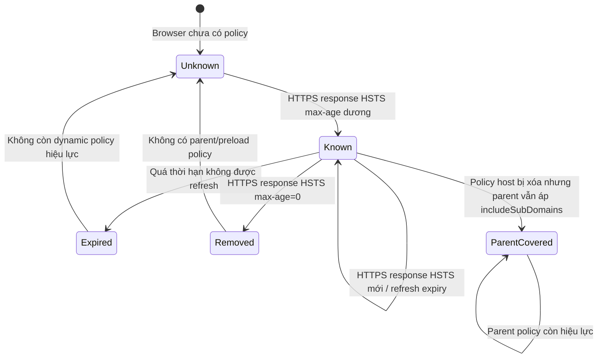
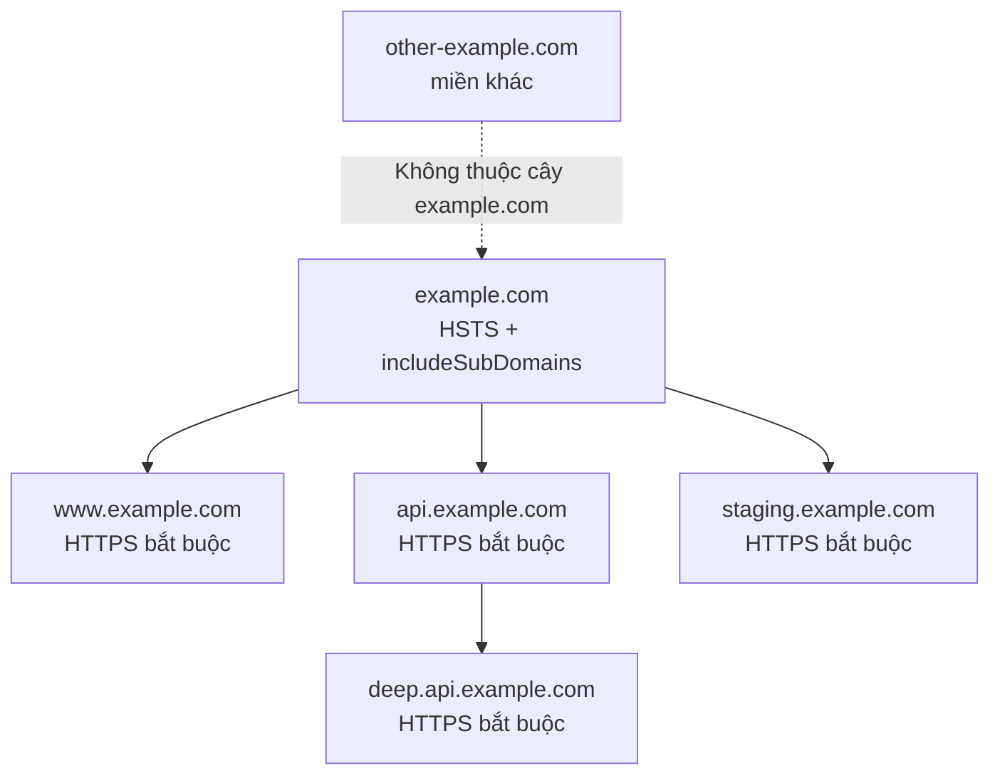
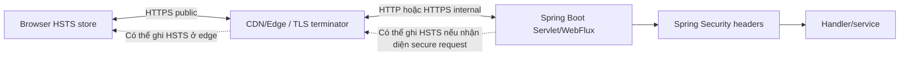
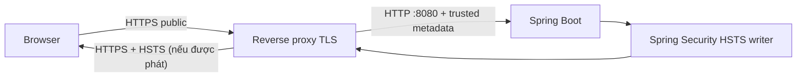

# Strict-Transport-Security và cách trình duyệt ghi nhớ chính sách

> **Chương:** HTTPS và HSTS  
> **Học phần:** `SPRING_SECURITY_HTTP_PROTECTION` — áp dụng các lớp phòng vệ HTTP và trình duyệt trong Spring Security, từ CSRF, CORS, security headers, CSP, HSTS tới HTTP firewall và session protection. Bài này tập trung riêng vào **header Strict-Transport-Security (HSTS)**, **cơ chế browser ghi nhớ và thực thi chính sách theo hostname**, giới hạn first visit, vòng đời/thu hồi policy, và cách kiểm chứng trong kiến trúc **Servlet**, **Reactive WebFlux** và **reverse proxy**.

## 1. Câu chuyện mở đầu: tại sao không thấy HTTP redirect mà website vẫn dùng HTTPS?

Một người dùng truy cập trang quản lý qua:

```text
https://accounts.example.com/login
```

Server trả response HTTPS hợp lệ với header:

```http
Strict-Transport-Security: max-age=31536000; includeSubDomains
```

Một ngày sau, người dùng nhập:

```text
http://accounts.example.com/profile
```

Trình duyệt đã biết HSTS cho `accounts.example.com`. Thay vì gửi một request HTTP lên mạng, nó **đổi đích thành HTTPS ở phía client trước khi kết nối**. Trong một số trình duyệt, công cụ Network có thể hiển thị bước này dưới dạng *internal redirect/upgrade*; đó không nhất thiết là một status `301`, `302`, `307` hay `308` do server gửi.

Đây là khác biệt cốt lõi:

- **HTTP → HTTPS redirect:** server/edge trả 3xx sau khi đã nhận HTTP request.
- **HSTS:** browser đã ghi nhớ chính sách và nâng cấp request sang HTTPS **trước khi phát ra mạng**.
- **TLS:** TLS endpoint thực sự mã hóa kết nối và trình duyệt xác minh chứng chỉ.
- **Spring Security:** có thể thêm HSTS header vào response theo policy, nhưng **không** thực hiện TLS handshake và **không** điều khiển bộ nhớ HSTS của browser.

Nếu cả ba lớp được thiết kế đúng, các lần truy cập tiếp theo giảm nguy cơ vô tình gửi HTTP plaintext. Nếu cấu hình sai, HSTS cũng có thể khiến người dùng **không truy cập được** một subdomain chưa hỗ trợ HTTPS.

### Mục tiêu học tập

Sau bài, người học có thể:

1. Giải thích cú pháp `Strict-Transport-Security` và ý nghĩa của `max-age`, `includeSubDomains`, `preload`.
2. Mô phỏng cách browser **nhận, lưu, cập nhật, hết hạn, kế thừa** và xóa HSTS policy theo hostname.
3. Phân biệt một hostname có HSTS độc lập với hostname chỉ chịu ảnh hưởng từ HSTS **của miền cha**.
4. Dự đoán HTTP URL có cổng `80`, cổng tùy chỉnh và path/query sẽ được nâng cấp thế nào.
5. Nhận biết giới hạn **first-visit problem**, chứng chỉ TLS, preload và các client không hỗ trợ HSTS.
6. Cấu hình HSTS trong Servlet và Reactive, hoặc ở edge/CDN, dựa trên TLS termination và trusted forwarded headers.
7. Viết test phân biệt **header được gửi** với **browser đã ghi nhớ và thực thi** policy.
8. Chẩn đoán trường hợp HSTS thiếu, subdomain bị khóa HTTPS, browser có hành vi khác curl, hoặc `max-age=0` chưa giúp khôi phục truy cập.
9. Đánh giá HSTS cùng CSRF, CORS, CSP, session cookie, HTTPS redirect và HTTP firewall mà không nhầm chúng là một cơ chế.

## 2. HSTS bảo vệ kịch bản nào?

Một nguy cơ phổ biến là *protocol downgrade*: người dùng hoặc liên kết ban đầu dùng HTTP, và một đối tượng kiểm soát mạng có thể nghe lén/sửa luồng trao đổi hoặc chặn response redirect lên HTTPS.

Khi trình duyệt **đã biết HSTS**, browser không gửi yêu cầu HTTP tới hostname thuộc policy. Điều này giảm cơ hội:

- Rò rỉ hoặc sửa đổi request/response **qua HTTP plaintext** sau khi policy đã được học.
- Một attacker trên mạng can thiệp vào phản hồi HTTP redirect thông thường.
- Người dùng tiếp tục dùng bookmark `http://` cũ tới host đã bật HSTS.
- Browser chấp nhận một số lựa chọn bỏ qua lỗi chứng chỉ đối với host HSTS, làm suy yếu khả năng xác thực máy chủ.

Nhưng HSTS **không** loại bỏ các nguy cơ sau:

| Nguy cơ | HSTS có thay thế biện pháp bảo vệ không? | Cần bổ sung |
| --- | --- | --- |
| Lần truy cập đầu khi browser chưa biết policy | Không | HTTPS links trực tiếp, redirect ở edge, HTTPS-first/preload khi phù hợp |
| Chứng chỉ hết hạn hoặc tên host sai | Không; HSTS thường khiến lỗi này nghiêm ngặt hơn | Quản lý PKI/cert, giám sát expiry, TLS validation |
| Cookie bị lộ do XSS trong origin HTTPS | Không | Output encoding/sanitization, CSP, `HttpOnly` |
| CSRF POST dùng session cookie | Không | CSRF token, `SameSite` và authorization |
| User khác tenant đọc dữ liệu qua HTTPS | Không | Object-level authorization theo tenant/ACL |
| Backend HTTP sau TLS-terminating proxy | Không | TLS/mTLS hoặc trust/network controls cho hop nội bộ |
| CDN/cache trả dữ liệu của user A cho user B | Không | Cache-Control và cấu hình cache key |
| CORS quá rộng | Không | Origin allowlist, credentials policy, authorization |
| Path URL không chuẩn bypass filter | Không | HTTP firewall, thống nhất parser và route matcher |
| Browser/profile không hỗ trợ hoặc chưa lưu HSTS | Không thể áp yêu cầu ghi nhớ | Client dùng HTTPS trực tiếp và TLS validation |

**Mô hình nguy cơ đúng:** HSTS củng cố sự lựa chọn **HTTPS cho những kết nối tương lai** của một user agent có hỗ trợ. Nó không tự chứng minh mọi request đã an toàn ngay từ lần đầu hoặc mọi hop trong hệ thống đã được mã hóa.

## 3. Bốn cơ chế dễ bị gộp làm một

| Cơ chế | Ai quyết định? | Khi nào tác động? | Ví dụ |
| --- | --- | --- | --- |
| HTTPS/TLS | Browser/client và TLS endpoint | Khi mở kết nối | Kết nối `https://accounts.example.com` có cert hợp lệ |
| HTTP→HTTPS redirect | HTTP server, reverse proxy hoặc Spring Security | **Sau khi nhận HTTP request** | `308 Location: https://accounts.example.com/...` |
| HSTS | Host phát policy qua HTTPS; **browser lưu và thực thi** | **Trước request tương lai** | `Strict-Transport-Security: max-age=...` |
| Authentication/authorization | Spring Security + ứng dụng | Khi xử lý request đến server | Chỉ Alice được xem thông tin tài khoản Alice |

Một website có thể có redirect nhưng **không có HSTS**. Ngược lại, một browser đã biết HSTS sẽ không cần nhìn thấy HTTP redirect trên nhiều lần truy cập. Cả hai vẫn cần một HTTPS listener và chứng chỉ hợp lệ.

### 3.1. Hai bài toán của hai thời điểm

```mermaid
sequenceDiagram
    participant B as Browser chưa nhớ policy
    participant H as HTTP endpoint
    participant S as HTTPS endpoint
    Note over B,S: Lần truy cập đầu (không có preload/known policy)
    B->>H: GET http://accounts.example.com
    H-->>B: 301/308 Location: https://accounts.example.com
    B->>S: TLS handshake + HTTPS GET
    S-->>B: HTTPS response + Strict-Transport-Security
    Note over B: Lưu HSTS theo hostname và thời hạn
    Note over B,S: Lần sau, khi policy còn hiệu lực
    B->>B: Nâng http://... thành https://... trước network
    B->>S: TLS handshake + HTTPS GET
    S-->>B: HTTPS response; có thể làm mới max-age
```

Trình tự minh họa không áp dụng cứng cho mọi browser; ví dụ browser có preload hoặc cơ chế HTTPS-first riêng có thể không phát request HTTP ngay cả lần đầu.

## 4. Cú pháp Strict-Transport-Security

Một policy điển hình:

```http
Strict-Transport-Security: max-age=31536000; includeSubDomains
```

Ba thành phần thường gặp:

- **`max-age` — bắt buộc:** số giây browser ghi nhớ policy kể từ khi nhận response HTTPS hợp lệ.
- **`includeSubDomains` — tùy chọn:** mở hiệu lực xuống các hostname con của host đã gửi header.
- **`preload` — tùy chọn, không phải directive cốt lõi của RFC 6797:** một tín hiệu gắn với quy trình đăng ký preload list; **không** tự khiến browser đưa host vào list.

Ví dụ các dạng khác nhau:

```http
Strict-Transport-Security: max-age=300
Strict-Transport-Security: max-age=86400; includeSubDomains
Strict-Transport-Security: max-age=31536000; includeSubDomains; preload
Strict-Transport-Security: max-age=0
```

**Bốn dòng trên là bốn ví dụ thay thế**, không phải khuyến nghị gửi đồng thời nhiều header cùng tên trên một response. Trong thực tế nên để **một component sở hữu policy** và phát giá trị rõ ràng, tránh duplicate/conflicting headers giữa edge và backend.

### 4.1. max-age đo bằng giây, không phải ngày

Một số giá trị tham khảo:

| Cấu hình | Khoảng thời gian tương đương | Dùng khi nào |
| --- | --- | --- |
| `max-age=0` | Yêu cầu xóa policy riêng của hostname | Thu hồi policy thông qua HTTPS hợp lệ |
| `max-age=300` | 5 phút | Khảo sát trên test host có kế hoạch |
| `max-age=86400` | 1 ngày | Giai đoạn rollout hạn ngắn |
| `max-age=604800` | 7 ngày | Rollout kiểm chứng thêm |
| `max-age=2592000` | 30 ngày | Mở rộng độ ổn định |
| `max-age=31536000` | 365 ngày | Một policy dài hạn phổ biến |
| `max-age=63072000` | 730 ngày | Có thể phù hợp yêu cầu preload theo quy trình hiện hành |

Đây là **ví dụ về giá trị**, không phải lịch bắt buộc hay cam kết tiêu chí preload hiện hành. Việc triển khai duration phụ thuộc threat model, quy mô domain, khả năng cấp chứng chỉ và kế hoạch rollback.

### 4.2. Lưu ý cú pháp và parser

- Header name và directive cần đúng chính tả; `max-age` phải có giá trị số giây phù hợp cú pháp.
- `includeSubDomains` là một directive không yêu cầu gán giá trị.
- Không tự chế khoảng thời gian như `max-age=1year`.
- Nếu một response có nhiều bản HSTS do các tầng thêm, parser của browser có quy tắc xử lý riêng; **không nên dựa vào hành vi duplicate** để kết hợp policy.
- Chỉ vì `curl` in ra header không chứng minh browser đã chấp nhận header nếu response không được vận chuyển qua HTTPS hợp lệ.

## 5. Khi nào browser chấp nhận một policy HSTS?

Điều kiện cốt lõi theo mô hình HSTS:

1. Browser kết nối đến hostname qua **HTTPS hợp lệ**.
2. Browser **xác thực TLS server** theo trust store và hostname verification.
3. Browser nhận một `Strict-Transport-Security` hợp lệ trên response của hostname đó.
4. Hostname phù hợp phạm vi lưu HSTS của user agent; RFC không dùng IP literal như một Known HSTS Host theo cùng cách hostname DNS.
5. Browser lưu/cập nhật policy với thời gian hiệu lực tương ứng.

Những điều **không đủ** để browser tin policy:

- Header HSTS nằm trên response HTTP plaintext.
- Một client dùng `--insecure` để bỏ certificate validation rồi kết luận “server đã bật HSTS đúng”.
- Header HSTS được gửi từ một host A nhưng mong nó trực tiếp làm policy riêng cho host B không thuộc phạm vi.
- Response có `Location: https://...` nhưng không có HTTPS response thực sự chứa policy.
- Một endpoint được đánh dấu secure trong `MockMvc` mà chưa có TLS endpoint thật.

### 5.1. Response nào có thể mang HSTS?

HSTS là **response header theo hostname**, không phải chính sách chỉ dành cho HTML. Một HTTPS response trả HTML, JSON, file hoặc status 3xx/4xx/5xx có thể mang policy nếu hệ thống phát đúng.

Ví dụ:

```http
HTTP/1.1 200 OK
Strict-Transport-Security: max-age=31536000
Content-Type: application/json

{"status":"ok"}
```

Trình duyệt có thể ghi nhớ HSTS từ một response HTTPS hợp lệ trên hostname đó. Điều này khác CSP: CSP áp trên document/loại response theo ngữ cảnh sử dụng, còn HSTS quản lý **host/transport policy**.

### 5.2. HSTS trên HTTP redirect không kích hoạt policy

```http
HTTP/1.1 308 Permanent Redirect
Location: https://accounts.example.com/
Strict-Transport-Security: max-age=31536000
```

Nếu response này **được nhận qua HTTP**, browser không dùng chính header HSTS đó để thiết lập policy. Quy trình nên là:

- HTTP endpoint chuyển hướng lên HTTPS nếu chính sách có redirect.
- **HTTPS response** từ hostname thực sự phát HSTS.
- Browser lưu policy từ HTTPS response sau khi TLS validation thành công.

Nếu browser đã có policy HSTS, nó có thể không gửi HTTP request và cũng không nhìn thấy HTTP redirect.

## 6. Browser ghi nhớ những gì?

Hãy hình dung một **bảng policy nội bộ** của user agent:

| Thuộc tính khái niệm | Giá trị ví dụ | Ý nghĩa |
| --- | --- | --- |
| Hostname | `accounts.example.com` | Host công bố policy |
| Thời điểm ghi nhận | `t0` | Lần browser nhận HTTPS response hợp lệ |
| `max-age` | `31536000` giây | Khoảng thời gian policy được ghi nhớ |
| Thời điểm hết hạn | `t0 + max-age` | Hết hiệu lực nếu không nhận policy mới |
| `includeSubDomains` | `true` hoặc `false` | Có áp dụng xuống hostname con hay không |
| Nguồn policy | Dynamic response hoặc preload | Ảnh hưởng khả năng thu hồi/khởi tạo |
| Parent policy | Có thể có | Host đang bị chi phối bởi policy miền cha |

Đây là mô hình **khái niệm**, không phải cấu trúc dữ liệu/đường dẫn bộ nhớ cụ thể của Chrome, Firefox hoặc Safari. Mỗi browser có cách lưu, đồng bộ, bảo vệ profile và triển khai preload riêng.

### 6.1. HSTS không phải cookie phiên

HSTS:

- Không chứa session ID hay principal.
- Không cấp quyền đăng nhập cho browser.
- Không nhất thiết bị xóa khi ứng dụng logout.
- Không phụ thuộc user vẫn còn cookie HSTS-specific.
- Không thể được quản lý như một application session bằng `HttpSession.invalidate()`.

Cookie có `Secure` hạn chế cookie được gửi qua HTTP; HSTS có nhiệm vụ **nâng URL của host** trước khi browser phát request. Hai cơ chế bổ trợ nhưng không thay thế nhau.

### 6.2. Phạm vi của bộ nhớ HSTS

- Browser lưu theo **hostname**, không theo một route như `/login` hoặc `/api/**`.
- Policy có thể được giữ trong browser profile hoặc một không gian duyệt web tương ứng; cách lưu, tính bền vững và private browsing tùy triển khai.
- Không giả định “xóa cookie là xóa sạch HSTS” trên mọi browser/version.
- Không giả định hai browser hoặc hai profile dùng chung policy động đã học.
- Một user có policy cũ trong profile thường gặp hành vi khác user dùng profile sạch.

Đây là lý do QA cần test **browser chưa có policy** và **browser đã được primed** (đã nhận policy) tách biệt.

## 7. Vòng đời chính sách: học, làm mới, hết hạn và xóa



Sơ đồ minh họa **dynamic HSTS policy**. Preload có cơ chế phân phối/thu hồi độc lập và không thể chỉ xem nó là dynamic entry được xóa ngay.

### 7.1. Lần đầu nhận max-age

Giả sử browser truy cập `https://accounts.example.com` lúc `t0` và nhận:

```http
Strict-Transport-Security: max-age=86400
```

Browser có thể ghi nhớ chính sách khoảng một ngày, đến `t0 + 86400 giây` nếu không có cập nhật mới.

### 7.2. Nhận policy mới làm mới thời hạn

Sau 12 giờ, browser truy cập lại HTTPS và server trả cùng `max-age=86400`. Thời điểm hết hạn mới được tính từ **lần nhận policy mới**, không chỉ từ lần đầu. HSTS có thể được liên tục gia hạn khi user truy cập site thường xuyên.

Vì thế nếu site vẫn gửi HSTS dài hạn trên mọi HTTPS response, việc đợi một khoảng ngắn rồi mong browser quên policy có thể không hiệu quả.

### 7.3. Giảm max-age

Nếu đội vận hành thay từ một năm sang một ngày và browser truy cập HTTPS nhận policy mới, thời hạn dynamic policy được cập nhật theo giá trị mới. Nhưng:

- Không phải mọi browser/user đều truy cập site ngay sau khi rollout.
- Những browser chưa nhận thay đổi có thể tiếp tục giữ policy cũ.
- Parent HSTS và preload có thể khiến giảm duration **không** gỡ bỏ hiệu lực thực tế.

### 7.4. max-age=0

Gửi qua HTTPS hợp lệ:

```http
Strict-Transport-Security: max-age=0
```

là cách để browser xóa **dynamic HSTS policy của chính hostname phát header**. Điều này không phải cách gỡ chính sách do một parent với `includeSubDomains` áp đặt.

Nếu HTTPS endpoint đã hỏng chứng chỉ, browser bị HSTS chi phối có thể không tải được response chứa `max-age=0` — một vấn đề **chicken-and-egg** trong xử lý sự cố.

## 8. includeSubDomains: chính sách của miền cha đi xuống đâu?

Giả sử `example.com` gửi HSTS qua HTTPS:

```http
Strict-Transport-Security: max-age=31536000; includeSubDomains
```

Browser đã ghi nhớ policy có thể buộc HTTPS cho:

- `example.com`.
- `www.example.com`.
- `api.example.com`.
- `deep.api.example.com`.
- `staging.example.com`.

Điều này có thể xảy ra **ngay cả khi hostname con không tự phát HSTS**.



### 8.1. Chính sách HSTS là ràng buộc hostname, không phải wildcard certificate

Bật `includeSubDomains` **không cấp chứng chỉ TLS** cho các host con, không cấu hình server và không thay DNS. Tất cả hostname bị tác động phải sẵn sàng phục vụ HTTPS hợp lệ.

Nếu `legacy.example.com` chỉ có HTTP, browser đã nhận parent policy sẽ cố kết nối HTTPS tới host con. Khi TLS không khả dụng, user có thể không truy cập được service cũ như trước.

### 8.2. Không có includeSubDomains

Nếu `example.com` gửi:

```http
Strict-Transport-Security: max-age=31536000
```

thì policy trực tiếp của `example.com` không tự bao gồm `api.example.com`. Host con chỉ bị buộc HTTPS nếu **chính nó** hoặc một **ancestor khác** có policy phù hợp, hay browser có preload tương ứng.

### 8.3. Host con không thể tự xóa policy miền cha

Tình huống:

- `example.com` đã được browser ghi nhớ với `includeSubDomains`.
- `legacy.example.com` gửi `max-age=0` trên HTTPS.

Lệnh này có thể xóa policy động **của legacy.example.com**, nhưng host vẫn chịu policy từ `example.com`. Muốn gỡ ràng buộc thực sự phải điều chỉnh parent policy và giải quyết thời gian lưu/preload của các clients.

### 8.4. Host con có thể có policy riêng

`api.example.com` có thể phát một duration khác cho chính nó. Khi parent policy hết hạn hoặc không áp subdomains nữa, policy riêng của `api.example.com` vẫn có thể tồn tại và tiếp tục áp HTTPS theo tuổi thọ của nó.

Do đó “HSTS bị mất sau khi xóa ở parent” không phải kết luận tự động cho toàn bộ cây hostname.

## 9. HSTS áp dụng theo host, không theo path

HSTS **không** có cú pháp giới hạn `/login`, `/admin/**`, `/api/**` hoặc `/health`.

Nếu `accounts.example.com` có policy HSTS hợp lệ, browser sẽ xử lý HTTPS cho các URI HTTP của hostname đó, không chỉ trang đã phát header:

```text
http://accounts.example.com/login
http://accounts.example.com/api/profile
http://accounts.example.com/assets/app.js
http://accounts.example.com/download/42
```

Đây vừa là lợi ích, vừa là ràng buộc triển khai:

- Lợi ích: giảm nguy cơ một route phụ vô tình bị bỏ qua HTTPS.
- Ràng buộc: không thể thử cho một URL HTTP trên cùng hostname tiếp tục hoạt động độc lập khi browser đã học HSTS cho host.

**Spring Security filter chain vẫn có phạm vi riêng.** Nếu app chỉ phát HSTS trên một chain, browser có thể học policy từ response bất kỳ có header trong hostname, rồi áp cho **mọi path của host**. Đó là sự khác biệt giữa **nơi phát policy** và **phạm vi client thực thi**.

### 9.1. Các ứng dụng cùng host chịu tác động chung

Nếu một gateway cung cấp `https://example.com/appA` và `https://example.com/appB`, appA phát HSTS thì browser có thể buộc HTTPS cho appB vì **chung hostname**. Đừng phân quyền sở hữu HSTS theo team/path mà không có điều phối ở cấp hostname.

## 10. Port 80 và port tùy chỉnh: bài học thường bị bỏ qua

Theo cơ chế nâng cấp URI của HSTS:

- `http://accounts.example.com/profile` → `https://accounts.example.com/profile`.
- `http://accounts.example.com:80/profile` → `https://accounts.example.com:443/profile`.
- `http://accounts.example.com:8080/profile` → `https://accounts.example.com:8080/profile` theo quy tắc giữ cổng **không phải 80**.

Điểm cuối rất quan trọng: browser **không tự suy** `8080→8443` bằng `PortMapper` của Spring Security. HSTS không phải một bảng port mapping tùy biến.

| URL người dùng muốn mở | Kết quả theo HSTS (khái niệm) | Nguy cơ vận hành |
| --- | --- | --- |
| `http://app.example.com/a` | `https://app.example.com/a` | TLS phải có trên cổng HTTPS mặc định |
| `http://app.example.com:80/a` | `https://app.example.com:443/a` | TLS listener 443 phải hoạt động |
| `http://app.example.com:8080/a` | `https://app.example.com:8080/a` | Nếu 8080 chỉ nói HTTP, handshake HTTPS thất bại |
| `http://app.example.com:8443/a` | `https://app.example.com:8443/a` | Nếu 8443 có TLS, kết nối có thể thành công |
| `https://app.example.com/a` | Giữ HTTPS, không cần upgrade | Vẫn kiểm tra TLS/cert bình thường |

Các phép biến đổi được trình bày theo HSTS URI rules và không mô tả mọi browser UI. Điều cần nhớ là **HSTS không chuyển cổng tùy ý theo cấu hình server**.

### 10.1. HSTS trên localhost và IP addresses

Không dùng `http://127.0.0.1:8080` hoặc một IP literal để chứng minh thuật toán HSTS cho hostname DNS production. HSTS xác định policy theo hostname; RFC xử lý IP literal khác DNS host. Các browser còn có xử lý đặc biệt cho localhost và môi trường phát triển.

Để kiểm thử HSTS đúng nghĩa, nên dùng hostname test có chứng chỉ hợp lệ và quyền kiểm soát DNS/host routing rõ ràng. Tránh dùng miền cha production chỉ để thử `includeSubDomains`.

### 10.2. HSTS và PortMapper là hai lớp khác nhau

- `PortMapper` trong Spring Security Servlet có thể giúp server dựng `Location` cho HTTP→HTTPS redirect.
- HSTS do browser diễn giải **trước request**, không gọi PortMapper của backend.

Nếu đang debug `localhost:8080`/`localhost:8443`, hãy kiểm tra **server redirect và browser HSTS riêng biệt**, không lấy kết quả của một cơ chế để suy ra cơ chế còn lại.

## 11. HSTS preload: biết trước khi nhận response đầu tiên

**Preload** là cách một số browser phân phối danh sách hostname phải dùng HTTPS ngay từ trước khi user truy cập lần đầu. Nó giải quyết một phần **first-visit gap** của HSTS học động.

Ví dụ header liên quan đến chương trình preload:

```http
Strict-Transport-Security: max-age=63072000; includeSubDomains; preload
```

Tuy nhiên:

1. Thêm directive `preload` **không đồng nghĩa** browser đã đưa hostname vào preload list.
2. Đăng ký preload phải qua chương trình riêng và thỏa các yêu cầu hiện hành (chứng chỉ/TLS, redirect, thời hạn, subdomains, v.v.).
3. Browser cập nhật preload list theo chu kỳ/phát hành; không có bảo đảm mọi browser trên mọi thiết bị cập nhật tức thời.
4. Gỡ một hostname khỏi preload list có thể mất nhiều phiên bản browser và không thu hồi ngay như dynamic `max-age=0`.
5. Với `includeSubDomains`, quyết định preload ở miền cha có thể ràng buộc **rất nhiều service do các nhóm khác nhau vận hành**.

### 11.1. Khi nào không nên preload?

- Domain có subdomain không kiểm kê được hoặc còn HTTP-only.
- Hạ tầng cấp chứng chỉ/renewal chưa đáng tin.
- Cần chuyển hostname giữa các environment thường xuyên.
- Không có owner cấp tổ chức và quy trình rollback.
- Team chỉ muốn “được điểm security scanner” mà chưa hiểu hậu quả.

**Khuyến nghị thực hành:** đánh giá chính sách preload và điều kiện hiện hành qua trang chính thức <https://hstspreload.org/> và tài liệu browser tương ứng, không sao chép một con số cũ mà không kiểm tra.

### 11.2. Dynamic HSTS và preload có cùng độ linh hoạt không?

Không. Dynamic policy có thể được cập nhật/xóa khi browser nhận một HTTPS response hợp lệ. Preload được phân phối qua danh sách browser, nên rollback phức tạp và chậm hơn. Một response `max-age=0` trên website không tự đảm bảo mọi browser xóa preload đã đóng gói.

## 12. First-visit problem và giới hạn giảm thiểu

Một attacker trên mạng có thể tấn công **lần truy cập HTTP đầu tiên** khi browser chưa biết HSTS và host chưa có preload/HTTPS-first protection. Attacker có thể tìm cách chặn hoặc sửa HTTP redirect trước khi browser chuyển đến HTTPS.

HSTS có hiệu quả lớn sau khi policy được học, nhưng không nên coi là bằng chứng request đầu tiên chắc chắn an toàn.

### 12.1. Nhiều lớp giảm rủi ro

- Mọi link trong email, tài liệu, ứng dụng mobile và QR code trỏ trực tiếp `https://`.
- HTML form action và API base URLs dùng HTTPS ngay từ đầu.
- Edge có HTTP listener chỉ redirect/reject, không phục vụ dữ liệu cá nhân.
- Session cookie có `Secure`, tránh gửi credential/token qua HTTP.
- HSTS được phát trên HTTPS response hợp lệ và có tuổi thọ phù hợp.
- Có thể cân nhắc preload nếu **toàn bộ hostname/subdomain** đủ điều kiện và quy trình vận hành cho phép.
- Browser HTTPS-first/HTTPS-only modes là cơ chế bổ sung, **không thay trách nhiệm server**.

### 12.2. HSTS không chứng minh certificate đúng

Nếu browser kết nối tới server mạo danh nhưng có certificate không được trust hoặc không khớp hostname, HSTS không làm certificate đó hợp lệ. Browser cần xác minh chuỗi tin cậy và hostname trong TLS handshake.

Một browser HSTS thường không cung cấp cách bỏ qua certificate error thông thường. Đây là bảo vệ chống downgrade, **đồng thời tăng tác động availability** khi đội vận hành để chứng chỉ hết hạn hoặc sai hostname.

## 13. Khi HSTS được browser thực thi: internal redirect và lỗi chứng chỉ

Một browser có policy đã lưu có thể hiển thị “307 Internal Redirect” (hoặc cách trình bày khác) khi điều hướng một HTTP URL. Đó là mô tả **nội bộ trình duyệt** cho quyết định nâng cấp URL, không nhất thiết tương ứng một gói HTTP status `307` đi qua mạng.

### 13.1. Dấu hiệu cần phân biệt trong DevTools

| Dấu hiệu | Khả năng | Cách xác minh |
| --- | --- | --- |
| Network hiển thị internal redirect/upgrade không có HTTP response remote | HSTS hoặc HTTPS-first nội bộ browser | Xem browser state/initiator và network transport thực |
| `301/308 Location: https://...` từ port 80 | Redirect server/edge | Dùng HTTP client không tự follow và không áp HSTS |
| `302 Location: /login` | Authentication entry point | Kiểm tra session và route, không gọi là HSTS |
| Certificate error khi mở host con | Parent HSTS + TLS/cert host con lỗi | Kiểm tra parent `includeSubDomains` và cert |
| `curl` thấy HTTP 308, Chrome không thấy | Browser đã biết HSTS | Test 2 loại client với state riêng |
| Client dùng URL `http://...:8080` thất bại TLS | HSTS giữ cổng 8080 | Kiểm tra quy tắc chuyển port và TLS listener |

### 13.2. Không coi “không thấy 3xx” là lỗi server

Khi browser upgrade trước network, edge **không cần** phát redirect vì nó không nhận HTTP request. Để xác minh edge redirect hoạt động cho client chưa có HSTS, dùng một HTTP client riêng hoặc browser profile/test hostname chưa từng học policy.

### 13.3. HSTS không xử lý mọi loại browser navigation theo một hành vi cố định

User agent, browser version, private mode, preload list và policy doanh nghiệp có thể khác. Khi viết test report, ghi rõ client/version/profile state thay vì khẳng định mọi browser sẽ có cùng dòng DevTools.

## 14. Quyết định bật HSTS ở đâu trong kiến trúc Spring

Một hệ thống thường có browser → CDN/ingress → Spring Boot. HSTS có thể được phát bởi:

- Spring Security Servlet/Reactive security headers.
- Reverse proxy/ingress sở hữu TLS.
- CDN phục vụ HTML/static assets hoặc response proxy.
- Một HTTP server/runtime khác nằm trước ứng dụng.

Điều quan trọng là **response HTTPS cuối browser nhận** có policy hợp lệ và các tầng không phát header mâu thuẫn.



Hai mũi tên nét đứt là **các lựa chọn ownership**, không khuyến nghị cả hai tầng cùng ghi HSTS không phối hợp.

### 14.1. Khi Spring Boot trực tiếp kết thúc TLS

Spring Boot HTTP server nhận HTTPS; security chain thường thấy request secure đúng. Spring Security có thể phát HSTS bằng header writer theo policy.

### 14.2. Khi TLS kết thúc ở reverse proxy

Browser kết nối HTTPS tới proxy, nhưng backend có thể chỉ nhận HTTP từ proxy. Nếu không khôi phục external scheme đáng tin, Spring Security có thể **không** ghi HSTS vì request nội bộ không được xem là secure.

Hai thiết kế thường dùng:

**Edge sở hữu HSTS:**
- Proxy/ingress phát HSTS trên HTTPS public response.
- Cấu hình bao gồm response lỗi do edge tự sinh nếu policy yêu cầu.
- Backend không cần phát policy trùng/mâu thuẫn.

**Spring Security sở hữu HSTS:**
- Proxy gửi trusted forwarding thông tin external scheme/host.
- Spring Framework/container diễn giải đúng external request trước khi security headers quyết định.
- Response do CDN/WAF sinh riêng cũng cần chính sách xử lý, vì không đi qua Spring Security.

### 14.3. Chỉ một chủ sở hữu có trách nhiệm rõ

Một policy table tối thiểu:

| Quyết định | Owner | Evidence |
| --- | --- | --- |
| Certificate public và HTTPS listener | Platform/edge hoặc HTTP server | TLS client certificate verification |
| HSTS trên hostname public | Edge **hoặc** application | HTTPS response cuối |
| `includeSubDomains` và preload | Người quản lý DNS/domain + security | Kiểm kê subdomains, phê duyệt rollout |
| Trusted forwarded headers | Edge + backend framework | Spoofing tests và HTTPS scheme tests |
| Session cookie attributes | Component phát `Set-Cookie` | Browser network/cookie inspector |
| Authn/authz/CSRF | Spring Security + domain service | Integration tests, side-effect assertions |
| CSP của HTML | Host phát HTML | Browser test document CSP |
| HTTP redirect | Edge/server/app được phân công | HTTP 3xx/Location không loop |

## 15. Servlet: HSTS writer trong Spring Security

Trong Servlet Spring Security 6.x và các phiên bản tương thích, các security headers được cấu hình qua `HttpSecurity.headers(...)`.

Một cấu hình minh họa có chủ ý chọn phạm vi **không bao gồm subdomains**:

```java
import static org.springframework.security.config.Customizer.withDefaults;

@Configuration
@EnableWebSecurity
class ServletHstsSecurity {

    @Bean
    SecurityFilterChain filterChain(HttpSecurity http)
            throws Exception {
        return http
            .headers(headers -> headers
                .httpStrictTransportSecurity(hsts -> hsts
                    .includeSubDomains(false)
                    .maxAgeInSeconds(31536000)
                )
            )
            .csrf(withDefaults())
            .authorizeHttpRequests(auth -> auth
                .requestMatchers("/assets/**", "/login").permitAll()
                .anyRequest().authenticated()
            )
            .formLogin(withDefaults())
            .build();
    }
}
```

Các class/imports và cách gọi configurer cần đối chiếu **version đã ghim**. Ví dụ có thể dùng đúng khi app sở hữu HSTS, không phải mệnh lệnh áp một năm trong mọi môi trường.

### 15.1. Spring Security mặc định và chính sách riêng

Với cấu hình security headers tiêu chuẩn, Spring Security Servlet thường đã hỗ trợ HSTS cho những request được nhận diện **secure**. Một header mặc định phổ biến là `max-age=31536000; includeSubDomains`; ứng dụng phải kiểm tra phiên bản/cấu hình thực của mình, không coi mọi bộ mặc định là bất biến.

Những điều cần xác minh:

- Có bean `SecurityFilterChain` tùy biến đã thay đổi mặc định không?
- Đã gọi `headers(...).disable()` hoặc vô hiệu HSTS writer ở đâu không?
- Request HTTPS public có được backend nhận diện secure không?
- Có nhiều chains xử lý các routes khác nhau không?
- Edge có thêm, thay hoặc xóa HSTS trên response cuối không?

### 15.2. HSTS writer không tự bật TLS

Ví dụ trên không sinh certificate, không mở port HTTPS và không redirect client HTTP. Với Spring Boot trực tiếp TLS, cần server SSL config. Với edge, cần TLS tại edge và cân nhắc trusted forwarding/ownership.

### 15.3. Không đặt CSP bằng suy luận từ HSTS

HSTS bảo vệ transport của hostname. Nếu app trả HTML có dữ liệu không tin cậy, vẫn cần output encoding/sanitization và `Content-Security-Policy` phù hợp. `httpStrictTransportSecurity` không thay `contentSecurityPolicy`.

## 16. Reactive WebFlux: cùng policy, API và lifecycle khác

WebFlux dùng `ServerHttpSecurity` và `SecurityWebFilterChain`. Ví dụ giữ security headers mặc định để framework phát các headers tương ứng khi thích hợp:

```java
import static org.springframework.security.config.Customizer.withDefaults;

@Configuration
@EnableWebFluxSecurity
class ReactiveHstsSecurity {

    @Bean
    SecurityWebFilterChain webFilterChain(ServerHttpSecurity http) {
        return http
            .headers(withDefaults())
            .csrf(withDefaults())
            .authorizeExchange(auth -> auth
                .pathMatchers("/assets/**", "/login").permitAll()
                .anyExchange().authenticated()
            )
            .formLogin(withDefaults())
            .build();
    }
}
```

Đoạn trên **không giả định** mọi phiên bản WebFlux có cùng method name để chỉnh thời hạn HSTS. Khi muốn thay `max-age` hoặc `includeSubDomains` trong Reactive, đọc API `ServerHttpSecurity.HeaderSpec` và HSTS spec của phiên bản thực, hoặc giao edge phát header theo chính sách thống nhất.

### 16.1. Khác biệt cần nhớ

| Khía cạnh | Servlet | Reactive WebFlux |
| --- | --- | --- |
| HTTP security builder | `HttpSecurity` | `ServerHttpSecurity` |
| Security chain | `SecurityFilterChain` | `SecurityWebFilterChain` |
| Security headers config | `http.headers(...)` | `http.headers(...)` với Reactive specs |
| HTTP request | `HttpServletRequest` | `ServerWebExchange` |
| Session | `HttpSession` | `WebSession` |
| Security context | `SecurityContextHolder` trong Servlet integrations | `ReactiveSecurityContextHolder` qua Reactor context |
| Forwarded integration | `ForwardedHeaderFilter`/container | `ForwardedHeaderTransformer`/runtime |
| HTTP security test | `MockMvc` | `WebTestClient` |
| TLS endpoint | Servlet container hoặc edge | Reactive HTTP server hoặc edge |

Về mặt browser, HSTS không quan tâm HTTP server dùng Servlet hay WebFlux: nó quan tâm **hostname, HTTPS response và header hợp lệ**.

### 16.2. Đừng dùng Servlet class trong WebFlux

Không copy nguyên `HttpSecurity` hoặc `HttpServletRequest.isSecure()` sang Reactive. Reactive request scheme được biểu diễn qua `ServerWebExchange` sau khi HTTP runtime/forwarded transformation phù hợp. Một mock Reactive test với URI HTTPS cũng không tự xác minh certificate thật.

## 17. HSTS ở reverse proxy: ví dụ với Nginx

Nếu edge sở hữu HSTS, một cấu hình minh họa:

```nginx
# Chỉ là ví dụ học tập. Không dùng nguyên xi nếu chưa kiểm tra topology.
server {
    listen 80;
    server_name accounts.example.com;
    return 308 https://accounts.example.com$request_uri;
}

server {
    listen 443 ssl;
    server_name accounts.example.com;

    ssl_certificate     /secure/path/fullchain.pem;
    ssl_certificate_key /secure/path/private-key.pem;

    # Chủ đích chưa áp cho subdomains trong giai đoạn đầu.
    add_header Strict-Transport-Security "max-age=86400" always;

    location / {
        proxy_pass http://127.0.0.1:8080;
        proxy_set_header Host accounts.example.com;
        proxy_set_header X-Forwarded-Host accounts.example.com;
        proxy_set_header X-Forwarded-Proto https;
        proxy_set_header X-Forwarded-Port 443;
        proxy_set_header X-Forwarded-For $remote_addr;
        proxy_set_header Forwarded "";
    }
}
```

**Giải thích:**

- `listen 80` phục vụ redirect HTTP; response HSTS trên HTTP, nếu có, vẫn không được browser tin.
- `listen 443 ssl` thực hiện TLS public; cần cert/keys hợp lệ, bảo mật private key.
- `add_header ... always` nhằm thêm header trên nhiều response statuses, kể cả lỗi do Nginx sinh ra trong phạm vi cấu hình. Cần xác minh inheritance và các blocks/location thực tế của Nginx.
- `max-age=86400` chỉ là giai đoạn minh họa, không phải chuẩn bắt buộc.
- `includeSubDomains` chưa bật vì chưa kiểm kê host con.
- Backend `127.0.0.1:8080` chỉ là ví dụ máy đơn; thực tế có thể dùng Kubernetes/mesh và cần network policy/TLS nội bộ.
- Edge cần lọc forwarded metadata từ client và khóa đường truy cập backend.
- Việc thêm HSTS ở edge không tự giải quyết authn/authorization/CSRF của Spring Security.

### 17.1. Lưu ý khi dùng CDN/WAF

Nếu CDN terminate TLS trước Nginx, browser sẽ nhìn thấy response cuối từ CDN. Header có thể bị CDN thêm, xóa hoặc thay đổi. Cần xác định **đúng lớp public** đang phát HSTS và kiểm tra cả static HTML, API, redirect và error page.

Đừng chỉ dùng `curl` gọi backend internal và kết luận browser nhận HSTS.

## 18. Trusted forwarded headers: điều kiện khi HSTS do app phát

Nếu browser vào HTTPS tại edge nhưng backend nhận HTTP nội bộ:



Spring Security có thể dựa vào request secure flag/scheme do framework/container cung cấp. Để dùng external scheme, proxy thường truyền:

```http
Forwarded: for=198.51.100.10;proto=https;host=accounts.example.com
X-Forwarded-Proto: https
X-Forwarded-Host: accounts.example.com
X-Forwarded-Port: 443
```

**Đây không phải header xác thực.** Nếu client Internet có thể tự đặt `X-Forwarded-Proto`/`Forwarded` và backend tin bừa, attacker có thể đánh lừa app về scheme, host và URL.

### 18.1. Điều kiện phải có trước khi xử lý forwarding

1. Edge **xóa/ghi đè** forwarded headers do client không tin cậy gửi.
2. Backend chỉ nhận request từ trusted proxies, qua network access control, mTLS hoặc cơ chế phù hợp.
3. Nhiều proxies phải thống nhất cách ghép/ghi đè `Forwarded`/`X-Forwarded-*`; không lấy tùy tiện giá trị client có thể chèn.
4. Hostname được kiểm soát bằng allowlist/canonical host policy, tránh host-header poisoning.
5. Quy trình kiểm thử có tình huống spoof forwarded scheme/host từ client public.

### 18.2. Cấu hình Spring Boot tham khảo

```yaml
# Chỉ dùng sau khi bảo đảm trust boundary tại proxy.
server:
  forward-headers-strategy: framework
```

Servlet có `ForwardedHeaderFilter`/container integration; WebFlux có `ForwardedHeaderTransformer`/runtime integration. `framework` và `native` là những lựa chọn tùy môi trường. Bật chúng **không tự làm header từ Internet đáng tin**.

### 18.3. HSTS thiếu do scheme sai và redirect loop

Cùng một lỗi external scheme có thể gây hai triệu chứng:

- Spring Security không thêm HSTS vì nghĩ request là HTTP.
- HTTPS redirect filter liên tục đưa browser trở về **cùng URL HTTPS**, tạo vòng lặp.

Cách sửa là chọn một owner cho redirect/HSTS và bảo đảm external scheme đáng tin, **không** tắt CSRF/CORS/firewall để che triệu chứng.

## 19. HSTS rollout: tăng thời hạn có kiểm soát

Một rollout HSTS tốt là một quyết định **quản lý hostname**, không chỉ pull request ứng dụng.

### 19.1. Giai đoạn chuẩn bị

- Kiểm kê toàn bộ hostname thuộc phạm vi, cả CDN, API, mail-linked web apps, legacy, staging, tenant custom domains nếu liên quan.
- Xác nhận HTTPS listener và certificate hợp lệ trên từng host.
- Giám sát renewal/expiry, SAN, hostname routing, SNI và failover.
- Xác định nơi phát HSTS trên response cuối.
- Kiểm tra HTTP→HTTPS redirect/reject, không truyền dữ liệu nhạy cảm qua HTTP.
- Xác định ai có quyền bật `includeSubDomains`/preload cho miền cha.
- Thiết kế rollback có xét tới browser lưu policy và preload.

### 19.2. Ví dụ một lộ trình tăng dần

| Giai đoạn | Header minh họa | Bằng chứng trước khi tiếp tục |
| --- | --- | --- |
| Smoke test trên host riêng | `max-age=300` | Browser học policy, TLS không lỗi |
| Rollout hạn ngắn | `max-age=86400` | Response cuối/redirect/cert ổn định |
| Theo dõi | `max-age=604800` | Không có host con bất ngờ bị ảnh hưởng |
| Dài hạn | `max-age=31536000` | Vận hành TLS/renewal đáp ứng tiêu chí |
| Xét includeSubDomains | `max-age=31536000; includeSubDomains` | Kiểm kê và TLS mọi subdomain |
| Xét preload | Header/đăng ký theo yêu cầu hiện hành | Phê duyệt cấp domain, vận hành/rollback được chuẩn bị |

Không áp bảng này máy móc: một tổ chức có thể chọn policy khác. Điều quyết định là **bằng chứng và quyền sở hữu**, không phải số ngày cố định.

### 19.3. Thế nào là rollback thực tế?

Rollback phải trả lời:

- Browser đã nhận `max-age` bao lâu?
- Có policy từ miền cha không?
- Host có preload không?
- Có HTTPS response hợp lệ để gửi `max-age=0` không?
- Trình duyệt người dùng có sớm truy cập response mới không?
- Có cách khôi phục chứng chỉ/TLS trước khi thay đổi policy không?

**Đừng dùng câu “chỉ cần sửa header thành max-age=0” như một kế hoạch rollback đầy đủ.**

## 20. HSTS và sự cố chứng chỉ: thứ tự khắc phục đúng

Một hệ thống dùng HSTS có thể trở nên không truy cập được khi chứng chỉ hết hạn, SAN sai hoặc một subdomain không có TLS. Trong browser hỗ trợ HSTS, người dùng thường không thể “bấm tiếp” qua một lỗi certificate như một số trường hợp không có HSTS.

### 20.1. Những việc nên làm

1. Xác định hostname và policy nguồn: host riêng, parent `includeSubDomains`, preload hay kết hợp.
2. Kiểm tra certificate chain, hostname/SAN, expiration, DNS và SNI trên public TLS endpoint.
3. **Khôi phục HTTPS hợp lệ trước**, để browser có thể kết nối.
4. Nếu thật sự cần điều chỉnh dynamic HSTS, phát policy mới qua HTTPS hợp lệ.
5. Nếu host chịu preload/parent policy, lập kế hoạch riêng cho phạm vi đó.
6. Kiểm thử bằng browser profile đã biết HSTS và profile mới, không chỉ `curl -k`.
7. Cập nhật giám sát renewal/rollout và regression tests.

### 20.2. Những việc không nên làm

- Bảo người dùng bỏ kiểm tra chứng chỉ TLS.
- Tắt certificate validation trong mobile app/SDK.
- Gửi `max-age=0` qua HTTP rồi giả định browser sẽ nhận.
- Xóa HSTS ở hostname con và tuyên bố parent policy đã mất.
- Bật một wildcard certificate/redirect mà không kiểm tra phạm vi DNS và hostname.
- Dùng một profile mới không có HSTS làm bằng chứng lỗi của user cũ đã hết.

## 21. HSTS cùng cookie Secure, session và logout

Session cookie và HSTS có điểm giao nhau nhưng khác nhiệm vụ:

```http
Set-Cookie: SESSION=<opaque-id>; Path=/; Secure; HttpOnly; SameSite=Lax
```

Đây là ví dụ lý tưởng hóa; tên cookie/thuộc tính do Servlet container, Spring Session, WebSession hoặc edge quyết định theo kiến trúc.

- **`Secure`:** browser chỉ gửi cookie trên HTTPS phù hợp; đây là thuộc tính cookie, không phải HSTS.
- **`HttpOnly`:** JavaScript thông thường không đọc trực tiếp cookie; XSS vẫn có thể gửi request cùng-origin dùng cookie.
- **`SameSite`:** điều chỉnh cookie trong bối cảnh site; không đồng nghĩa same-origin/CORS.
- **HSTS:** browser cố gắng dùng HTTPS cho host trước khi phát request; không tự cấp `Secure` cho cookie.
- **Logout:** server invalidates session; HSTS vẫn có thể tiếp tục tồn tại vì đó là policy của hostname.

### 21.1. Vì sao Secure vẫn cần khi HSTS đã bật?

- Browser có thể chưa biết HSTS ở lần truy cập đầu.
- Một số client không thực thi HSTS.
- Policy có thể hết hạn, chưa được lưu ở profile mới hoặc không áp tới một hostname khác.
- `Secure` là ràng buộc trực tiếp cho cookie, không nên phụ thuộc vào policy nhớ của user agent.

### 21.2. Session fixation và CSRF vẫn độc lập

HSTS không thay session rotation/fixation protection, CSRF token validation hay object authorization. Một POST HTTPS dùng session cookie vẫn có thể bị CSRF nếu không xác minh tính hợp lệ của request.

Servlet thường có `HttpSession` và CSRF filter; WebFlux có `WebSession` và `CsrfWebFilter`. Không dùng kết quả HSTS để suy ra hai cơ chế này đã hoạt động.

## 22. HSTS, SameSite và CORS trong SPA khác origin

Giả sử:

- HTML SPA: `https://portal.example.com`.
- API: `https://api.example.com`.
- API dùng cookie-session và token CSRF.

Hai hostname có **origin khác nhau**, dù có thể là cùng site khi xét scheme và registrable domain.

### 22.1. Chính sách HSTS áp tới host nào?

Nếu chỉ `api.example.com` phát HSTS **không có parent includeSubDomains**, browser có thể ghi nhớ policy cho **api.example.com**, nhưng điều đó **không tự thiết lập HSTS riêng cho portal.example.com**.

Nếu `example.com` đã được browser ghi nhớ với `includeSubDomains`, cả portal và api có thể chịu chính sách từ parent.

Đừng nghĩ một API JSON trả HSTS sẽ tự bảo vệ mọi host frontend trong hệ thống. HSTS là **theo hostname**, khác cookie Domain và CSP của HTML.

### 22.2. CORS và credentialed fetch

```javascript
const response = await fetch(
  "https://api.example.com/api/profile",
  {
    credentials: "include"
  }
);
```

Browser áp CORS để quyết định script từ portal có được đọc response API hay không. HSTS không tạo `Access-Control-Allow-Origin`, không cấp quyền đọc response và không tự thêm credentials.

Với request thay đổi trạng thái:

- Dùng URL API HTTPS trực tiếp.
- Có CSRF token theo policy cookie/session.
- Server kiểm tra authentication và quyền đối tượng.
- CORS allowlist đúng origin, không phản chiếu mọi origin tùy ý.
- Preflight `OPTIONS` thường không có cookie và cần được xử lý trước authentication không phù hợp.
- Cookie `SameSite`/`Secure`/Domain/Path cùng browser policy vẫn ảnh hưởng request.

### 22.3. HSTS không phải mixed-content fixer tổng quát

Nếu SPA HTML là HTTPS nhưng code cố gọi `http://api.example.com`, browser có thể chặn mixed content hoặc xử lý theo các chính sách riêng. Đừng dùng HSTS làm lý do giữ URL HTTP trong frontend. **Sửa API base URL thành HTTPS** và kiểm thử với browser thật.

## 23. HSTS và CSP: chính sách theo hostname khác chính sách theo document

Cùng một website có thể trả:

```http
Strict-Transport-Security: max-age=31536000
Content-Security-Policy: default-src 'self'; script-src 'self'; object-src 'none'; frame-ancestors 'none'
X-Content-Type-Options: nosniff
```

Mỗi header có một vai trò:

| Header | Mục đích | Phạm vi hiệu lực |
| --- | --- | --- |
| `Strict-Transport-Security` | Ưu tiên HTTPS cho hostname đã biết | Host và tùy `includeSubDomains` |
| `Content-Security-Policy` | Hạn chế script/resource/frame | Policy gắn với response/document theo ngữ cảnh |
| `X-Frame-Options` | Chống nhúng iframe trái phép | Response trang cần bảo vệ |
| `X-Content-Type-Options` | Hạn chế MIME sniffing | Response có nội dung |
| `Cache-Control` | Kiểm soát lưu và dùng lại response | Browser/proxy/cache xử lý response |

HSTS không ngăn XSS trong HTML HTTPS. CSP không biến một kết nối HTTP thành TLS. Với SPA ở CDN, CSP phải nằm trên **HTML thật** do CDN/host frontend phát; còn HSTS được quyết định cho hostname public tương ứng.

### 23.1. CSP upgrade-insecure-requests có thay HSTS không?

Không. Directive `upgrade-insecure-requests` trong CSP có thể yêu cầu browser nâng cấp những tài nguyên không an toàn ở phạm vi document được bảo vệ, nhưng không tương đương với **bộ nhớ host policy HSTS** dùng cho những navigation sau, subdomains và certificate-error handling.

Có thể dùng cả hai khi phù hợp nhưng không coi chúng là hai cách viết cùng một chính sách.

## 24. HSTS không thay HTTP firewall hoặc authorization

Một request HTTPS sau HSTS upgrade vẫn có thể chứa URL bất thường:

```text
https://api.example.com/accounts%2F42
https://api.example.com/accounts;foo=bar/42
https://api.example.com//accounts/42
```

TLS/HSTS không chuẩn hóa path, không xác thực object ownership và không thống nhất cách proxy/container/controller giải mã URL.

- Servlet: `HttpFirewall`/`StrictHttpFirewall`.
- Reactive: `ServerWebExchangeFirewall`/`StrictServerWebExchangeFirewall`.
- Route authorization: giới hạn chức năng theo principal.
- Service authorization: kiểm tra tenant, owner, ACL, trạng thái cụ thể.
- Proxy: phải thống nhất path rewriting/normalization và không phá matcher.

**Test kết hợp:** browser sử dụng HTTPS đúng nhưng user B vẫn không được xem thông tin user A, kể cả qua endpoint download hoặc path encoded đặc biệt.

## 25. Lập kế hoạch test theo hai mục tiêu khác nhau

Không gộp một assertion “có header” và một assertion “browser thực thi policy”.

### Mục tiêu A — Xác minh server phát HSTS đúng

Đo trên HTTPS response:

- Header có mặt.
- `max-age` và `includeSubDomains`/`preload` đúng policy.
- Hostname/certificate hợp lệ.
- Header hiện diện ở các response quan trọng, kể cả static/error pages theo ownership.
- Không bị CDN/proxy xóa hoặc thay bằng giá trị mâu thuẫn.
- HTTP response không được browser dùng làm nguồn học HSTS.

### Mục tiêu B — Xác minh browser đã ghi nhớ và thực thi

- Dùng browser profile/hostname test chưa từng học HSTS.
- Truy cập HTTPS endpoint hợp lệ, nhận policy có duration ngắn phù hợp.
- Điều hướng `http://` đến **cùng hostname**, quan sát browser nâng lên HTTPS **trước khi phát request HTTP**.
- Test host con khi có `includeSubDomains` và host ngoài phạm vi để so sánh.
- Đợi hết hạn trong môi trường test hoặc dùng policy `max-age=0` hợp lệ và quan sát thay đổi (nếu không bị parent/preload).
- Không biến test trên miền production thành thí nghiệm thay đổi policy của user thật.

### 25.1. Các cấp độ bằng chứng

| Cấp độ | Công cụ | Có thể chứng minh | Không tự chứng minh |
| --- | --- | --- | --- |
| Unit/config test | Java config inspection | Dự kiến có HSTS writer | Browser đã lưu policy |
| Servlet integration | `MockMvc` | App thêm HSTS khi request mock secure | TLS/certificate, proxy, browser |
| Reactive integration | `WebTestClient` | Reactive security headers trên request test | Browser HSTS state, CDN |
| HTTP/TLS client | `curl`/OpenSSL | Response/header và TLS validation ở hostname public | Browser memory algorithm |
| Browser E2E | Chrome/Firefox/Safari test profile | Upgrade, subdomain scope, cert handling theo browser đó | Mọi browser khác có cùng hành vi |
| Proxy/CDN E2E | Public network route | Headers cuối, redirect, scheme/host, lỗi edge | Mọi nhánh nghiệp vụ nếu không có fixture |
| Audit/telemetry | Metrics/trace an toàn | Phát hiện bất thường trong vận hành | Chứng minh không có lỗ hổng |

**Không điền PASS** cho một cấp độ chưa chạy chỉ vì một cấp độ khác đã PASS.

## 26. Servlet: kiểm thử HSTS writer bằng MockMvc

Giả định `MockMvc` có Spring Security filter chain và route `GET /health` trả 200 hoặc response đúng theo config.

```java
@Test
void secureServletRequestContainsHsts() throws Exception {
    mvc.perform(get("/health")
            .secure(true))
        .andExpect(header().exists(
            "Strict-Transport-Security"))
        .andExpect(header().string(
            "Strict-Transport-Security",
            containsString("max-age=")));
}
```

`containsString` là Hamcrest matcher; cần import tương ứng.

### 26.1. Khi muốn kiểm đúng policy

Nếu HSTS được cấu hình trong app với `maxAgeInSeconds(31536000)` và `includeSubDomains(false)`, có thể assert:

- Header chứa `max-age=31536000`.
- Header **không** chứa `includeSubDomains` nếu chính sách không bật.
- Response đi qua đúng `SecurityFilterChain`.

Tuy nhiên không nên parse/header-exact-match tùy tiện khi version/header formatting khác; hãy đối chiếu response thực.

### 26.2. Test HTTP request không phải bằng chứng browser học HSTS

```java
@Test
void insecureServletRequestIsNotARealHstsHandshake()
        throws Exception {
    mvc.perform(get("/health")
        .secure(false));
    // HSTS chỉ được browser chấp nhận từ HTTPS hợp lệ.
    // Nếu app cấu hình redirect, hãy test status/Location riêng.
}
```

Đây là **ví dụ minh họa request mock**, không phải complete test vì chưa có assertion. Một test đầy đủ cần biết HTTP policy và kiểm tra status/headers tương ứng.

### 26.3. Một application có nhiều security chains

Nếu `/api/**` thuộc chain bearer và `/ui/**` thuộc browser/session chain, hãy chọn đúng route khi kiểm tra HSTS. Một chain không mặc nhiên thêm header cho response của chain khác.

Khi HSTS do **edge** sở hữu, backend MockMvc không nhất thiết phải phát HSTS. Thay vào đó test cần xác minh header trên **HTTPS public response**.

## 27. Reactive: kiểm thử header với WebTestClient

`WebTestClient` phù hợp với WebFlux. Ví dụ mô hình test:

```java
@Test
void secureReactiveExchangeContainsHsts() {
    webTestClient.get()
        .uri("https://api.example.com/health")
        .exchange()
        .expectHeader()
        .exists("Strict-Transport-Security");
}
```

Lưu ý:

- Với `WebTestClient` bind-to-application, URI scheme có thể được mô phỏng; chưa hề có TLS handshake.
- Với bind-to-live-server, HTTPS URI cần server TLS thật và client trust/certificate validation phù hợp.
- Nếu test setup không tạo `ServerWebExchange` với scheme secure thật như mong đợi, HSTS writer có thể không phát header. Cần kiểm tra `ServerHttpRequest` trong môi trường test.
- Không dùng `MockMvc` cho WebFlux hoặc suy rằng `HttpServletRequest.isSecure()` tồn tại trong Reactive pipeline.
- Không coi `expectHeader().exists(...)` là bằng chứng trình duyệt đã ghi nhớ policy.

### 27.1. Thực hành so sánh hai stack

Cùng một host policy:

1. Servlet HTTPS mock request → HSTS writer khi app sở hữu policy.
2. WebFlux HTTPS mock exchange → HSTS writer khi app sở hữu policy.
3. HTTP mock request → redirect/reject theo cấu hình; browser sẽ không học HSTS từ HTTP.
4. HTTPS public request qua edge → header/certificate đúng.
5. Browser đã primed → HTTP URL được nâng trước network.

Kết quả (4) và (5) là hai cấp bằng chứng **không thể thay bằng** (1)/(2).

## 28. Quan sát headers bằng curl, nhưng không lạm dụng kết luận

Dùng host thuộc hệ thống test được phép, không đưa cookie/token/password thật vào lệnh.

### 28.1. Kiểm tra HTTPS response thực

```bash
curl -v -D - -o /dev/null \
  https://accounts.example.com/health
```

Kiểm tra:

- TLS certificate/hostname verification thành công.
- Có `Strict-Transport-Security` trên HTTPS response.
- `max-age`, `includeSubDomains` đúng policy.
- Redirect/host/port đúng public URL.
- Response có thể được edge/CDN xử lý, không chỉ backend.

Không dùng `-k`/`--insecure` khi tuyên bố **TLS verification PASS**.

### 28.2. Kiểm tra response đầu tiên qua HTTP

```bash
curl -sS -D - -o /dev/null \
  http://accounts.example.com/health
```

Mong đợi có thể là redirect 3xx hoặc reject HTTP theo architecture. Dù có header HSTS trên HTTP response, **không coi nó là nguồn policy hợp lệ** của browser.

### 28.3. Theo redirect chain giới hạn

```bash
curl -sS -L --max-redirs 8 \
  -D - -o /dev/null \
  http://accounts.example.com/health
```

Chỉ dùng GET vô hại. Lệnh giúp xem HTTP→HTTPS redirect và response HTTPS cuối. Nó **không mô phỏng browser HSTS storage**, trừ khi một client có hỗ trợ riêng được bật/cấu hình phù hợp.

### 28.4. Kiểm tra chứng chỉ TLS

```bash
openssl s_client \
  -connect accounts.example.com:443 \
  -servername accounts.example.com \
  -verify_return_error \
  -verify_hostname accounts.example.com
```

Tùy phiên bản OpenSSL và trust store; nếu option không được hỗ trợ, dùng một TLS client có hostname verification đầy đủ. Handshake thành công đơn lẻ không tự chứng minh certificate SAN/hostname hợp lệ.

### 28.5. Tránh dùng HEAD làm bằng chứng duy nhất

`curl -I` gửi HEAD. Một số app/edge có thể xử lý HEAD khác GET. Nếu cần xác minh HSTS trên **HTML document** hay một response cụ thể, dùng đúng method/route hợp lệ tương ứng.

## 29. Thiết kế browser E2E: một host test, hai trạng thái profile

Đây là bài thực hành trọng tâm của chủ đề “trình duyệt ghi nhớ chính sách”.

### 29.1. Môi trường cần có

- Một hostname test do tổ chức kiểm soát, chẳng hạn `hsts-lab.example.net`, không phải production root domain.
- HTTPS endpoint với certificate hợp lệ.
- HTTP endpoint có log/telemetry để biết có request HTTP thật đến hay không.
- Response HTTPS có HSTS duration ngắn và không bật `includeSubDomains` trừ khi cố tình thử.
- Hai browser profiles test độc lập, hoặc công cụ automation có kiểm soát state phù hợp.
- Không lưu session user thật; chỉ dùng test data.

### 29.2. Kịch bản A — Browser chưa biết HSTS

1. Xác minh profile/hostname test chưa có HSTS dynamic hoặc preload.
2. Truy cập HTTP URL vô hại. Quan sát có request HTTP/redirect hay không theo browser/settings.
3. Truy cập HTTPS endpoint hợp lệ và kiểm tra response chứa HSTS.
4. Ghi thời điểm nhận policy, max-age và hostname.
5. Không vội tuyên bố browser đã lưu chỉ vì nhìn thấy header; tiếp tục bước nâng cấp.

### 29.3. Kịch bản B — Browser đã biết HSTS

1. Trong cùng profile, nhập lại `http://hsts-lab.example.net/path`.
2. Quan sát browser kết nối tới HTTPS mà không phát HTTP request ra mạng (khi policy đã được chấp nhận).
3. So sánh DevTools với access log HTTP ở edge.
4. Ghi rõ browser có hiển thị “Internal Redirect” hay tự thay scheme trong UI; cách hiển thị khác nhau theo browser/version.
5. Kiểm tra TLS/certificate vẫn hợp lệ tại HTTPS đích.

### 29.4. Kịch bản C — Thay đổi max-age

1. Gửi response HTTPS có duration nhỏ ở host test.
2. Quan sát policy còn hiệu lực khi chưa hết hạn.
3. Thay header bằng duration mới, truy cập HTTPS để nhận update.
4. Nếu thử `max-age=0`, bảo đảm không có parent HSTS/preload.
5. Xác minh browser không còn áp **dynamic policy riêng của host** sau khi nhận response xóa.
6. Không cố rút thời gian hệ thống production để ép hết hạn; dùng môi trường test kiểm soát được.

### 29.5. Kịch bản D — Thử includeSubDomains an toàn

Chỉ trên một test domain riêng, ví dụ:

```text
lab-hsts.example.net
a.lab-hsts.example.net
deep.a.lab-hsts.example.net
outside.example.net
```

Phát `includeSubDomains` từ `lab-hsts.example.net` qua HTTPS hợp lệ. Kiểm tra:

- Host con `a.lab-hsts.example.net` bị buộc HTTPS.
- Host sâu `deep.a.lab-hsts.example.net` bị buộc HTTPS.
- Host không nằm trong cây policy `outside.example.net` không bị thay đổi chỉ do policy này.
- Host con gửi `max-age=0` không xóa policy miền cha.
- Tất cả host con có TLS/cert hợp lệ trước khi bật policy.

## 30. Ma trận negative và positive tests

| Test ID | Tình huống | Bằng chứng PASS |
| --- | --- | --- |
| H-01 | HTTPS hợp lệ phát HSTS | Header đúng trên public response |
| H-02 | HTTP response chứa HSTS | Browser không học HSTS từ HTTP response |
| H-03 | Browser chưa có dynamic/preload policy | Bước đầu phản ánh policy/client state đúng |
| H-04 | Browser vừa nhận HSTS qua HTTPS | HTTP URL sau đó được nâng trước network |
| H-05 | Browser nhận HSTS mới cùng host | Expiry được làm mới phù hợp max-age mới |
| H-06 | Browser nhận `max-age=0` | Xóa dynamic policy riêng nếu không có parent/preload |
| H-07 | Parent có `includeSubDomains` | Subdomain bị buộc HTTPS |
| H-08 | Subdomain `max-age=0`, parent vẫn còn | Parent policy vẫn chi phối subdomain |
| H-09 | Host ngoài cây policy | Không bị HSTS parent đó chi phối |
| H-10 | HTTP URL có port 80 | Nâng sang HTTPS port 443 |
| H-11 | HTTP URL có port 8080 | Giữ port 8080 khi nâng scheme |
| H-12 | Public HTTPS response từ CDN | HSTS không bị CDN bỏ hoặc sửa trái policy |
| H-13 | Edge tự sinh 4xx/5xx | HSTS hiện diện nếu edge được giao phát |
| H-14 | HTTPS sau proxy TLS termination | App/edge phát HSTS đúng, không bị loop |
| H-15 | Client giả `X-Forwarded-Proto` | Không chi phối scheme/host security decision |
| H-16 | Certificate hết hạn/không khớp | Browser từ chối kết nối; không bỏ qua validation để PASS |
| H-17 | Parent `includeSubDomains` mà host con thiếu TLS | Test phát hiện trước rollout production |
| H-18 | Browser profile mới vs cũ | Kết quả được giải thích bằng policy state |
| H-19 | Login cookie-session trên HTTPS | `Secure` và các cookie attributes đúng |
| H-20 | POST thiếu CSRF | Bị từ chối, dữ liệu không đổi dù HTTPS/HSTS đúng |
| H-21 | User khác tenant vào URL đã upgrade HTTPS | Object authorization vẫn từ chối |
| H-22 | SPA khác origin, CORS preflight | CORS đúng trên HTTPS; HSTS không thay origin allowlist |
| H-23 | HTML SPA từ CDN | CSP trên document, không chỉ HSTS tại API |
| H-24 | Encoded URL path | HTTP firewall/authorization không bị bypass |
| H-25 | Preload candidate | Đủ tiêu chí chương trình hiện hành và owner cấp domain |
| H-26 | Phục hồi khi chứng chỉ hỏng | Có thể khôi phục HTTPS hợp lệ trước khi update dynamic policy |
| H-27 | HSTS trên host con có policy riêng | Parent/child expiration được hiểu đúng |
| H-28 | Browser HTTP URL sau khi đã primed | Phân biệt internal upgrade với 3xx server |

**Không thể chạy toàn bộ ma trận bằng một bộ unit tests.** Test suite cần chia theo ứng dụng, proxy/TLS, browser state và quyền nghiệp vụ.

## 31. Chẩn đoán: thấy HSTS trong response nhưng browser vẫn gửi HTTP

Có thể do:

1. Header chỉ được gửi trên **HTTP response**, không phải HTTPS hợp lệ.
2. HTTPS có certificate/hostname error hoặc browser không chấp nhận policy.
3. Hostname bạn đang kiểm tra **khác hostname** đã phát HSTS.
4. Dùng IP literal hoặc localhost dev có hành vi khác production hostname DNS.
5. `max-age=0` hoặc policy đã hết hạn.
6. Browser dùng profile khác, private mode hoặc client không hỗ trợ HSTS.
7. Response HSTS bị proxy/CDN chỉnh sửa và browser thực không nhận policy.
8. Test đang đọc HTTP log từ một **client khác** không có HSTS.
9. Browser có chính sách doanh nghiệp/HTTPS-first/HSTS preload làm cách quan sát khác dự kiến.

### 31.1. Cách xác minh có hệ thống

- Ghi đúng hostname, scheme, port của URL public.
- Xem HTTPS response cuối qua client có certificate verification.
- Kiểm tra header value và có duplicate hay không.
- Kiểm tra browser/profile/version và trạng thái host/parent preload.
- Tạo một request HTTP vô hại trong **chính profile đã học** và quan sát network.
- So sánh HTTP access log tại edge với DevTools; đừng chỉ nhìn thanh địa chỉ.
- Nếu nghi browser chưa học, dùng test hostname mới chưa preload và duration ngắn để tách vấn đề.

## 32. Chẩn đoán: browser buộc HTTPS nhưng server không phục vụ được

| Triệu chứng | Nguyên nhân đáng xem | Hành động ưu tiên |
| --- | --- | --- |
| Subdomain HTTP-only đột nhiên không mở được | Parent `includeSubDomains` được học | Khôi phục HTTPS cho subdomain, đánh giá parent scope |
| Browser không cho bỏ qua certificate error | Host chịu HSTS | Sửa certificate/chain/SAN/expiry trước |
| Gửi `max-age=0` ở host con vẫn bị HTTPS | Parent hoặc preload đang áp | Kiểm tra nguồn policy, không chỉ child header |
| `max-age=0` qua HTTP không hiệu quả | Browser không tin HSTS trên HTTP | Phát qua HTTPS hợp lệ |
| Một user vẫn bị HTTPS, user khác không | HSTS state/profile hoặc preload/version khác | So sánh client/browser state |
| Cổng 8080 bị lỗi TLS sau khi bật HSTS | HSTS nâng scheme nhưng giữ port 8080 | Sử dụng public HTTPS URL/port đúng |
| App có HTTPS nhưng production thiếu HSTS | TLS termination, backend thấy HTTP, edge xóa header | Chọn owner và trusted scheme |
| HSTS bị mất trên 502 | Response tạo tại gateway, không qua app | Header policy tại edge cho lỗi |
| HTTPS redirect loop | Backend tưởng public HTTPS là HTTP | Trusted forwarding hoặc edge redirect ownership |
| Preload gỡ rồi browser vẫn buộc HTTPS | Preload list phân phối chậm/dynamic parent | Kế hoạch thời gian rollout/rollback |

### 32.1. Quy trình cứu sự cố subdomain

Nếu `legacy.example.com` không có HTTPS nhưng browser đã học parent HSTS:

1. Không yêu cầu người dùng phá TLS/cert validation.
2. Xác nhận parent policy `example.com` có `includeSubDomains`/preload không.
3. Thiết lập HTTPS/certificate đúng cho `legacy.example.com` hoặc chuyển URL đến dịch vụ có HTTPS hợp lệ.
4. Khôi phục phục vụ trước khi thay policy để user có thể nhận HTTPS response.
5. Chỉ sau đó đánh giá thay đổi parent HSTS và tác động lên các host khác.
6. Viết post-incident regression test cho toàn cây subdomains và certificate renewal.
7. Ghi nhận HSTS của browser đã lưu có thể tồn tại nhiều ngày/tháng dù config server đổi.

## 33. Case study: ba team dùng chung một miền

### 33.1. Mô tả hệ thống

Một tổ chức quản lý:

- `example.com`: landing page do frontend team vận hành.
- `api.example.com`: Spring Security **Servlet** cho dữ liệu khách hàng.
- `events.example.com`: Spring Security **WebFlux** cho streams/API.
- `legacy.example.com`: ứng dụng nội bộ cũ, hiện còn HTTP.
- `cdn.example.com`: static files, qua CDN.
- Gateway public kết thúc TLS; các backend có thể nhận HTTP nội bộ.

Frontend team thêm:

```http
Strict-Transport-Security: max-age=31536000; includeSubDomains; preload
```

vào response HTTPS của `example.com` với mục tiêu “đạt điểm cao hơn” trên scanner.

### 33.2. Điều gì có thể xảy ra?

Sau khi browser nhận parent HSTS:

- Browser buộc HTTPS cho `example.com` và những subdomains phù hợp.
- `api.example.com` và `events.example.com` sẽ chịu policy dù không chủ động triển khai header.
- `legacy.example.com` có thể trở nên không truy cập được nếu không có TLS hợp lệ.
- Từ khóa `preload` không có nghĩa host đã có trong browser preload list; nhưng nếu được đăng ký/đóng gói, việc rollback càng khó.
- Các backend Servlet/WebFlux có thể vẫn cần trusted forwarded scheme để thêm HSTS hoặc tạo absolute redirects đúng nếu app sở hữu các trách nhiệm đó.

### 33.3. Thiết kế sửa đổi

1. Tạm hoãn `includeSubDomains`/preload ở parent cho đến khi tất cả host sẵn sàng.
2. Duy trì HTTPS/redirect và HSTS thận trọng trên từng hostname riêng khi phù hợp.
3. Đảm bảo TLS valid cho legacy hoặc chuyển đổi dịch vụ trước khi ép toàn cây.
4. Xác định một owner cấp domain phê duyệt chính sách parent.
5. Phát HSTS ở edge hoặc backend với quy tắc rõ, không để nhiều team thay header tùy tiện.
6. Giám sát certificate expiry và HSTS headers trên mọi host.
7. Test từ cả browser đã học và browser chưa học; không dùng một kết quả curl để khẳng định hết sự cố.

### 33.4. Điều kiện nghiệm thu

| Invariant | Bằng chứng |
| --- | --- |
| Mọi hostname trong phạm vi HSTS có HTTPS hợp lệ | TLS tests theo SAN/hostname |
| Browser không gửi HTTP sau khi học HSTS | Browser E2E với profile đã primed |
| Parent không gây outage cho host chưa migrate | Subdomain inventory và staging tests |
| API vẫn có CSRF/authn/authz đúng | Servlet/WebFlux integration và DB assertions |
| HSTS do đúng lớp phát | Edge response headers, error pages |
| Không bị redirect loop sau TLS termination | HTTPS E2E trace |
| Cookie không rò qua HTTP | Browser cookie `Secure` + HTTP test vô hại |
| Kế hoạch rollback khả thi | Parent/preload/dynamic policy analysis |

## 34. Bài tập thực hành

### Bài 1 — Tính thời hạn ghi nhớ

Browser nhận `max-age=86400` lúc 09:00 ngày thứ Hai, rồi nhận lại cùng policy lúc 21:00 ngày thứ Hai. Nếu không có response mới, thời điểm hết hạn mới là lúc nào?

**Gợi ý:** HSTS được refresh từ lần nhận policy mới, nên thời hạn mới tính từ 21:00, không từ 09:00.

### Bài 2 — Miền cha và miền con

`example.com` gửi HSTS `max-age=31536000; includeSubDomains`. Sau đó `legacy.example.com` gửi `max-age=0` trên HTTPS. Tại sao browser vẫn buộc HTTPS cho legacy?

**Gợi ý:** host con không xóa được dynamic policy đang áp từ ancestor.

### Bài 3 — Port mặc định và tùy chỉnh

Cho browser đã biết HSTS của `app.example.com`. Dự đoán URL được nâng cấp:

1. `http://app.example.com/a`.
2. `http://app.example.com:80/a`.
3. `http://app.example.com:8080/a`.
4. `http://app.example.com:8443/a`.

**Gợi ý:** 80→443; cổng không phải 80 được giữ.

### Bài 4 — Header trên HTTP

Một server chỉ phát `Strict-Transport-Security` trên response `http://app.example.com` trả 308, còn HTTPS không phát. Browser mới có học HSTS không?

**Gợi ý:** không được tin policy từ HTTP. Cần header trên HTTPS response hợp lệ.

### Bài 5 — HSTS và Spring Security

Một service Servlet có `httpStrictTransportSecurity`, WebFlux có security headers. Cả hai chạy sau HTTPS proxy và chỉ thấy backend HTTP. Giải thích hai cách khắc phục để browser nhận HSTS ổn định.

**Gợi ý:** edge sở hữu HSTS hoặc ứng dụng được cung cấp external scheme đáng tin; TLS/cert vẫn do proxy/runtime.

### Bài 6 — Viết một test plan có state

Thiết kế hai browser profiles:

- Profile A chưa từng truy cập test hostname.
- Profile B đã nhận HSTS `max-age=300`.

Viết expected behavior cho HTTP navigation của từng profile, rồi thiết kế phép thử `max-age=0` trên HTTPS. Ghi rõ không bật preload/parent HSTS cho test domain.

### Bài 7 — Kiểm thử sự cố cert

Một site đã preload HSTS nhưng certificate hết hạn. Vì sao không thể chỉ phát `max-age=0` qua HTTP để sửa? Đâu là bước cần làm trước tiên?

**Gợi ý:** khôi phục TLS/chứng chỉ hợp lệ; preload cần quy trình riêng để loại bỏ.

### Bài 8 — HSTS và CSRF

Một API POST dưới `https://api.example.com` có HSTS một năm. Attacker vẫn có thể thử CSRF thông qua trình duyệt user đã login bằng cookie. HSTS có chặn CSRF không?

**Gợi ý:** không. HSTS bảo vệ transport, CSRF bảo vệ ý định request và cần token/context controls.

## 35. Checklist trước khi bật hoặc tăng HSTS

- [ ] Đã xác định hostname cụ thể phát HSTS; không chỉ một route.
- [ ] HTTPS listener và certificate hợp lệ cho hostname public.
- [ ] Không dựa vào HTTP response để browser học HSTS.
- [ ] Đã có owner cho HSTS, HTTP→HTTPS redirect, TLS certificates và forwarded metadata.
- [ ] Đã hiểu `max-age` đo bằng giây và được refresh khi nhận policy mới.
- [ ] Có test browser mới và browser đã học policy.
- [ ] Đã phân biệt internal browser upgrade với server-generated 3xx.
- [ ] Cấu hình HSTS không trùng/mâu thuẫn giữa CDN/edge/Spring Security.
- [ ] HTTPS response cuối có header trên các routes/status cần bảo vệ.
- [ ] Không bật `includeSubDomains` trước khi kiểm kê mọi host con.
- [ ] HSTS trên parent có thể áp cả nested subdomains.
- [ ] Host con `max-age=0` không xóa policy miền cha.
- [ ] Không coi directive `preload` là bằng chứng đã được preloaded.
- [ ] Đăng ký preload chỉ khi có phê duyệt cấp domain và kế hoạch dài hạn.
- [ ] Đã hiểu `max-age=0` chỉ có ý nghĩa khi nhận qua HTTPS hợp lệ.
- [ ] Kế hoạch rollback xét tới browser state, parent policy và preload list.
- [ ] Đã kiểm tra certificate renewal/SAN/SNI/DNS và thất bại TLS trên host con.
- [ ] Đã kiểm tra quy tắc port 80→443, port không chuẩn giữ nguyên theo HSTS.
- [ ] Không dùng IP literal/localhost là bằng chứng đại diện cho DNS production.
- [ ] Proxy loại bỏ/ghi đè forwarded headers từ client chưa tin cậy.
- [ ] Backend không public trực tiếp qua cổng HTTP ngoài chính sách.
- [ ] Không có HTTPS redirect loop khi TLS kết thúc ở edge.
- [ ] Session cookies có `Secure`/`HttpOnly`/`SameSite` phù hợp.
- [ ] CSRF trên unsafe cookie-session request vẫn được bảo vệ.
- [ ] CORS preflight của SPA chạy ở HTTPS API origin.
- [ ] CSP được kiểm tra trên HTML document đúng host.
- [ ] HTTP firewall và object authorization vẫn có negative tests.
- [ ] Đã test edge 4xx/5xx, cache, CORS/CSP và cookie ngoài application tests.
- [ ] Bằng chứng không chứa private keys, password, session ID, bearer/CSRF tokens hoặc PII thật.
- [ ] Mọi kết quả PASS đều có môi trường, phiên bản client và observed evidence rõ ràng.

## 36. Câu hỏi tự đánh giá

**1. HSTS có bắt client HTTP gửi request trước khi nâng cấp không?**  
Nếu browser đã biết policy, nó có thể nâng scheme **trước khi gửi request**. Nếu chưa biết HSTS/preload, lần truy cập đầu có thể vẫn dùng HTTP và cần redirect/reject server-side.

**2. HSTS được lưu theo path `/login` hay hostname?**  
Theo hostname. Không có directive HSTS chỉ dành riêng `/login`.

**3. `max-age=31536000` có nghĩa server lưu cookie một năm không?**  
Không. Đó là thời hạn browser ghi nhớ transport policy, không phải session cookie.

**4. Nhận lại cùng header HSTS có làm mới thời hạn không?**  
Có. Duration được cập nhật từ thời điểm nhận HTTPS response mới hợp lệ.

**5. `includeSubDomains` có tự cấp HTTPS certificate cho host con không?**  
Không. Host con vẫn cần DNS/TLS/cert hợp lệ.

**6. Host con gửi `max-age=0` có vô hiệu HSTS của miền cha không?**  
Không. Parent `includeSubDomains` vẫn có thể chi phối host con.

**7. Thêm từ khóa `preload` có đồng nghĩa browser đã preload host không?**  
Không. Phải đáp ứng tiêu chí và qua quy trình preload list của browser.

**8. HSTS có nâng `http://host:8080` thành `https://host:8443` không?**  
Không theo quy tắc HSTS; cổng khác 80 thường được giữ nguyên.

**9. Vì sao browser không cho tiếp tục khi certificate lỗi trên host HSTS?**  
HSTS yêu cầu kênh HTTPS xác thực nghiêm ngặt, nhằm tránh downgrade hoặc bỏ qua lỗi TLS.

**10. Có thể xóa HSTS chỉ bằng cách logout hoặc xóa session cookie không?**  
Không. HSTS và session là hai loại state khác nhau.

**11. Spring Security Servlet/WebFlux có tự thực thi HSTS trong browser không?**  
Không. Framework có thể phát header; browser mới là bên lưu và áp policy.

**12. Tại sao backend sau TLS proxy không phát HSTS?**  
Có thể nó chỉ thấy HTTP nội bộ và không biết external scheme đáng tin, trong khi HSTS writer chỉ ghi cho secure request.

**13. HSTS có thay CSRF/CORS/CSP không?**  
Không. Nó chỉ giải quyết transport scheme, không quyết định quyền user, ý định POST hay tài nguyên script/frame.

**14. Test `MockMvc.secure(true)` có chứng minh browser đã ghi nhớ HSTS không?**  
Không. Đó chỉ là request mock đánh dấu secure, không có TLS handshake hay browser state.

**15. Phải làm gì trước tiên nếu parent HSTS làm subdomain HTTPS bị lỗi chứng chỉ?**  
Khôi phục TLS/certificate đúng cho hostname bị ảnh hưởng, sau đó mới quyết định cập nhật policy và kế hoạch rollback.

## 37. Nguồn tra cứu và đối chiếu

HSTS được chuẩn hóa trong RFC và hành vi browser có thể thay đổi theo phiên bản. Khi triển khai, hãy tra **Spring Security/Spring Boot version thực**, hostname, TLS stack và policy của browser, không suy mọi mặc định đều giống nhau.

### RFC, browser và preload

- [RFC 6797 — HTTP Strict Transport Security (HSTS)](https://www.rfc-editor.org/rfc/rfc6797): cú pháp, host matching, max-age, includeSubDomains và HTTPS URI upgrade.
- [MDN — Strict-Transport-Security](https://developer.mozilla.org/en-US/docs/Web/HTTP/Headers/Strict-Transport-Security): giải thích áp dụng/khả năng nhớ HSTS của browser.
- [MDN — HTTP Strict Transport Security (HSTS)](https://developer.mozilla.org/en-US/docs/Web/HTTP/Guides/HSTS): giới hạn first visit và hoạt động theo hostname.
- [HSTS Preload List Submission](https://hstspreload.org/): yêu cầu, đăng ký và quy trình gỡ preload hiện hành.
- [RFC 9110 — HTTP Semantics](https://www.rfc-editor.org/rfc/rfc9110): HTTP redirect semantics và các status 3xx.
- [MDN — Set-Cookie](https://developer.mozilla.org/en-US/docs/Web/HTTP/Headers/Set-Cookie): `Secure`, `HttpOnly`, `SameSite`.
- [MDN — Mixed Content](https://developer.mozilla.org/en-US/docs/Web/Security/Mixed_content): trình duyệt xử lý tài nguyên HTTP trong HTTPS document.

### Spring Security và Spring Framework

- [Spring Security — Servlet Security HTTP Response Headers](https://docs.spring.io/spring-security/reference/servlet/exploits/headers.html): HSTS header writer và security headers.
- [Spring Security — Reactive Security HTTP Response Headers](https://docs.spring.io/spring-security/reference/reactive/exploits/headers.html): Reactive headers/HSTS.
- [Spring Security — Servlet Redirect to HTTPS](https://docs.spring.io/spring-security/reference/servlet/exploits/http.html): HTTP redirect khác HSTS.
- [Spring Security — Reactive Redirect to HTTPS](https://docs.spring.io/spring-security/reference/reactive/exploits/http.html).
- [Spring Security — Servlet Architecture](https://docs.spring.io/spring-security/reference/servlet/architecture.html): chains và filter.
- [Spring Security — Reactive Architecture](https://docs.spring.io/spring-security/reference/reactive/architecture.html).
- [Spring Security — Servlet CSRF](https://docs.spring.io/spring-security/reference/servlet/exploits/csrf.html).
- [Spring Security — Reactive CSRF](https://docs.spring.io/spring-security/reference/reactive/exploits/csrf.html).
- [Spring Security — Servlet HTTP Firewall](https://docs.spring.io/spring-security/reference/servlet/exploits/firewall.html).
- [Spring Security — Reactive HTTP Firewall](https://docs.spring.io/spring-security/reference/reactive/exploits/firewall.html).
- [Spring Boot — SSL/TLS](https://docs.spring.io/spring-boot/reference/features/ssl.html): HTTPS listener và chứng chỉ do runtime/edge sở hữu.
- [Spring Framework — Servlet Forwarded Headers](https://docs.spring.io/spring-framework/reference/web/webmvc/filters.html#filters-forwarded-headers).
- [Spring Framework — WebFlux Forwarded Headers](https://docs.spring.io/spring-framework/reference/web/webflux/filters.html#webflux-filters-forwarded-headers).

**Kết luận:** `Strict-Transport-Security` không phải một redirect nữa ở server: đó là **chính sách transport mà browser lưu theo hostname, làm mới theo `max-age`, có thể mở xuống subdomains và buộc HTTP URL trở thành HTTPS trước khi phát request**. Sức mạnh này đồng thời tạo trách nhiệm vận hành: kiểm kê tên miền, duy trì TLS/certificate, hiểu preload/rollback, không nhầm port mapping, và phân biệt policy động trong browser với response headers của Spring Security. Chỉ khi kiểm thử được **HTTPS response hợp lệ**, **bộ nhớ HSTS của browser** và **hành trình thực qua proxy** — đồng thời giữ nguyên CSRF, CORS, CSP, firewall, session và object authorization — hệ thống mới có một lớp phòng vệ HTTPS có thể kiểm chứng.

