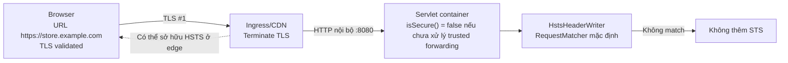
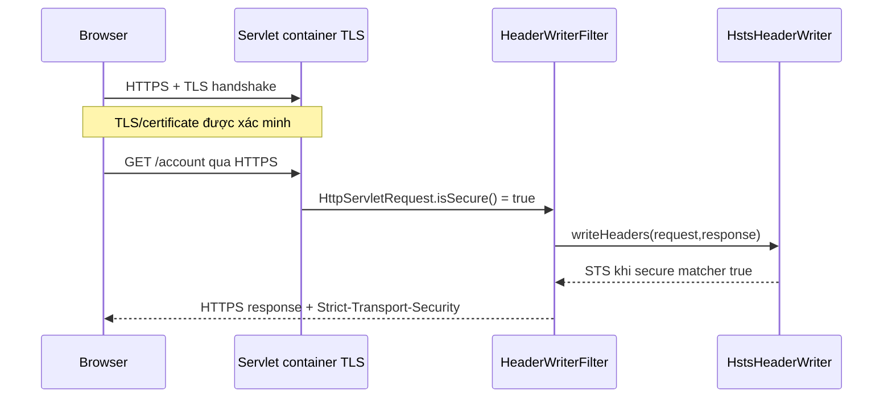
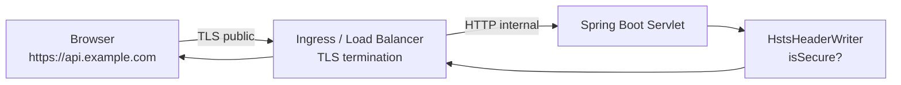
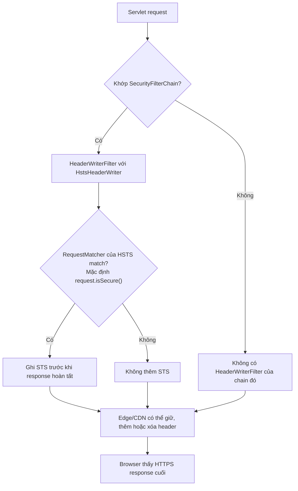
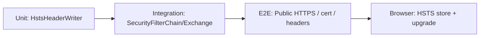
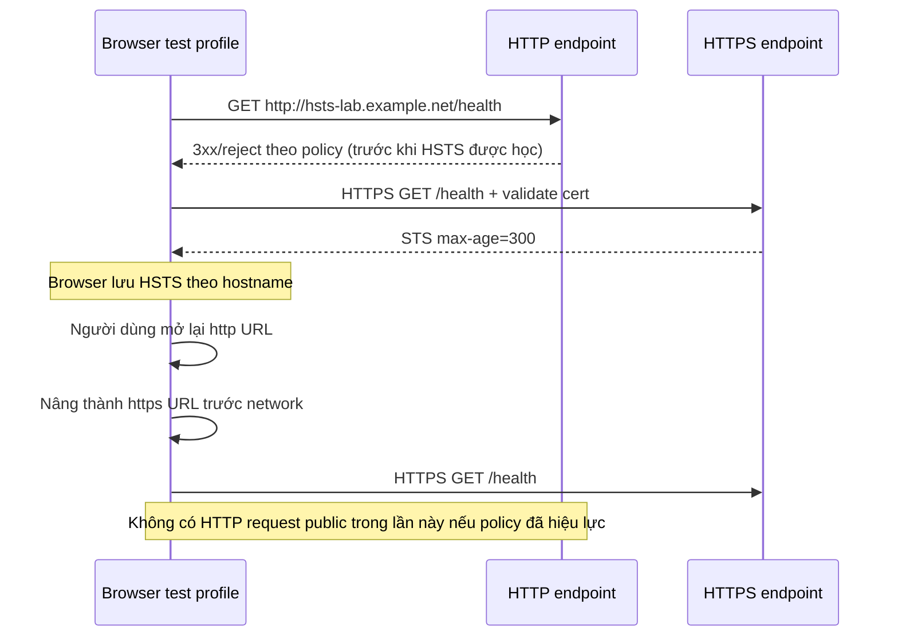

# HstsHeaderWriter cùng điều kiện yêu cầu được xem là secure

> **Chương:** HTTPS và HSTS  
> **Học phần:** `SPRING_SECURITY_HTTP_PROTECTION` — bảo vệ HTTP và trình duyệt trong Spring Security, từ CSRF, CORS, security headers, CSP, HSTS tới HTTP firewall và session. Bài này phân tích chính xác **`HstsHeaderWriter` của Servlet**, điều kiện **`ServletRequest.isSecure()`**, cơ chế tương ứng **Reactive WebFlux**, và các ranh giới tin cậy khi HTTPS kết thúc tại reverse proxy.

## 1. Tình huống khởi đầu: HTTPS trên trình duyệt, nhưng không có HSTS

Ứng dụng bán hàng hoạt động tại `https://store.example.com`. Trình duyệt hiển thị kết nối TLS hợp lệ, đăng nhập và tải trang được. Nhóm vận hành dùng lệnh:

```bash
curl -sS -D - -o /dev/null https://store.example.com/
```

Response không có `Strict-Transport-Security` dù Spring Security đã bật các security headers. Trong cùng thời điểm, ứng dụng chạy ở `http://localhost:8080` trả các header như `X-Content-Type-Options: nosniff` và `X-Frame-Options: DENY` nhưng vẫn không thấy HSTS.

Điều này **không nhất thiết là bug của header writer**. HSTS được thiết kế chỉ công bố trên HTTPS; `HstsHeaderWriter` của Spring Security **Servlet** mặc định chỉ ghi header khi:

```java
request.isSecure() == true
```

Ở môi trường local HTTP, `isSecure()` thường là `false`. Còn ở production, HTTPS có thể đã dừng tại ingress, khiến backend nhận **HTTP nội bộ** và vẫn thấy `isSecure() == false`. Người dùng thấy HTTPS, nhưng request object mà Servlet filter xử lý không nhất thiết ghi nhận scheme public đó.

**Câu hỏi trung tâm của bài:** “Yêu cầu được xem là `secure`” là kết luận của **lớp nào, theo thông tin nào và có được tin cậy hay không?**

### Kết quả học tập

Sau bài học, người học có thể:

1. Mô tả điểm kích hoạt `HstsHeaderWriter.writeHeaders(...)` và điều kiện mặc định `request.isSecure()`.
2. Phân biệt **request secure flag** ở Servlet với **TLS thực tế của browser**, chứng chỉ và các hop sau reverse proxy.
3. Cấu hình `HttpSecurity.headers(...).httpStrictTransportSecurity(...)` để điều chỉnh `max-age`, `includeSubDomains`, `preload` và `requestMatcher` khi thật cần.
4. Dùng `StrictTransportSecurityServerHttpHeadersWriter` và `ServerHttpSecurity.headers(...).hsts(...)` đúng với WebFlux, không copy Servlet API sang Reactive.
5. Chọn nơi sở hữu HSTS: Spring Security, edge/CDN hay một tầng hạ tầng thống nhất, không phát trùng/mâu thuẫn.
6. Kiểm thử ba mức: **writer trực tiếp**, **security chain**, **HTTPS public response + browser state**.
7. Tìm lỗi HSTS vắng mặt sau TLS termination hoặc do `web.ignoring`/multi-chain/headers disabled.
8. Chẩn đoán và khắc phục mà không tin `X-Forwarded-Proto` của client, không buộc writer ghi HSTS trên HTTP public.
9. Giữ nguyên tính đúng đắn của CSRF, CORS, CSP, HTTP firewall, session và phân quyền đối tượng khi điều chỉnh HSTS.

## 2. HSTS là policy transport của browser, không phải một TLS connector

`Strict-Transport-Security`, viết tắt HSTS, là một **HTTP response header** mà hostname công bố qua HTTPS hợp lệ:

```http
Strict-Transport-Security: max-age=31536000; includeSubDomains
```

Một browser hỗ trợ HSTS có thể ghi nhớ rằng những lần truy cập tiếp theo tới hostname đó phải dùng HTTPS, **nâng URL HTTP thành HTTPS trước khi gửi request**. Chính sách được quản lý theo hostname, có thể bao trùm subdomains; không gắn riêng với một endpoint như `/login`.

Tách bốn lớp:

| Lớp | Công việc | Giới hạn |
| --- | --- | --- |
| HTTP server/proxy TLS | Cấp chứng chỉ, TLS handshake, giải mã HTTP trên hop nhận HTTPS | Không tự quyết token CSRF/quyền nghiệp vụ |
| Spring Security header writer | Tạo `Strict-Transport-Security` khi điều kiện viết header đúng | Không tự tạo TLS listener hay chứng chỉ |
| Browser HSTS store | Nhận policy qua HTTPS hợp lệ, lưu theo hostname và nâng các HTTP URL sau | Không chạy thay cho ứng dụng trên mọi client, không bảo vệ lần đầu khi chưa có policy |
| Spring Security + service | Authentication, CSRF, route authorization, session, quyền theo object | Không làm transport tự mã hóa nếu HTTP được phép |

Việc **có HSTS header** chưa chứng minh browser đã chấp nhận nó. Browser yêu cầu kết nối HTTPS hợp lệ, trust chain/certificate/hostname phù hợp. Header lấy từ HTTP plaintext bị bỏ qua theo RFC 6797.

### 2.1. Sơ đồ: cùng một browser HTTPS, hai góc nhìn secure khác nhau



Một điểm kiểm chứng: `isSecure()` là trạng thái mà **Servlet request** thể hiện tại lúc filter đọc nó; không phải phép đo chứng chỉ TLS của browser. Không mặc định mọi proxy sẽ thay đổi trạng thái đó đúng cách.

### 2.2. HSTS, redirect và cookie Secure khác nhau

- **HTTPS redirect:** HTTP server/Spring Security/edge trả `3xx Location: https://...` sau khi đã nhận request.
- **HSTS:** browser đã biết policy nâng request trước khi gửi; không cần nhìn thấy server 3xx ở lần sau.
- **`Secure` cookie:** browser giới hạn gửi cookie qua HTTPS phù hợp.
- **`HttpOnly` cookie:** ngăn JavaScript thông thường đọc trực tiếp cookie, nhưng không làm XSS vô hại.
- **`SameSite` cookie:** điều chỉnh khi cookie được gửi trong bối cảnh site, không thay CSRF.

Không dùng HSTS để thay `Secure` cookie hoặc để hợp thức hóa một form gửi password qua HTTP trước khi redirect.

## 3. HstsHeaderWriter chính xác là lớp nào?

Ở **Servlet**, Spring Security cung cấp:

```java
org.springframework.security.web.header.writers.HstsHeaderWriter
```

Lớp này là một triển khai của:

```java
org.springframework.security.web.header.HeaderWriter
```

Phương thức ghi header có chữ ký:

```java
void writeHeaders(
    HttpServletRequest request,
    HttpServletResponse response
)
```

Spring Security thường tạo và gọi writer thông qua **headers configuration** trong `SecurityFilterChain`; ứng dụng không cần gọi trực tiếp `writeHeaders` trong controller. Nó đọc `HttpServletRequest` và chỉnh `HttpServletResponse` khi được security header infrastructure điều phối.

### 3.1. Điều kiện mặc định

Javadoc `HstsHeaderWriter` xác định rõ: **`Strict-Transport-Security` chỉ được ghi khi `ServletRequest.isSecure()` trả `true`** theo matcher mặc định. Lý do là RFC 6797 yêu cầu HSTS host không đưa STS header vào **HTTP response không bảo vệ**.

Điều kiện logic:

```text
Request đã vào đúng Servlet security chain
  AND Servlet header infrastructure vẫn hoạt động
  AND HstsHeaderWriter được bật
  AND RequestMatcher của writer match (mặc định: isSecure)
=> Writer có thể ghi Strict-Transport-Security lên response

Ngược lại:
  isSecure == false, matcher mặc định
=> Writer KHÔNG thêm STS
```

Ở đây, “có thể” nhắc rằng còn phụ thuộc response có thực sự do filter xử lý/commit và có tầng edge thay đổi response hay không. Kết quả cuối phải đo qua network.

### 3.2. Các giá trị mặc định từ Javadoc writer

| Thuộc tính | Giá trị mặc định của `HstsHeaderWriter` | Ý nghĩa |
| --- | --- | --- |
| `maxAgeInSeconds` | Một năm: `31536000` giây | Browser giữ dynamic HSTS policy theo thời gian tương ứng |
| `includeSubDomains` | `true` | Policy còn tác động đến các subdomains |
| `preload` | `false` | Không tự đưa directive `preload` vào header |
| `requestMatcher` | Secure request, dựa trên `isSecure()` | Không viết cho request bị coi là HTTP |
| Writer implementation | Servlet `HeaderWriter` | Không dùng cho Reactive WebFlux |

**Ghi chú độ chính xác:** Một số trang tổng quan mô tả cấu hình HSTS ví dụ với `preload`, nhưng đó không tự làm thay đổi **giá trị mặc định của class**. Khi cần biết giá trị tại phiên bản cụ thể, kiểm tra Javadoc của `HstsHeaderWriter`/configurer và header quan sát trên response thực.

### 3.3. HstsHeaderWriter không quyết định tính an toàn của TLS

Writer không:

- Thực hiện TLS handshake hoặc xác thực chứng chỉ.
- Đọc certificate chain từ trình duyệt.
- Tạo HTTPS port/keystore.
- Xác thực nguồn của `X-Forwarded-Proto`.
- Đảm bảo mọi response do CDN/WAF sinh cũng có HSTS.
- Thay đổi session/cookie `Secure`.
- Kiểm tra CSRF, CORS, CSP hoặc quyền tenant.
- Đăng ký hostname vào preload list của browser.

**Nó chỉ là một HTTP header writer có điều kiện.** Các ranh giới còn lại phải được thiết kế riêng.

## 4. Mô hình quyết định theo `isSecure()`

Giả sử app Servlet có writer mặc định, không bị vô hiệu hóa và request được một chain xử lý.

| Browser → HTTP endpoint | Backend thực tế thấy | `isSecure()` thường có giá trị | HSTS được writer mặc định thêm? |
| --- | --- | --- | --- |
| Browser HTTP trực tiếp vào backend HTTP | HTTP | `false` | Không |
| Browser HTTPS trực tiếp vào embedded Tomcat TLS | HTTPS | `true` | Có |
| Browser HTTPS tới edge, edge→backend HTTP, không trusted forwarding | HTTP | `false` | Không |
| Browser HTTPS tới edge, edge→backend HTTP, trusted forwarding đã khôi phục đúng | External HTTPS theo wrapper/container | `true` nếu integration đặt đúng flag | Có |
| Browser HTTPS tới edge, edge tự phát HSTS | Backend có thể là HTTP | Không quan trọng cho edge HSTS | Đánh giá **response cuối tại edge**, không mặc định app phải phát |
| HTTPS URL của browser nhưng CDN sinh `502` trước backend | Spring Security không nhận request | Không có | Writer app **không chạy** |

Cột `isSecure()` mô tả trạng thái thường gặp và phụ thuộc HTTP server/framework integration. Không suy kết quả từ việc URL trên thanh địa chỉ có biểu tượng khóa.

### 4.1. Một HTTPS request có thể không có header mà vẫn được mã hóa

Nếu browser kết nối thành công qua TLS, response vẫn có thể được mã hóa **dù thiếu HSTS**. Thiếu HSTS là một thiếu sót **transport upgrade policy cho các lần truy cập tương lai**, không đồng nghĩa TLS hiện tại đã bị tắt.

Chiều ngược lại, một response nội bộ mang chuỗi `Strict-Transport-Security` qua HTTP không chứng minh kết nối browser có TLS. Hãy kiểm tra cả **kênh thực** và **policy response**.

### 4.2. Một header trên response HTTP không làm browser học HSTS

Nếu custom matcher bất cẩn ép writer thêm STS cho **request HTTP public**, browser theo chuẩn sẽ bỏ qua header đó. Điều này gây false positive ở security scanner đơn giản mà không tăng bảo vệ client.

Đừng chọn `requestMatcher(request -> true)` chỉ để kết quả kiểm tra ở localhost HTTP có thêm STS.

## 5. Những phương thức HstsHeaderWriter cần hiểu

Javadoc có các constructors và setters nổi bật:

```java
HstsHeaderWriter writer = new HstsHeaderWriter();

writer.setMaxAgeInSeconds(86400);       // một ngày
writer.setIncludeSubDomains(false);     // không áp miền con
writer.setPreload(false);               // không thêm preload
writer.setRequestMatcher(request -> request.isSecure());
```

Các setters:

| API | Trách nhiệm | Sai lầm thường gặp |
| --- | --- | --- |
| `setMaxAgeInSeconds(long)` | Ghi giá trị `max-age` | Đưa giá trị âm, nhầm milliseconds với seconds |
| `setIncludeSubDomains(boolean)` | Có/không thêm `includeSubDomains` | Bật trên miền cha khi còn subdomain HTTP-only |
| `setPreload(boolean)` | Có/không thêm directive `preload` | Hiểu nhầm `true` = browser đã preloaded |
| `setRequestMatcher(RequestMatcher)` | Điều kiện có viết STS không | Thay điều kiện secure bằng raw proxy header chưa tin |
| `writeHeaders(request, response)` | Ghi header khi match | Gọi ở controller rồi bỏ qua header infrastructure |

`setRequestMatcher(null)` là không hợp lệ. Không dùng custom matcher tùy tiện để “bỏ qua” điều kiện secure mà không chứng minh client public nhận response qua HTTPS.

### 5.1. Không cấu hình `HstsHeaderWriter` bằng `HttpSecurity.redirectToHttps`

`HttpSecurity.redirectToHttps(...)` (Servlet 6.5+; ở dòng cũ có `requiresChannel(...)`) cấu hình **HTTP→HTTPS redirect**, không điều chỉnh `HstsHeaderWriter`.

Bốn phần khác nhau:

```text
server.ssl.* (Spring Boot) / Ingress TLS
    => HTTPS listener, certificate, TLS handshake

HttpSecurity.redirectToHttps(...) / Edge redirect
    => trả 3xx khi request cần nâng HTTPS

HttpSecurity.headers(...).httpStrictTransportSecurity(...)
    => writer đưa STS vào HTTPS response

Browser
    => học chính sách HSTS và áp cho các lần sau
```

Không thể thay riêng một phần rồi kỳ vọng toàn hệ thống có hành vi của bốn phần.

## 6. Cấu hình khuyến nghị trong Servlet: dùng DSL của HttpSecurity

Trong đa số ứng dụng, **không cần tự khởi tạo class writer**. Spring Security cấu hình writer qua `HttpSecurity.headers`:

```java
import static org.springframework.security.config.Customizer.withDefaults;

@Configuration
@EnableWebSecurity
class BrowserSecurity {

    @Bean
    SecurityFilterChain browserChain(HttpSecurity http) throws Exception {
        return http
            .headers(headers -> headers
                .httpStrictTransportSecurity(hsts -> hsts
                    .maxAgeInSeconds(86400)
                    .includeSubDomains(false)
                    .preload(false)
                )
            )
            .csrf(withDefaults())
            .authorizeHttpRequests(auth -> auth
                .requestMatchers("/login", "/assets/**").permitAll()
                .anyRequest().authenticated()
            )
            .formLogin(withDefaults())
            .build();
    }
}
```

Ví dụ chọn **duration ngắn** và **không bật subdomains/preload** cho một giai đoạn kiểm tra. Với production, giá trị phải theo policy đã phê duyệt của hostname, không bắt buộc như ví dụ.

### 6.1. Giữ những security headers còn lại

Cấu hình `headers(headers -> headers.httpStrictTransportSecurity(...))` thường vẫn giữ các writers mặc định khác nếu không tắt. Điều này khác với:

```java
.headers(headers -> headers.disable())
```

Lệnh `disable()` toàn bộ headers có thể bỏ cả cache control, `nosniff`, frame protection và các headers khác, **không phải cách tốt** khi chỉ muốn đổi HSTS.

Khi HSTS do edge sở hữu và thật sự muốn tránh app phát trùng policy, có thể tắt **riêng HSTS writer**:

```java
.headers(headers -> headers
    .httpStrictTransportSecurity(hsts -> hsts.disable())
)
```

**Điều kiện:** Edge phải thực sự cung cấp HSTS đúng trên HTTPS response cuối, kể cả response lỗi thuộc trách nhiệm edge. Không tắt HSTS ở app rồi tin rằng “CDN chắc đã thêm”.

### 6.2. `permitAll()` không đồng nghĩa bỏ qua headers

Một `GET /login` hay `GET /assets/app.js` với `permitAll()` vẫn đi qua security chain và có thể nhận security headers. Ngược lại, `web.ignoring()` hoặc `securityMatcher` để request nằm ngoài mọi chain có thể khiến **HeaderWriterFilter không chạy**.

Ví dụ vấn đề:

```java
// Cẩn trọng: ignore route làm request đi ngoài Spring Security filters.
web.ignoring().requestMatchers("/public/**");
```

Một static path bị “ignore” có thể mất HSTS do app phát, dù trang chính vẫn có. Nếu chính sách yêu cầu toàn hostname có HSTS, hãy kiểm tra owner ở edge hoặc cho request đi qua security chain khi phù hợp; không nhầm `permitAll` với `ignoring`.

### 6.3. Cấu hình phù hợp phiên bản

`HstsHeaderWriter` đã tồn tại từ dòng Spring Security lâu năm; DSL `HttpSecurity`, namespace XML, method deprecations và path matchers có thay đổi theo version. Ví dụ trên nhắm tới Servlet config dạng bean `SecurityFilterChain`/Customizer, cần đối chiếu version đã ghim và imports thực.

Không lấy API Reactive `ServerHttpSecurity.HeaderSpec.HstsSpec` đặt vào `HttpSecurity`; chúng **khác type**.

## 7. Khi nào thật sự cần một RequestMatcher tùy biến?

Servlet `HeadersConfigurer.HstsConfig` có method:

```java
requestMatcher(RequestMatcher matcher)
```

Bên trong, configurer gọi `HstsHeaderWriter.setRequestMatcher(...)` để thay điều kiện ghi header.

Một trường hợp có thể cân nhắc là một security chain dùng chung nhiều virtual hosts, nhưng tổ chức chỉ phê duyệt dynamic HSTS cho một hostname. **Điều kiện phải giữ kiểm tra request secure.**

Ví dụ minh họa sau **chỉ dùng khi hostname đã được allowlist ở ingress và request metadata đáng tin**:

```java
@Bean
SecurityFilterChain selectiveHsts(HttpSecurity http) throws Exception {
    return http
        .headers(headers -> headers
            .httpStrictTransportSecurity(hsts -> hsts
                .requestMatcher(request ->
                    request.isSecure()
                    && "accounts.example.com".equalsIgnoreCase(
                        request.getServerName()))
                .maxAgeInSeconds(86400)
                .includeSubDomains(false)
                .preload(false)
            )
        )
        .authorizeHttpRequests(auth -> auth
            .anyRequest().authenticated()
        )
        .build();
}
```

### 7.1. Vì sao không match raw Host vô điều kiện?

`Host` trong HTTP request có thể do client đặt. Nếu backend không có allowlist hoặc trusted proxy, đối tượng có thể cố dùng Host header khác để thay đổi policy/absolute URLs. Với HSTS, browser sẽ gắn policy theo **hostname nó đang truy cập**, không theo giá trị mà ứng dụng muốn suy ra từ headers chưa tin.

Trước khi dùng hostname trong matcher:

1. Public ingress xác minh host và TLS certificate cho host đó.
2. Edge khóa đường truy cập trực tiếp backend.
3. Forwarded host/scheme được xóa/ghi đè ở trust boundary.
4. Test forged `Host`, `X-Forwarded-Host` và `X-Forwarded-Proto`.
5. Đảm bảo matcher không vô tình làm mất HSTS trên những host khác cần policy.

Nếu nhiều virtual hosts cùng một edge, **phát HSTS theo virtual host tại edge** thường dễ kiểm soát hơn việc mỗi application tự suy host từ headers.

### 7.2. Không dùng matcher để sửa TLS termination thiếu trust

Sai tư duy:

```java
// KHÔNG áp dụng với header do client public có thể tự điền.
.requestMatcher(request ->
    "https".equalsIgnoreCase(
        request.getHeader("X-Forwarded-Proto")))
```

Nếu attacker có thể gửi header này, backend có thể đánh giá sai độ an toàn public request. Dù header HSTS trên public HTTP không được browser tin, việc thiết kế proxy trust sai còn có thể dẫn tới redirect/cookie/URL bugs.

**Ưu tiên:** (a) edge sở hữu HSTS, hoặc (b) xử lý trusted forwarding đúng để `request.isSecure()` phản ánh external HTTPS và giữ matcher mặc định.

### 7.3. RequestMatcher không tạo chính sách HSTS theo path

Ngay cả khi writer chỉ phát HSTS trên `/login`, browser nhận một HTTPS response ở hostname đó sẽ học policy cho **toàn hostname** (và subdomains nếu bật). Điều kiện writer ảnh hưởng **nơi header được phát**, không giới hạn HSTS browser chỉ cho path được match.

## 8. Đặt trực tiếp HstsHeaderWriter vào chain khi nào?

Có môi trường dùng custom `HeaderWriter` cùng những policy phức tạp. Khi đó có thể tạo:

```java
HstsHeaderWriter writer = new HstsHeaderWriter();
writer.setMaxAgeInSeconds(86400);
writer.setIncludeSubDomains(false);
writer.setPreload(false);
// Giữ điều kiện secure mặc định; không đặt matcher 'true'.
```

Sau đó có thể đăng ký qua `HeaderWriterFilter` hoặc `HttpSecurity.headers(...).addHeaderWriter(writer)` theo phiên bản.

**Quan trọng:** nếu configurer HSTS mặc định vẫn bật và bạn **add thêm** một `HstsHeaderWriter`, response có thể mang nhiều writers/policies hoặc hành vi khó dự đoán. Phải **thay thế/thống nhất owner**, không chồng nhiều writer rồi hy vọng browser tự chọn đúng.

Mẫu tích hợp một writer tùy biến và tắt bản tích hợp mặc định trong cùng Servlet chain:

```java
@Bean
SecurityFilterChain customHstsWriter(HttpSecurity http)
        throws Exception {
    HstsHeaderWriter writer = new HstsHeaderWriter();
    writer.setMaxAgeInSeconds(86400);
    writer.setIncludeSubDomains(false);
    writer.setPreload(false);

    return http
        .headers(headers -> headers
            .httpStrictTransportSecurity(hsts -> hsts.disable())
            .addHeaderWriter(writer)
        )
        .authorizeHttpRequests(auth -> auth
            .anyRequest().authenticated()
        )
        .build();
}
```

Đây là **mẫu thay thế**, không cần dùng nếu DSL đã đủ khả năng. Trước khi áp dụng, kiểm tra kết quả với phiên bản đã ghim; tránh bean tự đăng ký filter ngoài Spring Security gây chạy hai lần.

## 9. TLS trực tiếp vào Tomcat/Servlet container: con đường đơn giản nhất



Đây là luồng **khái niệm**, không cam kết thứ tự mọi filter với mọi version; mục đích là thể hiện HTTP connector tạo request secure, HeaderWriterFilter điều phối writer và browser nhận header qua TLS.

### 9.1. Ví dụ TLS runtime của Spring Boot

```yaml
# Ví dụ thử nghiệm, không đưa bí mật keystore thật vào mã nguồn.
server:
  port: 8443
  ssl:
    enabled: true
    key-store: classpath:tls/dev-server.p12
    key-store-type: PKCS12
    key-store-password: "__INJECT_FROM_SECRET_STORE__"
```

Thuộc tính này thuộc **Spring Boot HTTP server**, không thuộc `HstsHeaderWriter`. HTTPS listener chỉ hoạt động khi file/chứng chỉ hợp lệ; hostname/SAN cần khớp địa chỉ mà client truy cập.

Nếu chỉ mở HTTPS 8443, không tự có HTTP 8080 listener để redirect. Muốn xử lý HTTP→HTTPS cần thêm listener/edge. HSTS không tự mở cổng TLS.

### 9.2. Test phân biệt secure flag và TLS thật

Một unit test có thể gọi `request.setSecure(true)` và khiến writer ghi header, nhưng **không** chạy TLS handshake. Để khẳng định production bảo vệ đúng, cần kiểm tra endpoint public với certificate verification.

## 10. TLS termination ở proxy: cốt lõi của lỗi HSTS thiếu

Một topology thực tế:



Backend không nhìn thấy TLS public. Nếu proxy forward HTTP bình thường và không có integration phục hồi external scheme, Servlet request thường có:

```text
request.getScheme() = "http"
request.isSecure()  = false
request.getServerPort() = 8080 (có thể)
```

Vì thế `HstsHeaderWriter` mặc định không thêm HSTS. Hành vi này giúp tránh phát HSTS trên HTTP nội bộ, nhưng không tự biết rằng **browser đã dùng HTTPS ở hop trước**.

### 10.1. Hai chiến lược tốt, một ranh giới rõ

**Lựa chọn A — Edge sở hữu HSTS:**

- Edge terminate HTTPS, phát HSTS trên **HTTPS public response cuối**.
- Spring Security có thể tắt riêng HSTS để tránh policy trùng, giữ các security headers khác.
- Edge xử lý cả redirect và những response 4xx/5xx tự sinh theo yêu cầu chính sách.
- Không cần app giả vờ HTTP nội bộ là HTTPS chỉ để ghi STS.

**Lựa chọn B — App sở hữu HSTS với metadata được tin:**

- Edge xóa/ghi đè `Forwarded`/`X-Forwarded-*` từ client không tin.
- Backend chỉ nhận request từ proxy tin cậy.
- Spring Framework/container phục hồi external scheme/host/port **trước khi** Spring Security đọc request.
- Writer mặc định đánh giá `isSecure() == true` nếu integration thiết lập đúng.
- Kiểm tra cả response do app phát và response do edge tạo riêng.

Bảng quyết định:

| Điều kiện | Edge sở hữu HSTS | App sở hữu HSTS |
| --- | --- | --- |
| Có CDN/WAF nhiều lớp | Thường dễ quản lý policy toàn hostname | Cần kiểm tra header cuối, lỗi edge |
| Nhiều app cùng một public hostname | Một policy chung | Rủi ro các app phát khác nhau |
| Spring Boot tự terminate TLS | Có thể không cần edge | Khá trực tiếp |
| Không có trust policy forwarded headers | Có thể hoạt động nếu edge thực sự TLS | App có thể không biết request secure |
| Cần HSTS trên edge-generated 502 | Edge phù hợp | App không kiểm soát response đó |
| Cần kiểm soát duration riêng mỗi host | Edge virtual host config | Chain/app host config sau trust |
| Độ rủi ro duplicate headers | Phải loại bỏ/tổ chức owner | Phải bảo đảm edge không ghi trùng |

### 10.2. Vì sao không “ép” header trên mọi request?

Nếu dùng:

```java
hsts.requestMatcher(request -> true)
```

writer có thể thêm `Strict-Transport-Security` cho public HTTP response, trái với nguyên tắc công bố HSTS qua HTTPS. Browser sẽ bỏ qua policy nếu nhận trên HTTP. Điều chỉnh matcher như vậy còn che khuất vấn đề **external scheme trust** thực sự.

Nếu browser HTTPS public nhưng backend HTTP, **sửa trust boundary hoặc đặt STS ở edge**, không tắt điều kiện secure toàn cục.

## 11. Trusted forwarding: tạo isSecure đúng không đồng nghĩa tin client header

Edge có thể gửi thông tin kết nối gốc:

```http
Forwarded: for=198.51.100.20;proto=https;host=api.example.com
X-Forwarded-Proto: https
X-Forwarded-Host: api.example.com
X-Forwarded-Port: 443
```

`198.51.100.20` chỉ là địa chỉ minh họa. Các header này là **HTTP data**, không phải bằng chứng mật mã. Nếu attacker có thể tự tạo header trực tiếp vào backend hoặc proxy không lọc client input, ứng dụng có thể bị đánh lừa về scheme.

### 11.1. Ranh giới tin cậy bắt buộc

1. Edge tiếp xúc Internet phải **loại bỏ/ghi đè** mọi `Forwarded` và `X-Forwarded-*` do client chưa tin gửi.
2. Proxy phát giá trị mới theo kết nối thực và hostname đã validate.
3. Backend chỉ nhận traffic từ proxy tin cậy qua network policy, private address/ACL hoặc mTLS theo thiết kế.
4. Nếu nhiều proxy hops, phải xác định hop nào có quyền tạo/chuyển tiếp `proto` và `host`, không lấy phần tử client có thể thêm.
5. Hostnames public được allowlist ở ingress; không dựng `Location` từ Host header do client chọn tùy ý.
6. Kiểm thử HTTP client giả `X-Forwarded-Proto: https` và `X-Forwarded-Host: attacker.example.net` ở tuyến public.
7. Tránh log đầy đủ các forwarding lists kèm IP cá nhân nếu không có mục đích bảo mật/vận hành đã được phê duyệt.

### 11.2. Spring Boot và Spring Framework

Spring Boot có thể được cấu hình:

```yaml
# Chỉ bật sau khi edge đã xác lập trust boundary.
server:
  forward-headers-strategy: framework
```

Ở Servlet, các lựa chọn gồm `ForwardedHeaderFilter` và xử lý native của container như Tomcat `RemoteIpValve` tùy runtime. `framework`/`native` có ý nghĩa khác nhau; hãy dùng một đường xử lý có chủ đích, tránh filter/valve trùng không kiểm chứng.

Điểm cần xác minh bằng integration test:

```text
HTTPS ngoài → trusted proxy → HTTP backend
  => ứng dụng nhận scheme/secure phù hợp external HTTPS

HTTP ngoài (nếu được phép đến app) → trusted proxy
  => ứng dụng không nhận sai là HTTPS

Client gửi spoofed forwarded headers → edge
  => không thể làm app tin public HTTP là HTTPS
```

**`server.forward-headers-strategy=framework` không tự xác thực sender.** Một ứng dụng để backend port lộ Internet có thể gặp rủi ro lớn hơn nếu tin forwarded headers mù quáng.

## 12. Servlet: một RequestMatcher an toàn không thể thay trust proxy

Khi cần custom matcher, Javadoc `HeadersConfigurer.HstsConfig.requestMatcher(...)` cho phép thay điều kiện ghi header.

Ví dụ giữ secure check và bổ sung giới hạn host sau khi ingress đã xác minh hostname:

```java
RequestMatcher trustedSecureHost = request ->
    request.isSecure()
    && "api.example.com".equalsIgnoreCase(request.getServerName());
```

Nếu request đến qua proxy không khôi phục scheme, matcher vẫn là false. Đó là **tín hiệu cần sửa topology**, không phải lý do bỏ `request.isSecure()`.

### 12.1. Matcher ở ba tầng khác nhau

| API/khái niệm | Phạm vi | Kết quả |
| --- | --- | --- |
| `http.securityMatcher("/api/**")` | Chọn security chain Servlet | Route nào vào chain |
| `hsts.requestMatcher(...)` | Chọn request để **ghi HSTS** trong chain | Header có được viết trên response không |
| `auth.requestMatchers("/api/**").authenticated()` | Authorization | User cần quyền gì |
| `http.redirectToHttps(...)` hoặc `requiresChannel` | HTTPS redirect policy | HTTP request có được chuyển HTTPS không |

Không dùng matcher HSTS để thay authorization hoặc để bỏ qua TLS trên route không nằm trong matcher. HSTS browser policy, khi đã học, còn có **phạm vi toàn hostname**, không chỉ request làm writer phát header.

### 12.2. Multi-chain: route nào chạy writer?

Giả sử:

- Chain 1 `@Order(1)` chỉ khớp `/api/**`.
- Chain 2 `@Order(2)` khớp các pages/session.
- Một route `/files/**` không khớp chain nào.

Response `/api/**` có thể nhận HSTS vì chain 1 có writer; `/files/**` có thể không nhận header do ứng dụng phát. Dù vậy browser đã học HSTS từ `/api/**` vẫn áp HTTPS cho `/files/**` nếu cùng hostname.

**Không lấy một response `/api/health` có HSTS để kết luận mọi response từ app/edge đều có header**. Cần soát chain/ignored paths/error routes và response cuối.

## 13. HeaderWriterFilter và lifecycle ghi response

Trong Servlet, `HeaderWriterFilter` tập hợp những `HeaderWriter` được cấu hình và ghi security headers vào `HttpServletResponse` trong quá trình xử lý response. Chi tiết giai đoạn ghi/commit có thể chịu ảnh hưởng bởi wrapper, cơ chế xử lý async/error dispatch và phiên bản.

HSTS writer không nhất thiết được gọi trực tiếp trong controller. Nó có thể được gọi ngay cả khi route trả error/redirect mà vẫn **đi qua security chain**, nhưng không được suy mọi 4xx/5xx trên internet đều đi qua app.



### 13.1. Có thể mất HSTS chỉ vì bỏ qua security chain

Những trường hợp cần kiểm tra:

- `web.ignoring()` làm request bypass Servlet security filters.
- Nhiều `SecurityFilterChain` nhưng một chain không bật headers hoặc vô tình disable.
- `http.securityMatcher(...)` loại bỏ URL cần kiểm tra.
- Resource static/error page do container/edge phục vụ không vào Spring.
- Proxy trả một response error `502` trước khi app được gọi.
- Application/server khác cùng hostname phục vụ một phần đường dẫn.
- Cache/CDN làm mới/cắt bỏ header response theo rules riêng.

`permitAll()` vẫn qua chain và thường không tự tắt header writer. `web.ignoring()` là bypass khác bản chất.

### 13.2. Không ghi header nhiều lần không có nghĩa an toàn hơn

Nếu Spring Security, gateway và CDN cùng phát các giá trị khác nhau:

```http
Strict-Transport-Security: max-age=86400
Strict-Transport-Security: max-age=31536000; includeSubDomains
```

browser/parser có thể xử lý duplicate không như ý. **Không thiết kế policy bằng cách cộng dồn hai header.** Chọn một owner, rà cấu hình inheritance/response override ở edge, và assert response cuối chỉ có một policy thống nhất.

## 14. Mô hình Reactive: không có Servlet HstsHeaderWriter

Với **Spring WebFlux**, không dùng class Servlet `HstsHeaderWriter`. Lớp tương ứng là:

```java
org.springframework.security.web.server.header
    .StrictTransportSecurityServerHttpHeadersWriter
```

Nó triển khai `ServerHttpHeadersWriter` và cung cấp:

```java
Mono<Void> writeHttpHeaders(ServerWebExchange exchange)
```

Javadoc mô tả nhiệm vụ: **ghi Strict-Transport-Security nếu request secure**. Writer làm việc với `ServerWebExchange`/`ServerHttpRequest`, không truy cập `HttpServletRequest.isSecure()`.

### 14.1. API Reactive cần nhớ

| Servlet | Reactive WebFlux |
| --- | --- |
| `HstsHeaderWriter` | `StrictTransportSecurityServerHttpHeadersWriter` |
| `HeaderWriter` | `ServerHttpHeadersWriter` |
| `writeHeaders(HttpServletRequest, HttpServletResponse)` | `writeHttpHeaders(ServerWebExchange)` |
| `setMaxAgeInSeconds(long)` | `setMaxAge(Duration)` |
| `setIncludeSubDomains(boolean)` | `setIncludeSubDomains(boolean)` |
| `setPreload(boolean)` | `setPreload(boolean)` |
| `setRequestMatcher(RequestMatcher)` | Không copy Servlet setter sang Reactive; dùng Reactive API/policy phù hợp |
| `HttpSecurity.headers(...)` | `ServerHttpSecurity.headers(...)` |
| `SecurityFilterChain` | `SecurityWebFilterChain` |
| `MockMvc` | `WebTestClient` |

Cả hai có giá trị mặc định phổ biến: **max-age một năm**, **includeSubDomains true**, **preload false** theo Javadoc writers. Cần kiểm tra version/config thực nếu app đã tùy biến headers.

### 14.2. Request secure trong Reactive được diễn giải thế nào?

Reactive security layer nhìn `ServerWebExchange` do WebFlux runtime tạo sau xử lý forwarding metadata phù hợp. Nếu browser HTTPS nhưng edge→backend HTTP và không có trusted forwarding, exchange có thể thể hiện scheme là HTTP; writer Reactive sẽ không phát STS theo điều kiện secure của nó.

Với WebFlux, Spring Framework có `ForwardedHeaderTransformer` và cơ chế runtime tương ứng để diễn giải external scheme khi proxy đã thiết lập trust boundary. Không dùng Servlet `ForwardedHeaderFilter` trong Reactive.

## 15. WebFlux: cấu hình HSTS bằng ServerHttpSecurity

Ví dụ Java cho Spring Security WebFlux hỗ trợ DSL `headers().hsts(...)`:

```java
import static org.springframework.security.config.Customizer.withDefaults;
import java.time.Duration;

@Configuration
@EnableWebFluxSecurity
class ReactiveBrowserSecurity {

    @Bean
    SecurityWebFilterChain securityWebFilterChain(ServerHttpSecurity http) {
        return http
            .headers(headers -> headers
                .hsts(hsts -> hsts
                    .maxAge(Duration.ofDays(1))
                    .includeSubdomains(false)
                    .preload(false)
                )
            )
            .csrf(withDefaults())
            .authorizeExchange(auth -> auth
                .pathMatchers("/login", "/assets/**").permitAll()
                .anyExchange().authenticated()
            )
            .formLogin(withDefaults())
            .build();
    }
}
```

**Khác biệt viết hoa:** trong DSL WebFlux dùng `includeSubdomains(...)` theo Javadoc/docs Reactive, còn Servlet dùng `includeSubDomains(...)`. Vì vậy không copy/paste mà không kiểm tra class/configurer.

Chính sách một ngày và không preload chỉ là **ví dụ**. Cần quyết định HSTS scope ở hostname public và kiểm tra cả edge.

### 15.1. Cần conditional HSTS trong Reactive?

`ServerHttpSecurity.HeaderSpec.HstsSpec` cung cấp maxAge/includeSubdomains/preload. Không giả định nó có `requestMatcher(RequestMatcher)` của Servlet.

Nếu cần điều kiện phức tạp hơn theo host/path, nên:

1. Ưu tiên **edge virtual host policy** hoặc các Reactive security chains được thiết kế rõ.
2. Khi cần custom Reactive header writer, xem `ServerWebExchangeDelegatingServerHttpHeadersWriter` cùng `ServerWebExchangeMatcher` theo phiên bản; tránh viết trùng STS khi default writer còn bật.
3. Không tạo custom writer luôn phát STS trên public HTTP.
4. Bảo đảm forwarded scheme đáng tin; kiểm thử trên HTTPS public response thật.

### 15.2. HSTS không biến WebFlux thành Servlet

Reactive `SecurityWebFilterChain`/`WebSession`/`ReactiveSecurityContextHolder` và `CsrfWebFilter` khác Servlet `SecurityFilterChain`/`HttpSession`/`SecurityContextHolder`/`CsrfFilter`. Cùng một browser HSTS policy được áp cho hostname bất kể backend stack, nhưng **API cấu hình và công cụ test khác nhau**.

## 16. Vì sao `isSecure` có thể sai trong cả hai hướng?

Không chỉ có tình huống **false negative** (public HTTPS nhưng backend coi là HTTP). Cũng cần phòng **false positive** (public HTTP nhưng backend lại coi là HTTPS).

| Kết quả | Tình huống | Tác động |
| --- | --- | --- |
| False negative | Proxy TLS terminate → HTTP backend; không forward/parse external scheme | HSTS writer không phát header, redirect HTTPS có thể loop |
| False positive | Client public gửi `X-Forwarded-Proto: https`; backend tin vô điều kiện | App có thể bỏ redirect hoặc sinh absolute URLs/cookie không đúng |
| False positive | App/custom matcher `request -> true` trên HTTP | HSTS được thêm vào response HTTP nhưng browser không chấp nhận |
| Sai host | Header `X-Forwarded-Host` do client điều khiển | Redirect/Host policy có thể bị lợi dụng để phishing/open redirect |
| Sai port | Backend port 8080 được dùng làm public HTTPS target | `Location` trỏ `:8443` hay `:8080` ngoài dự kiến |
| Đúng secure flag, thiếu header | Request bypass chain hoặc writer bị disable | Không có app HSTS dù scheme đã đúng |
| Header có, browser không nhớ | Header chỉ qua HTTP hoặc TLS cert không hợp lệ | Test HTTP scanner giả PASS nhưng client không được bảo vệ |

**Điểm cần đo:** public scheme/host/port, backend scheme/secure flag sau trusted forwarding, security chain, response cuối và browser state — không chỉ một biến Boolean.

## 17. HSTS được ghi ở response nào?

HSTS khác các header gắn riêng với HTML document. Một HTTPS response trả JSON, HTML, 3xx, 401 hay 403 có thể là nơi browser học HSTS nếu header hiện diện, TLS hợp lệ và browser hỗ trợ.

Nhưng không có bảo đảm mọi status đều do application xử lý:

| Response | Có thể qua Spring Security writer? | Kiểm thử |
| --- | --- | --- |
| `200 GET /account` từ app | Có, nếu chain xử lý | MockMvc/WebTestClient + HTTPS public |
| `302 Location: /login` từ app | Có thể, nếu chain xử lý | Xác định redirect owner, check response cuối |
| `401/403` do app/security chain sinh | Có thể | Kiểm tra headers thực và filter chain |
| `404` do handler/container | Tùy dispatch và chain | Thử route lỗi cụ thể, không suy mọi 404 giống nhau |
| `502` do ingress sinh | Không đi qua app | Cần kiểm tra owner edge |
| `301/308` trên HTTP port 80 từ edge | Không được browser học HSTS qua HTTP | Chỉ đánh giá redirect ở đây |
| Static resource từ CDN | Thường không qua backend | HSTS chính sách của hostname CDN |
| HTTPS error page của CDN | Không mặc định qua app | Kiểm tra cấu hình response headers ở CDN |

Do đó khi HSTS do app sở hữu, phải có kế hoạch bổ sung header cho **response ngoài app** theo yêu cầu vận hành, hoặc chuyển ownership về edge.

## 18. `max-age`, `includeSubDomains` và `preload` trong writer

HstsHeaderWriter xây header ví dụ:

```http
Strict-Transport-Security: max-age=31536000; includeSubDomains
```

Một policy không áp subdomains:

```http
Strict-Transport-Security: max-age=86400
```

Một policy có directive preload sau phê duyệt:

```http
Strict-Transport-Security: max-age=63072000; includeSubDomains; preload
```

Những con số trên là **ví dụ**, không phải chỉ dẫn bật preload mặc định. Việc đăng ký preload còn cần điều kiện và quy trình riêng qua `hstspreload.org`.

### 18.1. max-age là tuổi thọ trong browser

- Giá trị tính bằng **giây**, không phải milliseconds.
- Browser có thể làm mới thời hạn sau mỗi HTTPS response hợp lệ mang policy.
- `max-age=0` yêu cầu xóa dynamic HSTS policy riêng của hostname thông qua HTTPS hợp lệ.
- Parent `includeSubDomains` vẫn có thể chi phối hostname con sau khi con tự gửi `max-age=0`.
- Preload list không biến mất ngay chỉ vì app đổi `max-age=0`.

### 18.2. includeSubDomains ràng buộc cả dịch vụ ngoài Spring Security

Nếu `example.com` phát HSTS với `includeSubDomains`, browser có thể bắt buộc HTTPS cho `api.example.com`, `legacy.example.com`, `deep.api.example.com` dù chúng thuộc các team khác nhau.

Vì default writer có `includeSubDomains = true`, **phải đánh giá cả khi bạn không tự gọi setter**. Việc “dùng mặc định là luôn đúng” có thể tạo outage nếu tổ chức vẫn có subdomains HTTP-only.

### 18.3. preload false mặc định

`HstsHeaderWriter.setPreload(false)` không thêm directive `preload`. Bật `preload(true)` chỉ công bố chữ `preload` trong header; bản thân thao tác này **không tự đăng ký** domain vào browser preload list.

## 19. Kiểm thử đúng phải tách ba sự thật

Một mục tiêu “HSTS hoạt động” thực ra có ba tầng độc lập:

1. **Writer được cấu hình đúng:** request secure → class tạo STS, request insecure → không thêm.
2. **Application/edge truyền header đúng:** browser nhận STS trên HTTPS response cuối; không bị proxy xóa/ghi đè.
3. **Browser chấp nhận và áp HSTS:** khi đã học policy, HTTP URL được nâng sang HTTPS trước network.



MockMvc có thể chứng minh (1)/(2) **trong app**, nhưng không phải TLS thật. Curl với TLS validation chứng minh header trên public HTTPS endpoint, nhưng không chứng minh browser lưu state. Browser test mới chứng minh hành vi HSTS theo browser/profile đó.

## 20. Thực hành Unit Test HstsHeaderWriter trực tiếp

Đây là test nhỏ để cô lập `isSecure()` khỏi routing, proxy hoặc authentication. Với Spring MVC testing utilities, có thể dùng `MockHttpServletRequest` và `MockHttpServletResponse`.

```java
import static org.assertj.core.api.Assertions.assertThat;

import org.junit.jupiter.api.Test;
import org.springframework.mock.web.MockHttpServletRequest;
import org.springframework.mock.web.MockHttpServletResponse;
import org.springframework.security.web.header.writers.HstsHeaderWriter;

class HstsHeaderWriterTest {

    @Test
    void secureRequestGetsHsts() {
        HstsHeaderWriter writer = new HstsHeaderWriter();
        writer.setMaxAgeInSeconds(86400);
        writer.setIncludeSubDomains(false);
        writer.setPreload(false);

        MockHttpServletRequest request =
            new MockHttpServletRequest("GET", "/health");
        request.setSecure(true);

        MockHttpServletResponse response =
            new MockHttpServletResponse();

        writer.writeHeaders(request, response);

        assertThat(response.getHeader("Strict-Transport-Security"))
            .contains("max-age=86400")
            .doesNotContain("includeSubDomains")
            .doesNotContain("preload");
    }

    @Test
    void insecureRequestDoesNotGetHstsByDefault() {
        HstsHeaderWriter writer = new HstsHeaderWriter();
        MockHttpServletRequest request =
            new MockHttpServletRequest("GET", "/health");
        request.setSecure(false);
        MockHttpServletResponse response =
            new MockHttpServletResponse();

        writer.writeHeaders(request, response);

        assertThat(response.getHeader("Strict-Transport-Security"))
            .isNull();
    }
}
```

### 20.1. Test này chứng minh gì?

- Matcher mặc định của writer dùng secure flag để quyết định viết.
- Cấu hình duration/subdomains/preload được phản ánh trong header.
- Không cần TLS listener để kiểm tra riêng Java class.

### 20.2. Test này **không** chứng minh gì?

- Browser có kết nối HTTPS thật.
- Certificate public được trust/khớp SAN/hostname.
- Ingress đã áp forwarded metadata đúng.
- Response 502 do edge sinh có HSTS.
- Browser đã ghi nhớ HSTS hoặc upgrade HTTP URL.
- Một trang bị bảo vệ CSRF/object authorization đúng.

**Cẩn trọng:** `MockHttpServletRequest.setSecure(true)` là **mô phỏng**, không phải chứng cứ TLS thực.

## 21. MockMvc: kiểm thử HSTS trong Servlet security chain

Sau unit test class writer, bước tiếp theo là kiểm tra writer đã được đăng ký đúng trong `SecurityFilterChain`. Ví dụ dùng `MockMvc` được tích hợp Spring Security và route `GET /health` tồn tại.

### 21.1. HTTPS mock request phải có header

```java
import static org.hamcrest.Matchers.containsString;
import static org.springframework.security.test.web.servlet.request
    .SecurityMockMvcRequestPostProcessors.user;
import static org.springframework.test.web.servlet.request
    .MockMvcRequestBuilders.get;
import static org.springframework.test.web.servlet.result
    .MockMvcResultMatchers.header;

@Test
void secureHealthResponseContainsHsts() throws Exception {
    mvc.perform(get("/health")
            .secure(true)
            .with(user("alice")))
        .andExpect(header().string(
            "Strict-Transport-Security",
            containsString("max-age=")));
}
```

Các dòng import bị ngắt để dễ đọc **cần được gộp lại** thành một qualified import trên một dòng trong dự án thật; test yêu cầu `spring-security-test` và môi trường đã tạo `MockMvc`. Nếu `GET /health` công khai, có thể bỏ `with(user(...))`.

**Bằng chứng:** Spring Security chain của test viết HSTS trên request mà Servlet đánh dấu secure. Nó chưa phải kết quả TLS public.

### 21.2. HTTP mock request mặc định không có HSTS

```java
import static org.springframework.test.web.servlet.result
    .MockMvcResultMatchers.header;

@Test
void insecureHealthResponseDoesNotContainHsts() throws Exception {
    mvc.perform(get("/health").secure(false))
        .andExpect(header().doesNotExist(
            "Strict-Transport-Security"));
}
```

Test này giả định **chưa bật HTTPS redirect trong cùng chain** hoặc rằng request còn đi qua header writer theo cách kết quả được kiểm tra. Khi app có `redirectToHttps(...)` hoặc policy reject HTTP, hãy assert status/`Location` đúng theo thiết kế và vẫn không coi HSTS trên HTTP là yêu cầu hợp lệ.

Đừng dùng `header().exists(...)` trên HTTP test rồi kết luận HSTS thành công; RFC yêu cầu browser không học HSTS từ public HTTP response.

### 21.3. Không dùng kết quả `isSecure()` để kết luận request đã qua TLS

Nếu test viết:

```java
mvc.perform(get("/health").secure(true))
   .andExpect(header().exists("Strict-Transport-Security"));
```

`secure(true)` **chỉ thay thuộc tính request giả lập**. Một ứng dụng deployment public có proxy TLS và forwarded headers sai vẫn có thể không phát HSTS. Vì vậy cần thêm test gửi request qua **cùng public ingress** như người dùng.

### 21.4. Kiểm thử custom HSTS RequestMatcher

Với matcher `request.isSecure() && hostname == accounts.example.com`:

| Request được mô phỏng | Expected |
| --- | --- |
| Secure và hostname accounts.example.com | STS được thêm |
| Insecure và hostname accounts.example.com | Không có STS |
| Secure và hostname khác đã được kiểm soát | Không có STS của policy này |
| Secure nhưng Host do client spoof | Edge phải reject/normalize trước; MockMvc không chứng minh edge trust |
| Request ngoài chain | App writer không được gọi; policy phải có owner khác hoặc fallback |

**Điểm mấu chốt:** test matcher ở app và **test hostname validation tại edge** là hai việc khác nhau.

## 22. WebFlux unit test: StrictTransportSecurityServerHttpHeadersWriter

Để cô lập Reactive writer, có thể sử dụng mock `ServerWebExchange` và kiểm tra việc ghi headers. Ví dụ:

```java
import static org.assertj.core.api.Assertions.assertThat;

import java.time.Duration;
import org.junit.jupiter.api.Test;
import org.springframework.mock.http.server.reactive.MockServerHttpRequest;
import org.springframework.mock.web.server.MockServerWebExchange;
import org.springframework.security.web.server.header
    .StrictTransportSecurityServerHttpHeadersWriter;
import reactor.test.StepVerifier;

class ReactiveHstsWriterTest {

    @Test
    void httpsExchangeGetsHsts() {
        var writer = new StrictTransportSecurityServerHttpHeadersWriter();
        writer.setMaxAge(Duration.ofDays(1));
        writer.setIncludeSubDomains(false);
        writer.setPreload(false);

        var exchange = MockServerWebExchange.from(
            MockServerHttpRequest.get("https://api.example.com/health"));

        StepVerifier.create(writer.writeHttpHeaders(exchange))
            .verifyComplete();

        assertThat(exchange.getResponse().getHeaders().getFirst(
            "Strict-Transport-Security"))
            .contains("max-age=86400")
            .doesNotContain("includeSubDomains");
    }

    @Test
    void httpExchangeDoesNotGetHsts() {
        var writer = new StrictTransportSecurityServerHttpHeadersWriter();
        var exchange = MockServerWebExchange.from(
            MockServerHttpRequest.get("http://api.example.com/health"));

        StepVerifier.create(writer.writeHttpHeaders(exchange))
            .verifyComplete();

        assertThat(exchange.getResponse().getHeaders().getFirst(
            "Strict-Transport-Security"))
            .isNull();
    }
}
```

Giống Servlet, những import tên package trải nhiều dòng ở ví dụ cần **ghép về một dòng Java hợp lệ** trước khi biên dịch; `reactor-test` cung cấp `StepVerifier`. Tùy phiên bản WebFlux test utilities và cách writer được gọi trong response lifecycle, hãy xác nhận API và commit behavior của `ServerHttpHeadersWriter` đúng với dependency cụ thể.

### 22.1. `Mono<Void>` ở writer có nghĩa gì?

Trong WebFlux, response writing có thể được lên lịch qua `beforeCommit` và các bước Reactive. Phương thức `writeHttpHeaders(exchange)` trả `Mono<Void>` để điều phối quá trình viết header. Không gọi một Reactive writer mà bỏ qua publisher trong test rồi kỳ vọng hành vi chắc chắn xảy ra.

### 22.2. Không lạm dụng `block()` trong pipeline

Một unit test có thể chủ động chờ hoàn tất publisher bằng StepVerifier. Trong runtime Reactive, không sử dụng `block()` trên event loop để đồng bộ hóa tùy tiện; sẽ gây vấn đề throughput/deadlock.

### 22.3. Cùng kết quả browser, khác test API

Servlet dùng `MockHttpServletRequest.setSecure(true)`; WebFlux sử dụng `MockServerHttpRequest` có HTTPS URI/scheme. Không sao chép request mutators hoặc package imports giữa hai test stacks.

## 23. WebTestClient: kiểm thử HSTS trong WebFlux chain

Với một `WebTestClient` đã kết nối đúng `ApplicationContext` và cấu hình `SecurityWebFilterChain`, kiểm tra response có header trên HTTPS exchange:

```java
@Test
void reactiveSecureEndpointHasHsts() {
    webTestClient.get()
        .uri("https://api.example.com/health")
        .exchange()
        .expectStatus().isOk()
        .expectHeader()
        .exists("Strict-Transport-Security");
}
```

Giả định `GET /health` có thật, trả `200` và WebTestClient không bị một base URL/URI resolver làm thay scheme. Với client `bindToApplicationContext`, HTTPS scheme có thể chỉ là dữ liệu mô phỏng; với `bindToServer`, đây có thể là kết nối TLS thật nếu server đã bật HTTPS.

### 23.1. Những nhánh cần thêm

- HTTP exchange theo setup hiện hành: writer không gửi HSTS nếu request không secure.
- HTTPS exchange thuộc đúng Reactive chain: có STS khi app sở hữu policy.
- Exchange không khớp một security chain nào: kiểm tra fallback/edge ownership.
- HTTPS exchange trong response lỗi 401/403: kiểm tra header theo filter/handler lifecycle.
- HSTS trên **public HTTPS response qua gateway**: không được suy từ WebTestClient bound-to-app.

### 23.2. Reactive request scheme sau proxy

Nếu test muốn xác minh external scheme, cần mô phỏng **trusted proxy integration thực sự** chứ không chỉ đặt raw `X-Forwarded-Proto` lên request không qua filter/transformer. Quan trọng hơn, có test E2E để chứng minh attacker public không thể giả forwarding headers.

## 24. HTTPS public test: đo response cuối với curl

Các lệnh dưới đây dùng hostname ví dụ và chỉ nên chạy trên hệ thống test được phép. Không gửi password, session cookie hoặc bearer token thật qua HTTP.

### 24.1. Kiểm tra HSTS trên HTTPS

```bash
curl -v -D - -o /dev/null https://api.example.com/health
```

Cần kiểm tra cả:

1. **TLS handshake** hoàn tất và certificate được xác minh thành công.
2. Hostname trong URL khớp certificate/SAN theo client validation.
3. HTTP response cuối có `Strict-Transport-Security`.
4. Giá trị `max-age`/`includeSubDomains`/`preload` đúng policy.
5. Response không có hai header STS mâu thuẫn.
6. Các headers khác (CSP với HTML, cookie, cache) đúng với loại response.

Không dùng `curl -k`/`--insecure` để chứng minh TLS hợp lệ. Trong một môi trường test sử dụng CA riêng, cấu hình trust root phù hợp thay vì bỏ hostname verification.

### 24.2. Kiểm tra HTTP redirect và giới hạn HSTS

```bash
curl -sS -D - -o /dev/null http://api.example.com/health
```

Nếu public HTTP listener được thiết kế redirect, quan sát `3xx Location: https://...`; nếu thiết kế reject, kiểm tra phản hồi/chính sách tương ứng. **Không yêu cầu HSTS được browser học từ HTTP response**.

### 24.3. Tránh HEAD-only false negative

`curl -I` gửi HEAD và một số endpoint/edge xử lý HEAD khác GET. Khi xác minh path quan trọng, nên dùng đúng method mà user thực sử dụng, ví dụ GET với body bỏ vào `/dev/null` như trên.

### 24.4. TLS client và chứng chỉ

```bash
openssl s_client \
  -connect api.example.com:443 \
  -servername api.example.com \
  -verify_return_error \
  -verify_hostname api.example.com
```

Tùy phiên bản OpenSSL, tùy chọn có thể khác. Không cho rằng chỉ `CONNECTED` đã chứng minh chain/hostname hợp lệ. Công cụ này xác nhận TLS, không thay kiểm thử Spring Security HSTS writer.

### 24.5. Các hop cần phân biệt

| Phép đo | Điểm gọi | Ý nghĩa |
| --- | --- | --- |
| HTTP GET tới edge :80 | Public HTTP | Redirect/reject policy |
| HTTPS GET tới edge :443 | Public HTTPS | TLS + header client thấy |
| HTTP GET trực tiếp backend :8080 trong mạng test | Internal app | App có thể thấy `isSecure=false`, điều tra chain |
| HTTPS/mTLS edge→backend nếu có | Internal TLS | Bảo vệ hop nội bộ |
| Browser HTTPS public | Trình duyệt | HSTS acceptance/cache/upgrade |
| HTTP client spoof forwarding headers | Public edge test | Xác minh proxy tin đúng nguồn |

Nếu không được phép gọi backend trực tiếp, **đừng mở port production ra Internet** chỉ để debug; lấy metric/test tại môi trường nội bộ được kiểm soát.

## 25. Browser E2E: xác minh policy HSTS thật sự được học

Writer chỉ phát header; **browser** mới là nơi lưu policy và nâng HTTP URL trong các lần tới. Một kịch bản E2E cần hai trạng thái:

- **Profile sạch:** browser chưa có dynamic HSTS cho test host và không thuộc preload/parent policy.
- **Profile đã học:** browser đã truy cập HTTPS response hợp lệ có HSTS.

### 25.1. Chuẩn bị một hostname thử nghiệm riêng

Ví dụ `hsts-lab.example.net` do team kiểm soát, có HTTPS certificate hợp lệ và public HTTP listener có request logging. Không dùng root domain production để thử `includeSubDomains`/preload.

Nên chọn `max-age` nhỏ ở test hostname để tránh policy tồn tại quá lâu. Cần bảo đảm profile/test browser không có preload hoặc HSTS parent từ trước.

### 25.2. Tiến trình test



Phân biệt browser internal upgrade với **server 3xx**. Một số browser DevTools có thể ghi “307 Internal Redirect”; đó không nhất thiết là HTTP response `307` từ edge.

### 25.3. Test không được làm gì?

- Không test bằng cách nhập credential thật vào HTTP trước khi HSTS được học.
- Không tắt certificate verification để browser “chấp nhận”.
- Không dùng một browser đã preloaded test host rồi tuyên bố dynamic HSTS writer hoạt động.
- Không tự đổi browser HSTS state thủ công trong một test nhưng ghi đó là kết quả do server policy.
- Không coi logout/xóa session cookie là thao tác xóa HSTS; chúng là hai loại state khác nhau.

## 26. Những lỗi thường gặp liên quan tới HSTS writer

| Triệu chứng | Nguyên nhân có thể | Cách xác định chính xác | Hướng sửa |
| --- | --- | --- | --- |
| Local HTTP không có HSTS | `request.isSecure=false` | Mock writer/HTTP connection | **Đúng mặc định**; test bằng HTTPS thay vì ép STS lên HTTP |
| Public HTTPS không có HSTS | TLS termination, backend HTTP | So sánh public TLS và backend scheme | Edge owner hoặc trusted forwarding |
| HSTS trên API nhưng không trên static page | Static bypass security chain/CDN | So response theo path và owner | Thống nhất policy theo hostname |
| HSTS mất trên 502 | CDN/WAF sinh response không qua app | Header tại edge | Cấu hình edge phát HSTS cho error |
| HTTPS redirect loop | App chỉ thấy HTTP nội bộ | Trace `Location` và forwarded scheme | Chọn redirect owner/trusted forwarding |
| HSTS xuất hiện cả trên HTTP | Matcher bị set luôn true, edge thêm header | Kiểm tra source writer/ingress | Bỏ cấu hình trái RFC; browser sẽ không học qua HTTP |
| HSTS có hai giá trị | App và gateway đều ghi | Inspect raw response headers | Chỉ một owner/policy |
| Writer không chạy cho `/health` | Route ở chain khác/`web.ignoring` | Test chain matching | Thống nhất routes/fallback/edge |
| `permitAll` route không có HSTS | Có thể do scheme/matcher, không phải permitAll | Kiểm tra isSecure và chain | Sửa đúng lớp |
| HSTS chỉ có ở một node | Config/runtime/proxy lệch giữa replicas | Gọi từng node trong test phù hợp | Đồng bộ cấu hình/rollout |
| HTTPS response không có HSTS dù `isSecure=true` | Headers disabled hoặc response bypass | Quan sát chain/filter | Khôi phục HSTS writer hoặc edge owner |
| Header có trên HTTP scanner nhưng browser không nhớ | Browser bỏ HSTS từ HTTP | Dùng HTTPS có TLS validation | Phát trên HTTPS |
| HSTS đúng nhưng browser vẫn nhận HTTP | Profile chưa học/hết hạn/host khác | Kiểm tra browser state/hostname | Tách policy/URL, không suy từ curl |
| Bật HSTS gây lỗi certificate subdomain | Parent `includeSubDomains` áp host con | Inspect parent policy và TLS host con | Khôi phục TLS, rollout/rollback có chủ đích |
| App sinh absolute links HTTP | Forwarded scheme sai | Trace URLs và request metadata | Trusted forwarding/canonical origin |
| `X-Forwarded-Proto` giả mạo đổi kết quả | Proxy không reset headers | Test spoofing public | Edge overwrite, backend ACL |
| HSTS không chặn CSRF | Cơ chế khác nhau | POST thiếu token và side-effect | Giữ CSRF |
| SPA CORS error dù HSTS có | CORS/preflight/credentials khác policy | Browser Network | Sửa allowlist/HTTPS API URL |
| CSP vẫn cho XSS dù HSTS có | HSTS không kiểm soát script | HTML + CSP/encoding test | Sửa XSS/CSP |
| Logout vẫn đọc được dữ liệu | Session invalidation/cache | Replay session cookie cũ | Sửa session/store/cache |
| Encoded path bypass quyền | Firewall/authorization | Test URL và owner/tenant | Sửa firewall/matcher/service policy |

### 26.1. Đường điều tra ngắn nhất cho HSTS bị mất

1. Browser public **có thật sự dùng HTTPS TLS hợp lệ** không?
2. Tại public response có STS không? Có duplicate không?
3. Request có vào Spring Security chain có writer không?
4. `HttpServletRequest.isSecure()` hoặc scheme của Reactive exchange là gì **sau trusted forwarding**?
5. Writer có bị tắt/đè/custom matcher sai không?
6. HSTS do edge hay app sở hữu; CDN/WAF có sửa header không?
7. Response đang xét là do app phát hay edge-generated error?
8. Browser có đúng hostname/profile và đã chấp nhận policy không?
9. Sau sửa, test HTTP/HTTPS, session/CSRF/authz để tránh regression.

## 27. Ma trận test end-to-end và security invariants

Đặt tên bất biến:

- **INV-H1:** HSTS chỉ được trình duyệt học từ HTTPS hợp lệ.
- **INV-H2:** Header STS được phát đúng policy cho public hostname và đúng response owner.
- **INV-H3:** Khi browser đã ghi nhớ, request tới HTTP URL của hostname được nâng thành HTTPS trước mạng.
- **INV-H4:** Client public không giả mạo được trusted external scheme/host.
- **INV-H5:** HSTS không ảnh hưởng sai tới service con hoặc quy trình login/session.
- **INV-H6:** Authentication, CSRF, CORS, CSP và quyền đối tượng vẫn hoạt động độc lập.

| Test ID | Layer | Input | Expected evidence |
| --- | --- | --- | --- |
| HSTS-W01 | Unit Servlet | `setSecure(true)` | Writer thêm STS đúng duration |
| HSTS-W02 | Unit Servlet | `setSecure(false)` | Writer mặc định không thêm STS |
| HSTS-W03 | Unit Servlet | Custom matcher đúng host, secure | Match đúng, không viết STS cho HTTP |
| HSTS-W04 | Unit Servlet | maxAge/includeSubDomains/preload | Header theo config, không nhầm defaults |
| HSTS-W05 | Unit Reactive | Mock HTTPS exchange | Reactive writer thêm STS |
| HSTS-W06 | Unit Reactive | Mock HTTP exchange | Reactive writer không thêm STS |
| HSTS-I01 | Servlet integration | HTTPS GET qua chain có writer | HSTS hiện diện |
| HSTS-I02 | Servlet integration | Route `permitAll` | Header vẫn có khi secure + chain |
| HSTS-I03 | Servlet integration | Route `web.ignoring` | Không mặc định được writer bao phủ |
| HSTS-I04 | Reactive integration | HTTPS exchange qua chain | STS theo Reactive config |
| HSTS-P01 | Public HTTPS | GET /health có TLS certificate hợp lệ | Response cuối có HSTS |
| HSTS-P02 | Public HTTP | GET /health không chứa secret | Redirect/reject đúng, không coi header HTTP là HSTS |
| HSTS-P03 | Trusted proxy | External HTTPS → internal HTTP | Không mất HSTS, không redirect loop |
| HSTS-P04 | Proxy spoof | HTTP public với forged `X-Forwarded-Proto` | App/edge không hiểu sai là HTTPS |
| HSTS-P05 | Host spoof | Forged `X-Forwarded-Host` | Không open redirect/policy host lạ |
| HSTS-P06 | Edge-generated 502 | HTTPS response lỗi | HSTS đúng nếu edge owner |
| HSTS-P07 | Multiple chain/replicas | HTML/API/static/errors | Header phù hợp public hostname |
| HSTS-P08 | Header duplication | Edge + app config | Không có nhiều policy mâu thuẫn |
| HSTS-B01 | Browser sạch | HTTPS response học HSTS | Browser chấp nhận và lưu |
| HSTS-B02 | Browser đã học | HTTP URL nhập lại | Nâng lên HTTPS trước network |
| HSTS-B03 | Browser với parent includeSubDomains | Host con | HTTPS được áp đúng phạm vi |
| HSTS-B04 | Browser max-age=0 | HTTPS policy update | Dynamic policy của host được xóa nếu không có parent/preload |
| HSTS-B05 | Browser tải HTML HTTPS | Scripts/assets/API | Không có mixed active content HTTP |
| HSTS-A01 | POST cookie thiếu CSRF | HTTPS API | 403/từ chối, data không đổi |
| HSTS-A02 | User khác tenant | HTTPS GET tài nguyên A | Không đọc được object trái quyền |
| HSTS-A03 | Logout | Replay cookie cũ | Không vào session đã invalidated |
| HSTS-A04 | Browser SPA cross-origin | CORS preflight | Allowlist/credentials đúng ở HTTPS API |
| HSTS-A05 | HTML document | CSP policy | XSS/script không đáng tin không được thực thi |
| HSTS-A06 | URL encoded lạ | HTTP firewall | Không bypass authz dù dùng HTTPS |

Mỗi mục PASS phải có **observed evidence**. Các dòng là **kế hoạch**, không phải báo cáo test đã chạy.

## 28. HSTS và authentication/session/CSRF: phân biệt lỗi cùng trả 403

Một app dùng session cookie có thể gặp:

- HTTP GET bị chuyển hướng HTTPS đúng.
- HTTPS GET nhận HSTS đúng.
- POST login/approve vẫn trả `403`.
- Sau logout, giao diện chuyển về login nhưng cookie cũ vẫn còn.

HSTS writer không xử lý những lỗi đó.

### 28.1. CSRF

Cookie-session unsafe requests thường yêu cầu CSRF token. Cả Servlet `CsrfFilter` và Reactive `CsrfWebFilter` kiểm tra token theo cơ chế riêng. Chỉ vì response có HSTS không có nghĩa POST được user cố ý khởi tạo.

Để chứng minh CSRF: chọn user **có đủ quyền nghiệp vụ**, gửi POST **thiếu/sai token**, assert bị từ chối **và database không đổi**. Gửi token đúng nhưng thiếu quyền cần bị từ chối bởi authorization.

### 28.2. Session cookie

```http
Set-Cookie: SESSION=<opaque-id>; Path=/; Secure; HttpOnly; SameSite=Lax
```

Đây là cookie minh họa. Cần xác minh `Secure`/`HttpOnly`/`SameSite` theo component phát cookie, Domain/Path, thời hạn và logout invalidation. HSTS có thể giữ trong browser **sau logout** vì đó là policy hostname, không phải session cookie.

### 28.3. Authorization

Một GET qua HTTPS có HSTS vẫn phải kiểm tra `ROLE_USER`, tenant/owner/ACL trong service. HTTP firewall chặn một số URL encoding bất thường, nhưng không biết user có quyền đọc order nào. Không dựa vào transport security để giảm kiểm tra đối tượng.

## 29. HSTS, CORS, CSP và caching sau CDN

Với SPA:

- HTML từ `https://portal.example.com`.
- API JSON từ `https://api.example.com`.
- CDN phục vụ HTML/static.
- Spring Security Servlet/WebFlux bảo vệ API.

**HSTS của API không tự trở thành policy riêng của portal**, trừ khi một parent policy với `includeSubDomains` áp hai host. Ngược lại, CSP trên JSON API không tự áp lên HTML SPA do CDN phát.

| Chính sách | Đặt ở đâu và ai thực thi? |
| --- | --- |
| HSTS | HTTPS response của hostname do edge/app phát; browser ghi nhớ theo host |
| CSP | HTML document response và ngữ cảnh liên quan; browser hạn chế script/frame |
| CORS | API/edge trả origin/method/header allowlist; browser kiểm soát JS đọc response |
| CSRF | Spring Security/ứng dụng xác minh unsafe request dùng ambient credentials |
| Cache-Control | App/edge/CDN quyết định lưu và dùng lại response, đặc biệt dữ liệu cá nhân |
| X-Content-Type-Options | Header response và browser MIME handling |
| Secure cookie | Component phát `Set-Cookie`; browser thực thi |
| Object authorization | Service quyết định theo principal, tenant, ACL |

### 29.1. Đừng “sửa CORS” bằng cách vô hiệu hóa HSTS

CORS preflight là request `OPTIONS` từ browser với `Origin` và `Access-Control-Request-*`, thường không gửi cookie. Nếu frontend gọi HTTP API từ HTTPS HTML, browser có thể chặn mixed content/preflight trước khi nhận redirect. Cách sửa là dùng **HTTPS API base URL trực tiếp**, cấu hình CORS đúng nguồn và kiểm tra CSRF.

### 29.2. CDN cache có thể làm lộ dữ liệu dù TLS/HSTS tốt

TLS và HSTS không ngăn CDN phát nhầm JSON riêng của Alice cho Bob nếu cache key/cache policy sai. Trên resource nhạy cảm, kiểm soát `Cache-Control` và kiểm tra bằng hai tài khoản khác nhau sau CDN.

## 30. Case study: cùng một hệ thống, hai kiểu lỗi “HSTS không hoạt động”

### 30.1. Kiến trúc

- `https://shop.example.com`: SPA HTML do CDN phát.
- `https://api.example.com`: API Servlet Spring Security.
- `https://events.example.com`: API WebFlux/SSE.
- Ingress terminate TLS, upstream HTTP nội bộ.
- Spring Security app dùng headers mặc định cho cả hai services.
- Một vài static files và 502 error pages do CDN tự phục vụ.

### 30.2. Triệu chứng

1. `curl https://api.example.com/health` không thấy HSTS.
2. HTTPS response JSON của `events.example.com` lại có HSTS.
3. HTTP local `localhost:8080` không có STS.
4. Browser đã biết HSTS của `shop.example.com` vẫn mở HTTP URL thành HTTPS tự động.
5. Một response 502 trên `api.example.com` thiếu HSTS.
6. Một request public với `X-Forwarded-Proto: https` làm ứng dụng ghi nhận scheme khác bình thường.
7. Static asset từ CDN không có HSTS dù API có.
8. User vẫn CSRF được giả định vì API dùng HTTPS; team muốn tắt CSRF.
9. Sau logout browser vẫn “buộc HTTPS”, nhóm nhầm đây là “session chưa xóa”.
10. Một host `legacy.example.com` bị ép HTTPS vì miền cha có `includeSubDomains`.

### 30.3. Giải mã từng dấu hiệu

| Triệu chứng | Giả thuyết đúng lớp | Phép thử phân biệt |
| --- | --- | --- |
| API Servlet thiếu STS | Backend `isSecure=false`, writer disabled hoặc chain không match | App secure flag/chain + public response |
| API WebFlux có STS | Reactive scheme đúng hoặc edge viết header | So response internal/public, owner |
| Local HTTP thiếu STS | Writer đúng mặc định | Unit secure/insecure |
| Browser tự nâng URL | HSTS đã được browser học hoặc preload | Browser state vs HTTP edge request logs |
| 502 thiếu STS | Response do edge sinh | HTTPS response 502 test ở edge |
| Forwarded header thay scheme | Edge chưa làm sạch/trust sai | Test spoof public + backend ACL |
| Static path thiếu STS | CDN phát hoặc path bypass chain | CDN config, không phải controller |
| Vẫn CSRF dù HTTPS | TLS không xác minh ý định POST | Token/no token + DB assertions |
| Logout vẫn buộc HTTPS | HSTS store không phải session | Replay cookie vs browser HSTS state |
| Legacy bị ép HTTPS | Parent `includeSubDomains` | Kiểm kê policy miền cha và TLS host con |

### 30.4. Kế hoạch sửa theo ownership

**Bước 1 — Chọn HSTS owner của mỗi hostname:** nếu CDN/ingress sở hữu public TLS và có nhiều routes/error pages, edge thường là lựa chọn nhất quán. API Spring Security có thể tắt riêng HSTS nếu policy do edge phát đúng.

**Bước 2 — Khôi phục trust boundary:** edge ghi đè forwarded scheme/host, backend chỉ nhận traffic tin cậy; không set custom `requestMatcher(request -> true)`.

**Bước 3 — Soát Servlet/Reactive security chains:** `permitAll` khác `web.ignoring`; HSTS writer Reactitve khác Servlet. Mọi route quan trọng vẫn vào authn/authorization/CSRF đúng stack.

**Bước 4 — Sửa parent HSTS rollout:** không bật `includeSubDomains` khi host con chưa có TLS hợp lệ. Nếu browser đã học, cần khôi phục TLS và đánh giá tuổi thọ policy/rollback, không chỉ đổi một header.

**Bước 5 — Chạy regression suite:** HTTPS public header/TLS, HTTP redirect/reject, browser HSTS store, cookie, CSRF, CORS, CSP, object authorization và cache.

## 31. Bài tập thực hành

### Bài 1 — Dự đoán hành vi writer

Một `HstsHeaderWriter` mặc định nhận hai request:

- Request A: `request.isSecure() = true`.
- Request B: `request.isSecure() = false`.

Hãy dự đoán có `Strict-Transport-Security` hay không, và nêu giá trị mặc định của duration, subdomains, preload.

**Gợi ý:** A có thể nhận STS; B không, nếu cả hai đi qua chain/writer. Mặc định một năm, includeSubDomains true, preload false theo Javadoc.

### Bài 2 — Reverse proxy TLS termination

Browser `https://api.example.com` → ingress HTTPS → backend HTTP 8080. App không có HSTS. Hãy đưa ra hai cách kiến trúc sửa, chỉ ra nơi cần kiểm tra trust và error pages.

**Gợi ý:** edge sở hữu HSTS hoặc backend nhận trusted external scheme; đừng bật requestMatcher always true.

### Bài 3 — Viết RequestMatcher không bỏ secure check

Một ứng dụng nhiều virtual hosts cần chỉ phát HSTS cho `accounts.example.com`. Viết `HstsConfig.requestMatcher` đảm bảo request secure **và** hostname được allowlist, sau khi ingress xác minh Host/forwarded metadata. Kiểm thử secure/insecure, đúng/sai hostname và spoof.

### Bài 4 — Phân biệt ba matcher

Giải thích khác nhau giữa:

```java
http.securityMatcher("/api/**");

hsts.requestMatcher(request -> request.isSecure());

auth.requestMatchers("/api/private/**").authenticated();
```

Đâu là chain selection, đâu là điều kiện ghi header, đâu là authorization? Điều gì xảy ra với route không khớp chain?

### Bài 5 — HTTP headers trên 403

Một HTTPS POST thiếu CSRF trả 403. HSTS có cần trên response này không? Nếu muốn có, phải kiểm tra điều kiện nào?

**Gợi ý:** Browser có thể học HSTS từ HTTPS response lỗi; nhưng cần response thực sự qua writer/owner. CSRF từ chối là **kết quả bảo mật đúng** và không ngăn policy STS nếu infrastructure ghi header.

### Bài 6 — Test thiếu bằng chứng

Một nhóm báo cáo “HSTS PASS” vì:

```java
mvc.perform(get("/health").secure(true))
   .andExpect(header().exists("Strict-Transport-Security"));
```

Liệt kê ít nhất năm điều chưa được kiểm chứng.

**Đáp án gợi ý:** TLS certificate, public HTTPS endpoint, proxy forwarding, CDN error pages, browser HSTS state, subdomain scope, HSTS preload và session/CSRF.

### Bài 7 — Reactive vs Servlet

Chỉ ra lớp writer và phương thức configuration của:

1. Servlet Spring Security 6.5.
2. Reactive WebFlux Spring Security hiện đại.

Giải thích vì sao không thể dùng `HstsHeaderWriter` trong `SecurityWebFilterChain` hay `ServletRequest.isSecure()` trong Reactor pipeline.

### Bài 8 — Parent HSTS và rollback

`example.com` bật `includeSubDomains` một năm; `legacy.example.com` chỉ có HTTP. Tại sao chỉ gửi `max-age=0` trên legacy không đủ? Cần làm gì đầu tiên?

**Đáp án gợi ý:** browser còn bị parent chi phối. Khôi phục HTTPS/cert cho legacy, đánh giá parent policy/preload và kế hoạch rollback theo hostname, không yêu cầu user bỏ TLS validation.

## 32. Checklist review trước triển khai

- [ ] Có một owner cho HSTS của mỗi public hostname.
- [ ] Đã xác định ai terminate TLS ở mỗi hop.
- [ ] HTTPS listener/cert có TLS validation thành công với hostname public.
- [ ] Không dùng `HstsHeaderWriter` để thay HTTPS listener hoặc redirect.
- [ ] Servlet `HstsHeaderWriter` mặc định dựa `request.isSecure()`.
- [ ] Không ép HSTS lên HTTP public bằng `requestMatcher(request -> true)`.
- [ ] Đã hiểu mặc định max-age một năm, includeSubDomains true, preload false theo writer Javadoc.
- [ ] `max-age`, subdomain scope, preload có phê duyệt theo hostname.
- [ ] Đã kiểm kê host con trước khi bật `includeSubDomains` ở parent.
- [ ] Không coi thêm directive `preload` là đã đăng ký preload list.
- [ ] Có rollback plan xét tới browser cache, parent policy, preload và certificate renewal.
- [ ] Servlet dùng `HttpSecurity.headers().httpStrictTransportSecurity(...)` hoặc writer phù hợp.
- [ ] WebFlux dùng `ServerHttpSecurity.headers().hsts(...)`/Reactive writer, không dùng Servlet class.
- [ ] Các security chains có matcher/headers đúng; phân biệt `permitAll` và `web.ignoring`.
- [ ] Nếu custom `RequestMatcher`, vẫn giữ điều kiện secure và giới hạn host đáng tin.
- [ ] Edge xóa/ghi đè forwarded headers từ client; backend không public trực tiếp ngoài policy.
- [ ] External scheme/host/port được phục hồi đúng qua TLS termination nếu app sở hữu HSTS.
- [ ] Không có HTTPS redirect loop hoặc Location sai cổng/hostname sau proxy.
- [ ] App và edge không cùng phát STS policies mâu thuẫn.
- [ ] Public HTTPS response cuối có STS, kể cả response lỗi theo policy owner.
- [ ] HTTP response không được coi là nguồn browser học HSTS.
- [ ] Browser test có cả profile chưa học và đã học policy.
- [ ] Unit test Servlet secure true/false và Reactive HTTPS/HTTP exchange được thực hiện.
- [ ] Integration test MockMvc/WebTestClient có assertion header theo chain thật.
- [ ] Dữ liệu/sessions trên network nội bộ được bảo vệ theo threat model, không suy TLS toàn tuyến.
- [ ] Cookie `Secure`/`HttpOnly`/`SameSite` và logout invalidation được test.
- [ ] CSRF không bị tắt để sửa HSTS/redirect; kiểm tra side effect khi POST bị từ chối.
- [ ] CORS, CSP, cache, HTTP firewall và object authorization có negative tests riêng.
- [ ] Không log session IDs, access tokens, CSRF tokens, password hoặc private keys khi debug.
- [ ] Báo cáo phân biệt **cấu hình**, **headers quan sát**, **TLS validation** và **browser behavior**; không tự điền PASS khi chưa chạy.

## 33. Câu hỏi tự đánh giá

**1. `HstsHeaderWriter` có tự gọi HTTPS handshake không?**  
Không. Đó là Servlet HTTP response header writer, không phải TLS engine.

**2. Điều kiện mặc định để Servlet writer phát HSTS là gì?**  
`ServletRequest.isSecure() == true`, với điều kiện response đi qua chain/writer.

**3. Vì sao backend có thể thấy `isSecure() == false` khi browser đã dùng HTTPS?**  
TLS kết thúc ở reverse proxy, backend nhận HTTP nội bộ; external scheme chưa được khôi phục qua trusted forwarding.

**4. Bật `server.forward-headers-strategy=framework` có tự làm header trusted không?**  
Không. Edge phải làm sạch/ghi đè forwarded metadata, backend chỉ nhận proxy đáng tin.

**5. Có nên dùng `requestMatcher(request -> true)` để ép HSTS không?**  
Không. Nó có thể thêm STS vào HTTP public response, trái nguyên tắc HSTS và khiến bài kiểm tra đánh giá sai.

**6. Giá trị mặc định `preload` của `HstsHeaderWriter` là gì?**  
`false` theo Javadoc class; directive preload là quyết định riêng và đăng ký preload list còn cần quy trình khác.

**7. `includeSubDomains` mặc định có tác động gì?**  
Có thể buộc HTTPS với subdomains sau khi browser học policy của miền cha; cần kiểm kê host con trước rollout.

**8. Vì sao `permitAll` khác `web.ignoring` với HSTS?**  
`permitAll` cho phép request qua chain mà không yêu cầu auth, còn `ignoring` khiến request bypass Spring Security filters và có thể mất headers do app phát.

**9. WebFlux có sử dụng `HstsHeaderWriter` không?**  
Không. Reactive dùng `StrictTransportSecurityServerHttpHeadersWriter` và `ServerHttpSecurity.headers(...).hsts(...)`.

**10. Có thể dùng MockMvc với `secure(true)` để chứng minh public certificate hợp lệ không?**  
Không. Mock secure flag không chạy TLS/hostname verification.

**11. Một `502` không có HSTS có phải bug của Spring Security writer không?**  
Không nhất thiết. Nếu 502 do edge tự sinh, app writer không được gọi. Cần kiểm tra HSTS owner ở edge.

**12. Browser có thể ghi nhớ HSTS từ response HTTP 301 không?**  
Không. Browser chỉ chấp nhận STS từ HTTPS hợp lệ.

**13. Khi browser đã biết HSTS, vì sao có thể không thấy HTTP 3xx?**  
Browser nâng URL trước network; internal upgrade khác server redirect.

**14. `Secure` cookie và HSTS có thay thế nhau không?**  
Không. Cookie Secure giới hạn việc gửi cookie, HSTS quản lý transport policy hostname cho navigation/request.

**15. Có HSTS thì POST HTTPS thiếu CSRF token có thể được chấp nhận không?**  
Không vì lý do HSTS. CSRF token và authorization vẫn phải được kiểm tra theo threat model.

**16. Vì sao HSTS trên một URL có thể ảnh hưởng toàn hostname?**  
Browser ghi nhớ policy theo hostname, không theo path mà writer đã phát header.

**17. Dùng `X-Forwarded-Proto: https` từ một request do client tự tạo để thay `isSecure()` có an toàn không?**  
Không. Phải xác minh proxy trust boundary và scheme do hạ tầng đáng tin quyết định.

**18. Nên xác minh HSTS theo thứ tự nào?**  
Đúng TLS public → request metadata/chain → header trên response cuối → browser chấp nhận và upgrade; song song giữ test CSRF/CORS/CSP/session/authz.

## 34. Tài liệu tham khảo và tra cứu theo phiên bản

Các tài liệu chính thức sau giúp xác minh chữ ký Java API và điều kiện secure thực tế. Ví dụ trong bài mang mục đích học thuật, chưa khẳng định đã biên dịch trên project cụ thể; phải kiểm tra dependency và integration tests khi áp dụng.

### 34.1. Spring Security Servlet

- [HstsHeaderWriter Javadoc — Spring Security](https://docs.spring.io/spring-security/reference/api/java/org/springframework/security/web/header/writers/HstsHeaderWriter.html) — `isSecure()` default matcher, max-age, includeSubDomains, preload, `setRequestMatcher`.
- [HeadersConfigurer.HstsConfig Javadoc](https://docs.spring.io/spring-security/reference/api/java/org/springframework/security/config/annotation/web/configurers/HeadersConfigurer.HstsConfig.html) — `requestMatcher`, `maxAgeInSeconds`, `includeSubDomains`, `preload` và `disable`.
- [Servlet Security HTTP Response Headers](https://docs.spring.io/spring-security/reference/servlet/exploits/headers.html) — HSTS cùng các security headers khác.
- [Servlet SecurityFilterChain architecture](https://docs.spring.io/spring-security/reference/servlet/architecture.html) — HeaderWriterFilter/chain matching.
- [Servlet HTTPS redirect](https://docs.spring.io/spring-security/reference/servlet/exploits/http.html) — redirect khác HSTS.
- [Servlet CSRF](https://docs.spring.io/spring-security/reference/servlet/exploits/csrf.html).
- [Servlet HTTP firewall](https://docs.spring.io/spring-security/reference/servlet/exploits/firewall.html).
- [Servlet MockMvc testing](https://docs.spring.io/spring-security/reference/servlet/test/mockmvc/index.html).

### 34.2. Spring Security Reactive

- [StrictTransportSecurityServerHttpHeadersWriter Javadoc](https://docs.spring.io/spring-security/reference/api/java/org/springframework/security/web/server/header/StrictTransportSecurityServerHttpHeadersWriter.html) — writer Reactive chỉ ghi khi secure.
- [WebFlux HeaderSpec.HstsSpec Javadoc](https://docs.spring.io/spring-security/reference/api/java/org/springframework/security/config/web/server/ServerHttpSecurity.HeaderSpec.HstsSpec.html).
- [Reactive Security HTTP Response Headers](https://docs.spring.io/spring-security/reference/reactive/exploits/headers.html) — `hsts(...maxAge(Duration)...)`.
- [Reactive architecture](https://docs.spring.io/spring-security/reference/reactive/architecture.html).
- [Reactive CSRF](https://docs.spring.io/spring-security/reference/reactive/exploits/csrf.html).
- [Reactive HTTP firewall](https://docs.spring.io/spring-security/reference/reactive/exploits/firewall.html).
- [Reactive WebTestClient testing](https://docs.spring.io/spring-security/reference/reactive/test/web/index.html).

### 34.3. RFC, browser và proxy

- [RFC 6797 — HTTP Strict Transport Security](https://www.rfc-editor.org/rfc/rfc6797) — HSTS policy theo hostname, HTTPS requirement và các directives.
- [MDN — Strict-Transport-Security](https://developer.mozilla.org/en-US/docs/Web/HTTP/Headers/Strict-Transport-Security) — browser HSTS storage/upgrade.
- [HSTS Preload List Submission](https://hstspreload.org/) — yêu cầu preload/rollback.
- [Spring Framework — Servlet Forwarded Headers](https://docs.spring.io/spring-framework/reference/web/webmvc/filters.html#filters-forwarded-headers).
- [Spring Framework — Reactive Forwarded Headers](https://docs.spring.io/spring-framework/reference/web/webflux/filters.html#webflux-filters-forwarded-headers).
- [Spring Boot — SSL/TLS](https://docs.spring.io/spring-boot/reference/features/ssl.html).
- [MDN — Set-Cookie](https://developer.mozilla.org/en-US/docs/Web/HTTP/Headers/Set-Cookie).
- [MDN — Content-Security-Policy](https://developer.mozilla.org/en-US/docs/Web/HTTP/Headers/Content-Security-Policy).

**Kết luận:** `HstsHeaderWriter` là một **Servlet header writer có điều kiện**, mặc định chỉ thêm `Strict-Transport-Security` khi **`request.isSecure()` trả `true`**; ở **WebFlux**, `StrictTransportSecurityServerHttpHeadersWriter` thực hiện vai trò tương ứng trên **secure `ServerWebExchange`**. Câu hỏi cần giải quyết trong production không chỉ là “bean HSTS đã bật chưa?”, mà là **ai sở hữu TLS, app có nhìn đúng external scheme đáng tin không, request có đi qua chain/header writer không, edge có giữ header trên HTTPS response cuối không và browser có thực sự ghi nhớ policy không**. Trả lời được bằng unit, integration và browser/E2E tests sẽ tạo một lớp HSTS có bằng chứng, đồng thời giữ nguyên CSRF, CORS, CSP, firewall, session và object authorization.


