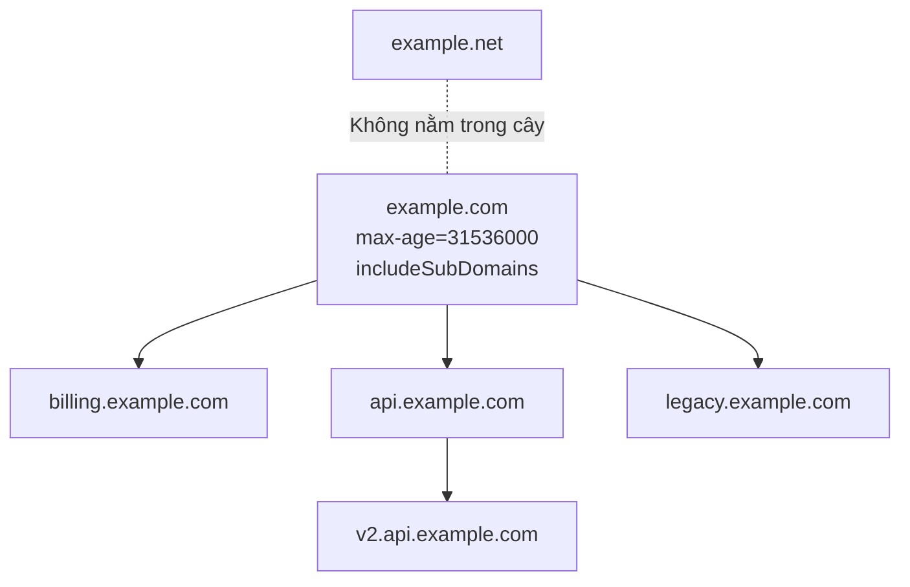
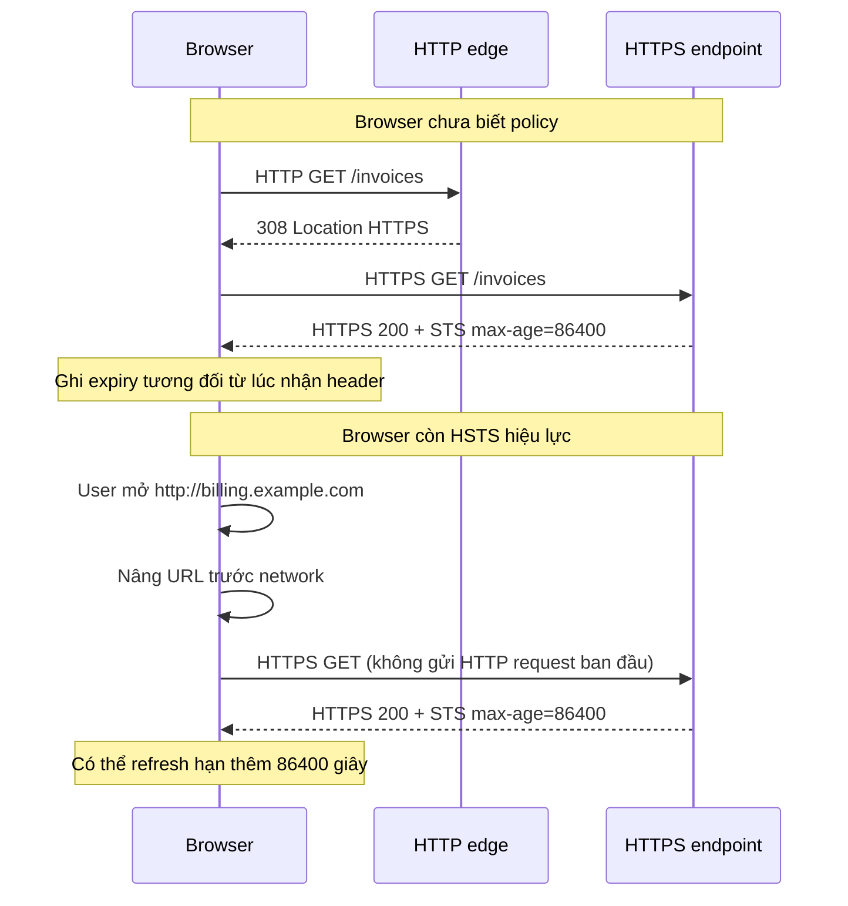
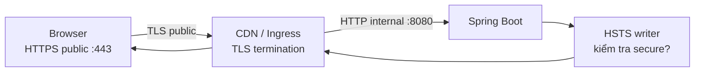

# max-age và thời gian hiệu lực phía trình duyệt

> **Chương:** HTTPS và HSTS  
> **Học phần:** `SPRING_SECURITY_HTTP_PROTECTION` — bảo vệ HTTP và trình duyệt với Spring Security, bao gồm HTTPS/HSTS, CSRF, CORS, security headers, CSP, HTTP firewall và session, triển khai trên Servlet lẫn Reactive.  
> **Trọng tâm:** cách browser tiếp nhận, tính lại, lưu, hết hạn và xóa chính sách `Strict-Transport-Security` theo directive `max-age`; các trường hợp ngoại lệ do `includeSubDomains`, preload, certificate error, reverse proxy và kiểm thử có trạng thái.

## 1. Vì sao cần hiểu “thời gian hiệu lực” thay vì chỉ thêm một header?

Giả sử nền tảng quản lý hóa đơn sử dụng `https://billing.example.com`. Một ngày trước, trình duyệt của nhân viên đã nhận:

```http
HTTP/1.1 200 OK
Strict-Transport-Security: max-age=604800
Content-Type: text/html; charset=utf-8
```

Hôm nay, người ấy nhập `http://billing.example.com/invoices`. Trình duyệt vẫn chuyển trực tiếp sang HTTPS, dù đội phát triển vừa **xóa dòng cấu hình HSTS trên server** và thậm chí một HTTP endpoint không có rule redirect.

Lý do: HSTS đã được lưu ở phía user agent. Việc **không phát lại header** không tương đương với lệnh **hủy một policy đang có hiệu lực**. Browser có thể giữ entry cho đến khi hết hạn tính từ lần gần nhất nhận policy hợp lệ.

Ngược lại, đội vận hành nghĩ rằng đã bật HSTS một năm, nhưng trình duyệt của một khách hàng mới vẫn gửi HTTP request đầu tiên. Khách hàng đó chưa từng nhận policy từ HTTPS và host chưa được preload/HTTPS-first bảo vệ.

Cả hai hiện tượng đều được giải thích bằng **cùng một mô hình thời gian**.

### Mục tiêu học tập

Sau bài, người học có thể:

1. Đọc đúng `max-age` (số **giây**), kể cả `0`, và phân biệt **thời hạn tương đối** với thời điểm hết hạn browser lưu.
2. Tính `t_expiry = t_received + max_age` cho nhiều lần response, giải thích vì sao policy được gia hạn theo kiểu *sliding expiration*.
3. Phân biệt **response thiếu STS**, **header STS hợp lệ mới**, **header lỗi**, **max-age=0**, và **browser chưa từng ghi nhớ**.
4. Giải thích hiệu lực HSTS theo hostname, các policy của parent/child, `includeSubDomains` và preload.
5. Mô tả các thay đổi sau khi policy hết hạn: browser có thể gửi HTTP trên request tiếp theo nếu không còn nguồn bảo vệ khác.
6. Cấu hình tuổi thọ HSTS với Spring Security Servlet, Spring Security Reactive WebFlux và reverse proxy mà không biến trusted forwarding thành cửa cho spoofing.
7. Thiết kế phép thử mô phỏng thời gian, kiểm thử header và kiểm thử browser state; không coi `MockMvc.secure(true)` là TLS thật.
8. Lập kế hoạch rollout/rollback theo độ trễ cập nhật policy của nhiều browser, không nhầm với `Cache-Control`, session timeout hay cookie expiry.

## 2. HSTS là ràng buộc transport cho lần truy cập tương lai

HSTS (HTTP Strict Transport Security) được chuẩn hóa bởi [RFC 6797](https://www.rfc-editor.org/rfc/rfc6797). Server công bố chính sách bằng response header **trên kết nối HTTPS hợp lệ**:

```http
Strict-Transport-Security: max-age=31536000; includeSubDomains
```

Nếu user agent hỗ trợ và chấp nhận header, nó có thể nhớ rằng các request tương lai đến hostname đó phải dùng HTTPS, kể cả khi URL được nhập là `http://...`. Browser thực hiện nâng cấp **trước khi gửi request HTTP ra mạng** khi host đang thuộc policy có hiệu lực.

HSTS **không** làm những việc sau:

- Thiết lập TLS listener, cài chứng chỉ hoặc mã hóa lại một HTTP request đã gửi.
- Đảm bảo browser chưa từng ghé host sẽ tự biết policy động.
- Tạo hoặc làm mới session đăng nhập.
- Thay xác thực, phân quyền tenant/owner, chống CSRF hoặc CORS.
- Ngăn XSS trong HTML; đó là công việc của output encoding, sanitization và CSP.
- Bảo vệ mặc nhiên hop HTTP giữa ingress và Spring Boot sau TLS termination.
- Ép mọi HTTP library/mobile SDK phải quản lý HSTS như browser.

**Chìa khóa:** `max-age` điều khiển **thời gian browser xem một hostname là Known HSTS Host**, không phải thời hạn của kết nối TLS hiện tại.

### 2.1. Bốn thời điểm cần phân biệt

| Thời điểm | Sự kiện | Có làm thay đổi HSTS store không? |
| --- | --- | --- |
| `t_request` | Browser phát request HTTPS | Chưa chắc; còn chờ response |
| `t_received` | Browser nhận HSTS hợp lệ trên HTTPS đáng tin | **Có**: lưu hoặc cập nhật policy |
| `t_expiry` | Thời điểm chính sách dự kiến hết hạn | Có thể không còn hiệu lực nếu không được gia hạn |
| `t_next_navigation` | User mở lại HTTP URL | Browser kiểm tra state **tại thời điểm này** |

Một server đã deploy HSTS không thể đồng bộ tức thời policy vào mọi browser; chỉ những browser nhận được response theo quy định mới cập nhật dynamic HSTS store.

## 3. Cú pháp max-age: số giây tương đối

Theo RFC 6797 `6.1.1, `max-age` là directive **bắt buộc** trong STS header. Cú pháp cơ bản là số nguyên không âm gồm các chữ số thập phân.

```http
Strict-Transport-Security: max-age=300
Strict-Transport-Security: max-age=86400
Strict-Transport-Security: max-age=31536000; includeSubDomains
Strict-Transport-Security: max-age=0
```

**Đây là bốn ví dụ thay thế nhau**, không phải bốn header cần gửi đồng thời.

| Giá trị | Thời hạn tương đương | Nhận xét |
| --- | --- | --- |
| `0` | Xóa dynamic policy của chính hostname khi được tiếp nhận hợp lệ | Không đồng nghĩa xóa parent/preload |
| `60` | 1 phút | Hữu ích trên test hostname có kiểm soát |
| `300` | 5 phút | Phù hợp quan sát vòng đời ngắn trong lab |
| `3600` | 1 giờ | Không phải một giờ kể từ lúc cấu hình server |
| `86400` | 1 ngày | Một bước rollout có thể cân nhắc |
| `604800` | 7 ngày | Đủ dài để cần có rollback plan |
| `2592000` | 30 ngày | Chú ý browser ít truy cập |
| `31536000` | 365 ngày | Giá trị mặc định phổ biến của Spring Security HSTS writer |
| `63072000` | 730 ngày | Ví dụ độ dài lớn; preload có yêu cầu riêng |

`max-age=3600` **không** có nghĩa là “HSTS có hiệu lực từ khi deploy đến một giờ sau”. Nó có nghĩa là user agent áp chính sách trong một giờ **tính từ khi nhận header HSTS qua HTTPS hợp lệ** (hoặc được cập nhật bằng response mới).

### 3.1. Những biểu thức không được dùng

```http
# Các ví dụ SAI, không dùng như policy thực
Strict-Transport-Security: max-age=1year
Strict-Transport-Security: max-age=24h
Strict-Transport-Security: max-age=-1
Strict-Transport-Security: max-age=2027-01-01
```

RFC cho phép `max-age` số giây, không phải cú pháp ngày giờ hay đơn vị text. `max-age=0` **hợp lệ** và mang nghĩa xóa policy; số âm không hợp lệ. Đừng dùng Java `Duration.toMillis()` rồi đưa trực tiếp vào writer nhận **giây**.

### 3.2. Con số lớn không đồng nghĩa “vĩnh viễn”

Một `max-age` dài không phải vô hạn. Browser có thể áp giới hạn nội bộ, xử lý overflow hoặc storage theo cách triển khai; RFC cũng bàn đến rủi ro lưu dài trong `11.2`. Không dựa vào số nguyên khổng lồ để bảo đảm policy không hết hạn.

Nếu tổ chức yêu cầu mức bảo vệ ngay ở lần đầu, hãy đánh giá preload và HTTPS-first theo client; đừng biến `max-age` thành một “cờ vĩnh viễn” không có kế hoạch hoàn nguyên.

## 4. Công thức thời gian hiệu lực

Mô hình khái niệm:

```text
t_expiry = t_received + max_age_seconds

isDynamicHstsActive(host, t_now)
    = (có entry hợp lệ cho host) AND (t_now < t_expiry)
```

Trong đó:

- `t_received`: thời điểm user agent **nhận được** STS response hợp lệ, không phải lúc server bắt đầu chạy hoặc build code.
- `max_age_seconds`: con số trong directive.
- `t_expiry`: hạn lưu của entry HSTS động trong browser.
- `t_now`: thời điểm user agent đánh giá khi chuẩn bị request.

**Lưu ý thuật toán:** đây là một mô hình để suy luận/test, không phải hướng dẫn can thiệp cấu trúc dữ liệu HSTS bên trong Chrome/Firefox/Safari. Browser có thể lưu dạng timestamp riêng và có xử lý giới hạn, profile hoặc clock đặc thù.

### 4.1. Ví dụ tính thời hạn đầu tiên

Browser nhận `max-age=86400` qua HTTPS lúc **08:00 thứ Hai**.

```text
Nhận policy: thứ Hai 08:00
Thời hạn:    86 400 giây = 24 giờ
Hết hạn:     thứ Ba 08:00 (nếu không refresh)
```

Nếu người dùng vào một URL HTTP cùng host lúc thứ Hai 20:00, browser có thể nâng lên HTTPS ngay vì policy còn hiệu lực.

Nếu lúc thứ Ba 09:00 policy đã hết hạn và chưa có nguồn bảo vệ khác, browser có thể gửi HTTP khi user mở `http://...`. Lúc này server vẫn nên có redirect/reject HTTP chính xác.

### 4.2. Thời hạn hiệu lực không phải TCP/TLS session timeout

Một TLS handshake mới không tự gia hạn HSTS. Thời hạn chỉ được cập nhật khi user agent nhận response STS hợp lệ theo xử lý policy của nó.

Ngược lại, browser có thể thiết lập nhiều TLS connections và request HTTP/2/HTTP/3 trên một hostname trong khi cùng một HSTS policy đã được lưu từ trước. HSTS không theo từng socket.

## 5. Sliding expiration: mỗi lần nhận HSTS có thể đẩy hạn xa hơn

Điều hay bị bỏ qua nhất của `max-age`: **mỗi lần browser nhận lại HSTS hợp lệ có thể làm mới expiry time theo giá trị mới và thời điểm nhận mới**.

Ví dụ đều nhận `max-age=86400`:

| Lần nhận | Thời điểm nhận | Expiry sau lần nhận | Vì sao |
| --- | --- | --- | --- |
| #1 | Thứ Hai 08:00 | Thứ Ba 08:00 | Lần đầu học 24 giờ |
| #2 | Thứ Hai 20:00 | Thứ Ba 20:00 | Gia hạn từ 20:00 |
| #3 | Thứ Ba 12:00 | Thứ Tư 12:00 | Gia hạn tiếp từ 12:00 |
| #4 | Không nhận STS nữa | Giữ Thứ Tư 12:00 | Header vắng mặt không tự xóa |

```mermaid
timeline
    title HSTS max-age = 86400 (mô hình minh họa)
    Thứ Hai 08:00 : Nhận HSTS
                   : Hạn đến Thứ Ba 08:00
    Thứ Hai 20:00 : Nhận HSTS lần nữa
                   : Hạn dời đến Thứ Ba 20:00
    Thứ Ba 12:00 : Nhận HSTS lần nữa
                   : Hạn dời đến Thứ Tư 12:00
    Thứ Tư 12:00 : Không refresh thêm
                 : Dynamic policy hết hạn
```

**Kết luận tại bước này:** thay một header một năm bằng **không có header** không khiến tất cả browser lập tức quên policy. Những browser đã từng truy cập và được gia hạn gần đây có thể tiếp tục tự nâng HTTPS trong nhiều tháng.

### 5.1. Gia hạn kể cả khi cấu hình server không đổi

Một user truy cập `https://billing.example.com` mỗi ngày, server phát `max-age=31536000` trên mỗi HTTPS response hợp lệ. Với mỗi lượt nhận policy, expiry có thể lại cách **một năm tính từ hôm đó**.

Do đó nếu đánh giá “HSTS đã có hiệu lực bao lâu?” cần phân biệt:

- **Thời gian server đã bật HSTS**.
- **Thời gian kể từ lần browser nhận STS cuối**.
- **Thời gian còn lại trong HSTS store**.

Ba giá trị này không đồng nhất.

### 5.2. Gia hạn không cần browser nhận cùng URL/path

Browser lưu theo hostname. Nếu lần đầu `GET /login` trả HSTS, và sau đó `GET /assets/app.css` trên cùng hostname trả HSTS, policy của host có thể được refresh từ response CSS.

HSTS không ghi nhớ theo path hay security role. Một response JSON/HTML/file HTTPS hợp lệ có STS cũng có thể ảnh hưởng policy của toàn hostname.

### 5.3. Response qua CDN/cache cần đánh giá ở phía client

Nếu CDN phục vụ một HTTPS response đã cache **và response cuối mà browser nhận có header HSTS hợp lệ**, browser xử lý policy trên response đó theo quy tắc của user agent. Đừng tính expiry dựa trên thời điểm origin **tạo** nội dung trong cache.

Cần kiểm tra hệ thống **có gửi HSTS trên response cuối** hay không, kể cả edge-generated errors, cache hits, redirects và static responses.

## 6. Header không xuất hiện khác với max-age=0

Đây là khác biệt vận hành cốt lõi.

| Response mới qua HTTPS hợp lệ | Browser chưa có entry | Browser đã có dynamic entry |
| --- | --- | --- |
| `Strict-Transport-Security: max-age=3600` | Học policy cho 3600 giây | Đặt lại thời hạn theo 3600 giây từ lúc nhận |
| `Strict-Transport-Security: max-age=0` | Không thêm entry | Xóa policy **của hostname phát header** |
| **Không có** `Strict-Transport-Security` | Không học policy | **Giữ entry cũ** cho tới khi hết hạn |
| `max-age` không hợp lệ/thiếu | Không tạo entry theo RFC | Không cập nhật entry cũ bằng dữ liệu lỗi |
| STS trên response **HTTP** | Bỏ qua header | Không dùng HTTP header đó để xóa/làm mới |
| STS trên HTTPS có lỗi TLS/certificate | Không tin policy mới | Không coi response lỗi là cập nhật policy hợp lệ |

**Tuyệt đối không coi việc xóa header khỏi Nginx hoặc Spring Security là tương đương phát `max-age=0`.**

### 6.1. Ví dụ xóa policy ở đúng hostname

Browser đã ghi nhớ dynamic HSTS cho `billing.example.com`. Hãy phát trên HTTPS hợp lệ:

```http
HTTP/1.1 200 OK
Strict-Transport-Security: max-age=0
Cache-Control: no-store
```

Browser hỗ trợ sẽ loại bỏ **policy động riêng của hostname** khi nhận và xử lý response. Tuy nhiên:

- Browser phải **truy cập được HTTPS** trước khi nhìn thấy chỉ thị xóa.
- Parent `example.com` có `includeSubDomains` vẫn có thể ép `billing.example.com` dùng HTTPS.
- Preload có cơ chế phân phối/loại bỏ riêng; `max-age=0` không bảo đảm bỏ trạng thái preloaded.
- Các browser chưa kết nối lại website chưa nhận lệnh xóa.
- Một số response do CDN/cache/edge có thể không mang header mới; phải kiểm tra bên ngoài.

### 6.2. Vì sao nên có kế hoạch thu hồi theo thời gian?

Giả sử hôm nay đội vận hành muốn dừng HSTS trên một host test và chỉ **xóa header**. Những browser từng nhận `max-age=31536000` có thể tiếp tục áp trong gần một năm, tính từ lần refresh cuối.

Nếu chủ động gửi `max-age=0`, client truy cập HTTPS hợp lệ sẽ có cơ hội xóa dynamic entry sớm hơn. Nhưng không thể “push” lệnh xóa tới mọi browser đã offline. Việc thay policy trên server không đồng bộ ngay trạng thái HSTS tại mọi máy.

## 7. Giảm max-age không phải bật một bộ đếm từ lúc deploy

Một service từng phát một năm, nay thay thành một ngày:

```text
Cũ: Strict-Transport-Security: max-age=31536000
Mới: Strict-Transport-Security: max-age=86400
```

Hai browser:

- **Browser A** kết nối HTTPS và nhận header mới ngay lúc deploy: expiry dynamic policy riêng của A được tính lại theo 86400 giây từ **thời điểm nó nhận**.
- **Browser B** không ghé website: vẫn giữ expiry đã tính từ header một năm mà B nhận trước đó, cho đến khi nhận update mới hoặc hết hạn.

**Không thể kết luận “đã giảm max-age xuống một ngày thì sau một ngày toàn bộ browser đều quên”.** Chỉ biết server đã bắt đầu quảng bá thời hạn ngắn hơn.

### 7.1. Bảng điều kiện khi thay đổi chính sách

| Thay đổi server | Browser đã từng học HSTS | Browser mới |
| --- | --- | --- |
| Một năm → một tháng | Chỉ đổi expiry khi nhận HTTPS response mới | Học một tháng khi truy cập HTTPS lần đầu |
| Một năm → không có STS | Giữ expiry đã lưu, không có refresh | Không học dynamic HSTS |
| Một năm → `max-age=0` | Xóa policy riêng khi nhận HTTPS response mới | Không học policy |
| Một năm → hai năm | Gia hạn theo hai năm khi nhận response | Học hai năm |
| `includeSubDomains` true → false | Parent entry mới cập nhật **khi browser nhận** | Đọc policy hiện hành |
| Parent policy bị xóa | Browser chưa được cập nhật vẫn có thể áp parent | Browser chưa từng học parent có thể khác |

### 7.2. Hệ quả với rollback

Muốn thay đổi một chính sách dài hạn có thể mất thời gian vì những client:

- Không online.
- Đang dùng browser/profile khác.
- Chỉ truy cập qua app/SDK không cùng HSTS storage.
- Có policy parent hoặc preload.
- Không thể đi tới HTTPS do lỗi chứng chỉ/DNS.

Do đó hãy hoạch định rollback **trước khi tăng max-age**, không phải sau khi có outage.

## 8. Một mô hình trạng thái cho Known HSTS Host

Để lý giải hệ thống, có thể mô hình hóa một entry động bằng:

```text
HostPolicy {
  hostname: billing.example.com
  expiresAt: t_received + maxAgeSeconds
  includeSubDomains: true/false
  source: dynamic-hsts
}
```

Cấu trúc trên là **mô hình khái niệm**, không phải class thực tế của Chromium/Safari.

```mermaid
stateDiagram-v2
    [*] --> Unknown : Chưa có dynamic HSTS
    Unknown --> Active : HTTPS + STS max-age>0
    Active --> Active : HTTPS + STS hợp lệ mới (refresh/replace)
    Active --> Expired : Tới thời điểm hết hạn; không refresh
    Active --> Removed : HTTPS + STS max-age=0
    Expired --> Unknown : Entry hết hạn bị loại bỏ
    Removed --> Unknown : Dynamic entry riêng đã xóa
    Active --> Active : Response thiếu STS: giữ expiry cũ
```



Trạng thái “Unknown” ở sơ đồ **không đồng nghĩa browser chắc chắn sẽ dùng HTTP**: có thể còn parent `includeSubDomains`, preload, HTTPS-first, người dùng nhập HTTPS ngay từ đầu hoặc policy doanh nghiệp.

### 8.1. Những state không được nhầm với HSTS

- Browser cache của HTML/JavaScript (`Cache-Control`).
- Session cookie (`Max-Age` hoặc `Expires` của cookie).
- TLS session resumption ticket.
- HTTP connection keep-alive.
- Service worker cache.
- Browser saved passwords.
- Local Storage/IndexedDB.
- DNS TTL.
- OAuth access token expiry.

HSTS là **host transport state**, có vòng đời riêng. Một user logout không có nghĩa HSTS mất; xóa HTTP cache hoặc cookies cũng không bảo đảm HSTS bị xóa trên mọi browser.

## 9. Browser lưu policy theo hostname, không theo origin/path

Một website gồm:

```text
billing.example.com
api.billing.example.com
static.billing.example.com
legacy.example.com
```

Nếu `billing.example.com` gửi:

```http
Strict-Transport-Security: max-age=604800
```

thì browser học dynamic policy cho **billing.example.com**. Nó không mặc nhiên tạo cùng một entry riêng cho `api.billing.example.com` nếu không có `includeSubDomains` hoặc chính sách từ hostname khác.

### 9.1. HSTS không giống origin

Origin dùng scheme, hostname và port. HSTS policy theo hostname, vì vậy:

- `https://billing.example.com:443` và `https://billing.example.com:8443` liên quan tới cùng tên host khi xét HSTS.
- Khi browser nâng `http://billing.example.com`, nó dùng HTTPS default port; `http://billing.example.com:80` tương ứng 443.
- Với HTTP URL dùng cổng **không phải 80**, browser theo HSTS giữ cổng đó khi đổi scheme, ví dụ `http://billing.example.com:8080` → `https://billing.example.com:8080`.
- HSTS **không** dùng Spring Security Servlet `PortMapper` để suy 8080→8443.

Điểm cổng ảnh hưởng thực hành: một browser đã biết HSTS có thể không dùng được endpoint `http://billing.example.com:8080` nếu cổng 8080 không nói TLS.

### 9.2. Không thử dynamic HSTS bằng IP literal như DNS hostname

Theo mô hình RFC 6797, IP literal không được coi là HSTS host theo cách hostname DNS được dùng. Browser có thể xử lý đặc biệt localhost và các môi trường phát triển. Dùng một DNS hostname test với HTTPS/certificate hợp lệ để chứng minh thời hạn HSTS production.

### 9.3. HSTS không giới hạn theo path

Nếu browser nhận STS từ `https://billing.example.com/login`, nó không chỉ nâng `http://billing.example.com/login` mà còn có thể nâng những URL khác cùng host, chẳng hạn `/invoices`, `/assets`, `/download`.

Bởi vậy `max-age` không thể được cài riêng theo “thời hạn cho endpoint login” hay “thời hạn cho API POST” trong browser. Mọi đội dùng chung một hostname cần điều phối policy.

## 10. includeSubDomains: một entry cha có thể ảnh hưởng cả cây

Giả sử host gốc `example.com` công bố qua HTTPS:

```http
Strict-Transport-Security: max-age=31536000; includeSubDomains
```

Khi browser học policy này, các host con cũng bị buộc HTTPS khi parent entry còn hiệu lực:



**Khác biệt then chốt:** entry của `example.com` không biến thành nhiều entry riêng cho tất cả host con. Browser có thể kiểm tra tên host khi cần kết nối và áp parent matching policy.

### 10.1. Parent hết hạn có làm tất cả child trở về HTTP không?

Không thể kết luận ngay:

- Child `billing.example.com` có thể **đã tự học** dynamic HSTS từ response của nó.
- Có thể tồn tại một ancestor khác đang hiệu lực.
- Một hoặc nhiều host có thể được preload.
- Browser HTTPS-first/HTTPS-only có thể tự nâng URL.
- Client có thể luôn dùng HTTPS từ link đúng.

Hết hạn parent entry chỉ loại bỏ **ảnh hưởng của entry đó**; không xóa những entry riêng của child.

### 10.2. Header max-age=0 của child không xóa parent

Giả sử:

```text
example.com
  HSTS max-age=31536000; includeSubDomains (đã được browser lưu)

billing.example.com
  HSTS max-age=0 (mới phát qua HTTPS)
```

Browser có thể xóa **policy riêng của billing.example.com**, nhưng parent `example.com` vẫn buộc HTTPS trên billing nếu parent còn hiệu lực. Không nên báo “HSTS rollback hoàn tất” chỉ vì child đã trả `max-age=0`.

### 10.3. Parent xóa policy không xóa các entry child

Đảo chiều cũng đúng. `example.com` gửi `max-age=0` qua HTTPS hợp lệ. Điều này xóa dynamic entry của **example.com**, bao gồm directive `includeSubDomains` của entry đó, nhưng **không tự xóa** các HSTS entries mà các host con đã học độc lập.

**Bài học về thời hạn:** quản lý hiệu lực theo **từng nguồn policy** (host riêng, ancestor, preload), không chỉ đọc một header của URL hiện tại.

## 11. Preload là nguồn “biết trước” có vòng đời khác

Một số trình duyệt cung cấp danh sách HSTS **preload** đóng gói hoặc phân phối theo phiên bản, giúp áp HTTPS **trước lần truy cập đầu**.

Ví dụ header thường liên quan tới quy trình đăng ký:

```http
Strict-Transport-Security: max-age=63072000; includeSubDomains; preload
```

Nhưng directive `preload` **không tự đăng ký** hostname vào danh sách. Cần đáp ứng điều kiện và quy trình tại [hstspreload.org](https://hstspreload.org/), có thể thay đổi theo thời gian và theo hệ sinh thái browser.

### 11.1. max-age=0 ảnh hưởng dynamic entry, không phải nút “xóa preload”

Nếu browser đang ép HTTPS do preload, nhận `max-age=0` từ server không bảo đảm xóa tình trạng preloaded. Phải hiểu hai nguồn:

| Nguồn HSTS | Cách xuất hiện | Cách cập nhật |
| --- | --- | --- |
| **Dynamic** | Browser nhận STS qua HTTPS hợp lệ | Response tiếp theo thay `max-age`, `includeSubDomains` hoặc dùng `0` |
| **Preload** | Browser được phân phối entry trước khi user truy cập | Theo quy trình đăng ký/gỡ và cập nhật browser |
| **Parent dynamic** | Browser nhận entry của ancestor có `includeSubDomains` | Cần ancestor nhận policy mới hợp lệ |
| **Parent preload** | Preload ancestor bao gồm descendants | Phụ thuộc cập nhật danh sách/browser |

Một domain vừa có dynamic entry vừa nằm trong preload có thể tiếp tục bắt buộc HTTPS sau khi dynamic entry bị xóa.

### 11.2. Vì sao preload cần phê duyệt cấp domain?

Preload cộng `includeSubDomains` có thể ảnh hưởng hostname legacy, staging, custom hosts dưới miền tổ chức. Nếu một host con không có TLS hợp lệ, browser preloaded sẽ từ chối kết nối và không thể đơn giản quay lại HTTP.

Không bật `preload` chỉ để security scanner hiển thị điểm tốt hơn. Cần kiểm kê DNS, TLS/certificate renewal, quyền sở hữu subdomain và kế hoạch rollback.

## 12. Chỉ response HTTPS hợp lệ mới thay đổi dynamic HSTS state

Không phải bất kỳ gói HTTP nào chứa dòng `Strict-Transport-Security` cũng được browser tin.

| Đầu vào | Browser xử lý HSTS theo RFC |
| --- | --- |
| HTTPS response hợp lệ, TLS không có lỗi, STS đúng cú pháp | Ghi nhớ/cập nhật/xóa theo `max-age` |
| HTTP plaintext response có STS | **Bỏ qua** STS |
| HTTPS response có lỗi TLS/cert | Không coi là nguồn policy hợp lệ |
| HTTPS response thiếu STS | Không xóa policy đang lưu |
| HTTPS response có STS sai cú pháp | Bỏ qua STS sai cú pháp |
| HTTPS response có nhiều STS headers | RFC 6797 quy định xử lý header đầu tiên; **không được thiết kế dựa trên duplicate** |
| HTTPS response có directive không nhận diện nhưng các directive còn lại hợp lệ | Bỏ qua directive lạ theo quy tắc RFC; vẫn xem các directive được nhận diện |
| Browser chưa từng nhận STS/preload | Không có dynamic HSTS để áp từ server đó |

### 12.1. Một ví dụ lỗi cú pháp có thể gây mất cập nhật

```http
# Không dùng những header này:
Strict-Transport-Security: max-age=1h
Strict-Transport-Security: includeSubDomains
Strict-Transport-Security: max-age=86400; max-age=31536000
```

- `1h` không phải giá trị số giây.
- Thiếu `max-age` không tạo policy STS hợp lệ.
- Directive lặp vi phạm quy tắc cú pháp của RFC.

Nếu browser đã lưu policy trước đó, header sai **không tự xóa entry**. Điều đó có thể làm QA nhầm rằng deploy policy mới thành công vì browser vẫn tự nâng URL.

### 12.2. Đừng lạm dụng duplicate header ở proxy

Nếu Spring Security và CDN cùng phát:

```http
Strict-Transport-Security: max-age=300
Strict-Transport-Security: max-age=31536000; includeSubDomains
```

thì ý định của hệ thống không rõ ràng. RFC có quy tắc nhận header đầu tiên trong một response có nhiều STS, nhưng proxy/client có thể kết hợp hoặc thay đổi cách biểu diễn field. **Một hostname nên có một policy owner và một giá trị thống nhất trên response public**.

### 12.3. Không dùng HTTP để thu hồi

```http
HTTP/1.1 308 Permanent Redirect
Location: https://billing.example.com
Strict-Transport-Security: max-age=0
```

Nếu response trên được gửi **qua HTTP**, browser bỏ qua STS `max-age=0`. Để thay dynamic HSTS state, cần HTTPS response hợp lệ và hostname tương ứng.

## 13. “HSTS đã hết hạn” không bằng “client chắc chắn gửi HTTP”

Một browser hết entry dynamic vẫn có thể mở HTTPS vì:

- URL ban đầu là `https://`.
- Bookmark/link form/API base URL là HTTPS.
- Browser dùng HTTPS-first/HTTPS-only mode.
- Domain nằm trong preload.
- Có parent `includeSubDomains`.
- Một extension/policy doanh nghiệp điều chỉnh navigation.
- Page đang ở HTTPS và các resource URLs cùng origin dùng relative paths.

Ngược lại, một HTTP library không có HSTS store có thể không tự nâng URL chỉ vì Spring Security phát header một năm. Với API clients, **cấu hình base URL HTTPS ngay từ đầu**.

### 13.1. HSTS không phải bảo đảm khả năng kết nối

Nếu HSTS đã nâng request sang `https://billing.example.com` nhưng cert hết hạn hoặc server chỉ nghe HTTP, client có thể thất bại. Browser của Known HSTS Host thường xử lý certificate errors nghiêm ngặt, không cho người dùng tiếp tục qua lỗi như một số site khác.

Điều kiện **bắt buộc trước rollout duration dài** là TLS endpoint ổn định, certificate renewal và fallback/failover có HTTPS hợp lệ.

## 14. Cache-Control max-age khác hoàn toàn HSTS max-age

Hai header có cùng chữ `max-age` nhưng mang ý nghĩa khác nhau:

```http
Strict-Transport-Security: max-age=31536000
Cache-Control: private, max-age=60
```

| Thuộc tính | HSTS `max-age` | `Cache-Control: max-age` |
| --- | --- | --- |
| Quản lý thứ gì? | Host transport policy | Thời hạn freshness của representation |
| Đối tượng chính | Browser/user agent hỗ trợ HSTS | Caches theo HTTP semantics |
| Áp theo | Hostname (+ subdomains nếu chỉ định) | Response/cache key, request context |
| Bắt đầu đếm | Khi UA nhận STS hợp lệ | Theo mô hình HTTP cache age |
| Có được làm mới bởi HTTPS response? | Có nếu response mang STS hợp lệ | Cơ chế cache riêng |
| Xóa response cache có xóa HSTS? | Không được bảo đảm | Không phải cùng state |
| `max-age=0` có ý nghĩa? | Xóa dynamic HSTS của host khi nhận qua HTTPS hợp lệ | Freshness lifetime bằng 0 |

Tương tự, `Set-Cookie: SESSION=...; Max-Age=3600` quản lý **tuổi cookie**, không quản lý Known HSTS Host. Một session có thể hết hạn sau 15 phút nhưng browser vẫn buộc HTTPS một năm.

### 14.1. Khác cả DNS TTL và TLS session lifetime

DNS TTL có thể hết nhưng HSTS vẫn còn, vì hostname vẫn là tên được so khớp. TLS session ticket có thể hết hạn trước HSTS. Không có lý do đặt tất cả các thời hạn này bằng nhau.

## 15. Đánh giá thời gian thực của browser: profile, đồng hồ và môi trường

Browser là nơi lưu dynamic HSTS, nhưng implementation/đường dẫn lưu có thể khác nhau giữa Chromium, Firefox, Safari và các phiên bản.

### 15.1. Những yếu tố làm kết quả khác nhau

- Browser/profile đã truy cập hostname trước đó.
- Chế độ riêng tư và quy tắc lưu state của trình duyệt.
- Browser version/preload list đã cập nhật hay chưa.
- Parent domain có HSTS mà người kiểm thử chưa phát hiện.
- Thời điểm browser nhận header cuối cùng.
- Đồng hồ hệ thống và cách user agent tính/kiểm soát expiry.
- Những HTTPS responses do CDN trả sau khi đội vận hành đổi config.
- Chế độ HTTPS-first, extension hoặc enterprise policy độc lập với HSTS.

**Không dựa vào việc xóa cookies để khẳng định xóa HSTS.** Một số browser có giao diện hoặc công cụ riêng để quản lý transport-security state; API/giao diện cụ thể có thể đổi theo phiên bản.

### 15.2. Không thử bằng cách đổi đồng hồ máy production

Mô hình `t_expiry = t_received + max-age` dễ tính, nhưng không nên kiểm thử bằng cách chỉnh thời gian hệ điều hành của người dùng. Việc đổi clock có thể làm sai certificate validation, token expiry, TLS, audit logs và các dịch vụ khác.

Nếu cần test thời gian ngắn: dùng **hostname độc lập với `max-age` ngắn**, profile mới và automation có khả năng reset môi trường một cách kiểm soát. Đừng sửa trực tiếp HSTS store của user thật rồi dùng kết quả đó làm test của server.

## 16. Giao nhau với HTTP→HTTPS redirect

Trước khi browser học HSTS, user có thể nhập:

```http
GET /invoices HTTP/1.1
Host: billing.example.com
```

Server/edge trả:

```http
HTTP/1.1 308 Permanent Redirect
Location: https://billing.example.com/invoices
```

Client theo redirect, thiết lập TLS và nhận STS ở **HTTPS response**. Lần sau khi policy còn hiệu lực, browser có thể bỏ qua hoàn toàn HTTP hop.



### 16.1. HSTS first visit gap

Nếu browser **chưa biết** HSTS/preload và website có một HTTP URL, attacker kiểm soát mạng có thể can thiệp response HTTP trước khi HTTPS được thiết lập. Vì thế:

- Form action, API URL, email links, OAuth callbacks phải dùng HTTPS **trực tiếp**.
- HTTP endpoint chỉ nên redirect/reject; không phục vụ dữ liệu riêng tư qua HTTP.
- Cookie `Secure` vẫn cần thiết.
- HSTS là lớp phòng vệ cho **truy cập tiếp theo**, preload có thể giúp trước lần đầu ở browser hỗ trợ.

### 16.2. HSTS không biến POST ban đầu thành an toàn

Một POST chứa password đã đi qua HTTP không được bảo vệ hồi tố nếu server trả 307/308. Status có thể khiến client gửi lại method/body trên HTTPS nhưng không xóa rủi ro request đầu.

**Chính sách an toàn:** client và browser hợp lệ tạo unsafe requests trực tiếp tới HTTPS, còn HTTP unsafe requests ở public edge bị reject hoặc xử lý theo policy không có side effect.

## 17. Trách nhiệm cấu hình trong Spring Security

Spring Security có thể công bố HSTS qua **security headers**; không có API “lưu policy vào browser” từ phía Java. Browser tự xử lý STS khi nhận HTTPS response hợp lệ.

Với **Servlet**:

- `HttpSecurity.headers(...)` cung cấp DSL.
- `HstsHeaderWriter` thực hiện header writing.
- Mặc định writer chỉ ghi khi `ServletRequest.isSecure() == true`.
- Giá trị mặc định của writer thường là 1 năm, `includeSubDomains=true`, `preload=false` theo Javadoc.

Với **Reactive WebFlux**:

- `ServerHttpSecurity.headers(...)` cung cấp Reactive DSL.
- `StrictTransportSecurityServerHttpHeadersWriter` xử lý STS.
- `maxAge(Duration)`, `includeSubdomains(...)`, `preload(...)` có trong cấu hình Reactive được hỗ trợ.
- Request security được suy từ Reactive exchange sau pipeline/framework integrations phù hợp.

Không dùng `HttpServletRequest.isSecure()` trên `ServerWebExchange` hoặc copy nguyên kiểu configurer Servlet sang Reactive.

### 17.1. Lưu ý version trước khi dùng ví dụ

Các code dưới đây minh họa Spring Security **DSL hiện đại** và cần đối chiếu version được ghim. Một số API/overloads thay đổi trong Spring Security 5.x, 6.x và 7.x. **Kết luận về `max-age` của browser theo RFC không phụ thuộc Java DSL nào sinh header**, miễn browser nhận policy hợp lệ.

## 18. Servlet: chọn max-age với HttpSecurity

Ví dụ một ứng dụng Servlet dùng policy **một ngày** để kiểm thử rollout (không phát preload và không áp subdomain):

```java
package example.security;

import static org.springframework.security.config.Customizer.withDefaults;

import org.springframework.context.annotation.Bean;
import org.springframework.context.annotation.Configuration;
import org.springframework.security.config.annotation.web.builders.HttpSecurity;
import org.springframework.security.web.SecurityFilterChain;

@Configuration
class HstsAgeServletConfig {

    @Bean
    SecurityFilterChain securityFilterChain(HttpSecurity http)
            throws Exception {
        return http
            .headers(headers -> headers
                .httpStrictTransportSecurity(hsts -> hsts
                    .maxAgeInSeconds(86400)
                    .includeSubDomains(false)
                    .preload(false)
                )
            )
            .csrf(withDefaults())
            .authorizeHttpRequests(auth -> auth
                .requestMatchers("/health", "/login").permitAll()
                .anyRequest().authenticated()
            )
            .formLogin(withDefaults())
            .build();
    }
}
```

Khi request được coi là HTTPS/secure và qua chain này, một response có thể mang:

```http
Strict-Transport-Security: max-age=86400
```

**Đây là cấu hình thử nghiệm, không phải khuyến cáo cố định 1 ngày cho production.** Khi triển khai production, duration và subdomain scope phải được chủ hostname/DNS/security team phê duyệt.

### 18.1. Writer cho phép max-age=0

Một kế hoạch xóa dynamic HSTS cho chính hostname có thể sử dụng:

```java
.headers(headers -> headers
    .httpStrictTransportSecurity(hsts -> hsts
        .maxAgeInSeconds(0)
        .includeSubDomains(false)
        .preload(false)
    )
)
```

Nhưng điều kiện then chốt: **HTTPS response public vẫn phải hợp lệ**. Nếu backend chỉ nhận HTTP từ TLS proxy, writer mặc định có thể **không** phát STS, kể cả `max-age=0`. Chọn owner và trusted external scheme phù hợp trước khi tuyên bố đã rollback.

### 18.2. Với duration lớn: số giây hay milliseconds?

API Servlet là `maxAgeInSeconds(long)`. Ví dụ đổi `Duration` thành giây an toàn:

```java
long maxAgeSeconds = java.time.Duration
    .ofDays(30)
    .getSeconds();

if (maxAgeSeconds < 0) {
    throw new IllegalArgumentException("max-age must be non-negative");
}
// Sau khi đã validate chính sách và version:
hsts.maxAgeInSeconds(maxAgeSeconds);
```

`ofDays(30).getSeconds()` là 2.592.000; nếu dùng `toMillis()` sẽ thành 2.592.000.000, gấp 1000 lần ý định. Với giá trị đến từ config, validate phạm vi/kiểu số và không chấp nhận duration quá lớn do nhập sai.

### 18.3. HSTS không thuộc redirectToHttps

`HttpSecurity.redirectToHttps(...)` (Servlet 6.5+; trước đó có `requiresChannel(...)`) xử lý **HTTP→HTTPS 3xx**. Nó không đặt `max-age` của `HstsHeaderWriter`. Có thể dùng cả hai nhưng phải quyết định **redirect owner** và **HSTS owner** để tránh loop/duplicate headers.

## 19. Reactive WebFlux: maxAge(Duration) thay vì số giây trực tiếp

Reactive dùng `ServerHttpSecurity`, `SecurityWebFilterChain` và header writer tương ứng `StrictTransportSecurityServerHttpHeadersWriter`. Trong DSL WebFlux hiện đại, thời lượng nhận vào là `java.time.Duration`.

```java
package example.security;

import java.time.Duration;
import org.springframework.context.annotation.Bean;
import org.springframework.context.annotation.Configuration;
import org.springframework.security.config.annotation.web.reactive.EnableWebFluxSecurity;
import org.springframework.security.config.web.server.ServerHttpSecurity;
import org.springframework.security.web.server.SecurityWebFilterChain;

@Configuration
@EnableWebFluxSecurity
class HstsAgeReactiveConfig {

    @Bean
    SecurityWebFilterChain securityWebFilterChain(
            ServerHttpSecurity http) {
        return http
            .headers(headers -> headers
                .hsts(hsts -> hsts
                    .maxAge(Duration.ofDays(1))
                    .includeSubdomains(false)
                    .preload(false)
                )
            )
            .authorizeExchange(auth -> auth
                .pathMatchers("/health").permitAll()
                .anyExchange().authenticated()
            )
            .build();
    }
}
```

Đoạn trên minh họa **chỉ cấu hình HSTS và authorization**, không phải cấu hình toàn bộ chính sách đăng nhập/CSRF cho mọi ứng dụng. Trong WebFlux, CSRF có các mặc định/cơ chế riêng; đừng giả định snippet này tự thực thi đúng mọi nghiệp vụ.

### 19.1. So sánh hai stack tại điểm khai báo thời hạn

| Khía cạnh | Servlet | Reactive WebFlux |
| --- | --- | --- |
| HTTP builder | `HttpSecurity` | `ServerHttpSecurity` |
| Security chain | `SecurityFilterChain` | `SecurityWebFilterChain` |
| Writer | `HstsHeaderWriter` | `StrictTransportSecurityServerHttpHeadersWriter` |
| Cấu hình max-age | `maxAgeInSeconds(86400)` | `maxAge(Duration.ofDays(1))` |
| Include descendants | `includeSubDomains(false)` | `includeSubdomains(false)` |
| Header name thực tế | `Strict-Transport-Security` | `Strict-Transport-Security` |
| Điều kiện cơ sở | Servlet `isSecure()` | Request secure trong Reactive exchange |
| Integration test | `MockMvc` | `WebTestClient` |

Điểm khác biệt là **kiểu API của framework**, không phải ý nghĩa HSTS browser. Cùng một response `max-age=86400` sẽ được user agent hiểu theo RFC bất kể backend dùng Servlet hay WebFlux.

### 19.2. Reactive không phải Servlet RequestMatcher

WebFlux nhận `ServerWebExchange`, không dùng `HttpServletRequest`. Nếu phải chọn policy theo hostname, có thể dùng các Reactive matchers/chains phù hợp hoặc đưa policy về edge. Không gắn `HstsHeaderWriter` của Servlet vào `SecurityWebFilterChain`.

### 19.3. Đừng biến Duration âm thành “xóa policy”

Trong chương trình Java, việc nhận `Duration` từ config cần validation riêng. Đừng dùng negative duration để biểu thị “tắt HSTS” hay “xóa state”. `max-age=0` là thông điệp **xóa dynamic policy**, còn **không phát STS** là không cập nhật policy đang có. Chọn đúng hành vi nghiệp vụ.

Ví dụ input hợp lệ:

```java
Duration duration = Duration.ofHours(12);
if (duration.isNegative()) {
    throw new IllegalArgumentException("HSTS max-age must not be negative");
}
http.headers(headers -> headers
    .hsts(hsts -> hsts
        .maxAge(duration)
        .includeSubdomains(false)
    )
);
```

Đoạn trên là **mảnh ghép** cấu hình trong phương thức nhận `ServerHttpSecurity http`, cần imports và version hỗ trợ. Với duration bằng zero, xác minh header thực được phát và test rollback trên HTTPS public endpoint.

## 20. TLS termination: vì sao server config đúng nhưng browser không được refresh

Topology phổ biến:



Browser **đang dùng HTTPS** với ingress, nhưng Spring Boot backend thấy `http://internal:8080`. Writer Servlet mặc định chỉ ghi STS khi `request.isSecure() == true`, còn Reactive writer cũng có điều kiện secure tương ứng. Nếu không có trusted forwarded scheme, app có thể không phát HSTS.

Khi browser không nhận STS mới, **expiry cũ vẫn trôi đi theo thời gian**; server đã deploy `max-age` cao nhưng không chắc browser được refresh.

### 20.1. Chọn một owner cho HSTS

**Phương án A — Edge sở hữu:**

- CDN/ingress phát `Strict-Transport-Security` trên HTTPS response cuối.
- HSTS có thể hiện diện cả trên lỗi 4xx/5xx do edge tự tạo.
- Spring Security có thể tắt riêng HSTS để không tạo duplicate/conflicting values.
- Dễ kiểm soát policy nhất quán cho những app cùng hostname.

**Phương án B — Spring Security sở hữu:**

- Proxy truyền **external scheme/host/port đáng tin** tới backend.
- Framework/container giải thích forwarded headers trước khi security writer đánh giá request.
- App phát STS trên response do app xử lý; edge-generated responses cần kiểm tra riêng.
- Mọi security chains/paths liên quan phải không vô tình vô hiệu hóa headers.

**Không ép HSTS lên HTTP bằng matcher always true chỉ để khiến unit test hiển thị header.** Browser sẽ bỏ qua STS trên response HTTP, còn lỗi trust boundary chưa được sửa.

### 20.2. Vì sao edge phù hợp khi cần max-age đồng nhất?

Một hostname có nhiều apps/paths:

```text
https://billing.example.com/         -> Frontend CDN
https://billing.example.com/api/**    -> Servlet backend
https://billing.example.com/stream/** -> WebFlux backend
https://billing.example.com/errors/** -> Edge error pages
```

Nếu mỗi app phát một `max-age` khác, policy của browser có thể được cập nhật **theo response hợp lệ nhận gần nhất**. Kết quả thời hạn lúc tăng, lúc giảm tùy route người dùng mở — khó debug và rollback.

Giải pháp: **chỉ một owner cho toàn hostname**, công bố cùng duration và subdomain scope trên các HTTPS responses theo policy.

## 21. Forwarded headers: thời gian HSTS không thể đúng nếu scheme bị giả

Một ingress thường gửi:

```http
Forwarded: for=198.51.100.25;proto=https;host=billing.example.com
X-Forwarded-Proto: https
X-Forwarded-Host: billing.example.com
X-Forwarded-Port: 443
```

Nhưng đây chỉ là **các HTTP headers**. Không được xem `X-Forwarded-Proto: https` như bằng chứng TLS nếu client Internet có thể tự đặt hoặc thay đổi header đó.

### 21.1. Bốn điều kiện trust cần được thực thi

1. Edge tiếp xúc Internet **xóa/ghi đè** các forwarded headers đến từ client chưa tin.
2. App chỉ chấp nhận kết nối từ proxy đáng tin, qua network ACL/policy hoặc mTLS phù hợp.
3. Hostnames public được validate/allowlist ở edge; không dùng `Host`/`X-Forwarded-Host` raw để tạo absolute URL/redirect.
4. Mỗi hop của chuỗi CDN → load balancer → ingress → backend có quy tắc xử lý forwarded metadata rõ ràng.

Spring Boot có cấu hình tham khảo:

```yaml
# Cấu hình chỉ phù hợp SAU KHI edge đã làm sạch metadata.
server:
  forward-headers-strategy: framework
```

Servlet có `ForwardedHeaderFilter`/cơ chế native của container, WebFlux có `ForwardedHeaderTransformer`/runtime integration. `framework` không tự chứng minh proxy là đáng tin.

### 21.2. Đừng dùng custom HSTS matcher để tin raw header

```java
// KHÔNG dùng làm biện pháp bảo mật nếu client có thể tự gắn header.
request -> "https".equalsIgnoreCase(
    request.getHeader("X-Forwarded-Proto"))
```

Một attacker có thể kích hoạt đường xử lý sai, khiến app tin HTTP request là HTTPS, hoặc góp phần gây lỗi redirect/cookie attributes. Với HSTS, chỉ thêm header không biến HTTP plaintext thành secure transport.

### 21.3. Đặt thời hạn phù hợp vẫn cần ngăn redirect loop

Nếu browser HTTPS qua edge mà backend nghĩ HTTP, một filter `redirectToHttps(...)` ở backend có thể liên tục trả `Location` về cùng URL. Khi browser không bao giờ nhận được HTTPS response cuối có STS như dự kiến, policy không được refresh đúng.

Debug theo thứ tự: public TLS → edge redirect rules → backend external scheme → app chain → response HSTS cuối → browser store, thay vì tắt CSRF/CORS hoặc hạ security để loại loop.

## 22. HSTS policy tại Nginx/ingress: rollout và rollback rõ ràng

Ví dụ Nginx sở hữu redirect và HSTS cho `billing.example.com`. Đây là **mẫu học tập**, chưa chứa đầy đủ TLS hardening, access logging/redaction, backend authentication, rate limits hay network isolation.

```nginx
server {
    listen 80;
    server_name billing.example.com;
    return 308 https://billing.example.com$request_uri;
}

server {
    listen 443 ssl;
    server_name billing.example.com;

    ssl_certificate     /etc/ssl/private/billing-fullchain.pem;
    ssl_certificate_key /etc/ssl/private/billing-key.pem;

    # Chỉ bắt đầu với duration ngắn; không includeSubDomains.
    add_header Strict-Transport-Security "max-age=300" always;

    location / {
        proxy_pass http://127.0.0.1:8080;

        # Edge sở hữu HSTS; không chuyển bản backend để tránh trùng.
        proxy_hide_header Strict-Transport-Security;

        proxy_set_header Host billing.example.com;
        proxy_set_header X-Forwarded-Host billing.example.com;
        proxy_set_header X-Forwarded-Proto https;
        proxy_set_header X-Forwarded-Port 443;
        proxy_set_header X-Forwarded-For $remote_addr;
        proxy_set_header Forwarded "";
    }
}
```

**Những giả định quan trọng:**

- Cổng 80/443 thuộc public hostname tương ứng và certificate thật được quản lý an toàn.
- Cổng backend `127.0.0.1:8080` chỉ minh họa máy đơn; môi trường nhiều node cần network policies.
- Rule cố định hostname canonical, không nối từ `Host` chưa được kiểm tra.
- `always` có ý nghĩa cho một số response lỗi, nhưng Nginx có quy tắc **inheritance `add_header`** khi vào `location`/nested config; kiểm tra response thật ở mọi route.
- Nếu backend vẫn tạo redirect HTTPS từ HTTP nội bộ, cần sửa redirect ownership/trusted forwarding.
- Khi cần trả `max-age=0`, chỉ thay ở **HTTPS server block**, không phải trên HTTP 308.

### 22.1. Kế hoạch rollback khi edge đã phát một năm

Nếu đã có người dùng học dynamic HSTS một năm, đổi config thành:

```nginx
add_header Strict-Transport-Security "max-age=0" always;
```

chỉ có thể giúp những browser **truy cập HTTPS hostname và nhận response mới**. Browser không ghé lại chưa cập nhật; parent/preload vẫn có thể tác động. Vì vậy phải bảo đảm HTTPS hoạt động trong quá trình thu hồi, không hạ TLS trước.

### 22.2. Một nginx config không xác nhận browser đã học

Kiểm thử kết nối TLS và response cuối bằng client có certificate verification. Sau đó phải test browser profile thật để xem động thái nâng cấp; chỉ kiểm tra file Nginx hoặc log deploy là chưa đủ.

## 23. Mẫu kiểm thử Servlet: header được viết và thời gian do browser tự tính

Với `spring-security-test` và `MockMvc` đã tích hợp đúng `SecurityFilterChain`, kiểm tra literal `max-age` được trả cho một mock secure request.

```java
package example.security;

import static org.springframework.test.web.servlet.request.MockMvcRequestBuilders.get;
import static org.springframework.test.web.servlet.result.MockMvcResultMatchers.header;
import static org.springframework.test.web.servlet.result.MockMvcResultMatchers.status;

import org.junit.jupiter.api.Test;
import org.springframework.beans.factory.annotation.Autowired;
import org.springframework.boot.test.autoconfigure.web.servlet.AutoConfigureMockMvc;
import org.springframework.boot.test.context.SpringBootTest;
import org.springframework.test.web.servlet.MockMvc;

@SpringBootTest
@AutoConfigureMockMvc
class ServletHstsAgeIntegrationTest {

    @Autowired
    MockMvc mvc;

    @Test
    void secureHealthHasExpectedOneDayPolicy() throws Exception {
        mvc.perform(get("/health").secure(true))
            .andExpect(status().isOk())
            .andExpect(header().string(
                "Strict-Transport-Security", "max-age=86400"));
    }

    @Test
    void insecureHealthDoesNotTeachBrowserHsts() throws Exception {
        mvc.perform(get("/health").secure(false))
            .andExpect(header().doesNotExist(
                "Strict-Transport-Security"));
    }
}
```

**Giả định test fixture:** ứng dụng có `GET /health` trả `200`, được `permitAll`, và chưa có redirect-to-HTTPS filter khiến HTTP request đi lộ trình khác. Nếu chain/app có redirect hoặc auth flow, điều chỉnh status assertion theo contract và vẫn test HSTS writer riêng.

### 23.1. Điều test này chứng minh

- Với Servlet request được đánh dấu secure, HSTS writer trong chain tạo header có duration một ngày.
- Với HTTP request mock, writer mặc định không gửi HSTS.
- Những tuyến vào chain có thể được kiểm soát bằng `securityMatcher`/`permitAll`/headers config.

### 23.2. Điều test này chưa chứng minh

- Browser đang ở HTTPS với TLS thật.
- Certificate/hostname hợp lệ.
- Browser đã lưu policy hoặc làm mới expiry.
- Edge không cắt header trên response thực.
- Nginx/CDN error page có HSTS.
- Ngày hết hạn ở mọi browser được tính đúng.
- POST cookie-session vẫn chống CSRF và phân quyền nghiệp vụ vẫn đúng.

### 23.3. Kiểm thử giá trị 0 theo cách độc lập

Trong một **test context** có policy `maxAgeInSeconds(0)`, HTTPS mock request nên trả `max-age=0`. Nhưng chỉ kiểm tra header này **không chứng minh** browser đã nhận và xóa dynamic entry; cần browser/E2E riêng với policy không bị parent/preload tác động.

### 23.4. Test trực tiếp HstsHeaderWriter

Khi cần cô lập writer khỏi route/controller, có thể dùng:

```java
import static org.assertj.core.api.Assertions.assertThat;

import org.junit.jupiter.api.Test;
import org.springframework.mock.web.MockHttpServletRequest;
import org.springframework.mock.web.MockHttpServletResponse;
import org.springframework.security.web.header.writers.HstsHeaderWriter;

class HstsWriterUnitTest {

    @Test
    void writesSecondsOnSecureRequest() {
        HstsHeaderWriter writer = new HstsHeaderWriter();
        writer.setMaxAgeInSeconds(300);
        writer.setIncludeSubDomains(false);
        writer.setPreload(false);

        MockHttpServletRequest request =
            new MockHttpServletRequest("GET", "/health");
        request.setSecure(true);
        MockHttpServletResponse response =
            new MockHttpServletResponse();

        writer.writeHeaders(request, response);

        assertThat(response.getHeader("Strict-Transport-Security"))
            .isEqualTo("max-age=300");
    }

    @Test
    void doesNotWriteOnInsecureRequestByDefault() {
        HstsHeaderWriter writer = new HstsHeaderWriter();
        MockHttpServletRequest request =
            new MockHttpServletRequest("GET", "/health");
        request.setSecure(false);
        MockHttpServletResponse response =
            new MockHttpServletResponse();

        writer.writeHeaders(request, response);

        assertThat(response.getHeader("Strict-Transport-Security"))
            .isNull();
    }
}
```

Đây là unit test của class writer, không phải HTTP/TLS test. Hãy đối chiếu header format với phiên bản cụ thể nếu team dùng writer khác hoặc nhiều header writers.

## 24. Kiểm thử Reactive: WebTestClient và Duration

Với `WebTestClient` đã bind đúng WebFlux application context và `SecurityWebFilterChain`, có thể viết:

```java
package example.security;

import static org.assertj.core.api.Assertions.assertThat;

import org.junit.jupiter.api.Test;
import org.springframework.beans.factory.annotation.Autowired;
import org.springframework.boot.test.autoconfigure.web.reactive.AutoConfigureWebTestClient;
import org.springframework.boot.test.context.SpringBootTest;
import org.springframework.http.HttpHeaders;
import org.springframework.test.web.reactive.server.WebTestClient;

@SpringBootTest
@AutoConfigureWebTestClient
class ReactiveHstsAgeIntegrationTest {

    @Autowired
    WebTestClient webTestClient;

    @Test
    void httpsResponseAdvertisesOneDayHsts() {
        webTestClient.get()
            .uri("https://api.example.com/health")
            .exchange()
            .expectStatus().isOk()
            .expectHeader()
            .valueEquals("Strict-Transport-Security", "max-age=86400");
    }
}
```

**Điều kiện:** `GET /health` hiện diện, trả 200 và WebTestClient xử lý HTTPS URI trong test setup như dự kiến; `HttpHeaders` và `assertThat` imports ở snippet là tùy chọn nếu bổ sung assertions, có thể bỏ khi không dùng. Trong các bài test thực, cần đảm bảo security chain được áp, không chỉ test router bên ngoài chain.

### 24.1. Những kiểm thử cần thêm cho Reactive

- `http://api.example.com/health` ở app-bound client: kiểm tra không thêm HSTS khi exchange là HTTP, trừ khi app đổi behavior do redirect.
- `https://api.example.com/health`: có HSTS khi app sở hữu policy.
- `maxAge(Duration.ofSeconds(0))` ở test context: header `max-age=0` nếu writer hỗ trợ và request secure.
- WebFlux security chain matcher, route handlers, CORS/CSRF hoạt động như thiết kế.
- Test proxy forwarding riêng cho external scheme và test E2E public HTTPS.

### 24.2. Giới hạn WebTestClient

Với bind-to-application, scheme HTTPS có thể là **metadata giả lập**, không có TLS handshake. Với bind-to-server thật, client phải trust certificate; không bật “trust-all” rồi tuyên bố TLS validation PASS.

### 24.3. Không nên đo browser expiry bằng Java Unit Test

Spring Security **chỉ sinh header**. Nó không có bộ đếm HSTS của trình duyệt để unit test. Có thể kiểm tra số giây trong header và logic tính expiry ở một mô hình riêng, nhưng **bằng chứng browser đã nhớ và refresh** đòi browser E2E.

## 25. Kiểm tra HTTPS response cuối, không chỉ nội dung file config

Các lệnh minh họa dùng hostname test hoặc host bạn được phép kiểm tra. Không đưa secrets/cookie/token thật vào request HTTP.

### 25.1. Đọc header từ public HTTPS

```bash
curl -v -D - -o /dev/null \
  https://billing.example.com/health
```

Quan sát:

- Certificate validation thành công, hostname đúng SAN.
- Header STS xuất hiện trên HTTPS response.
- `max-age` đúng policy hiện tại.
- `includeSubDomains`/`preload` chỉ có khi đã được phê duyệt.
- Không có duplicate/conflicting STS từ app và edge.
- Status/route là response client thực sự nhận.

Không dùng `-k`/`--insecure` cho phép thử tuyên bố TLS hợp lệ.

### 25.2. Quan sát HTTP redirect riêng

```bash
curl -sS -D - -o /dev/null \
  http://billing.example.com/health
```

Mục tiêu là kiểm tra public HTTP được redirect/reject theo policy. Nếu HTTP response có STS, browser vẫn **không học HSTS** từ response đó.

### 25.3. Theo chuỗi 3xx với GET vô hại

```bash
curl -sS -L --max-redirs 8 \
  -D - -o /dev/null \
  http://billing.example.com/health
```

Một client không có HSTS state có thể nhìn thấy HTTP 3xx trước HTTPS. Browser đã nhớ HSTS có thể nâng trước network nên không thấy response 3xx ấy. Hai hành vi không mâu thuẫn.

### 25.4. Đừng khẳng định “curl đã học HSTS” theo mặc định

Một số bản curl hỗ trợ HSTS storage khi được cấu hình tùy chọn riêng; nhiều lệnh curl thông thường không sử dụng một browser-like HSTS store. Phải ghi rõ công cụ/version/cấu hình và nguồn state, không suy rằng tất cả curl requests đều tự nâng URL sau khi thấy STS.

### 25.5. TLS client và DNS

```bash
openssl s_client \
  -connect billing.example.com:443 \
  -servername billing.example.com \
  -verify_return_error \
  -verify_hostname billing.example.com
```

Lệnh hỗ trợ điều tra TLS/certificate; tùy OpenSSL version mà options có thể khác. Đừng coi `CONNECTED` là xác nhận chain/hostname nếu verification không được thực hiện. TLS test **khác** browser HSTS state test.

## 26. Browser lab: chứng minh expiry và refresh từng bước

Để kiểm thử `max-age` thực sự, dùng một hostname **không chịu preload hoặc parent HSTS** và có TLS hợp lệ. Ví dụ `hsts-age-lab.example.net` là tên minh họa cho host thuộc quyền kiểm soát của nhóm.

### 26.1. Chuẩn bị

- Dùng hostname test riêng, không thay HSTS root production.
- Có HTTPS server với certificate hợp lệ và HTTP listener chỉ redirect/reject.
- Có log tại HTTP edge để biết **request HTTP thật** có đến hay không; không log credential.
- Bật STS `max-age=300` trên HTTPS response từ host test.
- Dùng browser profile mới chưa có dynamic HSTS/preload/parent policy.
- Có thể thay policy trong lab thành `max-age=0` qua HTTPS hợp lệ.
- Ghi lại browser type, version, profile và thời gian nhận response.

### 26.2. Kịch bản A — Lần đầu học policy

1. Trên profile sạch, mở `https://hsts-age-lab.example.net/health`.
2. Xác nhận certificate hợp lệ và response có `max-age=300`.
3. Ghi thời điểm browser nhận header là `t0`.
4. Nhập `http://hsts-age-lab.example.net/health`.
5. Quan sát browser upgrade lên HTTPS **trước request HTTP public**.
6. So sánh với HTTP access log ở edge; không dựa duy nhất vào URL trên address bar.

**Kết luận hợp lệ:** browser/profile đó đã chấp nhận HSTS cho hostname test.

### 26.3. Kịch bản B — Refresh khi nhận lại header

1. Sau một khoảng ngắn, giả sử 2 phút, mở lại HTTPS endpoint vẫn phát `max-age=300`.
2. Ghi thời điểm nhận thứ hai là `t1`.
3. Policy expiry mới kỳ vọng xấp xỉ `t1 + 300 giây`, không còn theo `t0 + 300`.
4. Đảm bảo browser thực nhận response có STS; nếu chỉ nhìn cache UI, cần xác minh traffic/response phù hợp.
5. Khi quá `t0 + 300` nhưng vẫn trước `t1 + 300`, thử HTTP navigation an toàn.
6. Nếu browser vẫn tự nâng HTTPS và chưa có nguồn HSTS khác, đó là bằng chứng phù hợp với **refresh**.

**Không** thay đổi đồng hồ máy người dùng để “đẩy nhanh thời gian”; dùng test environment kiểm soát được nếu cần.

### 26.4. Kịch bản C — Header biến mất

1. Browser đã nhận `max-age=300` qua HTTPS ở `t0`.
2. Server ngừng gửi HSTS ở HTTPS response tiếp theo (không phát `max-age=0`).
3. Trước `t0+300`: browser vẫn có thể tự nâng HTTP URL vì policy cũ còn hiệu lực.
4. Sau `t0+300` không có refresh và không có parent/preload: dynamic policy có thể hết hạn; quan sát hành vi với HTTP endpoint test.
5. Ghi nhận sự khác biệt giữa **absence** và **removal**.

### 26.5. Kịch bản D — max-age=0

1. Browser đang có dynamic entry cho test host.
2. Server phát `Strict-Transport-Security: max-age=0` **qua HTTPS hợp lệ**.
3. Browser truy cập HTTPS để nhận header mới.
4. Khi không có parent/preload/HTTPS-first, kiểm tra browser không còn **dynamic HSTS upgrade do entry đó**.
5. Không dùng một HTTP response mang `max-age=0` làm bằng chứng xóa.

### 26.6. Kịch bản E — Parent policy

Chỉ trên miền thử nghiệm đã kiểm soát:

```text
lab.example.net         max-age=600; includeSubDomains
a.lab.example.net       max-age=0
outside.example.net     không thuộc cây lab.example.net
```

Sau khi browser học parent `lab.example.net`:

- HTTP URL của `a.lab.example.net` vẫn có thể bị nâng do parent.
- STS `max-age=0` từ `a.lab.example.net` không xóa parent.
- `outside.example.net` không bị ảnh hưởng **chỉ bởi entry của lab.example.net**.
- Khi parent entry hết hạn và không có dynamic child/preload, hành vi có thể đổi; cần tách browser HTTPS-first và URL gốc.

## 27. Một bảng thời gian hoàn chỉnh để tính bằng tay

Xét hostname `portal.example.net`, không preload, không parent HSTS, browser clock nhất quán.

| Mốc | Response HTTPS nhận được | Dynamic expiry sau mốc | HTTP navigation ngay sau mốc |
| --- | --- | --- | --- |
| Thứ Hai 09:00 | `max-age=3600` | Thứ Hai 10:00 | Nâng HTTPS |
| Thứ Hai 09:30 | Không có STS | **Giữ 10:00** | Nâng HTTPS |
| Thứ Hai 09:40 | `max-age=7200` | Thứ Hai 11:40 | Nâng HTTPS |
| Thứ Hai 10:15 | `max-age=600` | Thứ Hai 10:25 | Nâng HTTPS |
| Thứ Hai 10:26 | Không nhận response mới | Entry đã hết hạn | Có thể đi HTTP |
| Thứ Hai 10:28 | `max-age=3600` qua HTTPS hợp lệ | Thứ Hai 11:28 | Nâng HTTPS |
| Thứ Hai 10:30 | `max-age=0` qua HTTPS hợp lệ | **Xóa entry** | Không còn dynamic policy này |
| Thứ Hai 10:31 | STS gửi qua HTTP | **Vẫn không có** | HTTP header không tạo policy |

**Cách đọc:** policy không “bắt đầu từ lần deploy”, không cộng dồn thời hạn (`3600+7200`), và một response không có header **không** tính lại expiry. Thời hạn được **thay thế** theo lần nhận STS hợp lệ cuối.

### 27.1. Pseudocode mô hình hóa để luyện tập

```text
state = Map<hostname, {expiresAt, includeSubDomains}>

onHttpsResponse(hostname, sts, tlsValid, now):
    if not tlsValid or sts is missing/invalid:
        return  // Không thay đổi state
    if sts.maxAgeSeconds == 0:
        state.remove(hostname)
        return
    state[hostname] = {
        expiresAt: now + sts.maxAgeSeconds,
        includeSubDomains: sts.includeSubDomains
    }

onNavigateToHttp(hostname, now):
    deleteExpiredEntries(now)
    if exactEntryActive(hostname, now)
       or matchingAncestorActiveWithIncludeSubDomains(hostname, now)
       or preloadApplies(hostname):
         upgradeToHttpsBeforeNetwork()
    else:
         proceedUnderOtherBrowserPolicies()
```

Đây là **mô hình giản lược**, không mô tả đầy đủ normalization IDNA, phần mềm trình duyệt, chứng chỉ, HTTPS-first hay tất cả RFC branches. Nó hữu ích để học logic thời gian và kiểm thử bằng các ví dụ toán học.

## 28. Ma trận kiểm thử max-age theo lớp

| Test ID | Lớp | Dữ liệu thử | Expected evidence |
| --- | --- | --- | --- |
| AGE-01 | Header syntax | `max-age=300` | Browser nhận policy hợp lệ qua HTTPS |
| AGE-02 | Header syntax | `max-age=24h` | Không học/cập nhật bằng giá trị sai |
| AGE-03 | Header syntax | Không có `max-age` | Không học STS không hợp lệ |
| AGE-04 | Header syntax | Duplicate directives | Không dựa vào STS lỗi để cập nhật |
| AGE-05 | Protocol | STS từ HTTP | Browser bỏ qua |
| AGE-06 | TLS | STS từ HTTPS cert lỗi | Không nhận policy mới |
| AGE-07 | Browser state | Browser sạch, HTTPS STS | Học entry theo host |
| AGE-08 | Browser state | Browser đã học, HTTP URL | Upgrade trước network |
| AGE-09 | Browser state | Không nhận STS mới | Giữ expiry cũ đến khi hết hạn |
| AGE-10 | Browser state | Nhận lại cùng `max-age` | Gia hạn theo thời điểm mới |
| AGE-11 | Browser state | Nhận giá trị ngắn hơn | Thay expiry bằng duration mới khi nhận |
| AGE-12 | Browser state | Nhận giá trị dài hơn | Thay expiry bằng duration mới khi nhận |
| AGE-13 | Browser state | HTTPS `max-age=0` | Xóa dynamic entry của host |
| AGE-14 | Browser state | HTTP `max-age=0` | Không xóa entry |
| AGE-15 | Parent | Parent `includeSubDomains` còn hiệu lực | Child bị nâng HTTPS |
| AGE-16 | Parent | Child `max-age=0` | Parent vẫn buộc HTTPS |
| AGE-17 | Parent | Parent `max-age=0` | Child entry riêng vẫn có thể còn |
| AGE-18 | Preload | Host nằm trong preload list | Không coi dynamic `0` là xóa preload |
| AGE-19 | Port | HTTP host :80 | HTTPS host :443 |
| AGE-20 | Port | HTTP host :8080 | HTTPS host :8080 theo HSTS |
| AGE-21 | Servlet | `maxAgeInSeconds(86400)` | Header đúng số giây |
| AGE-22 | Servlet | `secure(false)` | HstsHeaderWriter mặc định không gửi STS |
| AGE-23 | Reactive | `maxAge(Duration.ofDays(1))` | Header `max-age=86400` |
| AGE-24 | Reverse proxy | External HTTPS/internal HTTP | Browser nhận STS đúng owner/trusted scheme |
| AGE-25 | Proxy spoof | Forged `X-Forwarded-Proto` | Không làm app bỏ policy HTTPS |
| AGE-26 | CDN | Cache hit/edge error | Header public đúng policy |
| AGE-27 | Browser profile | Profile mới vs đã primed | Giải thích được state khác nhau |
| AGE-28 | Cookie/session | Logout | Dynamic HSTS không bị nhầm với session |
| AGE-29 | Security | POST HTTPS thiếu CSRF | Không có side effect |
| AGE-30 | Security | User khác tenant qua HTTPS | Object authorization từ chối |
| AGE-31 | SPA | CORS preflight và cookie cross-origin | Vẫn đúng CORS/CSRF, HSTS không thay |
| AGE-32 | Recovery | Giảm duration hoặc `0` | Browser có cơ hội cập nhật qua HTTPS |
| AGE-33 | Recovery | Host HTTPS cert hết hạn | Không coi HTTP fallback là giải pháp an toàn |
| AGE-34 | Rollout | Nhiều CDN nodes trả duration khác nhau | Phát hiện policy không đồng nhất |
| AGE-35 | Evidence | Client chỉ có `curl -I` | Không tuyên bố browser đã lưu/refresh |
| AGE-36 | Browser | Cache-Control và STS khác duration | Không nhầm hai đồng hồ |

Không bắt buộc chạy tất cả bằng một framework. Test header dùng Spring Security integration; test browser HSTS state cần browser; cert/TLS và response edge cần external HTTPS test; business invariants cần DB/service assertions.

## 29. Chẩn đoán bằng triệu chứng và thời hạn

| Triệu chứng | Nguyên nhân khả dĩ | Điều cần đo |
| --- | --- | --- |
| Đã xóa STS nhưng browser vẫn ép HTTPS | Dynamic entry chưa hết hạn | Lần nhận STS cuối, profile, parent/preload |
| Đã giảm một năm xuống một ngày nhưng user vẫn bị khóa nhiều tháng | User chưa nhận header ngắn mới | HTTPS response có đến browser đó? |
| Chrome tự nâng URL còn curl vẫn thấy HTTP 308 | Browser có dynamic HSTS/preload | Browser state và client configuration |
| HSTS hết hạn nhanh hơn dự kiến | Server mới phát duration ngắn, clock/profile khác | Header cuối, thời điểm nhận |
| HSTS không hết hạn theo dự kiến | Browser liên tục nhận lại header cũ | Trace HTTPS responses, CDN config |
| max-age=0 không xóa | Header qua HTTP, cert lỗi, CDN cache, parent/preload | Public HTTPS header và policy nguồn |
| max-age=0 trên subdomain không có tác dụng | Parent includeSubDomains | Kiểm tra ancestor |
| Một số host con bị HTTPS dù không có STS | Parent/preload | DNS tree và policy parent |
| HSTS mất trên edge 502 | Response không qua app | Edge headers và `always` rules |
| Spring Security không ghi STS | `isSecure=false`, chain missing, disabled writer | Request scheme, chain, HSTS owner |
| Browser bị TLS error ở :8080 | HSTS giữ custom port | URL public và TLS listener |
| Browser “không thấy” HTTP redirect | HSTS nâng scheme trước request | HTTP access logs vs DevTools |
| HSTS có trên JSON nhưng không trên HTML | Khác origin/owner/static CDN | Response cuối từng hostname |
| Session hết hạn nhưng HTTPS vẫn bị buộc | HSTS khác session TTL | Cookie vs HSTS entry |
| Cache hết hạn nhưng vẫn HTTPS | HSTS khác Cache-Control | Header semantics |
| Chỉ staging bị outage sau parent HSTS | Staging host chưa có TLS hợp lệ | Parent `includeSubDomains` và cert |
| HSTS trở lại sau khi đã gửi `0` | CDN/app vẫn phát header dương ở route khác | So tất cả HTTPS routes/hops |
| HSTS có nhưng POST bị CSRF | Cơ chế độc lập | Token, cookie, authorization |
| HSTS có, user B đọc được file A | Object authorization/cache thiếu | Tenant/ACL và CDN cache key |

### 29.1. Một quy trình điều tra 10 bước

1. Xác định **hostname chính xác** và URL public, không dùng backend internal URL để suy.
2. Ghi browser/version/profile, khả năng preload và ancestor policies.
3. Đọc **HTTPS response cuối** với TLS verification; ghi STS, status, host, timestamp.
4. Kiểm tra các routes khác/CDN nodes có phát duration hoặc subdomain scope khác không.
5. Xác nhận HTTP response (nếu có) chỉ redirect/reject và không được dùng làm nguồn học STS.
6. Xác định HSTS owner edge hay Spring Security và request scheme backend sau trust proxy.
7. Xem liệu header mới là `max-age=0`, duration ngắn, hay **header bị xóa**.
8. Đối chiếu quy tắc expiry với những lần browser đã nhận header.
9. Kiểm tra parent dynamic/preload khi dynamic entry riêng có vẻ đã hết nhưng HTTPS vẫn bắt buộc.
10. Sửa cấu hình và chạy regression cho HTTPS/header/browser, rồi kiểm tra cookie/CSRF/CORS/CSP/authorization.

## 30. Rollout: chọn max-age theo mức rủi ro và khả năng hoàn nguyên

Một chính sách HSTS nên được điều hành theo **hostname**, không chỉ PR của một backend.

### 30.1. Ví dụ giai đoạn tăng dần

| Giai đoạn | Header gợi ý để thảo luận | Tiêu chí trước khi tăng |
| --- | --- | --- |
| Lab | `max-age=300` | Test browser refresh/expiry/`0` thành công |
| Staging | `max-age=86400` | TLS/cert đúng mọi ingress node |
| Production thử hẹp | `max-age=604800` | Header cuối ổn định, redirect không loop |
| Production dài hơn | `max-age=2592000` | Giám sát renewal và DNS thay đổi |
| Dài hạn | `max-age=31536000` | Quy trình certificate renewal/rollback đáng tin |
| includeSubDomains | Một duration đã được phê duyệt + directive | Mọi host con đủ HTTPS, owner DNS đồng ý |
| Preload | Theo yêu cầu tại hstspreload.org | Phê duyệt tổ chức và kế hoạch gỡ preload |

Đây là **một lộ trình minh họa**, không phải chuẩn bắt buộc hoặc lời hứa đủ điều kiện preload hiện hành. Bước tăng cần dựa trên kết quả thực, phạm vi hostname, client ecosystem và threat model.

### 30.2. Nên phát STS ở đâu khi có nhiều backend?

Một edge/CDN sở hữu public TLS có thể thích hợp để phát STS nhất quán cho toàn hostname, bao gồm static content và edge-generated errors. Nếu ứng dụng trực tiếp terminate TLS và sở hữu cả host, Spring Security writer có thể phù hợp. Trong cả hai, tránh nhiều nguồn phát duration khác nhau vì browser refresh theo response nhận gần đây.

### 30.3. Không phụ thuộc vào max-age dài để thay monitoring

Gia hạn định kỳ không giải quyết việc server TLS hỏng. Cần tự động hóa certificate renewal, giám sát expiry/SAN/SNI, alert khi STS mất trên public HTTPS response và kiểm thử sau mỗi thay đổi CDN/proxy.

## 31. Rollback: ba kịch bản với kết quả khác nhau

### 31.1. Trường hợp 1 — Chỉ đổi duration từ lớn thành nhỏ

Công bố `max-age=86400` thay vì một năm. Những browser **nhận được** header mới sẽ tính lại expiry. Browser không nhận vẫn giữ lịch cũ.

**Kế hoạch cần có:** thông báo độ trễ, tiếp tục duy trì HTTPS và theo dõi response cuối trên CDN/edge để mọi truy cập hợp lệ nhận header cập nhật.

### 31.2. Trường hợp 2 — Muốn xóa dynamic policy của host

Phát `max-age=0` trên HTTPS hợp lệ, duy trì certificate/host routing đủ lâu để client có thể nhận update. Sau đó có thể tiếp tục vận hành HTTPS không HSTS tùy chính sách — nhưng **không** khuyến khích hạ server sang HTTP cho dữ liệu nhạy cảm.

### 31.3. Trường hợp 3 — Host còn chịu parent hoặc preload

Một `max-age=0` trên child không khử parent `includeSubDomains`. Một dynamic `0` không xóa preload phân phối bởi browser. Rollback cần phân tích domain tree, chính sách ancestor, quy trình gỡ preload và thời gian cập nhật browser.

### 31.4. Khi chứng chỉ HTTPS đã hỏng

Browser có HSTS có thể không cho bypass TLS error. Muốn gửi `max-age=0` qua HTTPS, trước tiên phải **khôi phục HTTPS/certificate hợp lệ**. Không gửi lệnh xóa qua HTTP rồi hy vọng browser tin. Một số tình huống bắt buộc phải khôi phục certificate/network trước khi có đường thay policy.

## 32. Case study: cắt max-age nhưng browser cũ vẫn bị buộc HTTPS

### 32.1. Kiến trúc

- `https://portal.example.com`: giao diện nhận HSTS từ CDN.
- `https://api.example.com`: API Servlet có `HstsHeaderWriter`.
- `https://stream.example.com`: API Reactive WebFlux.
- Gateway nhận HTTPS 443 và forward HTTP nội bộ vào services.
- `example.com` có thể phát HSTS `includeSubDomains`.
- Một ứng dụng cũ `legacy.example.com` chuẩn bị thay đổi DNS/TLS.

Platform team tăng `max-age` cho parent lên một năm. Sau đó phát hiện legacy certificate không hợp lệ, team chuyển parent xuống một ngày rồi xóa header.

### 32.2. Vì sao thay server chưa đủ?

1. Browser đã nhận parent một năm có thể **tiếp tục giữ** entry nếu không nhận header mới.
2. Việc xóa header không phải `max-age=0`; browser vẫn giữ expiry cũ.
3. Nếu một CDN edge khác tiếp tục phát HSTS một năm, browser có thể lại refresh duration lớn.
4. Host con có thể có dynamic HSTS riêng và chịu cả parent policy.
5. Nếu domain được preload, việc xóa dynamic entry không tự xóa preload.
6. Lỗi certificate trên legacy làm browser HSTS khó nhận các response sửa policy nếu TLS không hợp lệ.
7. Cookie/session expiry không liên quan thời hạn HSTS của hostname.

### 32.3. Kế hoạch khôi phục có thứ tự

1. Xác định chính xác scope parent/child và nguồn preload.
2. Khôi phục HTTPS/certificate hợp lệ cho legacy host trong phạm vi bị buộc.
3. Giữ HTTPS public trên tất cả affected hosts; không downgrade client vào HTTP.
4. Phát một STS policy thống nhất tại owner đã chọn, có thể là `max-age=0` ở host/parent phù hợp sau phê duyệt.
5. Xác minh CDN nodes, browser-visible 200/3xx/4xx/5xx đúng policy.
6. Ghi nhận các browser offline sẽ không nhận ngay update.
7. Nếu preload, làm thủ tục riêng và chấp nhận độ trễ phân phối.
8. Giữ negative tests cho CSRF, authorization, cookie và cache — sự cố HSTS không được dùng làm lý do giảm kiểm soát nghiệp vụ.

### 32.4. Bằng chứng nghiệm thu cần tách lớp

| Invariant | Phương pháp |
| --- | --- |
| Public HTTPS hợp lệ | TLS client/cert/hostname verification |
| STS policy có duration/scope đúng | HTTPS response inspection qua edge |
| Browser mới học duration mới | Profile mới, test hostname có điều kiện |
| Browser cũ được refresh/xóa sau khi nhận HTTPS response | Profile đã primed, test có trạng thái |
| Parent/child và preload được hiểu đúng | Domain inventory + browser tests |
| Không có redirect loop | Trace HTTP/HTTPS hops |
| API bảo mật nghiệp vụ | Servlet/Reactive CSRF/authorization tests |
| Cache không lộ dữ liệu cá nhân | Hai tài khoản/tenant qua CDN |

Không tự ghi “PASS” nếu chưa thực chạy phép thử; bảng trên là **tiêu chí nghiệm thu**.

## 33. max-age và lớp phòng vệ HTTP còn lại

HSTS là một lớp transport policy. Một HTTPS request sau khi được browser nâng scheme vẫn phải qua các kiểm soát ứng dụng.

### 33.1. Cookie và session

Ví dụ cookie phiên:

```http
Set-Cookie: SESSION=<opaque-id>; Path=/; Secure; HttpOnly; SameSite=Lax
```

- `Secure` hạn chế cookie gửi qua HTTP theo browser policy.
- `HttpOnly` hạn chế JavaScript đọc trực tiếp cookie.
- `SameSite` điều chỉnh khi cookie được gửi trong bối cảnh cross-site.
- Session expiry/login/logout là state khác HSTS; không suy rằng logout xóa transport policy.
- `max-age` của cookie và HSTS là hai bộ đếm độc lập.

### 33.2. CSRF

Một browser đang có HSTS có thể gửi POST HTTPS cùng session cookie theo ngữ cảnh phù hợp. TLS/HSTS không chứng minh người dùng cố ý thao tác. Khi API dùng ambient credential, cần CSRF token và test **request thiếu/sai token không gây side effect**, cùng authorization.

### 33.3. CORS và mixed content

SPA HTML từ `https://portal.example.com` gọi API `http://api.example.com` có thể bị browser chặn mixed content/preflight trước khi cơ chế redirect xuất hiện. **Sửa frontend gọi URL HTTPS trực tiếp**, CORS allowlist và credentials đúng, không dựa vào HSTS của một hostname khác làm “fix”.

### 33.4. CSP và XSS

HSTS không chặn script độc hại được website tự render qua HTTPS. HTML phải áp output encoding, sanitization và CSP trên đúng document origin. `Content-Security-Policy: upgrade-insecure-requests` không phải thay thế bộ nhớ HSTS hostname.

### 33.5. HTTP firewall và object-level authorization

HSTS không chuẩn hóa URL, không chặn encoded path khác thường và không kiểm tra quyền tenant/owner. Servlet `StrictHttpFirewall`, Reactive firewall và authorization service vẫn cần test riêng. User Bob không được xem invoice của Alice chỉ vì URL đã chuyển HTTPS.

## 34. Mẫu báo cáo test không nhầm giá trị cấu hình với browser state

```text
Feature: HSTS max-age update
Host: hsts-age-lab.example.net
Browser/profile: [ghi tên, phiên bản, profile]
Environment: [hostname test có TLS hợp lệ, không parent/preload]
HSTS owner: [edge hoặc Spring Security]
Start state: [fresh / dynamic policy known]
t0 HTTPS received: [thời điểm quan sát thật]
Header observed: Strict-Transport-Security: max-age=300
Expected expiry: t0 + 300 seconds (mô hình RFC)
Second HTTPS received: [t1 hoặc none]
Header second: [max-age=... hoặc absent]
Expected after second: [t1 + duration mới / giữ expiry cũ]
HTTP navigation after: [thời điểm test]
Network observation: [HTTP request sent? HTTPS upgrade?]
Evidence: [redacted response headers + edge HTTP log]
Result: PASS / FAIL / BLOCKED
Limits: Không chứng minh mọi browser khác cùng hành vi
```

**Không đưa vào báo cáo:** session cookies, `Authorization` tokens, mã OAuth `code`/`state` thật, private keys, password hoặc PII trong URL. Nếu log cần gắn request ID, dùng correlation ID không phải secret.

## 35. Checklist trước khi tăng max-age hoặc đổi chính sách

- [ ] Đã phân biệt HSTS `max-age` với Cookie Max-Age và Cache-Control max-age.
- [ ] Chỉ sử dụng `max-age` số giây không âm, không đưa milliseconds hay định dạng ngày.
- [ ] Hiểu expiry tính từ **lúc browser nhận STS hợp lệ**.
- [ ] Hiểu mỗi lần nhận STS mới có thể **thay expiry**; không cộng dồn các thời hạn.
- [ ] Biết rằng HTTPS response **không có STS** không tự xóa entry cũ.
- [ ] Khi muốn xóa dynamic policy, hiểu cần `max-age=0` trên HTTPS hợp lệ.
- [ ] Có kế hoạch cho browser offline/chưa nhận policy cập nhật.
- [ ] Đã kiểm tra parent `includeSubDomains` và entries của child.
- [ ] Không dùng child `max-age=0` để giả định xóa parent policy.
- [ ] Kiểm tra nguồn preload và quy trình gỡ nếu có.
- [ ] Không bật preload hoặc includeSubDomains cho miền cha khi còn host con HTTP-only.
- [ ] HTTPS listener và certificate/renewal/SAN/SNI hoạt động trên tất cả host trong phạm vi.
- [ ] HTTP public endpoint chỉ redirect/reject; form/API nhạy cảm gọi HTTPS ngay từ đầu.
- [ ] HSTS owner được xác định duy nhất ở edge hoặc app và có kiểm thử response cuối.
- [ ] Không có duplicate/conflicting STS trên CDN/gateway/backend.
- [ ] Servlet HSTS writer được dùng với `maxAgeInSeconds(long)`, chỉ phát cho secure request.
- [ ] WebFlux HSTS DSL dùng `maxAge(Duration)`, đúng Reactive security chain.
- [ ] Backend sau TLS proxy nhận trusted external scheme hoặc edge sở hữu STS.
- [ ] Proxy xóa/ghi đè forwarded headers do client Internet gửi.
- [ ] Client không spoof được `Forwarded`/`X-Forwarded-Proto` để bypass HTTPS.
- [ ] Public HTTP và HTTPS không tạo redirect loop hoặc Location sai host/port.
- [ ] Đã test cả browser mới và browser đã học policy trước đó.
- [ ] Không đổi system clock của user thật để test expiry.
- [ ] Test HeaderWriter/MockMvc/WebTestClient được tách khỏi TLS/browser E2E.
- [ ] Response static, 3xx, 4xx, 5xx và cache hits được kiểm tra theo ownership.
- [ ] HSTS không được dùng làm lý do bỏ `Secure` cookie, CSRF, CORS hoặc CSP.
- [ ] Object-level authorization, HTTP firewall và CDN cache có negative tests.
- [ ] Test evidence không chứa dữ liệu cá nhân, session IDs, passwords hay access tokens.
- [ ] Có rollback plan xét đến browser stale state, parent policy, preload và chứng chỉ.
- [ ] Mọi kết quả PASS ghi rõ môi trường, thời điểm nhận header, hostname và client version.

## 36. Câu hỏi tự đánh giá

**1. `max-age=3600` bắt đầu tính từ lúc build server hay lúc browser nhận header?**  
Từ lúc browser nhận `Strict-Transport-Security` hợp lệ qua HTTPS được tin cậy.

**2. Browser nhận `max-age=86400` lúc thứ Hai 08:00 và lại nhận lúc 20:00. Khi nào dự kiến hết hạn?**  
Thứ Ba 20:00 nếu không có refresh mới, theo mô hình tương đối.

**3. Server xóa hẳn STS header; browser đã học một năm có quên ngay không?**  
Không. Nó giữ entry cũ cho đến khi hết hạn hoặc nhận policy cập nhật/xóa hợp lệ.

**4. `max-age=0` khác gì không có header?**  
`0` là chỉ thị xóa dynamic HSTS của hostname khi nhận qua HTTPS hợp lệ; không có header thì không cập nhật entry cũ.

**5. Gửi `max-age=0` trên HTTP 308 redirect có tác dụng xóa policy không?**  
Không. Browser bỏ qua STS từ HTTP plaintext.

**6. Child gửi `max-age=0` có vô hiệu parent `includeSubDomains` không?**  
Không. Parent entry vẫn áp trong thời hạn riêng của nó.

**7. Parent gửi `max-age=0` có xóa HSTS entry riêng của mọi child không?**  
Không. Dynamic entry của child có thể còn độc lập.

**8. Nếu browser hết dynamic entry thì lần tới chắc chắn gửi HTTP không?**  
Không. URL có thể vốn là HTTPS; còn preload, parent, HTTPS-first hoặc policy khác.

**9. HSTS tính theo path hay hostname?**  
Theo hostname, có thể áp xuống subdomains. Không có duration riêng cho `/login` so với `/api` trong browser.

**10. `max-age=31536000` có gia hạn khi browser nhận lại cùng header?**  
Có thể gia hạn theo mỗi lần tiếp nhận HTTPS response hợp lệ mang STS.

**11. Browser đổi `http://host:8080` thành `https://host:8443` theo HSTS không?**  
Không. HSTS thường giữ port 8080 khi port không phải 80; PortMapper của Spring Security là cơ chế server redirect khác.

**12. Cấu hình Servlet dùng `maxAgeInSeconds` hay `maxAge(Duration)`?**  
Servlet HSTS DSL dùng `maxAgeInSeconds(long)`; WebFlux HSTS DSL dùng `maxAge(Duration)` theo API tương ứng.

**13. MockMvc `secure(true)` đủ chứng minh browser đã học HSTS không?**  
Không. Cần TLS/public response và browser state E2E.

**14. TLS termination có thể ảnh hưởng việc refresh HSTS không?**  
Có. Backend có thể thấy HTTP và writer không phát STS; hoặc edge phải đảm nhận header public.

**15. Khi giảm max-age, vì sao hai user có expiry khác nhau?**  
Vì mỗi browser nhận header mới ở thời điểm khác nhau; browser chưa nhận vẫn giữ expiry cũ.

**16. `Cache-Control: max-age=60` có rút HSTS xuống 60 giây không?**  
Không. Chúng quản lý hai state khác nhau.

**17. Nếu HTTPS certificate hỏng, có thể xóa HSTS qua HTTP để giải cứu user không?**  
Không. Phải khôi phục HTTPS/certificate hợp lệ; parent/preload cần xử lý riêng.

**18. HSTS có thay CSRF cho POST dùng session cookie không?**  
Không. Nó chỉ bảo vệ lựa chọn transport; kiểm tra CSRF và authorization vẫn cần.

## 37. Tài liệu tham khảo

Để tra giá trị mặc định và chữ ký cấu hình, dùng **Javadoc đúng Spring Security version trong build**. Để suy hành vi browser, ưu tiên RFC 6797 và tài liệu browser. Ví dụ trong bài là cấu hình/kiểm thử tham khảo, **chưa chạy trên dự án cụ thể**.

### HSTS và HTTP semantics

- [RFC 6797 — HTTP Strict Transport Security](https://www.rfc-editor.org/rfc/rfc6797) — `6.1.1 max-age`, `8.1 tiếp nhận/xóa`, `8.1.1 storage`, `8.2 domain matching` và `11.2 expiration`.
- [MDN — Strict-Transport-Security](https://developer.mozilla.org/en-US/docs/Web/HTTP/Reference/Headers/Strict-Transport-Security) — expiry refresh, absent header, max-age=0, parent/child và port behavior.
- [HSTS Preload Submission](https://hstspreload.org/) — điều kiện/đăng ký/gỡ HSTS preload hiện hành.
- [RFC 9110 — HTTP Semantics](https://www.rfc-editor.org/rfc/rfc9110) — 3xx, method semantics, HTTP response.
- [MDN — Cache-Control](https://developer.mozilla.org/en-US/docs/Web/HTTP/Headers/Cache-Control) — phân biệt freshness max-age.
- [MDN — Set-Cookie](https://developer.mozilla.org/en-US/docs/Web/HTTP/Headers/Set-Cookie) — cookie `Max-Age`, `Secure`, `HttpOnly`, `SameSite`.

### Spring Security và TLS infrastructure

- [Spring Security — Servlet Security Response Headers](https://docs.spring.io/spring-security/reference/servlet/exploits/headers.html) — HSTS mặc định và tùy biến.
- [Spring Security — Reactive Security Response Headers](https://docs.spring.io/spring-security/reference/reactive/exploits/headers.html) — `maxAge(Duration)` và Reactive writer.
- [Spring Security — HstsHeaderWriter Javadoc](https://docs.spring.io/spring-security/reference/api/java/org/springframework/security/web/header/writers/HstsHeaderWriter.html) — `setMaxAgeInSeconds`, default secure matcher, includeSubDomains, preload.
- [Spring Security — Servlet HeadersConfigurer.HstsConfig](https://docs.spring.io/spring-security/reference/api/java/org/springframework/security/config/annotation/web/configurers/HeadersConfigurer.HstsConfig.html).
- [Spring Security — StrictTransportSecurityServerHttpHeadersWriter Javadoc](https://docs.spring.io/spring-security/reference/api/java/org/springframework/security/web/server/header/StrictTransportSecurityServerHttpHeadersWriter.html).
- [Spring Security — Servlet architecture](https://docs.spring.io/spring-security/reference/servlet/architecture.html) — chain/header writer filter.
- [Spring Security — Reactive architecture](https://docs.spring.io/spring-security/reference/reactive/architecture.html).
- [Spring Security — Servlet HTTP redirect](https://docs.spring.io/spring-security/reference/servlet/exploits/http.html).
- [Spring Security — Reactive HTTP redirect](https://docs.spring.io/spring-security/reference/reactive/exploits/http.html).
- [Spring Security — Servlet CSRF](https://docs.spring.io/spring-security/reference/servlet/exploits/csrf.html).
- [Spring Security — Reactive CSRF](https://docs.spring.io/spring-security/reference/reactive/exploits/csrf.html).
- [Spring Boot — SSL/TLS](https://docs.spring.io/spring-boot/reference/features/ssl.html).
- [Spring Framework — Servlet forwarded headers](https://docs.spring.io/spring-framework/reference/web/webmvc/filters.html#filters-forwarded-headers).
- [Spring Framework — WebFlux forwarded headers](https://docs.spring.io/spring-framework/reference/web/webflux/filters.html#webflux-filters-forwarded-headers).

**Kết luận:** HSTS `max-age` là **tuổi thọ tương đối tính từ lúc browser nhận STS qua HTTPS hợp lệ**, không phải đồng hồ bắt đầu khi server deploy. Mỗi lần nhận STS mới có thể tính lại expiry; **thiếu header** không xóa policy cũ, còn **`max-age=0`** chỉ xóa dynamic entry phù hợp khi nhận qua HTTPS và không tự gỡ parent `includeSubDomains` hay preload. Một cấu hình Spring Security đúng phải đồng thời bảo đảm **duration theo đúng đơn vị**, **secure request recognition**, **response public qua edge**, **browser state theo hostname**, và các kiểm soát độc lập như CSRF, CORS, CSP, HTTP firewall, cookie/session và object authorization. Chỉ khi kiểm thử được cả timeline phía trình duyệt lẫn TLS/headers trên network mới có thể kết luận thời gian hiệu lực HSTS đang hoạt động như chính sách mong muốn.


