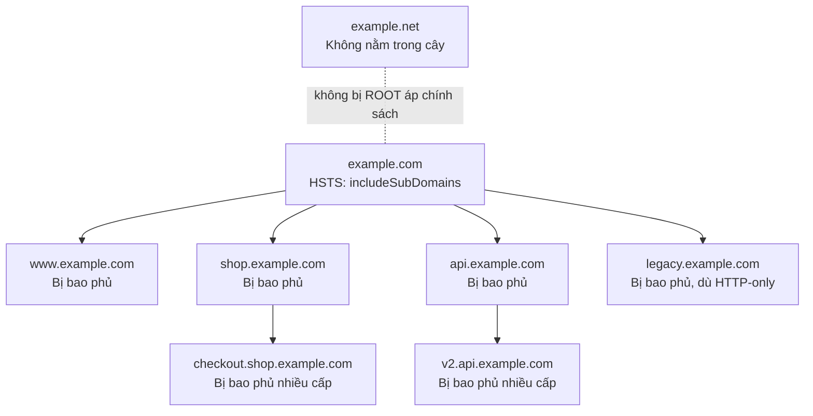
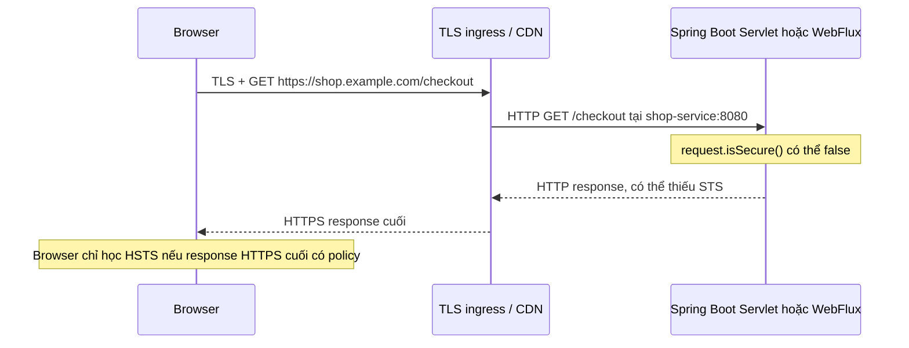

# includeSubDomains và phạm vi các tên miền con

> **Chương:** HTTPS và HSTS  
> **Học phần:** `SPRING_SECURITY_HTTP_PROTECTION` — áp dụng các lớp phòng vệ HTTP và trình duyệt của Spring Security, từ CSRF, CORS, security headers, CSP, HSTS đến HTTP firewall và bảo vệ session.  
> **Chủ đề trọng tâm:** directive `includeSubDomains` của `Strict-Transport-Security`, quy tắc so khớp hostname của trình duyệt, chính sách HSTS độc lập giữa miền cha và con, điều kiện TLS/DNS khi triển khai và kiểm thử bằng Servlet, WebFlux, reverse proxy và browser có trạng thái.

## 1. Tình huống mở đầu: một thay đổi nhỏ tại miền cha có thể làm hỏng nhiều dịch vụ

Tổ chức có một hệ thống thương mại điện tử:

- `https://example.com`: website chính, được quản lý bởi nhóm frontend.
- `https://shop.example.com`: ứng dụng Spring MVC dùng session cookie.
- `https://api.example.com`: API Spring WebFlux.
- `https://admin.example.com`: trang quản trị.
- `http://legacy.example.com`: ứng dụng cũ chưa có HTTPS hợp lệ.
- `https://assets.cdn-provider.example.net`: tệp tĩnh ở miền của nhà cung cấp ngoài.

Nhóm frontend thêm vào response HTTPS của `example.com`:

```http
Strict-Transport-Security: max-age=31536000; includeSubDomains
```

Đây là một dòng header, nhưng nếu browser **đã nhận** nó qua HTTPS hợp lệ, những lần truy cập HTTP sau tới `shop.example.com`, `api.example.com`, `admin.example.com` và **`legacy.example.com`** đều có thể bị **nâng thành HTTPS trước khi gửi ra mạng**.

Kết quả: website chính, shop và API có thể vẫn hoạt động; ứng dụng legacy chỉ có HTTP có thể gặp lỗi kết nối/certificate. HSTS không tự tạo HTTPS listener hay cấp chứng chỉ cho legacy. Khi browser đã ghi nhớ policy dài hạn, việc xóa header khỏi `example.com` cũng **không khiến mọi trình duyệt quên ngay**.

Đồng thời, `assets.cdn-provider.example.net` không tự bị ảnh hưởng chỉ vì cùng một trang HTML tham chiếu tài nguyên đó: nó thuộc một cây hostname khác.

### 1.1. Tư duy cần thay đổi

Trước khi bật `includeSubDomains`, không hỏi đơn thuần:

> “Ứng dụng hiện tại có HTTPS chưa?”

Câu hỏi vận hành đầy đủ là:

> “**Mọi hostname nằm trong phạm vi hậu duệ của tên miền phát HSTS, kể cả các dịch vụ không do cùng team quản lý, đã sẵn sàng HTTPS hợp lệ và có kế hoạch vận hành/rollback chưa?**”

### 1.2. Kết quả học tập

Sau bài này, người học có thể:

1. Diễn giải chính xác `includeSubDomains`, phân biệt hostname phát header, miền cha, miền con trực tiếp, miền con nhiều cấp, hostname “anh em” và miền ngoài.
2. Dự đoán những HTTP URLs được trình duyệt nâng lên HTTPS khi một hoặc nhiều HSTS entries còn hiệu lực.
3. Tránh nhầm quy tắc HSTS với wildcard TLS certificate, DNS wildcard, CORS origin, Cookie Domain, SameSite hoặc Java request matchers.
4. Hiểu **mỗi host có HSTS entry độc lập**, parent có thể bao phủ child nhưng child không xóa được parent bằng `max-age=0`.
5. Giải thích first-visit gap: browser chưa từng nhận policy từ parent thì child có thể vẫn chưa được bảo vệ, dù parent server đã cấu hình.
6. Nhận diện rủi ro includeSubDomains cho DNS delegation, staging/legacy, tenant subdomain, nhiều CDN và nhà cung cấp thứ ba.
7. Cấu hình HSTS với Spring Security Servlet, Reactive WebFlux và edge; soát điều kiện request được xem là HTTPS và trusted forwarding.
8. Lập lộ trình rollout/rollback kiểm tra toàn bộ cây hostname, TLS/certificates, HSTS store, preload và các HTTP security layers khác.
9. Thực hiện unit/integration/browser E2E tests cho domain matching, quy tắc thời hạn, negative cases và sự cố certificate.
10. Chứng minh một policy HSTS đúng không thay thế CSRF, CORS, CSP, session security, HTTP firewall hay phân quyền dữ liệu.

## 2. HSTS và includeSubDomains thực sự nói gì?

HSTS (HTTP Strict Transport Security), đặc tả trong **RFC 6797**, là chính sách do một hostname gửi trong HTTPS response. Browser hỗ trợ HSTS nhận và nhớ policy để các HTTP URLs thuộc phạm vi sẽ được chuyển sang HTTPS **ở client trước khi phát request**.

Header cơ sở chỉ áp cho hostname phát:

```http
Strict-Transport-Security: max-age=31536000
```

Header mở rộng xuống các hostname con:

```http
Strict-Transport-Security: max-age=31536000; includeSubDomains
```

Thêm `preload` để biểu thị dự định tham gia chương trình preload:

```http
Strict-Transport-Security: max-age=63072000; includeSubDomains; preload
```

**Ba dòng trên là ba ví dụ thay thế nhau**, không được gửi như ba policy đồng thời. Những giá trị thời hạn chỉ mang tính minh họa, không phải đề xuất bật `preload` trên domain production chưa được kiểm kê.

### 2.1. Directive không có giá trị gán

`includeSubDomains` là **valueless directive** trong RFC 6797 `6.1.2. Nó có nghĩa khi **xuất hiện** trong một STS header hợp lệ.

```http
# Hợp lệ theo cú pháp của directive:
Strict-Transport-Security: max-age=300; includeSubDomains
```

Không dùng các biến thể tự chế như:

```http
# Ví dụ KHÔNG dùng làm cấu hình thật:
Strict-Transport-Security: max-age=300; includeSubDomains=true
Strict-Transport-Security: max-age=300; includeSubDomains=*.example.com
Strict-Transport-Security: max-age=300; excludeSubDomains=legacy.example.com
```

HSTS không có cú pháp wildcard liệt kê tên miền con, và RFC 6797 **không có directive loại trừ hostname con** kiểu `excludeSubDomains`.

### 2.2. HSTS tác động ở đâu trong vòng đời HTTP?

- **TLS:** browser kết nối HTTPS và xác minh certificate, hostname, chain tin cậy.
- **STS response:** hostname công bố `max-age` và tùy chọn `includeSubDomains`.
- **HSTS store:** browser lưu entry theo domain name đã phát policy.
- **Request sau:** browser xem hostname đích có bằng hostname HSTS hoặc nằm trong cây con của HSTS ancestor có `includeSubDomains` không.
- **URL rewrite nội bộ:** HTTP URI phù hợp được nâng sang HTTPS **trước khi tới proxy/server**.
- **TLS mới:** browser lại xác minh certificate ở hostname đích được nâng.

`includeSubDomains` không làm cho HTTPS request hiện tại “an toàn hơn” nếu TLS đã hợp lệ; nó mở phạm vi bảo vệ của **policy cho các request tương lai**.

### 2.3. Ba điều không được suy từ một header

Header không chứng minh:

1. Browser đã từng **nhìn thấy** HTTPS response của miền cha.
2. Toàn bộ subdomains thực sự có HTTPS listener/certificate hợp lệ.
3. Mọi client, SDK hoặc mobile networking library đều áp HSTS như trình duyệt.

Policy tồn tại trong cấu hình server và policy **đã được browser lưu** là hai trạng thái khác nhau.

## 3. “Miền con” theo nhãn DNS, không theo chuỗi ký tự tùy ý

RFC 6797 `8.2 quy định đối chiếu tên miền theo **các DNS labels**, bắt đầu từ nhãn bên phải và so sánh ASCII không phân biệt hoa/thường. Một miền HSTS có thể khớp:

- **Congruent match:** tên đích trùng chính hostname đã lưu.
- **Superdomain match:** tên đã lưu là miền cha của hostname đích theo ranh giới nhãn.

Ví dụ browser biết HSTS của `secure.example.com` với `includeSubDomains`.

| URL hostname đích | Khớp? | Lý do |
| --- | --- | --- |
| `secure.example.com` | **Có** | Trùng chính host phát |
| `login.secure.example.com` | **Có** | Một nhãn con bên trái |
| `a.b.secure.example.com` | **Có** | Nhiều cấp con |
| `SECURE.EXAMPLE.COM` | **Có** | DNS matching không phân biệt ASCII letter case |
| `example.com` | **Không** | Miền **cha**, không phải hậu duệ |
| `api.example.com` | **Không** | Host “anh em” của secure |
| `notsecure.example.com` | **Không** | Không cùng ranh giới nhãn `secure` |
| `badsecure.example.com` | **Không** | Chứa chuỗi “secure”, không phải label `secure` |
| `secure-example.com` | **Không** | Miền khác |
| `secure.example.com.attacker.net` | **Không** | Suffix thực là `attacker.net` |
| `secure.example.net` | **Không** | Khác TLD/nhánh tên miền |

**Đây là so khớp label của hostname**, không phải một phép kiểm `host.endsWith("example.com")` thực hiện thiếu dấu chấm ranh giới. Cấu hình proxy, application code và security controls khác cũng cần tránh kiểu so khớp hostname thiếu label boundary.

### 3.1. Phân biệt hậu duệ với anh em cùng miền cha

Ví dụ `shop.example.com` và `api.example.com` là hai hostname **anh em**. Một chính sách phát từ `shop.example.com` với `includeSubDomains` sẽ áp xuống:

```text
cart.shop.example.com
checkout.cart.shop.example.com
```

Nhưng không lan ngang sang:

```text
api.example.com
admin.example.com
legacy.example.com
```

Muốn ảnh hưởng **cả những hostname anh em**, parent `example.com` phải được browser nhận policy có `includeSubDomains`, hoặc mỗi hostname phát HSTS riêng.

### 3.2. Không coi “www” là tên miền gốc

`www.example.com` là một subdomain của `example.com`. Nếu chỉ `www.example.com` phát STS `includeSubDomains`, policy của browser không tự bao phủ `example.com` hay `api.example.com`.

Đây là lỗi thường gặp khi CDN tự thêm HSTS ở host có `www` và đội vận hành nghĩ cả apex root đã được bảo vệ.

### 3.3. Ranh giới “.example.com” có ý nghĩa

Trong code security để validate host, không dùng:

```java
// Ví dụ về suy luận sai; đây không phải thuật toán HSTS:
boolean unsafe = host.endsWith("example.com");
```

Biểu thức này có thể nhầm `notexample.com` với `example.com`. Nếu phải viết một phép kiểm hostname trong hệ thống khác, cần dùng so sánh **chính xác** hoặc so khớp dấu chấm nhãn phù hợp, xử lý canonical host/IDNA theo thư viện tiêu chuẩn.

HSTS browser đã có quy tắc domain matching từ RFC. **Không cần tự viết HSTS matcher Java để mô phỏng chức năng của browser**.

## 4. Cây tên miền: hiệu lực theo chiều xuống

Hãy xét khi **browser đã nhận STS có `includeSubDomains` từ `example.com`**:



Sơ đồ mô tả **quy tắc lựa chọn HTTPS phía browser**, không bảo đảm mọi hostname trong cây tồn tại trên DNS hoặc có certificate hợp lệ.

### 4.1. Có phải browser tạo một entry mới cho mỗi con?

Không nhất thiết. RFC `5.3` và `8.1.1` mô tả HSTS store theo hostname phát policy. Browser có thể ghi nhớ **entry của `example.com`**, có cờ includeSubDomains; khi user điều hướng tới `api.example.com`, browser thực hiện **superdomain match**.

Một child chỉ có **entry riêng** nếu đã tự phát STS và browser nhận nó qua HTTPS hợp lệ (hoặc một cơ chế preload khác tác động).

### 4.2. Không được hiểu “tất cả subdomains” là wildcard DNS provisioning

`includeSubDomains` không:

- Tạo bản ghi `A`, `AAAA`, `CNAME` trong DNS.
- Sinh wildcard DNS như `*.example.com`.
- Cấp wildcard TLS certificate.
- Cài HTTPS listener trên những host con.
- Chuyển HTTP server đang listen 8080 sang TLS.
- Xác minh domain ownership giữa nhiều đội/nhà cung cấp.
- Thiết lập proxy route đến backend.

Nó chỉ làm browser **từ chối dùng HTTP cho những hostname đích phù hợp** khi policy còn hiệu lực.

### 4.3. Cả host con chưa từng tồn tại cũng có thể bị ảnh hưởng về sau

HSTS policy được áp **khi browser chuẩn bị load HTTP URL**. Nếu năm nay bật includeSubDomains một năm và năm sau tạo `new-service.example.com`, browser còn policy parent có thể **ép HTTPS ngay lần đầu truy cập host con mới**.

Vì vậy inventory phải bao gồm cả **quy trình tạo hostname trong tương lai**, không chỉ danh sách DNS hiện tại.

## 5. Bảng lựa chọn HSTS theo ba điểm đặt policy

Ba phương án tưởng giống nhau nhưng kết quả hoàn toàn khác nhau:

| Host phát STS | Header | Phạm vi mà browser đã nhận policy sẽ áp |
| --- | --- | --- |
| `example.com` | `max-age=31536000` | Chỉ `example.com` |
| `example.com` | `max-age=31536000; includeSubDomains` | `example.com` và toàn bộ hậu duệ |
| `www.example.com` | `max-age=31536000; includeSubDomains` | `www.example.com` và hậu duệ của `www`, **không có `api.example.com`** |
| `shop.example.com` | `max-age=31536000; includeSubDomains` | `shop.example.com`, `cart.shop.example.com`, ... |
| `api.example.com` | `max-age=31536000` | Chỉ `api.example.com` |
| `deep.api.example.com` | `max-age=31536000; includeSubDomains` | Tên `deep.api.example.com` và hậu duệ của **deep**, không áp ngược lên `api.example.com` |

### 5.1. “Có trong header của server” chưa phải “có trong browser”

Giả sử DNS có:

```text
example.com
www.example.com
```

Server `example.com` đã được cấu hình HSTS includeSubDomains, nhưng trong hành trình người dùng, tất cả liên kết và bookmarks đều dẫn thẳng tới `https://www.example.com`. Nếu browser chưa bao giờ nhận HTTPS response từ `example.com`, nó **chưa học policy động của apex**.

Vì vậy `www.example.com` **nên phát HSTS riêng** để bảo vệ user truy cập trực tiếp. MDN và RFC 6797 mô tả rõ trường hợp này.

### 5.2. Chính sách không “nhảy” từ hostname con lên cha

Một child không có quyền công bố HSTS cho parent bằng STS của chính child. Ví dụ dịch vụ ở `tenant.example.com` không thể làm browser ghi một dynamic HSTS entry cho `example.com` chỉ bằng response STS từ tenant.

Điều này ngăn một website con thay policy của toàn miền cha qua cơ chế HSTS thông thường. Ngược lại, chủ miền cha có thể tạo ảnh hưởng rộng tới các child, nên trách nhiệm quản trị của parent cao hơn.

## 6. Kịch bản browser chưa truy cập miền cha: lỗ hổng first contact

Đây là bẫy quan trọng nhất khi test chỉ kiểm tra header tại `example.com`.

```mermaid
sequenceDiagram
    participant B as Browser mới
    participant A as example.com (parent)
    participant C as shop.example.com (child)
    Note over A: Parent đã cấu hình STS includeSubDomains
    Note over B: Browser chưa từng nhận HTTPS response từ A
    B->>C: User nhập http://shop.example.com
    Note over B,C: Chưa có parent dynamic policy để nâng URL
    C-->>B: HTTP redirect hoặc response theo policy child
    B->>A: Lần sau mới truy cập HTTPS example.com
    A-->>B: STS max-age=...; includeSubDomains
    Note over B: Lưu policy của parent
    B->>B: User nhập lại http://shop.example.com
    B->>C: HTTPS trực tiếp, không gửi HTTP request ban đầu
```

**Ghi chú:** thực tế browser còn có HTTPS-first, preloaded HSTS hoặc child policy riêng. Sơ đồ giả định chúng **không tồn tại** để làm rõ HSTS động của parent.

### 6.1. Làm gì để giảm khoảng trống?

- Phát STS từ **chính các subdomains** phục vụ website/API qua HTTPS hợp lệ.
- Dùng URL/link/form/API base URL HTTPS ngay từ đầu.
- Đảm bảo public HTTP chỉ redirect/reject, không phát dữ liệu cá nhân.
- Đặt cookie `Secure` và session protections phù hợp.
- Cân nhắc preload **sau khi toàn bộ tên miền con đã sẵn sàng và được phê duyệt**.
- Duy trì TLS/certificates cho cả apex và subdomains, không dựa riêng vào parent redirect.

### 6.2. Vì sao mỗi child nên có policy riêng ngay cả khi parent includeSubDomains?

Nếu browser chỉ thăm child, không thăm parent, nó có thể học **child policy** mà không cần biết parent. Nếu browser đã học parent nhưng parent hết hạn trước child, child entry riêng vẫn tiếp tục bảo vệ chính child.

Nhưng không có yêu cầu bắt buộc phải thêm policy ở tất cả hosts bằng Spring Security nếu edge đã phát STS đúng cho từng hostname và ownership được thống nhất. Điều quan trọng là **response HTTPS của từng hostname** truyền policy dự kiến, không nhất thiết mỗi backend tự bật writer.

## 7. Chính sách parent và child được lưu độc lập

RFC 6797 `5.3` quy định browser lưu HSTS policies **tách biệt theo từng hostname phát policy**. Parent entry và child entry có thể có `max-age` và `includeSubDomains` khác nhau; một entry không tự thay giá trị hoặc thời hạn của entry khác.

Ví dụ browser đã học:

```text
Host entry #1:
  hostname = example.com
  max-age  = 604800
  includeSubDomains = true

Host entry #2:
  hostname = api.example.com
  max-age  = 86400
  includeSubDomains = false

Host entry #3:
  hostname = admin.example.com
  max-age  = 31536000
  includeSubDomains = true
```

Giả sử tất cả còn hiệu lực.

| URL HTTP đích | Entry nào có thể khiến nâng HTTPS? |
| --- | --- |
| `http://example.com` | Entry #1 (exact) |
| `http://api.example.com` | Entry #1 (ancestor) và #2 (exact) |
| `http://v2.api.example.com` | Entry #1 (ancestor), **không phải #2** vì #2 không include children |
| `http://admin.example.com` | Entry #1 (ancestor) và #3 (exact) |
| `http://deep.admin.example.com` | Entry #1 (ancestor) và #3 (ancestor) |
| `http://legacy.example.com` | Entry #1 (ancestor), dù legacy chưa tự phát STS |
| `http://example.net` | Không từ ba entries trên |

### 7.1. Một child không thể “opt-out” khỏi parent đang hiệu lực

`api.example.com` gửi:

```http
Strict-Transport-Security: max-age=0
```

Browser nhận qua HTTPS hợp lệ sẽ xóa **dynamic entry của chính `api.example.com`**. Nhưng entry của `example.com` vẫn còn `includeSubDomains`. Vì vậy `api.example.com` **vẫn thuộc HTTPS-only theo parent**.

Không có “HSTS exception” từ child để ghi đè ancestor bằng một `max-age` ngắn hơn hoặc `0`.

### 7.2. Parent max-age=0 có xóa child policy không?

Không. Khi `example.com` gửi qua HTTPS:

```http
Strict-Transport-Security: max-age=0
```

nó yêu cầu xóa **entry của example.com** và cờ includeSubDomains của entry đó. Những entries độc lập của `api.example.com` hoặc `admin.example.com` **không tự bị xóa**.

### 7.3. Khi một trong hai policy hết hạn

Giả định parent và child được học ở những thời điểm khác nhau:

| Trạng thái | Parent `example.com` | Child `api.example.com` | HTTPS cho `api.example.com`? |
| --- | --- | --- | --- |
| A | Còn, includeSubDomains=true | Còn | Có |
| B | Còn, includeSubDomains=true | Hết | Có, vì parent |
| C | Hết | Còn | Có, vì child exact |
| D | Hết | Hết | Không có HSTS từ hai entries này; có thể còn preload/HTTPS-first |
| E | Còn, includeSubDomains=false | Hết | Không do parent này áp child |
| F | Còn, includeSubDomains=false | Còn | Có, vì child exact |
| G | Còn, includeSubDomains=true | Child vừa gửi `max-age=0` | Có, vì parent |
| H | Parent vừa gửi `max-age=0` | Child còn | Có, vì child |

**Mỗi entry là một bộ đếm riêng.** Không tính expiry cho child bằng cách cộng/trừ max-age của parent.

## 8. Mô hình thuật toán browser để luyện suy luận

Một mô hình **giản lược** giúp học cách chọn hostname:

```text
hstsEntries = Map<domainName, {
    expiresAt,
    includeSubDomains,
    source: dynamic
}>

shouldUpgradeHttp(host, now):
    if host is an IP literal:
        return false   // RFC 6797 không lưu IP-literal làm HSTS Host

    for each unexpired HSTS entry e:
        if equalDnsLabels(host, e.domainName):
            return true
        if isStrictSubdomainByDnsLabels(host, e.domainName)
           and e.includeSubDomains:
            return true

    if preloadListCovers(host):
        return true

    return false   // Chưa xét HTTPS-first, extension, policy trình duyệt
```

Mô hình này không phải source code của Chrome/Firefox/Safari, không xử lý đầy đủ normalization của IDNA, các loại port, internal browser policies hay storage/expiration details. **Không dùng nó làm security-critical hostname parser tự viết trong ứng dụng**.

### 8.1. Vì sao cần so khớp theo DNS labels?

Dưới đây là vài cặp:

```text
Known HSTS Host: example.com
Given host:      api.example.com         -> superdomain match
Given host:      notexample.com          -> no match
Given host:      example.com.attacker.tld -> no match

Known HSTS Host: shop.example.com
Given host:      cart.shop.example.com   -> superdomain match
Given host:      api.example.com         -> no match
Given host:      shop.example.com        -> congruent match
```

Điều kiện label-by-label tránh sai lầm khi dùng so khớp chuỗi thiếu ranh giới và đánh giá sai hostname trong các URL.

### 8.2. Không suy từ CNAME hoặc IP chung

`assets.example.com` có thể CNAME tới `cdn.vendor.example.net`. HSTS matching của URL `https://assets.example.com` xét **hostname trong URL `assets.example.com`**, không thay bằng hostname đích DNS CNAME để quyết định policy của `example.com`.

Tương tự, hai hostname trỏ cùng một IP không có nghĩa HSTS entries được chia sẻ. Hostname và TLS identity của URL vẫn khác.

### 8.3. DNS delegation không chặn includeSubDomains

Nếu chủ `example.com` giao vận hành `customers.example.com` hoặc `tenant.example.com` cho đối tác qua NS/CNAME, những hosts đó **vẫn là hậu duệ theo hostname**. Browser đã học `example.com; includeSubDomains` vẫn áp, dù backend, tài khoản cloud hay DNS zone con thuộc chủ thể khác.

Đây là lý do includeSubDomains phải được phê duyệt ở **cấp người sở hữu toàn domain**, không chỉ team quản lý apex website.

## 9. Những gì HSTS không thay đổi khi mở phạm vi

| Đối tượng | HSTS có sửa trực tiếp không? | Ý nghĩa |
| --- | --- | --- |
| DNS A/AAAA/CNAME/NS | Không | DNS vẫn ánh xạ theo cấu hình riêng |
| TLS certificate SAN | Không | Host con phải có certificate khớp hostname |
| TLS listener/port | Không | Server/proxy phải phục vụ HTTPS trên port đích |
| HTTP method | Không | POST vẫn là POST khi browser tự nâng scheme trước network |
| Application authorization | Không | User phải được kiểm tra quyền tenant/owner |
| Cookie Domain/Path | Không | Cookie scoping độc lập |
| Cookie `Secure`/`HttpOnly`/`SameSite` | Không | Browser còn policy cookie riêng |
| CORS origin | Không | Khác hostname vẫn có thể khác origin |
| CSP source list | Không | Script/frame policies áp theo document |
| HTTP firewall | Không | Path parser và request normalization vẫn cần |
| Reverse proxy path rewrite | Không | Matcher chain/app có thể khác public path |
| Backend HTTP sau TLS edge | Không | HSTS không mã hóa hop nội bộ |
| CDN cache key | Không | HSTS không ngăn cross-user cache leak |
| Browser profile history | Có liên quan nhưng không trực tiếp quản lý | Dynamic store là một loại state riêng |

### 9.1. HSTS không có quan hệ với wildcard certificate “một cách tự động”

Một certificate `*.example.com` thường chỉ khớp **một nhãn bên dưới** như `api.example.com`, không tự khớp `deep.api.example.com` hoặc `example.com`. Certificate cho những host sâu cần SAN phù hợp hoặc wildcard thích hợp theo hostname/TLS rules.

Trong khi đó includeSubDomains áp **nhiều cấp không giới hạn bởi một dấu sao**. Vì vậy có thể xảy ra trường hợp browser ép HTTPS cho `deep.api.example.com` nhưng certificate `*.example.com` **không hợp lệ** cho host này.

### 9.2. DNS wildcard không phải TLS wildcard hay HSTS wildcard

Một DNS record `*.example.com` có thể resolve nhiều names; nó không làm certificate hoặc HSTS policy trở nên hợp lệ cho mọi host sâu. Ngược lại, includeSubDomains có thể áp cho một tên con **không có DNS record**, khiến kết nối thất bại trước khi tới server.

Mỗi lớp có tiêu chí riêng:

```text
DNS: tên đích có resolve đến endpoint?
TLS: endpoint có hỗ trợ HTTPS/cert đúng hostname?
HSTS: browser có policy bắt buộc dùng HTTPS cho tên đó?
Spring Security: request đã vào chain đúng và có quyền không?
```

## 10. HSTS theo hostname, không giới hạn bởi port và path

Một khi `example.com` được browser xem là Known HSTS Host, sự bảo vệ transport áp lên host đó theo quy tắc RFC, không chỉ một path.

Ví dụ `api.example.com` bị parent includeSubDomains bao phủ:

| HTTP URL ban đầu | Cách browser có HSTS xử lý | Điều kiện |
| --- | --- | --- |
| `http://api.example.com/users` | `https://api.example.com/users` | Port mặc định HTTPS |
| `http://api.example.com:80/users` | `https://api.example.com:443/users` | Port 80 đổi sang 443 |
| `http://api.example.com:8080/users` | `https://api.example.com:8080/users` | Cổng khác 80 được giữ |
| `http://api.example.com:8443/users` | `https://api.example.com:8443/users` | Không dùng Servlet PortMapper |
| `http://v2.api.example.com/users` | `https://v2.api.example.com/users` | Parent includeSubDomains bao host sâu |
| `https://api.example.com/users` | Vẫn HTTPS | Không có HTTP scheme để nâng |

### 10.1. Đừng nhầm PortMapper của Servlet

Spring Security Servlet có thể dùng `PortMapper` khi tạo **server-side HTTP→HTTPS redirect**; HSTS được browser áp **trước request** và dùng quy tắc port của RFC, không hỏi `portMapper(8080→8443)` của backend.

Khi test một host có HSTS, `http://host:8080` có thể trở thành HTTPS **trên cổng 8080**, và thất bại nếu cổng đó chỉ nói HTTP. Đây là hệ quả quan trọng khi mở includeSubDomains cho nhiều service/dev ports.

### 10.2. Không tạo ngoại lệ theo route

HSTS không có cách nói “bao phủ `/admin/**` nhưng không `/health`”. Khi browser đã ghi nhớ policy của host, nó áp cho hostname phù hợp trong mọi path, kể cả path do ứng dụng khác cùng host phục vụ.

Với application routing, `securityMatcher` và `requestMatchers` của Spring Security chỉ chọn **request trong các security chains**, không giới hạn chính sách HSTS browser sau khi đã học.

## 11. Phân biệt includeSubDomains với Preload

Dynamic HSTS có một giới hạn: browser phải **đã nhận header** trên HTTPS response hợp lệ của host phát.

Preload là một cơ chế phân phối danh sách hostname HSTS thông qua hệ sinh thái browser để giảm khoảng trống trước lần truy cập đầu. Directive:

```http
Strict-Transport-Security: max-age=63072000; includeSubDomains; preload
```

không tự biến website thành thành viên preload list. Một host phải qua **điều kiện/đăng ký/chờ phân phối** theo chương trình hiện hành, chẳng hạn [HSTS Preload List Submission](https://hstspreload.org/).

### 11.1. Tại sao bật includeSubDomains không bắt buộc phải preload?

- Có thể phát dynamic HSTS với `includeSubDomains` mà **không** thêm `preload`.
- Có thể phát dynamic HSTS chỉ trên hostname mà không gồm descendants.
- Preload thường đòi scope/TTL và các điều kiện nghiêm ngặt hơn tùy chương trình.
- Preload có rollback chậm hơn: không thể chỉ gửi `max-age=0` rồi lập tức làm mọi browser bỏ entry đã được đóng gói.

Do đó đừng thêm `preload` chỉ vì một lint/security scanner khuyến khích; phải có approval từ chủ DNS/domain và kế hoạch dài hạn.

### 11.2. Một hostname preloaded có thể làm thay đổi kết quả test

Nếu `example.com` đã preloaded với descendants, browser profile mới vẫn có thể ép HTTPS cho `legacy.example.com` mà không cần truy cập apex. Nếu bài kiểm thử nhằm chứng minh **dynamic** HSTS từ header của apex, dùng hostname lab **không có preload và không có ancestor policy** để tách kết quả.

### 11.3. HSTS không phải chính sách cho “mọi browser/client”

Một số HTTP client libraries không lưu HSTS; `curl` có thể dùng HSTS store riêng khi được bật/tùy version, nhưng không được mặc nhiên coi nó giống Chrome. Mobile SDK/service-to-service clients phải được cấu hình HTTPS/TLS verification theo contract, không phụ thuộc người dùng đã ghé apex hay chưa.

## 12. Thời hạn max-age và phạm vi includeSubDomains

Theo RFC 6797, browser lưu cho mỗi hostname phát policy:

- Domain name.
- Thời điểm hết hạn tính từ lần nhận policy `max-age`.
- Cờ `includeSubDomains` có được assert hay không.

Ví dụ:

```http
Strict-Transport-Security: max-age=604800; includeSubDomains
```

Browser nhận qua HTTPS tại `example.com` lúc `t0` có thể xem `example.com` và descendants thuộc chính sách đến khoảng `t0 + 604800 giây`, trừ khi sau đó nhận policy mới/xóa hoặc có xử lý riêng.

### 12.1. Refresh policy của parent

Nếu browser nhận lại `max-age=604800; includeSubDomains` từ `example.com` sau 3 ngày, expiry của **parent entry** được cập nhật từ lúc nhận mới. Child entries độc lập **không tự được gia hạn** chỉ vì browser nhận parent header.

### 12.2. Refresh policy của child

Nếu browser chỉ nhận STS mới từ `api.example.com`, nó cập nhật entry của **api**, không thay expiry/cờ includeSubDomains của `example.com`. Đây là quy tắc quản lý HSTS storage theo hostname phát.

### 12.3. Bỏ includeSubDomains ở parent thì sao?

Giả sử parent đã phát:

```http
Strict-Transport-Security: max-age=31536000; includeSubDomains
```

sau đó đổi thành:

```http
Strict-Transport-Security: max-age=86400
```

Một browser **nhận được header mới qua HTTPS của parent** có thể cập nhật parent entry với duration mới và **includeSubDomains=false**. Nhưng browser chưa truy cập lại parent vẫn giữ policy đã lưu trước đó, có thể ép descendants trong thời gian còn lại.

**Không khẳng định rollout “đã tắt includeSubDomains cho toàn bộ người dùng” chỉ vì code server mới đã deploy.**

## 13. max-age=0 và khả năng thu hồi theo cấp tên miền

Một STS response hợp lệ qua HTTPS:

```http
Strict-Transport-Security: max-age=0
```

yêu cầu user agent ngừng xem **host phát response đó** là Known HSTS Host trong dynamic store. Hệ quả trên policy parent/child:

| Host phát `max-age=0` | Entry bị xóa | Entry **không** bị xóa |
| --- | --- | --- |
| `example.com` | Dynamic policy của `example.com`, gồm cờ includeSubDomains của entry này | Entry riêng của `shop.example.com`, `api.example.com` |
| `api.example.com` | Dynamic policy của `api.example.com` | Parent `example.com`, siblings khác |
| `v2.api.example.com` | Dynamic policy của `v2.api.example.com` | `api.example.com` và `example.com` |
| `shop.example.com` | Dynamic policy của `shop.example.com` | `checkout.shop.example.com` nếu child đã lưu entry riêng |

**Không tồn tại chỉ thị “child opt-out khỏi HSTS của parent” trong RFC 6797.**

### 13.1. Khi HTTPS đã hỏng, xóa policy không phải thao tác tức thì

Nếu browser ép HTTPS cho `legacy.example.com` nhưng host đó không có HTTPS listener hoặc cert hợp lệ, browser không thể nhận một STS response HTTPS hợp lệ từ legacy để xóa entry của chính legacy; dù xóa được child, parent còn áp.

Phương án ưu tiên để phục hồi availability an toàn:

1. Khôi phục HTTPS listener/certificate đúng cho affected hostname.
2. Xác định **nguồn policy**: parent, child, preload hoặc nhiều nguồn.
3. Cập nhật policy tại **host phát entry** khi cần và có thể.
4. Nhớ rằng các browser offline/chưa ghé host phát vẫn giữ state cũ.
5. Nếu preload, dùng quy trình gỡ và chấp nhận thời gian phân phối riêng.

Không chỉ thêm HTTP redirect rồi kỳ vọng browser HSTS sẽ đi qua HTTP để nhận nó: khi đã biết HSTS, browser thường không gửi HTTP ban đầu.

### 13.2. Một host con phát max-age=0 không làm parent “quên”

Trường hợp có ảnh hưởng vận hành:

```text
example.com
  max-age=31536000; includeSubDomains
  browser đã ghi nhớ

legacy.example.com
  max-age=0
  browser nhận qua HTTPS
```

Browser xóa dynamic entry legacy, nhưng vẫn ép HTTPS vì parent entry. Đây là hệ quả thiết kế, không phải bug của Spring Security writer hay CDN cache.

## 14. Triển khai HSTS theo từng hostname, không theo “một service”

Một cùng service có thể đứng sau nhiều hostnames; một hostname có thể proxy tới nhiều services:

```text
example.com             -> CDN landing
shop.example.com        -> Spring MVC
api.example.com         -> Spring WebFlux
static.example.com      -> Object storage/CDN
users.example.com       -> Identity provider frontend
legacy.example.com      -> App cũ
tenant-a.example.com    -> Tenant/customer A
tenant-b.example.com    -> Tenant/customer B
status.example.com      -> Provider external
```

Bật `includeSubDomains` ở apex **mang tính tổ chức**: nó ảnh hưởng những hostname theo ranh giới DNS, **không quan tâm backend framework**.

### 14.1. Những nhóm host thường bị bỏ sót khi kiểm kê

- Staging/sandbox/test/preview names.
- SaaS custom hostnames, portal của đối tác.
- Subdomains dùng NS delegation cho bên thứ ba.
- Vanity sites/campaign microsites theo thời vụ.
- API v1, legacy admin consoles.
- Static assets/redirect endpoints, download/media hosts.
- OAuth/OIDC login/callback hosts.
- Health/observability/UIs ngoài public network.
- Subdomains mới được tạo sau rollout.
- Các hostname chạy HTTP trên port tùy chỉnh.
- Các hosts không thuộc web nhưng có HTTP admin UI.
- Wildcard routing để tự cấp tên theo tenant.
- Reverse proxy khác nhau theo vùng địa lý, CDN error domains.

Một tên miền con chỉ dùng **SMTP/SSH/non-HTTP** không bị HSTS trực tiếp áp lên những giao thức đó, vì HSTS nói về HTTP URLs. Nhưng nếu một hostname đồng thời có HTTP admin page hoặc webmail, phần web của nó vẫn bị tác động. Không mở rộng sai “HSTS bắt mọi giao thức thành TLS”.

### 14.2. NS delegation không phải ngoại lệ HSTS

Giả sử `client.example.com` được giao cho khách hàng qua DNS delegation. Hostname vẫn nằm dưới `example.com`. Browser đã học includeSubDomains của parent sẽ áp khi khách hàng truy cập `http://client.example.com`.

Đó là rủi ro trách nhiệm giữa các đội/đối tác: người vận hành parent có thể vô tình **ép HTTPS trên tên miền do người khác quản lý**.

### 14.3. Không có “bỏ qua legacy” bằng một header trên legacy

Nếu legacy không hỗ trợ TLS, các lựa chọn thực tế là:

- Nâng cấp legacy lên HTTPS hợp lệ.
- Cấp HTTPS qua reverse proxy trước legacy theo threat model, bảo vệ hop nội bộ phù hợp.
- Di chuyển legacy sang một hostname **ngoài cây parent HSTS** sau đánh giá kiến trúc.
- Hoãn bật includeSubDomains tại parent.
- Thiết kế migration/retirement với người sở hữu ứng dụng.

Cố đưa `max-age=0` lên legacy **không vô hiệu hóa parent policy**.

## 15. TLS certificates: includeSubDomains rộng hơn rất nhiều một wildcard

Một lỗi kiểm kê phổ biến là có certificate `*.example.com` nên kết luận an toàn bật includeSubDomains cho toàn cây.

| Hostname | Certificate chỉ có SAN `*.example.com` thường hợp lệ? | HSTS từ parent `example.com` với includeSubDomains có áp? |
| --- | --- | --- |
| `example.com` | **Không**, cần tên apex riêng | Có |
| `www.example.com` | Có, một nhãn | Có |
| `api.example.com` | Có, một nhãn | Có |
| `deep.api.example.com` | **Không**, hai nhãn sâu | Có |
| `v2.deep.api.example.com` | **Không**, sâu hơn | Có |
| `example.net` | Không | Không từ parent `example.com` |

**Không có sự tương ứng 1-1 giữa phạm vi wildcard TLS certificate và phạm vi includeSubDomains.**

### 15.1. Kiểm kê TLS cần xét gì?

1. DNS của từng hostname.
2. SNI routing và HTTPS listener thực.
3. Certificate SAN/wildcard matching đúng host.
4. Chain tin cậy, thời hạn, renewal.
5. Các HTTPS ports ngoài 443 nếu có client dùng.
6. Redirect/canonical host và forwarded scheme.
7. CDN TLS termination và upstream security.
8. Kế hoạch khi hosting provider đổi cert/edge deployment.
9. TLS đối với subdomains mới do tenant tạo.
10. Failover region có cert/route giống production.

Nếu parent HSTS khiến browser buộc TLS cho host không đáp ứng các điều này, user agent có thể từ chối kết nối và **không cho bỏ qua certificate error** như với host chưa bị HSTS chi phối.

### 15.2. Không đánh tráo “TLS có sẵn” bằng “TLS hợp lệ”

Kết nối `https://deep.api.example.com` bắt tay TCP/TLS được nhưng chứng chỉ không khớp hostname vẫn là **lỗi**. Dùng một HTTPS client có certificate + hostname verification, không dùng `curl -k` để chấm PASS.

## 16. HSTS ở Spring Security Servlet: cấu hình phạm vi subdomains

Trong Servlet Spring Security, `HstsHeaderWriter` viết header HSTS khi request được xem là **secure** theo điều kiện mặc định. Javadoc mô tả mặc định writer:

- `max-age`: khoảng một năm (`31536000` giây).
- `includeSubDomains`: `true`.
- `preload`: `false`.
- Điều kiện viết STS: mặc định `ServletRequest.isSecure() == true`.

Đây là những mặc định **cần biết trước khi dùng withDefaults()**, vì một hostname gốc của tổ chức có thể vô tình phát includeSubDomains dù developer không gọi setter.

### 16.1. Không bật includeSubDomains khi còn legacy HTTP-only

Ví dụ cấu hình thận trọng cho một host đang rollout:

```java
package example.security;

import static org.springframework.security.config.Customizer.withDefaults;

import org.springframework.context.annotation.Bean;
import org.springframework.context.annotation.Configuration;
import org.springframework.security.config.annotation.web.builders.HttpSecurity;
import org.springframework.security.web.SecurityFilterChain;

@Configuration
class ServletSecurityConfig {

    @Bean
    SecurityFilterChain securityFilterChain(HttpSecurity http)
            throws Exception {
        return http
            .headers(headers -> headers
                .httpStrictTransportSecurity(hsts -> hsts
                    .maxAgeInSeconds(86400)
                    .includeSubDomains(false)
                    .preload(false)
                )
            )
            .csrf(withDefaults())
            .authorizeHttpRequests(auth -> auth
                .requestMatchers("/health").permitAll()
                .anyRequest().authenticated()
            )
            .build();
    }
}
```

**Bối cảnh:** ứng dụng được giao phát HSTS ở hostname của nó, cần có HTTPS listener hoặc trusted proxy metadata để request được xem secure. `86400` là giai đoạn minh họa, **không** là khuyến nghị cố định cho mọi production host.

Khi chủ domain đã hoàn tất kiểm kê con, thay:

```java
.httpStrictTransportSecurity(hsts -> hsts
    .maxAgeInSeconds(31536000)
    .includeSubDomains(true)
    .preload(false)
)
```

và tiếp tục test browser/proxy/TLS. Chữ `includeSubDomains(true)` chỉ có ý nghĩa khi browser nhận HTTPS response từ **hostname mà Spring Security đang phục vụ**, không từ một hostname khác trong metadata bất kỳ.

### 16.2. Không cấu hình theo Servlet path rồi hiểu nhầm phạm vi browser

Giả sử chỉ chain `/login` phát STS trên HTTPS:

```java
http.securityMatcher("/login/**")
    .headers(headers -> headers
        .httpStrictTransportSecurity(hsts -> hsts
            .includeSubDomains(true)));
```

Khi browser học HSTS từ một response `https://shop.example.com/login`, browser sẽ áp chính sách cho **toàn `shop.example.com` và con của shop** (nếu còn hiệu lực), không chỉ `/login`. Việc `securityMatcher` giới hạn nơi header được viết **không** giới hạn HSTS client theo path.

**Vấn đề ngược:** những browser không bao giờ vào `/login` có thể không nhận STS do chain khác không phát header. Đó là lý do nên xác định owner theo hostname (thường edge) và test nhiều routes.

### 16.3. Vì sao permitAll không làm mất HSTS?

`permitAll()` trong `authorizeHttpRequests` chỉ là quyền truy cập, request vẫn đi qua security chain và header writers nếu không bị bypass. Ngược lại `web.ignoring()` có thể làm Spring Security không chạy trên một route; nếu HSTS do app sở hữu, response ấy có thể thiếu STS.

**Không dùng `web.ignoring` như một cách “cho phép một subdomain không nhận HSTS”**. HSTS đã được browser học vẫn áp theo hostname, kể cả khi backend bỏ qua filter.

## 17. HstsHeaderWriter: khi nào cần chỉnh bằng Java API trực tiếp?

Lớp Servlet chính thức:

```java
org.springframework.security.web.header.writers.HstsHeaderWriter
```

Có setter:

```java
HstsHeaderWriter writer = new HstsHeaderWriter();
writer.setMaxAgeInSeconds(86400);
writer.setIncludeSubDomains(false);
writer.setPreload(false);
// Điều kiện secure mặc định được giữ nguyên.
```

Thông thường dùng `HttpSecurity.headers(...).httpStrictTransportSecurity(...)` dễ kiểm soát hơn. Nếu có nhu cầu custom `HeaderWriter`, tránh đăng ký hai writers cùng tên STS với nội dung mâu thuẫn.

### 17.1. Cẩn trọng với requestMatcher

`HstsHeaderWriter.setRequestMatcher(RequestMatcher)` điều chỉnh request **nào được ghi header**; không điều chỉnh thuật toán browser match subdomains. Nếu dùng custom matcher, giữ điều kiện `request.isSecure()` và chỉ dùng hostname đã được ingress validate.

```java
RequestMatcher trustedSecureHost = request ->
    request.isSecure()
    && "shop.example.com".equalsIgnoreCase(request.getServerName());
```

Ở đây `shop.example.com` là hostname policy cụ thể, **không** là wildcard cho `*.example.com`. Nếu app phục vụ nhiều virtual hosts, việc sinh HSTS per-host ở edge có thể rõ ràng hơn custom matcher tự đọc `Host` chưa tin cậy.

### 17.2. RequestMatcher không thể loại trừ con dưới policy parent

Một team nghĩ rằng thêm matcher loại `legacy.example.com` khỏi HSTS writer của chính legacy sẽ cho phép HTTP. Sai: nếu browser đã học HSTS `example.com; includeSubDomains`, nó **nâng URL của legacy trước khi request đến bất kỳ Spring Security filter nào**.

Rule ở child không thấy HTTP request ban đầu từ browser HSTS, nên không thể undo parent policy.

## 18. Reactive WebFlux: includeSubdomains theo Reactive DSL

Trên Reactive, Spring Security dùng `ServerHttpSecurity`, `SecurityWebFilterChain` và `StrictTransportSecurityServerHttpHeadersWriter`, không phải Servlet `HstsHeaderWriter`.

Một cấu hình thận trọng ở API host:

```java
package example.security;

import java.time.Duration;
import org.springframework.context.annotation.Bean;
import org.springframework.context.annotation.Configuration;
import org.springframework.security.config.annotation.web.reactive.EnableWebFluxSecurity;
import org.springframework.security.config.web.server.ServerHttpSecurity;
import org.springframework.security.web.server.SecurityWebFilterChain;

@Configuration
@EnableWebFluxSecurity
class ReactiveSecurityConfig {

    @Bean
    SecurityWebFilterChain webFilterChain(ServerHttpSecurity http) {
        return http
            .headers(headers -> headers
                .hsts(hsts -> hsts
                    .maxAge(Duration.ofDays(1))
                    .includeSubdomains(false)
                    .preload(false)
                )
            )
            .authorizeExchange(auth -> auth
                .pathMatchers("/health").permitAll()
                .anyExchange().authenticated()
            )
            .build();
    }
}
```

Cần phân biệt chính xác tên method:

| Servlet | Reactive |
| --- | --- |
| `HttpSecurity` | `ServerHttpSecurity` |
| `SecurityFilterChain` | `SecurityWebFilterChain` |
| `headers().httpStrictTransportSecurity(...)` | `headers().hsts(...)` |
| `maxAgeInSeconds(86400)` | `maxAge(Duration.ofDays(1))` |
| `includeSubDomains(false)` | `includeSubdomains(false)` |
| `HstsHeaderWriter` | `StrictTransportSecurityServerHttpHeadersWriter` |
| `HttpServletRequest` | `ServerWebExchange` |

**Không copy nguyên configurer Servlet sang WebFlux**, và không suy từ tên builder giống nhau rằng các API có cùng kiểu/syntax. Kiểm tra Javadoc đúng Spring Security version đang dùng.

### 18.1. Bật includeSubdomains có làm WebFlux tự bảo vệ tenant hostnames?

Không. Writer phát STS trên response thuộc **hostname đã đến WebFlux**, nếu request được coi secure. Browser sẽ lưu theo hostname đó. Nếu app đang phục vụ `api.example.com`, directive includeSubdomains của response ấy sẽ áp **descendants của api.example.com**, không tự áp `shop.example.com`.

Nếu cần toàn bộ cây `example.com`, parent policy phải đến browser từ `example.com`, hoặc mỗi host có policy riêng theo kế hoạch. Không thể phát STS từ API child mà browser hiểu đó là policy của apex.

### 18.2. Reactive chain chưa đủ để chứng minh kết nối TLS

`WebTestClient` mô phỏng HTTPS URI có thể khiến Reactive writer phát STS, nhưng không chứng minh public certificate, subdomain DNS routing hay browser đã học parent entry. Cần kiểm tra HTTPS endpoint thật và browser E2E.

## 19. Reverse proxy/TLS termination: đừng nhầm host browser với host backend

Ở production, browser có thể kết nối HTTPS tới `shop.example.com`, nhưng Spring Boot nhận HTTP trên `http://shop-service:8080` sau một ingress terminate TLS.



Một số developers “sửa” bằng cách tự đặt:

```java
// KHÔNG dùng như một phép kiểm trust:
boolean https = "https".equalsIgnoreCase(
    request.getHeader("X-Forwarded-Proto")
);
```

Đây không phải bảo đảm an toàn. Nếu client Internet có thể gửi header do chính nó chọn, backend có thể bị lừa về scheme, host hoặc port. HSTS cũng không thể biến một HTTP hop nội bộ thành mã hóa TLS.

### 19.1. Hai mô hình ownership hợp lệ

**Mô hình A — Edge sở hữu HSTS theo public hostname:**

- CDN/ingress nhìn thấy TLS public thật.
- Edge xác định hostname canonical được phép.
- Edge phát STS cho HTTPS responses, bao gồm những response lỗi do chính edge sinh ra khi policy yêu cầu.
- Spring Security có thể tắt **riêng HSTS writer** ở backend để tránh duplicate, không tắt toàn bộ HTTP security headers.
- Mỗi public host nhận duration/includeSubDomains theo policy DNS đã được phê duyệt.

**Mô hình B — Spring Security sở hữu HSTS sau trusted forwarding:**

- Edge loại bỏ và tái tạo `Forwarded`/`X-Forwarded-*` từ kết nối thực.
- Backend chỉ nhận traffic từ proxies đáng tin bằng network controls hoặc mTLS phù hợp.
- Servlet `ForwardedHeaderFilter`/container hoặc WebFlux `ForwardedHeaderTransformer` khôi phục external scheme/host/port trước HSTS writer.
- App phát STS trên những responses do app xử lý; edge error responses vẫn cần được thiết kế riêng.
- Test browser-visible HSTS cho từng host, không chỉ response HTTP nội bộ.

### 19.2. Spring Boot forward-headers-strategy

Trong topology có trust boundary đáng tin, Spring Boot có lựa chọn:

```yaml
server:
  forward-headers-strategy: framework
```

Tùy HTTP server/framework, `native` có thể phù hợp. Thuộc tính trên **chỉ yêu cầu xử lý metadata**, không xác thực client hoặc đảm bảo proxy đã làm sạch header.

### 19.3. Một sai lầm dẫn tới redirect loop

Nếu backend nghĩ public HTTPS là HTTP, Servlet `redirectToHttps(...)` hoặc Reactive `redirectToHttps(...)` có thể đưa browser quay lại **cùng HTTPS URL vô hạn**. Khi vòng lặp diễn ra, response cuối có STS theo kỳ vọng cũng có thể không đến browser.

Không tắt CSRF/CORS/CSP để sửa redirect loop. Sửa **redirect owner** và **external scheme trust**, rồi kiểm thử riêng HSTS và các cơ chế còn lại.

## 20. Một cấu hình Nginx minh họa HSTS trên host con

Giả sử chỉ muốn bật HSTS cho `shop.example.com` và descendants của shop, **không** muốn tác động `api.example.com` hoặc `legacy.example.com`.

```nginx
# Ví dụ học tập, không phải cấu hình TLS production đầy đủ.
server {
    listen 80;
    server_name shop.example.com;
    return 308 https://shop.example.com$request_uri;
}

server {
    listen 443 ssl;
    server_name shop.example.com;

    ssl_certificate     /etc/tls/shop/fullchain.pem;
    ssl_certificate_key /etc/tls/shop/privkey.pem;

    # Phạm vi: shop.example.com + hậu duệ của shop, KHÔNG phải siblings.
    add_header Strict-Transport-Security \
        "max-age=86400; includeSubDomains" always;

    location / {
        proxy_pass http://127.0.0.1:8080;

        # Edge chịu trách nhiệm STS; tránh trùng với backend.
        proxy_hide_header Strict-Transport-Security;

        proxy_set_header Host shop.example.com;
        proxy_set_header X-Forwarded-Proto https;
        proxy_set_header X-Forwarded-Host shop.example.com;
        proxy_set_header X-Forwarded-Port 443;
        proxy_set_header X-Forwarded-For $remote_addr;
        proxy_set_header Forwarded "";
    }
}
```

**Giải thích phạm vi:** `shop.example.com` là HSTS Host phát policy. Browser đã nhận header sẽ bảo vệ `cart.shop.example.com`/`deep.cart.shop.example.com`, không tự bảo vệ `api.example.com`.

### 20.1. Vì sao ví dụ vẫn cần kiểm tra?

- `listen 443 ssl` phải có cert hợp lệ và SNI mapping đúng.
- `always` và `add_header` inheritance trong Nginx tùy context/location; hãy đo response thực ở nhiều paths/statuses.
- Ví dụ hard-code Host khi môi trường chỉ có một virtual host; hệ thống nhiều host cần routing/allowlist đúng.
- Proxy upstream `127.0.0.1:8080` chỉ minh họa máy đơn; có thể cần TLS/mTLS hoặc network segmentation tùy threat model.
- Nếu backend phát STS trong các error responses mà Nginx không hide đúng, browser có thể nhận duplicate policies.
- Rule HTTP 80 chỉ redirect; HSTS trên response **HTTP** không được browser tin.
- Port 80→443 trên server-side redirect là cơ chế khác với browser HSTS rewrite.
- Không copy `includeSubDomains` từ shop lên apex `example.com` khi legacy chưa có HTTPS.

### 20.2. Nếu cần bảo vệ toàn bộ example.com?

Cần công bố policy từ **`example.com`**:

```http
Strict-Transport-Security: max-age=31536000; includeSubDomains
```

nhưng chỉ sau khi tất cả hậu duệ được kiểm kê và phục vụ HTTPS hợp lệ. Một Nginx block ở `shop.example.com` **không thể thay** policy của apex bằng cách tự thêm header.

### 20.3. Khi CDN ở phía trước Nginx

Browser chỉ thấy response từ CDN. Nếu CDN dùng TLS với `shop.example.com` nhưng HSTS header bị CDN xóa/đè, config Nginx đúng chưa chứng minh policy đã đến browser.

Đo **public HTTPS response cuối**, đặc biệt static/redirect/error/cache-hit responses.

## 21. Rủi ro multi-tenant: tenant subdomain dưới root

Một nền tảng SaaS cấp host theo tenant:

```text
tenant-a.platform.example.com
tenant-b.platform.example.com
tenant-c.platform.example.com
...
```

Nếu `platform.example.com` phát HSTS `includeSubDomains`, browser đã học chính sách có thể buộc HTTPS cho **toàn bộ tenant hostnames**, kể cả những tenant mới tạo.

### 21.1. Những điều phải chuẩn bị trước

- Tự động cấp và gia hạn certificate cho hostname tenant.
- TLS routing theo SNI/host, không nhầm tenant domain.
- Cấu hình DNS và CDN onboarding đủ nhanh để hostname mới có HTTPS ngay.
- Không trả certificate của tenant A cho tenant B.
- Tránh khả năng một tenant tự điều khiển HSTS policy của parent.
- Xác minh wildcard certificate chỉ khớp đúng độ sâu hostname.
- Không cấp host con cho khách hàng chỉ hỗ trợ HTTP nếu parent policy đã bật.
- Có cơ chế bảo vệ custom domains nằm ngoài `platform.example.com` một cách riêng biệt.
- Giữ object-level authorization: HTTPS không chứng minh tenant có quyền đọc object người khác.

### 21.2. Sự khác biệt giữa tenant slug và domain name

`/tenant-a/dashboard` chỉ là **path** trên cùng một hostname; HSTS không tạo policy riêng cho tenant theo path.

`tenant-a.platform.example.com` là **hostname khác**, có thể được bảo vệ do `platform.example.com; includeSubDomains`. Tuy nhiên cùng HSTS scope không có nghĩa same-origin hoặc cùng quyền truy cập.

### 21.3. Custom domains không nằm trong cây sẽ không tự được bảo vệ

Khách hàng có tên miền riêng `portal.customer.example.net` CNAME đến cùng dịch vụ SaaS. HSTS của `platform.example.com` **không áp** cho URL `portal.customer.example.net`, dù DNS cuối cùng trỏ cùng load balancer/IP.

Phải cấu hình HTTPS/cert và policy riêng cho custom hostname mà browser thực dùng.

## 22. So sánh HSTS scope với Cookie Domain, SameSite và CORS

Ba khái niệm đều nói tới “domain”, nhưng thuật toán khác nhau:

| Chính sách | Dữ liệu/đối tượng | Nguồn | Phạm vi và hiệu lực |
| --- | --- | --- | --- |
| HSTS `includeSubDomains` | Browser chọn HTTPS | HTTPS STS response của hostname | Host và descendants theo DNS labels khi policy hiệu lực |
| Cookie `Domain` | Browser gửi cookie | `Set-Cookie` của server | Domain-match của cookie, Path, Secure, SameSite… |
| SameSite | Cookie gửi qua bối cảnh site | Cookie attribute | Phân biệt same-site/cross-site theo browser policy |
| CORS | JS khác origin đọc HTTP response | CORS response headers | Origin gồm scheme + host + port |
| CSP | Script/image/frame trong document | CSP của response | Policy gắn với document/response context |
| OAuth redirect URI allowlist | Client/IdP callback | Identity configuration | URI được đăng ký, không phải HSTS inheritance |
| TLS certificate SAN | Server identity | X.509 certificate | Hostname verification, không phải HSTS tree |

### 22.1. Hai subdomains có thể cùng HSTS nhưng khác origin

`https://shop.example.com` và `https://api.example.com` có cùng parent `example.com`. Cả hai có thể bị HSTS của parent bao phủ, nhưng **khác origin** vì hostname khác nhau.

SPA tại shop gọi API vẫn cần CORS chính xác:

```http
Origin: https://shop.example.com
Access-Control-Request-Method: POST
Access-Control-Request-Headers: content-type,x-csrf-token
```

API phải trả `Access-Control-Allow-Origin` và các headers liên quan đúng allowlist nếu browser cần cross-origin access. HSTS không cấp quyền JS đọc API.

### 22.2. Secure cookie vẫn phải có

```http
Set-Cookie: SESSION=<opaque-id>; Path=/; Secure; HttpOnly; SameSite=Lax
```

Một parent HSTS không tự thêm `Secure` vào session cookies. Browser mới/profile khác có thể chưa biết HSTS; HTTP client không áp HSTS; session cookie cũng cần bảo vệ riêng.

### 22.3. Không mặc nhiên bật cookie Domain toàn parent

`Cookie Domain=example.com` có thể làm cookie gửi đến nhiều subdomains theo browser cookie rules. Điều này có thể gây rủi ro với subdomain không tin cậy hoặc tenant-controlled hostnames; HSTS includeSubDomains **không yêu cầu** cookie Domain rộng như vậy.

Khi không cần chia session giữa hosts, host-only cookie (không khai báo Domain) thường có phạm vi nhỏ hơn. Kiểm tra nguy cơ cookie tossing/session fixation, không dùng HSTS làm lý do mở rộng cookie scope.

### 22.4. HTTPS và “same-site” không phải authorization

User Bob có thể đăng nhập trên `shop.example.com` bằng HTTPS hợp lệ nhưng vẫn không được phép đọc hóa đơn Alice chỉ vì cả hai đi qua một parent HSTS. Service phải kiểm tra owner/tenant/ACL tại từng resource.

## 23. HTTP firewall, canonical hosts và các đường đi nhập nhằng

HSTS tác động đến scheme/transport của URL. Nó không sửa:

- `/admin/../api/private` sau normalize.
- Encoded slash `%2F`, semicolon `;`, double slash.
- Header `Host` do client giả mạo.
- Path rewrite khác nhau ở ingress/container/handler.
- Cấu hình security chain matcher bị bỏ sót một route.
- Quyền truy cập trực tiếp backend qua nội bộ.

Servlet có `StrictHttpFirewall`, WebFlux có các cơ chế firewall tương ứng và ứng dụng phải duy trì authorization tại service layer.

### 23.1. Domain matching an toàn không làm route matching tự an toàn

Nếu HSTS ép browser dùng HTTPS trên `api.example.com`, nhưng `/api/v2/orders/42` không đi qua security chain hoặc service thiếu kiểm tra owner, đó vẫn là lỗ hổng. Không nhầm “URL đã HTTPS” với “request đã được Spring Security bảo vệ”.

### 23.2. Mã hóa đường đi sai có thể gây 3xx loop

Public HTTPS qua CDN có thể bị app nghĩ là HTTP do TLS termination; app trả redirect về đúng URL public vô hạn. HSTS không giải quyết proxy scheme mismatch, và includeSubDomains có thể khiến các host con gặp cùng vấn đề nếu dùng một ingress chung.

Cần chọn redirect owner tại edge hay app, trusted forwarding và test 3xx chain theo từng hostname.

## 24. Kiểm thử Servlet bằng MockMvc: xác minh header chứ không giả browser

Giả định ứng dụng Spring MVC có `GET /health` trả 200, request đi qua `SecurityFilterChain` và cấu hình HSTS của chính service là `max-age=86400` **không** includeSubDomains.

```java
package example.security;

import static org.hamcrest.Matchers.not;
import static org.hamcrest.Matchers.containsString;
import static org.springframework.test.web.servlet.request.MockMvcRequestBuilders.get;
import static org.springframework.test.web.servlet.result.MockMvcResultMatchers.header;
import static org.springframework.test.web.servlet.result.MockMvcResultMatchers.status;

import org.junit.jupiter.api.Test;
import org.springframework.beans.factory.annotation.Autowired;
import org.springframework.boot.test.autoconfigure.web.servlet.AutoConfigureMockMvc;
import org.springframework.boot.test.context.SpringBootTest;
import org.springframework.test.web.servlet.MockMvc;

@SpringBootTest
@AutoConfigureMockMvc
class HstsScopeServletTest {

    @Autowired
    MockMvc mvc;

    @Test
    void secureRequestPublishesScopeOfItsHost() throws Exception {
        mvc.perform(get("/health")
                .secure(true)
                .with(request -> {
                    request.setScheme("https");
                    request.setServerName("shop.example.com");
                    request.setServerPort(443);
                    return request;
                }))
            .andExpect(status().isOk())
            .andExpect(header().string(
                "Strict-Transport-Security", "max-age=86400"));
    }

    @Test
    void insecureRequestDoesNotPublishHstsByDefault()
            throws Exception {
        mvc.perform(get("/health").secure(false))
            .andExpect(header().doesNotExist("Strict-Transport-Security"));
    }
}
```

Với configuration đặt `includeSubDomains(true)`, assertion nên kiểm tra header chứa directive và duration đã phê duyệt. Vì `MockMvc` không có browser store, không thể assert rằng `cart.shop.example.com` đã thực sự bị nâng lên HTTPS chỉ bằng test này.

### 24.1. Vì sao test đặt host ở request không có nghĩa policy parent đã được áp?

`request.setServerName("shop.example.com")` chỉ dựng **request giả lập đến shop**, không làm browser đã học entry `example.com`. Muốn kiểm thử HSTS inheritance phải dùng browser profile có state hoặc một mô hình domain-matching test riêng, không gắn kết quả đó vào class writer Servlet.

### 24.2. HTTP redirect cần test riêng

Nếu cùng chain bật `redirectToHttps(...)`, test HTTP `/health` có thể trả 3xx trước khi handler; hãy assert status và `Location` theo architecture thay vì ép status 200. HSTS trên HTTP response không phải nguồn để browser học policy.

### 24.3. Unit test trực tiếp HstsHeaderWriter

Với Java mock request:

```java
import static org.assertj.core.api.Assertions.assertThat;

import org.junit.jupiter.api.Test;
import org.springframework.mock.web.MockHttpServletRequest;
import org.springframework.mock.web.MockHttpServletResponse;
import org.springframework.security.web.header.writers.HstsHeaderWriter;

class HstsHeaderWriterScopeTest {

    @Test
    void writesIncludeSubDomainsWhenConfiguredAndSecure() {
        HstsHeaderWriter writer = new HstsHeaderWriter();
        writer.setMaxAgeInSeconds(300);
        writer.setIncludeSubDomains(true);
        writer.setPreload(false);

        var request = new MockHttpServletRequest("GET", "/health");
        request.setSecure(true);
        var response = new MockHttpServletResponse();

        writer.writeHeaders(request, response);

        assertThat(response.getHeader("Strict-Transport-Security"))
            .contains("max-age=300")
            .contains("includeSubDomains")
            .doesNotContain("preload");
    }

    @Test
    void doesNotWriteHeaderOnHttp() {
        HstsHeaderWriter writer = new HstsHeaderWriter();
        var request = new MockHttpServletRequest("GET", "/health");
        request.setSecure(false);
        var response = new MockHttpServletResponse();

        writer.writeHeaders(request, response);

        assertThat(response.getHeader("Strict-Transport-Security"))
            .isNull();
    }
}
```

**Kết luận kiểm thử:** writer tạo header đúng cho một request secure. Test này **không** chứng minh browser đã ghi nhớ policy của hostname hay các subdomains có TLS hoạt động.

## 25. Kiểm thử Reactive với WebTestClient

Giả sử WebFlux app có `GET /health` trả 200 và HSTS policy:

```http
Strict-Transport-Security: max-age=86400; includeSubDomains
```

Một test minh họa:

```java
@Test
void reactiveHttpsHasHstsScope() {
    webTestClient.get()
        .uri("https://api.example.com/health")
        .exchange()
        .expectStatus().isOk()
        .expectHeader()
        .valueMatches("Strict-Transport-Security",
            "^max-age=86400; includeSubDomains$");
}
```

**Giới hạn:** `WebTestClient` bind-to-application có thể mô phỏng URI/scheme mà không thực hiện TLS handshake. Kiểm tra test setup, chain, version và response thực; không coi đây là chứng nhận public TLS hoặc browser HSTS inheritance.

### 25.1. Khi writer nằm ở edge

Nếu CDN sở hữu HSTS, WebTestClient app có thể **không có header** một cách có chủ đích. Kiểm thử HSTS khi đó chuyển sang public HTTPS E2E (edge) và browser state, không ép app mock test theo trách nhiệm mà app không sở hữu.

### 25.2. Đừng test domain matching bằng một API Reactive path matcher

`ServerHttpSecurity.authorizeExchange().pathMatchers(...)` quyết định route authorization; nó không xác định phạm vi hostname mà browser áp HSTS. Cần kiểm thử riêng DNS tree + HSTS store.

## 26. Kiểm thử bảo vệ miền cha và con với browser E2E

Đây là trọng tâm mà test Spring Security đơn thuần không thể thay thế.

### 26.1. Tạo một cây DNS thử nghiệm an toàn

Sử dụng tên do tổ chức quản lý, không dùng root production để thử:

```text
hsts-lab.example.net
a.hsts-lab.example.net
deep.a.hsts-lab.example.net
b.hsts-lab.example.net
outside.example.net
```

Yêu cầu:

- Mỗi hostname cần dùng trong phép thử có DNS routing và HTTPS certificate hợp lệ.
- Có HTTP listener hoặc logging riêng trên hosts thử để phân biệt browser upgrade với server redirect.
- Parent `hsts-lab.example.net` có thể phát STS ngắn `max-age=300; includeSubDomains`.
- Child `a.hsts-lab.example.net` có thể phát STS riêng trong một số nhánh.
- Host `outside.example.net` không bị ảnh hưởng **bởi parent lab** và không có policy khác trong test profile.
- Dùng browser profile mới chưa học dynamic/preload hoặc HTTPS-first khác biệt được ghi nhận.
- Không nhập credentials thật vào các HTTP URLs trong lab.

### 26.2. Kịch bản A: Browser chưa từng thăm parent

1. Kiểm tra profile chưa có HSTS của `hsts-lab.example.net` hoặc ancestor khác.
2. **Không** truy cập parent.
3. Mở `http://a.hsts-lab.example.net/test` bằng test endpoint vô hại.
4. Quan sát client/browser có gửi HTTP request hay tự dùng HTTPS bởi các lý do khác.
5. Nếu browser gửi HTTP, điều đó minh họa **parent dynamic policy chưa được học**.
6. Không gọi đây là “server HSTS sai” nếu server parent đã cấu hình nhưng browser chưa nhận.

### 26.3. Kịch bản B: Browser đã nhận HSTS từ parent

1. Truy cập `https://hsts-lab.example.net/health` qua TLS hợp lệ.
2. Xác nhận HTTPS response có `max-age=300; includeSubDomains`.
3. Ghi thời điểm nhận và hostname.
4. Mở `http://a.hsts-lab.example.net/test` trong **cùng profile**.
5. Mở `http://deep.a.hsts-lab.example.net/test`.
6. Quan sát browser nâng HTTPS trước khi request HTTP đi lên mạng; so với HTTP access log ở edge.
7. Mở `http://outside.example.net/test`; chỉ parent lab **không** khiến host này nâng.
8. Ghi browser/version/profile và mọi HSTS preload/HTTPS-first mode nếu có.

### 26.4. Kịch bản C: Tắt includeSubDomains ở parent

1. Browser đã học parent `max-age=300; includeSubDomains`.
2. Parent đổi thành `max-age=300` không có directive và browser nhận **HTTPS response mới**.
3. Kiểm tra child không có entry riêng sẽ không còn bị **parent này** buộc HTTPS sau update.
4. Browser không nhận parent response mới vẫn giữ state cũ cho đến khi được cập nhật hoặc hết hạn.
5. Không đánh giá từ một profile khác rồi suy “mọi người đã được xóa policy”.

### 26.5. Kịch bản D: Child phát max-age=0

1. Browser học parent có includeSubDomains.
2. Child `a.hsts-lab.example.net` phát `max-age=0` trên HTTPS hợp lệ.
3. Mở lại `http://a.hsts-lab.example.net/test`.
4. Browser vẫn có thể nâng HTTPS nhờ **parent policy**.
5. Nếu child có entry riêng trước đó, chỉ entry riêng của child bị xóa.
6. Ghi bằng chứng parent vẫn có expiry còn hiệu lực.

### 26.6. Kịch bản E: Parent max-age=0 nhưng child vẫn có policy riêng

1. Parent và child đều đã phát dynamic HSTS riêng.
2. Parent gửi `max-age=0` trên HTTPS hợp lệ.
3. Child vẫn còn entry dynamic chưa hết hạn.
4. Browser tiếp tục nâng HTTP URL của child do **child entry**, không phải parent.
5. Đợi child hết hạn hoặc test child `max-age=0` qua HTTPS hợp lệ trong lab để phân biệt.
6. Không dùng production hostname cho thí nghiệm xóa/đổi HSTS vì ảnh hưởng người dùng thật.

## 27. Công cụ HTTP/TLS hỗ trợ điều tra, nhưng không thay browser store

Dùng hostname bạn được phép kiểm tra. Các lệnh dưới đây **không gửi credential hoặc token trên HTTP**.

### 27.1. Kiểm tra HSTS trên HTTPS response của parent

```bash
curl -v -D - -o /dev/null \
  https://hsts-lab.example.net/health
```

Cần xác minh:

- TLS certificate/hostname verification thành công.
- `Strict-Transport-Security` có duration và `includeSubDomains` như dự kiến.
- Không có duplicate/conflicting headers.
- Response đến từ đúng public host/edge.
- Không bị redirect loop giữa canonical host, ingress và backend.

### 27.2. Kiểm tra response child, độc lập parent

```bash
curl -v -D - -o /dev/null \
  https://a.hsts-lab.example.net/health
```

Child có thể trả STS riêng hoặc không; dù không có STS, browser đã học parent vẫn có thể áp HTTPS cho child. Do đó lệnh này giúp xác minh **header của child**, không chứng minh parent inheritance trong browser.

### 27.3. Kiểm tra HTTP redirect của client chưa có HSTS

```bash
curl -sS -D - -o /dev/null \
  http://a.hsts-lab.example.net/health
```

Lệnh giúp xem HTTP endpoint thực trả 3xx/reject. **Không** suy curl mặc định giống browser đã học HSTS; một số curl versions có tính năng HSTS nếu bật riêng.

### 27.4. Kiểm tra certificate hostname và SNI

```bash
openssl s_client \
  -connect a.hsts-lab.example.net:443 \
  -servername a.hsts-lab.example.net \
  -verify_return_error \
  -verify_hostname a.hsts-lab.example.net
```

Tùy OpenSSL version, options có thể khác; dùng công cụ TLS có hostname verification đầy đủ. Không dùng `-k`/`--insecure` khi cần chứng minh TLS hợp lệ.

### 27.5. Đọc log HTTP ingress để xác minh client upgrade

Sau khi browser được primed, mở HTTP URL của child trong browser. Nếu browser tự nâng trước network, ingress HTTP port 80 sẽ **không** nhận request ban đầu trong phép thử đó. Dùng correlation test không chứa token/cookie/PII, tránh nhầm với request từ curl hoặc clients khác.

## 28. Ma trận test HSTS subdomain scope

| Test ID | Nhóm | Điều kiện | Bằng chứng mong đợi |
| --- | --- | --- | --- |
| SD-01 | Exact | Parent có dynamic HSTS còn hiệu lực | HTTP URL parent được nâng |
| SD-02 | Child | Parent includeSubDomains=true | Một nhãn con được nâng |
| SD-03 | Deep child | Parent includeSubDomains=true | Nhiều nhãn con được nâng |
| SD-04 | Sibling | `shop.example.com` có policy | `api.example.com` **không** bị policy shop áp |
| SD-05 | Ancestor | `shop.example.com` có policy | `example.com` không bị shop áp |
| SD-06 | Suffix | `example.com` có policy | `notexample.com` không match |
| SD-07 | Unrelated | Parent example.com | example.net không bị áp |
| SD-08 | Case | Hostname có chữ hoa/thường | DNS label matching không phân biệt ASCII case |
| SD-09 | No include | Parent không includeSubDomains | Child không bị parent này áp |
| SD-10 | First visit | Browser chưa thăm parent/child | Không giả định dynamic HSTS đã có |
| SD-11 | Parent learned | Browser vừa nhận STS từ parent | Child được nâng HTTPS |
| SD-12 | Child learned | Browser chỉ nhận STS từ child | Child exact được nâng, parent không tự bị áp |
| SD-13 | Parent expiry | Parent hết hạn, child có entry riêng | Child vẫn được bảo vệ |
| SD-14 | Child expiry | Child hết hạn, parent còn include=true | Child vẫn được bảo vệ |
| SD-15 | Child max-age=0 | Parent còn include=true | Child vẫn bị parent chi phối |
| SD-16 | Parent max-age=0 | Child entry riêng còn | Child vẫn bị entry của child áp |
| SD-17 | Parent scope changed | Browser nhận STS mới không include | Parent ngừng áp descendants theo entry đó |
| SD-18 | Browser offline | Parent config đã thay đổi trên server | Profile chưa nhận policy mới có thể giữ state cũ |
| SD-19 | Preload | Parent preloaded và include descendants | Browser mới có thể nâng ngay |
| SD-20 | Wildcard cert | Cert `*.example.com` và host deep | TLS hostname validation phát hiện không match |
| SD-21 | DNS delegation | NS/CNAME ở child | HSTS parent vẫn match hostname |
| SD-22 | Custom domain | Host ngoài parent tree | Không bị parent policy áp |
| SD-23 | Port 80 | Child thuộc HSTS | URL HTTPS default/443 |
| SD-24 | Custom port | HTTP child :8080 | HTTPS child :8080 theo RFC HSTS |
| SD-25 | IP literal | URL dùng IP | Không học HSTS theo DNS host như trường hợp thường |
| SD-26 | Servlet writer | Secure request đúng chain | Header đúng includeSubDomains |
| SD-27 | Servlet HTTP | insecure request | HstsHeaderWriter mặc định không phát STS |
| SD-28 | WebFlux writer | secure Reactive exchange | Header đúng `includeSubDomains` |
| SD-29 | Proxy forwarding | HTTPS public, HTTP backend | STS đúng owner/scheme; không loop |
| SD-30 | Spoof | Client tự gửi `X-Forwarded-Proto` | Không thay đổi security decision bất hợp pháp |
| SD-31 | Host spoof | Client tự gửi `X-Forwarded-Host` | Không tạo redirect/cookie/host lạ |
| SD-32 | Edge error | Public HTTPS 502/503 | Header đúng policy owner |
| SD-33 | Mixed host app | CDN HTML + Spring API | HSTS trên từng host theo policy |
| SD-34 | Session | Cookie từ child | `Secure`/`HttpOnly`/`SameSite` hợp lệ |
| SD-35 | CSRF | HTTPS POST thiếu token | Bị chặn, DB không đổi |
| SD-36 | Authorization | Tenant B đọc object tenant A | Bị từ chối dù HTTPS |
| SD-37 | CORS | Shop gọi API khác origin | Allowlist đúng, HTTPS trực tiếp |
| SD-38 | CSP | HTML ở CDN | CSP trên đúng document origin |
| SD-39 | Firewall | Encoded/path lạ | Không bypass authz |
| SD-40 | Rollout | Tăng includeSubDomains tại parent | Có chứng cứ toàn bộ child TLS readiness |
| SD-41 | Rollback | Gửi max-age=0 tại parent | Browser nhận qua HTTPS; child entry riêng vẫn giữ |
| SD-42 | Rollback preload | Domain nằm preload | Không giả định max-age=0 gỡ preload ngay |

**Ma trận mô tả test design, không phải kết quả đã chạy.** Để gọi một test PASS cần môi trường, client/browser version, expected/observed evidence tương ứng. Một lệnh curl không thể chứng minh toàn bộ browser behavior; một test MockMvc không chứng minh TLS/cert host con.

## 29. Chẩn đoán nhanh khi bật includeSubDomains gây sự cố

| Triệu chứng | Nguyên nhân đáng điều tra | Cách sửa đúng lớp |
| --- | --- | --- |
| `legacy.example.com` bị ép HTTPS và lỗi | Parent includeSubDomains, legacy thiếu TLS | Khôi phục HTTPS/cert, cân nhắc parent policy |
| Child `max-age=0` mà vẫn bị HTTPS | Ancestor HSTS/preload | Tìm nguồn policy, không sửa child bừa |
| Parent `max-age=0` nhưng child vẫn nâng | Child có policy riêng | Kiểm tra child dynamic/preload |
| API sibling không bị nâng | HSTS chỉ có ở `www` hoặc `shop` | Policy riêng API hoặc policy apex có kiểm soát |
| Browser mới khác browser cũ | HSTS store/preload/profile khác | Test fresh/primed profiles |
| Chỉ một vài users bị lỗi deep subdomain | Browser có policy parent, cert deep không match | Cấp cert đúng deep hostname |
| Một host CNAME tới CDN nhưng thiếu HSTS | CDN không phát STS cho public hostname | Sửa response public, không nhìn CNAME target |
| HTML có STS nhưng API JSON không | Khác hostname/app owner | Thống nhất policy hostname hoặc phát riêng |
| HTTPS response thiếu STS sau TLS proxy | Backend thấy HTTP nội bộ | Edge owner hoặc trusted forwarding |
| TLS proxy tạo redirect loop | Backend nghĩ external HTTPS là HTTP | Sửa external scheme và redirect owner |
| Port 8080 bị TLS error | HSTS giữ cổng tùy chỉnh | Dùng public HTTPS URL hoặc sửa listener |
| HSTS mất trên CDN 502 | Response do edge tạo | Cấu hình STS ở edge cho lỗi |
| Bật include ở apex làm tenant outage | Tenant HTTPS chưa sẵn sàng | TLS automation/quy trình onboarding |
| CORS error sau chuyển HTTPS | Khác origin/SPA gọi HTTP API | HTTPS API URL và CORS allowlist |
| POST HTTPS trả 403 | CSRF/authorization, không phải HSTS | Test token/session/quyền |
| Cookie gửi nhầm subdomain | Cookie Domain quá rộng | Host-only cookie/Secure/SameSite |
| Header có nhưng browser vẫn dùng HTTP | Chưa nhận HTTPS STS hợp lệ/preload/parent | Kiểm tra TLS/browser state/hostname |
| Browser chặn cert error không cho bypass | Host đang bị HSTS chi phối | Sửa TLS/cert, không vô hiệu validation |

### 29.1. Phân tích theo thứ tự quyết định

1. Xác định **URL public và hostname chính xác** (scheme, host, port).
2. Xác định browser đã học policy từ **host nào**: exact, parent, nhiều ancestors hoặc preload.
3. Đo STS trên HTTPS response cuối của **host phát policy**, không chỉ host đang gặp lỗi.
4. Đọc `max-age`, `includeSubDomains` và thời điểm browser nhận để ước tính expiry.
5. Kiểm tra certificate/SNI/DNS của host con.
6. Xác định redirect và HSTS owners ở edge/app.
7. Kiểm tra raw forwarded metadata chỉ sau khi đã xác minh trust boundary.
8. So sánh profile sạch, profile đã primed và các browser versions.
9. Thử giải pháp trên hostname lab trước khi rollout.
10. Bổ sung regression tests cho các cơ chế bảo mật khác của application.

## 30. Case study: rollout HSTS toàn miền gây outage cho subdomain của đối tác

### 30.1. Bối cảnh

Một tổ chức có:

- `example.com`: trang chính do Platform team sở hữu.
- `shop.example.com`: Spring MVC cookie-session.
- `api.example.com`: Spring WebFlux API.
- `reports.example.com`: frontend bên thứ ba qua CNAME.
- `partners.example.com`: DNS zone đã delegate cho đối tác.
- `legacy.example.com`: portal chỉ hỗ trợ HTTP.
- `deep.api.example.com`: WebSocket/gRPC gateway sử dụng TLS/cert chuyên biệt.

Security scanner khuyến khích thêm:

```http
Strict-Transport-Security: max-age=31536000; includeSubDomains; preload
```

Platform team đưa header lên apex và deploy. Một số browsers đã nhận chính sách; ứng dụng legacy, partners và deep API bắt đầu gặp lỗi certificate/routing.

### 30.2. Phân tích threat model

**Tài sản:**

- Dữ liệu mua hàng và cookie phiên của shop.
- Token và payload API.
- Báo cáo của khách hàng.
- Availability của các portal legacy/partner.
- Quyền kiểm soát domain và certificate.

**Kẻ tấn công/biến cố:**

- Đối tượng nghe lén hoặc can thiệp HTTP trước TLS.
- Browser mới chưa học HSTS.
- Chủ subdomain khác chưa triển khai HTTPS.
- Chứng chỉ wildcard không match deep hostname.
- CDN/WAF sinh error response mà không có HSTS.
- Sai forwarded headers khi TLS termination.

**Mục tiêu bảo vệ:**

- Không để credentials/PII đi qua HTTP plaintext.
- Browser đã biết HSTS không downgrade kết nối.
- Mọi hostname chịu chính sách có HTTPS/certificate hợp lệ.
- Không cho đối tượng dùng spoofed Host/Forwarded headers để bypass.
- Không làm mất CSRF/authorization/session controls.

### 30.3. Điều sai trong rollout

1. Nhầm includeSubDomains với wildcard certificate đã mua.
2. Bỏ qua DNS delegation/tenant ownership.
3. Không kiểm kê deep subdomains và hostname mới trong tương lai.
4. Bật preload dù chưa có phê duyệt cấp domain hoặc kế hoạch gỡ.
5. Tin rằng “xóa header khỏi root” sẽ khắc phục ngay cho browser đã học.
6. Dựa trên `MockMvc.secure(true)` của shop để kết luận mọi public TLS endpoints đã sẵn sàng.
7. Không theo dõi response cuối của CDN/WAF và browser state.

### 30.4. Phương án phục hồi có kiểm soát

1. Khôi phục HTTPS và chứng chỉ hợp lệ cho affected hostnames, ưu tiên host đang outage.
2. Xác định các nguồn HSTS hiện có: apex dynamic, child dynamic, preload.
3. Phối hợp chủ domain quyết định thời hạn/`includeSubDomains` mới.
4. Nếu cần thu hồi apex dynamic policy, phát policy phù hợp như `max-age=0` hoặc duration/scope mới **qua HTTPS của apex hợp lệ**; browser chưa cập nhật vẫn có thể giữ entry cũ.
5. Không yêu cầu users bỏ qua certificate errors.
6. Nếu preload đã thực sự được đăng ký, thực hiện quy trình removal riêng và tính độ trễ phân phối.
7. Tách test browser đã học và chưa học; log public HTTP/HTTPS redirects an toàn.
8. Giữ các kiểm soát CSRF, CORS, CSP, firewall, session, tenant authorization trong mỗi backend.
9. Tăng HSTS scope trở lại **chỉ sau** khi inventory/ownership/TLS readiness và regression suite đầy đủ.

### 30.5. Bảng nghiệm thu

| Invariant | Owner | Evidence |
| --- | --- | --- |
| Apex HTTPS hợp lệ và STS đúng | Platform/edge | Public TLS & HTTPS headers |
| Every descendant HTTPS-ready | DNS/cert owners + tenants | SNI/certificate/route matrix |
| Parent policy không làm outage legacy | Domain change board | Browser primed scenarios |
| STS không bị CDN xóa trên edge errors | CDN/edge | Public 4xx/5xx verification |
| Browser dynamic parent/child đúng | QA browser | Fresh/primed/expiry/`0` tests |
| Forwarded scheme đáng tin | Platform/network | Spoofing negative tests |
| Shop CSRF/session đúng | Servlet app owner | MockMvc/DB/browser tests |
| API authorization/CORS đúng | WebFlux owner | WebTestClient/E2E |
| Cross-tenant access bị từ chối | Domain service owner | DB/ACL tests |
| Không có preload ngoài kế hoạch | Domain security owner | Preload status/approval |

Các dòng mô tả tiêu chí cần **đo**, không phải kết quả đã kiểm thử sẵn trong bài.

## 31. Bài tập thực hành theo phạm vi tên miền

### Bài 1 — Chọn host được áp chính sách

Browser đã học STS `max-age=86400; includeSubDomains` từ `shop.example.com`. Hãy đánh dấu có/không cho:

```text
shop.example.com
cart.shop.example.com
deep.cart.shop.example.com
api.example.com
example.com
shop.example.com.attacker.net
notshop.example.com
shop.example.net
```

**Gợi ý:** chỉ exact `shop.example.com` và hậu duệ theo DNS labels, không lan lên parent/sibling hay sang tên chứa chuỗi.

### Bài 2 — Parent chưa được browser ghé

Apex `example.com` có HSTS includeSubDomains nhưng tất cả links trỏ trực tiếp `www.example.com`. Browser mới chưa ghé apex. Hãy giải thích vì sao dynamic parent policy chưa chắc bảo vệ lần thăm đầu của www và đề xuất cách cải thiện.

**Gợi ý:** phát HSTS riêng qua HTTPS của www, dùng HTTPS links, cân nhắc preload sau khi toàn cây đủ điều kiện.

### Bài 3 — Hai dynamic entries khác hạn

`example.com` có HSTS includeSubDomains còn 4 ngày; `api.example.com` có HSTS riêng còn 1 ngày. Sau 2 ngày, điều gì xảy ra với `api.example.com`? Sau 5 ngày nếu không refresh?

**Gợi ý:** sau 2 ngày parent còn nên API vẫn bị buộc HTTPS; sau 5 ngày hai entries có thể hết, trừ policy/preload/HTTPS-first khác.

### Bài 4 — Child xóa policy không phải ngoại lệ

Parent includeSubDomains còn hạn; child gửi `max-age=0`. Chứng minh browser vẫn có thể nâng child URL. Cần làm gì nếu child chỉ có HTTP?

**Gợi ý:** khôi phục HTTPS cho child hoặc thay parent policy/thiết kế domain sau khi đánh giá; không dùng `0` ở child làm bypass.

### Bài 5 — Wildcard certificate

Đội vận hành mua `*.example.com` và bật HSTS includeSubDomains ở `example.com`. Thử truy cập `https://deep.api.example.com`. Certificate có đủ không?

**Gợi ý:** một wildcard label không khớp nhiều cấp; cần SAN/wildcard phù hợp và valid TLS route.

### Bài 6 — DNS CNAME và custom domain

`customer.example.net` CNAME tới cùng CDN của `tenant-a.platform.example.com`. Parent `platform.example.com` includeSubDomains. Khi user mở URL customer.example.net, HSTS parent nào áp?

**Gợi ý:** browser match hostname public `customer.example.net`; CNAME backend không làm parent platform HSTS áp lên custom domain.

### Bài 7 — Servlet vs WebFlux

Viết hai bean configs tương ứng cho:

- Servlet `shop.example.com`, duration một ngày, `includeSubDomains(false)`.
- Reactive `api.example.com`, duration một ngày, `includeSubdomains(false)`.

Chứng minh chúng tạo STS header nhưng **không** tự làm browser học HSTS của `example.com` apex.

### Bài 8 — TLS termination và giả mạo

Một ingress terminate TLS, backend Servlet thấy HTTP và không phát STS. Dev đề xuất ép `requestMatcher(req -> true)` hoặc tin raw `X-Forwarded-Proto` do client tự gửi. Hãy chỉ ra sai lầm và đề xuất hai phương án an toàn.

**Gợi ý:** edge sở hữu STS; hoặc trusted forwarding đúng, backend chỉ nhận proxy tin cậy.

### Bài 9 — Test browser độc lập với MockMvc

Hãy thiết kế ba profiles và kết quả mong đợi:

1. Profile chưa học HSTS, chỉ vào child.
2. Profile đã học parent includeSubDomains.
3. Profile có parent bị xóa dynamic nhưng child còn entry riêng.

Ghi rõ các HTTP request có thực sự ra edge hay browser nâng nội bộ.

### Bài 10 — Domain migration

Một tenant không thể triển khai HTTPS, trong khi parent `platform.example.com` đã preloaded includeSubDomains. Đề xuất lộ trình chuyển tenant sang một hostname mới ngoài cây parent, chuẩn bị DNS/TLS/cookie/OAuth callbacks và không phá tenant isolation.

**Gợi ý:** migration khác hostname không tự di chuyển session, CSP, CORS, redirects hoặc cookie policies; cần kế hoạch bảo mật toàn diện.

## 32. Checklist trước khi bật includeSubDomains trên production

- [ ] Đã xác định chính xác **hostname phát STS** và các hậu duệ theo DNS labels.
- [ ] Đã phân biệt apex, `www`, sibling, nested descendants và external domains.
- [ ] Không coi `includeSubDomains` là wildcard DNS/certificate.
- [ ] Mọi hostname con có website/API HTTP trong phạm vi đã được kiểm kê.
- [ ] Đã bao gồm staging, legacy, partner delegated zones, tenant subdomains và future onboarding.
- [ ] Đã xét deep subdomains mà certificate `*.example.com` không tự bao phủ.
- [ ] Có HTTPS listener/cert chain/SAN/SNI hợp lệ cho mọi web hostname bị tác động.
- [ ] Đã có owner quản trị DNS/domain đủ quyền phê duyệt thay đổi.
- [ ] HSTS được phát trên HTTPS response hợp lệ, không chỉ HTTP redirect.
- [ ] Hiểu browser phải đã **nhận** dynamic policy parent trước khi áp descendants.
- [ ] Các subdomains có thể phát HSTS riêng để bảo vệ người dùng không ghé parent.
- [ ] Mỗi host entry có max-age/includeSubDomains/expiry độc lập.
- [ ] Child `max-age=0` không xóa parent entry.
- [ ] Parent `max-age=0` không xóa child entries riêng.
- [ ] Không có directive để “loại trừ” legacy khỏi parent HSTS đã học.
- [ ] Có rollback plan xét tới browser offline, stale state, parent và preload.
- [ ] Không bật `preload` chỉ vì security scanner, chưa được phê duyệt.
- [ ] Có test browser profile sạch và profile đã học parent.
- [ ] Có test child, nested child, sibling, parent, lookalike hostname và unrelated domain.
- [ ] Dữ liệu kiểm thử không gửi credential/token qua HTTP.
- [ ] TLS/hệ thống thực được kiểm tra bằng client có certificate verification, không dùng `-k`.
- [ ] HTTP URL với cổng tùy chỉnh đã được đánh giá theo quy tắc HSTS giữ port.
- [ ] Redirect owner và HSTS owner được định nghĩa theo public hostname.
- [ ] Không để app và CDN ghi duplicate/conflicting HSTS headers.
- [ ] Proxy xóa/ghi đè forwarded metadata từ client không tin cậy.
- [ ] Backend không truy cập trực tiếp từ public ngoài kiến trúc cho phép.
- [ ] Backend hiểu đúng external scheme nếu app chịu trách nhiệm ghi STS.
- [ ] HSTS trên edge-generated errors có theo policy owner.
- [ ] Servlet dùng `HstsHeaderWriter`/`httpStrictTransportSecurity(...)` đúng version.
- [ ] WebFlux dùng `StrictTransportSecurityServerHttpHeadersWriter`/`hsts(...)` đúng version.
- [ ] Không nhầm Servlet `includeSubDomains` với Reactive `includeSubdomains`.
- [ ] Security chains bảo vệ đúng route; `permitAll` khác `web.ignoring`.
- [ ] Cookie `Secure`/`HttpOnly`/`SameSite`/Domain/Path được kiểm thử độc lập.
- [ ] Browser SPA dùng HTTPS API URL, CORS allowlist chính xác.
- [ ] CSRF vẫn kiểm tra unsafe cookie-session requests.
- [ ] CSP nằm trên HTML document đúng origin.
- [ ] HTTP firewall và object-level authorization có negative tests.
- [ ] CDN cache không làm lộ dữ liệu giữa users/tenants.
- [ ] Có monitoring TLS certificate expiry, HSTS headers, CDN errors và tenant onboarding.
- [ ] Mọi kết luận PASS ghi browser version/profile, hostname, policy source và observed evidence.

## 33. Câu hỏi tự đánh giá

**1. includeSubDomains có bao gồm chính hostname gửi HSTS không?**  
Có. Host phát policy luôn được bao phủ khi dynamic HSTS entry hợp lệ; directive mở phạm vi đến các hậu duệ.

**2. `www.example.com` gửi includeSubDomains có bảo vệ `api.example.com` không?**  
Không. Chúng là sibling hostnames. Directive chỉ áp hậu duệ của `www.example.com`.

**3. `example.com` gửi includeSubDomains có bao gồm `deep.api.example.com` không?**  
Có, nếu browser đã học và policy parent còn hiệu lực. Quy tắc áp nhiều cấp theo DNS labels.

**4. Một domain kiểu `notexample.com` có bị policy của `example.com` áp không?**  
Không. Domain matching của RFC 6797 theo DNS labels, không theo chuỗi suffix thiếu ranh giới.

**5. Chỉ vì apex server đã cấu hình HSTS, browser mới mở `www.example.com` có được bảo vệ chưa?**  
Không chắc. Browser phải đã nhận dynamic policy apex hoặc có chính sách khác như child HSTS/preload.

**6. Child tự gửi `max-age=0` có làm mất includeSubDomains của parent không?**  
Không. Chỉ dynamic entry riêng của child bị xóa.

**7. Parent gửi `max-age=0` có xóa mọi child HSTS entries không?**  
Không. Entries độc lập của child vẫn có thể còn hiệu lực.

**8. includeSubDomains có cấp certificate `*.example.com` cho toàn cây không?**  
Không. HSTS không cấp TLS certificate và wildcard TLS thường chỉ bao một nhãn.

**9. Nếu browser đã học HSTS parent, mở HTTP URL trên port 8080 của child thì sao?**  
Browser nâng scheme sang HTTPS nhưng giữ port 8080 theo quy tắc RFC 6797, có thể lỗi nếu port đó không hỗ trợ TLS.

**10. DNS NS delegation có giúp child thoát parent HSTS không?**  
Không. Matching dựa trên hostname, không dựa người vận hành DNS zone/backend.

**11. HSTS parent có tự áp cho custom domain của tenant CNAME đến cùng CDN không?**  
Không nếu custom domain không thuộc cây hostname parent. Browser xét hostname public trong URL.

**12. Spring Security Servlet có tự phát HSTS trên HTTP request không?**  
Theo mặc định `HstsHeaderWriter` chỉ ghi trên request được xem secure. Header STS trên HTTP cũng không làm browser học HSTS.

**13. WebFlux có dùng Servlet `HstsHeaderWriter` không?**  
Không. Nó dùng Reactive `StrictTransportSecurityServerHttpHeadersWriter` và `ServerHttpSecurity.headers(...).hsts(...)`.

**14. includeSubDomains có thay CORS cho SPA khác origin không?**  
Không. Hai subdomains vẫn khác origin, CORS policy cần riêng.

**15. Có HSTS thì session cookie không cần `Secure` nữa đúng không?**  
Sai. Cookie Secure là ràng buộc riêng và bảo vệ trước client/profile chưa có dynamic policy.

**16. Tại sao bật includeSubDomains có thể gây outage?**  
Browser buộc HTTPS cho host con không có TLS/certificate hợp lệ và không thể tùy ý quay lại HTTP.

**17. Xóa includeSubDomains khỏi server có ảnh hưởng tức thì tới mọi browser không?**  
Không. Chỉ browser nhận HTTPS policy mới có thể cập nhật dynamic entry; các browser cũ có thể vẫn giữ state.

**18. Có nên bật preload chỉ để khắc phục first-visit gap không?**  
Chỉ khi toàn domain và descendants sẵn sàng TLS, thỏa yêu cầu chương trình và có phê duyệt/rollback; không bật tùy tiện.

**19. HSTS bảo vệ được gRPC/SSH/SMTP trên mọi host con không?**  
HSTS chủ yếu điều chỉnh việc dereference HTTP URIs của user agents hỗ trợ; nó không biến mọi giao thức TCP thành HTTPS.

**20. Một test MockMvc có `Strict-Transport-Security` chứng minh điều gì?**  
Writer/chain app có thể phát header cho mock secure request; không chứng minh browser đã lưu parent policy hoặc TLS của mọi child đúng.

## 34. Tài liệu tham khảo theo mục đích

Các nguồn chính thức bên dưới giúp phân biệt *quy tắc của browser theo RFC* với *khả năng viết HTTP header của Spring Security*. Khi áp dụng, đối chiếu đúng version Spring Security đang chạy, TLS/server/CDN topology và browser.

### 34.1. Chuẩn HSTS và browser domain matching

- [RFC 6797 — HTTP Strict Transport Security](https://www.rfc-editor.org/rfc/rfc6797): `5.3 HSTS Policy Storage`, `6.1.2 includeSubDomains`, `8.1.1 storage`, `8.2 congruent/superdomain matching`, `8.3 URI/port mapping`, `8.4 TLS errors` và tình huống subdomain chỉ được truy cập trực tiếp.
- [MDN — Strict-Transport-Security](https://developer.mozilla.org/en-US/docs/Web/HTTP/Reference/Headers/Strict-Transport-Security): parent/child examples, HSTS entries độc lập, expiry/`max-age=0`, first visit và cách xử lý HTTP URLs.
- [HSTS Preload List Submission](https://hstspreload.org/): yêu cầu đăng ký, kiểm tra và gỡ preload theo chương trình hiện hành.
- [RFC 9110 — HTTP Semantics](https://www.rfc-editor.org/rfc/rfc9110): redirection 3xx, HTTP methods và response.
- [MDN — HTTP Redirections](https://developer.mozilla.org/en-US/docs/Web/HTTP/Guides/Redirections).
- [MDN — Mixed Content](https://developer.mozilla.org/en-US/docs/Web/Security/Mixed_content).
- [MDN — Set-Cookie](https://developer.mozilla.org/en-US/docs/Web/HTTP/Reference/Headers/Set-Cookie): cookie Domain/Secure/SameSite độc lập với HSTS.

### 34.2. Spring Security Servlet và Reactive

- [Spring Security — Servlet Security HTTP Response Headers](https://docs.spring.io/spring-security/reference/servlet/exploits/headers.html): HSTS defaults và DSL `httpStrictTransportSecurity`.
- [Spring Security — HstsHeaderWriter Javadoc](https://docs.spring.io/spring-security/reference/api/java/org/springframework/security/web/header/writers/HstsHeaderWriter.html): mặc định `includeSubDomains=true`, `maxAgeInSeconds`, `setPreload`, secure request matcher.
- [Spring Security — HeadersConfigurer.HstsConfig Javadoc](https://docs.spring.io/spring-security/reference/api/java/org/springframework/security/config/annotation/web/configurers/HeadersConfigurer.HstsConfig.html).
- [Spring Security — Reactive HTTP Response Headers](https://docs.spring.io/spring-security/reference/reactive/exploits/headers.html): `ServerHttpSecurity.headers(...).hsts(...)`, `includeSubdomains` và `maxAge(Duration)`.
- [Spring Security — Reactive StrictTransportSecurityServerHttpHeadersWriter Javadoc](https://docs.spring.io/spring-security/reference/api/java/org/springframework/security/web/server/header/StrictTransportSecurityServerHttpHeadersWriter.html).
- [Spring Security — Servlet Architecture](https://docs.spring.io/spring-security/reference/servlet/architecture.html): `SecurityFilterChain`, matchers và filters.
- [Spring Security — Reactive Architecture](https://docs.spring.io/spring-security/reference/reactive/architecture.html).
- [Spring Security — Servlet HTTPS redirect](https://docs.spring.io/spring-security/reference/servlet/exploits/http.html).
- [Spring Security — Reactive HTTPS redirect](https://docs.spring.io/spring-security/reference/reactive/exploits/http.html).
- [Spring Security — Servlet CSRF](https://docs.spring.io/spring-security/reference/servlet/exploits/csrf.html).
- [Spring Security — Reactive CSRF](https://docs.spring.io/spring-security/reference/reactive/exploits/csrf.html).
- [Spring Security — Servlet HTTP firewall](https://docs.spring.io/spring-security/reference/servlet/exploits/firewall.html).
- [Spring Security — Reactive HTTP firewall](https://docs.spring.io/spring-security/reference/reactive/exploits/firewall.html).

### 34.3. TLS và reverse proxy

- [Spring Boot — SSL/TLS](https://docs.spring.io/spring-boot/reference/features/ssl.html): HTTPS listener/certificate khác HSTS writer.
- [Spring Framework — Servlet Forwarded Headers](https://docs.spring.io/spring-framework/reference/web/webmvc/filters.html#filters-forwarded-headers).
- [Spring Framework — WebFlux Forwarded Headers](https://docs.spring.io/spring-framework/reference/web/webflux/filters.html#webflux-filters-forwarded-headers).
- [OWASP — HTTP Strict Transport Security Cheat Sheet](https://cheatsheetseries.owasp.org/cheatsheets/HTTP_Strict_Transport_Security_Cheat_Sheet.html): thận trọng khi mở phạm vi HSTS và vận hành HTTPS.

**Kết luận:** `includeSubDomains` mở rộng một **HSTS policy đã được browser học qua HTTPS hợp lệ** từ chính hostname phát xuống **mọi hậu duệ theo DNS labels**, không lan lên miền cha, sang sibling hoặc custom domain ngoài cây. Mỗi parent/child giữ dynamic HSTS entry độc lập: **child `max-age=0` không thể “thoát” parent**, còn xóa parent không tự xóa entries của child. Sức mạnh của policy kéo theo trách nhiệm kiểm kê **DNS delegation, tenant/legacy/staging hosts, TLS certificates và deep subdomains**, tránh nhầm wildcard TLS với HSTS. Spring Security Servlet/WebFlux chỉ giúp **phát header theo secure request**; bằng chứng hoàn chỉnh phải có **HTTPS public response qua edge**, **browser profile mới và đã học**, **kiểm thử inheritance/rollback** và các kiểm soát CSRF, CORS, CSP, session, HTTP firewall và object authorization vẫn được giữ nguyên.


