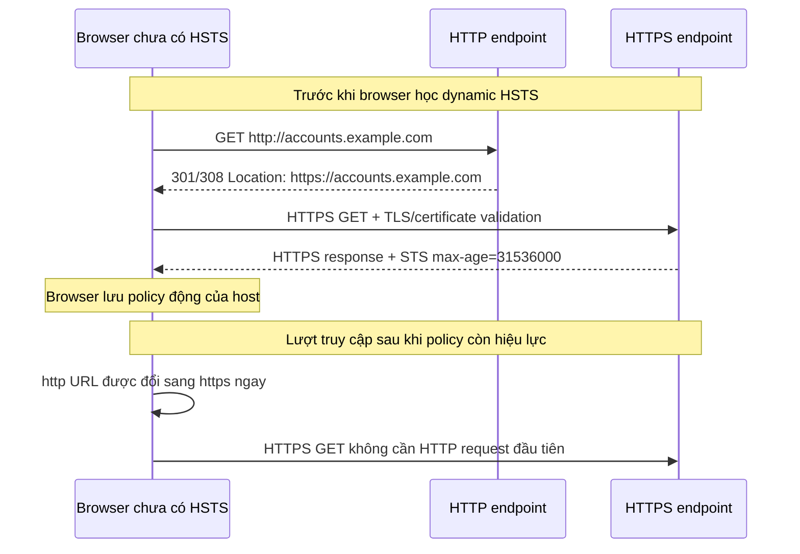
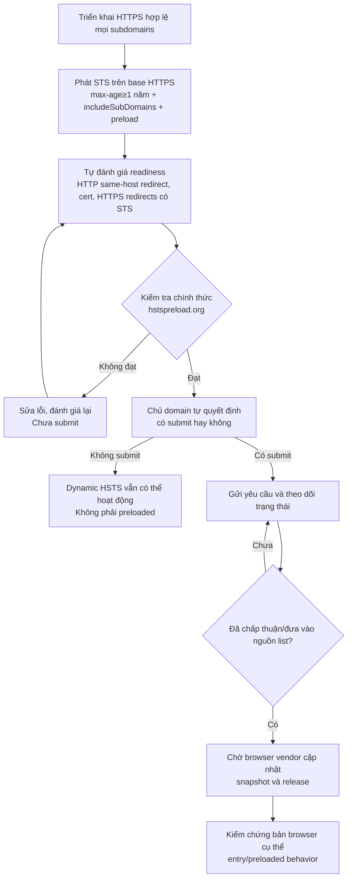
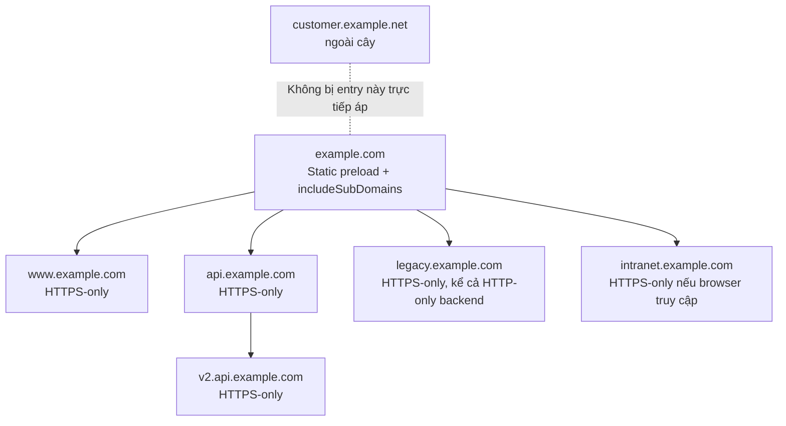
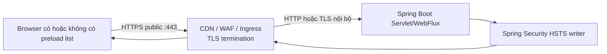

# Preload và sự khác biệt với chỉ gửi chỉ thị trong header

> **Chương:** HTTPS và HSTS  
> **Học phần:** `SPRING_SECURITY_HTTP_PROTECTION` — áp dụng các lớp phòng vệ HTTP và trình duyệt với Spring Security, bao gồm CSRF, CORS, security headers, CSP, HSTS, HTTP firewall và bảo vệ session trên Servlet và Reactive WebFlux.  
> **Trọng tâm:** phân biệt **phát `Strict-Transport-Security` có directive `preload`**, **đáp ứng điều kiện và gửi yêu cầu vào danh sách preload**, **được tích hợp trong dữ liệu trình duyệt**, và **trình duyệt thật sự thực thi HTTPS trước lần truy cập đầu tiên**; quản lý triển khai, rút lui và kiểm thử theo đúng ranh giới trách nhiệm.

## 1. Vấn đề: có chữ preload nhưng lần truy cập đầu vẫn là HTTP

Giả sử nhóm bảo mật của dịch vụ ngân hàng thử nghiệm `https://accounts.example.com` thấy:

```http
HTTP/1.1 200 OK
Strict-Transport-Security: max-age=63072000; includeSubDomains; preload
```

Một kỹ sư kết luận: “Đã có `preload` trong header, trình duyệt nào cũng biết host này phải dùng HTTPS từ lần đầu.” Nhóm bỏ qua kiểm thử public HTTP và xem policy đã được triển khai xong.

Kết luận đó **không đúng**.

Có ít nhất **ba trạng thái** hoàn toàn khác nhau:

1. Website **phát header HSTS** qua HTTPS, trong đó có token `preload`. Trình duyệt truy cập site có thể học **dynamic HSTS** theo `max-age`.
2. Chủ domain **đăng ký/được chấp nhận** vào chương trình quản lý danh sách HSTS preload, sau khi đạt yêu cầu HTTPS, subdomains và redirect. Trạng thái submit/accept là một bước của chương trình, **không phải bằng chứng mọi browser đã có entry**.
3. Một bản build của trình duyệt **thực sự chứa danh sách preload** có tên domain hoặc ancestor bao phủ domain, nên browser có thể áp HTTPS **trước khi tải response đầu tiên** từ website.

Một domain có thể ở trạng thái (1) nhưng chưa có (2)/(3). Một browser cũ có thể chưa tích hợp entry dù người quản trị đã submit thành công. Ngược lại, một browser có thể vẫn ép HTTPS do **preload entry đã được phân phối từ trước** ngay cả khi site vừa xóa `preload` khỏi header.

### 1.1. Câu hỏi nghiệp vụ của bài

Câu hỏi không phải chỉ là “Header đã có `preload` chưa?”, mà là:

> **“Tên miền của chúng ta đã được browser hiện tại nhận biết sẵn nhờ danh sách preload chưa, trong khi vẫn duy trì HTTPS hợp lệ cho toàn bộ tên miền con và có khả năng xử lý sự cố nếu cần rút khỏi danh sách?”**

### 1.2. Sau bài học, người học có thể

1. Nêu khác biệt giữa **HSTS động**, **directive `preload`**, **submission/acceptance**, **bản build trình duyệt có entry tĩnh** và **HTTPS-first browser behavior**.
2. Giải thích vì sao preload làm giảm **first-visit downgrade gap** nhưng không thay thế TLS validation, CSRF, authorization hay các phòng vệ HTTP khác.
3. Đọc đúng các điều kiện đăng ký theo `hstspreload.org`, đặc biệt `max-age >= 31536000`, `includeSubDomains`, `preload`, HTTPS cho mọi subdomain và STS trên redirect HTTPS.
4. Hiểu mẫu `63072000` là **ví dụ 2 năm**, **không phải** ngưỡng tối thiểu hiện hành mà mọi hồ sơ phải dùng.
5. Giải thích vì sao trang vận hành preload hiện hành khuyến nghị **HSTS nhưng không khuyến nghị preload như mặc định** do lợi ích bổ sung nhỏ và rollback khó.
6. Thiết kế chính sách cho apex, `www`, deep subdomains, tenant domains, DNS delegation và internal HTTP services.
7. Cấu hình header trên Spring Security Servlet/WebFlux hoặc edge mà không nhầm việc “bật writer” là “đã được preloaded”.
8. Tạo bộ test tách bạch **header validation**, **preload list status**, **fresh browser behavior**, **preloaded browser behavior** và **removal propagation**.
9. Lập kế hoạch đăng ký và gỡ bỏ có trách nhiệm, không tạo outage do certificate, proxy, session hay hostname.
10. Duy trì kiểm thử CSRF, CORS, CSP, HSTS, HTTP firewall, cookie và object-level authorization dù HTTPS được nâng cấp tự động.

## 2. Nhắc lại: HSTS thường hoạt động như thế nào?

HSTS được mô tả trong [RFC 6797](https://www.rfc-editor.org/rfc/rfc6797). Một hostname công bố chính sách qua **HTTPS response hợp lệ**:

```http
Strict-Transport-Security: max-age=31536000; includeSubDomains
```

Nếu browser hỗ trợ, nhận header và TLS certificate hợp lệ, nó có thể ghi nhớ rằng những lần mở HTTP URL tương lai của hostname này phải được nâng sang HTTPS **trước khi gửi request HTTP ra mạng**. Với `includeSubDomains`, descendants phù hợp theo DNS labels cũng bị áp.

Điểm yếu: một browser chưa từng kết nối HTTPS với hostname đó **chưa chắc đã biết dynamic HSTS policy**.



Trong lượt HTTP đầu, một đối tượng kiểm soát đường truyền có thể tìm cách sửa/chặn redirect thông thường (**SSL stripping/protocol downgrade**). HSTS động bảo vệ các lượt sau khi policy đã được học nhưng không tự giải quyết toàn bộ khoảng trống ở lần đầu.

### 2.1. Browser có thể tự ưu tiên HTTPS mà không cần preload

Một số browser hiện đại có cơ chế HTTPS-first/HTTPS-only hoặc tự nâng điều hướng HTTP. **Không được lấy hiện tượng browser tự nâng một URL làm bằng chứng HSTS preload đã có hiệu lực.** Đó có thể là một chính sách browser độc lập.

Khi đo first-visit gap, ghi rõ browser/version/settings, policy doanh nghiệp và preload status. HSTS preload hữu ích nhất trong những tình huống hành vi nâng HTTPS khác có thể bị vô hiệu hóa hoặc bị attacker cản trở.

### 2.2. HSTS không tự tạo mã hóa

`Strict-Transport-Security` chỉ ảnh hưởng **lựa chọn HTTPS của client**. Server vẫn cần:

- DNS và public HTTPS listener.
- Chứng chỉ TLS hợp lệ cho hostname.
- Cấu hình SNI/routing đúng.
- Chính sách HTTP→HTTPS redirect/reject hợp lý cho client chưa có HSTS.
- Bảo vệ hop từ edge đến backend phù hợp với threat model.
- Authentication/authorization, session/cookie và CSRF.

Nếu browser HSTS/preloaded ép HTTPS nhưng host không có certificate, kết quả có thể là **không truy cập được**, không phải “được mã hóa tự động”.

## 3. Directive preload là gì và không phải là gì?

Ví dụ:

```http
Strict-Transport-Security: max-age=63072000; includeSubDomains; preload
```

Ba directive cần hiểu:

| Thành phần | Ý nghĩa | Browser/site vận hành thế nào |
| --- | --- | --- |
| `max-age=63072000` | Dynamic HSTS được nhớ khoảng 730 ngày sau khi nhận HTTPS STS hợp lệ | Tác động HSTS runtime thông thường |
| `includeSubDomains` | Áp chính sách của hostname sang mọi hậu duệ theo DNS labels | Tác động HSTS runtime thông thường |
| `preload` | Biểu thị mong muốn đủ điều kiện đăng ký preload list | **Không tự tạo static entry** trong browser |

`preload` **không phải** một lời gọi API đến Google/Chromium; server chỉ gửi text trong HTTP response. Trình duyệt không tự liên hệ dịch vụ đăng ký và phê duyệt chỉ vì thấy chữ này.

### 3.1. HSTS preload không nằm trong phần cơ bản của RFC 6797

RFC 6797 định nghĩa HSTS policy và dynamic tracking; cơ chế preload theo danh sách do các browser vendor duy trì là **một cơ chế bổ sung, không phải bước bắt buộc của HSTS RFC**.

Những điều sau đều đúng:

- Website dùng HSTS có thể **không** tham gia preload.
- Website có thể gửi `preload` nhưng **không** có tên trong danh sách.
- Browser có thể có preload entry cho domain ngay cả trước khi người dùng truy cập domain.
- Một hệ sinh thái browser có thể không có cùng snapshot preload list ở cùng thời điểm.
- Xóa `preload` khỏi response **không xóa ngay entry tĩnh** đã được browser phân phối.

### 3.2. Bảng so sánh ba cách một browser bắt buộc HTTPS

| Cơ chế | Điều kiện browser biết chính sách | HTTP URL đầu tiên | Hạn sử dụng/khả năng rollback |
| --- | --- | --- | --- |
| **Không HSTS**, chỉ HTTP redirect | Server nhận HTTP rồi gửi 3xx | Có thể gửi HTTP request trước | Sửa redirect ở server có tác dụng với requests mới nhưng dễ bị can thiệp lượt đầu |
| **Dynamic HSTS** | Browser đã nhận STS qua HTTPS hợp lệ | Nếu chưa học policy, có thể gửi HTTP trước | Dynamic policy theo `max-age`, có thể cập nhật hoặc xóa bằng HTTPS `max-age=0` |
| **HSTS preload list** | Browser build/list có entry sẵn cho host/ancestor | Browser dùng HTTPS từ đầu khi entry áp | Chỉ gỡ khỏi danh sách qua quy trình riêng; triển khai tới browser có độ trễ |
| **HTTPS-first/HTTPS-only** | Browser setting/feature, không nhất thiết có STS | Có thể nâng URL trước network | Phụ thuộc policy/browser; không đồng nghĩa preload |

Trên cùng host, **nhiều cơ chế có thể đồng thời áp dụng**. Nếu browser đã preloaded parent, việc xóa dynamic child không làm host con quay lại HTTP.

### 3.3. Ba câu khẳng định khác nhau trong tài liệu triển khai

**Khẳng định A:** “Ứng dụng trả STS có `preload`.”  
Chỉ chứng minh HTTP header được cấu hình và phát ở response tương ứng.

**Khẳng định B:** “Tên miền đã được danh sách preload chấp nhận hoặc đang chờ đưa vào.”  
Cần bằng chứng từ kênh trạng thái chính thức; chưa chứng minh browser của user đã nhận dữ liệu.

**Khẳng định C:** “Bản build Chrome/Firefox/Safari cụ thể có entry và thực thi HTTPS ngay lần đầu.”  
Cần kiểm tra **trình duyệt/version thực** và cách nâng HTTPS tương ứng; không suy từ A/B.

Một bài kiểm thử đạt A **không được tự nâng thành PASS ở C**.

## 4. Sự thật quan trọng trong hướng dẫn preload hiện hành

Trang chính thức [HSTS Preload List Submission](https://hstspreload.org/) mô tả cả lợi ích và rủi ro. Trang hiện khẳng định **HSTS nói chung được khuyến nghị**, nhưng **HSTS preloading không được khuyến nghị như một bước mặc định**, vì nhiều trình duyệt hiện tự nâng HTTP navigation và lợi ích bảo vệ bổ sung của preload trong thực tế hạn chế so với HSTS; đồng thời việc thu hồi preload lâu và khó.

Điều này không có nghĩa “preload vô dụng” hoặc “không ai được dùng”. Nó có nghĩa quyết định preload cần **phân tích rủi ro/giá trị riêng**, ngoài việc bật HSTS thường. Các trang hướng dẫn khác có thể nhấn mạnh khả năng bảo vệ lần đầu; đội triển khai nên ưu tiên **yêu cầu và cảnh báo hiện tại của chính chương trình preload** khi quyết định có gửi hồ sơ hay không.

### 4.1. Khi nào preload có giá trị rõ?

Trong các trường hợp browser đã có preload entry, không phải chờ website phát STS response lần đầu nên policy HSTS áp trước khi kết nối tới site. Điều này hữu ích nếu:

- Client có thể bắt đầu bằng HTTP URL.
- Có kẻ tấn công trên đường truyền cố ngăn SSL stripping protection bằng cách chặn 3xx.
- Các cơ chế HTTPS-first khác không đủ để đảm bảo upgrade cho trường hợp đó.
- Hostname và tất cả descendants có HTTPS hợp lệ lâu dài.

### 4.2. Khi nào chi phí preload vượt lợi ích?

Đặc biệt khi:

- Một parent domain chứa nhiều legacy/internal subdomains không quản lý tập trung.
- Subdomains có DNS delegation cho đối tác hoặc tenant.
- Nhiều cổng HTTP nội bộ vẫn được sử dụng thông qua hostname con.
- Certificate renewal và routing nhiều vùng chưa ổn định.
- Cần rollback/đổi kiến trúc hostname liên tục.
- Không biết toàn bộ chủ thể có thể tạo thêm child hosts sau này.
- Đội vận hành hiểu nhầm `max-age=0` có thể xóa preload khỏi browser ngay lập tức.

**Khuyến nghị kiến trúc:** bật HTTPS và dynamic HSTS phù hợp trước; chỉ quyết định preload sau khi xác minh lợi ích thật sự và quy trình chịu ràng buộc dài hạn cho toàn bộ cây hostname.

## 5. Điều kiện đăng ký tại hstspreload.org

Các điều kiện dưới đây được đối chiếu với [trang đăng ký chính thức](https://hstspreload.org/) tại thời điểm soạn. Yêu cầu có thể thay đổi, nên **trước khi submit thật phải chạy checker/đọc quy định hiện hành**; đừng sao chép checklist của một bài học cũ làm cam kết hồ sơ chắc chắn được nhận.

| Điều kiện hiện hành | Giải thích | Điều cần kiểm tra |
| --- | --- | --- |
| Certificate hợp lệ | HTTPS thực sự xác thực server | TLS chain, SAN/hostname, hết hạn, SNI |
| Nếu port 80 có listener, HTTP→HTTPS redirect **trên cùng hostname** | Browser chưa có HSTS vẫn được nâng đúng host thay vì qua host không rõ | Status/`Location` của HTTP response, không chứa dữ liệu riêng tư |
| **Tất cả subdomains** có HTTPS | Bao gồm nested/internal subdomains, không chỉ những host public dễ thấy | DNS/host inventory, delegation, wildcard, cert và routing |
| `www` có HTTPS nếu có DNS record | `www` là child bắt buộc sẵn sàng khi tồn tại | HTTPS và certificate của `www.example.com` |
| Base domain phát STS trên HTTPS responses | Chương trình kiểm tra domain xin đăng ký | Header trên HTTPS response cuối của base domain |
| `max-age >= 31536000` giây | Tối thiểu **một năm** theo yêu cầu công khai hiện hành | Không nhầm 2 năm là tối thiểu |
| `includeSubDomains` có mặt | Preload phạm vi toàn cây | Không còn HTTP-only descendants |
| `preload` có mặt | Header thể hiện mong muốn xin preload | Chỉ là điều kiện header, chưa phải membership |
| Nếu HTTPS endpoint còn redirect, **redirect HTTPS response vẫn phải mang STS** | Không chỉ trang 200 cuối có header | Test 301/302/307/308 trên HTTPS hop |
| Duy trì các điều kiện sau khi submit | Điều kiện không chỉ tại thời điểm checker | Monitoring cert, domains, edge headers lâu dài |

### 5.1. Đừng nhầm mức tối thiểu một năm với ví dụ hai năm

Trang chính thức nêu:

```http
Strict-Transport-Security: max-age=63072000; includeSubDomains; preload
```

Đó là **header minh họa 730 ngày**. Ngưỡng tối thiểu được niêm yết đối với hồ sơ theo quy tắc hiện hành là:

```http
Strict-Transport-Security: max-age=31536000; includeSubDomains; preload
```

Tức **365 ngày**. Một số tài liệu cũ hoặc yêu cầu lịch sử khác nhau có thể khiến các con số không nhất quán; khi submit, dùng checker chính thức của chương trình.

### 5.2. HTTP redirect cùng hostname là điều kiện riêng

Giả sử submit `example.com`. Khi có listener HTTP port 80:

```http
GET / HTTP/1.1
Host: example.com
```

Response theo hướng dẫn:

```http
HTTP/1.1 308 Permanent Redirect
Location: https://example.com/
```

Không chuyển trước sang `https://www.example.com` nếu như thế vi phạm điều kiện *same-host redirect* của chương trình; canonical host migration cần được đánh giá lại. Cần kiểm tra **đúng hostname đang submit**, không suy từ các rules của hostname khác.

Lưu ý: không thể bảo vệ dữ liệu nhạy cảm đã gửi trong HTTP request đầu bằng một redirect 3xx; browser/app phải **dùng HTTPS trực tiếp** cho login POST, API calls mang token và các unsafe requests.

### 5.3. HTTPS redirect cũng phải có STS

Nếu client vào `https://example.com` và server trả:

```http
HTTP/1.1 301 Moved Permanently
Location: https://www.example.com/
Strict-Transport-Security: max-age=31536000; includeSubDomains; preload
```

header STS ở **HTTPS response của example.com** là quan trọng: nếu chỉ trang cuối trên `www` có header, browser học policy của `www`, không tự học policy của apex `example.com`. Đó cũng là nguyên nhân preload checker yêu cầu STS trên HTTPS redirects của base host.

### 5.4. “Mọi subdomain” bao gồm host không public

Chương trình cảnh báo rõ **internal subdomains không truy cập công khai cũng nằm trong phạm vi preload**. Nếu browser có static preload entry cho `example.com` với includeSubDomains, các HTTP URLs kiểu:

```text
http://intranet.example.com
http://grafana.infra.example.com
http://test.customer.example.com
```

có thể bị ép HTTPS khi user-agent mở từ mạng nơi host resolve được. HSTS không quan tâm DNS zone do nhóm nào sở hữu, IP có private hay public, hoặc app là Spring Boot hay sản phẩm bên thứ ba.

Phải chuẩn bị TLS hợp lệ cho các host có HTTP URLs, không “loại trừ internal” bằng cách chỉ kiểm tra một crawler public.

## 6. Quy trình từ cấu hình header đến browser được preload

Một tiến trình có nhiều điểm dừng:



Sơ đồ chỉ mô tả luồng quản lý, không ngụ ý tỷ lệ chấp thuận hay SLA cố định.

### 6.1. “Hợp lệ để submit” khác “đã submit”

Một domain vượt qua kiểm tra điều kiện không có nghĩa tự động được đăng ký. Việc submit là một quyết định **có hệ quả lâu dài** và cần người có thẩm quyền sở hữu domain thực hiện qua quy trình tương ứng.

Nếu tổ chức chưa phê duyệt preload, có thể dừng lại ở dynamic HSTS **không `preload`**, hoặc thậm chí trước khi bật `includeSubDomains` trên root.

### 6.2. “Đã submit” khác “đã được chấp thuận”

Danh sách có thể có trạng thái chờ xử lý, không đạt, đang chờ đưa vào, hoặc trạng thái tương đương. Đừng tự tuyên bố một domain đã preloaded chỉ vì form trả xác nhận đã nhận yêu cầu.

### 6.3. “Đã được đưa vào nguồn list” khác “mọi browser đã có”

Dữ liệu preload đi qua các bản build/release/cập nhật của browser. Trang chính thức lưu ý có thể mất **nhiều tháng** để một entry mới đến stable Chrome; Chromium cũng không bảo đảm thời hạn cụ thể cho thêm/xóa danh sách ngoài.

Cần kiểm tra browser/version hiện diện ở user population. Firefox, Safari và các client khác không nhất thiết có cùng snapshot/nhịp phát hành.

## 7. Một ma trận trạng thái tránh tuyên bố quá mức

| Header có `preload`? | Trạng thái chương trình | Browser đang dùng có preload entry? | Hành vi HTTP URL có thể thấy |
| --- | --- | --- | --- |
| Không | Chưa submit | Không, chưa có dynamic HSTS | Có thể HTTP ở lượt đầu hoặc HTTPS-first nâng riêng |
| Có | Chưa submit | Không | Browser vẫn có thể học **dynamic HSTS** khi đã nhận HTTPS STS; không có static preload bảo đảm |
| Có | Checker đạt, chưa submit | Không | Tương tự hàng trên |
| Có | Đã submit, đang chờ | Không | Không được khẳng định preloaded |
| Có | Đã chấp thuận vào list upstream | Browser build chưa chứa entry | Vẫn chưa có bảo đảm preload của build đó |
| Có | Đã chấp thuận | Có entry | Browser thực thi HTTPS ngay từ HTTP URL theo entry đó |
| Không | Chưa gỡ list dù đã yêu cầu | Có entry | Browser vẫn có thể ép HTTPS nhờ preload |
| `max-age=0` ở host | Preload entry vẫn tồn tại | Có | Dynamic entry riêng có thể xóa; static preload vẫn có thể chi phối |
| Child không có header | Parent preloaded với includeSubDomains | Có entry parent | Child vẫn được ép HTTPS |
| Chỉ child có HSTS động | Parent chưa preloaded/chưa được học | Không | Child sau khi học có HSTS riêng; không suy ra parent bảo vệ |

### 7.1. Browser self-upgrade là bằng chứng yếu nếu thiếu phân loại

Một browser mới mở `http://example.com` thành `https://example.com`. Chưa thể kết luận domain **đã có trong preload list** vì browser cũng có thể dùng:

- HTTPS-first/HTTPS-only mode.
- Dynamic HSTS từ trước trong profile.
- HSTS của một parent hoặc TLD.
- Enterprise policy/extension.
- Cache/redirect browser riêng.

Cần tách profile state, browser version và nguồn chính sách (static preload/dynamic) bằng những công cụ phù hợp phiên bản.

### 7.2. Header `preload` cũng không phải câu lệnh bắt browser ghim chứng chỉ

HSTS preload không phải **certificate pinning**. Browser vẫn dùng hệ thống xác minh TLS certificate/hostname/chain tin cậy của nó. Preload khiến HTTPS bắt buộc và certificate errors trở nên nghiêm ngặt, nhưng không ghim một public key hoặc certificate fingerprint cố định.

Tránh trộn preload với cơ chế HPKP cũ hoặc việc pin certificates của ứng dụng mobile. Cả hai có vòng đời/rủi ro riêng.

## 8. Preload ở miền cha làm phạm vi HTTPS khác biệt như thế nào?

Giả sử `example.com` được preloaded với includeSubDomains trong browser đang dùng:



Khác HSTS động ở parent: **browser đã được phân phối list có thể biết policy ngay khi profile mới**, không cần từng kết nối đến `https://example.com`.

### 8.1. Scope theo hostname, không theo DNS owner

- `api.example.com` nằm dưới `example.com` dù CNAME tới một SaaS khác.
- `partners.example.com` vẫn là descendant dù DNS delegation tới đối tác.
- `legacy.example.com` vẫn bị browser ép HTTPS dù chỉ có HTTP listener.
- `customer.example.net` **không** thuộc cây, dù trỏ cùng IP/CDN với `example.com`.
- `shop.example.com` có `includeSubDomains` thì chỉ ảnh hưởng descendants của **shop**, không lan lên parent/sibling.

Browser so khớp domain labels, không xem backend có cùng Spring Boot application hay không.

### 8.2. Không có excludeSubDomains tiêu chuẩn

Đừng giả định child có thể “tự opt-out” khỏi parent preload bằng:

```http
Strict-Transport-Security: max-age=0
```

Lệnh trên qua HTTPS hợp lệ chỉ ảnh hưởng **dynamic policy riêng của child**; không gỡ một parent static preload entry đang áp xuống descendants.

Nếu có một HTTP-only child dưới parent preloaded, giải pháp đúng thường là **triển khai HTTPS cho child hoặc thay đổi kiến trúc hostname**, không phải cố tắt HSTS trong child Spring Security chain.

### 8.3. Scope rộng hơn wildcard certificate

Một certificate `*.example.com` thường khớp hostname một nhãn con như `api.example.com`, **không** khớp `deep.api.example.com`. Preload parent includeSubDomains có thể ép HTTPS cho cả deep hosts.

| Tên host | Parent `example.com` preload bao phủ? | Chỉ có cert `*.example.com` đủ cho TLS? |
| --- | --- | --- |
| `example.com` | Có | Không, cần SAN apex |
| `www.example.com` | Có | Thường có |
| `api.example.com` | Có | Thường có |
| `v2.api.example.com` | Có | Không |
| `deep.v2.api.example.com` | Có | Không |
| `customer.example.net` | Không do entry parent này | Không |

HSTS preload không hạ tiêu chuẩn TLS hostname verification để “cho qua” những hosts thiếu cert.

## 9. Vai trò của max-age khi domain đã được preloaded

Hai nguồn policy khác nhau:

- **Dynamic HSTS**: browser nhận `Strict-Transport-Security` từ HTTPS response; `max-age` điều khiển thời hạn lưu.
- **Static preload**: trình duyệt đã có entry theo preload list mà nó nhận cùng build/update, không được xóa chỉ bằng header của server.

Các giá trị:

```http
Strict-Transport-Security: max-age=31536000; includeSubDomains; preload
Strict-Transport-Security: max-age=63072000; includeSubDomains; preload
Strict-Transport-Security: max-age=0
```

là ba ví dụ thay thế nhau; dòng thứ ba chỉ thị xóa dynamic policy nếu nhận qua HTTPS hợp lệ.

### 9.1. Khi server phát max-age=0 trên một host đã preloaded

Browser có thể xóa dynamic entry đã học từ host đó, nhưng **không tự xóa một entry tĩnh đã được phân phối từ preload list**. Client vẫn có thể ép HTTPS do preload.

Do vậy rollback preload không tương đương dynamic HSTS rollback, và không thể dựa vào thử `max-age=0` trong MockMvc để kết luận browsers ngoài Internet đã hết bị buộc HTTPS.

### 9.2. Khi server xóa directive preload nhưng giữ max-age dương

Ví dụ chuyển:

```http
Strict-Transport-Security: max-age=31536000; includeSubDomains; preload
```

thành:

```http
Strict-Transport-Security: max-age=31536000; includeSubDomains
```

Dynamic HSTS **vẫn hoạt động** theo header mới. Trên hstspreload.org, việc bỏ directive `preload` có thể khiến domain **đủ điều kiện gửi yêu cầu gỡ**, nhưng **không tự gỡ static entry khỏi các bản browser đã phát hành**.

### 9.3. Khi server giảm max-age từ một năm xuống một ngày

Browser nhận policy động mới có thể điều chỉnh thời hạn dynamic entry của host, nhưng preload entry vẫn có thể ép HTTPS. Hơn nữa, giảm dưới ngưỡng tối thiểu của chương trình có thể làm site không còn đáp ứng điều kiện duy trì preload.

Không xem việc giảm duration như một cách “tắt dần preload” chắc chắn thành công.

## 10. Quy trình gỡ preload: vì sao chậm và khó

Trang chính thức cảnh báo việc remove entry có thể **mất hàng tháng** để đến với người dùng Chrome qua bản cập nhật, không bảo đảm thời hạn đối với các browser khác. Trong khi chờ, thiết bị đang có static entry vẫn có thể buộc HTTPS.

### 10.1. Các bước gỡ theo nguyên tắc

1. **Xác định vấn đề thật**: subdomain không thể hỗ trợ HTTPS, thay đổi domain strategy, hoặc ràng buộc vận hành khác.
2. **Khôi phục TLS/certificate** cho các host đang outage nếu khả thi — không phụ thuộc việc gỡ list đến kịp.
3. Kiểm tra **preload status** và các ancestor/TLD entries liên quan; domain có thể bị bao phủ từ một nguồn lớn hơn.
4. Thực hiện thay đổi header theo **điều kiện removal hiện hành**; trang chính thức nêu việc bỏ directive `preload` giúp domain đủ điều kiện gửi removal form.
5. Chủ sở hữu domain **gửi yêu cầu removal** qua [removal form](https://hstspreload.org/removal/), nếu URL/quy trình còn áp dụng tại thời điểm thực tế.
6. Theo dõi trạng thái, source list và các browser releases tương ứng.
7. Duy trì HTTPS/certificates cho tới khi đã có bằng chứng đủ các browser/clients quan trọng không còn bị entry áp — có thể kéo dài.
8. Đánh giá riêng dynamic HSTS `max-age` và policy của parent/child; gỡ static entry không tự xóa dynamic entries.
9. Ghi lại incident, quyết định owner cấp domain và regression tests cho onboarding các subdomains trong tương lai.

**Không thể đưa ra một ngày hẹn gỡ preload bảo đảm.** Ngay cả khi upstream đã xóa, các browser cũ hoặc không cập nhật có thể tiếp tục chứa static entry.

### 10.2. Header và removal đều không thể vá một HTTPS endpoint đã hỏng ngay lập tức

Browser preloaded muốn kết nối HTTPS. Nếu certificate hết hạn hoặc hostname không hợp lệ, browser có thể không cho tiếp tục/không cho fallback HTTP. Khi sự cố ảnh hưởng availability:

- Sửa DNS, SNI, TLS listener và certificate ngay ở hostname lỗi.
- Nếu cần, chuyển lưu lượng sang một HTTPS host có chứng chỉ hợp lệ qua route phù hợp.
- Sau khi khôi phục, mới thực hiện chính sách/removal theo kế hoạch.
- Không hướng dẫn người dùng tắt certificate validation hay “click through” cảnh báo bảo mật.

### 10.3. Preload removal là thay đổi bảo mật có ảnh hưởng chéo

Một hostname đã preloaded có thể được dùng bởi nhiều apps, browsers, tenant portals hoặc đối tác. Removal có thể làm mất bảo vệ first-visit mà trước đó hệ thống trông đợi, đồng thời **không** chứng minh tất cả clients đều thay đổi ngay.

Nên đánh giá cùng chủ DNS/domain, security, platform, service owners, browser support và kế hoạch communications.

## 11. TLD/public suffix preload: một trường hợp ít được nhắc

Trang chính thức cũng có cơ chế dành cho chủ quản lý TLD/public suffix. Nếu một TLD hoặc public suffix được preloaded theo chính sách bao gồm descendants, những hostnames nằm bên dưới có thể phải dùng HTTPS khi trình duyệt áp list, **ngay cả khi chủ một subdomain không tự submit**.

Điều này là một nguồn khác cần xét khi một hostname vẫn bị HTTPS-only dù site chưa bao giờ phát STS hoặc gửi `max-age=0`. Không giả định mọi preloaded behavior đều bắt đầu từ một tên miền đăng ký do ứng dụng sở hữu.

### 11.1. Kiểm tra ancestry đầy đủ

Khi điều tra `a.b.example.tld`:

- Có static entry đúng `a.b.example.tld` không?
- Có dynamic entry của `b.example.tld` hoặc `example.tld` bao descendants không?
- Có preload entry của ancestor không?
- Có browser HTTPS-first/enterprise policy không?
- Browser đang dùng bản list nào?

Chỉ nhìn mỗi `a.b.example.tld` trong một trang checker không đủ nếu entry của ancestor đang bao phủ nó.

### 11.2. Không tự áp các quy tắc của chương trình TLD cho một website bình thường

Chủ gTLD/ccTLD hoặc public suffix có quyền kiểm soát rộng hơn một chủ `example.com` thông thường. Việc đánh giá preloading cấp TLD cần chương trình/phối hợp đặc biệt; không coi đó là một tùy chọn `preload(true)` ở Spring Security.

## 12. Lợi ích bảo mật của preload và giới hạn đe dọa

### 12.1. Mô hình attacker trên mạng

Kịch bản: Alice có browser profile chưa từng ghé `login.example.com`, được gửi một liên kết HTTP tới dịch vụ. Mallory kiểm soát Wi-Fi công cộng, có khả năng chặn/sửa HTTP.

Không HSTS/preload:

1. Browser có thể gửi HTTP request tới host.
2. Mallory có thể can thiệp HTTP 3xx và cố giữ client trên HTTP.
3. Nếu một ứng dụng sai thiết kế gửi token/cookie/credential qua HTTP, dữ liệu có thể bị lộ hoặc sửa.

Có preload entry đã nằm trong browser:

1. Browser nhận HTTP URL nhưng **đổi sang HTTPS trước network**.
2. Mallory không có cơ hội sửa một HTTP redirect đầu tiên vì không có request HTTP đó.
3. Browser xác minh certificate TLS của hostname.
4. Nếu TLS không hợp lệ, trình duyệt HSTS không chấp nhận downgrade để tiếp tục HTTP.

**Preload không khiến Mallory biến mất**, và không giải quyết XSS, phishing trên một domain khác hoặc service authorization bugs.

### 12.2. Những kiểu tấn công preload không chặn

| Tấn công/sự cố | HSTS preload giúp gì? | Cần thêm |
| --- | --- | --- |
| SSL stripping tại HTTP lượt đầu | Giảm cơ hội khi entry đã có trong browser | TLS/cert hợp lệ, HTTPS links |
| XSS trên HTTPS site | Không chặn JS độc hại trong trang | CSP, output encoding/sanitization |
| CSRF gửi POST hợp lệ về HTTPS origin bằng cookie | Không chứng minh ý định user | CSRF token, SameSite, origin checks theo threat model |
| Broken Access Control/IDOR | Không quyết định ai đọc tài nguyên nào | Object/tenant authorization |
| Credential stuffing | Không thay chống brute force | Rate limits, MFA, monitoring |
| CORS quá rộng | Không thay browser same-origin policy | CORS allowlist, credentials policy |
| HTTP firewall bypass do path parsing | Không chuẩn hóa path | Firewall, URL handling nhất quán |
| Cache leak user A→B ở CDN | Không thay cache key | Cache-Control, edge policy |
| API token leak từ XSS | Không chặn JS có quyền origin | CSP/XSS mitigation và token architecture |
| Session fixation/replay | Không rotate/invalidate session | Session security |
| Proxy forward header spoof | Không tự xác thực internal metadata | Trusted proxy boundary |
| Subdomain HTTPS cert outage | **Có thể tăng tác động outage** | TLS inventory/renewal/failover |

Khi user khác tenant đọc được file qua HTTPS, đây **không phải** lý do tắt preload: đó là lỗ hổng authorization cần sửa ở service layer.

## 13. Preload, includeSubDomains và certificate wildcard không đồng nghĩa nhau

Một chủ domain nghĩ certificate `*.example.com` đã đủ để preload `example.com`, nhưng còn các hosts:

```text
example.com
api.example.com
deep.api.example.com
legacy.example.com
internal.ops.example.com
tenant-123.example.com
```

Certificate `*.example.com` thường chỉ hợp lệ cho **một nhãn phía trước** như `api.example.com`, không tự hợp lệ cho apex hoặc `deep.api.example.com`. Preload parent với includeSubDomains lại có thể ép HTTPS cho **mọi cấp sâu**.

### 13.1. Những công việc cần hoàn thành trước khi đề nghị preload

- Kiểm kê DNS records và wildcard DNS behavior.
- Kiểm kê NS delegations/CNAME tới bên thứ ba.
- Liệt kê hostname nội bộ và môi trường staging/preview.
- Đảm bảo certificate SAN/TLS/SNI đúng cho **mỗi host**.
- Kiểm tra HTTPS reverse proxies, internal ports và redirects.
- Bảo đảm quy trình tạo tenant hostname tự cấp TLS hợp lệ.
- Rà các child services do vendor hoặc khách hàng vận hành.
- Kiểm tra hostnames dự kiến được tạo trong tương lai.
- Phân công owner có quyền phê duyệt thay đổi cho toàn bộ domain.
- Có test và kế hoạch khôi phục nếu một child bị lỗi TLS.

Không có “excludeSubDomains=legacy.example.com” trong HSTS RFC. Nếu chưa sẵn sàng, **đừng submit parent** hoặc thay đổi kiến trúc hostname trước.

### 13.2. Cookie Domain không liên quan đến phạm vi preload

HSTS parent bao children **không có nghĩa** nên đặt `Cookie: Domain=.example.com` cho mọi app. Cookie Domain mở phạm vi gửi cookie và có thể tạo rủi ro giữa subdomains không tin cậy. Ưu tiên host-only cookies nếu không có yêu cầu chia sẻ thực sự, và giữ `Secure`/`HttpOnly`/`SameSite` phù hợp.

## 14. Quy tắc port khi browser đã preloaded

Cơ chế HTTPS upgrade của HSTS có semantics cho port:

| URL HTTP ban đầu | URL theo HSTS | Diễn giải |
| --- | --- | --- |
| `http://example.com/path` | `https://example.com/path` | Cổng mặc định HTTPS |
| `http://example.com:80/path` | `https://example.com:443/path` | 80 đổi thành 443 |
| `http://example.com:8080/path` | `https://example.com:8080/path` | Cổng **không phải 80** được giữ |
| `http://deep.example.com/path` | `https://deep.example.com/path` | Parent includeSubDomains áp child |
| `https://example.com/path` | Giữ HTTPS | Không có HTTP để nâng |

HSTS preload không dùng Java Servlet `PortMapper` để suy `8080→8443`; PortMapper là cơ chế server-side redirect riêng.

Điều này có thể làm hỏng những internal admin UIs nằm ở `http://infra.example.com:8080`: browser preloaded cố TLS trên **cổng 8080**, có thể lỗi vì server chỉ nói HTTP. Dùng HTTPS endpoint/port được thiết kế rõ thay vì mong browser tự đoán.

### 14.1. Browser không biến mọi protocol thành HTTPS

HSTS chủ yếu áp với HTTP URIs/nguồn liên quan trong user agents hỗ trợ; nó **không tự biến SSH/SMTP/TCP services thành HTTPS**, không thay mTLS giữa services. Với WebSocket, hãy dùng `wss://` và test behavior riêng theo browser/client, không dựa vào suy đoán toàn bộ giao thức từ một STS header.

## 15. Chuẩn bị domain inventory theo cách có thể phê duyệt

Để preload một root domain, nên tạo một bảng ownership cho **tất cả** nhánh tên miền.

| DNS name / pattern | Chủ quản lý | Có HTTP web? | HTTPS + SAN hợp lệ? | Được bao bởi root? | Việc cần hoàn tất |
| --- | --- | --- | --- | --- | --- |
| `example.com` | Platform | Có | Có | Exact | Kiểm tra same-host HTTP redirect, HTTPS STS |
| `www.example.com` | Frontend | Có | Có | Có | Test STS/redirect, cert |
| `api.example.com` | API | Có | Có | Có | Test API CORS/auth, TLS |
| `deep.api.example.com` | API infra | Có | Chưa | Có | SAN và SNI routing |
| `legacy.example.com` | Legacy team | Có | Chưa | Có | Migrate TLS hoặc đổi kiến trúc |
| `intranet.example.com` | IT | Chỉ internal | Chưa | Có | Private CA/trust/client policy cần đánh giá |
| `tenant-*.example.com` | SaaS platform | Có | Chưa bảo đảm | Có | Automated cert onboarding |
| `partner.example.com` | External vendor | Có | Không rõ | Có | Rà ownership/delegation/contract |
| `customer.example.net` | Khách hàng | Có | Có | Không bởi example.com | HSTS riêng nếu cần |

Bảng này là **dữ liệu giả định để thực hành**, không phải kết quả scan DNS thật. Không coi wildcard certificate hoặc route của CDN là bằng chứng toàn bộ subdomains đã sẵn sàng.

### 15.1. Đặc biệt nguy hiểm: public suffix và tenant-controlled names

Một nền tảng lưu trang khách hàng dưới `tenant-X.platform.example.com` có thể có hàng nghìn child hosts và delegation riêng. Preload `platform.example.com` khiến **mọi tenant** phải duy trì HTTPS và certificate hợp lệ. Lỗi ở một tenant có thể làm tenant đó không truy cập được trong một số browser.

Tuy nhiên, điều đó **không** có nghĩa tenant nào cũng được phép đọc dữ liệu người khác. HSTS là transport policy; tenant isolation vẫn phải được kiểm tra tại router, authentication và service authorization.

### 15.2. Lỗi ở host con không chỉ do HSTS

Bật preload có thể làm lộ những vấn đề sẵn có:

- CNAME tới provider chưa có certificate cho custom host.
- TLS cert chỉ có `*.example.com` nhưng host sâu hơn.
- SNI mapping trỏ nhầm chứng chỉ.
- Edge redirect chéo host/port.
- Login OIDC callback vẫn dùng HTTP.
- Cookie Domain/Path/SameSite không phù hợp.
- Browser CSP chặn mixed active content.
- API URL còn `http://` trong SPA.

**Không nới CORS/CSRF/certificate validation chỉ để dịch vụ “tạm chạy”.** Sửa đúng lớp và giữ bằng chứng kiểm thử.

## 16. Chiến lược phù hợp: dynamic HSTS trước, preload chỉ khi thực sự cần

Một quy trình chuẩn bị có thể gồm:

1. **Tắt HTTP xử lý dữ liệu nhạy cảm**; mọi login form/API client dùng HTTPS trực tiếp.
2. **TLS readiness:** public HTTPS với certificate hợp lệ, gia hạn tự động.
3. **Dynamic HSTS rollout nhỏ:** phát `max-age=300` trên HTTPS, monitor lỗi.
4. **Tăng thời hạn có kiểm soát:** ví dụ 1 tuần rồi 1 tháng; thử cả browser profile mới và profile đã học.
5. **Thẩm định includeSubDomains:** kiểm kê toàn bộ hậu duệ trước khi mở rộng root.
6. **Đánh giá lợi ích preload:** browser population, first-visit threat model, mức bảo đảm của HTTPS-first, chi phí thay đổi domain.
7. **Chỉ nếu có phê duyệt:** đáp ứng điều kiện và gửi request qua chương trình chính thức.
8. **Theo dõi status và browser builds:** không tuyên bố đã preloaded trước khi có bằng chứng.
9. **Duy trì liên tục:** cert rotation, edge response headers, new-subdomain onboarding và removal plan.

Trang hstspreload.org nêu lộ trình gia tăng `max-age` kiểu 5 phút → 1 tuần → 1 tháng, kèm theo dõi metrics và chờ hết mỗi giai đoạn trước khi tăng. Đây là **quy trình triển khai được khuyến nghị**, không phải định nghĩa HSTS RFC hay đảm bảo mọi hệ thống nên preload.

### 16.1. Khi không nên đăng ký

- Chưa kiểm soát được tất cả DNS subdomains.
- Có HTTP-only legacy/internal services không thể thay đổi.
- Không có khả năng cấp TLS certificates cho host mới trong tương lai.
- Cần rollback nhanh trong thời gian thử nghiệm.
- Không có owner cấp domain chịu trách nhiệm.
- Phần lớn clients đã dùng HTTPS trực tiếp và rủi ro first-visit không tạo đủ giá trị bổ sung.
- Chưa có regression suite qua browser/edge và test TLS hostname.

**Đừng biến `preload` thành default** của Spring Security template dùng chung cho mọi tổ chức.

## 17. Thiết kế ownership: ai được phép quyết định preload?

Preload không phải tính năng của một controller hay của một API service. Nó là một quyết định **toàn hostname và những descendants**.

| Vai trò | Trách nhiệm |
| --- | --- |
| Domain/DNS owner | Kiểm kê root/child, delegations, hostnames mới và phê duyệt scope |
| Security team | Threat model first-visit, duration/includeSubDomains, rollback risk |
| Platform/edge team | TLS certificates, redirect, STS headers cuối, error responses |
| Application teams | HTTPS-only URLs, authn/authz/CSRF, cookie, CSP, CORS, API behavior |
| QA/browser team | Test fresh/preloaded browsers và state sources |
| Incident response | Khôi phục TLS/route, theo dõi removal và tác động user |
| Compliance/operations | Lưu bằng chứng change review, rotation và owners |

Một developer của `api.example.com` không nên tự submit `example.com` lên preload list chỉ vì có quyền sửa `ServerHttpSecurity.headers(...)` trong API backend.

### 17.1. Header owner cũng cần rõ

Nếu CDN và Spring Boot cùng phát STS khác nhau trên cùng public hostname, browser có thể nhận policy không nhất quán. Chọn **một chủ sở hữu** trên HTTPS public response và test các nhánh:

- HTTP :80 redirect (header STS trên HTTP không được browser tin).
- HTTPS :443 trả 200 HTML/JSON.
- HTTPS 301/302/307/308 canonical redirects.
- HTTPS 401/403 authentication/CSRF errors.
- HTTPS 404 và 502/503 do edge sinh.
- Static assets/CDN cache hits.
- DNS-geo/region-specific edge nodes.

### 17.2. Mỗi domain có trách nhiệm riêng

`api.example.com` phát `preload` không tự đăng ký `example.com`, `shop.example.com` hay custom domain `customer.example.net`. Nếu muốn preloading toàn parent, phải đánh giá và đăng ký **parent hostname** theo quy trình chính thức.

## 18. Servlet Spring Security: phát HSTS header khác với được preload

Spring Security Servlet có `HstsHeaderWriter`, được cấu hình qua `HttpSecurity.headers(...)`. Một bean `SecurityFilterChain` có thể tạo STS header chứa `preload` nếu request được xem là **secure**.

### 18.1. Cấu hình minh họa đủ các directive của header

```java
package example.security;

import static org.springframework.security.config.Customizer.withDefaults;

import org.springframework.context.annotation.Bean;
import org.springframework.context.annotation.Configuration;
import org.springframework.security.config.annotation.web.builders.HttpSecurity;
import org.springframework.security.web.SecurityFilterChain;

@Configuration
class ServletHstsHeaderConfig {

    @Bean
    SecurityFilterChain filterChain(HttpSecurity http)
            throws Exception {
        return http
            .headers(headers -> headers
                .httpStrictTransportSecurity(hsts -> hsts
                    .maxAgeInSeconds(31536000)
                    .includeSubDomains(true)
                    .preload(true)
                )
            )
            .csrf(withDefaults())
            .authorizeHttpRequests(auth -> auth
                .requestMatchers("/health", "/login").permitAll()
                .anyRequest().authenticated()
            )
            .formLogin(withDefaults())
            .build();
    }
}
```

Khi HTTPS request đi qua chain với các điều kiện phù hợp, response có thể chứa:

```http
Strict-Transport-Security: max-age=31536000; includeSubDomains; preload
```

**Cảnh báo:** đây là **mẫu học API**, không phải khuyến nghị bật `preload(true)` trên project mặc định. Hãy chỉ áp sau quyết định của **chủ domain**, kiểm kê toàn bộ subdomains và hoàn tất thẩm định. Không có phần nào trong bean này **gửi đơn đăng ký hoặc chèn domain vào browser list**.

### 18.2. Mẫu thận trọng cho giai đoạn rollout dynamic HSTS

Trước khi xem xét preload, có thể cấu hình:

```java
.headers(headers -> headers
    .httpStrictTransportSecurity(hsts -> hsts
        .maxAgeInSeconds(86400)
        .includeSubDomains(false)
        .preload(false)
    )
)
```

Browser nhận HTTPS response có thể học **dynamic HSTS** cho hostname hiện tại. Điều này không ngụ ý domain đủ điều kiện preload: duration còn dưới ngưỡng, chưa includeSubDomains, chưa phát token preload, và chưa qua checker.

### 18.3. Điều kiện request secure

`HstsHeaderWriter` mặc định chỉ phát STS khi `ServletRequest.isSecure() == true`. Nếu browser đã dùng HTTPS tại reverse proxy, nhưng proxy gửi HTTP nội bộ vào Servlet container mà không có trusted forwarding, request có thể bị coi là insecure và writer **không phát STS**.

Không sửa bằng cách đặt writer `requestMatcher(request -> true)` trên cả HTTP public, vì browser bỏ qua HSTS trên HTTP và lớp HTTPS trust vẫn sai.

### 18.4. Chỉ tắt HSTS writer nếu edge thật sự sở hữu

Nếu ingress/CDN sở hữu HSTS theo public hostname, application có thể tránh duplicate:

```java
.headers(headers -> headers
    .httpStrictTransportSecurity(hsts -> hsts.disable())
)
```

Nhưng phải đo HTTPS response cuối thực sự có STS và các response do edge sinh đều được xử lý. **Không** tắt toàn bộ security headers với `headers().disable()` khi chỉ muốn thay HSTS owner.

### 18.5. Mặc định và trách nhiệm thẩm định

`HstsHeaderWriter` mặc định phổ biến: max-age khoảng một năm, `includeSubDomains=true`, `preload=false`. Vì thế:

- Mặc định writer **không tự** thêm token `preload`.
- Dù không có preload, `includeSubDomains` vẫn có thể ảnh hưởng descendants khi browser đã học dynamic policy của parent.
- Nếu deploy ở apex root, cần xem xét rủi ro host con ngay cả khi chưa submit preload.
- Cấu hình phải được kiểm thử **trên đúng phiên bản Spring Security** đang dùng; không mặc định API 5.x, 6.x, 7.x có overload và deprecation giống nhau.

## 19. Reactive WebFlux: hsts(...).preload(true) cũng chỉ tạo header

Với Spring Security Reactive, sử dụng `ServerHttpSecurity` và `SecurityWebFilterChain`, không dùng Servlet `HstsHeaderWriter`.

### 19.1. Một cấu hình Reactive tạo STS đầy đủ

```java
package example.security;

import java.time.Duration;
import org.springframework.context.annotation.Bean;
import org.springframework.context.annotation.Configuration;
import org.springframework.security.config.annotation.web.reactive.EnableWebFluxSecurity;
import org.springframework.security.config.web.server.ServerHttpSecurity;
import org.springframework.security.web.server.SecurityWebFilterChain;

@Configuration
@EnableWebFluxSecurity
class ReactiveHstsHeaderConfig {

    @Bean
    SecurityWebFilterChain webFilterChain(ServerHttpSecurity http) {
        return http
            .headers(headers -> headers
                .hsts(hsts -> hsts
                    .maxAge(Duration.ofDays(365))
                    .includeSubdomains(true)
                    .preload(true)
                )
            )
            .authorizeExchange(auth -> auth
                .pathMatchers("/health").permitAll()
                .anyExchange().authenticated()
            )
            .build();
    }
}
```

Khi điều kiện secure của Reactive writer đáp ứng, response có thể mang:

```http
Strict-Transport-Security: max-age=31536000; includeSubDomains; preload
```

Giống Servlet, **đây là ví dụ minh họa cú pháp Java và HSTS header**, không phải cấu hình hoàn chỉnh cho mọi ứng dụng và **không phải thao tác đăng ký vào preload list**.

### 19.2. Tên API không hoàn toàn giống Servlet

| Thuộc tính | Servlet | Reactive |
| --- | --- | --- |
| HTTP builder | `HttpSecurity` | `ServerHttpSecurity` |
| Security chain | `SecurityFilterChain` | `SecurityWebFilterChain` |
| HSTS DSL | `httpStrictTransportSecurity(...)` | `hsts(...)` |
| Duration | `maxAgeInSeconds(long)` | `maxAge(Duration)` |
| Descendants | `includeSubDomains(boolean)` | `includeSubdomains(boolean)` |
| Preload | `preload(boolean)` | `preload(boolean)` |
| Writer | `HstsHeaderWriter` | `StrictTransportSecurityServerHttpHeadersWriter` |
| Request type | `HttpServletRequest` | `ServerWebExchange` |
| Common test | `MockMvc` | `WebTestClient` |

Nếu code được copy giữa hai stacks, lỗi viết hoa của `includeSubDomains`/`includeSubdomains` hoặc thiếu `Duration` có thể làm dự án không biên dịch. Kiểm tra method signatures theo version đã ghim.

### 19.3. Reactive HSTS không thay CSRF/CORS

Một API WebFlux dùng JWT bearer có thể có CSRF threat model khác ứng dụng dùng cookie-session. Cấu hình HSTS không quyết định chuyện tắt/bật CSRF. Nếu browser gửi cookies tự động cho unsafe requests, vẫn phải thiết kế CSRF phù hợp.

Tương tự, một SPA ở `https://portal.example.com` gọi `https://api.example.com` vẫn cần CORS allowlist. Việc hai host nằm dưới một preloaded parent không biến chúng thành cùng origin.

### 19.4. Không suy browser preloaded từ response WebTestClient

`WebTestClient` có thể khẳng định Reactive chain phát một STS header, nhưng không biết hstspreload.org đã chấp nhận domain hay static preload list của browser cụ thể có entry. Những bằng chứng đó thuộc **các kiểm thử khác**.

## 20. TLS termination và hạ tầng: owner của STS phải đúng

Hệ thống điển hình:



Điểm cần nhớ:

- Browser chỉ tiếp nhận **response HTTPS cuối cùng** theo hostname mà nó truy cập.
- Nếu proxy terminate TLS, backend có thể thấy `http://internal:8080`.
- Servlet writer dựa `request.isSecure()`; Reactive writer dựa điều kiện secure trong `ServerWebExchange`.
- TLS public hợp lệ không chứng minh hop nội bộ cũng mã hóa; cần network policy/TLS/mTLS theo threat model.
- Một 502 do CDN sinh ra trước backend **không** đi qua Spring Security writer.

### 20.1. Mô hình A: Edge là HSTS policy owner

Edge sở hữu hostname public và có thể phát STS trên HTTPS response cuối, bao gồm redirects/errors của chính nó. Để tránh rối, không cho backend ghi một HSTS policy khác.

Điều kiện tối thiểu:

1. HTTPS listener/cert trên public hostname hợp lệ.
2. Nginx/Ingress/CDN cấu hình STS header đúng duration và directives đã phê duyệt.
3. Header hiện diện cả trên **HTTPS redirect** nếu muốn thỏa điều kiện preload checker.
4. HTTP listener chuyển hướng cùng hostname khi áp điều kiện đăng ký, không phục vụ dữ liệu nhạy cảm.
5. Không bị trùng STS do app hoặc location config.
6. Các edge-generated 4xx/5xx có policy nhất quán theo ownership.
7. Multi-region/CDN POPs phát cùng policy.
8. TLS certificate renewal/monitoring trên tất cả subdomains.
9. Truy cập trực tiếp backend bị giới hạn theo network design.

### 20.2. Mô hình B: App là HSTS policy owner

Cần:

1. Edge làm sạch `Forwarded` và `X-Forwarded-*` do client chưa tin gửi.
2. Backend chỉ nhận connections từ trusted proxies.
3. Framework/container khôi phục external scheme/host/port đáng tin trước security filter.
4. App ghi STS đúng trên những HTTPS responses được xử lý.
5. CDN không bỏ STS hoặc thêm header mâu thuẫn.
6. HTTPS 301/302/307/308 từ app phải có STS nếu parent đăng ký preload.
7. Edge errors không đi qua app cần kế hoạch riêng.

Spring Boot có lựa chọn minh họa:

```yaml
# Chỉ sau khi đã xác thực ranh giới tin cậy ở edge!
server:
  forward-headers-strategy: framework
```

Servlet có `ForwardedHeaderFilter`/container integration; WebFlux có `ForwardedHeaderTransformer`/runtime integration. **Bật thuộc tính này không tự biến forwarded headers thành đáng tin.**

### 20.3. Tránh vòng lặp HTTPS

Nếu browser đã preloaded `example.com` và gửi HTTPS tới ingress, backend vẫn nghĩ đó là HTTP, một filter redirect có thể trả:

```http
HTTP/1.1 302 Found
Location: https://example.com/account
```

cho chính URL browser đang dùng, tạo vòng lặp. Preload không vá lỗi external scheme và càng không nên được coi là lý do tắt CSRF/firewall/headers. Chọn redirect owner và phục hồi trusted scheme đúng.

## 21. Nginx: header đủ điều kiện nhưng chưa phải enrollment

Ví dụ cho base domain `example.com` với TLS hợp lệ và HTTP listener:

```nginx
# Mẫu học thuật. Chỉ bật các giá trị preload sau khi DNS/TLS
# của TOÀN BỘ subdomains đã được kiểm kê và phê duyệt.
server {
    listen 80;
    server_name example.com;
    return 308 https://example.com$request_uri;
}

server {
    listen 443 ssl;
    server_name example.com;

    ssl_certificate     /etc/tls/example/fullchain.pem;
    ssl_certificate_key /etc/tls/example/privkey.pem;

    # Chỉ minh họa header của một ứng viên xin preload.
    add_header Strict-Transport-Security \
        "max-age=31536000; includeSubDomains; preload" always;

    location / {
        proxy_pass http://127.0.0.1:8080;

        # Edge chịu trách nhiệm HSTS; tránh trùng từ backend.
        proxy_hide_header Strict-Transport-Security;

        proxy_set_header Host example.com;
        proxy_set_header X-Forwarded-Host example.com;
        proxy_set_header X-Forwarded-Proto https;
        proxy_set_header X-Forwarded-Port 443;
        proxy_set_header X-Forwarded-For $remote_addr;
        proxy_set_header Forwarded "";
    }
}
```

**Giới hạn ví dụ:**

- Không phải cấu hình hoàn chỉnh về TLS versions/ciphers, rate limiting, backend access hay TLS certificate lifecycle.
- Một virtual host khác `www.example.com` cần HTTPS/cert độc lập nếu DNS record tồn tại.
- Các subdomains khác phải được phục vụ HTTPS; Nginx block apex không tự thiết lập chúng.
- `add_header ... always` có inheritance/override semantics tùy Nginx version và `location` context; **đo response thực**, đừng chỉ đọc config.
- HTTP 308 có thể không phù hợp mọi client POST, đặc biệt nếu dữ liệu nhạy cảm đã gửi HTTP; client phải dùng HTTPS trực tiếp.
- STS **không được browser học từ HTTP :80 response**, chỉ từ HTTPS.
- **Không được submit** chỉ vì snippet đã chạy; vẫn cần quyết định quản trị, checker và quy trình đăng ký chính thức.

### 21.1. Redirect HTTPS tại apex cần kiểm tra riêng

Nhiều hệ thống muốn canonical `www`:

```text
https://example.com  ->  https://www.example.com
```

Nếu HTTPS response đầu từ `example.com` không có STS, browser chỉ nhận header ở `www` có thể học dynamic HSTS cho **www**, không phải apex. Preload checker yêu cầu STS trên HTTPS redirect của base domain. Phải kiểm tra hop đầu thật sự có header.

### 21.2. Một cấu hình CDN/Ingress chỉ tiêu biểu cho một địa điểm

Domain có nhiều CDN POPs, edge geo routes hoặc failover regions. Một POP trả STS một năm, POP khác trả `max-age=0` hoặc thiếu `includeSubDomains` có thể làm policy dynamic không ổn định. Checker có thể truy cập một đường trong khi người dùng đi đường khác.

Cần giám sát theo vùng/hostname/loại response, không chỉ kiểm thử localhost.

## 22. Kiểm thử kỹ thuật phải chia thành bốn cấp bằng chứng

### Cấp A — Header của ứng dụng

`MockMvc`/`WebTestClient` xác nhận Spring Security đã cấu hình header đúng cho mock secure request; không xác nhận TLS, preload eligibility hay browser list.

### Cấp B — HTTPS public và điều kiện đăng ký

`curl`/TLS client kiểm tra certificate, same-host HTTP redirect, HTTPS redirect có STS, all relevant subdomains. Một số yêu cầu có thể cần đánh giá thủ công (internal zones/tenant hosts), không chỉ một crawler.

### Cấp C — Trạng thái chương trình và dữ liệu upstream

Chủ domain dùng hstspreload.org **read-only checker/status** để xác định eligible, pending, included hoặc removal status. Phải ghi thời điểm tra cứu; kết quả chương trình không tự chứng minh một browser cũ đã cập nhật.

### Cấp D — Browser-specific preloaded behavior

Kiểm chứng bản browser và preload list thực tế, tách:

- Profile mới chưa học HSTS động.
- Parent/child dynamic state.
- HTTPS-first mode.
- Static list entry hoặc một trường hợp test có static policy được kiểm soát.
- HTTP access logs để biết có gửi HTTP request ra mạng không.

**Không thể thay cấp D bằng việc thấy chữ `preload` trong header.**

## 23. Servlet: MockMvc kiểm thử chỉ thị, không kiểm thử danh sách

Giả sử ứng dụng có `GET /health` trả 200 và `SecurityFilterChain` cấu hình `maxAgeInSeconds(31536000)`, `includeSubDomains(true)`, `preload(true)`.

```java
package example.security;

import static org.hamcrest.Matchers.containsString;
import static org.springframework.test.web.servlet.request
    .MockMvcRequestBuilders.get;
import static org.springframework.test.web.servlet.result
    .MockMvcResultMatchers.header;
import static org.springframework.test.web.servlet.result
    .MockMvcResultMatchers.status;

import org.junit.jupiter.api.Test;
import org.springframework.beans.factory.annotation.Autowired;
import org.springframework.boot.test.autoconfigure.web.servlet.AutoConfigureMockMvc;
import org.springframework.boot.test.context.SpringBootTest;
import org.springframework.test.web.servlet.MockMvc;

@SpringBootTest
@AutoConfigureMockMvc
class ServletPreloadHeaderTest {

    @Autowired MockMvc mvc;

    @Test
    void secureResponseContainsConfiguredPreloadDirective()
            throws Exception {
        mvc.perform(get("/health").secure(true))
            .andExpect(status().isOk())
            .andExpect(header().string(
                "Strict-Transport-Security",
                containsString("max-age=31536000")))
            .andExpect(header().string(
                "Strict-Transport-Security",
                containsString("includeSubDomains")))
            .andExpect(header().string(
                "Strict-Transport-Security",
                containsString("preload")));
    }

    @Test
    void insecureRequestDoesNotTeachBrowserHsts()
            throws Exception {
        mvc.perform(get("/health").secure(false))
            .andExpect(header().doesNotExist(
                "Strict-Transport-Security"));
    }
}
```

**Chú ý mã:** các `import static` được xuống dòng để trình bày cần được **gộp lại thành một dòng cú pháp Java hợp lệ** trước khi copy vào source file. Test giả định route công khai và không có filter HTTPS redirect làm HTTP test đi nhánh khác; nếu có, sửa status assertions đúng policy.

### 23.1. Ý nghĩa chính xác của PASS

- App/chain có HSTS writer và sinh header trên mock secure request.
- `max-age`, `includeSubDomains`, `preload` xuất hiện như mong đợi.
- Mock HTTP request không được sử dụng như một nguồn policy HSTS.

**Không chứng minh**:

- Domain đã được submit.
- Domain đủ tiêu chí HTTPS trên mọi host con.
- Domain có mặt trong static preload list.
- Browser đã dùng HTTPS trước lần đầu.
- TLS certificate hợp lệ trên public ingress.
- Parent/child policy thật đã được browser lưu.

### 23.2. Unit test HstsHeaderWriter để cô lập DSL

```java
import static org.assertj.core.api.Assertions.assertThat;

import org.junit.jupiter.api.Test;
import org.springframework.mock.web.MockHttpServletRequest;
import org.springframework.mock.web.MockHttpServletResponse;
import org.springframework.security.web.header.writers.HstsHeaderWriter;

class HstsPreloadWriterTest {

    @Test
    void headerTokenPresentOnlyWhenConfigured() {
        HstsHeaderWriter writer = new HstsHeaderWriter();
        writer.setMaxAgeInSeconds(31536000);
        writer.setIncludeSubDomains(true);
        writer.setPreload(true);

        var request = new MockHttpServletRequest("GET", "/health");
        request.setSecure(true);
        var response = new MockHttpServletResponse();

        writer.writeHeaders(request, response);

        String sts = response.getHeader("Strict-Transport-Security");
        assertThat(sts)
            .contains("max-age=31536000")
            .contains("includeSubDomains")
            .contains("preload");
    }

    @Test
    void httpDoesNotCreateTrustedStsResponse() {
        HstsHeaderWriter writer = new HstsHeaderWriter();
        writer.setPreload(true);

        var request = new MockHttpServletRequest("GET", "/health");
        request.setSecure(false);
        var response = new MockHttpServletResponse();

        writer.writeHeaders(request, response);

        assertThat(response.getHeader("Strict-Transport-Security"))
            .isNull();
    }
}
```

Test này chủ động minh họa một Java writer. Nó không có quyền gọi hstspreload.org và không truy cập browser list.

## 24. Reactive: WebTestClient kiểm thử cấu hình HSTS

Với `ServerHttpSecurity.headers(...).hsts(...)`, test trên `WebTestClient` đã gắn `SecurityWebFilterChain`:

```java
@Test
void reactiveHttpsResponseHasPreloadHeaderToken() {
    webTestClient.get()
        .uri("https://api.example.com/health")
        .exchange()
        .expectStatus().isOk()
        .expectHeader()
        .valueMatches(
            "Strict-Transport-Security",
            "^max-age=31536000; includeSubDomains; preload$"
        );
}
```

Trong test setup cụ thể, header formatting có thể khác; nếu cần kiểm đúng nội dung thay vì byte exact, dùng assertions kiểm các directives. Dù test PASS, chưa có gì chứng minh `api.example.com` được Chrome/Firefox/Safari đưa vào static list.

### 24.1. WebFlux headers và Reactive request secure

Một `WebTestClient` bind-to-application với URI HTTPS có thể chỉ **mô phỏng scheme**, không TLS handshake. Trước khi kết luận, phải kiểm tra response qua public hostname bằng TLS client có hostname verification.

Nếu Reactive service sau TLS proxy chỉ thấy HTTP, writer có thể thiếu STS. Sửa trusted external scheme hoặc giao edge phát HSTS; không coi `max-age`/`preload` là công cụ xử lý forwarding.

### 24.2. Không biến test thành hành động đăng ký

Không viết integration test tự submit domain vào hstspreload.org khi chạy CI. Đăng ký/removal là thay đổi bên ngoài có tác động lâu dài, chỉ chủ domain được phê duyệt mới thực hiện. CI chỉ nên kiểm tra **read-only eligibility/evidence** nếu phù hợp giới hạn truy cập và chính sách của tổ chức.

## 25. TLS/redirect checklist bằng HTTP client

Chỉ thực hiện trên hostname thuộc quyền quản lý hoặc được phép kiểm tra, và dùng endpoint GET vô hại. Không gửi credentials, cookies hay bearer tokens qua HTTP.

### 25.1. Bước 1 — HTTP URL của base domain

```bash
curl -sS -D - -o /dev/null \
  http://example.com/health
```

Kiểm tra:

- Nếu port 80 đang nghe, response redirect sang **HTTPS trên cùng hostname** khi đây là ứng viên submit preload.
- Không phát dữ liệu riêng tư qua HTTP.
- Không chứa `Location` từ raw `Host` chưa validate dẫn sang attacker domain.
- Status/`Location` đúng policy; tránh loop.

### 25.2. Bước 2 — HTTPS response của base domain

```bash
curl -v -D - -o /dev/null \
  https://example.com/health
```

Kiểm tra certificate validation, hostname, duration, các directives và không có duplicated/conflicting STS. Nếu base domain có HTTPS redirect, đo ngay **redirect response này**, không chỉ trang sau cùng.

### 25.3. Bước 3 — Chứng minh HTTPS redirect chứa STS

```bash
curl -sS -D - -o /dev/null \
  https://example.com/
```

**Không** mặc định dùng `-L` cho bước này; cần nhìn response 3xx đầu của HTTPS origin và STS header trên chính hop đó. Sau đó có thể dùng `-L --max-redirs 8` cho một GET vô hại để kiểm tra toàn redirect chain.

### 25.4. Bước 4 — TLS certificate ở subdomains

```bash
openssl s_client \
  -connect api.example.com:443 \
  -servername api.example.com \
  -verify_return_error \
  -verify_hostname api.example.com
```

Phải kiểm tra cả www, deep/internal/tenant hosts theo inventory; tùy OpenSSL version, options có thể khác. **Không dùng `curl -k`/`--insecure`** trong phép thử tuyên bố TLS verification PASS.

### 25.5. Bước 5 — Không coi lệnh kiểm tra như giấy chứng nhận preload

Những lệnh trên có thể cung cấp bằng chứng điều kiện HTTP/TLS/header tại thời điểm chạy. Chúng **không xác nhận domain đã có trong source list hoặc browser binary**.

## 26. Đọc trạng thái preload theo hai nguồn khác nhau

### 26.1. Hệ thống đăng ký

Tra cứu tại [hstspreload.org](https://hstspreload.org/) theo hostname **mà bạn sở hữu**. Ghi:

- Domain chính xác.
- Ngày/giờ tra cứu.
- Trạng thái checker/eligibility.
- Đã submit chưa, tình trạng chờ/chấp nhận hay request removal nếu có.
- Những ràng buộc chưa đáp ứng.
- URL nguồn và ai là owner.

Một kết quả “đủ điều kiện đăng ký” **không** được báo cáo như “đã preloaded”.

### 26.2. Preload data của bản browser

Để chứng minh browser thực sự có entry, cần kiểm tra **bản browser cụ thể** hoặc tính năng introspection còn được hỗ trợ. Một số browser/build có công cụ truy vấn transport security state, nhưng đường dẫn UI (ví dụ `chrome://net-internals/#hsts` trong tài liệu cũ) có thể thay đổi/không còn sẵn ở phiên bản khác.

Không dùng kết quả của browser trên máy test để khẳng định mọi Safari/Firefox/Chrome/Edge của khách hàng đã cập nhật cùng list. Nếu dùng source list upstream, phải phân biệt **source upstream** với **dữ liệu bundled trong release** của browser.

### 26.3. Browser tự upgrade không đủ để chứng minh static preload

Dùng browser profile sạch chưa từng nhận dynamic HSTS là một bước tốt, nhưng vẫn cần tách HTTPS-first/default-upgrade và parent policies. Khi công cụ cho phép, xác minh nguồn static entry qua browser/list introspection. Nếu không có cách tách đáng tin:

- Kết luận “Browser đã dùng HTTPS trước khi gửi HTTP request” là hợp lệ nếu có network evidence.
- **Không** kết luận “Do static HSTS preload entry” nếu chưa chứng minh nguyên nhân.

Đó là khác biệt giữa **observed behavior** và **causal attribution** trong bảo mật.

## 27. Thiết kế browser E2E test: dynamic HSTS vs static preload

Thực hành với hai nhóm host/điều kiện có kiểm soát.

### 27.1. Lab A — Một hostname chỉ dùng dynamic HSTS

Ví dụ `hsts-lab.example.net`, có HTTPS/cert hợp lệ nhưng **không** có static preload hoặc parent HSTS áp dụng.

1. Mở browser profile mới chưa học dynamic policy.
2. Gọi HTTPS endpoint trả `max-age=300`, không cần token preload.
3. Nhập HTTP URL cùng hostname bằng endpoint GET vô hại.
4. Quan sát browser nâng lên HTTPS trước network khi dynamic entry còn hiệu lực.
5. Chờ hết `max-age` theo điều kiện lab hoặc gửi `max-age=0` trên HTTPS hợp lệ.
6. Quan sát browser không còn **dynamic entry đó**, nếu không còn nguồn policy khác.
7. Ghi browser/version/profile/HTTPS-first settings và edge HTTP access logs.

**Ý nghĩa:** test mô hình HSTS động và cách server header ảnh hưởng browser store. Nó **không** chứng minh danh sách preload được cập nhật.

### 27.2. Lab B — Xác minh entry thực có trong preload list

Dùng một hostname **đã được xác minh là preloaded trong browser/version đang kiểm**, hoặc một browser test build có static HSTS policy được kiểm soát (nếu môi trường test hỗ trợ). Không tự đăng ký hostname production chỉ để tạo test.

1. Xác nhận static entry và phạm vi parent/child bằng nguồn phù hợp.
2. Dùng profile test không có dynamic HSTS liên quan.
3. Mở HTTP URL của hostname bằng GET không nhạy cảm.
4. Xác minh browser thực hiện HTTPS ngay, không gửi HTTP request đầu tiên.
5. Kiểm tra certificate/TLS vẫn được xác minh.
6. Phân biệt HTTPS-first feature với static entry nếu có thể.
7. Đưa nguồn static status vào report, không chỉ ảnh Network.

### 27.3. Lab C — Header preload nhưng host chưa nằm trong danh sách

Một test hostname **không được đăng ký** có thể phát:

```http
Strict-Transport-Security: max-age=31536000; includeSubDomains; preload
```

Sau khi browser nhận HTTPS response, nó có thể học **dynamic HSTS**. Nhưng một browser profile khác chưa nhận header sẽ không tự có static entry nhờ token preload đó. Nếu profile khác vẫn nâng ngay do HTTPS-first, cần phân biệt nguyên nhân.

Đây là test trực tiếp cho ngộ nhận “chỉ gửi chỉ thị trong header là đã preload”.

### 27.4. Lab D — Browser có parent preloaded, child HTTP-only

Trên một domain thuộc môi trường test được phép, mô phỏng hoặc quan sát parent static entry (trong test build phù hợp) áp child. Browser kết nối HTTPS cho child; nếu child không có TLS/cert đúng, kết nối thất bại. **Đó là dấu hiệu hạ tầng chưa sẵn sàng, không phải lý do bảo browser bỏ qua lỗi certificate.**

### 27.5. Test không được làm điều gì?

- Không đăng ký hoặc gỡ một domain thật chỉ để “thử xem sao”.
- Không tác động preload của một root domain có users thực mà thiếu phê duyệt.
- Không gửi session cookie/token/password qua HTTP test request.
- Không vô hiệu TLS hostname validation.
- Không chỉnh permanent browser state của profile người dùng thật.
- Không đánh đồng “bản browser đã upgrade” với “mọi client đang dùng preload”.
- Không dùng test static preload như bằng chứng CSRF/authorization đã đúng.

## 28. Thử thách debug: browser preloaded nhưng form login vẫn lỗi

Một SPA có:

```text
https://portal.example.com
https://api.example.com
```

Domain `example.com` preloaded với includeSubDomains. Browser đã nâng mọi URL HTTP tự động. Tuy vậy khi submit form `POST /api/orders`, server trả 403. Dev nghĩ preload gây lỗi và đề xuất tắt CSRF.

**Phân tích đúng:**

- Preload chỉ chọn HTTPS trước request.
- Browser có thể thiếu CSRF token, session cookie bị `SameSite`/`Domain`/`Path`/`Secure` hạn chế, hoặc principal thiếu quyền.
- CORS preflight có thể bị reject do thiếu origin allowlist hoặc handler thứ tự sai.
- Nếu token đúng nhưng user không được phép đọc order của tenant khác, trả 403 có thể là expected authorization.
- Preload không làm browser tự thêm `X-CSRF-TOKEN` hoặc cấp quyền.

### 28.1. Quy trình phân biệt

1. Xác nhận network request là HTTPS và TLS/cert hợp lệ.
2. Ghi method, status, response type và location — không log secrets.
3. Kiểm tra cookie attributes và browser thực gửi cookie nào (ẩn giá trị).
4. Kiểm tra token CSRF có được cấp/refresh đúng sau login/logout/session rotation không.
5. Kiểm tra preflight CORS ở HTTPS API origin.
6. Xác định exception/handler authn, authorization hoặc CSRF từ server logs an toàn.
7. Thử request hợp lệ đủ quyền + token; thử request thiếu token và thiếu quyền riêng biệt.
8. **Không** tắt preload/CSRF/authorization để che triệu chứng.

### 28.2. Preload và CORS khác origin

`https://portal.example.com` và `https://api.example.com` vẫn là **hai origin khác nhau** dù cùng parent preloaded. `Origin` gồm scheme, host, port. CORS vẫn cần allowlist chính xác và credentials policy phù hợp; không sử dụng wildcard `Access-Control-Allow-Origin: *` khi credentialed CORS response yêu cầu origin cụ thể.

### 28.3. Secure cookies vẫn bắt buộc

```http
Set-Cookie: SESSION=<opaque-id>; Path=/; Secure; HttpOnly; SameSite=Lax
```

HSTS preload không tự gắn `Secure` cho cookie. Browser khác/preload list khác và HTTP clients có thể có hành vi không giống nhau; cookie và session security phải có chính sách độc lập. `HttpOnly` không thay phòng chống XSS, `SameSite` không thay CSRF validation trong mọi kịch bản.

## 29. HTTP firewall, CSP và CDN cũng không được bỏ qua

Preload là transport policy, không chặn:

- XSS trong JavaScript/HTML đã tải thành công qua HTTPS.
- Nội dung không tin cậy được render trong document thiếu CSP.
- Encoded URL/path ambiguity qua CDN, Servlet container hay WebFlux router.
- Broken object-level authorization/IDOR giữa tenants.
- Cache key sai khiến CDN phát nội dung A cho B.
- Host header injection hoặc spoofed `X-Forwarded-Host` tạo open redirect.
- Session replay/logout không invalidated.
- Misconfigured Content-Type/MIME sniffing.

**Các lớp bảo vệ còn cần:** CSP trên HTML document, output encoding, `X-Content-Type-Options`, `Cache-Control`, HTTP firewall, CSRF, authorization theo owner/tenant, session rotation/invalidation và trusted forwarding.

### 29.1. Một kiểm thử cần có trước/ sau preload

User Bob không có quyền xem đơn hàng của Alice. Bob gửi:

```http
GET /api/orders/42 HTTP/1.1
Host: api.example.com
```

dù browser ép HTTPS nhờ parent preload, API vẫn phải từ chối Bob theo ACL/tenant. “HTTPS connection secure” không được xem là đồng nghĩa “user có quyền”.

### 29.2. Browser CSP và mixed content

Frontend vẫn phải dùng API base URL **https://** và asset URLs HTTPS. HSTS không phải cách đúng để tiếp tục hard-code HTTP URLs trong ứng dụng. CSP `upgrade-insecure-requests` là cơ chế document-level riêng, không tương đương preload list theo hostname.

## 30. Ma trận kiểm thử HSTS preload: tách trạng thái và lớp hệ thống

Các ca bên dưới là **test cases cần triển khai**, không phải kết quả đã chạy. Mỗi ca cần ghi tên browser/build/profile, public hostname, thời điểm, môi trường và bằng chứng quan sát.

| ID | Mục tiêu | Input/điều kiện | Bằng chứng PASS mong đợi |
| --- | --- | --- | --- |
| PL-01 | Dynamic HSTS cơ bản | Browser sạch nhận HTTPS `max-age=300` | Browser học entry sau response |
| PL-02 | Dynamic first-visit | Browser chưa biết host, URL ban đầu HTTP | Phân biệt HTTP request/redirect với HTTPS-first |
| PL-03 | Directive không tự enroll | Host phát `preload`, chưa submit | Không tuyên bố có static preload entry |
| PL-04 | Checker eligibility | `max-age<31536000` | Không được xem là đủ ngưỡng đăng ký |
| PL-05 | Header minimum | `max-age=31536000; includeSubDomains; preload` | Đúng ngưỡng header tối thiểu hiện hành |
| PL-06 | Header example | `max-age=63072000; includeSubDomains; preload` | Hiểu là ví dụ 2 năm, không phải mức tối thiểu |
| PL-07 | Header thiếu directive | Không có `includeSubDomains` | Không đáp ứng yêu cầu submission |
| PL-08 | Header thiếu preload | Không có `preload` | Dynamic HSTS vẫn có thể hoạt động; không đáp ứng submission |
| PL-09 | Same-host redirect | HTTP :80 trên base hostname | `Location` sang HTTPS trên **cùng hostname** nếu đang nghe :80 |
| PL-10 | HTTPS redirect mang STS | Base HTTPS trả 301/308 | STS có trên **response redirect**, không chỉ trang cuối |
| PL-11 | Chứng chỉ | TLS cert/SAN sai | Không đạt TLS validation |
| PL-12 | Subdomain www | Có DNS record `www` | HTTPS/cert hợp lệ cho www |
| PL-13 | Deep subdomain | `v2.api.example.com` | HTTPS/cert hợp lệ dù wildcard nông không đủ |
| PL-14 | Internal host | `intranet.example.com` resolve nội bộ | HTTPS readiness đã được rà |
| PL-15 | Delegated child | `partners.example.com` tới vendor | Host vẫn thuộc cây và cần TLS |
| PL-16 | Future tenant host | Tạo `tenant-new.example.com` | TLS/cert sẵn trước onboarding |
| PL-17 | CNAME custom domain | `customer.example.net` tới cùng CDN | Không suy parent example.com áp host ngoài cây |
| PL-18 | Header duplicate | Edge và app trả STS mâu thuẫn | Một policy owner, một giá trị cuối nhất quán |
| PL-19 | Edge status | Public HTTPS 502 | STS đúng theo policy owner |
| PL-20 | Dynamic browser | Nhận STS mới cùng host | Gia hạn theo `max-age` mới |
| PL-21 | max-age=0 | HTTPS STS 0 ở host không preloaded | Dynamic entry được xóa; không suy static list |
| PL-22 | Preloaded & max-age=0 | Static entry còn trong browser | Có thể vẫn HTTPS-only do static entry |
| PL-23 | Parent preloaded | Child không tự gửi STS | HTTP child URL vẫn nâng HTTPS |
| PL-24 | Child max-age=0 | Parent preloaded includeSubDomains | Child vẫn bị parent ép HTTPS |
| PL-25 | Status pending | Đã submit, chưa có browser entry | Báo PENDING, không báo PRELOADED |
| PL-26 | Status accepted | Có trong upstream source list | Phân biệt với browser release chưa cập nhật |
| PL-27 | Browser static entry | Browser version đã chứa entry | HTTP URL nâng trước network với nguồn policy được xác minh |
| PL-28 | Browser HTTPS-first | Profile nâng HTTP nhưng không có entry | Không gán nhầm nguyên nhân là preload |
| PL-29 | Removal-ready | HTTPS HSTS hợp lệ, **không** `preload` | Đủ điều kiện header cho removal checker |
| PL-30 | Removal pending | Đã gửi removal request | Browser cũ có thể vẫn ép HTTPS |
| PL-31 | Browser sau removal | Bản browser đã cập nhật list | Tách kết quả khỏi dynamic HSTS/ancestor/TLD |
| PL-32 | TLS outage | Host preloaded, cert lỗi | Browser fail closed; cần sửa cert |
| PL-33 | Port 80 | HTTP URL host :80 | HSTS nâng sang HTTPS :443 |
| PL-34 | Custom port | HTTP URL host :8080 | HSTS giữ port 8080, không dùng PortMapper |
| PL-35 | Servlet header | `MockMvc.secure(true)` | Header có directive theo config, không suy static list |
| PL-36 | WebFlux header | `WebTestClient` HTTPS exchange | Header theo Reactive DSL, không suy static list |
| PL-37 | Proxy scheme | TLS public, backend HTTP | STS không mất và không HTTPS redirect loop |
| PL-38 | Forwarded spoof | Client gửi `X-Forwarded-Proto: https` | Không bypass HTTPS/security decision |
| PL-39 | Host spoof | Client gửi `X-Forwarded-Host` giả | Không open redirect hay policy host lạ |
| PL-40 | Browser session | Cookie Secure và SameSite | Auth flow đúng dù preloaded |
| PL-41 | CSRF | POST HTTPS dùng cookie không token | Từ chối và state không đổi |
| PL-42 | Authorization | Bob đọc dữ liệu tenant Alice | Từ chối dù transport HTTPS |
| PL-43 | CORS | SPA gọi API khác origin | Origin/method/credentials allowlist đúng |
| PL-44 | CSP | Trang HTML HTTPS với inline script trái policy | CSP vẫn áp theo document |
| PL-45 | HTTP firewall | Encoded/ambiguous URL | Không bypass route/object security |
| PL-46 | CDN cache | Hai user cùng endpoint | Không rò dữ liệu giữa sessions |
| PL-47 | Multiple browser builds | Chrome/Firefox/Safari khác phiên bản | Trạng thái list/behavior được ghi riêng |
| PL-48 | Preload TLD/ancestor | Host không có exact static entry | Tìm nguồn policy từ ancestor/public suffix |
| PL-49 | Dynamic child độc lập | Parent bỏ static, child còn dynamic | Child vẫn có thể ép HTTPS |
| PL-50 | Operational rollback | DNS/TLS và removal plan | Không hứa deadline gỡ đảm bảo cho mọi client |

### 30.1. Nhóm test nào phù hợp công cụ nào?

| Công cụ | Kiểm chứng chính | Điều không được suy ra |
| --- | --- | --- |
| Unit test `HstsHeaderWriter` | Writer tạo đúng STS trên mock secure | Không biết browser list |
| `MockMvc` | Servlet chain viết header theo policy | Không có TLS handshake |
| `WebTestClient` | Reactive headers theo secure exchange | Không chứng minh browser preloaded |
| `curl` với TLS validation | Public HTTPS/cert/header/redirect | Không chứng minh static browser list |
| OpenSSL/TLS checker | Certificate hostname/SNI/chain | Không kiểm chứng HSTS storage |
| hstspreload.org | Requirements/checker/submission/removal status | Không có SLA cho mọi browser |
| Browser introspection/build list | Static/dynamic state trên build cụ thể | Không đại diện mọi client |
| Browser E2E + edge logs | Upgrade trước network + hành vi thực | Không tự chứng minh nguyên nhân nếu HTTPS-first cũng bật |
| API/DB integration tests | CSRF/authz/session/cache invariants | Không thay kiểm thử TLS/preload |

### 30.2. Test đủ điều kiện không giống test đã phát hành

Một hệ thống có thể đạt **tất cả PL-04 tới PL-19** và vẫn ở trạng thái **chưa submit**. Bài kiểm thử HSTS preload đúng phải mô tả trạng thái theo **thời điểm**:

```text
Domain: example.com
Header HTTPS: valid
Submission requirements: met
Submission status: not submitted
Upstream preload list: no verified entry
Chrome release X: no verified entry
Browser first-visit test: HTTP redirect observed / HTTPS-first observed
Conclusion: HSTS header configuration READY; preload NOT PROVEN.
```

Không báo “Preload enabled” như một cờ Boolean duy nhất.

## 31. Chẩn đoán lỗi phổ biến

| Triệu chứng | Phỏng đoán sai | Khả năng thực tế cần kiểm tra |
| --- | --- | --- |
| Header có `preload` nhưng browser mới vẫn gửi HTTP | “Browser bỏ qua header” | Chưa submit/list chưa tới browser; HTTPS-first khác nhau |
| Scanner chấm PASS nhưng preload checker báo chưa đủ | “Checker lỗi” | Scanner chỉ nhìn header, checker kiểm cert/subdomains/redirect |
| Thêm preload mà không thấy khác biệt | “Preload không hoạt động” | Browser đã HTTPS-first hoặc dynamic HSTS từ trước |
| Submit thành công nhưng browser cũ không nâng | “Server config chưa cập nhật” | Static list chưa đến release/browser đó |
| Đã xóa directive nhưng Chrome vẫn buộc HTTPS | “Chrome cache lỗi” | Static preload entry còn, removal chưa phát hành |
| `max-age=0` vẫn bị HTTPS | “Spring Security không xóa được HSTS” | Browser static entry hoặc parent/TLD HSTS |
| Internal host bị TLS error | “HSTS tự sinh SSL lỗi” | Preloaded parent ép HTTPS tới host chưa có TLS/cert |
| Deep child certificate bị từ chối | “Wildcard phải bao mọi cấp” | `*.example.com` không khớp deep hostname |
| Apex HTTPS redirect không có STS | “Trang cuối có STS là đủ” | Preload checker yêu cầu header trên HTTPS redirect |
| HTTP redirect sang www bị checker từ chối | “3xx nào cũng hợp lệ” | Điều kiện same-host HTTP→HTTPS tại base hostname |
| Public HTTPS có STS, app mock không có | “Header sai” | Edge sở hữu policy, backend không cần writer |
| App mock có STS, CDN public thiếu | “Browser bug” | TLS termination, edge stripped/overrode headers |
| HTTPS request loop | “Preload làm browser lặp” | Backend thấy HTTP sau proxy, tạo same-URL redirect |
| Browser thấy 307 Internal Redirect | “Server trả 307” | Có thể browser HSTS/HTTPS-first nội bộ, cần xem actual network |
| Sau removal vẫn lỗi ở child | “Removal chưa chạy” | Child dynamic entry/ancestor khác/cert lỗi |
| Thời gian gỡ kéo dài | “Form chưa xử lý” | Browser release propagation, client không cập nhật |
| CORS error từ SPA | “Preload ảnh hưởng origin” | HTTPS API URL/CORS allowlist/credentials sai |
| POST 403 sau login | “HSTS làm hỏng CSRF” | CSRF token/session cookie/authorization khác |
| App mất session khi đổi host | “Preload xóa cookie” | Cookie Domain/Path/SameSite/redirect host thay đổi |
| Response HTTPS 502 thiếu STS | “HeaderWriterFilter bị lỗi” | 502 do CDN sinh, Spring Security không được gọi |
| Static resource bị mixed content | “Bật preload là đủ” | HTML CSP và HTTPS asset/API URLs chưa đúng |
| Tenant mới không truy cập được | “Domain chưa được preload đúng” | TLS cert provisioning không kịp trước hostname activation |

### 31.1. Quy trình điều tra 12 bước

1. Ghi **public hostname** cần kiểm, không dùng internal backend hostname để suy preload.
2. Xem browser/version/profile và có HTTPS-first/enterprise policy không.
3. Phân loại HTTP URL thuộc exact/static parent/TLD hay dynamic child entry nào.
4. Đo public HTTPS response TLS/certificate thực (không dùng `-k`).
5. Đọc HSTS header trên **HTTPS redirect đầu**, trang 200 cuối và errors.
6. So sánh `max-age`, `includeSubDomains`, `preload` với yêu cầu chính thức hiện hành.
7. Kiểm tra HTTP :80 same-host redirect khi domain có listener.
8. Kiểm kê HTTPS/certificate trên `www`/deep/internal/tenant subdomains.
9. Tra **submission/removal status** tại hstspreload.org.
10. Tra static list/bundled policy theo **browser build cụ thể**; không suy trực tiếp từ checker.
11. Nếu app có lỗi, kiểm tra trusted forwarding, CSP/CORS/CSRF/cookie/session/authorization riêng.
12. Sửa và bổ sung regression tests, ghi rõ giới hạn bằng chứng, đừng chỉ đổi một dòng header.

## 32. Bài tập tình huống tổng hợp: công ty muốn “bật preload cho nhanh”

### 32.1. Bối cảnh

Một công ty vận hành:

- `example.com`: landing HTTPS sau CDN.
- `www.example.com`: shop frontend HTTPS.
- `api.example.com`: Spring Security Servlet, session và CSRF.
- `events.example.com`: Spring WebFlux, Reactive API.
- `legacy.example.com`: HTTP-only app, chưa có HTTPS.
- `intranet.example.com`: IT console HTTP nội bộ.
- `tenant-*.example.com`: customer subdomains cấp tự động.
- `deep.api.example.com`: hostname sâu nhưng chỉ có wildcard cert `*.example.com`.
- `customer.example.net`: custom domain bên ngoài cây.

Một developer thêm `preload(true)` vào Servlet API app, rồi nói “Toàn domain đã an toàn ở lần truy cập đầu”. Security scanner báo STS header đã có. CTO yêu cầu hoàn thành preload trong ngày và muốn gỡ ngay nếu phát sinh sự cố.

### 32.2. Phân tích theo bốn lớp

**Lớp 1 — Header:** `api.example.com` phát preload directive trên HTTPS. Browser đã ghé API có thể học dynamic HSTS **cho api và descendants**, không phải apex.

**Lớp 2 — Submission eligibility:** `example.com` chưa đáp ứng điều kiện toàn subdomain vì legacy/intranet HTTP-only, deep API cert không phù hợp, tenant provisioning chưa được chứng minh.

**Lớp 3 — Chương trình preload:** Developer chưa gửi request từ domain owner; không có bằng chứng base domain được accepted.

**Lớp 4 — Browser behavior:** Các browser có thể nâng HTTPS nhờ HTTPS-first/dynamic HSTS nhưng không có căn cứ khẳng định static preload đã được phân phối.

**Kết luận:** status phù hợp là **NOT READY / NOT SUBMITTED**, không phải “PRELOADED”.

### 32.3. Kế hoạch sửa có tính khả thi

1. Không tự submit root domain trong tình trạng này.
2. Duy trì HTTPS trực tiếp cho mọi login/API URL; public HTTP chỉ redirect/reject.
3. Triển khai TLS/cert đúng cho legacy và intranet nếu vẫn nằm trong root tree, hoặc thay đổi kiến trúc hostname với đánh giá tác động.
4. Sửa certificate `deep.api.example.com`; wildcard `*.example.com` không đủ.
5. Tự động cấp TLS trước khi tenant host có thể được truy cập.
6. Rà DNS delegations, custom domains và future child creation.
7. Chọn owner HSTS theo hostname (edge hoặc app), tránh duplicate policies.
8. Rollout dynamic HSTS theo stages và monitor browser certificate/redirect errors.
9. Đánh giá ích lợi preload riêng so với HTTPS-first browsers và rủi ro gỡ chậm.
10. Nếu quyết định tiếp tục, chạy checker/approval, submit theo quy trình và theo dõi list→browser release.
11. Không hứa preloading hoàn tất trong ngày; thời gian phân phối không do backend Spring Security điều khiển.
12. Giữ regression tests của CSRF/CORS/CSP, cookies, session, firewall và tenant authorization.

### 32.4. Bằng chứng nghiệm thu

| Quyết định | Điều kiện nghiệm thu |
| --- | --- |
| Header đúng | HTTPS public base response và HTTPS redirects mang STS thống nhất |
| DNS/TLS sẵn sàng | All descendant hosts dùng HTTPS hợp lệ và cert đúng SAN |
| Eligibility | Checker hiện hành chấp nhận, trạng thái được ghi với timestamp |
| Submit có thẩm quyền | Domain owner/security change approval |
| Enrollment | Có bằng chứng accepted/included từ program |
| Browser thực thi | Có static entry trên browser build cụ thể và HTTP URL nâng trước network |
| Rollback chuẩn bị | Khả năng khôi phục cert/TLS và removal plan không hứa SLA |
| App security không suy giảm | CSRF, CORS, CSP, session, authz và cache tests đạt |

### 32.5. Vì sao “đổi header là xong” đặc biệt rủi ro?

Một số browser của user có thể đã nhận header một năm từ API host nên còn dynamic HSTS lâu ngay cả nếu team tắt writer. Nếu parent sau này được preload, thời gian phụ thuộc browser release; static list không bị xóa bởi `max-age=0`. Không thể quyết định rollback chỉ dựa trên cấu hình trong một bean `HttpSecurity`.

## 33. Bài tập thực hành

### Bài 1 — Header và static list

Một website có:

```http
Strict-Transport-Security: max-age=63072000; includeSubDomains; preload
```

nhưng chưa từng submit tới hstspreload.org.

**Câu hỏi:** browser mới có chắc biết static preload policy không? Browser đã ghé HTTPS site có thể học gì?

**Đáp án gợi ý:** không có bằng chứng static entry. Browser đã ghé có thể học dynamic HSTS `max-age=63072000` cho host và descendants.

### Bài 2 — Phân biệt yêu cầu tối thiểu

Kiểm tra hai headers:

```http
Strict-Transport-Security: max-age=31536000; includeSubDomains; preload
Strict-Transport-Security: max-age=63072000; includeSubDomains; preload
```

**Câu hỏi:** cái nào thấp hơn yêu cầu max-age tối thiểu của hstspreload.org hiện hành?

**Đáp án:** cả hai đều **không** thấp hơn một năm. Hai năm là ví dụ thường gặp, không phải ngưỡng tối thiểu bắt buộc hiện hành.

### Bài 3 — Redirect hai hostname

`http://example.com` trả 301 tới `https://www.example.com`, còn HTTPS apex trả 301 tiếp tới www nhưng không có STS trên hop apex.

**Câu hỏi:** có thể đạt checker như vậy không? Cần thay những gì?

**Gợi ý:** HTTP→HTTPS nên cùng host ở bước đầu khi đang nghe :80; HTTPS apex redirect vẫn cần STS header của apex; www cũng cần TLS.

### Bài 4 — Chrome tự nâng URL

Một browser mới nhập `http://sample.example.com` và lập tức mở HTTPS.

**Câu hỏi:** bằng chứng nào còn thiếu để kết luận static preload?

**Gợi ý:** static list status của browser/version, parent/TLD entries, dynamic state và HTTPS-first mode.

### Bài 5 — Child đang HTTP-only

Parent đã preloaded với includeSubDomains, child chưa có TLS.

**Câu hỏi:** child có thể phát `max-age=0` qua HTTP để thoát parent không?

**Đáp án:** không. Browser không tin STS từ HTTP và child không xóa parent/static policy. Cần khôi phục TLS cho child hoặc migration/rollout/removal theo kế hoạch.

### Bài 6 — Spring Security

Viết Servlet bean và Reactive bean phát STS `max-age=31536000; includeSubDomains; preload`. Sau khi hai integration tests đều PASS, chọn phát biểu đúng:

- A: Cả hai domain đã được Chrome preload.
- B: Hai app đã cấu hình phát HSTS header theo policy.
- C: Tất cả internal subdomains có certificate đúng.

**Đáp án:** B trong phạm vi test; A/C cần chứng cứ ngoài framework.

### Bài 7 — Removal khác max-age=0

Chủ domain bỏ `preload` nhưng giữ `max-age=31536000; includeSubDomains`, rồi gửi removal request.

**Câu hỏi:** một bản browser cũ còn static entry có thể tiếp tục ép HTTPS không? Dynamic policy có còn không?

**Gợi ý:** có thể còn static entry. Browser nhận HTTPS response mới vẫn có dynamic HSTS theo `max-age` dương.

### Bài 8 — Preload và CORS/CSRF

Một SPA được phục vụ từ `https://portal.example.com` gọi `https://api.example.com` bằng cookie-session. Parent đã preloaded. POST vẫn trả 403 khi thiếu CSRF token.

**Câu hỏi:** sửa gì?

**Đáp án:** kiểm tra token issuance/replay, cookie và CORS; không tắt CSRF hay preload tùy tiện.

### Bài 9 — Phân biệt checker và release

Checker trả “pending inclusion”, nhưng bản browser trên máy test đã upgrade HTTP URL.

**Câu hỏi:** đây có phải bằng chứng browser đã có entry từ request mới không?

**Gợi ý:** không; có thể có dynamic HSTS hoặc HTTPS-first/ancestor. Kiểm nguồn static list thực tế.

### Bài 10 — Vòng đời thay đổi domain

Bạn có thể tạo một hostname child mới sau khi parent được preloaded. Hãy thiết kế pipeline tạo DNS → certificate → ingress route → backend → browser E2E, sao cho không có giai đoạn host public nhưng HTTPS chưa sẵn sàng.

**Gợi ý:** TLS provisioning và readiness phải xảy ra **trước** việc hostname/route được thông báo cho user.

### Bài 11 — Nginx và 502

Nginx thêm STS trong application response nhưng 502 do gateway sinh không có header.

**Câu hỏi:** điều kiện preload checker/hardening có bị ảnh hưởng không? Nên sửa ở đâu?

**Gợi ý:** kiểm tra response cuối và HSTS ownership ở edge; `add_header ... always`, inheritance và WAF/CDN behavior cần được kiểm thực.

### Bài 12 — Tình huống ưu tiên remediation

Một preloaded host có certificate hết hạn; đội vận hành muốn yêu cầu removal ngay và chờ browser cập nhật.

**Câu hỏi:** bước đầu tiên là gì?

**Đáp án:** **khôi phục certificate/TLS hợp lệ** tại hostname bị ảnh hưởng. Removal có thể mất nhiều phiên bản browser, không giúp user đang bị outage ngay.

## 34. Checklist ra quyết định có đăng ký preload hay không

- [ ] Đã hiểu **token `preload` trong header không phải static preload entry**.
- [ ] Đã phân biệt đủ điều kiện, submit, pending, upstream inclusion và browser release.
- [ ] Đã đọc cảnh báo hiện hành của hstspreload.org về lợi ích/chi phí preload.
- [ ] Có threat model chứng minh preload bổ sung giá trị so với HTTPS/dynamic HSTS/HTTPS-first.
- [ ] Quyết định preload được chủ DNS/domain và security owner phê duyệt, không bật theo mặc định.
- [ ] Public HTTPS certificate hợp lệ trên base domain.
- [ ] Nếu nghe HTTP port 80, redirect sang HTTPS **cùng host** theo điều kiện chương trình.
- [ ] HTTPS redirect response trên base domain mang STS, không chỉ trang cuối.
- [ ] STS có `max-age >= 31536000`, `includeSubDomains` và `preload` theo checker hiện hành.
- [ ] Không nhầm `63072000` là mức tối thiểu duy nhất.
- [ ] Đã kiểm kê **mọi** subdomains, nested, internal, delegated, tenant và host tương lai.
- [ ] `www` có HTTPS hợp lệ nếu DNS record tồn tại.
- [ ] Không có HTTP-only host bị parent preload ép TLS mà chưa có kế hoạch chuyển đổi.
- [ ] Certificate SAN/wildcard depth đúng cho host sâu nhiều cấp.
- [ ] SNI, public HTTPS listeners, DNS routing và renewal đã kiểm thử.
- [ ] Có TLS readiness gate khi tạo hostname mới.
- [ ] Đã xét public suffix/TLD hoặc ancestor static entries.
- [ ] Mỗi custom domain ngoài parent tree có TLS/HSTS policy riêng nếu cần.
- [ ] Có một HSTS header owner trên mỗi public hostname (edge hoặc application).
- [ ] Không có duplicate/conflicting STS giữa CDN, Nginx và Spring Security.
- [ ] HTTPS 200/3xx/4xx/5xx responses được kiểm tra theo owner.
- [ ] Backend sau TLS proxy hiểu external scheme đáng tin khi app sở hữu STS.
- [ ] Proxy xóa/ghi đè `Forwarded`/`X-Forwarded-*` của client chưa tin.
- [ ] Không có HTTPS redirect loop hoặc `Location` host/port sai.
- [ ] Đã test Servlet `HstsHeaderWriter` và Reactive `StrictTransportSecurityServerHttpHeadersWriter` đúng version.
- [ ] `MockMvc`/`WebTestClient` PASS chỉ được ghi là **header test**, không phải preload membership test.
- [ ] Có test hstspreload.org checker/status trong khung quyền phù hợp.
- [ ] Có bằng chứng browser/version cụ thể chứa static entry trước khi báo “preloaded”.
- [ ] Browser E2E tách dynamic HSTS, static preload và HTTPS-first.
- [ ] Test browser với profile sạch và profile đã nhận HSTS.
- [ ] Mọi client SDK/service-to-service dùng HTTPS trực tiếp, không phụ thuộc browser preload.
- [ ] Có kế hoạch xử lý certificate outage trước khi removal hoàn tất.
- [ ] Đã biết removal form cần HSTS HTTPS hợp lệ **không có preload directive** theo điều kiện hiện hành.
- [ ] Không coi `max-age=0` là công cụ xóa static preload khỏi mọi browser ngay.
- [ ] Không hứa thời gian removal/propagation chính xác cho mọi browser.
- [ ] Có owner theo dõi browser release/list changes sau submission hoặc removal.
- [ ] Login form, OAuth callback, SPA API base URLs dùng HTTPS ngay từ đầu.
- [ ] Cookie `Secure`, `HttpOnly`, `SameSite`, Domain/Path đúng theo session threat model.
- [ ] CSRF vẫn bảo vệ unsafe cookie-session requests.
- [ ] CORS allowlist không bị nới quá rộng chỉ vì các hosts nằm dưới cùng parent.
- [ ] CSP và output encoding bảo vệ HTML, không lẫn với HSTS preload.
- [ ] HTTP firewall/matchers không bị thay đổi trái policy khi sửa HTTPS.
- [ ] Object/tenant authorization và CDN cache có negative tests.
- [ ] Logs/trace không chứa bearer token, session ID, password, OAuth code hoặc CSRF secrets.
- [ ] Báo cáo triển khai dùng trạng thái **cụ thể**, không ghi “Preload ON” chỉ từ header.

## 35. Câu hỏi tự đánh giá

**1. Gửi `preload` trong header HSTS có tự đưa domain vào Chrome static list không?**  
Không. Nó là điều kiện/mong muốn tham gia chương trình, còn phải đủ tiêu chí, submit, được chấp thuận và phân phối qua browser builds.

**2. Browser đã ghé HTTPS host có header `preload` nhưng chưa có static list entry thì sao?**  
Browser có thể học **dynamic HSTS** theo `max-age` và `includeSubDomains`; không có bảo đảm first-visit static preload.

**3. `max-age=63072000` có phải ngưỡng tối thiểu duy nhất để submit hiện nay không?**  
Không. hstspreload.org hiện liệt kê ít nhất `31536000` giây, còn 2 năm là một ví dụ header.

**4. Khi base HTTPS trả redirect sang www, STS chỉ có ở www đủ không?**  
Không theo điều kiện đăng ký nêu tại hstspreload.org; HTTPS redirect của base phải có STS.

**5. Nếu HTTP port 80 đang nghe, hướng redirect nào được chương trình yêu cầu?**  
HTTP→HTTPS trên **cùng hostname** theo yêu cầu công khai hiện hành.

**6. Parent preloaded có ép HTTPS với deep/internal subdomain không?**  
Có khi entry bao descendants; bao gồm internal hosts mà browser có thể truy cập.

**7. Child `max-age=0` có thoát parent preload không?**  
Không. Dynamic entry của child không xóa static/ancestor entry.

**8. Chỉ bỏ `preload` khỏi header có làm browser cũ quên ngay không?**  
Không. Đó là một bước đủ điều kiện để yêu cầu removal, nhưng browser list phải cập nhật/phát hành.

**9. `max-age=0` có xóa dynamic HSTS không?**  
Có thể xóa entry động của host khi nhận qua HTTPS hợp lệ; nó không tự xóa static preload entry.

**10. Vì sao website preloaded có thể không truy cập được khi chứng chỉ hết hạn?**  
Browser bị buộc HTTPS và có thể không cho bypass certificate error; cần khôi phục TLS/cert.

**11. Browser tự nâng HTTP URL có chứng minh preload không?**  
Không; có thể do dynamic HSTS, HTTPS-first, ancestor/TLD entry hoặc policy khác.

**12. Cấu hình Servlet `preload(true)` khác submit thế nào?**  
Servlet chỉ phát text trong STS header; submission là quy trình bên ngoài do owner có thẩm quyền.

**13. WebFlux `hsts(...).preload(true)` có ảnh hưởng danh sách Firefox tức thì không?**  
Không. Response chỉ quảng bá directive; browser list update theo vendor/release.

**14. Wildcard TLS `*.example.com` có đủ cho mọi descendant của parent preload không?**  
Không. Nó thường không bao apex hoặc hostname sâu nhiều cấp.

**15. Preload có làm `api.example.com` và `portal.example.com` thành cùng origin không?**  
Không. CORS vẫn so scheme/host/port và cần allowlist phù hợp.

**16. Có preload có thể bỏ cookie Secure hoặc CSRF không?**  
Không. Transport policy không thay cookie/session/CSRF threat models.

**17. Một site ở trạng thái “pending inclusion” có thể báo đã preloaded không?**  
Không nếu không có bằng chứng static entry trên browser build liên quan.

**18. Khi muốn gỡ preload, cần làm gì trước nếu một child đang lỗi TLS?**  
Khôi phục TLS/cert và phục vụ user; removal propagation không phải biện pháp khẩn cấp.

**19. Tại sao hstspreload.org hiện không khuyến nghị bật preload mặc định?**  
Trang vận hành nêu nhiều browsers đã tự nâng HTTP navigations, lợi ích bổ sung của preload tương đối nhỏ so với HSTS, trong khi triển khai và gỡ entry có chi phí đáng kể.

**20. Một bộ test PASS như thế nào mới đủ phát biểu về preload?**  
Phải có bằng chứng **header/HTTPS public**, **program status** và **browser build/static policy + behavior**, tách khỏi dynamic HSTS/HTTPS-first.

## 36. Nguồn tra cứu chính thức và phạm vi áp dụng

Các tiêu chí đăng ký/gỡ preload và cách phân phối có thể đổi theo thời gian. Tài liệu này ghi nhận chính sách hiển thị trên trang chương trình tại thời điểm soạn; **trước một quyết định live cần kiểm lại trực tiếp**. Các ví dụ Servlet/WebFlux minh họa API, không tuyên bố đã biên dịch hoặc test trên project cụ thể.

### 36.1. HSTS preload và trình duyệt

- [HSTS Preload List Submission](https://hstspreload.org/) — tiêu chí tiếp nhận, yêu cầu HTTPS/cert, same-host redirect, STS trên HTTPS redirects, thời hạn tối thiểu và **cảnh báo không bật preload mặc định**.
- [HSTS Preload List Removal](https://hstspreload.org/removal/) — điều kiện removal: tên miền preloaded/pending, HTTPS certificate hợp lệ, HSTS hợp lệ **không có preload directive**, và độ trễ cập nhật browser.
- [Chromium HSTS documentation](https://chromium.googlesource.com/website/+/HEAD/site/hsts/index.md) — khái niệm dynamic HSTS so với preloaded HSTS.
- [Chromium Security FAQ](https://chromium.googlesource.com/chromium/src/+/main/docs/security/faq.md) — browser không cam kết thời điểm cập nhật danh sách ngoài.
- [MDN — Strict-Transport-Security](https://developer.mozilla.org/en-US/docs/Web/HTTP/Reference/Headers/Strict-Transport-Security) — syntax/preload/dynamic HSTS, certificate errors và parent policy.
- [MDN — TLS/HTTPS guidance](https://developer.mozilla.org/en-US/docs/Web/Security/Defenses/Transport_Layer_Security) — first-visit downgrade và preload.
- [RFC 6797 — HTTP Strict Transport Security](https://www.rfc-editor.org/rfc/rfc6797) — semantics chuẩn của HSTS, max-age/includeSubDomains/host matching; preload list là cơ chế bổ sung.
- [RFC 9110 — HTTP Semantics](https://www.rfc-editor.org/rfc/rfc9110) — redirect status, methods và HTTP request semantics.

### 36.2. Spring Security Servlet/WebFlux

- [Spring Security — Servlet Security Response Headers](https://docs.spring.io/spring-security/reference/servlet/exploits/headers.html) — `HttpSecurity.headers()` và HSTS.
- [Spring Security — HstsHeaderWriter Javadoc](https://docs.spring.io/spring-security/reference/api/java/org/springframework/security/web/header/writers/HstsHeaderWriter.html) — secure matcher, preload, duration, includeSubDomains.
- [Spring Security — HeadersConfigurer.HstsConfig Javadoc](https://docs.spring.io/spring-security/reference/api/java/org/springframework/security/config/annotation/web/configurers/HeadersConfigurer.HstsConfig.html).
- [Spring Security — Reactive Security Response Headers](https://docs.spring.io/spring-security/reference/reactive/exploits/headers.html) — `ServerHttpSecurity.headers().hsts(...)`.
- [Spring Security — StrictTransportSecurityServerHttpHeadersWriter Javadoc](https://docs.spring.io/spring-security/reference/api/java/org/springframework/security/web/server/header/StrictTransportSecurityServerHttpHeadersWriter.html).
- [Spring Security — Servlet Architecture](https://docs.spring.io/spring-security/reference/servlet/architecture.html).
- [Spring Security — Reactive Architecture](https://docs.spring.io/spring-security/reference/reactive/architecture.html).
- [Spring Security — Servlet HTTPS Redirect](https://docs.spring.io/spring-security/reference/servlet/exploits/http.html).
- [Spring Security — Reactive HTTPS Redirect](https://docs.spring.io/spring-security/reference/reactive/exploits/http.html).
- [Spring Security — Servlet CSRF](https://docs.spring.io/spring-security/reference/servlet/exploits/csrf.html).
- [Spring Security — Reactive CSRF](https://docs.spring.io/spring-security/reference/reactive/exploits/csrf.html).
- [Spring Security — Servlet HTTP Firewall](https://docs.spring.io/spring-security/reference/servlet/exploits/firewall.html).
- [Spring Security — Reactive HTTP Firewall](https://docs.spring.io/spring-security/reference/reactive/exploits/firewall.html).
- [Spring Boot — SSL/TLS](https://docs.spring.io/spring-boot/reference/features/ssl.html).
- [Spring Framework — Servlet Forwarded Headers](https://docs.spring.io/spring-framework/reference/web/webmvc/filters.html#filters-forwarded-headers).
- [Spring Framework — WebFlux Forwarded Headers](https://docs.spring.io/spring-framework/reference/web/webflux/filters.html#webflux-filters-forwarded-headers).

### 36.3. Vấn đề liên quan cần tra cứu riêng

- [MDN — Set-Cookie](https://developer.mozilla.org/en-US/docs/Web/HTTP/Headers/Set-Cookie): `Secure`, `HttpOnly`, `SameSite`.
- [MDN — Content-Security-Policy](https://developer.mozilla.org/en-US/docs/Web/HTTP/Headers/Content-Security-Policy): script/resource restrictions.
- [MDN — CORS](https://developer.mozilla.org/en-US/docs/Web/HTTP/Guides/CORS): origin allowlist, preflight và credentials.
- [OWASP HSTS Cheat Sheet](https://cheatsheetseries.owasp.org/cheatsheets/HTTP_Strict_Transport_Security_Cheat_Sheet.html): triển khai HSTS có trách nhiệm.

**Kết luận:** `preload` trong `Strict-Transport-Security` là **một directive được phát từ server**, không phải phép màu đưa tên miền vào static HSTS preload list. Preload thực sự đòi **domain đủ điều kiện, chủ domain submit và được tiếp nhận, dữ liệu danh sách được phân phối trong browser build, và browser áp policy khi chưa từng ghé site**. Trước khi lựa chọn, phải cân nhắc cảnh báo của chương trình chính thức: **dynamic HSTS được khuyến nghị, nhưng preloading không nên bật mặc định** khi lợi ích bổ sung không tương xứng rủi ro gỡ chậm và áp HTTPS bắt buộc cho mọi subdomain. Spring Security Servlet/WebFlux và edge có thể giúp tạo **header đúng**, còn **browser membership, first-visit behavior, TLS/certificate readiness, removal propagation** phải được kiểm chứng độc lập. Dù preload thành công, hệ thống vẫn phải duy trì CSRF, CORS, CSP, HTTP firewall, cookie/session, HTTPS trust và object-level authorization.


