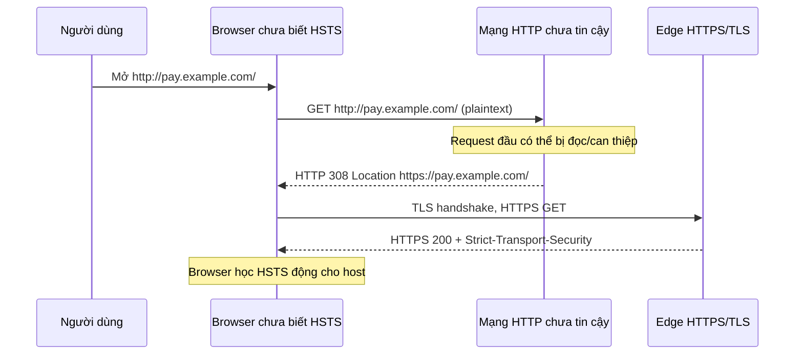
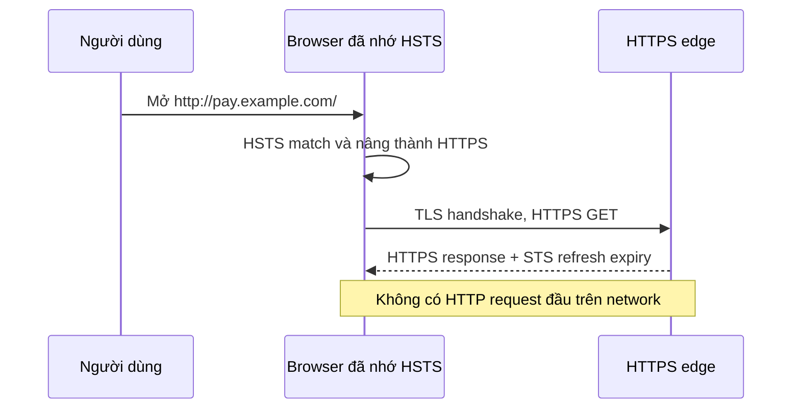
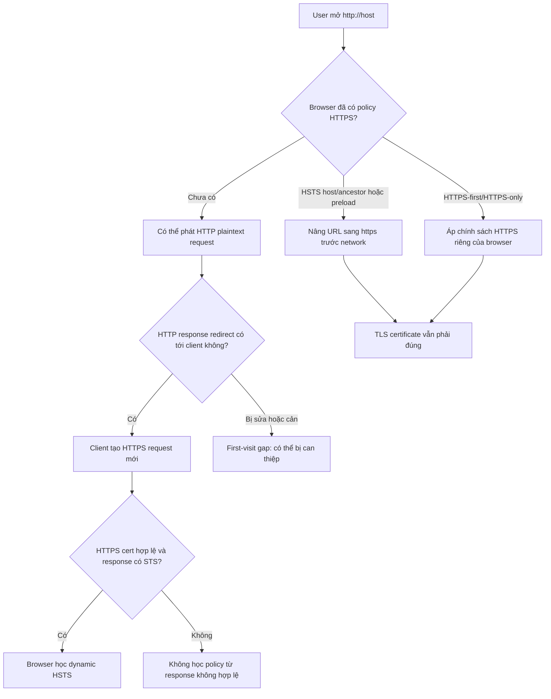
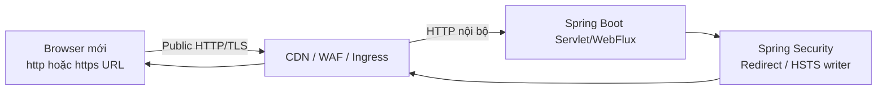

# Giới hạn bảo vệ ở lần truy cập đầu tiên

> **Chương:** HTTPS và HSTS  
> **Học phần:** `SPRING_SECURITY_HTTP_PROTECTION` — áp dụng các lớp phòng vệ HTTP và trình duyệt của Spring Security, gồm CSRF, CORS, security headers, CSP, HSTS, HTTP firewall và bảo vệ session trên Servlet lẫn Reactive WebFlux.  
> **Trọng tâm:** giới hạn của **HSTS động ở lần tiếp xúc đầu**, nguyên nhân *first-visit gap*, cách thiết kế HTTPS-first ngay từ client, redirect, preload, reverse proxy và kiểm thử hành trình từ trình duyệt tới hạ tầng. Bài viết độc lập, không yêu cầu kiến thức từ bài trước.

## 1. Tình huống khởi đầu: HSTS đã bật một năm nhưng người dùng vẫn gửi HTTP

Một ứng dụng thanh toán phục vụ tại `https://pay.example.com`. Security team đã kiểm tra HTTPS response:

```http
HTTP/1.1 200 OK
Strict-Transport-Security: max-age=31536000; includeSubDomains
Cache-Control: no-store
Content-Type: text/html; charset=utf-8
```

Hệ thống có certificate hợp lệ, API yêu cầu đăng nhập và CSRF được bật. Team kết luận: “Từ nay mọi người dùng luôn tới HTTPS.”

Một người dùng mới nhận tin nhắn chứa link:

```text
http://pay.example.com/invoice/2026-001
```

Đây là lần đầu trình duyệt của người đó ghé hostname `pay.example.com`. Nếu profile **chưa có HSTS cho host**, chưa có ancestor `includeSubDomains`, chưa có preload entry và không có cơ chế nâng HTTPS khác, browser **có thể gửi HTTP request ra mạng trước khi nhận redirect**.

Vì HTTP plaintext không xác thực/mã hóa đường truyền, đối tượng kiểm soát một mạng không đáng tin có thể can thiệp request/response đầu tiên. Dù server thật có 301/308 lên HTTPS, client **phải nhận được redirect thật** trước khi thiết lập TLS. HSTS server đã cấu hình không thể sửa một HTTP response giả mà client nhìn thấy trước lần HTTPS thành công.

**Đây là giới hạn bảo vệ ở lần truy cập đầu tiên — first-visit gap.**

### 1.1. Câu hỏi cốt lõi

> **Trước khi browser đã tin một HTTPS response mang HSTS của hostname, ai đảm bảo URL HTTP đầu tiên được nâng HTTPS mà không phụ thuộc một redirect HTTP dễ bị can thiệp?**

Câu trả lời cần phân biệt *trường hợp browser chưa biết HSTS động*, *preload đã được phân phối*, *HTTPS-first/HTTPS-only behavior*, *URL vốn đã là HTTPS* và *trusted TLS infrastructure*. Không có một bean Spring Security nào đơn độc giải quyết mọi trường hợp.

### 1.2. Mục tiêu học tập

1. Mô tả **HTTP request trước redirect** và mối đe dọa attacker-in-the-middle/SSL stripping.
2. Giải thích điều kiện để HSTS dynamic được học: **HTTPS response hợp lệ**, đúng hostname, `max-age` dương; vì sao STS trên HTTP bị bỏ qua.
3. Phân biệt first-visit gap với lỗi TLS hiện tại, lỗi cookie/session, CORS, CSRF hoặc authorization.
4. Nêu phạm vi hostname: policy parent `includeSubDomains` chỉ giúp child **sau khi browser đã học parent**, hoặc khi parent có preload entry phù hợp.
5. So sánh **HTTP 3xx redirect**, **dynamic HSTS**, **HSTS preload**, **HTTPS-first/HTTPS-only** và **HTTP client dùng HTTPS trực tiếp**.
6. Thiết kế links, login forms, OAuth/OIDC callbacks, API base URLs và session cookies tránh gửi dữ liệu bí mật qua HTTP ở lần đầu.
7. Cấu hình redirect/HSTS an toàn bằng Spring Security Servlet và Reactive WebFlux, kiểm tra TLS termination và forwarding trust.
8. Thiết kế kiểm thử phân biệt browser mới/chưa học với browser đã học/preloaded; quan sát HTTP request có ra mạng hay không.
9. Chẩn đoán khi scanner báo “HSTS PASS” nhưng website vẫn có first-contact weakness.
10. Giữ CSRF, CORS, CSP, HTTP firewall, session và object authorization độc lập với HSTS.

## 2. Nhắc lại HSTS: response header điều khiển **các request sau**

HSTS (HTTP Strict Transport Security) được chuẩn hóa bởi [RFC 6797](https://www.rfc-editor.org/rfc/rfc6797). Một hostname công bố:

```http
Strict-Transport-Security: max-age=31536000; includeSubDomains
```

qua **HTTPS response với TLS hợp lệ**. User agent hỗ trợ HSTS lưu rằng hostname chỉ được truy cập qua HTTPS trong thời gian `max-age`; tùy chọn `includeSubDomains` mở rộng chính sách đến descendants theo DNS labels.

HSTS ảnh hưởng **cách browser tạo request tiếp theo**, không phải request HTTP đã phát trước khi browser biết policy.

| Khái niệm | Điểm kích hoạt | Kết quả | Không làm được |
| --- | --- | --- | --- |
| TLS HTTPS | URL HTTPS, TLS handshake và cert | Mã hóa/toàn vẹn/xác thực endpoint hợp lệ | Không kiểm tra quyền user với hóa đơn |
| HTTP→HTTPS redirect | HTTP response `3xx Location` | Client có thể gửi request mới tới HTTPS | Không bảo vệ HTTP request/response đầu đã đi qua mạng |
| Dynamic HSTS | HTTPS response STS hợp lệ | Browser ghi nhớ host và nâng HTTP URL về sau | Không tự bảo vệ browser chưa nhận policy |
| HSTS preload | Static entry đã ở browser build | Client có thể nâng HTTPS từ lần đầu | Không tạo certificate/listener cho domain |
| HTTPS-first/HTTPS-only | Client/browser policy | Ưu tiên/bắt buộc HTTPS tùy implementation | Không chứng minh host có HSTS/preload |
| Spring Security | HTTP request tới filter chain | Headers, redirect, authn/authz, CSRF, session | Không thể ngăn client đã gửi HTTP plaintext trước app |

### 2.1. Header đúng không có nghĩa browser đã nhận

Một scanner gọi thẳng `https://pay.example.com` và thấy STS. Điều đó chỉ chứng minh một HTTPS response **có header tại thời điểm đo**. Chưa chứng minh browser chưa từng ghé host sẽ chọn HTTPS, browser có preload, API library có HSTS store hay HTTP listener không còn rủi ro.

Câu hỏi đúng là: “Client có **biết trước** policy khi chuẩn bị tạo request đầu hay chưa?”

## 3. Hai hành trình truy cập: lần đầu và những lần sau

### 3.1. Browser chưa có dynamic HSTS



**Giả định sơ đồ:** browser chưa có HSTS từ host hoặc ancestor, chưa có preload/HTTPS-first. Chỉ khi HTTP redirect được nhận và tuân theo, browser mới tới được HTTPS server thật để học STS.

### 3.2. Browser đã nhớ HSTS



Nếu browser đã học HSTS và policy còn hiệu lực, nó nâng scheme **trước network**. Điểm bảo vệ xảy ra **tại client**, trước khi Spring Security/WAF/HTTP reverse proxy nhận request.

### 3.3. Sơ đồ quyết định trước network request



Sơ đồ không bảo đảm browser cho fallback HTTP khi HTTPS-first gặp lỗi; chính sách tùy browser/version/mode.

## 4. Mô hình đe dọa: HTTP đầu tiên có thể bị làm gì?

### 4.1. Bối cảnh attacker-in-the-middle (AitM)

Một người dùng mở link HTTP qua mạng công cộng hoặc mạng bị kiểm soát. Attacker có thể quan sát hoặc sửa HTTP plaintext. Attacker **không cần** làm giả chứng chỉ HTTPS hợp lệ để can thiệp một request chưa dùng TLS.

Tùy quyền kiểm soát, attacker có thể:

- Đọc hostname, path, query string và các HTTP headers.
- Sửa response HTML/JavaScript tải qua HTTP.
- Thay HTTP 301/308 bằng trang HTML giả.
- Sửa `Location` sang domain phishing giống thật.
- Chặn redirect và giữ user trên HTTP.
- Đưa nội dung lạ vào một resource tải bằng HTTP.
- Lừa người dùng nhập thông tin vào một login form không an toàn.

Mục đích phần này là hiểu **hậu quả của plaintext transport**, không phải hướng dẫn thực hiện tấn công. Chỉ thử trong lab/network được phép.

### 4.2. Attacker không thể “dễ dàng sửa” TLS hợp lệ

Nếu browser kết nối trực tiếp `https://pay.example.com` với hostname và certificate hợp lệ, attacker trên mạng **không thể tùy ý thay response mà không bị TLS phát hiện**. HSTS không cần có trước để một kết nối HTTPS hợp lệ cung cấp confidentiality/integrity/endpoint authentication của TLS.

Attacker vẫn có thể gây mất kết nối (DoS) bằng cách chặn đường truyền; HTTPS cũng không xử lý bugs server như XSS, CSRF, IDOR, session fixation.

### 4.3. Dữ liệu có thể lộ trước redirect

| Dữ liệu | Có thể xuất hiện ở đâu? | Biện pháp |
| --- | --- | --- |
| Hostname/path | Request line, `Host` | Phát link HTTPS ngay từ nguồn |
| Query chứa email/ID/token | HTTP URL | Không đưa secrets vào URL, HTTPS direct |
| Referrer | `Referer` theo browser policy | HTTPS và `Referrer-Policy` phù hợp |
| Cookie không `Secure` | `Cookie` khi domain/path match | `Secure` và cookie scope tối thiểu |
| User-Agent/metadata | HTTP headers | Tối giản metadata nhạy cảm và dùng TLS |
| Password/form fields | HTTP POST nếu form/link sai | Chỉ gửi form qua HTTPS |
| Bearer token | HTTP API request từ SDK lỗi | HTTPS base URL, không downgrade |
| JS/HTML bootstrap | HTTP response bị can thiệp | Không bootstrap app từ HTTP |
| Session ID trong URL | Query/path | Không đưa session ID vào URL |

`Secure` cookie giảm nguy cơ cookie bị gửi qua HTTP nhưng không khiến **HTML qua HTTP** trở nên đáng tin. Attacker vẫn có thể thay nội dung đầu và tạo trang đăng nhập giả.

### 4.4. “HTTP chỉ trả redirect” là cần, chưa đủ

```http
HTTP/1.1 308 Permanent Redirect
Location: https://pay.example.com/
```

Giúp client thông thường chuyển HTTPS nếu nhận response thật. Nhưng server-side 3xx không xác thực HTTP hop đầu. Vì vậy xem redirect là **compatibility/safety fallback** cho URLs cũ, không thay client buộc HTTPS trước network.

## 5. HSTS chỉ được học qua HTTPS hợp lệ

`Strict-Transport-Security` là response header user agent được phép tin khi kết nối HTTPS có TLS hợp lệ. Nếu origin gửi STS qua HTTP plaintext, browser theo RFC **bỏ qua**.

```http
HTTP/1.1 301 Moved Permanently
Location: https://pay.example.com/
Strict-Transport-Security: max-age=31536000
```

Nếu response trên đi **qua HTTP**, STS không được dùng để tạo HSTS store. Redirect có thể vẫn được theo.

### 5.1. Tại sao browser phải bỏ qua STS trên HTTP?

Nếu tin STS từ HTTP, AitM có thể tự tạo policy dài cho host không hỗ trợ TLS gây denial of service, hoặc gửi `max-age=0` xóa policy thật. “Chỉ nhận STS qua HTTPS hợp lệ” bảo vệ **policy update**, song tạo ra **chicken-and-egg problem** ở lần đầu.

### 5.2. HTTP header giả không cập nhật HSTS store

```http
Strict-Transport-Security: max-age=0
```

qua HTTP không được dùng xóa policy đã học. Một STS dài qua HTTP cũng không tự khiến browser tin host phải dùng HTTPS.

### 5.3. Lỗi cert chặn học policy

HTTPS certificate hết hạn/sai SAN/hostname/trust chain không hợp lệ **không phải** nguồn browser tin để cập nhật policy. Người dùng không nên được hướng dẫn bỏ certificate verification để “học HSTS”. Với Known HSTS Host, browser thường không cho click-through TLS errors.

## 6. First-visit gap là vấn đề **client state**, không chỉ cấu hình server

Hai người dùng mở cùng một HTTP URL:

| Client | State trước navigation | Hành vi có thể |
| --- | --- | --- |
| Alice | Đã nhận STS HTTPS tuần trước | Nâng HTTPS trước network |
| Bob | Profile mới, chưa có dynamic HSTS | Có thể gửi HTTP rồi nhận 3xx |
| Carol | Đã học parent `example.com; includeSubDomains` | Nâng HTTPS cho child |
| Dan | Browser build chứa static preload | Nâng HTTPS nhờ preload |
| Eve | HTTPS-only mode được bật | Buộc HTTPS do browser policy khác |
| Java client | Không dùng HSTS store | Gửi HTTP nếu base URL sai |
| Browser HSTS đã hết hạn | Không còn entry đang hiệu lực | Có thể gửi HTTP lần tới |
| Private/profile riêng | State tùy implementation | Không được suy từ profile khác |

Bài kiểm thử trên máy Alice **không mô tả** client Bob. Test liên tục trên cùng profile đã primed có thể tạo false sense of security.

### 6.1. Vì sao browser không có state?

- Lần đầu dùng website trong profile mới/thiết bị mới.
- Dynamic HSTS chưa được học hoặc đã hết hạn.
- Hostname khác host từng học HSTS.
- Parent có HSTS nhưng browser chưa ghé parent.
- App chuyển domain/subdomain mới.
- Browser/SDK có HSTS handling/storage khác nhau.
- Private browsing lưu/clear state khác nhau theo implementation.

Xóa cookies không bảo đảm xóa HSTS. Đăng nhập hôm trước không chứng minh cùng profile đã học **đúng hostname**.

## 7. Lần đầu của subdomain có gap dù apex đã bật includeSubDomains

`https://example.com` phát:

```http
Strict-Transport-Security: max-age=31536000; includeSubDomains
```

Website có `www.example.com`, `login.example.com`, `api.example.com` và `v2.api.example.com`.

Nếu browser **chỉ thăm `www.example.com` trực tiếp** mà chưa từng ghé HTTPS apex, nó chưa tự có policy động do apex phát.

### 7.1. Hai timeline đối lập

**A — Browser mới:**

1. Mở trực tiếp `http://api.example.com`.
2. Chưa từng thấy STS từ `example.com` hoặc `api.example.com`.
3. Không có preload/HTTPS-first.
4. Có thể gửi HTTP request đầu; cần redirect/reject và HTTPS links.

**B — Browser đã học parent:**

1. Đã nhận STS includeSubDomains từ HTTPS `example.com`.
2. Nhập `http://api.example.com`.
3. Browser superdomain-match `example.com`.
4. Nâng HTTPS trước network, kể cả khi API chưa tự phát STS.

**Browser đã học policy parent** mới là điều kiện có ý nghĩa, không phải root server config.

### 7.2. Child HSTS riêng giúp gì?

`https://api.example.com` có thể phát STS riêng để user truy cập API học policy mà không cần ghé root. Nhưng child không thể áp STS ngược lên parent hoặc sang sibling bằng `includeSubDomains`.

### 7.3. DNS delegation/SaaS không tạo ngoại lệ

`partners.example.com` delegate DNS cho vendor vẫn là descendant. Browser đã học parent includeSubDomains sẽ ép HTTPS. `customer.example.net` CNAME tới cùng backend nhưng không thuộc cây hostname này và không tự được HSTS parent bảo vệ.

## 8. Server redirect và dynamic HSTS khác nhau như thế nào?

| Đặc tính | Server HTTP redirect | Dynamic HSTS |
| --- | --- | --- |
| Cần HTTP request đầu nếu client chỉ có URL HTTP? | Có | Không nếu HSTS đã học |
| HTTP response có thể bị AitM sửa? | Có | Không dùng HTTP response trong lần đã HSTS |
| Bảo vệ first visit chưa học? | Dẫn đến HTTPS nếu redirect thật được nhận | Không tự bảo vệ |
| Scope | Rules server/route | Hostname (+ descendants nếu chỉ định) |
| Client-side upgrade trước network? | Không | Có nếu policy đang áp |
| Certificate TLS có cần? | Có tại HTTPS destination | Có cho mọi kết nối HTTPS |
| Xử lý API HTTP library? | Client có thể follow 3xx | HSTS có thể không được HTTP library hỗ trợ |

### 8.1. 301/302/307/308 không xóa nguy cơ HTTP POST đầu

`307`/`308` giữ method/body khi follow redirect; không nên xem là an toàn cho một POST có password đã gửi qua HTTP. Lúc này dữ liệu có thể bị lộ **trước** khi client theo 3xx. Hãy bắt đầu với HTTPS URL, không nhờ redirect “cứu” credential POST.

### 8.2. Redirect cache không phải trust anchor HSTS

Một browser cached 301 có thể tự redirect mà không gửi HTTP lần này, nhưng client mới chưa có cache vẫn gặp HTTP hop. Redirect cache semantics khác HSTS và không chứng minh policy HSTS đã học.

### 8.3. Kiểm tra HTTP redirect vẫn quan trọng

Dù first-visit gap còn tồn tại, public HTTP listener cần redirect/reject thay vì trả dữ liệu bí mật. Đây là một biện pháp hỗ trợ defense-in-depth, kết hợp HTTPS direct links, cookies Secure và HSTS/preload nếu phù hợp.

## 9. Biện pháp chủ động nhất: phát HTTPS URL **ngay từ nguồn**

Không cần chờ browser học HSTS, các ứng dụng, liên kết và SDK có thể dùng HTTPS trực tiếp:

| Entry point | Mẫu lỗi | Thiết kế tốt |
| --- | --- | --- |
| Email/SMS/QR | `http://pay.example.com/...` | Link HTTPS, hạn chế secret trong query |
| HTML canonical link | Canonical URL HTTP | Canonical HTTPS |
| OAuth/OIDC callback | HTTP redirect URI | HTTPS callback với exact allowlist theo IdP |
| OIDC discovery/metadata | HTTP endpoint links | HTTPS endpoints |
| SPA API URL | `http://api.example.com` | HTTPS API URL ngay |
| `fetch()` từ HTTPS page | Absolute HTTP URL | HTTPS URL, không dựa vào mixed-content upgrade |
| Form login/action | `action="http://..."` | HTTPS action/relative path từ HTTPS document |
| Mobile SDK | HTTP base URL | HTTPS-only base URL, verify certificate |
| Microservices | HTTP internal hop không được đánh giá | TLS/mTLS hoặc threat model/net boundary rõ |
| Private file link | HTTP URL có token | HTTPS URL, short-lived/one-time credentials khi cần |

### 9.1. Relative URLs trên HTTPS giúp, nhưng không bảo vệ document đầu

Một trang tại `https://portal.example.com`:

```html
<form method="post" action="/checkout">
  <input name="quantity">
  <button type="submit">Submit</button>
</form>
<script src="/assets/app.js"></script>
```

Các relative URLs dựa trên HTTPS origin, tránh vô tình hard-code HTTP. Nhưng nếu **document ban đầu** bị tải qua HTTP, source HTML chưa đáng tin; relative URLs không tự sửa first visit đó.

### 9.2. HTTPS vẫn không phải lý do đặt secret trong URL

Ngay cả khi TLS che request path/query trên network, URLs vẫn có thể bị ghi trong logs, history, analytics/referrer. Không đưa session/bearer tokens vào URL; khi business cần one-time link, dùng token giới hạn thời gian và HTTPS.

## 10. Cookie Secure và session hạn chế một phần thiệt hại first-visit

Session cookie minh họa:

```http
Set-Cookie: SESSION=<opaque-value>; Path=/; Secure; HttpOnly; SameSite=Lax
```

`Secure` tránh cookie gửi qua HTTP theo browser cookie rules. `HttpOnly` hạn chế JS đọc trực tiếp cookie. `SameSite` điều chỉnh cross-site cookie sending. Không có thuộc tính nào **tự xác thực một HTML document đã đến qua HTTP**.

### 10.1. Cookie Secure không làm HTTP HTML đáng tin

Một HTTP GET đầu tiên không kèm cookie vẫn có thể nhận HTML bị sửa và hiển thị form giả. Browser chỉ chắc đang giao tiếp với server hợp lệ khi kết nối HTTPS xác minh certificate, hoặc URL được client chọn HTTPS ngay từ trước network.

### 10.2. HSTS và session/cookie có đồng hồ riêng

| State | Owner | Thời hạn |
| --- | --- | --- |
| Server session | App/session store | Session timeout/invalidation |
| Browser session cookie | Cookie jar | Cookie Max-Age/Expires |
| Dynamic HSTS | Browser HSTS store | `max-age` từ HTTPS STS response cuối |
| Static preload | Browser build/list | Release và removal propagation |
| TLS ticket | TLS stack | TLS resumption rules |
| Redirect cache | HTTP cache | Cache semantics |

Logout không xóa HSTS theo mặc định; browser chưa học HSTS không tự có session cookie. Không trộn hai trạng thái khi debug.

## 11. Preload giúp browser biết policy **trước lần đầu** trong một số bản build

HSTS preload có thể phân phối sẵn danh sách hostname vào browser. Nếu build đang dùng có entry cho host/ancestor, browser có thể nâng HTTP URL trước khi phát network request, kể cả chưa hề vào site.

### 11.1. Header preload không có nghĩa đã được preloaded

```http
Strict-Transport-Security: max-age=63072000; includeSubDomains; preload
```

Token `preload` trong HTTPS response là **một điều kiện/thông điệp ý định**. Nó không tự thêm host vào browser static list. Muốn preloaded cần:

1. Domain đáp ứng yêu cầu chương trình hiện hành (TLS, HTTPS subdomains, redirects, HSTS header...).
2. Chủ domain chấp thuận và submit qua kênh chính thức.
3. Được tiếp nhận/đưa vào upstream list.
4. Browser vendor cập nhật dữ liệu và phát hành.
5. User/browser version đã thực sự nhận list.

Một đơn đã submit/pending **không chứng minh** browser hiện tại có static policy.

### 11.2. Có lợi ích, nhưng có chi phí hồi phục lớn

**Lợi ích:** không chờ HTTP redirect ở first contact.

**Chi phí:** parent preload includeSubDomains có thể ép HTTPS tất cả child, kể cả legacy/internal/tenant hosts. Removal qua chương trình và cập nhật browser có thể kéo dài; `max-age=0` chỉ thay dynamic entry và không tự xóa static preload entry.

[HSTS Preload List Submission](https://hstspreload.org/) nêu HSTS thường được khuyến nghị nhưng không khuyến nghị **preloading như bước mặc định** do cần cân nhắc lợi ích bổ sung với rủi ro gỡ chậm và browser HTTPS-first.

### 11.3. First-visit không có nghĩa đã preload

Browser mới mở `http://host` thành HTTPS có thể do HTTPS-first/HTTPS-only, parent preload, dynamic HSTS còn sẵn trong profile, hoặc policy enterprise. Không lấy screenshot URL đổi thành HTTPS làm bằng chứng exact static preload membership.

## 12. HTTPS-first/HTTPS-only khác HSTS

Browser hiện đại có thể tự ưu tiên HTTPS hoặc hỗ trợ chế độ chỉ HTTPS. Behavior khác giữa versions/modes:

- Có thể nâng HTTP navigation trước network.
- Có thể cảnh báo hoặc không cho fallback HTTP khi HTTPS lỗi.
- Có thể chỉ ưu tiên top-level navigation hoặc có rules cho tài nguyên nhúng.
- Có thể chịu ảnh hưởng chính sách doanh nghiệp/extension.
- Có thể khác HTTP clients/mobile SDK không dùng browser engine.

Vì vậy nói “lần truy cập đầu **luôn đi HTTP** nếu không preload” là **không chính xác**. Câu đúng: **dynamic HSTS tự nó không bảo đảm bảo vệ first request trước khi browser học policy**; môi trường browser cụ thể có thể áp HTTPS nhờ cơ chế độc lập.

### 12.1. Không đánh đồng nâng HTTPS với static entry

| Quan sát | Chứng minh được | Chưa chứng minh |
| --- | --- | --- |
| Browser mở HTTP URL thành HTTPS | Browser đã dùng HTTPS | Nguyên nhân là preload hay HTTPS-first |
| DevTools có `307 Internal Redirect` | Có thể client-side upgrade | Không nhất thiết server đã gửi HTTP 307 |
| Edge không thấy HTTP request | Browser không gửi HTTP tới edge trong phép thử | Không tự chứng minh static preload |
| HTTPS response có STS | Response được cấu hình HSTS | Profile mới biết policy từ trước |
| hstspreload.org báo pending | Chương trình đã ghi nhận bước hồ sơ | Browser đang có entry |
| Browser build có static entry xác minh | Build đó có preload | Các builds/clients khác đều giống |

### 12.2. CSP upgrade-insecure-requests không giúp HTTP navigation đầu tải chính document

`Content-Security-Policy: upgrade-insecure-requests` áp trên ngữ cảnh document đã tải, có thể đổi URLs của resource requests. Nó không thể bảo vệ HTTP request đầu **để tải chính document** khi browser chưa nhận CSP đó. CSP qua `meta` tag cũng không phải trust anchor trước network.

## 13. Biên của hostname/port

HSTS theo hostname và descendants, không phải Java path. Khi policy áp:

| HTTP URL | HSTS rewrite | Ghi chú |
| --- | --- | --- |
| `http://pay.example.com` | `https://pay.example.com` | Default HTTPS port |
| `http://pay.example.com:80` | `https://pay.example.com:443` | Cổng 80 đổi 443 |
| `http://pay.example.com:8080` | `https://pay.example.com:8080` | Cổng khác 80 giữ nguyên |
| `http://login.pay.example.com` | HTTPS nếu parent includeSubDomains | Parent phải được học/preloaded |
| `http://api.example.com` | Không do `pay.example.com` | Sibling khác |
| `http://example.net` | Không do `example.com` | Domain khác |
| `http://notexample.com` | Không do `example.com` | So khớp DNS labels |
| `http://127.0.0.1:8080` | Không là DNS HSTS host theo RFC | IP literal/browser local exceptions riêng |

### 13.1. HSTS không dùng Servlet PortMapper

`HttpSecurity.redirectToHttps` có thể có server-side port mapping, nhưng browser HSTS không hỏi Java `PortMapper`. URL `http://host:8080` có thể được nâng thành `https://host:8080` và lỗi TLS nếu :8080 chỉ nói HTTP.

### 13.2. www, apex và deep hosts khác nhau

`www.example.com` phát STS không tự áp `example.com`/`api.example.com`. Ngược lại root phát `includeSubDomains` chỉ giúp browser đã **nhận root policy**, trừ khi root được preload. Host sâu cần TLS certificate phù hợp, không thể suy `*.example.com` wildcard bao mọi cấp.

## 14. TLS certificate lỗi trong first visit là vấn đề khác HSTS gap

Một HTTPS URL trực tiếp có thể gặp certificate hết hạn, sai SAN/hostname hoặc trust chain. Đây là **lỗi TLS readiness/identity**, không phải hệ quả bắt buộc của HSTS.

- Browser chưa biết HSTS có thể hiển thị warning/fallback tùy implementation, nhưng người dùng **không nên bỏ qua lỗi certificate** của dịch vụ nhạy cảm.
- Browser biết HSTS/preload thường chặn click-through nghiêm ngặt.
- HTTP `max-age=0` không thể xóa policy vì browser bỏ qua STS qua HTTP.
- Cần sửa cert, DNS, SNI, TLS listener trước khi phục vụ user.

### 14.1. Preload có thể đổi failure mode thành outage

Nếu browser bị buộc HTTPS nhưng child chỉ có HTTP hoặc cert sai, kết nối có thể thất bại thay vì bị hạ HTTP. Đây là thuộc tính fail-closed của bảo vệ transport. Sửa TLS readiness, không đề xuất user tắt validation.

## 15. Spring Security kiểm soát phần nào?

Hệ thống Spring Boot có thể terminate TLS tại embedded server, hoặc tại ingress/CDN rồi proxy HTTP/TLS nội bộ. Spring Security **không tạo certificate/PKI/TLS handshake**; nó giúp:

- Định nghĩa HTTP→HTTPS redirect policy.
- Ghi HSTS và các HTTP security headers.
- Kiểm tra authentication, authorization, CSRF và firewall.
- Quản lý session/login/logout theo cấu hình.

Không một filter nào có thể xử lý request/response đã bị thay ở mạng **trước khi request tới app**.

### 15.1. Ví dụ HTTPS listener Spring Boot

```yaml
# Ví dụ thử nghiệm; secret thực lấy từ secret manager/environment.
server:
  port: 8443
  ssl:
    enabled: true
    key-store: classpath:tls/server-dev.p12
    key-store-type: PKCS12
    key-store-password: "__FROM_SECRET_MANAGER__"
```

Ví dụ chỉ có ý nghĩa sau khi file PKCS12/cert hợp lệ, hostname/SAN đúng và secret được cấp an toàn. HTTPS 8443 không tự tạo HTTP listener 8080 để redirect. Khi triển khai thật, không commit password/keystore private key.

## 16. Servlet: redirect và HSTS là **hai chức năng khác nhau**

Ví dụ hiện đại dùng `HttpSecurity` và `SecurityFilterChain`:

```java
package example.security;

import static org.springframework.security.config.Customizer.withDefaults;

import org.springframework.context.annotation.Bean;
import org.springframework.context.annotation.Configuration;
import org.springframework.security.config.annotation.web.builders.HttpSecurity;
import org.springframework.security.web.SecurityFilterChain;

@Configuration
class ServletHttpsPolicy {

    @Bean
    SecurityFilterChain webSecurity(HttpSecurity http) throws Exception {
        return http
            .redirectToHttps(withDefaults())
            .headers(headers -> headers
                .httpStrictTransportSecurity(hsts -> hsts
                    .maxAgeInSeconds(86400)
                    .includeSubDomains(false)
                    .preload(false)
                )
            )
            .csrf(withDefaults())
            .authorizeHttpRequests(auth -> auth
                .requestMatchers("/health", "/login").permitAll()
                .anyRequest().authenticated()
            )
            .formLogin(withDefaults())
            .build();
    }
}
```

`redirectToHttps(withDefaults())` có trong tài liệu Servlet Spring Security mới; dòng cũ dùng `requiresChannel(...requiresSecure())`. Cần đúng HTTP/HTTPS listener hoặc trusted scheme mapping để redirect hoạt động, và đối chiếu API với version đang ghim.

### 16.1. Chuỗi phản hồi khi browser chưa biết HSTS

```text
Browser mở http://pay.example.com/login
  -> HTTP request tới edge/app nếu browser không nâng sẵn
  -> 3xx Location https://pay.example.com/login
  -> Browser kết nối TLS, validate cert
  -> HTTPS response + STS max-age=86400
  -> Browser có thể học dynamic HSTS
```

**Request HTTP đầu vẫn có thể bị can thiệp.** `redirectToHttps` là server-side redirect, không phải client static preload policy.

### 16.2. HTTP redirect có thể do edge sở hữu

Nếu CDN/nginx nhận port 80 và redirect, request HTTP không vào Servlet app. Đây có thể là thiết kế phù hợp; phải test trên public URL và phân biệt edge owner với app header writer.

### 16.3. HstsHeaderWriter mặc định chỉ ghi khi secure

Servlet dùng `HstsHeaderWriter`; mặc định chỉ thêm STS khi `ServletRequest.isSecure() == true`. Không cố sửa first gap bằng:

```java
// KHÔNG dùng: thêm HSTS vào HTTP response cũng không bảo vệ first contact.
hsts.requestMatcher(request -> true);
```

Browser bỏ qua HSTS từ HTTP. Cấu hình đó che mất lỗi trust boundary và tạo false positive cho test đơn giản.

### 16.4. permitAll khác web.ignoring

`permitAll()` vẫn đi qua security chain/filter/header writers. `web.ignoring()` hoặc route ngoài mọi chain có thể bỏ qua writer. Điều này ảnh hưởng **HTTPS response nào phát STS**, không giới hạn browser policy theo path sau khi đã học.

## 17. Reactive WebFlux: redirect và HSTS bằng ServerHttpSecurity

```java
package example.security;

import java.time.Duration;
import static org.springframework.security.config.Customizer.withDefaults;

import org.springframework.context.annotation.Bean;
import org.springframework.context.annotation.Configuration;
import org.springframework.security.config.annotation.web.reactive.EnableWebFluxSecurity;
import org.springframework.security.config.web.server.ServerHttpSecurity;
import org.springframework.security.web.server.SecurityWebFilterChain;

@Configuration
@EnableWebFluxSecurity
class ReactiveHttpsPolicy {

    @Bean
    SecurityWebFilterChain webSecurity(ServerHttpSecurity http) {
        return http
            .redirectToHttps(withDefaults())
            .headers(headers -> headers
                .hsts(hsts -> hsts
                    .maxAge(Duration.ofDays(1))
                    .includeSubdomains(false)
                    .preload(false)
                )
            )
            .authorizeExchange(auth -> auth
                .pathMatchers("/health").permitAll()
                .anyExchange().authenticated()
            )
            .build();
    }
}
```

Đây là ví dụ về **HTTPS/HSTS**, không phải cấu hình authn/CSRF/CORS hoàn chỉnh. Nếu browser sử dụng cookie-session, phải bảo vệ CSRF theo threat model; kiểm tra API phù hợp version.

| Ý định | Servlet | Reactive |
| --- | --- | --- |
| Builder | `HttpSecurity` | `ServerHttpSecurity` |
| Chain | `SecurityFilterChain` | `SecurityWebFilterChain` |
| Redirect | `redirectToHttps` mới hoặc `requiresChannel` cũ | `redirectToHttps` |
| HSTS writer | `HstsHeaderWriter` | `StrictTransportSecurityServerHttpHeadersWriter` |
| Duration | `maxAgeInSeconds(long)` | `maxAge(Duration)` |
| Descendants | `includeSubDomains` | `includeSubdomains` |
| Request | `HttpServletRequest` | `ServerWebExchange` |
| Test | `MockMvc` | `WebTestClient` |

`WebTestClient` bind-to-app có thể chỉ mô phỏng HTTPS scheme; không chứng minh TLS public hoặc browser first-visit behavior.

## 18. TLS termination: ranh giới edge/app phải rõ



Nếu browser đã phát HTTP tới edge, AitM ngoài mạng có thể can thiệp **trước edge**. Ngay cả WAF redirect hoàn hảo không thay HTTPS direct link/client enforcement.

### 18.1. Hai owner có thể chọn

**A — Edge sở hữu redirect và HSTS:**

- Edge xử lý port 80 redirect/reject.
- Public HTTPS :443 có TLS/cert hợp lệ.
- Edge phát STS trên HTTPS responses, gồm edge-generated errors/redirects theo policy.
- Backend giữ authentication/authorization, CSRF, firewall.
- Không có duplicate/conflicting HSTS từ app.

**B — App sở hữu redirect và HSTS:**

- App trực tiếp terminate TLS hoặc trusted proxy khôi phục external scheme đúng.
- Redirect không tạo loop.
- App phát STS trên HTTPS responses đi qua chain.
- Edge error pages/static resources cần đánh giá riêng.
- HTTP requests chưa tới app vẫn cần policy ở public edge.

### 18.2. Khi backend thấy HTTP dù browser dùng HTTPS

TLS ở ingress kết thúc, backend nhận HTTP nội bộ. Servlet `request.isSecure()` có thể false; HSTS writer không thêm header và redirect có thể lặp cùng public HTTPS URL.

Đây là **lỗi proxy trust/external scheme**, khác với browser first-visit gap:

- First-visit gap: browser chưa biết HSTS trước network.
- Forwarding lỗi: browser đang dùng HTTPS nhưng backend hiểu scheme sai.

### 18.3. Trusted forwarding không phải tin raw header

```http
Forwarded: for=198.51.100.20;proto=https;host=pay.example.com
X-Forwarded-Proto: https
X-Forwarded-Host: pay.example.com
X-Forwarded-Port: 443
```

Đây là HTTP metadata, không phải chứng minh TLS. Bắt buộc:

1. Edge xóa/ghi đè forwarded headers từ client chưa tin.
2. Backend chỉ nhận kết nối từ trusted proxy; không phơi cổng nội bộ ra Internet.
3. Hostnames public được validate/allowlist ở ingress.
4. Framework/container diễn giải forwarded metadata trước security filters.
5. Test forged `Host`, `X-Forwarded-Host` và `X-Forwarded-Proto` từ public.
6. Kiểm tra `Location` không mở redirect sang host sai/loop.

Spring Boot có thể dùng:

```yaml
# Chỉ khi edge đã thiết lập trust boundary an toàn.
server:
  forward-headers-strategy: framework
```

Servlet có `ForwardedHeaderFilter`/container integration; WebFlux có `ForwardedHeaderTransformer`. Thuộc tính trên **không tự xác thực sender**.

## 19. Edge redirect và HSTS: một mẫu Nginx có ranh giới rõ

Khi CDN/ingress là public TLS endpoint, HSTS và HTTP redirect thường nên được cấu hình ở nơi **nhìn thấy kết nối client**. Ví dụ sau dùng một public hostname `pay.example.com` và backend HTTP chỉ nằm trong mạng riêng.

```nginx
# MẪU MINH HỌA. Chưa bao gồm toàn bộ hardening của Nginx/TLS.
server {
    listen 80;
    server_name pay.example.com;

    # Chỉ redirect; không phục vụ login/credential qua HTTP.
    return 308 https://pay.example.com$request_uri;
}

server {
    listen 443 ssl;
    server_name pay.example.com;

    ssl_certificate     /etc/tls/pay/fullchain.pem;
    ssl_certificate_key /etc/tls/pay/privkey.pem;

    # Dynamic HSTS thận trọng, chưa includeSubDomains/preload.
    add_header Strict-Transport-Security "max-age=86400" always;

    location / {
        proxy_pass http://127.0.0.1:8080;

        # Chỉ edge phát STS; không để backend tạo policy thứ hai.
        proxy_hide_header Strict-Transport-Security;

        # Các forwarded fields được edge kiểm soát, không giữ raw client data.
        proxy_set_header Host pay.example.com;
        proxy_set_header X-Forwarded-Host pay.example.com;
        proxy_set_header X-Forwarded-Proto https;
        proxy_set_header X-Forwarded-Port 443;
        proxy_set_header X-Forwarded-For $remote_addr;
        proxy_set_header Forwarded "";
    }
}
```

### 19.1. Tại sao đây chưa phải bảo vệ hoàn toàn first visit?

- Nếu browser mới thực sự gửi HTTP tới port 80, attacker trên mạng có thể can thiệp **trước Nginx**. Redirect ở edge không có TLS để bảo vệ response HTTP ấy.
- HSTS ở HTTPS server block chỉ được browser học **sau khi** browser đã kết nối HTTPS hợp lệ.
- Một link HTTPS trực tiếp tránh HTTP hop từ đầu.
- HSTS preload (nếu đã được phân phối) hoặc browser HTTPS-first (nếu đang áp) có thể tránh HTTP request đầu.

### 19.2. Cấu hình phải được kiểm tra theo môi trường thực

- Certificate phải hợp lệ với public hostname và SNI.
- `server_name` canonical được xác minh; một hệ thống nhiều hosts cần virtual-host routing đúng.
- `add_header ... always` và quy tắc inheritance ở Nginx có thể bị ảnh hưởng bởi `location`/config khác.
- Response 502/503 do CDN/WAF ở phía trước sinh ra **không nhất thiết** đi qua Nginx.
- `proxy_hide_header` phải được đánh giá nếu backend còn phát STS.
- `X-Forwarded-For` và `Forwarded` chỉ là metadata, cần thiết kế trust chain khi có nhiều proxy.
- Internal backend HTTP cần network isolation và có thể cần TLS/mTLS tùy threat model; HSTS không bảo vệ hop đó.
- Nếu có HTTP 80 listener mở với paths nhạy cảm, kiểm tra **GET/HEAD/POST** theo contract, không chỉ `curl -I`.

### 19.3. Nếu không có HTTP listener thì sao?

Đóng port 80 ngăn server trả HTTP content, nhưng browser mới dùng HTTP URL có thể gặp kết nối thất bại nếu client không tự nâng HTTPS; điều đó khác với HSTS preload. Hãy phát HTTPS URLs từ đầu và quyết định có cần một public HTTP redirect listener để hỗ trợ links cũ hay không theo sản phẩm/clients.

Một số website ưu tiên **không nhận HTTP** đối với các API nhạy cảm, trong khi giữ redirect cho navigation. Cả hai cần test user experience và không gửi secret trước TLS.

## 20. Browser nhận HTTPS nhưng chưa học HSTS: lý do ngoài first visit

Thiếu dynamic HSTS state không nhất thiết có nghĩa browser chưa từng truy cập website. Có những tình huống:

| Hiện tượng | Lớp nguyên nhân | Điều cần kiểm tra |
| --- | --- | --- |
| HTTPS 200 nhưng không STS | App/edge chưa phát HSTS | Public HTTPS response headers |
| STS chỉ nằm trên HTTP 301 | Sai kênh phát header | Response HTTPS cuối có STS không? |
| HTTPS cert lỗi | TLS identity | SAN/SNI/chain, browser validation |
| Parent STS không tới browser | Host redirect sang www, browser chưa thăm parent HTTPS | HTTPS response của từng hostname |
| CDN xóa STS | Reverse proxy/cache | So origin/edge response |
| App HSTS writer không chạy | Request `isSecure=false` hoặc bypass chain | Filter chain và trusted forwarding |
| STS policy từng có đã hết hạn | Browser timer | Lần nhận STS cuối, max-age |
| Browser profile mới/private | Client state khác | Browser/version/profile |
| Host ngoài phạm vi | Sibling hoặc CNAME custom domain | DNS label ancestry |
| HTTP client không hỗ trợ HSTS | Library không có store | HTTPS URL contract ở client |
| STS header sai cú pháp | Header validation | max-age là số giây, không lặp directive |
| Browser còn static preload nhưng không thấy STS | Preload list khác dynamic header | Browser policy source |

### 20.1. Response không có STS không tự xóa entry cũ

Browser có entry dynamic `max-age=31536000` từ tuần trước. Hôm nay server bị lỗi nên không phát STS. Browser vẫn có thể tự nâng HTTP URL vì entry cũ còn hạn.

Ngược lại, một browser chưa có entry không học được gì từ response thiếu header. Vì vậy hiện tượng “máy A vẫn buộc HTTPS, máy B không” có thể do client state chứ không phải load balancer ngẫu nhiên.

### 20.2. max-age=0 là update thật qua HTTPS

```http
Strict-Transport-Security: max-age=0
```

nếu nhận qua HTTPS hợp lệ có thể xóa dynamic entry riêng của host. Nó không xóa parent `includeSubDomains` hoặc static preload policy đang áp. Nếu HTTP response gửi `max-age=0`, browser bỏ qua.

### 20.3. Dùng request direct-to-HTTPS để làm browser học có đủ không?

Đối với một browser có HSTS support, truy cập HTTPS hợp lệ có STS có thể tạo dynamic entry. Nhưng không có cơ chế server “push” policy tới mọi browser **trước khi lần đầu họ tới site**. Phải chủ động sửa entry points (HTTPS links), dùng preload nếu đủ điều kiện, hoặc dựa vào browser HTTPS-first khi khả dụng.

## 21. CORS và CSP khi website có nhiều hostname

Một hệ thống có:

```text
https://portal.example.com      -> HTML SPA
https://api.example.com         -> JSON API
https://static.example.com      -> JS/CSS/images
https://auth.example.com        -> Login/OIDC
```

HSTS policy theo hostname. CORS lại theo **origin = scheme + hostname + port**; CSP thường theo **HTML document**; cookie scope theo Domain/Path/SameSite.

### 21.1. Đừng nghĩ parent HSTS làm các subdomains thành một origin

Dù browser đã học HSTS từ `example.com; includeSubDomains`, `https://portal.example.com` và `https://api.example.com` vẫn khác origin. SPA gọi API với cookies/credentials cần CORS chính xác.

Ví dụ browser preflight:

```http
OPTIONS /api/orders HTTP/1.1
Host: api.example.com
Origin: https://portal.example.com
Access-Control-Request-Method: POST
Access-Control-Request-Headers: content-type,x-csrf-token
```

CORS policy của API cần cho phép đúng origin/method/headers/credentials nếu thiết kế yêu cầu. Không dùng `Access-Control-Allow-Origin: *` với credentialed CORS responses. HSTS không cấp quyền đọc cross-origin.

### 21.2. CSP không thay HTTPS ở document đầu

`Content-Security-Policy` có thể giới hạn script, frame, network destinations và nâng insecure subresources; nhưng browser phải **nhận và tin document** để áp chính sách của nó. Nếu HTML document đầu tiên bị phân phối qua HTTP và attacker sửa được HTML/headers, CSP trong response không phải trust anchor bảo đảm được bảo vệ khỏi việc sửa đó.

### 21.3. Mixed content xảy ra sau bootstrap HTTPS

Trên một HTML trang HTTPS thật, scripts/API requests HTTP có thể bị browser chặn hoặc nâng tùy loại resource/policy. HSTS của hostname đích có thể giúp nếu đã học. Nhưng điều đúng trong source code là dùng **HTTPS URLs trực tiếp**, không hard-code HTTP rồi dựa vào browser tự sửa.

### 21.4. Content-Security-Policy và Strict-Transport-Security là hai headers độc lập

| Header | Browser thực thi | Mối quan hệ với first visit |
| --- | --- | --- |
| `Strict-Transport-Security` | HTTPS policy theo hostname sau khi đã học hoặc preload | Giới hạn dynamic HSTS ở lần đầu |
| `Content-Security-Policy` | Chính sách resource/script cho document | Không tin được nếu HTML đầu qua HTTP đã bị can thiệp |
| `Referrer-Policy` | Kiểm soát referrer sharing | Giảm lộ thông tin, không tạo TLS |
| `X-Content-Type-Options: nosniff` | MIME sniffing control | Không thay TLS/redirect |
| `Cache-Control` | Caching behavior | Không xóa/làm mới HSTS store theo cùng semantics |
| `Set-Cookie` attributes | Browser cookie sending | Secure hạn chế cookie HTTP, không thay HSTS |

## 22. CSRF và authorization: dù browser đã có HTTPS thì vẫn phải kiểm

Có thể đặt hai yêu cầu bảo mật cạnh nhau:

- **Transport invariant:** request chứa credential không đi qua HTTP plaintext.
- **Action invariant:** một unsafe request có state-changing effect phải thỏa CSRF/authorization theo threat model.

HSTS/preload chỉ giúp transport invariant, **không chứng minh** người dùng định thực hiện hành động đó.

### 22.1. Cookie-session POST không token

Ví dụ Alice đã đăng nhập vào HTTPS shop, browser gửi `SESSION` cookie tự động. Một trang ác ý có thể cố tạo request cross-site. Server vẫn cần CSRF token/origin-related defenses phù hợp cho unsafe requests, dù HSTS được áp.

Test đúng:

1. Alice đăng nhập có quyền POST tạo payment.
2. Gửi POST hợp lệ HTTPS với token đúng: thành công theo nghiệp vụ.
3. Gửi POST cùng session **thiếu/sai CSRF token**: từ chối.
4. Assert database/ledger/payment state **không đổi**.
5. Test user không đủ quyền dù có CSRF token: vẫn từ chối bởi authorization.

### 22.2. Spring Security Servlet vs Reactive

Servlet `CsrfFilter`, `SecurityFilterChain` và session APIs khác Reactive `CsrfWebFilter`, `SecurityWebFilterChain` và `WebSession`. Đừng dùng HSTS config của một stack để suy kết quả CSRF ở stack kia.

### 22.3. Object-level authorization không thể thay bằng TLS

Nếu user Bob biết URL HTTPS `/api/invoices/42` nhưng hóa đơn thuộc Alice, service phải kiểm owner/tenant/ACL. TLS bảo vệ kênh, không bảo đảm principal có quyền. Một CDN cache key sai cũng có thể làm lộ hóa đơn qua HTTPS.

### 22.4. HTTP firewall và request normalization

Spring Security Servlet có `StrictHttpFirewall` và Reactive có cơ chế request firewall tương ứng; chúng liên quan đến normalization/path tricks/unsafe encodings. HSTS không sửa `%2F`, `;`, doubled slash hoặc bypass route matchers. Đừng dùng “mọi request đã HTTPS” như lý do bỏ firewall.

## 23. Kiểm thử trực tiếp class HstsHeaderWriter: cần hiểu giới hạn bằng chứng

Unit test writer giúp chứng minh Java class được cấu hình đúng, không chứng minh first-visit protection.

```java
package example.security;

import static org.assertj.core.api.Assertions.assertThat;

import org.junit.jupiter.api.Test;
import org.springframework.mock.web.MockHttpServletRequest;
import org.springframework.mock.web.MockHttpServletResponse;
import org.springframework.security.web.header.writers.HstsHeaderWriter;

class HstsWriterFirstVisitTest {

    @Test
    void secureRequestGetsHsts() {
        HstsHeaderWriter writer = new HstsHeaderWriter();
        writer.setMaxAgeInSeconds(300);
        writer.setIncludeSubDomains(false);
        writer.setPreload(false);

        var request = new MockHttpServletRequest("GET", "/health");
        request.setSecure(true);
        var response = new MockHttpServletResponse();

        writer.writeHeaders(request, response);

        assertThat(response.getHeader("Strict-Transport-Security"))
            .isEqualTo("max-age=300");
    }

    @Test
    void plainHttpDoesNotGetHstsByDefault() {
        HstsHeaderWriter writer = new HstsHeaderWriter();
        var request = new MockHttpServletRequest("GET", "/health");
        request.setSecure(false);
        var response = new MockHttpServletResponse();

        writer.writeHeaders(request, response);

        assertThat(response.getHeader("Strict-Transport-Security"))
            .isNull();
    }
}
```

### 23.1. Điều test này chứng minh

- Writer chỉ tạo STS khi request được mô phỏng là secure.
- Cấu hình `max-age`/`includeSubDomains`/`preload` được đưa vào header dự kiến.
- Điều kiện mặc định của writer không tạo STS trên HTTP request.

### 23.2. Điều test này **không** chứng minh

- Đã có TLS handshake thật.
- Public certificate trust/hostname validation hợp lệ.
- Browser đã học HSTS.
- Browser profile mới không gửi HTTP request đầu.
- Domain có static preload entry.
- Nginx/CDN giữ STS trên response cuối.
- CSRF, session và object-level authorization đúng.

**`request.setSecure(true)` là một thao tác mock**, không phải chứng cứ TLS.

## 24. MockMvc: kiểm thử Servlet chain kết hợp HTTPS redirect

Một app `SpringBootTest` có `GET /health` công khai trả 200 và `SecurityFilterChain` như mục 16.

### 24.1. Secure request qua chain nhận STS

```java
package example.security;

import static org.hamcrest.Matchers.containsString;
import static org.springframework.test.web.servlet.request.MockMvcRequestBuilders.get;
import static org.springframework.test.web.servlet.result.MockMvcResultMatchers.header;
import static org.springframework.test.web.servlet.result.MockMvcResultMatchers.status;

import org.junit.jupiter.api.Test;
import org.springframework.beans.factory.annotation.Autowired;
import org.springframework.boot.test.autoconfigure.web.servlet.AutoConfigureMockMvc;
import org.springframework.boot.test.context.SpringBootTest;
import org.springframework.test.web.servlet.MockMvc;

@SpringBootTest
@AutoConfigureMockMvc
class ServletHttpsIntegrationTest {

    @Autowired
    MockMvc mvc;

    @Test
    void mockHttpsResponseHasHsts() throws Exception {
        mvc.perform(get("/health").secure(true))
            .andExpect(status().isOk())
            .andExpect(header().string(
                "Strict-Transport-Security",
                containsString("max-age=86400")));
    }
}
```

### 24.2. HTTP redirect kiểm tra riêng

Trong test context có `redirectToHttps` và connector/port mapping phù hợp:

```java
@Test
void mockHttpRequestRedirectsToHttps() throws Exception {
    mvc.perform(get("/health").secure(false))
        .andExpect(status().is3xxRedirection())
        .andExpect(header().exists("Location"));
}
```

Đừng hard-code `Location`/port nếu test server không có URL/port mapping như production. Có thể assert HTTPS URL và hostname **sau khi đã cấu hình đúng** fixture.

### 24.3. Điều không nên assert

Không nên gán ý nghĩa “browser first-visit secure” cho một test HTTP redirect được trả từ MockMvc. Test này chỉ chứng minh filter/app tạo 3xx **nếu request tới app**, không mô phỏng kẻ tấn công can thiệp HTTP hop trước đó.

Nếu HTTP redirect do edge sở hữu và app không bật `redirectToHttps`, MockMvc test khác với public E2E một cách hợp lý.

### 24.4. Negative CSRF/authorization không có HSTS dependency

Một MockMvc test POST thiếu CSRF cần chỉ rõ user có quyền, token thiếu, expected status và không có side effect. Với `spring-security-test` có thể dùng `csrf()` cho request hợp lệ và so với request thiếu token, nhưng không trộn kết quả với STS header tests.

## 25. Reactive WebTestClient: kiểm chứng header/redirect, không giả lập browser store

Ví dụ một `WebTestClient` đã bind đúng WebFlux `ApplicationContext` hoặc server có route `GET /health`:

```java
@Test
void reactiveHttpsResponseAdvertisesHsts() {
    webTestClient.get()
        .uri("https://api.example.com/health")
        .exchange()
        .expectStatus().isOk()
        .expectHeader()
        .valueMatches("Strict-Transport-Security",
            ".*max-age=86400.*");
}
```

Test này cần đảm bảo URI scheme được WebTestClient/test runtime giữ đúng, security web filter chain được áp, route trả 200. `bindToApplicationContext` có thể chỉ mô phỏng HTTPS scheme; `bindToServer` mới có thể kiểm HTTPS thật nếu server dùng TLS và client trust certificate.

### 25.1. HTTP exchange với Reactive redirect

Khi `redirectToHttps(withDefaults())` được cấu hình và test environment có external host/port đúng:

```java
@Test
void reactiveHttpExchangeRedirects() {
    webTestClient.get()
        .uri("http://api.example.com/health")
        .exchange()
        .expectStatus().is3xxRedirection()
        .expectHeader().exists("Location");
}
```

Các assertions thuộc về **app redirect contract**, không chứng minh client chưa học HSTS được bảo vệ trước khi gửi HTTP.

### 25.2. API Reactive HSTS writer nếu muốn unit test

`StrictTransportSecurityServerHttpHeadersWriter` thực hiện `ServerHttpHeadersWriter`. Để isolate, dùng mock `ServerWebExchange` với HTTPS/HTTP URI và `StepVerifier` chờ `writeHttpHeaders(exchange)`. Đừng gọi Reactor `Mono<Void>` mà không subscribe trong unit test rồi tưởng writer đã chạy.

## 26. Test public endpoint: HTTPS/cert, redirect và STS

Sau framework tests, phải kiểm tra HTTP/TLS **thực tế** trên public URL. Chỉ dùng host thuộc quyền kiểm soát/được cho phép và endpoint GET không chứa secret.

### 26.1. Kiểm tra HTTPS trực tiếp

```bash
curl -v -D - -o /dev/null \
  https://pay.example.com/health
```

Ghi:

- TLS certificate được xác minh, hostname/SAN khớp.
- Request tới đúng HTTPS hostname; không dùng `-k`/`--insecure` để gọi PASS.
- HTTP status và response headers cuối có STS nếu policy owner yêu cầu.
- `max-age`/`includeSubDomains`/`preload` hợp lệ.
- Không có duplicate/conflicting STS giữa app và edge.
- HTTP 200/3xx/4xx/5xx và CDN cache/error responses có policy theo ownership.

### 26.2. Kiểm tra HTTP redirect

```bash
curl -sS -D - -o /dev/null \
  http://pay.example.com/health
```

Nếu public HTTP listener được thiết kế redirect, xem status/`Location`. Nếu thiết kế block, xem error behavior. Cả hai **không được coi là chứng cứ browser đã học HSTS**.

### 26.3. Quan sát chuỗi redirects mà không gửi secrets

```bash
curl -sS -L --max-redirs 8 -D - -o /dev/null \
  http://pay.example.com/health
```

Mục tiêu: kiểm tra redirects thực, vòng lặp, hostname/port, không phải browser HSTS store. Một số `curl` versions có HSTS support với flags/storage riêng; không giả định một lệnh curl thông thường mô phỏng browser đã primed.

### 26.4. TLS certificate/hostname

```bash
openssl s_client \
  -connect pay.example.com:443 \
  -servername pay.example.com \
  -verify_return_error \
  -verify_hostname pay.example.com
```

Tùy OpenSSL version options có thể khác; `CONNECTED` không đủ để nói certificate validated. Kiểm SNI, cert, chain và hostname. Lệnh này không thay browser first-visit test.

### 26.5. HTTP status 308 không chứng minh redirect không thể bị can thiệp

`curl` cho thấy **mạng nơi test chạy** nhận HTTP redirect. Trên một mạng khác có AitM, plaintext response có thể không giống. Không tuyên bố redirect status có thể tạo một kênh HTTP đáng tin; thiết kế phải ưu tiên HTTPS direct URLs.

## 27. Browser E2E: tách sạch, đã học và preload

Để đo first-visit gap đúng, phải có **ít nhất** những trạng thái browser riêng biệt và network evidence.

### 27.1. Hạ tầng lab riêng

Chọn host test do team kiểm soát, ví dụ `firstvisit-lab.example.net` (tên minh họa; triển khai cần domain mình sở hữu). Yêu cầu:

1. DNS và HTTPS listener với certificate hợp lệ.
2. HTTP listener chỉ phục vụ redirect cho GET endpoint vô hại, không có login.
3. HTTPS response có STS `max-age=300` cho dynamic HSTS test.
4. Có HTTP access log an toàn (không ghi credentials hoặc PII).
5. Browser test profile mới chưa học HSTS/preload/ancestor policy cho test host.
6. Có khả năng ghi browser version, HTTPS-first settings và time.
7. Không dùng root production đang phục vụ người dùng để thay `max-age` hoặc bật preload.
8. Không tạo browser profile với security disabled rồi dùng kết quả đó làm chuẩn của browser production; test cần ghi rõ mọi khác biệt cấu hình.

### 27.2. Kịch bản A — Client chưa học dynamic HSTS

1. Bắt đầu với một profile sạch và hostname không bị preload/ancestor policy.
2. Kiểm tra trạng thái HTTPS-first của browser; nếu browser tự nâng thì ghi **nguồn khác HSTS**.
3. Mở `http://firstvisit-lab.example.net/ping` bằng GET không nhạy cảm.
4. Quan sát Network tab và HTTP edge access logs để xác định có request HTTP public không.
5. Nếu có, ghi response 3xx rồi kiểm tra HTTPS theo sau có TLS/cert hợp lệ.
6. Không gửi credentials hay cookies vào HTTP request.
7. Kết luận **dynamic HSTS chưa được học ở trước lần này**, không suy browser luôn có hành vi HTTP ở mọi version.

### 27.3. Kịch bản B — Client đã học HSTS từ HTTPS

1. Mở `https://firstvisit-lab.example.net/ping` qua TLS hợp lệ.
2. Xác minh HTTPS response mang `max-age=300`.
3. Ghi timestamp, browser/profile.
4. Mở `http://firstvisit-lab.example.net/ping` cùng profile.
5. Quan sát browser nâng HTTPS trước network, không có HTTP request mới của phép thử ở edge.
6. Để phân biệt browser HTTPS-first và dynamic HSTS, dùng browser introspection/test setup tương ứng và các controls.
7. Có thể quan sát expiry hoặc phát `max-age=0` **qua HTTPS hợp lệ** trong lab để chứng minh policy động có state.

### 27.4. Kịch bản C — Header có preload nhưng host chưa vào static list

Trên hostname test **không submit preload**, HTTPS response có thể phát:

```http
Strict-Transport-Security: max-age=300; includeSubDomains; preload
```

Token `preload` trong header không tạo static entry. Một profile đã nhận header có thể học HSTS động; một profile khác chưa nhận **không tự có preload entry** từ việc server vừa phát token. Nếu profile mới vẫn nâng HTTPS, kiểm tra HTTPS-first, ancestor policies và list.

**Không tự submit một domain thật chỉ để thử nghiệm preload**, vì đây là thay đổi có ràng buộc lâu dài.

### 27.5. Kịch bản D — Browser build có static preload entry

Sử dụng domain/test build mà nhóm được phép dùng và đã **xác nhận static list membership của browser version**. Với profile sạch, mở HTTP URL vô hại và quan sát HTTPS upgrade trước network, đồng thời xác minh TLS certificate.

Kết quả chỉ đại diện **browser build/profile đó**, không phải mọi browser cũ hay SDK.

### 27.6. Kịch bản E — Parent HSTS mà child chưa bao giờ nhận

1. Tạo `hsts-parent-lab.example.net` và `api.hsts-parent-lab.example.net` thuộc lab.
2. Parent HTTPS phát `max-age=300; includeSubDomains`.
3. Profile sạch chỉ mở HTTP URL child (chưa ghé parent): có thể còn gap.
4. Cho browser ghé HTTPS parent, nhận STS.
5. Mở lại HTTP URL child: browser có thể nâng do **parent policy**.
6. Kiểm tra thêm hostname sibling/unrelated để tránh suy phạm vi quá rộng.
7. Không dùng một hostname preloaded để test riêng dynamic parent HSTS.

### 27.7. Kịch bản F — max-age hết hạn hoặc được xóa

1. Browser nhận STS `max-age=300` ở `t0`.
2. Không refresh policy, đợi hết duration trong môi trường test có kiểm soát.
3. Quan sát browser có còn HSTS entry không; HTTPS-first có thể vẫn nâng URL.
4. Làm trường hợp khác: gửi `max-age=0` trên HTTPS và kiểm dynamic store.
5. Không nhầm việc browser chuyển HTTPS theo chế độ riêng với HSTS vẫn còn.
6. Không đổi đồng hồ máy người dùng thật để đẩy nhanh expiry, vì gây ảnh hưởng TLS/token/logs.

## 28. Một phép thử AitM có đạo đức để hiểu giới hạn redirect

Mục tiêu học thuật: chứng minh **plaintext HTTP response không có tính toàn vẹn mặc định**, không cần xây công cụ tấn công người dùng thật.

Trong môi trường mạng giả lập, với endpoint GET test vô hại và consent:

1. Dựng HTTP redirect endpoint lab đã được team kiểm soát.
2. Có một proxy/thành phần test **được chỉ định** để thay nội dung HTTP response giả lập trong lab.
3. So sánh browser chưa học HSTS và browser đã học HSTS: browser chưa học có thể chịu tác động do HTTP response bị thay, browser đã học thường không phát request HTTP ban đầu.
4. Không dùng credential thật, không truy cập site ngoài phạm vi, không bypass TLS validation.
5. Ghi lại request/response metadata và test topology mà không log PII.
6. Chứng minh biện pháp tốt nhất là **HTTPS direct navigation** và HSTS/preload khi có điều kiện, không phải dựa vào redirect HTTP.

**Không cần thực hiện tấn công live**, vì mục đích là mô phỏng ranh giới tin cậy, không khai thác hệ thống. Trong production, đo bằng browser/edge logs và HTTPS assertions không xâm nhập.

## 29. Ma trận kiểm thử tổng thể theo tầng

Các mục dưới đây là **test design**, chưa phải kết quả đã chạy. PASS phải đi kèm client/version/time/hostname, expected và observed evidence.

| ID | Lớp | Input | Expected evidence |
| --- | --- | --- | --- |
| FV-01 | Browser state | Profile sạch, HTTP URL, không preload/HTTPS-first | Có thể HTTP first request; ghi network evidence |
| FV-02 | Browser state | Profile sạch, HTTPS URL trực tiếp | TLS được dùng ngay, không cần HSTS |
| FV-03 | Dynamic HSTS | HTTPS response có STS | Browser học policy của đúng host |
| FV-04 | Dynamic HSTS | HTTP URL sau khi học | Browser nâng trước network |
| FV-05 | Dynamic HSTS | HTTP response tự gửi STS | Browser bỏ qua STS |
| FV-06 | Dynamic HSTS | HTTP response `max-age=0` | Không xóa policy do HTTP |
| FV-07 | Dynamic HSTS | HTTPS `max-age=0` | Xóa dynamic entry riêng nếu hợp lệ |
| FV-08 | Dynamic HSTS | HTTPS response thiếu STS | Entry cũ không tự bị xóa |
| FV-09 | Dynamic HSTS | Policy hết hạn | Không còn policy đó, có thể còn HTTPS-first |
| FV-10 | Dynamic HSTS | Nhận lại STS dương | Gia hạn expiry từ lúc nhận |
| FV-11 | Host scope | STS của `www.example.com` | Không tự áp apex/api sibling |
| FV-12 | Parent scope | Parent chưa từng được browser ghé | Child có thể chưa được dynamic parent áp |
| FV-13 | Parent scope | Parent đã học `includeSubDomains` | Child/deep child nâng HTTPS |
| FV-14 | Parent scope | Child gửi `max-age=0` | Parent HSTS vẫn có thể áp |
| FV-15 | Preload | Header có `preload` nhưng chưa enroll | Không suy có static entry |
| FV-16 | Preload | Static list đã có host/ancestor | Browser build đó nâng first request |
| FV-17 | Preload | Static entry tồn tại, dynamic `0` | Static policy vẫn có thể áp |
| FV-18 | Browser setting | HTTPS-first nâng URL | Không gán nhầm static preload |
| FV-19 | Browser version | Browser cũ vs mới | Ghi policy source và behavior riêng |
| FV-20 | HTTP redirect | Public HTTP :80 GET vô hại | 3xx hoặc reject theo policy |
| FV-21 | HTTP redirect | HTTP first response bị thay trong lab | Demonstrate không có integrity |
| FV-22 | URL design | Email/SMS/QR link tới app | HTTPS URL ngay |
| FV-23 | URL design | Form login action | HTTPS trực tiếp, không POST plaintext |
| FV-24 | URL design | OAuth/OIDC callbacks | HTTPS và allowlist |
| FV-25 | URL design | API SDK base URL | HTTPS + certificate validation |
| FV-26 | TLS | Public HTTPS cert trust/SAN/SNI | TLS verification PASS |
| FV-27 | TLS | Expired/wrong cert | Client từ chối, không skip validation |
| FV-28 | TLS | Host sâu chỉ có wildcard nông | Phát hiện cert không match |
| FV-29 | Port | HTTP host :80 có HSTS | Upgrade sang 443 |
| FV-30 | Port | HTTP host :8080 có HSTS | Upgrade sang HTTPS :8080 |
| FV-31 | Servlet writer | Mock secure(true) | STS được ghi nếu chain match |
| FV-32 | Servlet writer | Mock secure(false) | Writer mặc định không thêm STS |
| FV-33 | Servlet redirect | Mock HTTP request | App 3xx/Location theo config |
| FV-34 | Reactive writer | Mock HTTPS exchange | STS theo `maxAge(Duration)` |
| FV-35 | Reactive redirect | Mock HTTP exchange | 3xx theo WebFlux rules |
| FV-36 | Proxy | HTTPS public → HTTP backend | HSTS owner/scheme đúng, không redirect loop |
| FV-37 | Proxy spoof | Forged `X-Forwarded-Proto` | Edge không cho fake public HTTPS |
| FV-38 | Host spoof | Forged `Host`/`X-Forwarded-Host` | Không open redirect/cookie domain sai |
| FV-39 | CDN | Edge-generated 502 | STS theo HTTPS policy owner |
| FV-40 | CDN | Static HTML/API nhiều hosts | STS đúng từng public hostname |
| FV-41 | Cookie | Browser mới, HTTP request | Session cookie `Secure` không bị gửi plaintext |
| FV-42 | Session | Logout rồi thử cookie cũ | Session invalidation đúng, HSTS không bị nhầm |
| FV-43 | CSRF | Cookie-session POST thiếu token | Bị từ chối, DB không đổi |
| FV-44 | Authorization | User B GET object A | Bị từ chối dù HTTPS |
| FV-45 | CORS | SPA portal gọi API khác origin | Allowlist/method/credentials đúng |
| FV-46 | CSP | HTML HTTPS với script lạ | CSP/encoding vẫn bảo vệ |
| FV-47 | HTTP firewall | URL encoded/ambiguous | Không bypass security chain |
| FV-48 | CDN cache | Response riêng của Alice/Bob | Không cross-user leakage |
| FV-49 | Observability | Client profile/browser state | Có bằng chứng HTTP network vs internal upgrade |
| FV-50 | Readiness | First-visit attack surface inventory | Có owner cho URLs/redirect/TLS/headers |
| FV-51 | Recovery | STS duration dài, cần thu hồi | Dynamic/parent/preload rollback được phân biệt |
| FV-52 | Availability | HTTPS listener lỗi sau preload | Khôi phục TLS, không HTTP downgrade |
| FV-53 | HTTP library | Client không hỗ trợ HSTS | Base URL HTTPS và strict TLS |
| FV-54 | App chain | Static/ignored routes | HSTS owner không bỏ sót responses |
| FV-55 | Redirect loops | External HTTPS nhưng app nghĩ HTTP | Trusted forwarding sửa đúng |
| FV-56 | Logs | HTTP URLs/correlation IDs | Không log token, PII, session identifiers |

### 29.1. Test nào thuộc framework, test nào thuộc browser?

| Test | Công cụ phù hợp | Kết luận tối đa |
| --- | --- | --- |
| HSTS writer secure/insecure | Unit test Servlet/Reactive | Header class tạo đúng |
| Redirect và security chain | MockMvc/WebTestClient | App config hoạt động ở môi trường mock |
| Public TLS/headers/redirect | curl/OpenSSL/client có verification | Endpoint/network contract tại nơi đo |
| Header qua CDN errors | HTTPS E2E/edge instrumentation | Public response cuối |
| Browser dynamic HSTS | Browser có state + edge logs | Client đã học và upgrade |
| Browser preload | Browser list introspection + fresh profile | Static entry trên build đã kiểm |
| AitM first contact | Lab có permission/benign test | Giới hạn HTTP plaintext |
| Cookie/CSRF/authz | Browser/backend integration + DB assertions | Application security invariants |

## 30. Bảng chẩn đoán “HSTS PASS nhưng lần đầu chưa an toàn”

| Triệu chứng | Nguyên nhân có thể | Hướng xác minh |
| --- | --- | --- |
| Scanner HTTPS báo HSTS PASS, user mới vẫn HTTP | Dynamic HSTS chưa được học | Fresh profile và HTTP edge logs |
| Máy A tự HTTPS, máy B thấy redirect | HSTS state/browser settings khác | So profile, preload, HTTPS-first |
| Trang chính có STS, API không | Khác hostname/owner | So STS trên public HTTPS từng host |
| `example.com` có include, `www` mới vẫn HTTP | Browser chưa ghé apex | Test direct www trong fresh profile |
| App mock STS, public HTTPS thiếu | Edge proxy xóa header | Compare app vs public response |
| Backend HTTP gây redirect loop | Trusted forwarding sai | Trace external scheme/`Location` |
| HTTP redirect được thay trong lab | Plaintext không có integrity | Chuyển entry links sang HTTPS |
| POST form bị lộ trước redirect | Form action URL HTTP | HTTPS action trước gửi |
| Cookie bị gửi HTTP | Cookie thiếu `Secure` hoặc client khác rules | Inspect Set-Cookie, transport |
| OAuth callback HTTP | App/IdP registration sai | Cập nhật HTTPS URI và allowlist |
| Browser upgraded vì HTTPS-first | Không phải HSTS | Kiểm browser mode/list |
| Domain có `preload` header nhưng browser không preloaded | Chưa submit/accepted/released | Checker/upstream/browser build |
| Child HTTP-only bị browser từ chối | Parent HSTS/preload | TLS readiness và ancestry |
| Cert expired trên preloaded host | TLS lifecycle lỗi | Restore cert, không HTTP fallback |
| CSP chặn script sau redirect | CSP riêng của HTML response | Test CSP/asset URLs |
| CORS 403/blocked sau HTTPS | API khác origin, preflight/credentials | CORS allowlist + HTTPS URL |
| CSRF 403 dù HTTPS | Token/session issue | Negative/positive CSRF tests |
| User khác xem tài nguyên trái quyền | Missing object authorization/cache | Tenant/ACL tests |
| Redirect sang attacker host | Host header injection | Canonical host allowlist |
| Static resources không được bảo vệ | Bypass security chain/CDN | Header owner/policy per host |

### 30.1. Quy trình điều tra theo ba câu hỏi đầu

1. **Client đã phát gì trước mạng?** HTTP URL, HTTPS URL, browser HSTS/preload/HTTPS-first state, profile/build nào?
2. **Public infrastructure đã xử lý gì?** HTTP 3xx/reject, HTTPS certificate, STS trên HTTPS response cuối, edge errors?
3. **Application có hiểu đúng request?** Trusted external scheme, security chain, redirect/HSTS writer, authentication/CSRF/session/authorization?

Không sửa chung một cấu hình “HSTS” rồi suy cả ba lớp đã đúng.

## 31. Case study: hóa đơn qua link HTTP, scanner vẫn chấm xanh

### 31.1. Kiến trúc

- `https://portal.example.com`: giao diện SPA từ CDN.
- `https://pay.example.com`: ứng dụng Spring MVC có session login.
- `https://api.example.com`: Spring WebFlux API.
- `https://auth.example.com`: IdP/OIDC.
- Edge terminate TLS, backend HTTP nội bộ có network isolation.
- Spring Security mặc định phát STS ở `pay.example.com` khi backend được đánh dấu secure.

### 31.2. Hiện tượng

1. Scanner gọi `https://pay.example.com/login`, thấy STS một năm.
2. Email hóa đơn vẫn dùng `http://pay.example.com/invoice/42`.
3. Browser của nhóm QA đã ghé website nhiều lần nên tự chuyển HTTP URL sang HTTPS.
4. Một browser profile mới trên mạng test chưa có dynamic HSTS gửi HTTP GET trước redirect.
5. Redirect thật ở edge không mã hóa; giả lập AitM trong lab cho thấy client có thể thấy HTTP response khác.
6. Team muốn sửa bằng cách đổi `max-age` thành 2 năm và thêm `preload(true)`.
7. Một số clients dùng API `http://api.example.com` bằng Java library.
8. Đội vận hành có `legacy.example.com` vẫn HTTP-only nên không thể bật parent preload tùy tiện.

### 31.3. Gốc rễ

- `max-age` dài chỉ kéo dài **dynamic policy sau khi học**, không sửa first HTTP request của client mới.
- `preload(true)` chỉ thêm token vào header của pay child; nó **không tự đăng ký** và không làm parent/other hosts có static entry.
- Browser QA đã được primed, nên test có selection bias.
- HTTP API base URLs tạo plaintext risk ngay cả khi browser side được cấu hình tốt.
- Preload parent khi legacy HTTP-only có thể gây outage; không phải quick fix.

### 31.4. Kế hoạch sửa theo thứ tự ưu tiên

1. **Sửa nguồn phát email/SMS/QR/payment links thành HTTPS**. Không để query chứa session/token nhạy cảm.
2. **Sửa SPA/API SDK base URLs thành HTTPS**; thiết lập strict TLS hostname/cert validation.
3. Duy trì public HTTP :80 redirect/reject hợp lệ để hỗ trợ links cũ, nhưng không phục vụ dữ liệu riêng qua HTTP.
4. Khẳng định session cookie `Secure; HttpOnly; SameSite`, login/callbacks chỉ HTTPS.
5. Soát HSTS owner ở CDN/ingress thay vì ép writer phát trên backend HTTP.
6. Dùng hostname-specific dynamic HSTS, kiểm browser mới và đã học.
7. Đánh giá `includeSubDomains`/preload **ở cấp domain owner** sau khi legacy/TLS inventory sẵn sàng; không vội bật.
8. Chạy positive/negative tests cho CSRF, authorization, CORS, CSP, firewall, CDN cache.
9. Theo dõi HTTP access logs của edge trên paths từng xuất hiện trong links, chỉ ghi metadata an toàn.
10. Đưa kiểm tra HTTPS URLs vào CI/content publishing/email template review để ngăn regression.

### 31.5. Bằng chứng nghiệm thu

| Invariant | Quan sát/công cụ |
| --- | --- |
| Email mới không phát HTTP links | Template tests/content review |
| Browser chưa học nhận HTTPS link trực tiếp | Fresh profile + TLS logs |
| HTTP link cũ được redirect/reject, không lộ token | Public edge GET test và HTTP logs |
| HTTPS cert hostname hợp lệ | TLS client có verification |
| STS HTTPS policy đúng theo host | Public response inspection |
| Browser đã học tự nâng HTTP URLs | Primed profile + HTTP edge logs |
| Parent/child policy không gây legacy outage | Domain inventory/TLS test |
| Cookie session không gửi HTTP | Browser cookie/HTTP negative test |
| CSRF thiếu token không gây side effect | App integration test + DB |
| User khác tenant không lấy được invoice | Service ACL test |
| CDN không cache rò dữ liệu riêng | Hai user/tenant qua CDN |
| Báo cáo không nhầm header với preload | Evidence theo browser/build/source |

## 32. Lộ trình vận hành giảm first-visit gap

### 32.1. Ưu tiên theo khả năng kiểm soát

| Giai đoạn | Biện pháp | Vì sao ưu tiên |
| --- | --- | --- |
| 0 | Kiểm kê link sources, clients và các HTTP entry points | Tìm nơi phát URL HTTP thật |
| 1 | HTTPS links/forms/API base URLs trực tiếp | Không cần browser HSTS state |
| 2 | TLS certificate/renewal/edge HTTPS ổn định | Mọi HTTPS connection phải hợp lệ |
| 3 | Port 80 redirect/reject, không phục vụ secrets | Giảm rủi ro từ links cũ, không khẳng định loại first gap |
| 4 | Cookie Secure/HttpOnly/SameSite, login/session policy | Giảm lộ credentials/session qua HTTP |
| 5 | Dynamic HSTS rollout với max-age ngắn trước | Bảo vệ những lần sau, có thể quan sát |
| 6 | Mở max-age/includeSubDomains sau kiểm kê | Bảo vệ nhiều host nhưng tăng rủi ro outage |
| 7 | Đánh giá preload/HTTPS-first tương ứng client population | Có thể giảm gap trước lần đầu |
| 8 | Kiểm thử profile mới + đã học và monitoring | Không bị đánh lừa bởi QA profile cũ |
| 9 | Incident/rollback, CDN errors và domain migration | Duy trì bảo vệ lẫn availability |

### 32.2. Rollout max-age có nghĩa gì cho first visit?

Tăng `max-age` từ 300 giây lên một năm **không** khiến browser mới biết policy trước lần đầu. Nó chỉ tăng thời hạn policy **sau khi browser nhận STS qua HTTPS hợp lệ**.

Tương tự, `includeSubDomains` giúp child khi browser đã biết parent; không thể tự broadcast dynamic parent policy tới những browsers chưa ghé parent. Preload có thể thay đổi trạng thái **bằng phân phối static list**, nhưng có điều kiện và độ trễ riêng.

### 32.3. Điều kiện “được phép gỡ” không có nghĩa mọi browser đã gỡ preload

Để removal HSTS preload, chủ domain cần tuân thủ thủ tục hiện hành của hstspreload.org và chờ browser versions cập nhật; chỉ bỏ token `preload` hoặc gửi `max-age=0` không làm static entry biến mất ngay. Không dùng gỡ preload như biện pháp xử lý certificate outage khẩn cấp: **khôi phục HTTPS trước**.

## 33. Bài tập tự thực hành

### Bài 1 — So sánh hai người dùng

Alice dùng browser đã học HSTS từ HTTPS `pay.example.com`. Bob dùng profile mới, mở cùng `http://pay.example.com`. Chưa preload/HTTPS-first.

**Câu hỏi:** request nào có thể đi HTTP trên network? Tại sao app server không sửa được rủi ro đó bằng writer?

**Đáp án:** Bob có thể gửi HTTP đầu trước redirect; app writer chỉ xử lý khi client đã nhận HTTPS response hợp lệ, không thể sửa một HTTP response bị thay trước app.

### Bài 2 — Header STS trên HTTP

Server HTTP :80 trả `308 Location: https://...` kèm `Strict-Transport-Security: max-age=31536000`.

**Câu hỏi:** browser có học HSTS ngay từ response này không?

**Đáp án:** Không. Browser bỏ qua STS từ HTTP. HTTPS response sau redirect mới là nguồn policy.

### Bài 3 — Preload token có đủ?

`https://example.com` trả `max-age=63072000; includeSubDomains; preload` nhưng chưa submit.

**Câu hỏi:** browser mới chắc chắn biết static entry chưa?

**Đáp án:** Chưa. Header chỉ đủ một phần yêu cầu; phải có submission/approval/browser list distribution. Browser đã ghé HTTPS site vẫn có thể học dynamic HSTS.

### Bài 4 — HTTPS-first làm test bị hiểu sai

Browser profile mới tự nâng `http://example.com` nhưng checker cho biết domain chưa preloaded.

**Câu hỏi:** có mâu thuẫn không?

**Gợi ý:** Không nhất thiết. Browser HTTPS-first/enterprise policy hoặc ancestor entry có thể nâng độc lập; test phải phân biệt nguồn.

### Bài 5 — Login form và cookie

Form được render qua HTTP, action HTTPS, cookie session `Secure`.

**Câu hỏi:** an toàn tuyệt đối chưa?

**Đáp án:** Chưa. HTML form đầu có thể bị sửa qua HTTP và lừa user nhập credential. Phải tải document ngay qua HTTPS và validate TLS.

### Bài 6 — POST HTTP nhận 308

Một SDK POST `Authorization: Bearer ...` tới HTTP endpoint, server trả 308 sang HTTPS.

**Câu hỏi:** credential đã được bảo vệ chưa?

**Đáp án:** Không. Request đầu có thể đã để lộ bearer token. Sửa SDK base URL HTTPS và không cho downgrade.

### Bài 7 — Root và child

`example.com` có `includeSubDomains` nhưng browser chưa từng vào root; chỉ mở `http://api.example.com`.

**Câu hỏi:** có chắc browser nâng trước network không?

**Đáp án:** Không do dynamic root policy chưa học. Có thể còn child HSTS hoặc preload/HTTPS-first khác.

### Bài 8 — Sai trusted forwarding

Browser HTTPS tới ingress, backend HTTP, `request.isSecure=false`. Dev đặt custom matcher luôn true.

**Câu hỏi:** sao vẫn không sửa first-visit gap?

**Gợi ý:** Writer có thể phát STS trên HTTP response bị browser bỏ qua; cần sửa proxy trust và HTTPS entry points, hoặc edge ownership.

### Bài 9 — HSTS và CORS

SPA `https://portal.example.com` gọi `https://api.example.com`, cả hai chịu parent HSTS.

**Câu hỏi:** có thể bỏ CORS không?

**Đáp án:** Không. Hai origins khác hostname; CORS policy vẫn cần đúng.

### Bài 10 — CSRF

User session hợp lệ gửi POST qua HTTPS nhưng thiếu CSRF token.

**Câu hỏi:** HSTS/preload có khiến POST hợp lệ không?

**Đáp án:** Không. Request phải bị từ chối nếu CSRF token bắt buộc; không có side effect.

### Bài 11 — Kiểm chứng first contact

Đề xuất bộ test ba trạng thái profile: mới, đã học dynamic HSTS, có static preload. Với mỗi trạng thái, ghi request scheme trước network, STS source, kết quả cert, edge port 80 logs.

**Gợi ý:** Một screenshot không đủ; cần browser/version/hostname/network evidence.

### Bài 12 — Preload làm legacy outage

Parent `example.com` preloaded includeSubDomains, `legacy.example.com` chỉ HTTP.

**Câu hỏi:** gỡ ngay bằng child `max-age=0` có hiệu quả không?

**Đáp án:** Không. Parent static entry vẫn có thể ép HTTPS; khôi phục TLS cho legacy, sau đó xử lý domain design/removal có kế hoạch.

### Bài 13 — Server error khác application error

Browser tới HTTPS ingress nhưng CDN trả 502 trước khi Spring Security xử lý, STS header vắng mặt.

**Câu hỏi:** sửa `HstsHeaderWriter` có đủ?

**Đáp án:** Không. HSTS owner tại edge phải có chính sách cho edge-generated errors nếu yêu cầu.

### Bài 14 — URL port tùy chỉnh

Browser đã biết HSTS của host và user nhập `http://pay.example.com:8080`. Backend chỉ có HTTP tại :8080 và HTTPS :8443.

**Câu hỏi:** HSTS có tự đổi sang 8443 không?

**Đáp án:** Không. Browser thường giữ non-80 port, dẫn tới HTTPS :8080 và có thể lỗi TLS. Cần sửa URL/listeners.

## 34. Checklist kiểm soát bảo vệ lần đầu

- [ ] Tất cả login/payment/email/QR links do sản phẩm tạo đều dùng HTTPS ngay từ nguồn.
- [ ] API clients/mobile SDK/service clients có HTTPS base URLs và strict TLS validation.
- [ ] OAuth/OIDC redirect URIs, discovery và callbacks dùng HTTPS theo policy.
- [ ] Không đặt bearer/session/CSRF tokens hay password trong URL/query.
- [ ] HTTP endpoint không trả login HTML, API secrets hoặc dữ liệu cá nhân.
- [ ] HTTP :80 redirect/reject được kiểm tra, nhưng không được gọi là chống AitM first contact.
- [ ] POST/unsafe requests có credentials được gửi trực tiếp HTTPS, không trông vào 307/308.
- [ ] HTTPS listener/cert chain/SAN/SNI/TLS renewal thành công cho các public hosts.
- [ ] Có quyết định edge hay app sở hữu HTTP redirect và HSTS headers.
- [ ] HSTS chỉ được browser học từ HTTPS response hợp lệ; HTTP STS không được dùng làm chứng cứ.
- [ ] `max-age` tính từ lúc browser nhận policy, không từ lúc deploy server.
- [ ] Đã kiểm tra `includeSubDomains` và tình huống browser chưa từng ghé parent.
- [ ] Đã phân biệt `www`, apex, sibling, deep child và custom domain.
- [ ] Preload header directive không bị nhầm với browser static list membership.
- [ ] HSTS preload chỉ được đề xuất sau khi domain owner kiểm kê HTTPS tất cả descendants.
- [ ] HTTPS-first behavior của browser được ghi nhận, không bị gán nhầm là HSTS.
- [ ] Test có fresh browser profile chưa học dynamic HSTS và một profile đã primed.
- [ ] Test browser có static preload entry chỉ khi đã xác minh browser build phù hợp.
- [ ] Browser DevTools/internal redirect được đối chiếu HTTP edge logs.
- [ ] Không dùng production root domain để thử thay HSTS state/preload tùy tiện.
- [ ] Không khuyên user bỏ qua HTTPS certificate errors.
- [ ] Đã thử HTTP URL với custom ports theo quy tắc HSTS.
- [ ] Servlet và WebFlux config được kiểm theo version đã ghim.
- [ ] `HttpSecurity.redirectToHttps`/`ServerHttpSecurity.redirectToHttps` không tạo loop.
- [ ] Servlet `HstsHeaderWriter` chỉ ghi STS trên secure request theo default matcher.
- [ ] Không dùng `requestMatcher(request -> true)` để đánh lừa STS checker trên HTTP.
- [ ] Public edge xóa/ghi đè untrusted forwarded headers.
- [ ] Backend HTTP nội bộ không bị phơi trực tiếp ra Internet trái thiết kế.
- [ ] Tài khoản/tenant/hostnames được validate ở ingress và backend.
- [ ] Public HTTPS response cuối có STS đúng theo hostname, cả redirect/error/cache hits khi cần.
- [ ] Không có duplicate/conflicting STS giữa CDN, gateway và app.
- [ ] `Secure`/`HttpOnly`/`SameSite` cookies và session invalidation được test riêng.
- [ ] CSRF token/side-effect checks vẫn chạy cho unsafe cookie-session requests.
- [ ] CORS origin/method/headers/credentials allowlist đúng cho SPA/API.
- [ ] CSP, output encoding và HTML sanitization vẫn kiểm tra độc lập với HSTS.
- [ ] HTTP firewall không cho path encoding bypass, service giữ object authorization.
- [ ] CDN caching không rò dữ liệu giữa users/tenants.
- [ ] Logs không ghi credentials, cookies, access tokens hoặc dữ liệu cá nhân trong URL.
- [ ] Bằng chứng PASS chỉ ghi những gì thực sự quan sát trên đúng browser/version/host.
- [ ] Có kế hoạch sửa link sources và certificate nhanh hơn phụ thuộc preload removal.
- [ ] Incident response phân loại client-state gap, proxy scheme gap và TLS failure khác nhau.

## 35. Câu hỏi tự đánh giá

**1. HSTS động bắt đầu bảo vệ khi nào?**  
Khi browser đã nhận STS từ một HTTPS response hợp lệ cho hostname hoặc ancestor phù hợp, và policy còn hiệu lực. Không bảo vệ hồi tố HTTP request đã gửi trước khi học.

**2. Trên port 80 đã có 308 lên HTTPS, browser mới có còn first-visit gap không?**  
Có thể còn, nếu browser chưa nâng URL trước network. HTTP redirect đầu không có integrity/authentication của TLS.

**3. Gửi STS một năm qua HTTP response có giúp browser học policy không?**  
Không. Theo RFC 6797, browser bỏ qua HSTS được gửi qua HTTP.

**4. Một HTTPS link đầu tiên có cần HSTS sẵn để có TLS confidentiality không?**  
Không. Client dùng HTTPS trực tiếp và TLS handshake/cert hợp lệ đã bảo vệ kênh hiện tại.

**5. Vì sao tăng max-age từ 1 ngày lên 2 năm không khắc phục first contact?**  
Vì max-age chỉ kéo dài dynamic policy **sau khi** browser nhận HSTS hợp lệ; không phân phối state tới browser mới.

**6. includeSubDomains ở apex có giúp child mới chưa bao giờ ghé root không?**  
Không do dynamic parent HSTS khi browser chưa học parent; có thể còn cơ chế browser/preload khác.

**7. Header có preload đã bảo đảm browser mới có static preload entry chưa?**  
Không. Cần đủ điều kiện, submission, acceptance và browser release có entry.

**8. Chrome tự nâng HTTP URL có chứng minh đã preload không?**  
Không; còn HTTPS-first, dynamic HSTS, ancestor policy, enterprise settings.

**9. CSP upgrade-insecure-requests có bảo vệ HTTP request đầu tải HTML chưa?**  
Không. Browser phải có document/policy trước; CSP không phải HTTPS trust anchor cho network request đầu.

**10. Cookie Secure giải quyết trọn vẹn first-visit gap không?**  
Không. Nó hạn chế cookie HTTP, nhưng HTTP HTML/redirect vẫn có thể bị can thiệp.

**11. POST password tới HTTP rồi theo 308 có an toàn không?**  
Không. Request đầu có thể đã lộ credential trước redirect.

**12. App Servlet có `HstsHeaderWriter` nhưng public HTTPS qua proxy thiếu STS, nguyên nhân?**  
Có thể backend `request.isSecure=false`, headers disabled, bypass chain hoặc edge strip header. Cần so app/edge trust.

**13. WebFlux dùng class nào cho HSTS?**  
`StrictTransportSecurityServerHttpHeadersWriter` với `ServerHttpSecurity.headers(...).hsts(...)`.

**14. Test MockMvc secure(true) có chứng minh browser first visit an toàn không?**  
Không. Nó chỉ mock request metadata/header writer; không có network AitM/TLS/browser state.

**15. HSTS có biến portal và API subdomains thành cùng origin không?**  
Không. CORS vẫn phải được thiết kế theo scheme/host/port.

**16. HTTPS có thay CSRF và object authorization không?**  
Không. TLS/HSTS bảo vệ transport; CSRF kiểm ý định unsafe requests và authorization kiểm principal/tenant/owner.

**17. Một host HSTS có certificate hết hạn, xử lý thế nào?**  
Khôi phục HTTPS/cert hợp lệ. Không hướng user bỏ validation hoặc trả `max-age=0` qua HTTP.

**18. `http://host:8080` khi host có HSTS thành HTTPS port nào?**  
Thường thành `https://host:8080`, không tự đổi sang 8443.

**19. Sự khác biệt giữa first-visit gap và proxy redirect loop?**  
First-visit gap là thiếu policy phía client trước request; proxy redirect loop là backend đánh giá external HTTPS scheme sai. Hai lỗi cần remediation khác nhau.

**20. Chỉ tiêu nghiệm thu đầy đủ là gì?**  
HTTPS direct entry points, TLS public hợp lệ, HTTP redirect/reject, dynamic/static/browser-state được phân biệt, headers cuối và app CSRF/CORS/CSP/session/authz/firewall đều có test riêng.

## 36. Nguồn tra cứu và giới hạn của ví dụ

Tài liệu sau hỗ trợ xác minh HSTS semantics, client first-contact gap và API Spring Security. **Các snippets là ví dụ cấu hình/kiểm thử, chưa build/run trên dự án cụ thể.** Khi triển khai production cần đối chiếu Spring Security version, browser policies hiện hành và topology thực tế.

### 36.1. HSTS và browser

- [RFC 6797 — HTTP Strict Transport Security](https://www.rfc-editor.org/rfc/rfc6797): HSTS response syntax, Known HSTS Hosts, processing, domain matching, TLS/certificate và các giới hạn.
- [MDN — Strict-Transport-Security](https://developer.mozilla.org/en-US/docs/Web/HTTP/Reference/Headers/Strict-Transport-Security): first-visit gap, HTTPS-only acceptance, redirect và dynamic policy.
- [U.S. Government HTTPS-Only Standard — HSTS](https://https.cio.gov/hsts/): vì sao client phải nhìn HSTS ít nhất một lần và tình huống apex redirect không giúp child được học.
- [HSTS Preload List Submission](https://hstspreload.org/): yêu cầu đăng ký, điều kiện subdomains và cảnh báo vận hành.
- [HSTS Preload Removal](https://hstspreload.org/removal/): quy trình thu hồi và độ trễ browser distribution.
- [MDN — Mixed Content](https://developer.mozilla.org/en-US/docs/Web/Security/Mixed_content).
- [MDN — Content-Security-Policy](https://developer.mozilla.org/en-US/docs/Web/HTTP/Headers/Content-Security-Policy).
- [MDN — Set-Cookie](https://developer.mozilla.org/en-US/docs/Web/HTTP/Headers/Set-Cookie).
- [MDN — CORS](https://developer.mozilla.org/en-US/docs/Web/HTTP/Guides/CORS).
- [RFC 9110 — HTTP Semantics](https://www.rfc-editor.org/rfc/rfc9110): redirect statuses và HTTP methods.

### 36.2. Spring Security và hạ tầng

- [Spring Security — Servlet HTTP and Redirect to HTTPS](https://docs.spring.io/spring-security/reference/servlet/exploits/http.html): `HttpSecurity.redirectToHttps` và HSTS.
- [Spring Security — Reactive HTTP and Redirect to HTTPS](https://docs.spring.io/spring-security/reference/reactive/exploits/http.html): `ServerHttpSecurity.redirectToHttps` và HSTS.
- [Spring Security — Servlet Security Response Headers](https://docs.spring.io/spring-security/reference/servlet/exploits/headers.html).
- [Spring Security — Reactive Security Response Headers](https://docs.spring.io/spring-security/reference/reactive/exploits/headers.html).
- [Spring Security — HstsHeaderWriter Javadoc](https://docs.spring.io/spring-security/reference/api/java/org/springframework/security/web/header/writers/HstsHeaderWriter.html).
- [Spring Security — Reactive StrictTransportSecurityServerHttpHeadersWriter Javadoc](https://docs.spring.io/spring-security/reference/api/java/org/springframework/security/web/server/header/StrictTransportSecurityServerHttpHeadersWriter.html).
- [Spring Security — Servlet Architecture](https://docs.spring.io/spring-security/reference/servlet/architecture.html).
- [Spring Security — Reactive Architecture](https://docs.spring.io/spring-security/reference/reactive/architecture.html).
- [Spring Security — Servlet CSRF](https://docs.spring.io/spring-security/reference/servlet/exploits/csrf.html).
- [Spring Security — Reactive CSRF](https://docs.spring.io/spring-security/reference/reactive/exploits/csrf.html).
- [Spring Security — Servlet HTTP Firewall](https://docs.spring.io/spring-security/reference/servlet/exploits/firewall.html).
- [Spring Security — Reactive HTTP Firewall](https://docs.spring.io/spring-security/reference/reactive/exploits/firewall.html).
- [Spring Boot — SSL/TLS](https://docs.spring.io/spring-boot/reference/features/ssl.html).
- [Spring Framework — Servlet Forwarded Headers](https://docs.spring.io/spring-framework/reference/web/webmvc/filters.html#filters-forwarded-headers).
- [Spring Framework — WebFlux Forwarded Headers](https://docs.spring.io/spring-framework/reference/web/webflux/filters.html#webflux-filters-forwarded-headers).

**Kết luận:** `HSTS động` không thể bảo vệ hồi tố **HTTP request đầu tiên** mà một browser chưa học policy đã gửi trên mạng; một HTTP 301/308 không có TLS vẫn có thể bị can thiệp trước khi client tới HTTPS. Biện pháp quan trọng nhất để giảm rủi ro là **phát HTTPS URLs ngay từ nguồn, kiểm chứng TLS/cert, đặt cookie Secure và hạn chế HTTP endpoint**, sau đó dùng HSTS để giữ browser ở HTTPS trong những lần truy cập sau. **Preload** hoặc **HTTPS-first/HTTPS-only** có thể nâng HTTPS trước lần đầu trong những client nhất định, nhưng phải tách rõ trạng thái browser, phạm vi hostname và chi phí vận hành. Spring Security Servlet/WebFlux hỗ trợ **redirect và HSTS headers**, không tự phân phối chính sách đến browser trước first contact. Một thiết kế hoàn chỉnh đòi hỏi bằng chứng từ **fresh browser profile, HTTPS public response/edge logs, đúng trusted forwarding**, cùng các kiểm soát CSRF, CORS, CSP, HTTP firewall, cookie/session và object-level authorization không bị suy giảm.


