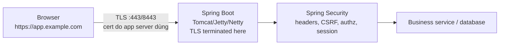
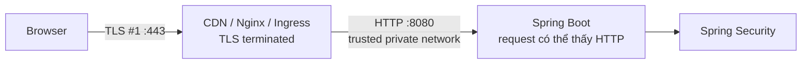
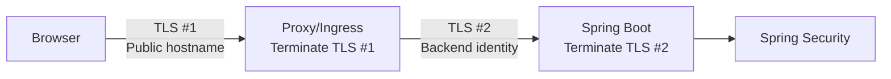
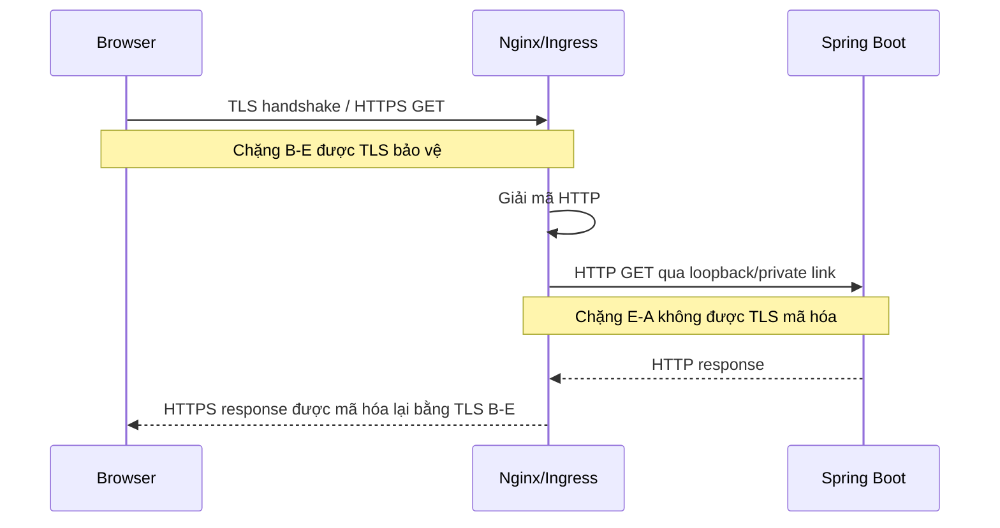
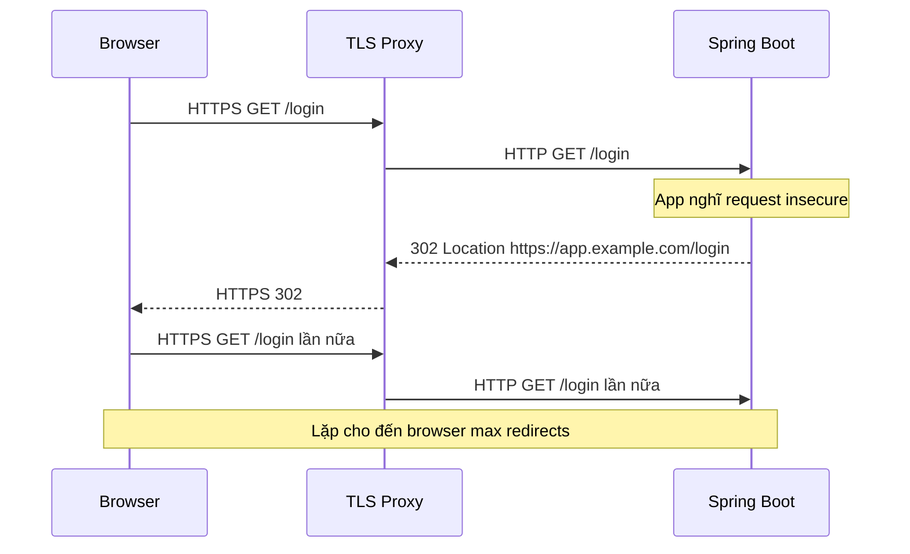
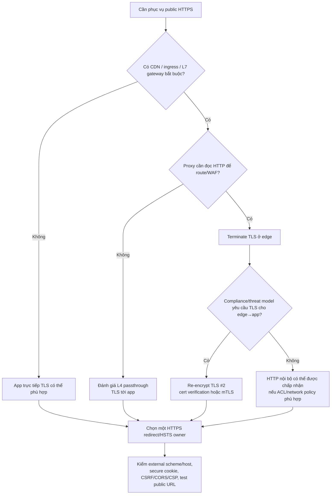

# HTTPS tại ứng dụng hoặc kết thúc TLS tại proxy

> **Chương:** HTTPS và HSTS  
> **Học phần:** `SPRING_SECURITY_HTTP_PROTECTION` — phòng vệ HTTP và trình duyệt trong Spring Security: HTTPS/HSTS, CSRF, CORS, security headers, CSP, HTTP firewall và session trên Servlet lẫn Reactive WebFlux.  
> **Trọng tâm:** quyết định **TLS kết thúc trực tiếp tại Spring Boot** hay **TLS được terminate tại CDN, load balancer, ingress/reverse proxy**; các trust boundaries giữa browser, proxy và application; tác động tới HSTS, HTTPS redirect, cookie, forwarded headers, mTLS và kiểm thử triển khai.

## 1. Tình huống: cùng một URL HTTPS, hai kiểu kiến trúc hoàn toàn khác

Người dùng vào:

```text
https://accounts.example.com/login
```

Họ thấy biểu tượng khóa và chứng chỉ hợp lệ. Nhưng kết nối thật có thể là một trong hai loại:

**Mô hình A — ứng dụng trực tiếp phục vụ HTTPS:**

```text
Browser --TLS--> Spring Boot (Tomcat/Jetty/Netty HTTPS listener)
```

**Mô hình B — reverse proxy kết thúc TLS:**

```text
Browser --TLS--> CDN/Ingress --HTTP private network--> Spring Boot
```

Cả hai có thể trả cùng HTML, đều dùng Spring Security, đều hiện HTTPS trên thanh địa chỉ. Tuy nhiên **nơi xác thực TLS, ai được giữ private key, ai biết external scheme và hop nào có mã hóa** khác nhau.

Trong mô hình B, Spring Boot có thể thấy `request.getScheme() = "http"` và `request.isSecure() = false` dù browser dùng `https://`. Khi đó ứng dụng có thể:

- Không ghi `Strict-Transport-Security` vì `HstsHeaderWriter` nghĩ request không secure.
- Sinh `Location: http://internal:8080/login` hoặc redirect sai port.
- Bật `redirectToHttps(...)` rồi tạo vòng lặp HTTPS→HTTP nội bộ→HTTPS URL công khai.
- Sinh absolute links/callback URLs sai scheme/host/prefix.
- Quên gắn `Secure` cookie nếu phụ thuộc automatic scheme detection.
- Tin nhầm `X-Forwarded-Proto: https` do client tự gửi và đưa ra quyết định bảo mật sai.

**Bài này không hỏi “HTTPS tốt hay không?”**; đáp án chắc chắn là TLS cần thiết cho HTTP traffic. Câu hỏi đúng là **TLS terminate ở đâu, ai sở hữu chính sách HTTPS/HSTS, và kiểm soát giữa các hop như thế nào?**

### 1.1. Mục tiêu học tập

Sau khi hoàn thành, người học có thể:

1. Vẽ và đánh dấu trust boundary của **TLS trực tiếp tại app**, **TLS offload tại proxy**, **TLS bridging/re-encryption**, và **end-to-end mTLS**.
2. Phân biệt **public HTTPS URL** với **backend transport scheme** và trạng thái **Servlet `isSecure()` / Reactive request URI scheme**.
3. Chọn đúng nơi quản lý chứng chỉ, SNI, HTTPS redirect, STS header, secure cookies và mTLS identity.
4. Cấu hình Spring Boot embedded HTTPS listener bằng keystore/SSL bundle mà không commit private keys.
5. Cấu hình edge Nginx HTTPS→HTTP và HTTPS→HTTPS re-encryption ở mức minh họa, không tin raw forwarded headers.
6. Dùng Spring Security `HttpSecurity` và `ServerHttpSecurity` cho HSTS/redirect đúng với Servlet/WebFlux.
7. Giải thích `Forwarded` (RFC 7239) và `X-Forwarded-*`, các chiến lược Spring Boot 3.x/4.x, thứ tự filter/transformer, và lý do chỉ tin proxy.
8. Tránh lỗi redirect loop, open redirect/Host spoofing, thiếu `Secure` cookie, CORS/CSRF sai và callback OIDC không đúng external URL.
9. Kiểm thử theo ba cấp: unit/integration của framework, network/TLS trên public edge, và hành vi browser/HSTS state.
10. Lập quyết định kiến trúc theo compliance, latency, certificate lifecycle, zero-trust, availability và khả năng quan sát.

## 2. HTTPS bao gồm những gì và Spring Security chịu trách nhiệm tới đâu?

HTTPS là HTTP qua một kết nối TLS đã được xác thực. Bên client thường xác minh tên máy chủ trong certificate SAN, chuỗi tin cậy, thời hạn và các chính sách TLS liên quan.

**TLS cung cấp:**

- Confidentiality: dữ liệu truyền qua **hop TLS đó** được mã hóa.
- Integrity: phát hiện sửa đổi dữ liệu trên hop đó.
- Server authentication: client xác minh endpoint theo certificate/hostname/trust.
- Có thể có **client authentication** (mTLS), nếu triển khai.

**TLS không cung cấp:**

- Quyền của user với một hóa đơn hay tenant.
- Chống CSRF cho requests dùng ambient session cookie.
- Chống XSS trong HTML được server thật trả về.
- CORS allowlist giữa hai origins khác nhau.
- HTTP path normalization/firewall và object-level authorization.
- Mã hóa **các hop sau** một TLS termination point.

Spring Security hoạt động tại **tầng ứng dụng** sau khi HTTP request được server/container giải mã hoặc được chuyển vào app. Nó có khả năng cấu hình HTTPS redirect, HSTS response headers, authentication/authorization, CSRF, session và các security headers, nhưng **không tự đóng vai trò TLS listener/CA**. TLS listener do Spring Boot/server hoặc proxy/ingress điều khiển. <https://docs.spring.io/spring-security/reference/6.5/features/exploits/http.html>

### 2.1. Phải đánh giá từng hop thay vì chỉ nhìn biểu tượng khóa

Một đường đi thực tế có thể gồm:

```text
Browser --TLS #1--> CDN --TLS #2--> Gateway --HTTP #3--> Pod
```

Ở đây TLS #1 và TLS #2 là **hai TLS sessions riêng**. CDN/gateway có thể nhìn plaintext sau khi giải mã ở endpoints của từng phiên. Hop #3 truyền HTTP trong cluster có thể bị quan sát/sửa nếu network boundary bị xâm nhập.

Mô tả chính xác là **“TLS từ browser tới CDN, re-encryption từ CDN tới gateway, plaintext HTTP từ gateway tới pod”**. Không gọi toàn tuyến là “TLS end-to-end” chỉ vì browser hiện HTTPS.

### 2.2. HSTS và HTTP redirect không bật TLS tự động

`Strict-Transport-Security` thông báo browser các HTTP URLs tương lai của hostname nên được nâng HTTPS theo policy đã học. `redirectToHttps(...)` gửi HTTP 3xx khi app thấy request không secure. Cả hai đều **yêu cầu HTTPS endpoint thực** mới có tác dụng.

Nếu chỉ thiết lập certificate/`server.ssl` trên cổng 8443, ứng dụng **không tự tạo thêm HTTP listener** trên cổng 8080 để redirect; phải có server connector thứ hai hoặc edge listener.

## 3. Sơ đồ bốn kiến trúc điển hình

### 3.1. Kiểu A: TLS trực tiếp tại ứng dụng



**Đặc trưng:** container embedded server nhìn request secure thật, private key/certificate phải được quản lý tại app node, và network path tới app cần mở cổng TLS.

### 3.2. Kiểu B: proxy offload TLS rồi chuyển HTTP



**Đặc trưng:** edge giữ public cert/private key; backend có thể không cần public TLS config; hop proxy→backend **không được TLS mã hóa** và phải có network isolation hoặc biện pháp khác theo threat model.

### 3.3. Kiểu C: terminate rồi re-encrypt tới app



**Đặc trưng:** cả browser→edge và edge→app được TLS bảo vệ nhưng **không phải một phiên TLS liên tục**. Proxy vẫn có thể đọc/biến đổi HTTP ở điểm trung gian. TLS #2 cần **xác minh certificate/backend hostname**, không chỉ có kết nối TCP tới port 8443.

### 3.4. Kiểu D: TLS passthrough

```text
Browser --TLS session xuyên qua L4 proxy--> Spring Boot TLS listener
                       |
              L4 proxy chủ yếu route TCP/SNI
```

Proxy L4 không giải mã HTTP nếu thực sự passthrough; app terminate TLS. Khác offload ở L7, L4 proxy không tự thêm `X-Forwarded-Proto` như một HTTP header nếu không có HTTP parsing. Có thể dùng PROXY protocol hoặc thông tin kết nối khác **khi hai đầu hỗ trợ và chỉ tin nguồn đáng tin**; đây không phải `Forwarded` HTTP header.

### 3.5. Bảng so sánh nhanh

| Tiêu chí | App TLS | Proxy TLS → HTTP | Proxy TLS → TLS | L4 passthrough |
| --- | --- | --- | --- | --- |
| Nơi terminate TLS từ browser | App | Proxy | Proxy | App |
| Backend HTTP scheme thấy | HTTPS | Thường HTTP | HTTPS của hop #2 | HTTPS |
| Public private key nằm ở | App/secret system | Edge | Edge và app có cert riêng | App |
| Proxy đọc được HTTP body? | Không nếu thuần L4 | Có | Có sau TLS #1 | Không nếu passthrough thực |
| Hop proxy→app có TLS? | Không có L7 proxy bắt buộc | Không | Có | TLS session xuyên qua |
| Cần trusted forwarded metadata? | Ít nếu không L7 rewrite | Thường có | Có thể vẫn cần host/scheme/prefix | Tùy PROXY protocol/client IP |
| WAF/L7 routing dễ làm ở edge? | Hạn chế | Có | Có | Hạn chế |
| App `isSecure()` | Thường true | Thường false nếu chưa khôi phục scheme | True cho hop #2 | True |
| HSTS owner | App hoặc outer edge | Edge hoặc app sau trust | Edge hoặc app thống nhất | App hoặc component khác |
| Rủi ro nếu proxy→app bị nghe lén | Không có hop HTTP riêng | Có | Giảm nếu TLS #2 verify đúng | Giảm nhờ TLS end-to-end |
| Scope của `mTLS` | Browser↔app nếu dùng | Cần xử lý tại edge | Có thể edge↔app | Browser↔app nếu passthrough |

Lựa chọn là trade-off, **không có mô hình nào tự động bảo đảm tất cả lớp bảo mật**.

## 4. Khi nào nên đặt TLS tại ứng dụng?

TLS trực tiếp ở Spring Boot phù hợp khi:

- Ứng dụng tự phục vụ HTTPS trên một hostname/cổng rõ ràng.
- Không cần terminate HTTP ở CDN hoặc ingress L7 trước app.
- Có thể quản lý certificates và private keys an toàn trên từng node.
- Cần kiểm soát trực tiếp client certificate tại app (mTLS đến app), thay vì nhận identity từ edge.
- Muốn tránh một plaintext hop giữa ingress và app hoặc có network policy hạn chế proxy L7.
- Môi trường tích hợp/test nhỏ, ranh giới mạng đơn giản, không có nhiều public hostnames.

### 4.1. Ưu điểm

- `HttpServletRequest.isSecure()` và request scheme có xu hướng phản ánh TLS thật ở container.
- Ít phụ thuộc forwarded headers để biết HTTPS public nếu hostname/port không bị rewrite.
- HSTS writer mặc định có thể phát header trên HTTPS requests.
- Có thể triển khai mTLS client authentication trực tiếp tại app.
- Sở hữu TLS protocols/certificates theo lifecycle của service.

### 4.2. Chi phí/rủi ro

- Phân phối/rotate private keys và certificates trên nhiều app instances.
- Kiểm tra hostname, SAN, renewal, truststore và keystore của từng instance.
- Cấu hình TLS/HTTP server phụ thuộc container/version.
- Nhiều hosts/multi-tenancy có thể cần SNI certificate routing phức tạp.
- Nếu public port 443 đi tới app 8443 qua proxy L4, app có thể biết local port 8443 nhưng external URL là 443; absolute redirects vẫn cần chú ý.
- TLS termination trực tiếp không tự chặn CSRF, CORS hoặc XSS.

### 4.3. Đừng đặt private keys trong Git

Không commit `.p12`/`.jks` có private key, PEM private key, hoặc keystore passwords vào repo. Secrets phải được cấp qua secret store, environment injection, volume với ACL phù hợp hoặc cơ chế TLS identity của nền tảng. Giảm quyền truy cập và cấu hình rotation/rollover.

## 5. Cấu hình HTTPS ở Spring Boot embedded server

Một ví dụ Spring Boot dùng PKCS12 keystore:

```yaml
# Cấu hình minh họa trên Spring Boot hỗ trợ server.ssl.*.
# file/secret phải được cung cấp ở runtime; không commit private key.
server:
  port: 8443
  ssl:
    enabled: true
    key-store: file:/run/secrets/tls/https-server.p12
    key-store-type: PKCS12
    key-store-password: "<injected-secret>"
```

Không dùng chuỗi `<injected-secret>` làm mật khẩu production. Thay bằng secret injection theo nền tảng (tài liệu vận hành thật phải chỉ ra cách cấp secret an toàn). Certificate trong keystore cần khớp hostname mà client kết nối.

### 5.1. Kiểm tra sau cấu hình

```bash
curl -v https://app.example.com:8443/health
```

Cần TLS verification thành công; server phải có DNS/port/certificate khớp `app.example.com`. Không dùng `-k`/`--insecure` khi kết luận TLS hợp lệ.

### 5.2. Spring Boot SSL bundles

Spring Boot cũng hỗ trợ `spring.ssl.bundle.*` để mô tả keystore/trust material và gắn vào web server. Một ví dụ ý tưởng:

```yaml
spring:
  ssl:
    bundle:
      jks:
        application:
          keystore:
            location: file:/run/secrets/tls/app.p12
            password: "<injected-secret>"
            type: PKCS12
server:
  port: 8443
  ssl:
    bundle: application
```

SSL bundles hỗ trợ quản lý trust material nhất quán hơn; **cần đối chiếu thuộc tính với Boot version**, định dạng secret/key alias và cơ chế reload/rotation của runtime. Keystore location là ví dụ, không phải file có sẵn trên máy.

### 5.3. Cấu hình một HTTPS connector không tự tạo HTTP connector

Nếu app chỉ nghe 8443/TLS, `http://app.example.com:8080` có thể bị kết nối từ chối. Spring Security `redirectToHttps` không tự mở HTTP cổng 8080 để tiếp nhận request.

Muốn hỗ trợ HTTP→HTTPS:

- Dùng một edge proxy với listener 80 và 443; **hoặc**
- Cấu hình HTTP connector thứ hai trên embedded server với cơ chế phù hợp Tomcat/Jetty/Netty version; **hoặc**
- Chỉ cho clients gửi HTTPS ngay, không tiếp nhận HTTP nếu compatibility cho phép.

Đừng triển khai đồng thời nhiều listeners mà không có policy routing/authorization rõ ràng. Khi server nhận một HTTP POST chứa credentials, redirect **không xóa được rủi ro payload đã gửi plaintext**.

### 5.4. Boot SSL khác việc Spring Security gửi HSTS

Bật `server.ssl.enabled=true` khiến embedded web server phục vụ TLS; `HttpSecurity.headers().httpStrictTransportSecurity(...)` quyết định header STS. Có TLS listener không tự đồng nghĩa browser đã ghi nhớ HSTS, và header STS cũng không tự thiết lập TLS listener.

## 6. Khi nào nên terminate TLS tại proxy/ingress?

TLS termination ở proxy thường phù hợp khi:

- Nhiều Spring services cùng phục vụ trên cổng public 443.
- Có CDN, WAF, load balancer, Kubernetes ingress/Gateway hoặc service mesh.
- Certificate lifecycle và public DNS được quản lý tập trung.
- Cần L7 routing theo `Host`, path, header; thêm rate limiting/edge authentication.
- Cần gzip/cache/static content/CDN và xử lý errors ở edge.
- Backend không tiếp xúc trực tiếp Internet.
- Hạ tầng có controls rõ cho hop proxy→backend.

### 6.1. Ưu điểm

- Cert renewal/rotation và TLS settings tập trung ở lớp edge.
- App có thể chạy HTTP nội bộ đơn giản hoặc vẫn dùng TLS bridging.
- Một nơi sở hữu public HTTPS redirect, canonical host và HSTS.
- Có thể áp policy uniform cho static assets, 301/302/307/308 và edge-generated errors.
- Dễ bố trí routing nhiều replicas/services, WAF và observability.

### 6.2. Rủi ro cần quản trị

- Client↔proxy HTTPS **không chứng minh** proxy↔backend mã hóa.
- Proxy có thể xem request/response plaintext sau terminate, bao gồm token/session/PII nếu app gửi.
- Backend có thể hiểu scheme/host/port là internal chứ không phải external.
- Trust sai `Forwarded`/`X-Forwarded-*` tạo host spoofing, redirect injection, cookie issues hoặc access-control bypass nếu code dựa vào scheme/IP.
- HSTS ở backend có thể vắng mặt trên edge responses.
- Nhiều lớp gateway/CDN có thể ghi headers mâu thuẫn.
- Nếu backend HTTP bị phơi Internet, attacker có thể bypass WAF/edge controls.

**Không dùng câu “nằm trong VPC/cluster nên HTTP mặc nhiên an toàn”.** Phải đánh giá ai có thể truy cập mạng/pod, controls isolation, audit, compliance và khả năng một workload bị compromise.

## 7. Reverse proxy TLS termination không phải end-to-end encryption

Giả sử browser tới `https://billing.example.com`, nginx terminate TLS và chuyển `http://127.0.0.1:8080`:



Nếu proxy và backend trên cùng máy, loopback có thể giảm attack surface. Trong cluster, HTTP đi qua overlay/VPC không tự bảo vệ chống sniffing/lateral movement. Cần đánh giá:

- NetworkPolicy/security group/ACL cấm direct access ngoài proxy.
- Thẩm quyền của pod/VM khác trên cùng subnet.
- Endpoint authentication giữa các workload.
- Sidecar/service mesh encryption hay re-encryption.
- Secrets/logs có bị lộ ở proxy/tracing layer không.
- Policy compliance yêu cầu encrypted-in-transit cho hop nào.

### 7.1. “Client → CDN HTTPS” không chứng minh “CDN → origin HTTPS”

Một CDN có thể dùng chế độ origin HTTP hoặc HTTPS tùy cấu hình. Một số sản phẩm có tên chế độ “Flexible”/“Full”/“Strict”; tên gọi marketing không phải tiêu chuẩn chung. Phải kiểm tra **origin protocol và certificate verification thật**.

### 7.2. Khi nào hop HTTP nội bộ có thể được chấp nhận?

Có thể phù hợp với một trust boundary cụ thể (loopback hoặc private network rất hạn chế) nếu tổ chức đã đánh giá rủi ro và yêu cầu tuân thủ cho phép. Nhưng cần ghi rõ hop này là HTTP, không gọi toàn tuyến là encrypted end-to-end.

Nếu policy yêu cầu encryption mọi hop, dùng TLS/mTLS giữa proxy và backend với hostname/SAN/trust verification.

## 8. Re-encryption từ proxy tới Spring Boot: hai TLS sessions

TLS bridging:

```text
Browser -- TLS #1 (cert public.example.com) --> Ingress
Ingress -- TLS #2 (cert app.service.internal) --> Spring Boot
```

Hai TLS sessions có **hai identities và hai bộ trust rules**:

| Thuộc tính | TLS #1 (public) | TLS #2 (internal) |
| --- | --- | --- |
| Client | Browser/HTTP client | Ingress/CDN/gateway |
| Server | Public edge | Backend Spring Boot/sidecar |
| Certificate SAN | `billing.example.com` | `app.service.internal` hoặc tên backend đã định |
| Trust | Public CA / enterprise CA tùy clients | Private CA/service mesh trust anchors |
| Verification | Browser xác minh public host | Proxy phải xác minh backend identity |
| Private key | Edge | App/service endpoint |
| mTLS option | Browser↔edge nếu dùng | Proxy↔backend nếu dùng |
| Kênh HTTP được giải mã tại proxy? | Có ở TLS termination | Proxy có thể đọc trước khi gửi TLS #2 |

### 8.1. Có TLS nhưng tắt verify là lỗi lớn

Một cấu hình proxy nối tới backend bằng HTTPS nhưng **tắt xác thực certificate** không bảo vệ đúng identity backend khỏi attacker ở hop giữa. Cần:

- Trust store/CA đúng cho internal server cert.
- `SNI` phù hợp nếu backend có nhiều virtual hosts.
- Certificate hostname matching theo tên mà proxy kỳ vọng.
- Failure policy khi cert hết hạn/không match (thường fail closed).
- Rotation và telemetry cho handshake errors.

### 8.2. TLS #2 không bảo đảm external host/scheme được app hiểu

App nhận HTTPS trên `app.service.internal:8443` có thể `isSecure=true` nhưng nhìn `getServerName()="app.service.internal"`, `getServerPort()=8443`. Khi phải sinh links/callbacks theo `billing.example.com:443`, vẫn cần external host/port/prefix metadata đáng tin hoặc config canonical public URL.

Một server “secure=true” chưa đủ để bảo đảm **redirect Location đúng external hostname**.

## 9. HTTPS redirect ở đâu: edge hay Spring Security?

Một HTTP URL từ client chưa học HSTS phải được redirect hoặc reject theo policy. Có hai owner thông dụng:

| Owner | Ưu điểm | Bẫy |
| --- | --- | --- |
| CDN / Ingress / Nginx | Xử lý ngay public port 80; không cần app nhận HTTP; thống nhất cho nhiều services | Không chặn AitM trên HTTP hop đầu; dễ sai `Host`/canonical location |
| Spring Security application | Gần policy backend; test `MockMvc`/`WebTestClient` được | Chỉ chạy nếu HTTP request đến app; có thể loop sau TLS proxy |
| Cả hai không điều phối | Không có lợi ích rõ | Redirect loops, status/method/prefix không nhất quán, hard-to-debug |

### 9.1. HTTP 3xx không thay client bắt đầu bằng HTTPS

Một browser mới có HTTP URL có thể gửi plaintext request trước khi được 301/308. Attacker trên đường truyền có thể can thiệp response đầu nếu client chưa có HSTS/preload/HTTPS-first. Tốt hơn nên phát HTTPS URLs trong email, QR, OAuth callbacks, SPA API base URL và SDK từ đầu.

### 9.2. Nguyên tắc unsafe requests

Nếu client gửi `POST /login` có password qua HTTP, một 307/308 có thể giữ method/body khi follow redirect nhưng không bảo vệ payload của request đầu. Với credential-bearing/side-effect operations, **client phải dùng HTTPS trực tiếp**; HTTP endpoint nên reject hoặc redirect theo policy không tạo side effect, tránh xem việc follow 3xx là giải pháp bảo mật.

### 9.3. Canonical hostname phải cố định hoặc allowlist

Không sinh:

```text
Location: https://<Host do client tự gửi>/login
```

từ `Host`/`X-Forwarded-Host` không được validate, vì có thể tạo open redirect hoặc password reset link poisoning. Với một hostname, cấu hình canonical host cố định ở edge. Với multi-tenancy, validate tenant hostname với registry/allowlist.

## 10. HSTS owner: người phát header ở đúng HTTPS response cuối

`Strict-Transport-Security` phải được browser nhận từ **HTTPS response hợp lệ**. Spring Security Servlet và WebFlux có HSTS support mặc định, nhưng sau TLS offload, app có thể nhìn request là HTTP nên writer không phát.

### 10.1. Nếu edge sở hữu HSTS

Ưu tiên khi edge sở hữu public TLS và nhiều apps/paths:

- Edge phát **một** HSTS policy trên HTTPS public host.
- Có thể phát trên 200, 3xx, 4xx, 5xx và edge-generated errors tùy policy.
- Backend không phát HSTS thứ hai gây duplicate/conflict.
- `max-age` và `includeSubDomains` theo owner của **hostname**, không theo từng Java service.
- HSTS trên HTTP port 80 bị browser bỏ qua, nên không lấy HTTP response làm bằng chứng.

### 10.2. Nếu application sở hữu HSTS

Phù hợp khi app trực tiếp terminate TLS hoặc trusted forwarding được xử lý đúng:

- Servlet `HstsHeaderWriter` phát khi request được coi secure.
- Reactive `StrictTransportSecurityServerHttpHeadersWriter` phát theo secure exchange.
- Không có `web.ignoring`/security chain gaps khiến một số HTTPS responses không có header theo policy.
- Edge không xóa header hoặc thêm policy trái với app.
- Edge-generated errors/static resources phải có cách xử lý riêng nếu app không thấy request.

### 10.3. Chính sách HSTS mặc định cần nhận thức

Tài liệu Spring Security ghi HSTS là default security header trên HTTPS responses, thường:

```http
Strict-Transport-Security: max-age=31536000; includeSubDomains
```

Việc có `includeSubDomains` có thể tác động toàn cây hostname **sau khi browser học policy**; không bật nó tại apex nếu các legacy/internal/tenant subdomains chưa sẵn sàng HTTPS. Directive `preload` không đồng nghĩa domain đã được đưa vào browser preload list.

## 11. Request secure: Servlet `isSecure()` và WebFlux scheme

Một request đến app có ít nhất hai ngữ cảnh:

1. **External client view:** browser đang ở `https://billing.example.com`.
2. **Internal server view:** app có thể nhận `http://billing-backend:8080`.

Spring Security dựa vào request mà framework/container cung cấp. Không có khả năng biết external client TLS chỉ bằng cách đọc network socket nội bộ nếu TLS đã terminate bên ngoài.

### 11.1. Servlet các giá trị dễ gây hiểu sai

```java
request.isSecure();     // true/false theo request wrapper/container
request.getScheme();    // "http" hoặc "https"
request.getServerName();
request.getServerPort();
request.getRemoteAddr();
```

Khi TLS offload mà chưa có trusted forwarded processing:

```text
External: https://billing.example.com/invoices
Internal: http://billing-backend:8080/invoices

isSecure()   -> false
getScheme()  -> "http"
getServerName() -> "billing-backend" hoặc host internal
getServerPort() -> 8080
```

Hậu quả có thể là STS header thiếu, wrong redirects, wrong absolute links/cookies nếu logic dựa scheme.

### 11.2. Reactive dùng ServerWebExchange

Trong WebFlux, request/response là `ServerWebExchange`, `ServerHttpRequest` và Reactor types. Không sử dụng Servlet `HttpServletRequest`/`HstsHeaderWriter` trên Reactive chain.

Reactive forwarding được xử lý bằng `ForwardedHeaderTransformer`/web server integration; Spring Security đọc scheme/host từ request đã được framework biến đổi phù hợp.

### 11.3. Secure flag không tương đương all hops encrypted

Ngay cả khi trusted forwarded processing khiến Servlet `isSecure() == true` vì **external browser→proxy HTTPS**, hop proxy→backend vẫn có thể là HTTP. Flag này giúp app sinh headers/URLs đúng theo **public request**, không chứng nhận nội bộ mã hóa.

## 12. RFC 7239 Forwarded và X-Forwarded-* có chức năng gì?

Reverse proxies có thể gửi:

```http
Forwarded: for=198.51.100.35;proto=https;host=billing.example.com
X-Forwarded-Proto: https
X-Forwarded-Host: billing.example.com
X-Forwarded-Port: 443
X-Forwarded-For: 198.51.100.35
X-Forwarded-Prefix: /billing
```

**Đây chỉ là HTTP header values**, không phải bằng chứng mật mã rằng client đã dùng TLS hoặc có IP/host được tuyên bố.

| Header | Truyền đạt | Sai lầm thường gặp |
| --- | --- | --- |
| `Forwarded` | Scheme, host, client address theo RFC 7239 | Tin dữ liệu do Internet client tự gửi |
| `X-Forwarded-Proto` | External scheme HTTP/HTTPS | Thấy `https` là tự cho phép request |
| `X-Forwarded-Host` | Host public | Dùng làm absolute redirect mà không validate |
| `X-Forwarded-Port` | External port | Không nhất quán với `Host`/`Proto` |
| `X-Forwarded-For` | Client/proxy hop addresses | Tin phần tử client tự prepend để bypass IP allowlist |
| `X-Forwarded-Prefix` | External path prefix | Bỏ qua path rewrite/ACL ở gateway |
| `X-Forwarded-Ssl` | Scheme tín hiệu cũ tùy stack | Tin đồng thời nhiều header xung đột |

### 12.1. Quy tắc quan trọng nhất: xóa rồi đặt lại ở edge trust boundary

Một proxy ở biên tin cậy phải **xóa/ghi đè cả họ `Forwarded` lẫn `X-Forwarded-*` do client chưa tin gửi**, kể cả khi hệ thống chỉ dùng một họ. Không để attacker tự gắn `X-Forwarded-Proto: https` rồi đi thẳng tới backend.

Backend chỉ nhận traffic từ trusted proxies, ví dụ security group, NetworkPolicy, private routing, mTLS hoặc service mesh identity phù hợp. Nếu không, attacker có thể bỏ qua toàn bộ controls ở edge.

### 12.2. Multi-hop forwarding

Trong topology CDN→load balancer→ingress→Spring, mỗi hop có thể thêm một địa chỉ hoặc sửa host/scheme. Cần hợp đồng rõ:

- Điểm nào xóa dữ liệu client supplied?
- Điểm nào đặt external scheme/host/port canonical?
- Hop nào được phép append `X-Forwarded-For`?
- App đọc header nào khi có cả `Forwarded` và `X-Forwarded-*`?
- Xử lý các giá trị mâu thuẫn thế nào?
- Ai kiểm tra hostname public/allowed tenants?
- Ai chịu trách nhiệm CSP/CSRF/redirect/cookie behavior sau rewrite?

**Không** dùng heuristic “lấy header đầu tiên hoặc cuối cùng tùy may mắn” làm trust policy. Dựa cấu hình proxy chain và tài liệu implementation của từng hop.

## 13. Cấu hình forwarded headers theo từng phiên bản Spring Boot

Một thay đổi phiên bản có thể khiến cả bài kiểm thử proxy fail mà team không nhận ra.

### 13.1. Spring Boot 3.5

Tài liệu Boot 3.5 dùng:

```yaml
# Spring Boot 3.5
server:
  forward-headers-strategy: framework
```

Các giá trị bao gồm:

- `none`: không sử dụng xử lý forwarded metadata tự động theo strategy.
- `native`: để embedded web server xử lý theo implementation (ví dụ Tomcat `RemoteIpValve`).
- `framework`: dùng `ForwardedHeaderFilter` (Servlet) hoặc `ForwardedHeaderTransformer` (Reactive).

Nếu Tomcat có redirect cho context root sau TLS offload, Boot 3.5 có lưu ý `server.tomcat.redirect-context-root=false` để external `X-Forwarded-Proto` được xét trước redirect tương ứng.

### 13.2. Tài liệu Spring Boot mới nhất: tên thuộc tính mới

Tài liệu embedded web server **ở bản tài liệu Spring Boot mới nhất** hiển thị cấu trúc tên khác. Tuy nhiên **không phải mọi bản 4.x đều dùng tên mới**: tài liệu Spring Boot **4.0** vẫn hướng dẫn cấu hình bằng `server.forward-headers-strategy` và `NATIVE`/`FRAMEWORK`. Phải kiểm tra version cụ thể thay vì suy theo major version:

```yaml
# Chỉ dùng ở phiên bản có property này; kiểm tra metadata của runtime.
server:
  request:
    header:
      forwarded:
        strategy: framework
```

Tài liệu mới nhất mô tả `none`, `web-server` và `framework` cho cấu hình này; trong khi tài liệu Boot 4.0 và một số API metadata trước đó vẫn dùng `NATIVE`/`FRAMEWORK` và property cũ. Hệ thống phải đối chiếu **tài liệu theo đúng minor/patch version và configuration metadata của dependency**, không copy bất kỳ tên property nào chỉ vì dự án được gọi là Boot 4.x. Nếu cần, kiểm tra runtime có cảnh báo deprecated/unknown property không và test external scheme thực.

### 13.3. Strategy không tạo trust boundary

Không quan trọng chọn `native`/`web-server`/`framework`: nếu backend có thể nhận arbitrary forwarded headers từ Internet, cấu hình framework có thể tin dữ liệu giả. Chỉ bật sau khi đã có **network isolation và header sanitization ở edge**.

### 13.4. Tránh xử lý forwarded metadata hai lần

Nếu container native valve đã chuẩn hóa request và Spring Framework filter lại parse headers, app có thể sinh URLs/remote addresses không đúng. Chọn một chiến lược phù hợp và test:

- scheme/public host/port/prefix.
- `request.isSecure()` hoặc Reactive URI.
- redirect `Location`.
- cookie `Secure`.
- HSTS presence.
- IP allowlist/rate limit logic.
- host spoof/forwarded spoof negative tests.

## 14. Servlet ForwardedHeaderFilter và Tomcat RemoteIpValve

Trong Servlet stack, Spring Framework cung cấp `ForwardedHeaderFilter` để wrap request, khôi phục scheme/host/port từ trusted headers và loại chúng khỏi downstream. Tomcat có `RemoteIpValve`; Jetty và containers khác có integration riêng.

### 14.1. Thứ tự filter quan trọng

Nếu `ForwardedHeaderFilter` dùng, nó phải chạy **trước** Spring Security hoặc những filters/handlers cần thông tin external scheme. Nếu chạy sau, HSTS writer/redirect logic có thể vẫn xem request là HTTP.

Trong Spring Boot, sử dụng strategy do Boot quản lý thường rõ ràng hơn tự đăng ký nhiều Filter beans; tránh duplicate filters/valves trừ khi đã kiểm chứng.

### 14.2. Chế độ removeOnly

`ForwardedHeaderFilter` có `setRemoveOnly(true)`. Chế độ này **chỉ loại forwarded headers**, không dùng chúng để thay đổi request. Nó hữu ích nếu app không muốn tin metadata đó, hoặc một lớp đã xử lý đủ.

Nhưng `removeOnly` **không** khôi phục external HTTPS scheme giúp HSTS writer. Nếu edge chịu trách nhiệm HSTS/redirect, app có thể không cần biến đổi scheme cho chức năng đó, nhưng vẫn cần URL/cookie/callback handling đúng.

### 14.3. Tomcat internal-proxies

Khi dùng native processing, Tomcat có `RemoteIpValve` và trust rules cho proxy addresses. **Không** mở rộng trusted proxies tới mọi địa chỉ tùy ý. Các giá trị như `internal-proxies` cần bám sát topology thực và được review; regex mặc định chỉ là starting point.

## 15. Reactive ForwardedHeaderTransformer

WebFlux không dùng Servlet Filter. Spring Framework có `ForwardedHeaderTransformer` để biến đổi `ServerHttpRequest` theo forwarded metadata và xóa headers để tránh downstream xử lý lần nữa. Trong cấu hình phù hợp, framework/runtime phát hiện transformer, hoặc Boot tích hợp bằng forwarded strategy.

### 15.1. Cần kiểm tra ba trạng thái

1. Browser HTTPS → proxy HTTP → Reactive app **không transformer**: app có thể thấy `http`.
2. Browser HTTPS → proxy HTTP → Reactive app **đã trusted transform**: request URI external là `https://public-host`.
3. Client trực tiếp giả `X-Forwarded-Proto: https` vào untrusted entry: proxy phải loại bỏ, không thể khiến app tin giả HTTPS.

### 15.2. Chế độ removeOnly

Reactive `ForwardedHeaderTransformer` cũng có `setRemoveOnly(true)` để loại headers nhưng không áp metadata. Chọn chế độ dựa vào trust boundary, không bật bừa rồi giả định HSTS writer sẽ thấy `https`.

### 15.3. Trường hợp HSTS có thể được sở hữu tại edge

Nếu CDN/ingress viết STS trên public HTTPS responses và app không cần sinh public absolute links, việc giữ app nhận HTTP nội bộ có thể chấp nhận trong một kiến trúc được bảo vệ. Vẫn phải đảm bảo:

- Cookie `Secure` đúng.
- Redirect/callback URLs không rò host internal hoặc scheme HTTP.
- CSRF/CORS origin policies nhìn đúng external origin.
- Backend không bỏ qua authorization chỉ vì proxy đã authenticate.
- Hop nội bộ có security controls theo threat model.

## 16. HTTPS redirect và HSTS trong Spring Security Servlet

Mẫu sau **chỉ phù hợp khi app trực tiếp phục vụ HTTPS hoặc đã có trusted forwarded scheme**, và nếu thật sự muốn app là owner của redirect/HSTS. Không deploy chung khi edge đã sở hữu hai chính sách mà không điều phối.

```java
package example.security;

import static org.springframework.security.config.Customizer.withDefaults;

import org.springframework.context.annotation.Bean;
import org.springframework.context.annotation.Configuration;
import org.springframework.security.config.annotation.web.builders.HttpSecurity;
import org.springframework.security.web.SecurityFilterChain;

@Configuration
class ServletTransportSecurity {

    @Bean
    SecurityFilterChain securityFilterChain(HttpSecurity http)
            throws Exception {
        return http
            .redirectToHttps(withDefaults())
            .headers(headers -> headers
                .httpStrictTransportSecurity(hsts -> hsts
                    .maxAgeInSeconds(86400)
                    .includeSubDomains(false)
                    .preload(false)
                )
            )
            .csrf(withDefaults())
            .authorizeHttpRequests(auth -> auth
                .requestMatchers("/health").permitAll()
                .anyRequest().authenticated()
            )
            .formLogin(withDefaults())
            .build();
    }
}
```

### 16.1. Tính đúng theo version Spring Security

`HttpSecurity.redirectToHttps(withDefaults())` được tài liệu Spring Security Servlet hiện đại mô tả. Ở một số phiên bản cũ, dùng `requiresChannel(...requiresSecure())`. Kiểm tra version đã ghim và có actual HTTPS listener/port mapping trước khi deploy.

### 16.2. Điều gì xảy ra trên request HTTPS?

Với request được container xem là secure:

```http
Strict-Transport-Security: max-age=86400
```

có thể xuất hiện. Nếu app không nhận được secure scheme do TLS offload không được khai báo, writer không phát STS theo matcher mặc định.

### 16.3. Vì sao không được ép writer phát trên HTTP?

Ví dụ **không nên dùng**:

```java
// Không sửa lỗi TLS/Forwarded bằng cách ép HSTS trên mọi HTTP request.
hsts.requestMatcher(req -> true);
```

Browser bỏ qua STS từ HTTP. Một unit test thấy header trên HTTP không chứng minh bảo mật, có thể che giấu lỗi forwarded scheme và false positive.

### 16.4. `permitAll` khác `web.ignoring`

`permitAll()` cho phép endpoint không yêu cầu authentication nhưng **vẫn qua filter chain**, do đó headers có thể được thêm. `web.ignoring()` hoặc route ngoài mọi security chain có thể bỏ qua HSTS writer. Nếu app sở hữu HSTS toàn public hostname, phải kiểm tra các routes/static/error responses có nhất quán hay không.

## 17. HTTPS redirect và HSTS trong Spring Security Reactive

WebFlux dùng `ServerHttpSecurity` và `SecurityWebFilterChain`:

```java
package example.security;

import java.time.Duration;
import static org.springframework.security.config.Customizer.withDefaults;

import org.springframework.context.annotation.Bean;
import org.springframework.context.annotation.Configuration;
import org.springframework.security.config.annotation.web.reactive.EnableWebFluxSecurity;
import org.springframework.security.config.web.server.ServerHttpSecurity;
import org.springframework.security.web.server.SecurityWebFilterChain;

@Configuration
@EnableWebFluxSecurity
class ReactiveTransportSecurity {

    @Bean
    SecurityWebFilterChain securityWebFilterChain(
            ServerHttpSecurity http) {
        return http
            .redirectToHttps(withDefaults())
            .headers(headers -> headers
                .hsts(hsts -> hsts
                    .maxAge(Duration.ofDays(1))
                    .includeSubdomains(false)
                    .preload(false)
                )
            )
            .authorizeExchange(auth -> auth
                .pathMatchers("/health").permitAll()
                .anyExchange().authenticated()
            )
            .build();
    }
}
```

### 17.1. Khác API Servlet

| Nhu cầu | Servlet | WebFlux |
| --- | --- | --- |
| Builder | `HttpSecurity` | `ServerHttpSecurity` |
| Chain | `SecurityFilterChain` | `SecurityWebFilterChain` |
| HSTS writer | `HstsHeaderWriter` | `StrictTransportSecurityServerHttpHeadersWriter` |
| Duration | `maxAgeInSeconds(86400)` | `maxAge(Duration.ofDays(1))` |
| Subdomain flag | `includeSubDomains(false)` | `includeSubdomains(false)` |
| Redirect | `redirectToHttps(...)` hoặc legacy `requiresChannel` | `redirectToHttps(...)` |
| Request | `HttpServletRequest` | `ServerWebExchange` |
| Typical tests | `MockMvc` | `WebTestClient` |

### 17.2. Configuration chỉ là một phần security policy

Snippet giới hạn ở redirect, HSTS và authorization cơ bản, chưa là policy đầy đủ cho WebFlux API dùng bearer tokens, session CSRF/CORS, SSE/WebSockets hoặc multi-tenant ACL. Các lớp bảo vệ khác phải được đánh giá độc lập.

### 17.3. Redirect loop sau TLS termination

Nếu Reactive app thấy internal HTTP cho mọi public HTTPS request, `redirectToHttps` có thể đưa browser tới cùng URL HTTPS nhiều lần. Sửa bằng trusted external scheme hoặc giao redirect cho edge; không tắt CSRF/authorization hay certificate validation để “sửa” vòng lặp.

## 18. Cookie Secure, SameSite, session và quyết định TLS termination

Cookie từ public HTTPS endpoint là tài sản quan trọng. Sau TLS offload, app có thể tạo cookie dựa trên request scheme internal HTTP; nếu code/runtime không rõ external scheme, cookie `Secure` có thể bị thiếu hoặc callback flow sai.

Một session cookie lý tưởng theo bối cảnh:

```http
Set-Cookie: SESSION=<opaque-id>; Path=/; Secure; HttpOnly; SameSite=Lax
```

`Secure` hạn chế gửi cookie qua HTTP, `HttpOnly` hạn chế JS đọc cookie trực tiếp, `SameSite` kiểm soát browser cross-site sending. Đây không phải các thuộc tính HSTS.

### 18.1. Servlet session cookie phải kiểm theo public response

Spring Boot có cấu hình cookie với `server.servlet.session.cookie.secure` (đúng Boot version), ví dụ:

```yaml
server:
  servlet:
    session:
      cookie:
        secure: true
        http-only: true
        same-site: lax
```

Những thuộc tính này áp cho servlet session cookie do container/session mechanism quản lý. Cookies **tự tạo bằng controller/response** cần set attributes riêng; Spring Session hoặc custom session stack có thể có config khác. Với WebFlux, session cookie writer/`WebSession` config không tự dùng mọi servlet property.

### 18.2. Không dùng cookie Secure để che việc HTTP document tải trước

`Secure` cookie giảm rủi ro session ID lộ trên HTTP, nhưng một login HTML bootstrap qua plaintext HTTP vẫn có thể bị thay bằng trang giả. Phát HTTPS URLs trực tiếp và dùng HSTS (sau lần học) hoặc preload/HTTPS-first phù hợp.

### 18.3. SameSite và OAuth/OIDC callbacks

OIDC dùng cross-site redirects qua browser. Một cookie `SameSite=Strict` có thể làm mất session state/correlation ở callback trong một số flows; `Lax` hoặc `None; Secure` cần đánh giá theo flow cụ thể. Đây là bẫy riêng, không được “sửa” bằng việc tắt HSTS hay mở CORS vô tội vạ.

### 18.4. Cookie Domain không nên tự động là apex

Một proxy phục vụ nhiều subdomains không có nghĩa nên đặt `Domain=example.com` cho session cookies. Host-only cookies thường thu hẹp phạm vi giữa sibling/tenant-controlled subdomains. HSTS `includeSubDomains` và cookie `Domain` dùng các scope/semantics khác nhau.

## 19. Nginx mẫu: public TLS ở edge, HTTP backend bị cô lập

Một cấu hình minh họa cho `billing.example.com`. Nó **không phải** cấu hình TLS/cipher/performance hoàn chỉnh và chỉ phù hợp nếu `127.0.0.1:8080` thuộc cùng máy/namespace mạng đáng tin, hoặc thay bằng upstream private được cô lập.

```nginx
# Public HTTP: chỉ redirect, không xử lý login/credential.
server {
    listen 80;
    server_name billing.example.com;
    return 308 https://billing.example.com$request_uri;
}

# Public HTTPS: certificate được quản lý tại Nginx.
server {
    listen 443 ssl;
    server_name billing.example.com;

    ssl_certificate     /run/secrets/tls/billing-fullchain.pem;
    ssl_certificate_key /run/secrets/tls/billing-privatekey.pem;

    # Policy động ngắn cho giai đoạn rollout; không tùy tiện preload.
    add_header Strict-Transport-Security "max-age=86400" always;

    location / {
        proxy_pass http://127.0.0.1:8080;

        # Nginx sở hữu HSTS public; ẩn header tương ứng từ app.
        proxy_hide_header Strict-Transport-Security;

        # Public host được ghim theo vhost; không phản chiếu raw Host.
        proxy_set_header Host billing.example.com;
        proxy_set_header X-Forwarded-Host billing.example.com;
        proxy_set_header X-Forwarded-Proto https;
        proxy_set_header X-Forwarded-Port 443;
        proxy_set_header X-Forwarded-For $remote_addr;

        # Không chuyển tiếp Forwarded từ client chưa tin.
        proxy_set_header Forwarded "";
    }
}
```

### 19.1. Ý nghĩa các lớp

- `listen 80`: HTTP request từ client chưa có HSTS được redirect; response HTTP 308 **không được browser dùng làm STS**.
- `listen 443 ssl`: Nginx terminate public TLS, nơi giữ public private key.
- `proxy_pass http://...`: chặng Nginx→Spring Boot không có TLS; phải có trust/network boundary.
- `add_header Strict-Transport-Security ... always`: Nginx phát HSTS trên **HTTPS response** của virtual host; kiểm lại inheritance và edge-generated errors thực.
- `proxy_hide_header`: tránh hai nơi cùng phát STS khác nhau cho cùng hostname.
- `X-Forwarded-*`: chỉ nên được app tin vì proxy đã đặt lại và backend không thể truy cập trái đường.
- `Host billing.example.com`: ví dụ chỉ một public host; multi-tenant phải validate/canonicalize theo registry.
- `X-Forwarded-For $remote_addr`: ví dụ đơn giản lưu peer IP của Nginx; nếu trước Nginx còn CDN, đây có thể là **IP CDN**, cần chuỗi trusted proxy/real-ip riêng để lấy client IP chính xác.

### 19.2. Không bê nguyên mẫu vào sản phẩm khác mà bỏ kiểm tra

Phải kiểm tra Nginx version, `add_header` inheritance (các `location` có thêm headers khác có thể thay behavior), các chính sách WAF/CDN ở trước nó, upstream health checks, TLS protocols và certificate/renewal.

Nếu backend không nằm cùng host, thay `127.0.0.1` bằng hostname/service address nhưng đồng thời đánh giá network policies, identity và TLS bridging. Không dùng `proxy_pass http://0.0.0.0:8080` hoặc expose backend port ra Internet rồi tin mọi clients đều đi qua Nginx.

### 19.3. Nếu muốn edge sở hữu HTTPS redirect nhưng app vẫn phục vụ TLS?

Có thể Nginx nhận public :443, proxy tới backend HTTPS :8443. Khi đó kết nối client→edge và edge→app là hai TLS sessions riêng. Không dùng sự hiện diện `proxy_pass https://` làm bằng chứng certificate verification đã bật; cần cấu hình xác thực upstream.

### 19.4. Vì sao một Nginx block không giải quyết mọi HSTS routes?

Một CDN phía trước có thể tự tạo 502 hoặc phục vụ cached assets mà không vào Nginx. Nếu CDN mới là public TLS endpoint, browser chỉ nhìn **headers của CDN**. Cần xác định policy owner ở điểm nhận TLS public cuối cùng của client, không chỉ tìm một dòng `add_header` trong config cục bộ.

## 20. Nginx mẫu: TLS re-encryption tới Spring Boot

Khi tổ chức yêu cầu encrypted-in-transit giữa ingress và backend, dùng HTTPS upstream với **certificate verification**:

```nginx
server {
    listen 443 ssl;
    server_name billing.example.com;

    ssl_certificate     /run/secrets/tls/billing-fullchain.pem;
    ssl_certificate_key /run/secrets/tls/billing-privatekey.pem;

    add_header Strict-Transport-Security "max-age=86400" always;

    location / {
        # Backend chạy TLS tại cổng 8443.
        proxy_pass https://spring.internal.example:8443;

        # Không bỏ qua TLS upstream verification.
        proxy_ssl_verify on;
        proxy_ssl_trusted_certificate /run/secrets/tls/internal-ca.pem;
        proxy_ssl_verify_depth 3;
        proxy_ssl_server_name on;
        proxy_ssl_name spring.internal.example;

        proxy_hide_header Strict-Transport-Security;

        proxy_set_header Host billing.example.com;
        proxy_set_header X-Forwarded-Host billing.example.com;
        proxy_set_header X-Forwarded-Proto https;
        proxy_set_header X-Forwarded-Port 443;
        proxy_set_header X-Forwarded-For $remote_addr;
        proxy_set_header Forwarded "";
    }
}
```

### 20.1. Hai hostname khác nhau là chuyện bình thường

- Browser verify cert của `billing.example.com` tại Nginx (TLS #1).
- Nginx verify cert `spring.internal.example` do internal CA cấp tại Spring Boot (TLS #2).
- HTTP `Host` có thể vẫn là `billing.example.com` để app route đúng, trong khi TLS `SNI`/`proxy_ssl_name` là tên backend cert. Đây là hai identity checks tách biệt, phải có hợp đồng kỹ thuật rõ.
- Nếu backend yêu cầu mTLS, Nginx còn phải trình client certificate/key phù hợp cho TLS #2, và app verify Nginx identity. Ví dụ trên mới minh họa **server TLS verification** ở upstream, chưa triển khai mTLS.

### 20.2. Tuyệt đối không chữa upstream cert lỗi bằng tắt verify

Một cấu hình `proxy_ssl_verify off` khiến ingress không xác minh upstream TLS identity; đây là anti-pattern khi mong đợi encrypted/authenticated internal traffic. Thay vì tắt verify, sửa:

- CA trust chain.
- Backend certificate SAN.
- `proxy_ssl_server_name`/`proxy_ssl_name` (SNI và hostname).
- Certificate validity/rotation.
- DNS routing/backend endpoint identity.
- Internal time synchronization.

### 20.3. Với Spring Boot upstream TLS, cần có đúng listener

App phải chạy HTTPS trên `spring.internal.example:8443` với certificate được Nginx tin. Nếu backend chỉ nghe HTTP 8080, `proxy_pass https://...:8443` sẽ thất bại. Không dùng một flag ở Spring Security để “biến HTTP server thành TLS server”; cấu hình TLS ở Spring Boot/container.

## 21. TLS passthrough và PROXY protocol

Trong Kubernetes/Gateway, có thể cấu hình **TCP/SNI passthrough** để Spring Boot trực tiếp terminate TLS. Lớp L4 không đọc HTTP nên không thể thêm STS HTTP header hoặc định tuyến theo HTTP path khi nó thật sự không terminate TLS.

### 21.1. Đặc điểm passthrough

- TLS session từ client kết thúc tại app.
- App giữ cert/private key hoặc dùng TLS endpoint cùng pod.
- Edge L4 có thể nhìn thông tin định tuyến tầng transport/SNI ở mức phù hợp, nhưng không đọc HTTP headers/body nếu passthrough đúng.
- Nếu cần IP nguồn khi proxy thay TCP peer address, dùng giải pháp được cả hai đầu hỗ trợ như PROXY protocol trong **trusted connection**, không nhầm với HTTP `Forwarded`.
- Client certificate trong mTLS có thể được app verify trực tiếp.
- Chức năng WAF L7, URL rewriting, HTTP 301 ở edge L4 sẽ không có khi edge không giải mã HTTP.

### 21.2. Ingress Kubernetes không đồng nhất một chế độ

Một controller có thể terminate TLS và proxy HTTP; controller khác có thể TLS passthrough; một Gateway có thể kết thúc TLS và khởi tạo TLS upstream. Không dựa vào tên resource `Ingress` hoặc annotation phổ biến để kết luận hop encryption; kiểm chứng controller/version và actual data path.

## 22. mTLS: ai xác thực ai tại từng hop?

mTLS (mutual TLS) là TLS mà phía server cũng yêu cầu **client certificate**. Cần phân biệt hai tình huống:

**A — Browser/client mTLS tại edge:**

```text
Client certificate --TLS #1--> Edge verifies client identity
Edge --HTTP/TLS #2--> Spring Boot
```

App **không tự nhận** TLS client identity từ TLS #1. Nếu edge chuyển identity cho app bằng header, ví dụ `X-Client-Cert` hoặc `X-Authenticated-User`, header đó chỉ an toàn khi:

- Edge xóa mọi giá trị do client tự gửi.
- Xác thực client cert và ánh xạ identity đúng.
- Đường edge→app được bảo vệ và backend chỉ tin nguồn edge.
- Identity propagation được ký/được đóng gói an toàn hoặc dựa vào mutual trust phù hợp.
- Authorization ở app vẫn quyết định quyền của identity đã xác thực.

**B — Edge mTLS với backend:**

```text
Edge certificate --TLS #2--> Spring Boot verifies edge workload identity
```

Điều này chứng minh **proxy workload** được phép gọi app trên hop đó, **không tự chứng minh người dùng cuối là Alice**. Hai danh tính tách biệt: end-user principal và proxy/workload principal.

### 22.1. Không tin một header mTLS từ Internet

Một request tới backend với `X-SSL-Client-Cert: ...` không chứng minh có client certificate đã được TLS handshake verify. Chỉ một trusted TLS endpoint mới có quyền cung cấp assertion đó theo contract và network boundary.

### 22.2. Tránh nhầm “mTLS nội bộ” với “HTTPS public”

Một site vẫn có thể dùng HTTP public (không nên) nhưng mTLS nội bộ; ngược lại có HTTPS public nhưng không có TLS nội bộ. Hai lớp độc lập, cần kiểm tra riêng.

## 23. Đưa external scheme/host vào login và OAuth/OIDC đúng cách

OIDC Authorization Code flow thường có:

```text
Browser -> https://accounts.example.com/login
App -> 302 Location: https://idp.example.net/authorize?...redirect_uri=...
IdP -> https://accounts.example.com/login/oauth2/code/idp
```

Nếu app sau proxy tưởng public URL là `http://accounts-internal:8080`, nó có thể sinh:

```text
redirect_uri=http://accounts-internal:8080/login/oauth2/code/idp
```

Hậu quả: IdP từ chối redirect URI, browser không thể đến internal host hoặc nguy cơ phát link HTTP không hợp lệ.

### 23.1. Cách sửa đúng

1. Khai báo canonical public base URL ở những thành phần hỗ trợ cấu hình rõ ràng.
2. Thiết lập trusted forwarded scheme/host/port/prefix khi app cần suy external URL.
3. Proxy phải validate `Host`, không cho spoof `X-Forwarded-Host`.
4. OIDC client registration có exact redirect URI allowlist phù hợp.
5. Test full login/callback/logout flow **qua public ingress**, không chỉ test backend localhost.
6. Không tắt CSRF/state validation để vượt lỗi redirect URI.

### 23.2. Path rewrite cũng là một phần external URL

Ví dụ browser vào:

```text
https://accounts.example.com/auth/login
```

nhưng ingress rewrite `/auth/*` vào app `/*`. `X-Forwarded-Prefix: /auth` có thể giúp một số framework reconstruct links, nhưng phải được phát bởi **trusted proxy** và test với security matchers, CSRF cookie path và OAuth callback.

Không dùng raw client `X-Forwarded-Prefix` để ghép absolute URL hoặc bypass authorization rules.

### 23.3. SameSite cookie và callback

OIDC redirects thường cross-site. `SameSite=Strict` hoặc cookie `Path`/`Domain` sai có thể làm mất `state`/session trong callback. Đừng coi đây là lỗi TLS và tắt security để che triệu chứng. Test thuộc tính cookie thực browser thấy và các bước cross-site theo flow.

## 24. CORS, CSRF, CSP và HTTP firewall sau TLS offload

HTTPS ở public edge giải quyết transport hop client→edge, **không** khiến mọi HTTP app security rule tự đúng.

### 24.1. CORS: public origin mới là điểm so sánh

`https://portal.example.com` gọi `https://api.example.com` là cross-origin (khác hostname), kể cả hai sau cùng tới cùng Nginx hoặc cùng pod. CORS allowlist phải chứa đúng origin public được cho phép.

Một request preflight:

```http
OPTIONS /payments HTTP/1.1
Origin: https://portal.example.com
Access-Control-Request-Method: POST
Access-Control-Request-Headers: content-type,x-csrf-token
```

Nếu proxy rewrite scheme nhưng app so `http://portal.example.com`, policy có thể reject sai. Không sửa bằng `Access-Control-Allow-Origin: *` cho credentialed browser requests; sửa external origin interpretation và CORS config đúng.

### 24.2. CSRF: cookie-session vẫn cần bảo vệ unsafe requests

Dù browser→edge là HTTPS, một trang khác có thể cố gửi POST bằng ambient session cookie. CSRF token, SameSite và origin/request validation phải được thiết kế theo threat model. HSTS không cấp bằng chứng user chủ động hành động.

### 24.3. CSP: security header thuộc document response

`Content-Security-Policy` áp cho HTML/document được browser nhận, giúp giảm rủi ro XSS/mixed content. Nếu CDN/edge phục vụ HTML mà app chỉ phát CSP trên API JSON, browser có thể thiếu CSP cần thiết. Ownership của CSP **khác** HSTS nếu nhiều origins/paths.

### 24.4. HTTP firewall: public path có thể khác internal path

Một request `/api/v1/orders/42` có thể được ingress rewrite thành `/v1/orders/42`. Servlet `StrictHttpFirewall` và security matchers phải bảo vệ **path mà app thực sự nhận**, trong khi gateway cũng cần canonical routing/validation. HSTS không chuẩn hóa encoded slash, dot segments, matrix parameters hoặc request smuggling.

### 24.5. Object authorization và caching vẫn độc lập

Sau khi TLS terminate, app phải kiểm principal/tenant/owner cho từng tài nguyên; CDN không được cache private responses cho user khác. HTTPS public không chặn IDOR hoặc cross-tenant cache leak.

## 25. Vấn đề đặc thù WebSockets, SSE và gRPC

Cùng một hostname có thể chứa nhiều transport/application protocols:

- WebSocket browsers thường dùng `wss://` khi trang là HTTPS.
- Server-Sent Events (SSE) chạy trên HTTP streaming và cần HTTPS khi public.
- gRPC có thể dùng HTTP/2 over TLS, h2c nội bộ hoặc qua gateway dịch protocol.
- HTTP/3/QUIC có TLS semantics và xử lý edge riêng.

### 25.1. Termination phải hỗ trợ protocol upgrade/streaming

Một Nginx proxy có TLS đúng nhưng thiếu WebSocket upgrade headers/timeouts có thể làm WebSocket fail. Một CDN có HTTP/2 public nhưng proxy HTTP/1.1 upstream phải có translation đúng. Không kết luận “HTTPS hoạt động” chỉ vì trang HTML 200; test ứng dụng streaming/protocol riêng.

### 25.2. WSS và origin validation

Một WebSocket kết nối từ browser có thể gửi cookies; cần authn/authorization và origin checks thích hợp. `wss://` bảo vệ transport nhưng không quyết định user nào được subscribe dữ liệu tenant khác.

### 25.3. mTLS/gRPC backend

Nếu ingress terminate TLS public và backend gRPC không có TLS, đánh giá hop traffic, service identity và NetworkPolicy. Nếu yêu cầu TLS mọi hop, dùng HTTP/2 TLS với cert verification hoặc service mesh mTLS; không nhầm client HTTPS trên frontend với backend RPC encryption.

## 26. Lỗi redirect loop thường gặp và cách xác định nguyên nhân

Một trong những lỗi tốn thời gian nhất khi chuyển TLS sang proxy:



### 26.1. Không phải do HSTS “quá mạnh”

Browser đã dùng HTTPS từ đầu, nhưng app đánh giá **internal scheme** thay vì trusted external scheme. Nếu tắt HSTS mà vẫn bật `redirectToHttps`, vòng lặp vẫn có thể xảy ra.

### 26.2. Hướng khắc phục

- Xác định ai sở hữu HTTPS redirect: edge hay app.
- Nếu edge sở hữu, không cấu hình app redirect mâu thuẫn trên HTTP nội bộ.
- Nếu app sở hữu, khôi phục trusted external scheme **trước** security chain.
- Bảo đảm PortMapper/canonical host/port đúng.
- Nếu có thêm CDN, kiểm edge→origin protocol ở từng hop.
- Test lại full HTTP/HTTPS route và login callbacks.
- Không tắt TLS verification, CSRF hoặc CORS để che lỗi scheme.

### 26.3. Header “Forwarded: proto=https” do client giả không được coi là fix

Nếu backend từ Internet nhận trực tiếp header này, app có thể nghĩ mọi HTTP request là HTTPS và bỏ redirect. Vậy là attacker đi **plaintext** nhưng security logic tưởng secure. Chính sách bắt buộc: sanitize headers tại trust edge và chặn direct backend access.

## 27. Lỗi thiếu HSTS dù public HTTPS hoạt động

Triệu chứng:

```text
curl https://app.example.com/health
=> HTTPS 200
=> không có Strict-Transport-Security
```

Các nguyên nhân có thể:

1. Proxy TLS offload, app request `isSecure=false` nên writer mặc định không ghi.
2. Backend security chain bị bỏ qua cho `/health` hoặc static path.
3. Edge/CDN đã strip `Strict-Transport-Security`.
4. App và edge đều không nhận ownership.
5. HSTS bị disable trong một security chain nhưng không chain khác.
6. Response do proxy/CDN sinh ra mà app không tham gia.
7. HTTPS redirect/4xx error được trả trước điểm header writing.
8. Proxy nhận HTTPS nhưng route đến một vhost/config khác theo hostname/SNI.

### 27.1. Sửa ở đâu?

- Nếu edge là policy owner: thêm STS tại public HTTPS edge response theo policy; tắt riêng HSTS ở app nếu trùng.
- Nếu app là policy owner: fix trusted forwarding hoặc terminate HTTPS tại app và bảo đảm chain chạy.
- Test với public hostname, nhiều paths/status codes và nếu nhiều edge POPs thì nhiều locations.

### 27.2. HTTP STS không giúp

Một response HTTP mang `Strict-Transport-Security` không được browser dùng học HSTS theo RFC 6797. Không chỉnh custom matcher để phát STS trên HTTP chỉ nhằm “pass scanner”.

## 28. Kiểm thử Servlet: secure request, HSTS và redirect

Các ví dụ dưới đây **mô phỏng request**; chúng không tạo TLS handshake. Cần `spring-security-test` và controller `GET /health` trả 200, `SecurityFilterChain` có HSTS/redirect theo bài.

### 28.1. Unit test trực tiếp HstsHeaderWriter

```java
package example.security;

import static org.assertj.core.api.Assertions.assertThat;

import org.junit.jupiter.api.Test;
import org.springframework.mock.web.MockHttpServletRequest;
import org.springframework.mock.web.MockHttpServletResponse;
import org.springframework.security.web.header.writers.HstsHeaderWriter;

class ServletHstsWriterTest {

    @Test
    void writesHstsWhenRequestIsSecure() {
        HstsHeaderWriter writer = new HstsHeaderWriter();
        writer.setMaxAgeInSeconds(86400);
        writer.setIncludeSubDomains(false);
        writer.setPreload(false);

        var request = new MockHttpServletRequest("GET", "/health");
        request.setSecure(true);
        var response = new MockHttpServletResponse();

        writer.writeHeaders(request, response);

        assertThat(response.getHeader("Strict-Transport-Security"))
            .isEqualTo("max-age=86400");
    }

    @Test
    void skipsHstsOnPlainHttpByDefault() {
        HstsHeaderWriter writer = new HstsHeaderWriter();

        var request = new MockHttpServletRequest("GET", "/health");
        request.setSecure(false);
        var response = new MockHttpServletResponse();

        writer.writeHeaders(request, response);

        assertThat(response.getHeader("Strict-Transport-Security"))
            .isNull();
    }
}
```

### 28.2. MockMvc integration test có SecurityFilterChain

```java
package example.security;

import static org.springframework.test.web.servlet.request.MockMvcRequestBuilders.get;
import static org.springframework.test.web.servlet.result.MockMvcResultMatchers.header;
import static org.springframework.test.web.servlet.result.MockMvcResultMatchers.status;

import org.junit.jupiter.api.Test;
import org.springframework.beans.factory.annotation.Autowired;
import org.springframework.boot.test.autoconfigure.web.servlet.AutoConfigureMockMvc;
import org.springframework.boot.test.context.SpringBootTest;
import org.springframework.test.web.servlet.MockMvc;

@SpringBootTest
@AutoConfigureMockMvc
class ServletHstsIntegrationTest {

    @Autowired
    MockMvc mvc;

    @Test
    void secureHealthResponseCarriesSts() throws Exception {
        mvc.perform(get("/health").secure(true))
            .andExpect(status().isOk())
            .andExpect(header().string(
                "Strict-Transport-Security", "max-age=86400"));
    }

    @Test
    void insecureHealthRequestRedirectsIfAppOwnsRedirect()
            throws Exception {
        mvc.perform(get("/health").secure(false))
            .andExpect(status().is3xxRedirection())
            .andExpect(header().exists("Location"));
    }
}
```

**Giả định:** route `/health` tồn tại và được phép; app thực sự là redirect owner. Với `MockMvc`, `.secure(true)` là giả lập metadata; trường hợp redirect cần port mapper/host fixture đúng; nếu edge sở hữu redirect, test HTTP app không nhất thiết trả 3xx.

### 28.3. Cẩn trọng test forwarded headers

Chỉ gắn `X-Forwarded-Proto: https` vào MockMvc request rồi thấy `secure=true` không chứng minh production proxy đáng tin. Test bổ sung phải xác minh edge **xóa spoofed client headers** và chặn direct backend ports. MockMvc là nơi kiểm behavior của app **sau khi trust đã được thiết lập**, không phải test network trust boundary.

## 29. Kiểm thử Reactive: WebTestClient và scheme

Một `WebTestClient` đã bind với WebFlux app có `SecurityWebFilterChain`:

```java
@Test
void reactiveSecureHealthHasSts() {
    webTestClient.get()
        .uri("https://api.example.com/health")
        .exchange()
        .expectStatus().isOk()
        .expectHeader().valueEquals(
            "Strict-Transport-Security", "max-age=86400");
}
```

Nếu app là HTTPS redirect owner:

```java
@Test
void reactiveHttpRequestRedirects() {
    webTestClient.get()
        .uri("http://api.example.com/health")
        .exchange()
        .expectStatus().is3xxRedirection()
        .expectHeader().exists("Location");
}
```

### 29.1. Điều test này chứng minh và không chứng minh

Khi bind-to-application, WebTestClient có thể tạo HTTPS URI như metadata **không tạo TLS handshake thực**. Test xác nhận web filters/headers theo scheme được mô phỏng, **không chứng minh**:

- Public TLS certificate valid.
- Ingress→app được mã hóa.
- Proxy thực sanitize forwarded headers.
- Browser đã học HSTS/preload.
- Security headers xuất hiện trên 502 do CDN sinh.

### 29.2. Reactive + session cookie cần test riêng

Nếu API WebFlux dùng browser cookie sessions, cần test cookie attributes và CSRF; API dùng bearer tokens có threat model riêng. Không tắt CSRF chỉ vì reverse proxy đang dùng HTTPS.

### 29.3. Cẩn thận với WebFlux TLS re-encryption

`ServerWebExchange` có thể thấy HTTPS vì **hop proxy→app** là TLS, nhưng public hostname/scheme/port vẫn có thể cần trusted forwarded data để tạo links. Khi test callback URLs, test qua ingress thật.

## 30. Kiểm tra public HTTPS và TLS upstream bằng công cụ mạng

Sử dụng hostname/endpoint bạn được phép kiểm tra, và chỉ gửi GET/HEAD vô hại khi qua HTTP. Không gửi credentials/session cookies vào HTTP port 80.

### 30.1. Browser→public edge TLS

```bash
curl -v -D - -o /dev/null \
  https://billing.example.com/health
```

Quan sát:

- TLS verification thành công, SAN đúng hostname.
- Response STS nếu HSTS owner yêu cầu.
- Không có duplicate `Strict-Transport-Security`.
- Status và `Location` phù hợp.
- Public scheme/host/port đúng, không có internal backend URL.
- Nếu response là error từ CDN, security headers theo policy đã định.

**Không dùng `curl -k`/`--insecure`** để kết luận certificate hợp lệ.

### 30.2. HTTP redirect/reject

```bash
curl -sS -D - -o /dev/null \
  http://billing.example.com/health
```

Kiểm tra public HTTP response theo policy. Nếu nhận 308, đó là server redirect — **không phải** bằng chứng browser mới đã biết HSTS từ trước request.

### 30.3. TLS certificate/SNI

```bash
openssl s_client \
  -connect billing.example.com:443 \
  -servername billing.example.com \
  -verify_return_error \
  -verify_hostname billing.example.com
```

Tùy phiên bản OpenSSL, options/CA setup khác nhau. Chỉ thấy `CONNECTED` chưa đủ; phải kiểm hostname/trust chain/expiry.

### 30.4. Proxy→backend HTTPS (nếu có TLS #2)

Từ môi trường nơi ingress được phép truy cập backend:

```bash
curl -v \
  --cacert /run/secrets/tls/internal-ca.pem \
  https://spring.internal.example:8443/health
```

Lệnh phải xác minh backend certificate theo `spring.internal.example`; nếu hostname chỉ resolve trong mạng nội bộ, chạy trên môi trường có DNS/trust đúng. Không dùng public browser certificate làm mặc định trust của backend.

### 30.5. Phân biệt cert errors với HTTP redirect errors

| Hiện tượng | Lớp có lỗi | Hướng sửa |
| --- | --- | --- |
| Browser báo `ERR_CERT_*` trước HTTP request | Public TLS #1 | Certificate chain/SAN/SNI/DNS edge |
| Nginx 502, upstream TLS handshake error | TLS #2 | Backend cert/trust/SNI/port |
| 308/302 lặp lại cùng URL | Redirect/external scheme | Edge/app ownership và forwarding |
| HSTS không thấy trong browser response | Header owner | Public HTTPS edge/app chain |
| API 403/CSRF | Application security | Token/session/authorization |
| CORS preflight blocked | Browser/API origin policy | CORS allowlist/routing |
| HTTP 200 từ internal port public | Network bypass | Block backend direct access |
| Session cookie thiếu Secure | Cookie generation/external scheme | Fix cookie config/trust |
| Redirect Location internal hostname | Public URL reconstruction | Trusted forwarding/canonical host |

## 31. Kiểm thử spoofed forwarding và direct backend bypass

Mục tiêu là chứng minh **trust boundary**, không chỉ app headers. Chỉ dùng môi trường được phép và route test vô hại.

### 31.1. Forged X-Forwarded-Proto từ HTTP client

Một test an toàn trong lab:

```bash
curl -sS -D - -o /dev/null \
  -H "X-Forwarded-Proto: https" \
  http://billing.example.com/health
```

Nếu edge cho phép client thêm `X-Forwarded-Proto` vào hop app mà không overwrite, app có thể nghĩ request an toàn dù client dùng HTTP. Hành vi đúng: **edge vẫn redirect/reject HTTP theo transport thực**, không phụ thuộc client header giả.

### 31.2. Forged X-Forwarded-Host

```bash
curl -sS -D - -o /dev/null \
  -H "X-Forwarded-Host: attacker.invalid" \
  https://billing.example.com/health
```

Expected: application không tạo `Location: https://attacker.invalid` hoặc absolute links/callbacks chứa host giả. Có thể reject/ignore/canonicalize theo policy. Phải dùng một test hostname vô hại và không phát credentials.

### 31.3. Direct backend access

Test network controls từ một vị trí **không thuộc trusted proxy**: cổng backend 8080/8443 có bị từ chối hay không. Không tự kết luận NetworkPolicy PASS chỉ từ một `kubectl get`/manifest; kiểm actual connectivity theo mô hình mạng đã phê duyệt.

### 31.4. Client IP allowlist không được tin arbitrary XFF

Nếu ứng dụng giới hạn hành chính theo IP, attacker có thể tự gắn `X-Forwarded-For: 127.0.0.1` trong HTTP header. Phải dùng trusted proxy chain và parser/allowlist đã review, không dùng raw first IP của XFF từ untrusted client.

## 32. Kịch bản kiểm thử browser và HSTS sau TLS termination

### 32.1. Browser mới (chưa học dynamic HSTS)

1. Dùng profile/test hostname không có HSTS từ trước, không thuộc preload; ghi HTTPS-first setting.
2. Mở `http://billing-lab.example.net/health` bằng GET vô hại.
3. Quan sát HTTP port 80 logs và browser network: browser có thể gửi HTTP rồi nhận redirect.
4. TLS handshake tới HTTPS endpoint phải hợp lệ.
5. Response HTTPS cuối có STS theo policy.
6. Kết luận chỉ trong phạm vi browser/profile đó; không đánh đồng redirect với client-side upgrade.

### 32.2. Browser đã học dynamic HSTS

1. Gọi trực tiếp HTTPS lab hostname, nhận STS `max-age=300`.
2. Mở HTTP URL cùng host trong cùng profile.
3. Browser có thể nâng HTTPS trước network; HTTP port 80 không nhận request của thao tác đó.
4. Phân biệt browser HTTPS-first với HSTS bằng browser state/introspection phù hợp.
5. Nếu cần reset dynamic state, chỉ làm trong lab bằng `max-age=0` qua HTTPS; không thay production hostname.

### 32.3. Parent includeSubDomains và preload

Nếu browser đã học HSTS parent với `includeSubDomains`, child được ép HTTPS. Nếu browser chưa ghé parent, dynamic parent policy chưa chắc áp. Với preload đã phân phối vào browser build, child có thể bị ép ngay lần đầu. **Không bật preload tùy tiện** khi có legacy/internal subdomains HTTP-only.

### 32.4. Proxy offload không xóa rủi ro first contact

Cả direct-app TLS lẫn proxy-terminated TLS cần HTTPS URLs từ client hoặc HSTS/preload/HTTPS-first. Một HTTP 301 ở edge không có tính toàn vẹn của TLS cho **request đầu tiên** khi client mới chưa nâng trước network.

## 33. Ma trận kiểm thử theo lớp, nhiều hop và trạng thái

Các tình huống dưới là **thiết kế kiểm thử**, không phải các kết quả đã chạy. Ghi môi trường, version Boot/Security, topology, status codes và evidence.

| Test ID | Kiểu | Điều kiện | Bằng chứng mong đợi |
| --- | --- | --- | --- |
| TLS-01 | Direct app | Boot HTTPS listener :8443 | Cert/SAN hợp lệ và app phục vụ HTTPS |
| TLS-02 | Direct app | App chỉ nghe 8443 | Không giả HTTP listener/redirect tự sinh |
| TLS-03 | Direct app | Cert hết hạn/sai SAN | TLS client từ chối |
| TLS-04 | Edge offload | Browser HTTPS→Nginx→HTTP app | Public TLS OK; hop nội bộ HTTP được khai báo |
| TLS-05 | Edge offload | Backend port bị truy cập trực tiếp | Network controls từ chối |
| TLS-06 | Edge offload | Request nội bộ thiếu forwarded | App có thể thấy HTTP, STS/redirect sai |
| TLS-07 | Trusted forwarding | Edge reset `Forwarded` và X-* | App đọc external scheme/host/port đúng |
| TLS-08 | Forwarded spoof | Client giả `X-Forwarded-Proto=https` | Không vượt HTTP redirect/security controls |
| TLS-09 | Host spoof | Client giả `X-Forwarded-Host` | Không open redirect/callback URL poisoning |
| TLS-10 | XFF spoof | Client giả client IP | Không vượt IP allowlist |
| TLS-11 | Header double parse | Native + framework cùng chạy | Phát hiện/cấu hình một strategy duy nhất |
| TLS-12 | Boot 3.5 | `server.forward-headers-strategy` | Dùng property đúng version |
| TLS-13 | Tài liệu Boot mới nhất | `server.request.header.forwarded.strategy` | Chỉ dùng khi version thực hỗ trợ; Boot 4.0 có thể vẫn dùng tên cũ |
| TLS-14 | Servlet | Request secure(true) | HSTS writer có STS |
| TLS-15 | Servlet | Request secure(false) | HSTS writer mặc định không có STS |
| TLS-16 | Servlet | `redirectToHttps` và HTTP request | App 3xx khi là redirect owner |
| TLS-17 | WebFlux | HTTPS URI/exchange mock | Reactive HSTS writer theo policy |
| TLS-18 | WebFlux | HTTP URI/exchange mock | Reactive redirect khi là owner |
| TLS-19 | Redirect loop | Public HTTPS, backend thinks HTTP | Không redirect lặp cùng URL |
| TLS-20 | Redirect Location | External 443, internal 8080 | Location không lộ internal host/port |
| TLS-21 | Context prefix | Public `/auth`→internal `/` | Callback, links, security matchers đúng |
| TLS-22 | CDN error | Public HTTPS 502/503 | HSTS/headers theo edge policy |
| TLS-23 | HSTS duplicate | App & edge đều phát | Browser-visible STS duy nhất đúng |
| TLS-24 | HSTS first visit | Browser mới, HTTP URL | Đo HTTP request/redirect; không overclaim |
| TLS-25 | HSTS learned | Browser đã nhận HTTPS STS | HTTP URL được nâng trước network |
| TLS-26 | HSTS scope | Parent includeSubDomains | Child HTTPS-only sau khi parent learned |
| TLS-27 | HSTS preload | Host chỉ có token preload | Không suy static browser list |
| TLS-28 | Custom port | HTTP URL :8080 đã HSTS | HTTPS :8080, không tự đổi 8443 |
| TLS-29 | Nginx proxy pass HTTP | HTTP upstream bị cô lập | Document trust boundary và NetworkPolicy |
| TLS-30 | Nginx proxy TLS | `proxy_ssl_verify on` và CA | Backend cert verified theo SNI/hostname |
| TLS-31 | Nginx proxy TLS | Wrong backend cert | Upstream fail closed, không disable verify |
| TLS-32 | Proxy mTLS | Edge presents client cert to app | App verifies workload identity |
| TLS-33 | Client mTLS edge | Browser cert verified by edge | App nhận identity qua trusted channel, không raw header |
| TLS-34 | L4 passthrough | Proxy không terminate TLS | App sở hữu TLS; không kỳ vọng edge HTTP headers |
| TLS-35 | Secure cookie | Public HTTPS login sau proxy | Session cookie `Secure`/`HttpOnly`/`SameSite` đúng |
| TLS-36 | Cookie domain | Sibling/tenant subdomains | Không chia session cookie trái ý định |
| TLS-37 | OIDC | Public callback qua ingress | redirect_uri HTTPS và host/prefix đúng |
| TLS-38 | OIDC | Host injection attempt | No callback URL to attacker host |
| TLS-39 | CORS | Portal→API khác origin | Allowed origins/credentials đúng |
| TLS-40 | CSRF | Unsafe cookie-session POST thiếu token | Bị chặn, DB không đổi |
| TLS-41 | Authz | User B đọc object user A | Bị từ chối trên cả HTTPS topology |
| TLS-42 | CSP | HTML do CDN trả | CSP hiện diện trên HTML đúng origin |
| TLS-43 | HTTP firewall | Encoded/path traversal variants | Không bypass chain |
| TLS-44 | CDN cache | Personal response của user A/B | Không cross-user leak |
| TLS-45 | WebSocket | Browser `wss://` qua proxy | Upgrade/timeout/authn đúng |
| TLS-46 | SSE | Stream HTTPS qua edge | Không bị buffer/cắt sai theo contract |
| TLS-47 | gRPC | Ingress HTTP/2/TLS & upstream | Protocol/certificate trust đúng |
| TLS-48 | Cert renewal | Expiration / rotation window | No outage, SNI/cert đúng |
| TLS-49 | Multi-POP | CDN nhiều regions | STS, cert, redirects nhất quán |
| TLS-50 | HTTP fallback | Client API gửi bearer tới HTTP | Bị loại bằng HTTPS base URL; không gửi plaintext |
| TLS-51 | DNS CNAME | Public hostname tới CDN | TLS cert public đúng URL hostname |
| TLS-52 | Privacy | Logs ở proxy | Không lưu token/PII/private keys |
| TLS-53 | Observability | Request ID qua proxy/app | Có correlation không lộ secrets |
| TLS-54 | Incident | Public TLS OK, upstream 502 | Debug TLS #2/network tách biệt TLS #1 |
| TLS-55 | Rollback | Switch app TLS ↔ proxy offload | Redirect/cookies/HSTS không regression |
| TLS-56 | Compliance | All hops must encrypt | Có evidence TLS #1/#2/mTLS khi yêu cầu |

### 33.1. Không thể PASS toàn ma trận chỉ bằng Spring tests

`MockMvc`/`WebTestClient` xác minh behavior của framework với mocked/exchange request. Public TLS certificate, CDN caching, proxy trust sanitization và mTLS giữa edge/app cần network-level tests. Browser HSTS state cần browser E2E. Kiểm tra hành động nghiệp vụ cần service/DB assertions.

## 34. Chẩn đoán theo triệu chứng

| Triệu chứng | Nguyên nhân khả dĩ | Bằng chứng cần |
| --- | --- | --- |
| HTTPS public OK nhưng STS vắng | App thấy HTTP sau offload, edge không phát | Public STS, app `isSecure`, chain, CDN headers |
| Browser tự bị redirect vòng lặp | App redirect dù external HTTPS | `Location` hops, trusted forwarded scheme |
| `Location` là internal:8080 | App không biết external host/port | Forwarded strategy, canonical URL |
| `Location` đến attacker.invalid | Tin raw `Host`/`X-Forwarded-Host` | Negative spoof test, host allowlist |
| Cookie session thiếu `Secure` | App scheme/cookie config sai | Public `Set-Cookie` attributes |
| OAuth redirect_uri không khớp | Scheme/host/prefix bị rewrite | IdP registration và external URL |
| CORS preflight bị block | Scheme/origin mismatch | Browser `Origin`/API headers |
| CSRF 403 ở HTTPS | CSRF token/session issue | CSRF tests, không tắt HSTS |
| Browser báo cert invalid | Public TLS #1 SNI/SAN/CA | TLS verify/cert chain |
| Nginx trả 502 với upstream HTTPS | Internal TLS #2 SNI/trust/port | Proxy logs, verified upstream TLS |
| Nginx proxy HTTPS nhưng bị MITM nội bộ | Upstream verify bị tắt | `proxy_ssl_verify`/CA/SNI |
| App API port truy cập được từ Internet | Network isolation sai | Security group/NetworkPolicy connectivity |
| Request secure=true dù client HTTP | Forged forwarded header trusted | Edge header overwrite/proxy ACL |
| Một số POP không có HSTS | CDN config rollout không đồng bộ | HTTPS response across POPs |
| Backend xử lý login tốt nhưng CDN login lỗi | Cookie/Host/Scheme/Path rewrite | E2E public browser flow |
| mTLS edge OK nhưng app không có user | Client identity không được truyền an toàn | Trust assertion contract |
| WebSocket `wss://` fail | Ingress upgrade/timeouts/protocol | WS handshake/edge config |
| Session hết sau redirect | Cookie Domain/Path/SameSite hoặc SameSite callback | Browser cookie behavior |
| Backend logs không thấy client IP | XFF chain bị reset/không parse | Proxy chain contract |
| User B xem được order A | Authorization/cache bug | ACL/service DB and CDN cache tests |

### 34.1. Quy trình điều tra theo thứ tự đáng tin cậy

1. Ghi **URL public** đầy đủ: scheme, hostname, port, path và browser/client type.
2. Vẽ **các hops**, ghi chính xác nơi TLS được terminate và client/server identities mỗi hop.
3. Kiểm public TLS certificate/hostname bằng client có verification.
4. Xác định redirect/HSTS owners: edge hay app.
5. Kiểm HTTP :80 policy và public HTTPS response cuối bao gồm errors/3xx.
6. Đo backend scheme/host/port **sau** forwarded integration (không log raw secrets).
7. So proxy sanitization và chặn direct backend access.
8. Kiểm upstream TLS handshake/trust nếu re-encryption.
9. Trace `Location`, `Set-Cookie`, CSP/CORS response headers qua public host.
10. Kiểm login/OIDC/CSRF/session/authorization/caching/WS nếu có.
11. So browser fresh vs primed HSTS khi cần; không suy từ một profile.
12. Sửa đúng tầng và chạy regression; ghi observed evidence, không chỉ config diff.

## 35. Case study: chuyển Spring MVC từ HTTPS trực tiếp sang ingress TLS offload

### 35.1. Trạng thái trước thay đổi

- `https://shop.example.com:8443` trực tiếp vào embedded Tomcat TLS.
- Session cookie có `Secure`, Spring Security `HstsHeaderWriter` phát STS.
- `HttpSecurity.redirectToHttps` có logic cho HTTP connector.
- OIDC callback đăng ký `https://shop.example.com/login/oauth2/code/partner`.
- CSP/CORS/CSRF đã được cấu hình; một số ứng dụng WebFlux hỗ trợ API streaming.

### 35.2. Mục tiêu migration

- Public `https://shop.example.com:443` qua ingress.
- Ingress terminate TLS; backend Tomcat nghe HTTP 8080.
- Edge sở hữu port 80 redirect và HSTS header.
- Chỉ ingress được truy cập backend HTTP 8080.
- Không làm thay đổi authentication, session, CSRF, object authorization và OAuth callback contract.

### 35.3. Lỗi xuất hiện sau deploy

1. Browser dùng HTTPS tại ingress, backend nghĩ `http` nên tự redirect lại HTTPS public URL: **loop**.
2. `HstsHeaderWriter` app không thêm STS do `isSecure=false`; ingress cũng chưa phát STS: browser không được refresh HSTS.
3. OIDC `redirect_uri` bị tạo thành HTTP internal host, IdP reject.
4. Một số session cookies thiếu `Secure` do config phụ thuộc scheme.
5. CDN 502 có thể thiếu security headers; tách case theo response owner.
6. CORS origin allowlist cho `https://portal.example.com` bị cấu hình nhầm với internal scheme.
7. Security team kiểm certificate public OK nhưng không biết backend port bị reachable trực tiếp trong cluster.

### 35.4. Phương án khắc phục

1. Chọn **edge** làm redirect/HSTS owner và bảo đảm public HTTPS listener/cert valid.
2. Edge phát STS trên HTTPS responses theo domain policy; tắt **riêng** app HSTS nếu trùng.
3. Disable app HTTP redirect ở môi trường edge-owned hoặc thiết lập trusted forwarding nếu còn cần app biết external scheme; tránh loop.
4. Làm sạch incoming forwarded headers ở trust boundary; chỉ cho ingress kết nối backend.
5. Cấu hình canonical public URL và trusted forwarding theo đúng Boot minor/patch version.
6. Đảm bảo `Secure` cookie ở public response và OIDC redirect URI HTTPS đúng.
7. Chạy CSRF/session/callback/CORS/CSP/authorization regression tests.
8. Nếu compliance yêu cầu encrypted-in-transit trên ingress→app, chuyển sang TLS #2 verified hoặc mesh mTLS; không để HTTP offload chỉ vì dễ làm.
9. Kiểm public HSTS qua nhiều responses/POP, không chỉ app headers.
10. Theo dõi certificate renewal và rollback plan nếu đổi sang TLS trực tiếp.

### 35.5. Bảng nghiệm thu

| Invariant | Phương pháp kiểm |
| --- | --- |
| Public URL HTTPS, cert valid | TLS client hostname verification |
| HTTP port 80 redirect/reject | Public HTTP GET không secrets |
| Không HTTPS redirect loop | Full redirect trace/browser |
| HSTS header owner duy nhất | Public HTTPS 200/3xx/4xx/5xx inspection |
| Backend unreachable from Internet | Network isolation test |
| Forwarded spoof bị loại | Negative tests ở edge |
| Secure/HttpOnly/SameSite cookie | Browser public login flow |
| OIDC callback đúng external URL | End-to-end auth flow |
| CSRF thiếu token bị từ chối | Integration test + state assertions |
| Tenant B không đọc tài nguyên A | Object authorization test |
| CORS portal→API hợp lệ | Browser preflight/credential test |
| CSP và cache không leak | CDN HTML & multi-user tests |
| Upstream TLS #2 (nếu yêu cầu) | Verified upstream TLS/mTLS |
| WebSocket/SSE/gRPC còn hoạt động | Protocol E2E tests |

## 36. Quyết định kiến trúc: chọn ở đâu để đạt mục tiêu?



### 36.1. Nguyên tắc chọn thực tế

- **Ít hệ thống và app sở hữu TLS:** direct-app TLS đơn giản về trust metadata, nhưng khó scale cert management nếu nhiều nodes.
- **Nhiều services và CDN:** terminate tại edge có thể thuận tiện cho certificates/routing/WAF, nhưng phải giải quyết hop encryption và forwarded trust.
- **High assurance/compliance:** terminate + re-encrypt verified TLS hoặc mTLS, hoặc passthrough tùy yêu cầu access controls tại edge.
- **Cần client mTLS identity tới app không qua trung gian:** cân nhắc passthrough hoặc propagation identity có xác minh mạnh; không tự tin arbitrary HTTP headers.
- **Mọi trường hợp:** public TLS certificate valid; client HTTPS URLs; một header/redirect owner và app-level security không suy giảm.

### 36.2. Không dùng hiệu năng làm lý do mặc định hạ bảo mật

TLS overhead có thể được tối ưu bằng connection reuse, HTTP/2, TLS session resumption, autoscaling/hardware, nhưng phải đo theo môi trường. Không khẳng định “TLS bridging luôn quá chậm” mà không benchmark và threat model; không tắt upstream certificate verification để tăng hiệu năng.

## 37. Checklist triển khai và migration

- [ ] Đã vẽ đầy đủ browser→CDN→gateway→ingress→app hops và chỗ terminate TLS.
- [ ] Có owner public DNS, TLS certificate, key rotation và incident response.
- [ ] Không gọi tuyến có hop HTTP nội bộ là “TLS end-to-end”.
- [ ] Public certificate SAN/SNI/expiry/chain được xác minh.
- [ ] Direct-app TLS có listener và secret/keystore/SSL bundle được cấp an toàn.
- [ ] Biết một `server.ssl` listener không tự tạo HTTP redirect listener.
- [ ] Nếu offload TLS, backend HTTP port được cô lập khỏi Internet/client chưa tin.
- [ ] Nếu compliance cần TLS nội bộ, có verified TLS #2 hoặc mTLS; không disable verify.
- [ ] App/proxy mỗi hop dùng hostname/trust anchor/cert phù hợp.
- [ ] L4 passthrough được phân biệt với L7 TLS termination/re-encryption.
- [ ] PROXY protocol không bị nhầm với HTTP `Forwarded`.
- [ ] CDN→origin protocol/certificate verification được kiểm tra thật.
- [ ] Có đúng một chủ sở hữu public HTTPS redirect.
- [ ] Có đúng một chủ sở hữu HSTS header trên mỗi public hostname.
- [ ] HSTS được phát trên HTTPS response hợp lệ, không chỉ HTTP 301/308.
- [ ] `includeSubDomains` chỉ bật khi các descendants sẵn sàng HTTPS.
- [ ] `preload` không bật theo mặc định chỉ để đạt điểm scanner.
- [ ] Browser fresh/primed HSTS profiles được dùng khi kiểm first visit.
- [ ] Backend thấy external scheme/host/port/prefix phù hợp nếu phải sinh URLs.
- [ ] Spring Boot forwarded property được chọn theo **đúng minor/patch version**, không suy mọi 4.x dùng tên mới.
- [ ] Container native/Framework forwarded processing không double parse.
- [ ] Edge xóa/ghi đè cả `Forwarded` và `X-Forwarded-*` từ untrusted clients.
- [ ] Backend chỉ chấp nhận trusted proxy connections (ACL/NetworkPolicy/mTLS).
- [ ] Các hostnames public được validate, không open redirect/Host injection.
- [ ] IP allowlist/rate limiting không tin raw `X-Forwarded-For`.
- [ ] Không có HTTPS redirect loops/`Location` internal host/port leaks.
- [ ] Callback OAuth/OIDC login/logout sử dụng public HTTPS URLs.
- [ ] `X-Forwarded-Prefix` nếu có được kiểm chứng với app path matchers.
- [ ] Session cookie Secure/HttpOnly/SameSite được đo trên public response.
- [ ] Cookie Domain/Path đúng scope, không vô tình chia session tenant.
- [ ] CORS allowlist/credentials được test với exact public origins.
- [ ] CSRF vẫn bảo vệ unsafe cookie-session operations.
- [ ] CSP và output encoding vẫn bảo vệ HTML document.
- [ ] HTTP firewall không bị bypass bởi path rewrite/encoded variants.
- [ ] Object/tenant authorization được test trên cả hai topology.
- [ ] CDN cache không lộ private data giữa users/tenants.
- [ ] Edge 4xx/5xx/502/503 có security headers theo owner/policy.
- [ ] WebSocket `wss://`/SSE/gRPC E2E không regression.
- [ ] Client certificate identity không được tin từ arbitrary request headers.
- [ ] Có certificate renewal/expiration telemetry cho TLS #1 và TLS #2.
- [ ] Logs/trace của proxy không lưu session IDs, bearer tokens, private keys hoặc PII.
- [ ] Test public URL và verified upstream TLS tách biệt với MockMvc/WebTestClient.
- [ ] Regression suite gồm positive/negative authn/authz/CSRF/CORS cases.
- [ ] Rollback giữ HTTPS/certificate hợp lệ và không tạo HSTS trap cho clients.

## 38. Câu hỏi tự đánh giá

**1. Browser hiện HTTPS có bảo đảm hop ingress→Spring Boot được mã hóa không?**  
Không. Public TLS chỉ bảo vệ browser→ingress; upstream có thể HTTP nếu cấu hình như vậy.

**2. Khi nào `request.isSecure()` có thể false dù người dùng đang ở HTTPS?**  
Sau TLS offload, backend nhận HTTP nội bộ và chưa có trusted forwarded processing.

**3. Spring Security có tự tạo TLS listener không?**  
Không. TLS do Spring Boot/web server hoặc edge quản lý; Spring Security xử lý HTTPS redirect/HSTS và các tầng HTTP security.

**4. Kết thúc TLS ở proxy có khiến app tự biết external hostname không?**  
Không. App có thể thấy internal scheme/host/port; cần canonical config hoặc trusted forwarded metadata.

**5. Vì sao không được tin raw `X-Forwarded-Proto` do client gửi?**  
Vì đó là HTTP header có thể giả mạo, không phải bằng chứng TLS.

**6. Các phiên bản Spring Boot có luôn dùng cùng property forwarded strategy không?**  
Không nên giả định. Boot 3.5 và tài liệu Boot 4.0 dùng `server.forward-headers-strategy`; tài liệu Boot mới nhất đã giới thiệu `server.request.header.forwarded.strategy`. Kiểm tra dependency/version thực và configuration metadata trước khi áp dụng.

**7. Tại sao backend HTTPS sau ingress vẫn cần forwarded metadata?**  
Nó có thể thấy TLS #2 với host internal, không phải public host/port/path mà browser dùng.

**8. TLS bridging có nghĩa một TLS session đi xuyên proxy không?**  
Không. Proxy terminate TLS #1 và mở TLS #2 mới, có thể đọc HTTP ở giữa.

**9. TLS passthrough khác gì TLS offload?**  
Passthrough L4 không giải mã HTTP tại proxy; app terminate TLS. Offload là proxy terminate TLS rồi forward HTTP hoặc re-encrypt.

**10. Proxy có `proxy_pass https://` đã đủ xác minh backend identity chưa?**  
Chưa. Cần xác minh upstream certificate/hostname/trust; một số proxy cần bật verify explicitly.

**11. HSTS writer không phát trên public HTTPS do đâu?**  
Có thể do app thấy internal HTTP, chain bỏ qua hoặc edge strip header; kiểm public response, scheme và owner.

**12. Đã có HTTP→HTTPS 308 tại Nginx có bảo vệ first-visit HTTP request khỏi AitM không?**  
Không. HTTP hop đầu vẫn plaintext nếu browser chưa nâng trước network.

**13. Cookie Secure có được bảo đảm nếu app sau proxy thấy HTTP không?**  
Không được suy từ URL browser. Cấu hình và kiểm public `Set-Cookie`; explicit Secure cho session cookie phù hợp.

**14. CORS có biến hai HTTPS subdomains thành cùng origin không?**  
Không. Origin vẫn gồm scheme/host/port; CORS policy phải rõ.

**15. HTTPS/mTLS có thay CSRF hoặc object authorization không?**  
Không. CSRF và authorization đánh giá request intent/user quyền ở ứng dụng, độc lập transport.

**16. mTLS edge xác minh client cert có làm app tự biết user identity không?**  
Không. Edge phải truyền assertion an toàn, app vẫn verify trust và quyền.

**17. HTTP servlet `web.ignoring` có ảnh hưởng HSTS writer không?**  
Có thể bypass security chain, nên app không thêm headers trên route đó; `permitAll` vẫn chạy chain.

**18. Vì sao một số redirect Location chứa `http://internal:8080`?**  
App dùng internal scheme/host khi tạo absolute URLs, thiếu trusted forwarded/canonical public config.

**19. Lỗi 502 ở Nginx khi dùng TLS upstream cần xem chặng nào trước?**  
TLS #2, backend listener, SNI/cert trust/port và proxy logs; public TLS #1 có thể vẫn tốt.

**20. Chọn direct-app TLS hay proxy TLS theo tiêu chí nào?**  
Nhu cầu L7 routing/WAF/CDN, certificate lifecycle, trust boundaries, mTLS identity, compliance all hops encryption, hiệu năng đo thực, operational controls và team ownership.

## 39. Nguồn tham khảo chính thức và ghi chú phiên bản

Các ví dụ được viết để giải thích kiến trúc, **không tuyên bố đã biên dịch/chạy trên ứng dụng cụ thể**. API và property names cần được đối chiếu theo dependency/version trong dự án, đặc biệt Spring Boot 3.x so với 4.x. Test cases chưa chạy không được báo PASS.

### 39.1. Spring Security HTTPS/HSTS

- [Spring Security — HTTP security concepts (6.5)](https://docs.spring.io/spring-security/reference/6.5/features/exploits/http.html): Spring Security giúp cấu hình HTTPS, không trực tiếp triển khai TLS connection.
- [Spring Security — Servlet HTTPS redirect and proxy](https://docs.spring.io/spring-security/reference/servlet/exploits/http.html): `HttpSecurity.redirectToHttps`, HSTS và proxy awareness.
- [Spring Security — Reactive HTTPS redirect and proxy](https://docs.spring.io/spring-security/reference/reactive/exploits/http.html): `ServerHttpSecurity.redirectToHttps`, HSTS.
- [Spring Security — Servlet response security headers](https://docs.spring.io/spring-security/reference/servlet/exploits/headers.html): HSTS và các security headers.
- [Spring Security — Reactive response security headers](https://docs.spring.io/spring-security/reference/reactive/exploits/headers.html): Reactive HSTS.
- [Spring Security — HstsHeaderWriter Javadoc](https://docs.spring.io/spring-security/reference/api/java/org/springframework/security/web/header/writers/HstsHeaderWriter.html).
- [Spring Security — Reactive StrictTransportSecurityServerHttpHeadersWriter Javadoc](https://docs.spring.io/spring-security/reference/api/java/org/springframework/security/web/server/header/StrictTransportSecurityServerHttpHeadersWriter.html).
- [Spring Security — Servlet CSRF](https://docs.spring.io/spring-security/reference/servlet/exploits/csrf.html).
- [Spring Security — Reactive CSRF](https://docs.spring.io/spring-security/reference/reactive/exploits/csrf.html).
- [Spring Security — Servlet firewall](https://docs.spring.io/spring-security/reference/servlet/exploits/firewall.html).
- [Spring Security — Reactive firewall](https://docs.spring.io/spring-security/reference/reactive/exploits/firewall.html).

### 39.2. Spring Boot và Spring Framework forwarded metadata

- [Spring Boot 3.5 — Running Behind a Front-end Proxy](https://docs.spring.io/spring-boot/3.5/how-to/webserver.html#howto.webserver.use-behind-a-proxy-server): `server.forward-headers-strategy`, `NATIVE`/`FRAMEWORK`, Tomcat context-root redirect.
- [Spring Boot — Embedded Web Servers (tài liệu mới nhất)](https://docs.spring.io/spring-boot/how-to/webserver.html): `server.request.header.forwarded.strategy` ở phiên bản được trang mô tả.
- [Spring Boot 4.0 — Embedded Web Servers](https://docs.spring.io/spring-boot/4.0/how-to/webserver.html): tiếp tục mô tả `server.forward-headers-strategy`; đối chiếu metadata trước khi nâng cấp.
- [Spring Boot — SSL/TLS](https://docs.spring.io/spring-boot/reference/features/ssl.html): SSL bundles, keystore, trust material.
- [Spring Framework — Servlet Forwarded Header Filter](https://docs.spring.io/spring-framework/reference/web/webmvc/filters.html#filters-forwarded-headers): RFC 7239, X-Forwarded headers, trust edge và `removeOnly`.
- [Spring Framework — WebFlux Forwarded Headers](https://docs.spring.io/spring-framework/reference/web/webflux/filters.html#webflux-filters-forwarded-headers): `ForwardedHeaderTransformer`/`removeOnly`.
- [RFC 7239 — Forwarded HTTP Extension](https://www.rfc-editor.org/rfc/rfc7239): syntax của `Forwarded`.

### 39.3. Transport security, HSTS và operational guidance

- [RFC 6797 — HTTP Strict Transport Security](https://www.rfc-editor.org/rfc/rfc6797): browser HSTS semantics.
- [MDN — Strict-Transport-Security](https://developer.mozilla.org/en-US/docs/Web/HTTP/Reference/Headers/Strict-Transport-Security): STS only HTTPS, max-age và subdomains.
- [HSTS Preload List Submission](https://hstspreload.org/): preload eligibility, rủi ro includeSubDomains và rollback.
- [MDN — Set-Cookie](https://developer.mozilla.org/en-US/docs/Web/HTTP/Reference/Headers/Set-Cookie): Secure/HttpOnly/SameSite cookies.
- [MDN — CORS](https://developer.mozilla.org/en-US/docs/Web/HTTP/Guides/CORS).
- [MDN — Content-Security-Policy](https://developer.mozilla.org/en-US/docs/Web/HTTP/Reference/Headers/Content-Security-Policy).
- [Nginx — Proxy Module](https://nginx.org/en/docs/http/ngx_http_proxy_module.html): `proxy_pass`, `proxy_set_header`, `proxy_hide_header` và `proxy_ssl_*`.
- [Nginx — Headers Module](https://nginx.org/en/docs/http/ngx_http_headers_module.html): `add_header`/`always` và inheritance.
- [OWASP — Transport Layer Security Cheat Sheet](https://cheatsheetseries.owasp.org/cheatsheets/Transport_Layer_Security_Cheat_Sheet.html).
- [OWASP — HTTP Strict Transport Security Cheat Sheet](https://cheatsheetseries.owasp.org/cheatsheets/HTTP_Strict_Transport_Security_Cheat_Sheet.html).

**Kết luận:** Chọn **HTTPS trực tiếp tại ứng dụng** hay **TLS termination tại proxy** là quyết định về **trust boundaries, chứng chỉ và bảo vệ từng hop**, không phải chỉ đổi một property của Spring Security. Với TLS trực tiếp, embedded server sở hữu TLS/private key; với TLS offload, public HTTPS chỉ bảo vệ client→edge và backend có thể nhận HTTP. Nếu cần mã hóa edge→app, phải thêm TLS #2 **được xác thực đúng certificate/hostname** hoặc mTLS, không chỉ dùng `proxy_pass https://` rồi bỏ verification. Spring Security Servlet/WebFlux giúp redirect, HSTS, cookie/session và các HTTP protections, nhưng phải nhận đúng **external scheme/host/port** qua trusted proxy hoặc giao header/redirect ownership cho edge. Vận hành an toàn đòi **header sanitization và network isolation**, browser-visible HSTS, HTTPS-first links, E2E TLS tests và không được nới CSRF, CORS, CSP, HTTP firewall hay object authorization chỉ vì hệ thống đã có HTTPS trên thanh địa chỉ.


