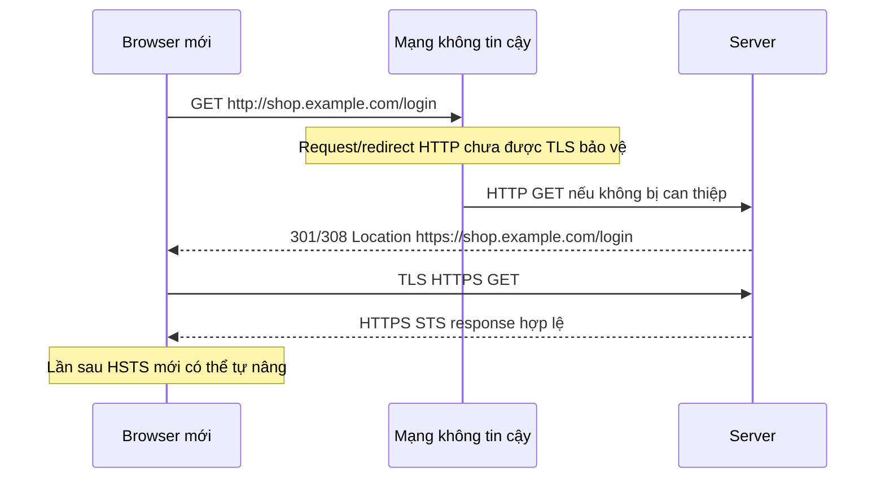
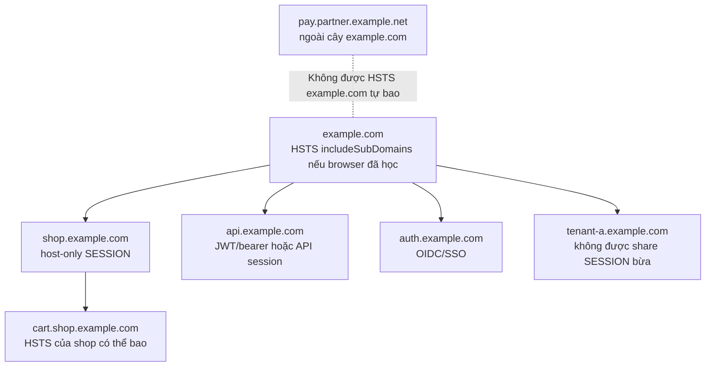
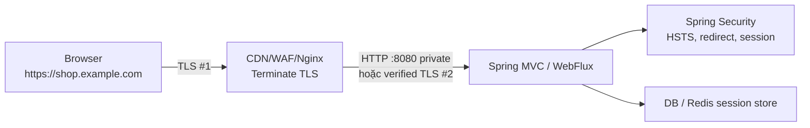
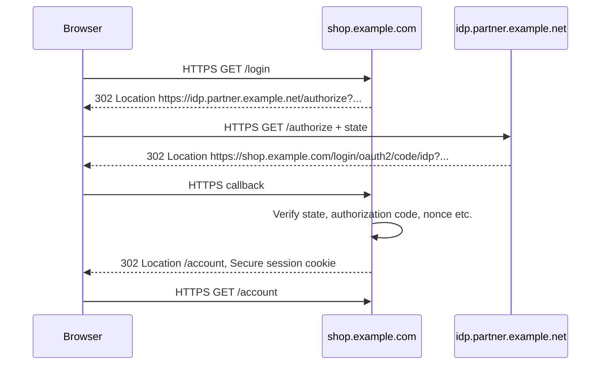
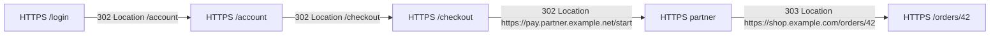

# Phối hợp HSTS, cookie Secure và địa chỉ redirect

> **Chương:** HTTPS và HSTS  
> **Học phần:** `SPRING_SECURITY_HTTP_PROTECTION` — áp dụng các lớp phòng vệ HTTP và trình duyệt trong Spring Security: CSRF, CORS, security headers, CSP, HSTS, HTTP firewall và bảo vệ session trên Servlet lẫn Reactive WebFlux.  
> **Chủ đề trực tiếp:** ba cơ chế **HSTS**, **thuộc tính cookie `Secure`** và **đích redirect `Location`** phải phối hợp thế nào để login/session/callback hoạt động đúng, không lộ bí mật, không sinh vòng lặp hoặc open redirect khi HTTPS terminate ở ứng dụng hay proxy.

## 1. Tình huống: HTTPS và HSTS đều “xanh” nhưng login vẫn lỗi

Một Spring MVC shop triển khai sau HTTPS ingress:

```text
Browser -> https://shop.example.com/login
Ingress --HTTP nội bộ--> Spring Boot :8080
```

Scanner thấy response 200 có:

```http
Strict-Transport-Security: max-age=31536000; includeSubDomains
```

Nhưng người dùng vẫn gặp ba hiện tượng:

1. `Set-Cookie: JSESSIONID=...; Path=/; HttpOnly` **thiếu `Secure`**. Nếu client chưa biết HSTS và mở HTTP URL, cookie có thể bị gửi trên HTTP theo domain/path matching.
2. Login thành công, server trả `Location: http://shop.example.com/account` hoặc `Location: http://internal-shop:8080/account`. Browser có thể downgrade, lộ metadata, mất session hoặc lặp redirect.
3. Một URL `?continue=https://attacker.example.net/` được phản chiếu thẳng vào `Location` sau login: user bị đưa sang site không tin cậy. Dù request đầu dùng TLS, redirect có thể dẫn tới phishing hoặc làm rò thông tin nếu ứng dụng đưa secrets trong URL.

Tất cả đều có thể cùng tồn tại với **HSTS header hợp lệ**. HSTS không tự thêm `Secure` cho cookie, không sửa URL chuyển hướng không đáng tin và không biến một website khác thành cùng origin.

> **Câu hỏi trọng tâm:** Khi browser nhận STS, cookie và response 302/303/307/308, cơ chế nào quyết định scheme, cookie nào được gửi, hostname nào được phép tới, và ai chịu trách nhiệm nếu request được đi qua TLS proxy?

### 1.1. Mục tiêu sau bài

Người học có thể:

1. Phân biệt chính xác **HSTS host policy**, **cookie sending rules** và **redirect target resolution** theo browser, hostname, scheme, path và port.
2. Trình bày được giới hạn của HSTS dynamic ở lần đầu, của `Secure` cookie và của HTTP redirect.
3. Thiết kế login success, logout, payment, SSO/OIDC redirects không vô tình hạ HTTP hay open redirect.
4. Biết khi nào `SameSite=Lax/Strict/None`, `HttpOnly`, host-only cookie và `__Host-` prefix hữu ích; không coi chúng là thay thế CSRF.
5. Dùng Servlet Spring Security `HttpSecurity`, Spring Boot cookie configuration và form-login success behavior an toàn.
6. Dùng Reactive `ServerHttpSecurity`, `WebSession`/`CookieWebSessionIdResolver` hoặc Spring Boot Reactive cookie settings phù hợp.
7. Chọn **edge** hoặc **application** làm owner cho HTTPS redirect/HSTS, tránh duplicate headers, sai external scheme, host spoofing và redirect loops.
8. Kiểm thử browser mới và đã HSTS, cookies theo network request, `Location` ở từng 3xx hop, TLS/forwarded metadata và các kịch bản CSRF/CORS.
9. Xây ma trận test bao gồm HTTP first visit, host/domain/path/port, OAuth callback, CDN và logout.
10. Chẩn đoán bằng bằng chứng, không tắt một lớp bảo mật để che lỗi của lớp khác.

## 2. Ba cơ chế giải ba câu hỏi khác nhau

| Cơ chế | Browser/server hỏi gì? | Đầu vào | Tác dụng chính | Không làm được |
| --- | --- | --- | --- | --- |
| **HSTS** | “URL HTTP tới hostname này phải dùng HTTPS không?” | Browser HSTS store, HTTPS `Strict-Transport-Security` | Nâng HTTP URL thành HTTPS **trước network** khi policy đã biết | Không phát hành TLS certificate; không đổi cookie attributes; không validate redirect target |
| **Cookie `Secure`** | “Có được gửi cookie này qua request transport hiện tại không?” | Cookie attributes, request URL, domain/path rules | Hạn chế cookie tới secure transport theo user-agent rules | Không ép document dùng HTTPS; không bảo vệ HTML HTTP; không hạn chế redirect domain |
| **Redirect `Location`** | “Response 3xx yêu cầu client điều hướng tới URL nào?” | Status 301/302/303/307/308, `Location`, client policies | Khởi tạo request mới tới URL đích nếu client follow | HTTP response gốc không có integrity; không tự xác minh đích là trusted |
| **TLS certificate** | “Endpoint đang kết nối có danh tính đúng không?” | TLS handshake, chain, SAN/hostname | Xác minh server và bảo vệ hop TLS | Không xác định user có quyền, cookie scope hay CSRF token |

Ba chính sách có thể bảo vệ **những mốc khác nhau trong cùng một điều hướng**. Chúng không tự động thiết lập lẫn nhau.

### 2.1. Sơ đồ vòng đời một lần login

```mermaid
sequenceDiagram
    participant B as Browser
    participant E as HTTPS edge
    participant A as Spring Security
    B->>B: Xem HSTS store cho shop.example.com
    B->>E: TLS GET https://shop.example.com/login
    E->>A: HTTP/TLS nội bộ theo topology
    A-->>E: Login page, security headers
    E-->>B: HTTPS response + STS
    B->>B: Cập nhật dynamic HSTS nếu hợp lệ
    B->>E: HTTPS POST /login + session/CSRF data
    E->>A: Xác thực request
    A-->>E: 303/302 Location: /account<br/>Set-Cookie: SESSION=...; Secure; HttpOnly; SameSite=Lax
    E-->>B: HTTPS 3xx + Set-Cookie + Location
    B->>B: Lưu cookie theo attributes
    B->>B: Resolve Location tới HTTPS public origin
    B->>E: HTTPS GET /account + cookie nếu matching
```

**Lưu ý về sơ đồ:** đoạn text trong một mũi tên Mermaid chỉ mô tả response; ngoài thực tế có thể là 302 thay vì 303, `Set-Cookie` có thể được phát trước/sau login tùy session strategy. Một response có thể đồng thời mang `Location`, `Set-Cookie` và `Strict-Transport-Security`, nhưng ba phần có semantics độc lập.

### 2.2. Ba trạng thái quan trọng trong browser

```text
HSTS store:  hostname -> max-age/includeSubDomains, có thể preload
Cookie jar:  name/value + Domain/Path/Secure/HttpOnly/SameSite/expiry
Navigation:  URL hiện tại + 3xx status/Location + redirect policy
```

- Xóa session cookie **không tự xóa** HSTS.
- Browser hết hạn HSTS **không tự xóa** cookie.
- `Set-Cookie` không đưa tên miền vào HSTS preload list.
- `Location` đổi host có thể khiến cookie host-only **không được gửi** dù HSTS vẫn có hiệu lực ở cả hai host.
- Chữ “HTTPS” trong `Location` không tự xác minh domain đó thuộc ứng dụng.

## 3. HSTS: policy của browser theo hostname, không phải cookie policy

Một HTTPS response hợp lệ có thể chứa:

```http
Strict-Transport-Security: max-age=31536000; includeSubDomains
```

Browser hỗ trợ HSTS ghi nhớ hostname đã phát policy trong thời hạn động. `includeSubDomains` khiến những hậu duệ của host đó cũng thuộc phạm vi nâng HTTPS.

### 3.1. Chỉ học từ HTTPS hợp lệ

`Strict-Transport-Security` trên **HTTP response** không được user agent tin để thêm/xóa HSTS. Lý do: attacker trên HTTP đường truyền có thể giả mạo policy.

Ví dụ HTTP 308:

```http
HTTP/1.1 308 Permanent Redirect
Location: https://shop.example.com/
Strict-Transport-Security: max-age=31536000
```

Nếu response trên đi qua **HTTP**, STS header bị bỏ qua cho HSTS processing. Browser theo 308 sang HTTPS rồi mới có thể học STS từ **HTTPS response**.

### 3.2. Lần truy cập đầu vẫn là điểm yếu

Browser mới chưa ghé `shop.example.com` và chưa có HSTS parent/preload/HTTPS-first có thể gửi HTTP request đầu:



Redirect HTTP giúp tương thích với link cũ **nếu client thực sự nhận response gốc**. Nó không loại bỏ first-visit downgrade/SSL stripping risk. Giải pháp chủ động: phát **HTTPS links/forms/API URLs ngay từ đầu**; preload hay browser HTTPS-first là cơ chế bổ sung có điều kiện.

### 3.3. Host matching khác cookie Domain matching

`https://shop.example.com` phát HSTS `includeSubDomains`: bảo vệ `cart.shop.example.com`, **không** tự bảo vệ `api.example.com`, vì api là sibling của shop. Ngược lại, `example.com` phát includeSubDomains có thể bao cả shop/api **nếu browser đã học parent policy**.

HSTS là chính sách chọn HTTPS **theo hostname**, không phải cookie Domain attribute. Một cookie host-only ở shop không được gửi tới api chỉ vì cả hai có HSTS.

### 3.4. `max-age=0` không phải logout

HTTPS `Strict-Transport-Security: max-age=0` có thể xóa **dynamic HSTS entry của chính hostname** trong browser. Nó không xóa session cookie, không làm user logout, không hủy session server và không tắt static preload entry đã được browser phân phối. Nếu parent có HSTS `includeSubDomains`, child không thoát parent bằng entry `0` riêng.

### 3.5. HSTS có thể làm lỗi redirect nặng hơn

Nếu server trả `Location: http://shop.example.com/account` nhưng browser **đã HSTS**, URL HTTP có thể bị nâng thành HTTPS trước network, khiến lỗi cấu hình bị che trên máy QA. Browser **chưa HSTS** hoặc API client không hỗ trợ HSTS vẫn có thể gửi HTTP. Đừng coi “máy mình vẫn chạy” là bằng chứng redirect an toàn.

## 4. Cookie Secure: phạm vi theo request transport, không theo quá khứ truy cập

Một session cookie minh họa:

```http
Set-Cookie: SESSION=<opaque-session-id>; Path=/; Secure; HttpOnly; SameSite=Lax
```

`Secure` yêu cầu cookie chỉ được gửi trong **kết nối an toàn** theo quy tắc browser, với ngoại lệ/chi tiết implementation cho localhost. `HttpOnly` hạn chế JavaScript truy cập qua `document.cookie`. `SameSite` giới hạn ngữ cảnh cross-site, `Path`/`Domain` ảnh hưởng nơi cookie được gửi.

**Không** có nguyên tắc “đã bật HSTS rồi thì không cần Secure”. Browser mới hoặc HTTP clients có thể không có HSTS; cookie Secure vẫn là một ràng buộc riêng. <https://developer.mozilla.org/en-US/docs/Web/HTTP/Reference/Headers/Set-Cookie>

### 4.1. Secure không tự nâng HTTPS

Browser có thể mở `http://shop.example.com/` lần đầu và gửi request HTTP **không mang cookie Secure**. Sau đó HTML HTTP response vẫn có thể bị attacker thay. Cookie an toàn hơn không làm **trang HTML HTTP** đáng tin.

### 4.2. Secure cookie có thể được gửi sau redirect hợp lệ

Ví dụ browser có cookie `SESSION; Secure` của shop:

1. User mở `http://shop.example.com/account`.
2. Khi request HTTP thật được tạo, browser **không gửi SESSION Secure** theo quy tắc thông thường.
3. Edge trả 308 tới `https://shop.example.com/account`.
4. Browser tạo **request HTTPS mới** và có thể gửi SESSION vì scheme/domain/path matching cho phép.

Nhưng điểm (2) vẫn tạo một HTTP request đầu có thể lộ path/query, header không bí mật và có thể bị AitM can thiệp. Cookie Secure chỉ giảm rủi ro rò giá trị session, không bảo vệ toàn bộ navigation.

### 4.3. Trường hợp redirect HTTP làm mất cookie

Nếu login response từ HTTPS trang A chuyển sang **HTTP** trang B cùng host/khác host, `Secure` cookie có thể **không được gửi** tới HTTP URL. Người dùng gặp vòng login, redirect về sign-in hoặc 401. Sửa **đích `Location` về HTTPS**, không bỏ `Secure` để “fix session”.

### 4.4. Cookie Secure không đồng nghĩa end-to-end HTTPS

Nếu browser gửi cookie Secure qua HTTPS tới CDN, CDN giải mã request. CDN có thể chuyển cookie plaintext qua HTTP tới backend. `Secure` quy định browser gửi cookie qua **browser→edge**, không mã hóa hop proxy→app. Nếu threat model yêu cầu, dùng TLS/mTLS hoặc network isolation cho upstream hop.

### 4.5. HSTS không cấp hoặc sửa cookie attributes

Ngay cả browser có static HSTS preload entry, response:

```http
Set-Cookie: SESSION=abc; Path=/; HttpOnly
```

vẫn là cookie **không `Secure`**. HSTS có thể khiến browser dùng HTTPS trong một số điều hướng, nhưng cookie vẫn có attribute thiếu; QA phải đánh giá cookie independently và thiết lập `Secure`.

## 5. HttpOnly, SameSite, Domain, Path: “Secure” chưa đủ

`Secure` chỉ xử lý transport constraint. Các thuộc tính còn lại kiểm soát những rủi ro khác.

| Thuộc tính | Ý nghĩa | Dễ nhầm với gì? |
| --- | --- | --- |
| `Secure` | Hạn chế gửi cookie qua insecure transport | HSTS |
| `HttpOnly` | Giảm khả năng JavaScript đọc giá trị qua `document.cookie` | CSP/XSS defense đầy đủ |
| `SameSite=Strict` | Hạn chế cookie trong bối cảnh cross-site mạnh | “An toàn cho mọi OAuth callback” |
| `SameSite=Lax` | Cho nhiều same-site requests và một số cross-site top-level navigations an toàn | CSRF token thay thế |
| `SameSite=None; Secure` | Cho phép cookie trong bối cảnh cross-site khi hợp lệ; Secure bắt buộc với browser hiện đại | CORS wildcard hoặc bypass chống theo dõi của browser |
| `Domain` | Phạm vi domain-match: cookie host-only nếu bỏ | HSTS `includeSubDomains` |
| `Path` | Giới hạn paths cookie được gửi; không phải security isolation mạnh | Spring Security path matcher |
| `Max-Age`/`Expires` | Vòng đời cookie | HSTS `max-age` |
| `Partitioned` (khi dùng) | Phân vùng cookie theo top-level site theo browser hỗ trợ | Cơ chế CORS hay tenant authorization |

### 5.1. Same-site khác same-origin

`https://shop.example.com` và `https://api.example.com` là **khác origin** (host khác), nhưng thường là **cùng site** nếu cùng registrable domain và scheme theo schemeful SameSite rules.

Hệ quả:

- SameSite không tự cho JavaScript đọc response API khác origin. CORS vẫn cần đúng.
- `SameSite=Lax` của một cookie có thể được gửi trong ngữ cảnh same-site cross-origin nếu domain/path/transport matching và các điều kiện browser fetch/credentials cho phép.
- Một subdomain không tin cậy có thể là **same-site** với ứng dụng chính, vì vậy SameSite **không đủ thay CSRF token** và host-only cookies ở mọi tình huống.
- Khi đổi HTTP→HTTPS, schemeful same-site classification có thể thay đổi; cần test browser flow thật.

### 5.2. Host-only cookie an toàn hơn Domain rộng khi không cần chia phiên

Đặt cookie không có `Domain`:

```http
Set-Cookie: SESSION=<opaque>; Path=/; Secure; HttpOnly; SameSite=Lax
```

Khi được phát từ `shop.example.com`, cookie được ràng buộc cho hostname này theo browser host-only rules; không tự gửi tới `api.example.com` hoặc `tenant-a.example.com`.

Ngược lại:

```http
Set-Cookie: SESSION=<opaque>; Domain=example.com; Path=/; Secure; HttpOnly; SameSite=Lax
```

có phạm vi các hosts phù hợp dưới `example.com`. Điều này có thể tăng nguy cơ cookie collision/tossing, chia sẻ không chủ ý giữa vendor/tenant/delegated subdomains. **Không** đặt `Domain=example.com` chỉ vì `example.com` đã bật HSTS includeSubDomains.

### 5.3. Prefix `__Host-` cho session host-only

Với browsers hỗ trợ cookie prefixes, một cookie kiểu:

```http
Set-Cookie: __Host-SESSION=<opaque>; Path=/; Secure; HttpOnly; SameSite=Lax
```

phải đáp ứng: `Secure`, `Path=/` và **không có `Domain`**; phải được thiết lập trong ngữ cảnh HTTPS hợp lệ theo browser rules. Prefix hỗ trợ ngăn một số cấu hình cookie scope sai.

`__Secure-` yêu cầu `Secure` nhưng không buộc host-only/Path=/ như `__Host-`. Prefix không thay session rotation/invalidation và không cấm một XSS thực hiện hành động thay mặt user khi có quyền origin.

### 5.4. `SameSite=None` trong SSO/iframe

Khi embedded app hoặc cross-site flow thực sự cần cookies, `SameSite=None; Secure` có thể là điều kiện cần nhưng không đủ. Browser có chính sách third-party cookies/partitioning/anti-tracking khác; app phải thiết kế và test flow, không cố “sửa” bằng `SameSite=None` ở mọi cookie.

### 5.5. Cookies không phải ranh giới phân quyền

Cookie gửi được tới một route không chứng minh user có quyền truy cập resource. Spring Security authentication xác định principal; authorization ở route/service/tenant phải chặn IDOR. HTTPS+Secure cookie không thể thay ACL.

## 6. Redirect Location: đích URL là dữ liệu bảo mật nhạy cảm

Response redirect phổ biến:

```http
HTTP/1.1 302 Found
Location: /account
Set-Cookie: SESSION=<opaque>; Path=/; Secure; HttpOnly; SameSite=Lax
```

`Location` chỉ nơi client nên điều hướng. Nó có thể là URI reference tương đối hoặc URI tuyệt đối theo HTTP semantics. Client quyết định việc follow theo context/method/redirect policy.

### 6.1. Relative redirect thường giảm lỗi scheme/host

`Location: /account` được browser resolve theo origin hiện tại. Nếu response đến từ `https://shop.example.com/login`, đích là `https://shop.example.com/account`.

Ưu điểm: không cần app biết external host/port cho một điều hướng nội bộ đơn giản; giảm nguy cơ trả `http://internal:8080` khi TLS offload.

**Giới hạn:** tương đối không tự validate path, không thay authorization và có thể bị lợi dụng nếu cho client kiểm soát path hoặc encode sai. Nếu dùng relative target từ input, vẫn cần validate.

### 6.2. Absolute redirect cần public HTTPS canonical URL

```http
HTTP/1.1 303 See Other
Location: https://shop.example.com/account
```

Dùng absolute URL khi cần host/port cụ thể (OIDC callback/links/cross-origin flow) nhưng phải lấy từ **cấu hình tin cậy hoặc allowlist**, không lắp từ `Host` hay `X-Forwarded-Host` do client tùy ý gửi.

### 6.3. HTTP redirect sai scheme tạo downgrade hoặc loop

```http
HTTP/1.1 302 Found
Location: http://shop.example.com/account
```

Nếu browser đã học HSTS của shop, nó có thể nâng đích về HTTPS nên lỗi bị che. Nếu client chưa có HSTS hoặc không hỗ trợ, nó có thể gửi HTTP request. Nếu cookie Secure không được gửi tới HTTP, user bị mất session hoặc quay lại login. **Không giảm bảo mật cookie/HSTS để chữa một `Location` sai.**

### 6.4. Hostname sai làm cookie host-only không được gửi

`https://shop.example.com/login` đặt cookie host-only, rồi trả:

```http
HTTP/1.1 302 Found
Location: https://www.example.com/account
```

Dù cả hai dùng HTTPS và certificate hợp lệ, cookie của **shop** không tự gửi cho **www**. Nếu SSO cần chuyển host, nên dùng flow giao đổi bằng authorization code/state và session riêng từng origin, không mở rộng cookie Domain toàn apex một cách tùy tiện.

### 6.5. Open redirect: HTTPS không đồng nghĩa trusted destination

```text
https://shop.example.com/login?next=https://attacker.example.net/phishing
```

Nếu server trả nguyên `next` vào `Location`, client có thể rời trusted site sang phishing origin. Đích ngoài này có thể dùng HTTPS hợp lệ của attacker: HSTS/TLS của shop **không chặn** việc điều hướng.

Thiết kế đúng:

- Ưu tiên **relative same-origin paths** trong một tập route được phép.
- Nếu phải cho external redirects (payment provider/OIDC), dùng **exact allowlist** cho scheme, host, port/path được đăng ký; không dựa vào hậu tố chuỗi đơn giản.
- Reject `javascript:`, `data:`, protocol-relative `//evil.example`, URL userinfo/encoding tricks, backslashes và ký tự điều khiển tùy parser.
- Normalize/canonicalize **một cách nhất quán** rồi so đích final theo URI parser phù hợp, không dùng `startsWith("https://shop.example.com")`.
- Không đưa token/session/OAuth codes vào query của một URL không tin cậy.
- Không tự động redirect mọi lỗi authentication sang `next` do client cung cấp.

## 7. Phân biệt HTTP status 301, 302, 303, 307, 308 trong login/payment

| Mã | Ý nghĩa thường dùng | Method/body khi follow | Lưu ý |
| --- | --- | --- | --- |
| `301 Moved Permanently` | Redirect permanent | Clients lịch sử có thể chuyển POST thành GET | Cache/SEO và permanent semantics, không tùy tiện dùng cho login |
| `302 Found` | Redirect tạm | Một số clients chuyển POST thành GET | Thường thấy sau login form theo framework |
| `303 See Other` | Xem response bằng GET (đặc biệt POST→GET) | POST→GET theo semantics | Phù hợp Post/Redirect/Get sau form thành công |
| `307 Temporary Redirect` | Redirect tạm bảo toàn method | Bảo toàn method/body | Không dùng để “cứu” POST secret đã gửi HTTP |
| `308 Permanent Redirect` | Redirect vĩnh viễn bảo toàn method | Bảo toàn method/body | Thận trọng với caches/client compatibility và unsafe methods |

### 7.1. Trường hợp POST credentials qua HTTP

Nếu client đã gửi:

```http
POST /login HTTP/1.1
Host: shop.example.com
Content-Type: application/x-www-form-urlencoded

username=alice&password=<redacted>
```

qua **HTTP**, request này có thể đã bị quan sát trước khi server phản hồi 307/308. Chuyển sang HTTPS sau đó không xóa rủi ro. Thiết kế: form/action/API clients **luôn gửi POST HTTPS trực tiếp**; HTTP ingress không xử lý secret-bearing unsafe requests.

### 7.2. Post/Redirect/Get không thay authorization

Sau khi xử lý `POST /checkout` thành công, server có thể trả `303 Location: /orders/42`, browser GET trang kết quả. Nhưng GET `/orders/42` vẫn cần kiểm **đơn hàng thuộc principal/tenant nào**. Redirect chỉ thay navigation/method; không tạo quyền.

### 7.3. Browser redirect policy và API clients có thể khác nhau

`fetch`, Java HTTP clients, OAuth libraries, proxies có thể khác behavior khi follow redirects, giữ headers hay cookies, chuyển phương thức. Không phụ thuộc một behavior ngầm khi thiết kế API chứa credentials; test từng client được hỗ trợ.

### 7.4. Permanent redirect cache có thể kéo dài lỗi

Một `301` hoặc `308` sai sang HTTP/internal host có thể được caches ghi nhớ. Sau khi sửa server, một số clients vẫn theo redirect cũ tùy caching semantics. Trong rollout login/payment, chọn redirect status có chủ đích và test freshness/cache headers; đừng xem việc “đổi config là xong” đủ để sửa mọi client.

## 8. Cây hostname: HSTS scope, cookie scope và Location đích



### 8.1. So sánh bốn tình huống

| Thao tác | HSTS ảnh hưởng | Cookie gửi? | Redirect cần làm gì? |
| --- | --- | --- | --- |
| `http://shop.example.com/cart` khi đã học HSTS shop | Nâng tới HTTPS | Secure host-only shop cookie có thể gửi trên HTTPS | Không cần server HTTP 3xx cho browser đã nâng |
| `http://api.example.com` khi chỉ shop có HSTS | Không tự nâng do policy shop | Shop host-only cookie không gửi | API links phải là HTTPS; không tin redirect HTTP |
| Login shop `302 /account` | Không đổi hostname/scheme đã HTTPS | Shop cookie gửi nếu Domain/Path/Secure/SameSite match | Internal relative Location an toàn hơn |
| Shop `302 https://auth.example.com` | HSTS từng host có thể áp | Shop host-only cookie không gửi auth | Cần SSO/OIDC flow và cookie/session riêng |
| Shop `302 https://pay.partner.example.net` | HSTS example.com không bao partner | Shop host-only cookie không gửi | External allowlist, signed state và callback đúng |
| Apex `example.com` HSTS includeSubDomains | Sau khi browser học parent, các descendants nâng | Không tự mở rộng cookie scope | Vẫn phải bảo vệ từng redirect target và từng host |

### 8.2. Không dùng wildcard certificate để suy cookie hoặc HSTS scope

Certificate `*.example.com` phục vụ TLS hostname verification cho một cấp host phù hợp; nó **không** mặc định mở rộng cookie Domain và cũng không tạo HSTS state. Deep child `a.b.example.com` cần certificate đúng dù browser có parent HSTS includeSubDomains.

### 8.3. Tenant subdomains làm cookie Domain rộng nguy hiểm hơn

Nhiều multi-tenant platforms cấp `tenant-X.example.com`. Nếu session cookie của `admin.example.com` được phát với `Domain=example.com`, tenant-controlled subdomains có thể trở thành một phần bề mặt tấn công cookie, tùy browser/provider controls. Ưu tiên host-only cookies, tách trust domains và kiểm tenant isolation ở backend.

## 9. HSTS, Secure cookie và first-visit: ma trận hành vi

| Browser state | URL ban đầu | Cookie `Secure` cho host | Hành vi/giới hạn |
| --- | --- | --- | --- |
| Chưa HSTS/preload/HTTPS-first | `http://shop.example.com` | Không gửi qua plaintext HTTP theo rules | Request HTTP đầu vẫn có thể bị AitM |
| Chưa HSTS | `https://shop.example.com` | Có thể gửi nếu matching | TLS được bảo vệ trực tiếp, browser học HSTS nếu HTTPS STS hợp lệ |
| Đã học HSTS shop | `http://shop.example.com` | Có thể gửi trên request sau khi browser nâng HTTPS | Không phát HTTP request đầu do HSTS host match |
| Chỉ học HSTS api | `http://shop.example.com` | Không được api policy nâng shop | Phải dùng HTTPS direct link/shop HSTS riêng |
| Parent example.com include và đã học | `http://shop.example.com` | Sau khi browser nâng HTTPS, cookie có thể gửi | Child TLS/cert phải hợp lệ |
| Browser có static preload parent | HTTP URL child lần đầu | Có thể gửi trên HTTPS sau client upgrade | Không cần đã ghé child/parent trước |
| Browser không hỗ trợ HSTS | HTTP URL | Cookie Secure vẫn hạn chế gửi HTTP | HTTPS direct URLs/strict TLS client cần thiết |
| Redirect từ HTTPS về HTTP | `Location: http://shop...` | Cookie Secure không gửi trên HTTP nếu client không nâng | Có thể mất session/downgrade |
| Redirect sang unrelated HTTPS host | `Location: https://other...` | Shop host-only cookie không gửi | Open redirect/phishing vẫn có thể xảy ra |

### 9.1. Browser HSTS state độc lập cookie jar

Trong testing, profile đã nhận STS khác profile chưa từng vào host. Một browser đã logout vẫn có thể HSTS; một cookie đã được đặt từ app không chứng minh HSTS đã học. Vì vậy phải đo **ba tầng riêng**: HSTS store, cookie attributes/send behavior, và redirect chain.

### 9.2. HSTS nâng HTTP URL nhưng không sửa scheme ban đầu trong mã nguồn

Nếu app ghi `http://shop.example.com/account` vào email, browser có HSTS có thể nâng. Nhưng email clients, link previewers, bots hoặc HTTP libraries có thể không áp HSTS giống browser; về nguyên tắc **phát HTTPS URL từ nguồn** thay vì dựa vào HSTS sửa lỗi cấu hình.

## 10. HSTS preload: tăng bảo vệ lần đầu nhưng không thay Secure/Location

Một HTTPS response:

```http
Strict-Transport-Security: max-age=63072000; includeSubDomains; preload
```

không tự đưa domain vào static browser preload list. Cần thỏa điều kiện, chủ domain đăng ký, được đưa vào danh sách và phân phối qua browser builds. Trang [hstspreload.org](https://hstspreload.org/) khuyến nghị xem xét cẩn thận bởi việc preload/gỡ rất chậm và mọi descendants phải có HTTPS.

Kể cả browser đã có static preload policy:

- Cookie thiếu `Secure` **vẫn thiếu attribute đó**.
- `Location: https://attacker.example.net` vẫn là redirect tới attacker domain.
- `Location: /account` vẫn cần authorization.
- `Domain=example.com` vẫn có phạm vi cookie rộng nếu server đặt như vậy.
- App vẫn phải đặt `SameSite`/CSRF/CORS/CSP đúng threat model.
- Bảo mật TLS/PKI và certificate renewal vẫn bắt buộc ở mọi HTTPS hostname.
- `max-age=0` qua HTTPS không xóa ngay static preload entry, và không xóa cookies.

## 11. HTTPS terminate ở reverse proxy: chỗ phối hợp dễ hỏng nhất

Topology production:



Nếu edge chuyển HTTP nội bộ, Servlet backend có thể thấy:

```text
request.isSecure()   = false
request.getScheme()  = "http"
request.getServerName() = "shop-internal"
request.getServerPort() = 8080
```

Dù **browser** ở `https://shop.example.com`. Kéo theo:

1. `HstsHeaderWriter` không phát STS mặc định vì request không được xem secure.
2. Logic session cookie phụ thuộc scheme có thể bỏ `Secure`.
3. Redirect builder tạo `Location: http://shop-internal:8080/...`.
4. `redirectToHttps` nghĩ HTTPS public là HTTP, có thể lặp redirect.
5. OAuth callback URL sai scheme/host/port; IdP từ chối.
6. CORS origin checks có thể so sai scheme/host nếu dựa internal URL.

### 11.1. Phải chọn owner cho HSTS và HTTPS redirects

**A — Edge sở hữu:** edge terminate public TLS, trả HTTP→HTTPS redirect cho port 80 và phát STS trên public HTTPS responses; app có thể không cần HSTS writer riêng. App vẫn cần đúng public base URL/cookie Secure/callback handling.

**B — App sở hữu:** cần trusted forwarded metadata được xử lý trước Spring Security hoặc app trực tiếp terminate HTTPS. Edge không thêm duplicate/conflicting STS. Nếu edge sinh 502 mà không vào app, chính edge phải quyết định chính sách STS/errors.

**C — TLS bridging:** edge terminate TLS #1 rồi thiết lập TLS #2 tới backend. App có thể thấy secure cho hop #2, nhưng external host/port/prefix vẫn có thể khác internal; cần canonical public URLs hoặc trusted forwarding khi tạo Location.

### 11.2. Không tin raw `Forwarded`/`X-Forwarded-*` từ client

```http
Forwarded: for=198.51.100.5;proto=https;host=shop.example.com
X-Forwarded-Proto: https
X-Forwarded-Host: shop.example.com
X-Forwarded-Port: 443
X-Forwarded-Prefix: /store
```

Đây chỉ là HTTP metadata. Chỉ tin khi:

- Public proxy **xóa/ghi đè** forwarded headers do Internet client tự gửi.
- App backend **không truy cập trực tiếp** từ Internet/clients ngoài trusted proxies.
- Proxy xác định external HTTPS scheme từ TLS termination thực, không từ raw header.
- Hostnames được validate/allowlist và không cho attacker điều khiển `X-Forwarded-Host`.
- Native web server/framework chỉ parse forwarding theo một strategy đúng version.
- Logs/test đủ để chứng minh spoofed header không dẫn tới open redirect/bypass.

Spring Boot 3.x thường có `server.forward-headers-strategy: framework`; các version Boot mới có thể dùng tên khác. Phải xem đúng configuration metadata của dependency đang sử dụng, không sao chép property mù quáng.

### 11.3. Relative Location giảm phụ thuộc scheme nhưng không xóa mọi vấn đề

Khi app dùng `Location: /account`, browser nhận redirect từ HTTPS edge sẽ resolve về HTTPS public host, dù app thấy internal HTTP. Đây thường là lựa chọn tốt cho redirect nội bộ, nhưng OAuth external callbacks/signed links vẫn cần cấu hình public canonical URL; cookies vẫn phải mang `Secure`.

### 11.4. Public TLS không chứng minh backend hop có TLS

Cookie `Secure` đi từ browser qua TLS #1 và được edge giải mã; nếu edge→app dùng HTTP, hop ấy cần network isolation hoặc TLS/mTLS theo threat model. Đừng gọi toàn tuyến là end-to-end encryption nếu có plaintext hop.

## 12. Spring Security Servlet: HTTPS redirect, HSTS, authentication và session

Một cấu hình `SecurityFilterChain` minh họa chính sách app-owned. Ví dụ chỉ nên dùng nếu app trực tiếp terminate TLS hoặc đã nhận **trusted external scheme**. Nếu edge là redirect/HSTS owner, điều chỉnh hai tính năng để tránh xung đột.

```java
package example.security;

import static org.springframework.security.config.Customizer.withDefaults;

import org.springframework.context.annotation.Bean;
import org.springframework.context.annotation.Configuration;
import org.springframework.security.config.annotation.web.builders.HttpSecurity;
import org.springframework.security.web.SecurityFilterChain;

@Configuration
class ServletTransportAndSessionSecurity {

    @Bean
    SecurityFilterChain appSecurity(HttpSecurity http) throws Exception {
        return http
            .redirectToHttps(withDefaults())
            .headers(headers -> headers
                .httpStrictTransportSecurity(hsts -> hsts
                    .maxAgeInSeconds(86400)
                    .includeSubDomains(false)
                    .preload(false)
                )
            )
            .csrf(withDefaults())
            .authorizeHttpRequests(auth -> auth
                .requestMatchers("/login", "/health").permitAll()
                .anyRequest().authenticated()
            )
            .formLogin(withDefaults())
            .logout(withDefaults())
            .build();
    }
}
```

### 12.1. Bảo vệ nào từ cấu hình này?

- `redirectToHttps(...)`: server-side redirect cho requests ứng dụng coi là HTTP, **nếu có listener/port mapping/proxy topology hỗ trợ**.
- HSTS writer: thêm `Strict-Transport-Security` cho requests được nhận là secure và đi qua chain.
- `csrf(...)`: giữ CSRF defense cho cookie-session form requests theo mặc định/thiết kế.
- `formLogin(...)`: cho flow xác thực; cụ thể `302 Location`/session strategy do framework và cấu hình quyết định.
- `authorizeHttpRequests(...)`: vẫn yêu cầu authentication cho routes còn lại, nhưng object-level ACL phải đặt ở service.

**Cảnh báo:** `redirectToHttps` không tự tạo TLS listener, và **không** sửa first HTTP request đã đi ra mạng. Spring Security versions cũ có `requiresChannel(...requiresSecure())`; xác minh DSL theo dependency đang chạy.

### 12.2. Nếu edge sở hữu redirect/HSTS

Trong `SecurityFilterChain` của app, tránh duplicate HSTS:

```java
.headers(headers -> headers
    .httpStrictTransportSecurity(hsts -> hsts.disable())
)
```

và **không bật app HTTPS redirect** trong môi trường luôn nhận HTTP từ trusted edge, trừ khi external scheme đã được xử lý đúng. Nhưng chỉ disable riêng HSTS writer khi edge thực sự phát STS trên public HTTPS responses; **không tắt toàn bộ security headers/CSRF**.

### 12.3. Mặc định writer không phát HSTS trên HTTP request

`HstsHeaderWriter` mặc định kiểm `HttpServletRequest.isSecure()`. Đừng ép `requestMatcher(req -> true)` chỉ để thấy STS header trên HTTP: browser bỏ qua HSTS qua HTTP và bảo mật không tăng.

### 12.4. permitAll và ignoring không tương đương

`permitAll()` vẫn chạy `SecurityFilterChain` và header writers, trong khi `web.ignoring()` hoặc route không match bất kỳ chain nào có thể bỏ qua security headers. Nếu app sở hữu STS cho một hostname, phải xác minh static/error paths có header phù hợp; nếu edge sở hữu, test public responses cuối.

## 13. Spring Boot Servlet: cấu hình cookie Secure rõ ràng

Khi ứng dụng dùng servlet session cookie, Spring Boot hỗ trợ thuộc tính theo version:

```yaml
server:
  servlet:
    session:
      cookie:
        secure: true
        http-only: true
        same-site: lax
        path: /
```

Tên cookie mặc định thường `JSESSIONID` trong servlet container, nhưng Spring Session có thể thay. **Đo `Set-Cookie` thực tế**, vì framework/session library/custom cookie writer khác có thể tạo cookies riêng.

### 13.1. Secure không nên chỉ dựa trên backend `isSecure()`

Sau TLS offload, container có thể nghĩ request HTTP nội bộ. Đặt `secure: true` giúp session cookie do container quản lý được đánh dấu `Secure` nhất quán khi public app là HTTPS-only.

Cần cùng lúc đảm bảo:

- Public TLS endpoint thực sự HTTPS.
- Không có public HTTP login route thiết lập session không an toàn.
- Canonical URLs/callbacks dùng HTTPS.
- HSTS owner đúng.
- Proxy sanitizes forwarded headers.
- Backend port không bị public bypass.

### 13.2. Cookie riêng của ứng dụng cần tự thêm attributes

`server.servlet.session.cookie.secure` áp cho **session cookie** do container/auto-configured session manager quản lý; nó không tự nâng mọi `ResponseCookie` hoặc `Set-Cookie` do business code viết.

Ví dụ một non-session cookie tạm thời qua Servlet:

```java
import jakarta.servlet.http.HttpServletResponse;
import org.springframework.http.HttpHeaders;
import org.springframework.http.ResponseCookie;

void addShortLivedPreferenceCookie(HttpServletResponse response) {
    ResponseCookie cookie = ResponseCookie.from("PREF", "compact")
        .secure(true)
        .httpOnly(true)
        .sameSite("Lax")
        .path("/")
        .maxAge(java.time.Duration.ofMinutes(15))
        .build();

    response.addHeader(HttpHeaders.SET_COOKIE, cookie.toString());
}
```

Đây **không phải** ví dụ đặt session ID. Phiên đăng nhập nên do Spring Security/session store quản lý, với ID ngẫu nhiên và rotation/invalidation. Không in secrets trong cookie value của code mẫu.

### 13.3. Có nên đặt `Domain=example.com` để sửa login giữa subdomains?

Không mặc định. Nếu login tại shop redirect sang auth, host-only cookie của shop không gửi cho auth là **đúng isolation**. Với SSO, dùng OIDC/code flow để establish session riêng trên từng hostname thay vì mở rộng tất cả session cookies cho parent. Chia cookie rộng chỉ sau đánh giá về subdomain ownership/CSRF/cookie tossing.

### 13.4. Cookie Prefix với Spring Session

Nếu muốn `__Host-SESSION`, phải đảm bảo **không có Domain**, `Path=/` và `Secure`; tên cookie, path, CookieSerializer/session resolver config phải khớp. Với Servlet và Spring Session có `DefaultCookieSerializer` hoặc config tương ứng theo version; không giả định property cho container cookie tự áp lên mọi Spring Session cookie.

## 14. Reactive WebFlux: HSTS, HTTPS redirect và WebSession cookies

Trong WebFlux, dùng `ServerHttpSecurity` và `SecurityWebFilterChain`, không copy `HttpSecurity` hoặc Servlet `HstsHeaderWriter`.

```java
package example.security;

import java.time.Duration;

import org.springframework.context.annotation.Bean;
import org.springframework.context.annotation.Configuration;
import org.springframework.security.config.annotation.web.reactive.EnableWebFluxSecurity;
import org.springframework.security.config.web.server.ServerHttpSecurity;
import org.springframework.security.web.server.SecurityWebFilterChain;

@Configuration
@EnableWebFluxSecurity
class ReactiveTransportAndSessionSecurity {

    @Bean
    SecurityWebFilterChain apiSecurity(ServerHttpSecurity http) {
        return http
            .redirectToHttps(spec -> { })
            .headers(headers -> headers
                .hsts(hsts -> hsts
                    .maxAge(Duration.ofDays(1))
                    .includeSubdomains(false)
                    .preload(false)
                )
            )
            .authorizeExchange(auth -> auth
                .pathMatchers("/login", "/health").permitAll()
                .anyExchange().authenticated()
            )
            .build();
    }
}
```

`redirectToHttps(spec -> { })` biểu thị sử dụng default redirect settings của Reactive API trong những phiên bản hỗ trợ; có thể dùng `redirectToHttps(Customizer.withDefaults())` theo version. WebFlux có CSRF enabled by default trong cấu hình thông thường nhưng cần test flow cụ thể; nếu API dùng bearer tokens không kèm browser cookies, threat model khác.

### 14.1. Cookie configuration của WebFlux

Tài liệu Spring Boot hiện có nhóm properties `server.reactive.session.cookie.*`, gồm `secure`, `http-only`, `same-site`, `path` và `name`. Ví dụ cho những versions hỗ trợ:

```yaml
server:
  reactive:
    session:
      cookie:
        secure: true
        http-only: true
        same-site: lax
        path: /
```

Với project dùng Spring Session Reactive, `CookieWebSessionIdResolver` có thể được tùy biến để đặt cookies:

```java
package example.security;

import org.springframework.context.annotation.Bean;
import org.springframework.context.annotation.Configuration;
import org.springframework.web.server.session.CookieWebSessionIdResolver;
import org.springframework.web.server.session.WebSessionIdResolver;

@Configuration
class ReactiveSessionCookieConfig {

    @Bean
    WebSessionIdResolver webSessionIdResolver() {
        CookieWebSessionIdResolver resolver =
            new CookieWebSessionIdResolver();

        resolver.setCookieName("SESSION");
        resolver.addCookieInitializer(builder -> builder
            .path("/")
            .secure(true)
            .httpOnly(true)
            .sameSite("Lax"));

        return resolver;
    }
}
```

**Không áp cả hai đường config một cách máy móc**: tùy stack và Boot/Spring Session version, một bean tùy chỉnh có thể thay behavior auto-configuration. Chọn đúng resolver/session manager của app và quan sát `Set-Cookie` của real HTTPS response.

### 14.2. Cookie host-only là lựa chọn mặc định thường phù hợp

Trong Reactive session config, không khai báo cookie `Domain` nếu không cần chia sẻ phiên giữa hosts. Khi session dùng tên `SESSION` không có `__Host-` prefix, các attributes `Secure`/`HttpOnly`/`SameSite` vẫn cần kiểm. Nếu dùng prefix, bắt buộc đáp ứng `Secure`, `Path=/` và không Domain.

### 14.3. Reactive redirect cũng có thể sai external scheme

Khi public HTTPS terminate ở proxy nhưng `ServerWebExchange` thấy internal HTTP, `ServerHttpSecurity.redirectToHttps` có thể tạo loop hoặc URL sai. Dùng trusted `ForwardedHeaderTransformer`/container integration theo version hoặc giao redirect cho edge, không tắt session Secure vì lỗi này.

### 14.4. Servlet và Reactive API khác nhau

| Ý định | Servlet | Reactive |
| --- | --- | --- |
| HTTPS/HSTS builder | `HttpSecurity` | `ServerHttpSecurity` |
| Chain | `SecurityFilterChain` | `SecurityWebFilterChain` |
| HSTS writer | `HstsHeaderWriter` | `StrictTransportSecurityServerHttpHeadersWriter` |
| Max age DSL | `maxAgeInSeconds(long)` | `maxAge(Duration)` |
| Include domains | `includeSubDomains(boolean)` | `includeSubdomains(boolean)` |
| HTTPS redirect | `redirectToHttps(...)` hoặc older `requiresChannel(...)` | `redirectToHttps(...)` |
| Session | Servlet `HttpSession`/Spring Session | `WebSession`/Reactive Spring Session |
| Session cookie config | `server.servlet.session.cookie.*` | `server.reactive.session.cookie.*` (supported versions) |
| Test | `MockMvc` | `WebTestClient` |
| Trust metadata | Servlet `ForwardedHeaderFilter`/container | `ForwardedHeaderTransformer`/web server |
| Browser HSTS/cookie semantics | Browser tự xử lý | Browser tự xử lý, không tùy backend stack |

## 15. Form login redirect: không nhận user-supplied absolute next URL bừa bãi

Một người dùng truy cập route yêu cầu đăng nhập; Spring Security có thể lưu original request trong `RequestCache` và sau authentication trả về trang user muốn đến thông qua success handler.

### 15.1. SavedRequest cần đúng external host

Khi reverse proxy làm app thấy `http://internal:8080`, saved request có thể lưu absolute URL/port không đúng public; sau login redirect sai, hoặc loop. Trusted forwarding/canonical public URL và URL validation phải được đặt trước hoặc trong success flow.

Trong Servlet, `DefaultSavedRequest` lưu thông tin của `HttpServletRequest` và cung cấp `getRedirectUrl()` cho cơ chế trở về request ban đầu. URL đó phản ánh request metadata mà app nhận; nếu scheme/host/port bị proxy làm sai hoặc bị giả mạo, không được mặc nhiên coi saved URL là một đích điều hướng đã được xác minh. Tham khảo [DefaultSavedRequest Javadoc](https://docs.spring.io/spring-security/reference/api/java/org/springframework/security/web/savedrequest/DefaultSavedRequest.html).

### 15.2. Không phản chiếu query param không kiểm tra

Không làm:

```java
// ANTI-PATTERN: next được lấy trực tiếp từ query param của client.
// response.sendRedirect(request.getParameter("next"));
```

`next` có thể là `https://attacker.example.net/`, `//attacker.example.net` hoặc các chuỗi encode/phân tích URL khó lường. Hãy dùng allowlist route nội bộ, hoặc config cụ thể cho một external partner đã tin và kiểm exact scheme/host/port.

### 15.3. Ví dụ success handler redirect cố định

Một lựa chọn đơn giản khi ứng dụng chỉ cho phép một route sau login:

```java
import org.springframework.security.web.authentication.SimpleUrlAuthenticationSuccessHandler;

@Bean
SimpleUrlAuthenticationSuccessHandler successHandler() {
    SimpleUrlAuthenticationSuccessHandler handler =
        new SimpleUrlAuthenticationSuccessHandler();

    handler.setDefaultTargetUrl("/account");
    handler.setAlwaysUseDefaultTargetUrl(true);
    return handler;
}
```

Khi gắn handler vào `formLogin(form -> form.successHandler(successHandler()))`, request success sẽ đi tới route cố định, không chấp nhận `next` tùy ý. Đây là một **trade-off UX**: nó bỏ behavior quay lại `SavedRequest` trước đó. Chỉ nên dùng nếu product flow có landing page cố định.

### 15.4. Nếu cần quay về trang trước login

Dùng request cache/success handler của Spring Security với **validation** cho URL/host/scheme từ trusted request metadata. Đừng trộn user-supplied return URL không kiểm vào `SavedRequest`. Nếu phải hỗ trợ nhiều paths, thiết kế allowlist nội bộ, kiểm authorization trên path đích, URL parse/normalize nhất quán và chặn redirect chains ra external host không tin cậy.

## 16. OIDC, OAuth và SSO: redirect hợp lệ thường đi ra host khác

Một login flow hợp lệ có thể cần:



### 16.1. Vì sao external redirect không tự là open redirect?

External redirect tới một **IdP/payment provider đã được cấu hình và allowlist** là phần hợp lệ của protocol. Sự khác biệt với open redirect là **đích được tin cậy và có cơ chế protocol (state, nonce, redirect URI, code binding) được kiểm** chứ không phải `Location` tự sinh từ user input tùy ý.

### 16.2. Redirect URI phải được IdP đăng ký chính xác

Nếu app nhận HTTP nội bộ rồi sinh:

```text
redirect_uri=http://shop-internal:8080/login/oauth2/code/idp
```

IdP sẽ không khớp URI `https://shop.example.com/login/oauth2/code/idp`. Cần external URL đúng scheme/host/port/prefix, trusted forwarding hoặc cấu hình canonical public URI. Không tắt OAuth state/redirect URI validation để che lỗi proxy.

### 16.3. SameSite có thể ảnh hưởng cookie correlation

OAuth/OIDC callbacks thường có cross-site top-level navigation. `SameSite=Strict` có thể làm browser không gửi session/correlation cookie, dẫn đến state validation fail dù TLS và redirect URL chính xác. `SameSite=Lax` thường phù hợp cho callback top-level GET, nhưng tùy flow (form_post/iframe) có thể cần chiến lược khác; không mặc định `None` cho mọi cookie và phải xét browser third-party cookie policies.

### 16.4. Không leak code/state qua redirect URL bên ngoài

OAuth authorization code và state là dữ liệu nhạy cảm theo protocol. Trước khi tạo `Location`, ứng dụng phải kiểm registered exact URI và state/PKCE/nonce theo protocol; không chuyển code/token sang một hostname không tin qua open redirect.

### 16.5. Logout đa origin phải có chính sách riêng

Sau logout ở shop, IdP session có thể vẫn tồn tại; một redirect sang IdP end-session endpoint là protocol-specific. HSTS không xóa cookies, `Secure` không invalidate server session; logout cần invalidate local server session, clear phù hợp cookies (đúng Domain/Path) và thực hiện end-session protocol khi cần.

## 17. Nginx mẫu: canonical HTTPS redirect, STS và forwarding có owner

Giả sử public hostname duy nhất `shop.example.com`; Nginx terminate TLS, Spring Boot nhận HTTP nội bộ. Edge sở hữu HTTP→HTTPS redirect và HSTS, app giữ session cookie Secure/CSRF/authz.

```nginx
# Mẫu minh họa, không phải TLS hardening production hoàn chỉnh.
server {
    listen 80;
    server_name shop.example.com;
    return 308 https://shop.example.com$request_uri;
}

server {
    listen 443 ssl;
    server_name shop.example.com;

    ssl_certificate     /run/secrets/tls/shop-fullchain.pem;
    ssl_certificate_key /run/secrets/tls/shop-privatekey.pem;

    add_header Strict-Transport-Security "max-age=86400" always;

    location / {
        proxy_pass http://127.0.0.1:8080;
        proxy_hide_header Strict-Transport-Security;

        proxy_set_header Host shop.example.com;
        proxy_set_header X-Forwarded-Host shop.example.com;
        proxy_set_header X-Forwarded-Proto https;
        proxy_set_header X-Forwarded-Port 443;
        proxy_set_header X-Forwarded-For $remote_addr;
        proxy_set_header Forwarded "";
    }
}
```

### 17.1. Điều mẫu này chưa bảo đảm

- Không có đầy đủ TLS protocols/ciphers, HTTP/2, limit/rate, WAF hay monitor certificate.
- `add_header ... always` có inheritance rules tùy Nginx context/version; đo HTTPS response cuối.
- Nếu có CDN phía trước, CDN có thể tạo 502 hoặc cache responses không đi qua Nginx.
- Backend `127.0.0.1` chỉ hợp lý khi colocated; nếu đi qua mạng phải có ACL/NetworkPolicy/TLS tùy threat model.
- Nếu upstream tạo `Location: http://internal...`, Nginx có thể cần rewrite/canonical config, nhưng **sửa nguồn tạo redirect** và trusted scheme tốt hơn cố ghép các replace không an toàn.
- `X-Forwarded-For $remote_addr` là peer IP của Nginx; sau CDN có thể là IP proxy, cần trusted client-IP chain riêng.
- Cấu hình ví dụ một host không xử lý multi-tenant wildcard hostnames.
- Response `Set-Cookie` do app tạo phải có `Secure`/`HttpOnly`/`SameSite`; Nginx HSTS không tự thêm chúng.
- Không kiểm được redirect open target từ một dòng `return 308`; login return URLs phải validate tại app.

### 17.2. Vì sao không viết `return 308 https://$host$request_uri` bừa bãi?

`$host` có thể bắt nguồn từ client-supplied Host trong tình huống vhost không kiểm rõ. Nếu Host không được validate, redirect có thể phản chiếu tên miền attacker. Với single public host, fixed canonical hostname dễ kiểm hơn. Với multi-host apps, implement hostname allowlist/tenant registry.

### 17.3. HTTP 80 không phải nơi phát STS

Edge có thể gửi `Location` qua HTTP 80, nhưng browser không dùng HSTS header từ HTTP. Nếu HSTS owner là edge, phải bảo đảm **HTTPS 200/3xx/4xx/5xx** phù hợp có `Strict-Transport-Security` (theo policy) để browser học/refresh.

## 18. Tránh open redirect: một mẫu allowlist an toàn hơn nhận URL bất kỳ

Một ứng dụng hỗ trợ redirect user sau login theo tham số `next`. Nếu product chỉ cần một vài màn hình hợp lệ, hãy dùng **tên route logic** thay vì nhận URL/path tự do.

### 18.1. Dùng bảng ánh xạ route từ server

```java
package example.security;

import java.util.Map;

final class SafeNavigationTargets {

    private static final Map<String, String> TARGETS = Map.of(
        "account", "/account",
        "orders",  "/orders",
        "cart",    "/cart"
    );

    private SafeNavigationTargets() {}

    static String resolve(String routeKey) {
        return TARGETS.getOrDefault(routeKey, "/account");
    }
}
```

Với `next=orders`, server trả `Location: /orders`. Với `next=https://attacker.example.net`, không tìm thấy key nên trả `/account`.

**Vì sao cách này phù hợp?**

- Không chấp nhận arbitrarily encoded URLs hoặc protocol-relative `//evil`.
- Không lắp đích từ untrusted `Host`/`X-Forwarded-Host`.
- Không phụ thuộc string prefix check dễ bị lừa bởi hostname lookalikes.
- Đích luôn relative path được product phê duyệt.
- Mỗi route đích vẫn phải có authorization riêng.

### 18.2. Nếu bắt buộc external destinations

Một hệ thống thanh toán có thể cần redirect sang payment provider hoặc IdP. Khi đó:

1. Chỉ định providers trong server-side configuration, không cho client cung cấp absolute base URL tùy ý.
2. Xác nhận scheme **HTTPS**, exact hostname và port theo allowlist.
3. Nếu có dynamic path/query, dựng URI bằng API encode chuẩn, không nối raw user input.
4. Với signed callbacks, xác minh `state`/`nonce`/signature/PKCE theo giao thức.
5. Không gửi session cookie của shop sang provider (cookie host-only không tự gửi).
6. Kiểm toàn bộ redirect chain không dẫn qua HTTP hoặc qua một bước open redirect khác.
7. Không tin “domain kết thúc bằng `example.com`” theo string suffix nếu không có DNS label boundary.
8. Không dùng `Location: //provider...` nếu policy yêu cầu HTTPS rõ ràng và exact authority.

### 18.3. Không coi một redirect “an toàn” chỉ vì là cùng site

`https://tenant-a.example.com` và `https://admin.example.com` có thể cùng registrable site nhưng thuộc trust boundaries khác. Một redirect từ admin tới tenant-controlled host không mặc nhiên trusted. Dùng origin/hostname allowlist theo ownership, không dùng same-site làm chứng cứ danh tính.

## 19. Các redirect chains cần đo, không chỉ response cuối

Một login/checkout flow có thể gồm nhiều 3xx responses:



Ở **mỗi hop** cần kiểm:

- Status code có phù hợp method/body hay không.
- `Location` đã encode đúng, không chứa CR/LF, không tạo open redirect.
- Scheme là HTTPS hoặc relative nội bộ resolving về HTTPS.
- Đích hostname/port/path được phép và TLS certificate hợp lệ.
- Cookies nào được browser gửi ở request **sau redirect** theo Domain/Path/Secure/SameSite.
- Response có tạo/rotate/session cookie hay không, `Set-Cookie` attributes nào.
- HSTS header thuộc HTTPS hostname phát **response đó**; HSTS từ shop không bảo vệ partner hostname ngoài cây.
- Có bị cache một permanent redirect sai và kéo dài tác động không.
- OAuth state/PKCE/nonce còn đúng và không leak query secrets sang external hop.

### 19.1. Đừng chỉ dùng `curl -L` rồi nhìn response cuối

`curl -L` giúp follow redirect, nhưng khi điều tra `Set-Cookie` và `Location` của từng hop, cần nhìn **ngay response 3xx đầu**. Nếu thiếu, lỗi “cookie được đặt ở hop nào?” khó phân biệt với “cookie không được gửi ở hop sau”.

### 19.2. `Set-Cookie` có thể tồn tại trên response redirect

Một response 302/303 có thể đồng thời phát `Set-Cookie` và `Location`. Browser xử lý cookie theo policy rồi follow redirect. Nhưng liệu cookie được gửi ở đích hay không còn do target hostname/scheme/path/SameSite/expiry, không phải vì “cookie đặt trước redirect nên chắc được gửi”.

### 19.3. Không dùng redirect để di chuyển session giữa hosts

Một cookie host-only ở `auth.example.com` không được copy một cách có thẩm quyền sang `shop.example.com` chỉ bằng 302. Một SSO flow đúng có protocol authentication/state/code exchange và session riêng. Domain-wide cookie chia sẻ quá rộng có thể khiến tenant-controlled subdomains trở thành attack surface.

## 20. Servlet logout: HSTS không xóa session hoặc cookies

Logout gồm ít nhất:

1. Invalidate authenticated session phía server.
2. Xóa/expire cookie mà browser đang giữ (đúng cookie name/Domain/Path).
3. Xóa/điều chỉnh các authentication-related tokens/cookies khác nếu app dùng.
4. Điều hướng về public HTTPS endpoint được phép.
5. Nếu dùng OIDC SSO, có thể cần end-session ở IdP theo giao thức.

HSTS không tham gia việc xóa cookie/session; nó chỉ có thể khiến `http://` logout redirect bị browser nâng thành HTTPS khi policy đã biết.

### 20.1. Một ví dụ cấu hình logout Servlet

```java
.logout(logout -> logout
    .logoutUrl("/logout")
    .logoutSuccessUrl("/login?logout")
    .invalidateHttpSession(true)
    .deleteCookies("JSESSIONID")
)
```

Đây là ví dụ cho ứng dụng Servlet dùng session cookie tên `JSESSIONID`. Nếu dùng Spring Session với cookie `SESSION` hoặc `__Host-SESSION`, phải đổi đúng tên và kiểm cookie Domain/Path. Spring Security logout handling/version và CSRF semantics (mặc định logout thường yêu cầu POST khi CSRF enabled) cần được kiểm trong dự án.

### 20.2. Vì sao `deleteCookies(...)` có thể không xóa cookie như mong đợi?

Cookie xóa cần khớp name/Domain/Path và các quy tắc browser liên quan. Nếu cookie lúc tạo có `Path=/shop` nhưng lúc xóa `Path=/`, browser có thể giữ cookie cũ; tương tự host-only vs Domain cookie. Không giải quyết bằng `max-age=0` của HSTS.

### 20.3. Logout redirect có thể thành open redirect

Nếu `logoutSuccessUrl` lấy từ `?post_logout_redirect_uri=...` mà không verify registry, attacker có thể biến logout thành phishing link. Với OIDC end-session, `post_logout_redirect_uri` phải đúng allowlist/provider rules; đừng phản chiếu raw query.

### 20.4. Session fixation và cookie rotation

Sau authentication, session fixation protection cần được bật/đánh giá để không tái sử dụng session ID không đáng tin. Bằng chứng bảo mật là session/token rotation, cookies mới có `Secure` và server từ chối session cũ khi logout; không phải việc browser vẫn có HSTS entry.

## 21. CSRF: cookie được gửi qua HTTPS không chứng minh ý định người dùng

Một ứng dụng cookie-session có `Secure`/`SameSite=Lax` có thể vẫn nhận unsafe requests từ nhiều bối cảnh, bao gồm những trường hợp cùng site nhưng khác origin. CSRF protection đánh giá liệu request thay đổi state có được người dùng/ứng dụng hợp lệ chủ động gửi hay không.

### 21.1. Test phải nhìn state thay đổi

Ví dụ:

- POST `/api/payments` từ authenticated user với đúng CSRF token và đủ quyền → thành công.
- POST cùng user/cookie nhưng thiếu/sai token → từ chối.
- POST có token nhưng user không đủ quyền → từ chối theo authorization.
- Sau mọi negative test, database/payment state **không thay đổi**.

HSTS không sinh CSRF token, `Secure` không xác minh user intent và `Location: /success` không đảm bảo operation trước đó được authorized.

### 21.2. SameSite không bảo vệ mọi same-site cross-origin

`https://evil-tenant.example.com` và `https://shop.example.com` có thể cùng site theo schemeful rules, dù khác origin/trust boundary. Nếu tenant-controlled host có khả năng phát HTML, một số SameSite cookie restrictions không chặn mọi cross-origin same-site requests. Cần CSRF tokens/origin checks theo threat model và không mở `Domain` rộng.

### 21.3. Các request bị redirect sau login phải có token lifecycle rõ

Nếu một browser vừa đăng nhập, session ID/token có thể rotate. CSRF token có thể cũng cần được cập nhật tùy strategy. Một SPA redirect đến `/account` rồi gửi POST ngay có thể nhận 403 nếu vẫn giữ token cũ. Sửa CSRF token refresh và cookie/session coordination, **không tắt CSRF hoặc bỏ Secure** chỉ để POST trả 200.

## 22. CORS: redirect qua hai origins không được coi là cùng origin

Một SPA ở `https://portal.example.com` gọi API `https://api.example.com`. Đây là cross-origin vì hostname khác, kể cả:

- Cả hai có HSTS.
- Cả hai nằm dưới parent `example.com`.
- Cả hai dùng cùng CDN/backend.
- Cookie `Domain=example.com` có thể được gửi tới cả hai theo browser rules.

### 22.1. Credentialed fetch cần rõ allowlist

Trên frontend có thể dùng:

```javascript
fetch("https://api.example.com/account", {
  credentials: "include"
});
```

API cần cấu hình CORS cho origin cụ thể, methods/headers/credentials đúng. Không dùng `Access-Control-Allow-Origin: *` với credentialed CORS. Một cookie `SameSite=Lax` có thể được gửi ở một số same-site cross-origin fetches nếu browser cho phép, nhưng CORS kiểm **JS có được đọc response hay không**.

### 22.2. CORS preflight và redirects

Một `OPTIONS` preflight có thể bị security chain, gateway redirect hoặc origin routing xử lý khác request GET/POST thật. Không giải quyết bằng cách tắt CSRF/CORS chung. Thiết kế API HTTPS URL trực tiếp, cho preflight đúng chain và kiểm CDN rules; hạn chế redirects với preflight/cross-origin APIs nếu không cần.

### 22.3. Redirect từ API sang login HTML gây lỗi khó hiểu

SPA gọi `/api/account` nhưng unauthenticated backend trả `302 /login`. Browser fetch có thể follow đến HTML trang login, rồi JS gặp CORS/content-type lỗi thay vì nhận JSON 401. Hãy tách **browser navigation login** và **API authentication failure contract**, ví dụ API trả 401/403 phù hợp, SPA chủ động điều hướng người dùng tới login route trusted.

`Secure` cookie và HSTS không quyết định API nên trả JSON 401 hay HTML 302.

## 23. CSP và browser navigation policies vẫn là lớp riêng

CSP có thể hạn chế scripts, frames, form submissions và network destinations theo document origin. Nhưng:

- CSP trên document không thay HSTS trước khi browser tải HTML document đầu.
- HSTS không cấm redirect tới một HTTPS domain phishing.
- `form-action` trong CSP (khi dùng) có thể ràng buộc nơi form được submit; không phải replacement cho server-side redirect allowlist.
- `navigate-to` CSP directive có mức hỗ trợ/đặc tả thay đổi theo browser, không nên coi là defense duy nhất cho open redirect.
- Output encoding, URL validation và XSS defenses vẫn phải có.

Đối với SPA có login forms và payment redirects, test CSP `form-action`, `connect-src` và frame policies **trên HTML response public**, không chỉ API JSON ở backend.

## 24. HTTP firewall và redirect URL parsing

Một URL trông giống path nội bộ có thể chứa:

```text
//attacker.example.net
/%2f%2fattacker.example.net
/login/../admin
/callback;token=...
https://shop.example.com.attacker.invalid
https://shop.example.com@attacker.invalid
https:\attacker.invalid\path
```

Tùy URI parser, browser, proxy, servlet container và framework, một số dạng có cách canonicalize khác nhau. Đừng cho phép arbitrary targets rồi dùng:

```java
// KHÔNG an toàn: tên hostname attacker có prefix giống host thật.
if (next.startsWith("https://shop.example.com")) {
    response.sendRedirect(next);
}
```

### 24.1. Hai hệ phân tích URL phải nhất quán

Ingress có thể normalize percent-encoding hoặc slash khác backend. Spring Security Servlet có `StrictHttpFirewall` (WebFlux có firewall/routing components riêng), nhưng firewall request URL **không bảo đảm** user-supplied redirect target được validate tự động.

Thiết kế an toàn là allowlist server-side route keys/registered external providers, và tập trung URI construction/encoding vào một abstraction được kiểm thử.

### 24.2. Host spoof qua forwarded metadata

Nếu `X-Forwarded-Host` từ client được tin, app có thể sinh redirect hoặc password-reset link tới host attacker, ngay cả `Location` được tạo bằng Spring helper. Phải đặt trust ở edge: sanitize headers, validate hostnames, chặn direct backend access.

## 25. Chiến lược kiểm thử: tách ba lớp bằng chứng

Để gọi phối hợp **HSTS + cookie Secure + redirect Location** là đúng, phải có bằng chứng ở cả ba lớp:

### Lớp A — Ứng dụng/Java code

- Servlet `MockMvc` hoặc reactive `WebTestClient` kiểm HSTS writer và redirect behavior.
- Test cookie builder/config tạo attributes mong đợi.
- Test redirect target validation từ user input và saved request.
- Test CSRF/authorization positive/negative cases.

**Không chứng minh** public TLS/certificate/edge forwarding.

### Lớp B — Public HTTPS và proxy

- TLS certificate/hostname validation.
- Public `Set-Cookie`, `Location`, `Strict-Transport-Security` trên HTTPS 200/3xx/401/403/500/edge error.
- HTTP :80 policy, HTTPS redirects và no downgrade.
- Proxy sanitization, canonical host, trusted external scheme.
- Không duplicate STS hoặc insecure cookies bị edge rewrite sai.

**Không chứng minh** browser đã nhớ HSTS hoặc cookies thực được gửi theo rules.

### Lớp C — Browser state và E2E

- Browser profile mới vs đã học HSTS/preloaded.
- Cookies thực được browser lưu/gửi hay block (reason trong DevTools nếu có).
- Redirect chain có thật sự rời origin hoặc lặp.
- OIDC cross-site state/callback và SameSite behavior.
- Không có HTTP request chứa secrets.
- Login/logout/session rotation/CSRF/authorization và cache regression.

Một bài test chỉ kiểm có `Set-Cookie` trong raw response **không** chứng minh browser chấp nhận/lưu cookie; một bài test chỉ kiểm `Location` **không** chứng minh browser theo và gửi cookie.

## 26. Unit test HSTS Servlet: đúng header cho secure request

Dùng `HstsHeaderWriter` để cô lập behavior của header writer:

```java
package example.security;

import static org.assertj.core.api.Assertions.assertThat;

import org.junit.jupiter.api.Test;
import org.springframework.mock.web.MockHttpServletRequest;
import org.springframework.mock.web.MockHttpServletResponse;
import org.springframework.security.web.header.writers.HstsHeaderWriter;

class HstsSecureCookieCoordinationTest {

    @Test
    void secureRequestPublishesHstsPolicy() {
        HstsHeaderWriter writer = new HstsHeaderWriter();
        writer.setMaxAgeInSeconds(86400);
        writer.setIncludeSubDomains(false);
        writer.setPreload(false);

        var request = new MockHttpServletRequest("GET", "/health");
        request.setSecure(true);
        var response = new MockHttpServletResponse();

        writer.writeHeaders(request, response);

        assertThat(response.getHeader("Strict-Transport-Security"))
            .isEqualTo("max-age=86400");
    }

    @Test
    void httpRequestDoesNotPublishHstsByDefault() {
        HstsHeaderWriter writer = new HstsHeaderWriter();

        var request = new MockHttpServletRequest("GET", "/health");
        request.setSecure(false);
        var response = new MockHttpServletResponse();

        writer.writeHeaders(request, response);

        assertThat(response.getHeader("Strict-Transport-Security"))
            .isNull();
    }
}
```

**PASS ở đây chứng minh** Java writer tạo/không tạo header theo mock `isSecure()`. Không có TLS handshake, browser HSTS store, session cookie hoặc redirect target trong test này.

### 26.1. Test Secure cookie builder riêng

```java
import static org.assertj.core.api.Assertions.assertThat;

import org.junit.jupiter.api.Test;
import org.springframework.http.ResponseCookie;

class CookieAttributeTest {

    @Test
    void secureCookieHasExpectedAttributes() {
        ResponseCookie cookie = ResponseCookie
            .from("__Host-PREF", "opaque")
            .secure(true)
            .httpOnly(true)
            .sameSite("Lax")
            .path("/")
            .build();

        assertThat(cookie.toString())
            .contains("Secure")
            .contains("HttpOnly")
            .contains("SameSite=Lax")
            .contains("Path=/")
            .doesNotContain("Domain=");
    }
}
```

Đây là test **builder output**, không phải browser cookie acceptance. Session cookie thực được phát theo session manager và phải kiểm ở public HTTPS endpoint.

### 26.2. Tại sao không assert `Set-Cookie` chỉ từ MockMvc `getSession()`?

`MockMvc` không chạy một Servlet container hoàn chỉnh như production. Tùy cách mock/session manager hoạt động, `request.getSession()` có thể không khiến response có actual `Set-Cookie: JSESSIONID` theo cùng lifecycle. Nếu cần kiểm end-to-end cookie, chạy embedded server và HTTP client/browser nhận raw response với port/TLS thật, hoặc integration test được thiết kế cùng session stack.

## 27. MockMvc: kiểm HTTPS redirect và an toàn đích sau login

Giả sử app dùng `SecurityFilterChain` ở mục 12 và có endpoint `GET /health` trả 200:

```java
package example.security;

import static org.hamcrest.Matchers.containsString;
import static org.springframework.test.web.servlet.request.MockMvcRequestBuilders.get;
import static org.springframework.test.web.servlet.result.MockMvcResultMatchers.header;
import static org.springframework.test.web.servlet.result.MockMvcResultMatchers.status;

import org.junit.jupiter.api.Test;
import org.springframework.beans.factory.annotation.Autowired;
import org.springframework.boot.test.autoconfigure.web.servlet.AutoConfigureMockMvc;
import org.springframework.boot.test.context.SpringBootTest;
import org.springframework.test.web.servlet.MockMvc;

@SpringBootTest
@AutoConfigureMockMvc
class TransportRedirectServletTest {

    @Autowired MockMvc mvc;

    @Test
    void httpsHealthContainsHsts() throws Exception {
        mvc.perform(get("/health").secure(true))
            .andExpect(status().isOk())
            .andExpect(header().string(
                "Strict-Transport-Security",
                containsString("max-age=86400")));
    }

    @Test
    void httpHealthGetsRedirectIfApplicationOwnsIt()
            throws Exception {
        mvc.perform(get("/health").secure(false))
            .andExpect(status().is3xxRedirection())
            .andExpect(header().exists("Location"));
    }
}
```

### 27.1. Bẫy của status 3xx mock

Spring Security `redirectToHttps` chỉ tạo 3xx nếu app là redirect owner và request scheme/port mapper/test fixture phù hợp. Nếu Nginx sở hữu HTTP redirect, MockMvc không nhất thiết phải assert app HTTP redirect. Test contract **theo kiến trúc thực**, không ép hai owners cùng làm.

### 27.2. Negative tests cho target allowlist

```java
import static org.assertj.core.api.Assertions.assertThat;
import org.junit.jupiter.api.Test;

class SafeNavigationTargetsTest {

    @Test
    void mapsTrustedRouteKeys() {
        assertThat(SafeNavigationTargets.resolve("orders"))
            .isEqualTo("/orders");
    }

    @Test
    void rejectsExternalAndAmbiguousTargetsByFallback() {
        assertThat(SafeNavigationTargets.resolve(
            "https://attacker.example.net"))
            .isEqualTo("/account");
        assertThat(SafeNavigationTargets.resolve("//attacker.example.net"))
            .isEqualTo("/account");
        assertThat(SafeNavigationTargets.resolve(
            "https://shop.example.com.attacker.net"))
            .isEqualTo("/account");
        assertThat(SafeNavigationTargets.resolve(null))
            .isEqualTo("/account");
    }
}
```

Sau đó integration test login success handler dùng `SafeNavigationTargets` trong application wiring, và assert response `Location` thật. Unit test mapping không chứng minh actual handler đã gắn vào Spring Security config.

## 28. Reactive WebTestClient: header, redirect và cookies

Một `WebTestClient` đã bind với WebFlux app có `SecurityWebFilterChain` và route `GET /health`:

```java
@Test
void reactiveHttpsHasHsts() {
    webTestClient.get()
        .uri("https://api.example.com/health")
        .exchange()
        .expectStatus().isOk()
        .expectHeader()
        .valueEquals("Strict-Transport-Security", "max-age=86400");
}
```

Một test HTTP redirect (chỉ khi app sở hữu redirect):

```java
@Test
void reactiveHttpRedirectsToHttps() {
    webTestClient.get()
        .uri("http://api.example.com/health")
        .exchange()
        .expectStatus().is3xxRedirection()
        .expectHeader().exists("Location");
}
```

Với `WebTestClient` bind-to-application, URI scheme có thể chỉ là metadata test, không có TLS handshake. Nếu cần test browser cookie `Secure`, dùng public HTTPS E2E hoặc embedded server thật và browser/HTTP client có cookie jar phù hợp.

### 28.1. Reactive `CookieWebSessionIdResolver` test riêng

Unit test bean cần kiểm initializer config (hoặc một `WebSession` exchange có `Set-Cookie`) nhưng không được suy browser đã chấp nhận. Nếu app dùng custom `WebSessionIdResolver`, xác minh không có hai beans/session strategies ghi cookies mâu thuẫn.

### 28.2. Cookie attributes trên `302` cũng phải được kiểm

Một Reactive login flow có thể phát `302 Location` và `Set-Cookie` cùng response. Browser sẽ cân nhắc cookie theo Domain/Path/Secure/SameSite rồi follow redirect. Đừng chỉ kiểm STS của trang 200 cuối.

## 29. Công cụ HTTP/TLS: quan sát từng response mà không làm rò credentials

Các lệnh minh họa dùng hostname thuộc quyền sở hữu/được phép kiểm tra. Dùng routes GET vô hại; **không chuyển password, session cookie hoặc bearer token qua HTTP**.

### 29.1. Public HTTPS response và headers

```bash
curl -v -D - -o /dev/null \
  https://shop.example.com/health
```

Kiểm TLS verification, hostname/cert, STS, Cache-Control, Location nếu 3xx. Không dùng `-k` khi kết luận TLS hợp lệ.

### 29.2. Public HTTP redirect

```bash
curl -sS -D - -o /dev/null \
  http://shop.example.com/health
```

Nếu HTTP :80 có redirect, xác minh `Location` trỏ HTTPS canonical host. Không gọi đây là bằng chứng browser đã học HSTS; một client mới vẫn phải gửi HTTP đầu nếu không có HTTPS-first/preload.

### 29.3. Xem 3xx hop đầu của một redirect

```bash
curl -sS -D - -o /dev/null \
  https://shop.example.com/safe-redirect-test
```

Không thêm `-L` cho bước này, vì cần xem `Location` và `Set-Cookie` của **redirect response đầu**. Dùng endpoint test an toàn, không login thật.

### 29.4. Follow chuỗi redirect bằng GET vô hại

```bash
curl -sS -L --max-redirs 8 -D - -o /dev/null \
  https://shop.example.com/safe-redirect-test
```

Không dùng `curl -L` với HTTP credential-bearing requests khi chưa có chính sách rõ về authentication headers, chuyển hostname và method. `curl` không tự mô phỏng browser HSTS store, cookie jar hay SameSite policies khi không cấu hình phù hợp.

### 29.5. TLS certificate/hostname

```bash
openssl s_client \
  -connect shop.example.com:443 \
  -servername shop.example.com \
  -verify_return_error \
  -verify_hostname shop.example.com
```

Phải kiểm certificate chain/hostname; chỉ thấy TCP `CONNECTED` không đủ. Một certificate hợp lệ của `attacker.example.net` không biến attacker site thành trusted redirect destination.

### 29.6. Header có Set-Cookie không phải bằng chứng browser đã lưu

`curl -D -` có thể thấy `Set-Cookie: ...` nhưng `curl` không nhất thiết áp toàn bộ browser SameSite/third-party cookie/partitioning policies. Dùng browser DevTools Storage/Network và E2E cookie jar tests để chứng minh accept/send/block.

## 30. Browser E2E: xác định lỗi ở HSTS, Secure cookie hay Location

Dùng một lab hostname do team quản lý, ví dụ `shop-lab.example.net`, không dùng production apex để đổi HSTS state.

### 30.1. Chuẩn bị ba profiles

- **P0 — Fresh:** browser profile chưa biết dynamic HSTS của host/ancestor và không có preload entry; ghi HTTPS-first settings.
- **P1 — Primed:** profile đã nhận HSTS từ HTTPS response với `max-age=300` trên lab host.
- **P2 — Browser đang có policy khác:** preload/HTTPS-first/enterprise settings; chỉ dùng khi đã xác minh nguồn behavior.

Không dùng profile của nhân viên có cookies thật; không đặt session IDs/token thật trong HTTP lab logs.

### 30.2. Kịch bản A: HTTPS link + Secure cookie

1. P0 mở `https://shop-lab.example.net/login` trực tiếp.
2. TLS cert hợp lệ.
3. App/edge trả STS ngắn và `Set-Cookie` session theo thiết kế.
4. DevTools xác nhận cookie có `Secure`, `HttpOnly`, `SameSite`, `Path` và host-only scope.
5. Browser submit form HTTPS, redirect `Location: /account`.
6. Request theo redirect là HTTPS và có cookie matching.
7. Không có HTTP request hay external open redirect.

### 30.3. Kịch bản B: P0 mở HTTP URL trước khi học HSTS

1. Chỉ thử URL GET vô hại `http://shop-lab.example.net/ping`.
2. Quan sát có HTTP request tới edge hay browser HTTPS-first đã nâng trước network.
3. Nếu có HTTP request, kiểm response 308/Location; **không gửi credential**.
4. Sau HTTPS response hợp lệ, browser có thể học STS.
5. Không coi HTTP STS header là nguồn HSTS.
6. Lặp lại với P1 để xem browser HSTS tự nâng.

### 30.4. Kịch bản C: HSTS che Location sai HTTP

1. Trong lab, app có response `302 Location: http://shop-lab.example.net/account` (chỉ endpoint test).
2. P1 có HSTS, có thể tự nâng URL HTTP nên không tạo HTTP request thực.
3. P0 chưa học HSTS hoặc client library không hỗ trợ sẽ có behavior khác.
4. Khi sửa, `Location` phải được tạo đúng HTTPS/relative từ server.
5. Không lấy việc P1 tải thành công làm lý do giữ `Location` HTTP.

### 30.5. Kịch bản D: Cookie host-only và chuyển host

1. Tạo host-only cookie ở `https://shop-lab.example.net`.
2. Redirect sang `https://auth-lab.example.net` trong một flow test được phép.
3. Cookie shop **không** được gửi sang auth chỉ vì cùng `example.net`.
4. Auth tạo session riêng qua protocol hợp lệ.
5. Callback HTTPS về shop phải bảo vệ state/nonce và tạo/tiếp tục session đúng.

### 30.6. Kịch bản E: SameSite và POST callback

1. Kiểm luồng OIDC top-level GET callback với `SameSite=Lax` trong môi trường được phép.
2. Nếu dùng `response_mode=form_post`/embedded iframe, kiểm cookie có được browser gửi theo policy không.
3. Không suy thay `SameSite=None` luôn an toàn; browser third-party cookie restrictions và CSRF threat model cần được đánh giá.
4. Test state/nonce validation cả lúc cookie có và vắng mặt.

### 30.7. Kịch bản F: Logout rồi redirect

1. Browser đã login, có HSTS dynamic và cookie session.
2. Gửi logout với method/CSRF hợp lệ; server invalidate session.
3. `Set-Cookie` xóa đúng name/Domain/Path nếu policy cần.
4. `Location` dẫn tới HTTPS same-origin route hoặc IdP end-session đã allowlist.
5. Browser không còn dùng session cũ.
6. HSTS entry **vẫn có thể còn**; đây không phải logout bug.

### 30.8. Kịch bản G: Forwarded/Host spoof

1. Client gửi `X-Forwarded-Proto: https` trên public HTTP lab request.
2. Edge vẫn xử lý theo transport HTTP thật; không cho forged header bypass redirect.
3. Client gửi `X-Forwarded-Host: attacker.invalid` trên HTTPS lab endpoint.
4. Response `Location`/Set-Cookie domain không chứa host attacker.
5. Direct backend port từ outside proxy boundary bị từ chối.
6. Nếu test không đạt, sửa edge trust/canonical hostname, không dựa vào HSTS.

## 31. Ma trận kiểm thử toàn diện

Các ca sau là **đề xuất kiểm thử**, không phải kết quả đã chạy. Để đánh dấu PASS, cần ghi browser/client/version, hostname, expected vs observed headers/requests và state effects.

| ID | Nhóm | Điều kiện | Expected evidence |
| --- | --- | --- | --- |
| HCR-01 | HSTS | HTTPS request với STS hợp lệ | Browser học dynamic policy đúng host |
| HCR-02 | HSTS | HTTP response kèm STS | Browser bỏ qua STS |
| HCR-03 | HSTS | Browser P0 HTTP URL | Có thể HTTP first hop; ghi HTTPS-first settings |
| HCR-04 | HSTS | Browser P1 HTTP URL | HSTS nâng HTTPS trước network |
| HCR-05 | HSTS | Parent có `includeSubDomains` đã học | Child HTTPS-only |
| HCR-06 | HSTS | Parent chưa được học | Child không được dynamic parent tự bao |
| HCR-07 | HSTS | Child `max-age=0`, parent còn | Parent vẫn có thể ép child HTTPS |
| HCR-08 | HSTS | `preload` token nhưng chưa submit | Không suy có static browser entry |
| HCR-09 | Cookie | Session `Secure` trên HTTPS | Browser có thể lưu/gửi qua HTTPS |
| HCR-10 | Cookie | Secure cookie với HTTP URL chưa HSTS | Không gửi cookie trên plaintext HTTP |
| HCR-11 | Cookie | Secure cookie sau HTTP→HTTPS redirect | Gửi ở HTTPS request đích nếu matching |
| HCR-12 | Cookie | Session thiếu Secure | Test phát hiện attributes không đạt |
| HCR-13 | Cookie | Cookie host-only shop→auth | Không tự gửi cookie shop tới auth |
| HCR-14 | Cookie | Cookie `Domain=example.com` | Scope rộng được review và chứng minh cần |
| HCR-15 | Cookie | Cookie `__Host-SESSION` | Secure, Path=/, không Domain |
| HCR-16 | Cookie | Cookie `HttpOnly` | JS không đọc cookie qua document.cookie |
| HCR-17 | Cookie | `SameSite=Lax` cross-site GET | Test top-level callback behavior |
| HCR-18 | Cookie | `SameSite=Strict` cross-site callback | Có thể mất session; behavior được ghi |
| HCR-19 | Cookie | `SameSite=None; Secure` | Browser xử lý theo policies, không suy allow third-party |
| HCR-20 | Cookie | Cookie Path không khớp | Browser không gửi cookie ngoài path |
| HCR-21 | Cookie | Cookie expiry vs HSTS expiry | Hai vòng đời độc lập |
| HCR-22 | Redirect | `Location: /account` từ HTTPS | Resolve HTTPS same-origin |
| HCR-23 | Redirect | Absolute Location HTTPS canonical | Host/port/path đúng |
| HCR-24 | Redirect | `Location: http://shop.example.com` | Fail check; sửa nguồn Location |
| HCR-25 | Redirect | Location tới internal:8080 | Fail check; trusted scheme/canonical URL |
| HCR-26 | Redirect | User-supplied external `next` | Fallback/reject, không open redirect |
| HCR-27 | Redirect | Protocol-relative `//attacker` | Fallback/reject |
| HCR-28 | Redirect | Lookalike hostname | Không pass allowlist |
| HCR-29 | Redirect | `https://trusted@attacker` | Không pass domain parsing |
| HCR-30 | Redirect | 302 POST login | Method/Location theo framework contract |
| HCR-31 | Redirect | 303 after successful POST | GET trang kết quả, authz vẫn kiểm |
| HCR-32 | Redirect | 307/308 unsafe POST HTTP | Không truyền secrets trước TLS |
| HCR-33 | Redirect | 301/308 cache | Test tránh cache permanent target sai |
| HCR-34 | Redirect | Redirect chain nhiều hops | Mọi scheme/host/Set-Cookie/Location được đo |
| HCR-35 | Servlet | Mock secure(true) | HSTS writer có STS |
| HCR-36 | Servlet | Mock secure(false) | HSTS writer mặc định bỏ qua |
| HCR-37 | Servlet | App `redirectToHttps` owner | 3xx khi request HTTP |
| HCR-38 | Servlet | Edge-owned redirect | App không bị redirect loop |
| HCR-39 | Servlet | Boot servlet session cookie | `Secure`/`HttpOnly`/`SameSite` public response |
| HCR-40 | Servlet | Custom ResponseCookie | Có attributes rõ; không suy session config áp |
| HCR-41 | Reactive | Secure WebFlux exchange | Reactive HSTS writer đúng |
| HCR-42 | Reactive | Reactive HTTP redirect | 3xx theo policy owner |
| HCR-43 | Reactive | `CookieWebSessionIdResolver` | Cookie attributes đúng, no conflict |
| HCR-44 | Proxy | Browser HTTPS→backend HTTP | External scheme/host đúng hoặc edge owner |
| HCR-45 | Proxy | Forwarded client spoof | Proxy overwrite/remove, không bypass |
| HCR-46 | Proxy | `X-Forwarded-Host` spoof | Không tạo attacker Location |
| HCR-47 | Proxy | Backend port exposed | Network control từ chối direct bypass |
| HCR-48 | Proxy | TLS bridge upstream | Certificate/hostname verified |
| HCR-49 | CDN | Edge-generated 502 | HSTS và cookie/error handling theo owner |
| HCR-50 | CSRF | POST thiếu CSRF token | 403/denied; DB không đổi |
| HCR-51 | Authz | User B đọc dữ liệu A | Denied dù HTTPS/cookie valid |
| HCR-52 | CORS | Portal khác API origin | Exact allowlist, credentials correct |
| HCR-53 | CORS | API unauth redirect login HTML | API contract 401/403 phù hợp |
| HCR-54 | CSP | HTML public route có CSP | Script/form/connect restrictions đúng |
| HCR-55 | Firewall | Encoded/path anomaly | Không bypass handler/security chain |
| HCR-56 | Session | Login session rotation | Old ID unusable/new Secure cookie |
| HCR-57 | Session | Logout | Invalidate + delete cookies matching path |
| HCR-58 | SSO | OIDC redirect URI | HTTPS exact allowlist, state/PKCE đúng |
| HCR-59 | SSO | POST callback with Strict cookie | Test failure/strategy đúng |
| HCR-60 | Cross-tenant | Domain-wide cookie scope | Không tạo trust/authorization leakage |
| HCR-61 | Cache | Private data CDN response | Không cross-user/tenant cache |
| HCR-62 | Logging | Redirect/query/cookie | Không ghi PII/secret/session token |
| HCR-63 | Multi-client | Browser vs Java SDK redirect | HTTPS-only, no unexpected HTTP fallback |
| HCR-64 | State | Logout nhưng HSTS còn | Expected: independent stores |
| HCR-65 | First visit | HTTPS direct link | TLS xác minh được ngay, không cần HSTS đã học |
| HCR-66 | Rollback | Change STS max-age/cookie/Location | Kiểm tác động riêng từng lớp |

### 31.1. Những test “PASS” nào vẫn chưa đủ?

- **HSTS unit test PASS** chưa chứng minh public certificate, browser state và STS trên CDN error.
- **Set-Cookie header test PASS** chưa chứng minh browser lưu hoặc gửi cookie qua redirects.
- **Location string test PASS** chưa chứng minh eventual target không có redirect chain ra attacker.
- **HTTPS 200 PASS** chưa chứng minh session fixation protection, CSRF, authorization.
- **E2E login PASS trên một profile đã HSTS** không chứng minh client mới không bị HTTP downgrade.
- **CORS preflight PASS** không chứng minh cookie session bị chặn/được gửi đúng SameSite trong mọi browser.
- **Logout 302 PASS** chưa chứng minh session server bị invalidate và cookie bị xóa đúng Domain/Path.

## 32. Chẩn đoán nhanh khi có lỗi

| Triệu chứng | Nguyên nhân cần điều tra | Sửa đúng lớp |
| --- | --- | --- |
| Browser mới bị HTTP hop dù scanner HSTS PASS | Chưa học dynamic HSTS, link nguồn HTTP | Phát HTTPS links, đánh giá preload/client mode |
| Session cookie bị gửi HTTP | Thiếu Secure hoặc client-specific behavior | Đặt Secure; sửa public HTTPS |
| Login thành công rồi mất session | Redirect sang HTTP/host/path khác | Sửa `Location`, cookie scope, SameSite |
| QA profile chạy, client mới lỗi | HSTS state/HTTPS-first khác | Test fresh + primed profiles |
| Redirect sang `http://internal:8080` | Proxy scheme/host chưa được trust đúng | Canonical URL/trusted forwarding |
| HTTPS redirect loop | Backend nghĩ public HTTPS là HTTP | Chọn redirect owner/external scheme |
| HSTS vắng nhưng login cookie Secure có | Hai policies độc lập, HSTS writer/edge thiếu | Sửa HSTS owner |
| HSTS có nhưng cookie thiếu Secure | Cookie manager/config khác header writer | Fix session cookie properties |
| OAuth state mismatch | SameSite/cookie Domain/Path hoặc callbacks sai | Test protocol + browser cookies |
| Logout xong cookie còn | Cookie delete Path/Domain/name sai | Xóa đúng cookie scope, invalidate server |
| `next=evil` được follow | Open redirect target chưa validate | Route key/external allowlist |
| Location host attacker do forwarded spoof | Edge tin untrusted X-Forwarded-Host | Sanitize/allowlist/chặn backend |
| SPA fetch nhận HTML login thay JSON | API 302 entry point sai contract | API 401/403, SPA tự chuyển UX |
| POST HTTPS bị 403 CSRF | Token/session lifecycle sai | Sửa token/side effects, không disable CSRF |
| Cookie `SameSite=None` vẫn không được gửi | Third-party cookie/partition policies | Design cross-site flow/browser-specific |
| `__Host-` cookie bị browser từ chối | Có Domain hoặc thiếu Secure/Path=/ | Sửa prefix invariants |
| HSTS parent gây outage child | Child thiếu TLS/cert hợp lệ | Khôi phục TLS, đánh giá parent policy |
| Redirect chain có 301 cached cũ | Permanent cache | Kiểm cache/client state, remediation URL |
| Cookie Domain quá rộng | Shared session trong tenant subdomains | Host-only session/SSO token exchange |
| API dữ liệu A xuất hiện cho B | Broken authz/CDN cache | ACL/Cache-Control regression tests |

### 32.1. Quy trình xử lý theo bốn câu hỏi

1. **Client đang ở trạng thái nào?** Browser version/profile/HSTS/preload/HTTPS-first, cookie jar và SameSite settings?
2. **Public HTTPS response có gì?** Cert, `Strict-Transport-Security`, `Set-Cookie`, `Location`, CSP/CORS và status?
3. **Redirect chain đi qua đâu?** Scheme/hostname/port của từng hop, cookies thực gửi/nhận, method/body và external allowlist?
4. **Ứng dụng đã xác minh gì?** CSRF, principal/tenant authorization, session rotation/invalidation và trusted forwarding?

Sau khi trả lời mới sửa đúng lớp: không tự tắt Secure, HSTS hoặc CSRF để che bug ở Location.

## 33. Case study: checkout, redirect partner và session mất sau TLS offload

### 33.1. Kiến trúc giả định

- `https://shop.example.com`: Spring MVC web app với cookie-session.
- `https://api.example.com`: Spring WebFlux API phục vụ SPA.
- `https://idp.partner.example.net`: IdP cho SSO.
- `https://pay.partner.example.net`: hosted checkout.
- Nginx public HTTPS terminate TLS; backend Spring Boot HTTP 8080.
- Shop có dynamic HSTS một năm nhưng chưa được browser preload.
- Session cookie mới có `HttpOnly`, không có `Secure`; login success handler đọc query `next`.

### 33.2. Triệu chứng sau deploy

1. Scanner HTTPS thấy HSTS ⇒ báo xanh.
2. Một số users mở email HTTP link ⇒ HTTP first request có thể bị can thiệp.
3. Backend tạo `Location: http://shop-internal:8080/account`.
4. Browser có HSTS từ trước tự nâng external HTTP URL; browser mới nhận Location sai.
5. Session cookie thiếu `Secure`; một số HTTP requests gửi cookie plaintext.
6. `next` có thể trỏ tới một domain ngoài không được phép.
7. Người dùng vào payment provider qua redirect nhưng quay về shop bị 403 CSRF/state mismatch.
8. API fetch cross-origin nhận 302 login HTML thay vì JSON 401.

### 33.3. Phân tích ranh giới

| Lớp | Điều sai | Không nên sửa bằng |
| --- | --- | --- |
| Source links | Email phát HTTP URL | Chỉ tăng `max-age` HSTS |
| Redirect | Dùng internal scheme/host, tin raw next | Tắt Secure cookie |
| Cookie | Thiếu `Secure`, SameSite chưa đánh giá | Tắt HSTS |
| Proxy | External scheme/host trust sai | Tin mọi `X-Forwarded-Proto` |
| SSO | State/callback/cookie flow chưa đúng | Tắt CSRF/state |
| API | Redirect HTML cho AJAX caller | Mở CORS wildcard |
| Authorization | Chưa có negative tenant tests | Tin HTTPS là đủ |

### 33.4. Phương án sửa

1. Sửa email/SMS/QR templates và SPA API base URL thành **HTTPS trực tiếp**.
2. Nginx sở hữu HTTP→HTTPS redirect và STS trên HTTPS public responses; tránh duplicate backend HSTS.
3. Backend chỉ nhận trusted Nginx traffic, proxy rewrite `Forwarded`/`X-Forwarded-*` an toàn.
4. Khôi phục external URL hoặc cấu hình canonical public base URL cho tuyệt đối/callback; internal redirects dùng relative `Location` khi hợp lý.
5. Bắt buộc session cookie `Secure; HttpOnly; SameSite` theo flow; không mở Domain cho sibling hosts nếu không cần.
6. Chuyển user-supplied `next` sang server-side route key map; external IdP/payment targets exact allowlist.
7. Kiểm OIDC state/nonce/PKCE và payment state; test cross-site callback với cookie SameSite thực.
8. Đưa API authentication failures về 401/403 JSON theo contract; SPA điều hướng UX riêng.
9. Chạy CSRF/service authorization/tenant isolation/cache regression tests.
10. Kiểm public TLS, HSTS browser state, cookies và redirect chain trên fresh/primed profiles.

### 33.5. Bằng chứng nghiệm thu

| Invariant | Evidence |
| --- | --- |
| Entry links HTTPS | Email/template/API config tests |
| HTTP first hop không chứa secrets | Public HTTP edge logs an toàn |
| TLS public cert đúng hostname | TLS client verification |
| HSTS trên HTTPS đúng owner | Public response inspection |
| Cookie session Secure và host-only | Browser Network/Storage |
| Redirect Location không HTTP/internal/evil | 3xx chain + negative tests |
| Không redirect loop | Browser/curl safe GET trace |
| CSRF và session rotation | Integration test + DB assertions |
| SSO callback correct state | Browser OIDC E2E |
| Tenant B không đọc object A | Service ACL negative test |
| CDN không cross-user cache | Two-user test |
| Header spoof không bypass edge | Network/trust boundary negative test |

## 34. Bài tập thực hành

### Bài 1 — HSTS có nhưng cookie thiếu Secure

HTTPS response có `Strict-Transport-Security` một năm và `Set-Cookie: SESSION=...; HttpOnly`.

**Câu hỏi:** Có thể bỏ qua vì HSTS đã bật không?

**Gợi ý:** Không. Thêm `Secure` và kiểm session cookie public response; browser mới/clients khác có thể chưa học HSTS.

### Bài 2 — Mất cookie sau redirect

Shop tạo host-only cookie `SESSION; Secure` rồi trả `Location: https://auth.example.com`.

**Câu hỏi:** Tại sao auth không có SESSION? Có nên thêm `Domain=example.com`?

**Gợi ý:** Host-only cookie không gửi sang sibling. Dùng SSO/protocol flow với session riêng, không mở Domain chỉ để “sửa” triệu chứng.

### Bài 3 — Redirect HTTP sai

App sau TLS ingress trả `302 Location: http://shop.example.com/account`.

**Câu hỏi:** Vì sao browser QA đã học HSTS vẫn chạy? Người dùng mới có rủi ro gì?

**Gợi ý:** QA browser nâng HTTP URL trước network. Browser mới hoặc SDK không hỗ trợ HSTS có thể gửi HTTP. Sửa external scheme/Location.

### Bài 4 — SameSite và CORS

`https://portal.example.com` gọi `https://api.example.com`. Hai host có HSTS từ parent và cookie `SameSite=Lax`.

**Câu hỏi:** Có thể bỏ CORS vì same-site không?

**Gợi ý:** Không. Chúng là khác origin; cần CORS exact allowlist và credentials policy.

### Bài 5 — POST/Redirect/Get

Sau POST payment thành công, app trả `303 Location: /orders/42`.

**Câu hỏi:** Phương thức theo redirect là gì, và user khác có thể GET order không?

**Gợi ý:** GET theo 303; route phải kiểm owner/tenant, không dựa vào redirect status.

### Bài 6 — XSS/phishing qua next

`next=https://shop.example.com.attacker.invalid/login` vượt qua `startsWith("https://shop.example.com")`.

**Câu hỏi:** Thiết kế thay thế?

**Gợi ý:** Server-side route keys/URI parser và exact external allowlist; không phản chiếu absolute URL user nhập.

### Bài 7 — OAuth callback mất state

`SameSite=Strict` trên session cookie; IdP top-level redirect về callback nhưng session không được gửi.

**Câu hỏi:** Có nên tắt state validation?

**Gợi ý:** Không. Đánh giá callback method, SameSite strategy và session correlation, giữ OAuth state/nonce/PKCE.

### Bài 8 — Parent HSTS và cookie Domain

`example.com` phát `includeSubDomains`. App shop cần session riêng.

**Câu hỏi:** Cookie nên là host-only hay `Domain=example.com`?

**Gợi ý:** Host-only nếu không cần chia, `Secure; HttpOnly; SameSite` phù hợp. HSTS scope không quyết định cookie scope.

### Bài 9 — Boot session config không áp custom cookie

`server.servlet.session.cookie.secure=true` nhưng một controller tự phát `Set-Cookie: PREF=abc` thiếu Secure.

**Câu hỏi:** Bug ở đâu?

**Gợi ý:** Cấu hình session cookie không tự áp mọi business cookie; thêm attributes khi tạo `ResponseCookie`.

### Bài 10 — Open redirect sau logout

Server cho `post_logout_redirect_uri` bất kỳ. Một phishing link chuyển user sau logout tới `https://attacker...`.

**Câu hỏi:** HSTS có giúp không?

**Gợi ý:** Không. Dùng exact allowlist/registered logout redirect URIs; logout invalidate session, xóa cookies đúng scope.

### Bài 11 — Test ba browser profiles

Thiết kế fresh profile, primed HSTS profile và browser HTTPS-first mode. So behavior khi server trả `Location: http://...` với cookie Secure.

**Gợi ý:** Đo network/edge HTTP logs, cookie sent flags và redirect chain; không suy từ một screenshot.

### Bài 12 — Proxy spoof

Client gửi `X-Forwarded-Host: attacker.invalid` tới ingress. Backend dùng nó để sinh Location sau login.

**Câu hỏi:** Cách sửa lớp nào?

**Gợi ý:** Proxy sanitize/validate host, chặn backend direct access, canonical public origin; không chỉ thêm `Secure`.

### Bài 13 — Reactive WebSession

WebFlux app dùng `CookieWebSessionIdResolver`, browser session bị mất sau login chuyển host.

**Câu hỏi:** Cần test gì?

**Gợi ý:** `Set-Cookie` attributes, host-only scope, location scheme/host, callback flow và resolver registration; không mặc định chia cookie toàn parent.

### Bài 14 — HSTS max-age vs cookie Max-Age

HSTS `max-age=31536000`, session cookie hết hạn sau 30 phút.

**Câu hỏi:** Sau 31 phút browser còn bắt HTTPS không? User còn login không?

**Gợi ý:** Có thể vẫn HSTS trong thời hạn; session có thể hết. Hai state độc lập.

### Bài 15 — HTTP 308 với password POST

Một HTTP client gửi POST login qua HTTP, edge trả 308 sang HTTPS.

**Câu hỏi:** Có thể xem password được bảo vệ không?

**Gợi ý:** Không. Password có thể đã bị gửi plaintext trước response 308; client phải POST HTTPS trực tiếp.

### Bài 16 — Cookie `__Host-SESSION` bị browser từ chối

Set-Cookie có `__Host-SESSION=...; Domain=example.com; Path=/; Secure`.

**Câu hỏi:** Tại sao browser từ chối và sửa thế nào?

**Gợi ý:** `__Host-` prefix cấm Domain; giữ Path=/ và Secure, không có Domain.

## 35. Checklist triển khai phối hợp ba cơ chế

- [ ] HTTP public endpoint chỉ redirect/reject, không phục vụ login/credential/plaintext session.
- [ ] Email/SMS/QR, OAuth callbacks, API base URLs và form action sử dụng HTTPS trực tiếp.
- [ ] Certificate TLS/hostname/SNI/trust chain hợp lệ trên public ingress và các hosts liên quan.
- [ ] HSTS được phát **qua HTTPS response hợp lệ**, không chỉ HTTP 301/308.
- [ ] Hiểu dynamic HSTS first-visit gap; không coi 3xx HTTP là chống AitM tuyệt đối.
- [ ] `includeSubDomains` chỉ mở phạm vi khi host con đã HTTPS-ready.
- [ ] `preload` token không được nhầm với static preload list browser.
- [ ] HSTS/redirect có owner rõ ràng ở edge hoặc app; không duplicate/conflict.
- [ ] Browser fresh/primed/HTTPS-first profiles được test và nguồn upgrade được phân biệt.
- [ ] Session cookie có `Secure` cả khi app sau TLS proxy thấy HTTP nội bộ.
- [ ] Session cookie có `HttpOnly` và `SameSite` phù hợp theo flow.
- [ ] Không dùng HSTS làm lý do bỏ `Secure`.
- [ ] Cookies custom được đặt attributes riêng, không dựa vào session properties.
- [ ] Không đặt `Domain` rộng nếu không cần chia session giữa subdomains.
- [ ] `Path`/Domain/expiry khi xóa cookie tương thích với lúc tạo.
- [ ] Cookie `__Host-` có Secure, Path=/, không Domain và đúng HTTPS context.
- [ ] XSS/CSRF/session fixation/authorization vẫn được bảo vệ độc lập.
- [ ] Post-login redirect dùng relative path hoặc canonical HTTPS public URL.
- [ ] Không sinh `Location` từ raw `Host`, `X-Forwarded-Host` hoặc arbitrary user input.
- [ ] Chặn `next` absolute URLs không allowlist, protocol-relative URLs, host lookalikes.
- [ ] External IdP/payment providers chỉ có registered/allowlisted HTTPS targets.
- [ ] Redirect 301/302/303/307/308 được chọn theo method/body và cache semantics.
- [ ] Không chuyển unsafe requests chứa secrets qua HTTP rồi mong redirect cứu.
- [ ] Full redirect chain được kiểm theo từng `Location`/`Set-Cookie`/status.
- [ ] Không có `Location: http://internal:8080` hoặc HTTPS redirect loop.
- [ ] Proxy overwrite/remove `Forwarded`/`X-Forwarded-*` từ Internet.
- [ ] Backend port không thể bị bypass trực tiếp từ untrusted networks.
- [ ] Forwarded parsing strategy đúng Spring Boot/Spring Framework version.
- [ ] Upstream HTTP có network isolation hoặc TLS/mTLS nếu threat model yêu cầu.
- [ ] Logout invalidate server session, rotate/clear session/cookies và dùng redirect trusted.
- [ ] OIDC state/nonce/PKCE/callbacks được test qua real browser/cookie policies.
- [ ] CORS exact origins/credentials policy chính xác cho SPA/API khác origin.
- [ ] CSRF unsafe cookie-session requests có negative tests đảm bảo DB không đổi.
- [ ] `SameSite` không bị coi là thay CSRF đối với same-site untrusted subdomain.
- [ ] CSP trên HTML public document, không chỉ API responses.
- [ ] HTTP firewall không bị bypass bởi encoded paths/path rewrite.
- [ ] Object-level authorization/tenant isolation có positive/negative tests.
- [ ] CDN cache không chia sẻ responses chứa private user data.
- [ ] Edge errors (401/403/502/503) được kiểm headers/cookie behavior theo owner.
- [ ] Test Servlet `MockMvc`, Reactive `WebTestClient` nhưng không suy thành public TLS/browser PASS.
- [ ] Dùng verified TLS clients (không `curl -k`) và browser cookie/redirect evidence.
- [ ] Không log session IDs/password/bearer token/OAuth code/state ở proxy hoặc test.
- [ ] Mọi lỗi được phân loại: HSTS state, cookie acceptance/sending, `Location`, TLS hoặc authz.
- [ ] Báo cáo PASS có browser/client version, hostname, state và observed evidence.

## 36. Câu hỏi tự đánh giá

**1. HSTS đã bật có thể tự gắn Secure cho JSESSIONID không?**  
Không. HSTS và cookie attributes là hai cơ chế độc lập; session manager/container phải phát `Secure` đúng.

**2. Secure cookie có buộc browser mở HTTPS cho HTML document đầu tiên không?**  
Không. Nó hạn chế cookie transport, nhưng HTML HTTP vẫn có thể bị sửa.

**3. Browser mới chưa học HSTS vào HTTP URL thì sao?**  
Có thể gửi HTTP request đầu nếu không có preload/HTTPS-first; redirect HTTP không có TLS integrity.

**4. HSTS có làm `Location: https://attacker.example.net` thành an toàn không?**  
Không. HTTPS xác thực attacker hostname, không chứng minh đích được ứng dụng cho phép.

**5. Vì sao `Location: /account` thường tốt cho redirect nội bộ?**  
Browser resolve cùng scheme/host từ response HTTPS, ít phụ thuộc internal proxy hostname. Vẫn phải validate path/authorization.

**6. `Location: http://shop.example.com` có thể bị HSTS che lỗi không?**  
Có. Browser đã HSTS nâng HTTPS, nhưng client mới/SDK vẫn có thể gửi HTTP.

**7. Cookie host-only shop có gửi sang auth sibling không?**  
Không. Host-only cookie ràng buộc hostname phát cookie, khác HSTS includeSubDomains.

**8. SameSite=Lax có thay CORS không?**  
Không. SameSite điều khiển cookie gửi theo site context; CORS điều khiển JS đọc response giữa origins.

**9. SameSite=Lax có thay CSRF token không?**  
Không trong mọi threat models, nhất là same-site untrusted subdomains/các requests không bị SameSite chặn.

**10. `__Host-SESSION` yêu cầu gì?**  
Secure, Path=/, không Domain và HTTPS context phù hợp theo browser rules.

**11. `server.servlet.session.cookie.secure=true` có tự áp cho mọi ResponseCookie custom không?**  
Không. Cấu hình session cookie không tự cấu hình mọi business cookie.

**12. WebFlux có dùng HttpServletRequest và HstsHeaderWriter không?**  
Không. WebFlux dùng `ServerWebExchange`, `ServerHttpSecurity` và Reactive HSTS writer.

**13. Vì sao proxy HTTPS→HTTP nội bộ có thể khiến login Location sai?**  
App thấy internal scheme/host/port nếu không có canonical public URL/trusted forwarded processing.

**14. Có nên tin `X-Forwarded-Proto=https` của client không?**  
Không. Header có thể giả; edge phải sanitize và backend chỉ tin trusted proxies.

**15. 303 sau POST thường yêu cầu browser theo phương thức nào?**  
GET tới Location theo semantics Post/Redirect/Get.

**16. 307/308 có bảo vệ password POST đã gửi HTTP ban đầu không?**  
Không. Payload có thể đã lộ trong request đầu trước redirect.

**17. Logout xóa HSTS không?**  
Không. Logout xử lý session/cookies/SSO state, HSTS browser store có vòng đời khác.

**18. Vì sao cookie không gửi sau redirect sang www khác host?**  
Host-only cookie của shop không match www, dù cùng parent và đều HTTPS.

**19. Trình duyệt thấy Set-Cookie trong Network có chắc lưu cookie không?**  
Không. Browser có thể block do prefix/SameSite/Secure/domain/third-party policy; phải kiểm acceptance/sending.

**20. Một tiêu chuẩn nghiệm thu đầy đủ là gì?**  
HTTPS entry URLs và cert valid, HSTS đúng hostname, cookie Secure/HttpOnly/SameSite/Domain/Path đúng, redirect chain HTTPS/allowlisted, trusted forwarding, CSRF/CORS/CSP/session/authz tests và browser fresh-vs-primed evidence.

## 37. Nguồn học và giới hạn của các ví dụ

Các snippets minh họa hành vi và API theo Spring Security/Spring Framework/Spring Boot hiện đại; **chưa build/test trên codebase thực**. Tên method/properties có thể thay đổi theo phiên bản. Khi triển khai phải kiểm dependencies, public TLS topology, session manager và browser versions cụ thể.

### 37.1. Browser semantics và HTTP standards

- [RFC 6797 — HTTP Strict Transport Security](https://www.rfc-editor.org/rfc/rfc6797): HSTS host policy, HTTPS-only header acceptance, includeSubDomains và URL upgrade.
- [MDN — Strict-Transport-Security](https://developer.mozilla.org/en-US/docs/Web/HTTP/Reference/Headers/Strict-Transport-Security): first-visit gap, browser dynamic policy và preload.
- [MDN — Set-Cookie](https://developer.mozilla.org/en-US/docs/Web/HTTP/Reference/Headers/Set-Cookie): `Secure`, `HttpOnly`, `SameSite`, cookie Domain/Path, prefixes, Partitioned.
- [RFC 6265bis draft — Cookies](https://datatracker.ietf.org/doc/draft-ietf-httpbis-rfc6265bis/): modern cookie matching/storage semantics; draft revision phụ thuộc thời điểm.
- [RFC 9110 — HTTP Semantics](https://www.rfc-editor.org/rfc/rfc9110): `Location` và 301/302/303/307/308.
- [MDN — HTTP Redirections](https://developer.mozilla.org/en-US/docs/Web/HTTP/Guides/Redirections): redirect patterns, methods/caching.
- [MDN — Same-origin policy](https://developer.mozilla.org/en-US/docs/Web/Security/Same-origin_policy): scheme/host/port khác site concept.
- [MDN — CORS](https://developer.mozilla.org/en-US/docs/Web/HTTP/Guides/CORS): preflight/credentials/cross-origin.
- [MDN — Content-Security-Policy](https://developer.mozilla.org/en-US/docs/Web/HTTP/Reference/Headers/Content-Security-Policy).
- [HSTS Preload List Submission](https://hstspreload.org/): enrollment/preload risks và browser list propagation.

### 37.2. Spring Security Servlet và Reactive

- [Spring Security — Servlet Response Headers](https://docs.spring.io/spring-security/reference/servlet/exploits/headers.html): HSTS security headers.
- [Spring Security — Reactive Response Headers](https://docs.spring.io/spring-security/reference/reactive/exploits/headers.html): WebFlux HSTS.
- [Spring Security — Servlet HTTPS Redirect](https://docs.spring.io/spring-security/reference/servlet/exploits/http.html).
- [Spring Security — Reactive HTTPS Redirect](https://docs.spring.io/spring-security/reference/reactive/exploits/http.html).
- [Spring Security — Servlet CSRF](https://docs.spring.io/spring-security/reference/servlet/exploits/csrf.html).
- [Spring Security — Reactive CSRF](https://docs.spring.io/spring-security/reference/reactive/exploits/csrf.html).
- [Spring Security — Servlet HTTP Firewall](https://docs.spring.io/spring-security/reference/servlet/exploits/firewall.html).
- [Spring Security — Reactive HTTP Firewall](https://docs.spring.io/spring-security/reference/reactive/exploits/firewall.html).
- [Spring Security — HstsHeaderWriter](https://docs.spring.io/spring-security/reference/api/java/org/springframework/security/web/header/writers/HstsHeaderWriter.html).
- [Spring Security — Reactive StrictTransportSecurityServerHttpHeadersWriter](https://docs.spring.io/spring-security/reference/api/java/org/springframework/security/web/server/header/StrictTransportSecurityServerHttpHeadersWriter.html).
- [Spring Security — DefaultRedirectStrategy](https://docs.spring.io/spring-security/reference/api/java/org/springframework/security/web/DefaultRedirectStrategy.html).
- [Spring Security — SavedRequestAwareAuthenticationSuccessHandler](https://docs.spring.io/spring-security/reference/api/java/org/springframework/security/web/authentication/SavedRequestAwareAuthenticationSuccessHandler.html).
- [Spring Security — Logout](https://docs.spring.io/spring-security/reference/servlet/authentication/logout.html).

### 37.3. Spring Boot, Spring Session và reverse proxy

- [Spring Boot — Servlet Web Applications](https://docs.spring.io/spring-boot/reference/web/servlet.html): session cookie SameSite.
- [Spring Boot — Common Application Properties](https://docs.spring.io/spring-boot/appendix/application-properties/): `server.servlet.session.cookie.*` và `server.reactive.session.cookie.*` theo version.
- [Spring Session — Common Configurations](https://docs.spring.io/spring-session/reference/configuration/common.html): `CookieWebSessionIdResolver` và cookie initializer.
- [Spring Framework — Forwarded Headers Servlet](https://docs.spring.io/spring-framework/reference/web/webmvc/filters.html#filters-forwarded-headers).
- [Spring Framework — Forwarded Headers WebFlux](https://docs.spring.io/spring-framework/reference/web/webflux/filters.html#webflux-filters-forwarded-headers).
- [RFC 7239 — Forwarded HTTP Extension](https://www.rfc-editor.org/rfc/rfc7239).
- [Nginx — Proxy Module](https://nginx.org/en/docs/http/ngx_http_proxy_module.html).
- [Nginx — Headers Module](https://nginx.org/en/docs/http/ngx_http_headers_module.html).
- [OWASP — Unvalidated Redirects and Forwards Cheat Sheet](https://cheatsheetseries.owasp.org/cheatsheets/Unvalidated_Redirects_and_Forwards_Cheat_Sheet.html).
- [OWASP — Session Management Cheat Sheet](https://cheatsheetseries.owasp.org/cheatsheets/Session_Management_Cheat_Sheet.html).
- [OWASP — CSRF Prevention Cheat Sheet](https://cheatsheetseries.owasp.org/cheatsheets/Cross-Site_Request_Forgery_Prevention_Cheat_Sheet.html).

**Kết luận:** **HSTS**, **cookie `Secure`** và **địa chỉ redirect `Location`** bảo vệ các khía cạnh khác nhau và phải được kiểm chứng **cùng trên hành trình browser thực**. HSTS giúp browser đã biết hostname nâng HTTP URL sang HTTPS, nhưng không tự thêm `Secure` hay sửa đích redirect. `Secure` hạn chế session cookie đi qua HTTP, nhưng không làm HTTP document đầu đáng tin hoặc chuyển session sang host khác. `Location` có thể hướng trình duyệt tới HTTPS nội bộ hợp lệ, nhưng cũng có thể sai scheme/host hoặc thành open redirect nếu tin dữ liệu client. Với Spring Security Servlet/WebFlux sau TLS proxy, giải pháp an toàn là **public HTTPS/certificate đúng, một owner HSTS/redirect, trusted external scheme/host, session cookies có Secure/HttpOnly/SameSite và host-only scope phù hợp, redirect destinations allowlisted, CSRF/CORS/CSP/HTTP firewall và object authorization vẫn hoạt động**. Chỉ tuyên bố đạt sau khi đã quan sát HSTS state, cookie acceptance/sending và từng bước redirect trên public browser/edge, không chỉ từ một scanner báo có header.


