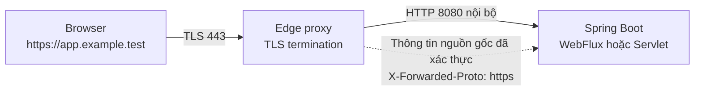
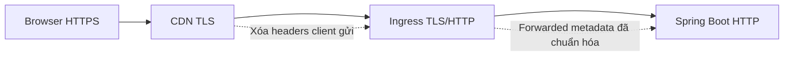
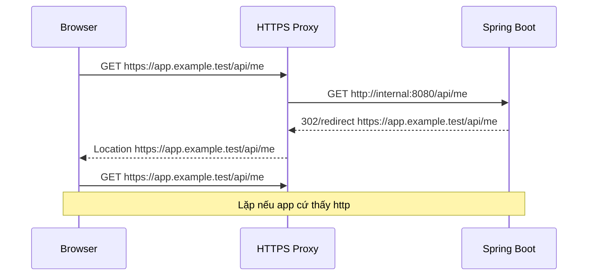

# Kiểm thử truy cập HTTP, HTTPS và nhận diện giao thức qua proxy

## 1. Bối cảnh: trình duyệt dùng HTTPS nhưng Spring thấy HTTP

Một ứng dụng Spring Security vận hành phía sau reverse proxy hoặc load balancer. Người dùng mở `https://app.example.test/api/profile`; proxy nhận kết nối TLS, giải mã và chuyển tiếp yêu cầu tới ứng dụng qua `http://10.0.1.25:8080`. Như vậy có **hai kết nối khác nhau**:

- **Client → edge:** HTTPS với chứng chỉ công khai hợp lệ.
- **Edge → origin:** HTTP nội bộ hoặc HTTPS/mTLS tùy kiến trúc.

Nếu ứng dụng chỉ dựa vào socket kết nối với origin, nó có thể cho rằng yêu cầu gốc là HTTP. Hệ quả thường gặp:

1. Spring Security tạo vòng lặp chuyển hướng HTTP → HTTPS, mặc dù browser đã ở HTTPS.
2. Header `Strict-Transport-Security` (HSTS) không được phát đúng chỗ.
3. `Location` trong redirect trỏ về `http://10.0.1.25:8080`, sai cổng hoặc hostname.
4. Cookie không có `Secure` khi ứng dụng suy nhầm request không an toàn.
5. Redirect OAuth2/login sử dụng callback scheme `http` và bị nhà cung cấp danh tính từ chối.
6. Một client Internet cố gửi `X-Forwarded-Proto: https` để đánh lừa ứng dụng rằng kết nối ngoài đã dùng TLS.

Bài này giải quyết câu hỏi: **Làm sao kiểm thử HTTP, HTTPS và scheme mà Spring Security nhận diện khi request đi qua một hay nhiều proxy, đồng thời không biến forwarded headers thành một nguồn tin giả mạo?**

Nội dung thuộc chương **HTTPS và HSTS** của mô-đun **SPRING_SECURITY_HTTP_PROTECTION**. Mô-đun bao quát phòng vệ HTTP/trình duyệt trong Spring Security, bao gồm CSRF, CORS, security headers, CSP, HSTS, HTTP firewall và bảo vệ session; người học cần cấu hình cả **Servlet và Reactive**, kiểm thử tấn công web và chẩn đoán xung đột bảo mật khi triển khai. Bài tập trung vào việc **kiểm chứng đường truyền và nhận diện giao thức thực tế** chứ không chỉ bật một annotation hay nhìn thấy một header.

### Mục tiêu học tập

Sau bài này, bạn có thể:

1. Phân biệt scheme từ **client**, scheme trên **upstream socket** và scheme **hiệu lực** mà Spring dùng sau khi xử lý forwarded headers.
2. Thiết kế kiểm thử HTTP → HTTPS redirect, HTTPS trực tiếp, TLS termination tại proxy và trường hợp backend dùng HTTP nội bộ.
3. Kiểm chứng HSTS theo RFC 6797: chỉ có hiệu lực với HTTPS đáng tin cậy, `max-age`, `includeSubDomains` và rủi ro `preload`.
4. Cấu hình và kiểm thử `server.forward-headers-strategy` với Spring Boot 3.5, phân biệt Servlet `ForwardedHeaderFilter` với Reactive `ForwardedHeaderTransformer`.
5. Thực hiện các test curl và WebTestClient để kiểm tra `Location`, status, HSTS, cookie, Host, port và HTTPS certificate.
6. Nhận diện redirect loop, open redirect từ Host/forwarded headers, HSTS bị thiếu hoặc nhân đôi và nhầm lẫn HTTP ở origin.
7. Giải thích ranh giới tin cậy khi có nhiều proxy, CDN hoặc Ingress; không chấp nhận forwarded headers do client Internet tự khai báo.
8. Xây ma trận kiểm thử end-to-end, tiêu chí nghiệm thu và quy trình xử lý khi nâng cấp proxy/Spring Security.

## 2. Ba góc nhìn về giao thức phải được ghi riêng

Xét topology:



Có ít nhất ba giá trị dễ bị nhầm:

| Thuộc tính | Ví dụ | Ai có quyền khẳng định? |
| --- | --- | --- |
| **External scheme** | `https` | Kết nối TLS thực giữa browser và edge |
| **Internal transport** | HTTP từ edge tới origin | Socket và hạ tầng network phía backend |
| **Effective request scheme** | Spring đọc `https` sau xử lý proxy metadata | Web server/Framework áp quy tắc trusted forwarded headers |
| **External authority** | `app.example.test:443` | Host/SNI/route đã được edge kiểm tra |
| **Internal authority** | `10.0.1.25:8080` | Cấu hình upstream nội bộ |

**Backend HTTP không tự chứng minh client đã dùng HTTP.** Ngược lại, một header `X-Forwarded-Proto: https` đơn lẻ cũng không chứng minh client đã dùng TLS.

### 2.1. Hai mô hình thường gặp

**Mô hình A — TLS tại ứng dụng:**

```text
Browser -- HTTPS --> Spring Boot (TLS listener)
```

Ứng dụng nhìn thấy HTTPS trực tiếp. Tính đúng của chứng chỉ, HSTS và redirect có thể được thử trên cùng HTTP endpoint, dù HTTP server còn có thể có listener riêng để redirect.

**Mô hình B — TLS kết thúc tại proxy:**

```text
Browser -- HTTPS --> Edge -- HTTP/HTTPS --> Spring Boot
                       |
                       +-- trusted scheme/host metadata
```

Ứng dụng có thể cần forwarded header processing để nhìn thấy `https` hiệu lực. Tuy nhiên proxy phải là **điểm tin cậy**, kiểm soát toàn bộ nguồn headers và không cho Internet gọi trực tiếp origin không qua quy tắc tương đương.

### 2.2. Tách scheme khỏi authentication

Một yêu cầu đã có `Authorization: Bearer ...` vẫn có thể đi qua HTTP không mã hóa nếu edge chưa enforce HTTPS. Việc authn thành công không bảo đảm kết nối được bảo mật.

Ngược lại, HTTPS và HSTS không cấp phép đọc tài liệu. Sau khi xác minh transport, Spring Security vẫn cần CSRF/CORS/session policy, xác thực và phân quyền theo user/tenant.

## 3. Những bất biến cần kiểm tra

| ID | Bất biến | Kỳ vọng |
| --- | --- | --- |
| T01 | HTTP public phải được điều hướng an toàn | HTTP → HTTPS hoặc từ chối rõ ràng, không phục vụ dữ liệu riêng qua cleartext |
| T02 | HTTPS với certificate hợp lệ phục vụ nội dung | Không redirect lặp lại HTTPS vô hạn |
| T03 | `Location` dùng authority được phép | Scheme `https`, host/cổng/path đúng; không có internal host/IP |
| T04 | HSTS chỉ được browser học từ HTTPS đáng tin | Không dùng HSTS qua HTTP làm bằng chứng bảo vệ |
| T05 | HSTS chỉ có một chính sách chủ sở hữu | Không nhân đôi/cấu hình mâu thuẫn giữa app và edge |
| T06 | Proxy báo đúng scheme ngoài | Spring hiểu HTTPS khi TLS kết thúc ở proxy tin cậy |
| T07 | Forged forwarded headers không thay security decisions | Client không ép origin nhận scheme/host giả |
| T08 | Cookie authentication dùng `Secure` thích hợp | Không rò session token qua HTTP |
| T09 | OAuth2 callback và absolute URL đúng | Không xuất hiện redirect `http` hoặc sai cổng |
| T10 | CSP/mixed content và CORS không bị lỗi do scheme sai | Không gọi API HTTP từ trang HTTPS |
| T11 | Backend origin không bị Internet truy cập trái policy | Không thể bypass redirect/WAF và trust boundary |
| T12 | Sau đổi proxy/framework, behavior ổn định | Regression test cả HTTP/HTTPS và hai phía proxy |

Điều quan trọng: **không kiểm thử HSTS chỉ bằng cách tìm chuỗi header**. Hãy kiểm tra đường truyền thực, chứng chỉ, response được browser chấp nhận và chính sách HSTS có phù hợp toàn bộ domain hay không.

## 4. So sánh redirect HTTPS và HSTS

| Cơ chế | Kích hoạt ở đâu? | Tác dụng | Giới hạn |
| --- | --- | --- | --- |
| HTTP → HTTPS redirect | Edge hoặc Spring Security | Chuyển request đang ở HTTP sang HTTPS | Request HTTP đầu tiên có thể đã bị nghe lén/chỉnh sửa |
| HSTS | Header HTTPS được browser chấp nhận hoặc preload | Browser tự dùng HTTPS cho host đã biết | Không tự tạo TLS/certificate, không áp cho mọi HTTP client |
| TLS termination | Edge hoặc origin | Mã hóa, xác thực phiên kết nối | Backend hop khác phải được bảo vệ riêng |
| `X-Forwarded-Proto`/`Forwarded` | Proxy đã xác thực | Truyền scheme ngoài đến backend | Có thể bị giả mạo nếu cho client kiểm soát |
| Cookie `Secure` | Cookie policy/session | Browser chỉ gửi cookie qua kết nối phù hợp | Không thay TLS toàn bộ hoặc HSTS |
| HTTPS-only client policy | Cấu hình browser/app | Thử HTTPS trước hoặc chặn HTTP | Không thay server configuration |

### 4.1. Vì sao cần cả redirect và HSTS?

Với người dùng chưa từng biết HSTS policy của domain, nếu họ nhập `http://app.example.test` thì một HTTP redirect không được bảo vệ bằng TLS có thể bị đối thủ trên đường truyền can thiệp. Sau khi browser nhận HSTS hợp lệ qua HTTPS, những lần tiếp theo browser chủ động dùng HTTPS trước khi gửi request HTTP.

Preload là một cơ chế riêng phân phối danh sách HSTS có sẵn cho browser, **không tự động xảy ra chỉ vì origin thêm token `preload`**.

### 4.2. Không coi một HTTPS redirect là HTTPS trên toàn hành trình

Nếu `http://app.example.test/api/me` trả redirect sang HTTPS, client có thể đã gửi URL, cookies không đánh dấu Secure hoặc thông tin request ở request HTTP đầu tiên. Test nên gửi **GET không credential** để kiểm tra redirect. Đừng thử gửi mật khẩu, bearer token hoặc cookie thật qua HTTP chỉ để xem có redirect hay không.

## 5. HSTS theo RFC 6797: yêu cầu bắt buộc phải hiểu

Một response HTTPS có thể gửi:

```http
Strict-Transport-Security: max-age=300
```

Sau khi triển khai và đánh giá cẩn thận, policy có thể dài hơn:

```http
Strict-Transport-Security: max-age=31536000; includeSubDomains
```

Các directive:

| Directive | Ý nghĩa | Rủi ro triển khai |
| --- | --- | --- |
| `max-age=300` | Browser ghi nhớ policy trong 300 giây | Hữu ích giai đoạn thử nghiệm |
| `max-age=31536000` | Thời gian giữ policy 1 năm | Khó rollback nếu domain không duy trì HTTPS |
| `includeSubDomains` | Áp dụng cho subdomains | Có thể làm hỏng dịch vụ cũ chỉ hỗ trợ HTTP |
| `preload` | Tín hiệu ý định xin đưa domain vào preload list | Không tự đưa vào danh sách; có quy trình/điều kiện riêng |
| `max-age=0` | Yêu cầu xóa policy đã học từ host đó | Không bảo đảm gỡ được preload policy hoặc parent domain |

**Lưu ý chuẩn:** Browser tuân RFC 6797 phải **bỏ qua** header `Strict-Transport-Security` nhận qua HTTP không bảo mật, hoặc qua TLS có lỗi/chứng chỉ không tin cậy. Browser cũng không lưu HSTS policy cho địa chỉ IP literal theo RFC 6797; với `localhost` hành vi còn phụ thuộc chính sách đặc biệt của browser. Vì vậy hãy thử một **hostname staging có TLS đáng tin**, không dựa trên `https://127.0.0.1` để kết luận toàn bộ HSTS.

### 5.1. Điều kiện trước khi bật includeSubDomains/preload

- Domain chính và **mọi subdomain liên quan** phải đáp ứng HTTPS, kể cả host quản trị, dịch vụ cũ, các tên DNS phụ thuộc và callback.
- Chứng chỉ, gia hạn, redirect, subdomain ownership và domain migration có kế hoạch vận hành.
- Các dịch vụ trên HTTP-only port/hostname phải được thay đổi hoặc loại trừ bằng kiến trúc domain thích hợp.
- Có quy trình ứng phó nếu chứng chỉ lỗi: với HSTS host, browser không cho “bỏ qua cảnh báo” tùy tiện.
- Không tăng ngay `max-age` lớn hoặc bật `preload` khi hệ thống còn chưa hoàn tất inventory.

### 5.2. Đánh giá HSTS response theo đường đi

| Response | Browser học HSTS? | Ghi chú |
| --- | --- | --- |
| HTTPS tin cậy, header hợp lệ | Có, theo chính sách browser | Thời gian dựa trên `max-age` |
| HTTP có header HSTS | **Không** | Browser phải bỏ qua |
| HTTPS với certificate invalid | **Không đáng tin** | Không tắt verify chỉ để test |
| HTTPS qua CDN mà edge strip HSTS | Có thể thiếu policy | Kiểm tra response cuối |
| HTTPS trả từ origin nội bộ nhưng client thực ở HTTP | Không | Backend transport không quyết định trust của browser |
| Trang HTTPS không có HSTS nhưng domain đã học | Policy cũ vẫn có thể còn hiệu lực | Không suy rằng policy đã được xóa |
| `max-age=0` trên HTTPS đáng tin | Yêu cầu xóa policy của host | Preload/parent policy có thể vẫn ảnh hưởng |

### 5.3. Curl không phải browser HSTS-state test

Lệnh `curl -I https://...` kiểm tra **header nhận được và TLS handshake**, nhưng không tự chứng minh browser đã ghi nhận, nhớ và nâng cấp `http://...` lần sau. Một số phiên bản curl có tùy chọn quản lý HSTS riêng; không đồng nhất mặc định curl với browser có HSTS store.

Muốn kiểm thử nâng cấp trong browser, dùng profile cô lập/DevTools và trạng thái domain được ghi nhận, đồng thời phân biệt với tính năng HTTPS-Only/HTTPS-First của trình duyệt.

## 6. Tổ chức trách nhiệm: Spring Security hay edge là chủ sở hữu redirect/HSTS?

Có hai kiến trúc hợp lệ, nhưng phải chọn rõ **ai quyết định scheme và gửi HSTS**.

### 6.1. Edge là chủ sở hữu

```text
HTTP client → Edge HTTP listener → HTTPS redirect
HTTPS client → Edge HTTPS listener → upstream HTTP/HTTPS → Spring
                          |
                          +-- HSTS header tại edge
```

Ưu điểm: scheme và TLS certificate rõ ở edge, HTTPS redirect được áp dụng **trước** khi request chạm app. Backend không cần tạo redirect HTTP→HTTPS lần nữa nếu edge đã thực thi đầy đủ.

Yêu cầu: Spring vẫn cần nhận diện external scheme đúng cho absolute URLs, login redirects, cookie/CSRF origins; và origin không bị truy cập trực tiếp từ Internet để bypass edge.

### 6.2. Ứng dụng là chủ sở hữu

```text
HTTP client → Edge → Spring nhận effective http → Spring redirect https
HTTPS client → Edge → Spring nhận effective https → Spring trả response + HSTS
```

Yêu cầu: Scheme truyền qua proxy đáng tin cậy phải đúng; không có loop; response 4xx/5xx và các tuyến ngoài security chain phải được xem xét riêng.

### 6.3. Không để hai bên phát chính sách mâu thuẫn

Một CDN gửi HSTS `max-age=300` còn Spring gửi `max-age=31536000; includeSubDomains` có thể tạo **nhiều header cùng tên**. RFC 6797 quy định UA xử lý header đầu tiên khi nhận nhiều HSTS fields, nên thứ tự qua các hop có thể quyết định behavior khó dự đoán.

Trong triển khai thực, chỉ định **một nguồn phát HSTS** cho public HTTPS response; nếu edge quản lý, phải loại/ghi đè upstream header đúng cách. Test số lượng và giá trị sau cùng, không chỉ test có ít nhất một header.

## 7. Spring Boot 3.5: cấu hình nhận diện forwarded headers

Khi Spring chạy sau proxy, các header thường gặp:

```http
Forwarded: for=192.0.2.10;proto=https;host=app.example.test
X-Forwarded-Proto: https
X-Forwarded-Host: app.example.test
X-Forwarded-Port: 443
X-Forwarded-Prefix: /portal
```

**Các giá trị này chỉ có ý nghĩa nếu được một proxy đáng tin cậy phát ra sau khi kiểm tra request gốc.** Một client Internet có thể tự gửi các header trên; nếu edge không xóa/ghi đè, backend không có cách chắc chắn phân biệt nguồn.

Với **Spring Boot 3.5.x**, property thường dùng:

```properties
# Chọn MỘT trong NONE / NATIVE / FRAMEWORK.
server.forward-headers-strategy=framework
```

| Giá trị | Ý nghĩa | Khi thích hợp |
| --- | --- | --- |
| `NONE` | Không tự áp forwarded scheme/host vào request | Origin trực tiếp hoặc chưa xác lập trust boundary |
| `NATIVE` | HTTP server/container tích hợp native processing | Khi adapter hỗ trợ đúng tập headers và trust policy |
| `FRAMEWORK` | Spring Framework áp forwarded support | Khi native không đủ; Servlet dùng Filter, Reactive dùng Transformer |

Spring Boot 3.5 documentation cho biết một số môi trường cloud có thể mặc định `NATIVE`, môi trường khác mặc định `NONE`. **Không mặc định rằng ứng dụng đã dùng forwarded headers.**

**Khác biệt phiên bản:** Spring Boot 4.x có hệ thuộc tính `server.request.header.forwarded.strategy` trong tài liệu mới. Không copy tên property 4.x vào ứng dụng Boot 3.5 rồi mong có tác dụng. Khóa version và tra tài liệu đúng nhánh.

### 7.1. Servlet và WebFlux dùng thành phần khác nhau

| Stack | Xử lý forwarded ở mức Spring Framework | Mục đích |
| --- | --- | --- |
| Servlet / Spring MVC | `ForwardedHeaderFilter` | Wrapper Servlet request/response với external scheme, host, port |
| Reactive / WebFlux | `ForwardedHeaderTransformer` | Biến đổi `ServerHttpRequest` trước khi WebFlux handlers xử lý |
| Native HTTP adapter | Tùy server hỗ trợ | Có thể cập nhật scheme/remote info theo native capabilities |

Với WebFlux, Bean tên `forwardedHeaderTransformer` có thể được Framework sử dụng; nhưng khi Spring Boot đã tạo cấu hình tương đương bằng `server.forward-headers-strategy=framework`, **không khai báo thêm transformer trùng lặp**. Nếu cần `removeOnly` để loại header không tin cậy, thiết kế theo tài liệu Spring Framework, không vừa xử lý vừa remove một cách không kiểm soát.

### 7.2. Không chọn FRAMEWORK như cách tin mọi Internet client

Việc bật `FRAMEWORK` **không tự định nghĩa danh sách IP của trusted proxy**. Chỉ bật sau khi:

1. Origin chỉ nhận traffic từ proxy/mesh đáng tin cậy theo network policy.
2. Entry proxy xóa `Forwarded` và toàn bộ `X-Forwarded-*` do client Internet tự gửi hoặc xây lại chuỗi headers được kiểm soát.
3. Proxy ghi đúng external `proto`, `host`, `port` và quy tắc nhiều hop.
4. Có test giả mạo headers qua cả **edge** và **đường kết nối trực tiếp tới origin** trong môi trường được phép.
5. Có test TLS redirect, cookie, oauth callback và HSTS ở public hostname.

## 8. Ranh giới tin cậy của nhiều proxy

Một hệ thống có thể là:



Điều nguy hiểm không chỉ là header thiếu, mà còn là header **mâu thuẫn**:

```http
Forwarded: proto=http;host=attacker.invalid
X-Forwarded-Proto: https
X-Forwarded-Host: app.example.test
```

Nếu các lớp chọn header theo ưu tiên khác nhau, Spring có thể sinh redirect sang host/scheme sai. Không có quy tắc “tin header đầu tiên” an toàn cho mọi topology.

### 8.1. Nguyên tắc xử lý ở edge

- Xóa hoặc ghi đè **toàn bộ** forwarded metadata chưa được xác minh từ client.
- Tránh gửi cả `Forwarded` và `X-Forwarded-*` mâu thuẫn; chọn cơ chế được server/framework hỗ trợ, test precedence.
- Chỉ tin kết nối đến từ đúng proxy/mesh bằng network policy và cấu hình trust.
- Nếu TLS kết thúc ở CDN rồi Ingress nhận HTTP, Ingress không thể đơn giản dùng `$scheme` của kết nối CDN→Ingress làm external scheme; phải tin metadata **đã được CDN xác thực**.
- Nếu có public request Host lạ, trả 400/421/404 theo edge policy thay vì tạo `Location` từ Host tùy ý.
- Không dùng forwarded host do client gửi làm nguồn cấp quyền tenant hoặc quyết định bypass authn/authz.

### 8.2. Forged X-Forwarded-Proto có thể gây lỗi bảo mật gì?

Giả sử client kết nối HTTP tới edge nhưng cố gửi:

```http
X-Forwarded-Proto: https
```

Nếu edge chuyển nguyên header vào ứng dụng và Spring cho rằng request đã an toàn, HTTP→HTTPS redirect ở app có thể bị bỏ qua, ứng dụng tạo absolute HTTPS URL giả hoặc đặt cookie/CSRF policy dựa trên kết luận sai. Kết nối ngoài **vẫn là HTTP**.

Do đó test cần xác định edge **không tin** giá trị đó, không chỉ kiểm tra Spring xử lý header đúng cú pháp.

## 9. Cấu hình NGINX minh họa: redirect ở TLS edge, forwarded metadata có kiểm soát

Một ví dụ **staging** với hostname `app.example.test`:

```nginx
# Phương án: edge là chủ sở hữu redirect và HSTS.
# Đường dẫn chứng chỉ là placeholder, không phải file cần tạo.
server {
    listen 80;
    server_name app.example.test;

    return 308 https://app.example.test$request_uri;
}

server {
    listen 443 ssl;
    server_name app.example.test;

    ssl_certificate     /path/to/staging-fullchain.pem;
    ssl_certificate_key /path/to/staging-private-key.pem;

    # Chỉ dùng giá trị nhỏ khi thử policy HSTS.
    # Không bật includeSubDomains/preload trong bài thử này.
    add_header Strict-Transport-Security "max-age=300" always;

    location / {
        proxy_pass http://127.0.0.1:8080;
        proxy_http_version 1.1;

        # Canonical public authority đã được kiểm tra.
        proxy_set_header Host app.example.test;
        proxy_set_header X-Forwarded-Host app.example.test;
        proxy_set_header X-Forwarded-Proto https;
        proxy_set_header X-Forwarded-Port 443;

        # Không chuyển tiếp Forwarded client tự gửi.
        proxy_set_header Forwarded "";

        # Nếu edge là nguồn HSTS duy nhất:
        proxy_hide_header Strict-Transport-Security;
    }
}
```

**Không dùng nguyên block này như production-ready config.** Nó thiếu nhiều thành phần như default-server reject unknown Host, TLS versions/ciphers, upstream health, timeout, IP allowlist, network segmentation, rate limits, monitoring và cơ chế cấp/gia hạn certificate.

Lưu ý quan trọng:

- `308` bảo toàn method/body khi redirect theo HTTP semantics, nhưng **request HTTP ban đầu vẫn không mã hóa**. Với clients cũ, kiểm tra hỗ trợ 308; không dùng redirect POST chứa credential thật để test.
- `$request_uri` có thể gồm query string nhạy cảm. Ở đây nó là thành phần redirect target; **không** nên log raw `$request_uri` trong production chỉ để debug.
- `X-Forwarded-Proto https` là hằng số hợp lý **chỉ trong TLS server block thực nhận HTTPS client**. Nếu NGINX nằm sau CDN và chỉ nhận HTTP, phải thiết kế chain of trust khác.
- `proxy_hide_header Strict-Transport-Security` ngăn HSTS của origin trùng với HSTS do edge quản lý. Không dùng khi app là nguồn HSTS chính.
- Phải ngăn truy cập trực tiếp `127.0.0.1:8080` từ Internet, không chỉ đặt một reverse proxy rồi cho mọi mạng kết nối origin.
- Cấu hình `server_name` không đủ để xử lý mọi unknown hosts; cần default virtual host reject phù hợp với sản phẩm.

### 9.1. Khi HTTPS ở proxy nhưng origin HTTP

Request `https://app.example.test/public/ping` có thể tới Spring qua HTTP socket. Nếu Boot đã áp forwarded metadata từ trusted proxy, effective scheme Spring thấy là `https`. Khi đó một Spring Security redirect-to-HTTPS rule sẽ **không nên** tạo redirect tiếp.

Nếu Boot không áp headers, Spring chỉ thấy `http` và có thể redirect sang `https://...` trong vòng lặp:



Test phải bắt **redirect loop**, không chỉ xem redirect lần thứ nhất có vẻ đúng.

## 10. Spring Security 6.5: bật redirect HTTPS khi ứng dụng sở hữu chính sách

Trong nhánh Spring Security **6.5**, tài liệu cho cả Servlet và Reactive đều có `redirectToHttps`.

### 10.1. Servlet / Spring MVC

```java
import org.springframework.context.annotation.Bean;
import org.springframework.context.annotation.Configuration;
import org.springframework.security.config.Customizer;
import org.springframework.security.config.annotation.web.builders.HttpSecurity;
import org.springframework.security.web.SecurityFilterChain;

@Configuration
class ServletHttpsConfiguration {

    @Bean
    SecurityFilterChain securityFilterChain(HttpSecurity http)
            throws Exception {

        http
            .redirectToHttps(Customizer.withDefaults())
            .authorizeHttpRequests(auth -> auth
                .requestMatchers("/public/**").permitAll()
                .anyRequest().authenticated());

        return http.build();
    }
}
```

Với nhánh cũ có thể gặp `requiresChannel(channel -> channel.anyRequest().requiresSecure())`. Không trộn code giữa nhiều nhánh mà chưa đối chiếu chữ ký và deprecation. Cấu hình trên **chưa có authentication mechanism hoàn chỉnh**; đó là ví dụ redirect và authorization.

### 10.2. Reactive / Spring WebFlux

```java
import org.springframework.context.annotation.Bean;
import org.springframework.context.annotation.Configuration;
import org.springframework.security.config.Customizer;
import org.springframework.security.config.annotation.web.reactive.EnableWebFluxSecurity;
import org.springframework.security.config.web.server.ServerHttpSecurity;
import org.springframework.security.web.server.SecurityWebFilterChain;

@Configuration
@EnableWebFluxSecurity
class ReactiveHttpsConfiguration {

    @Bean
    SecurityWebFilterChain securityWebFilterChain(ServerHttpSecurity http) {
        return http
            .redirectToHttps(Customizer.withDefaults())
            .authorizeExchange(auth -> auth
                .pathMatchers("/public/**").permitAll()
                .anyExchange().authenticated())
            .build();
    }
}
```

Đoạn Reactive dùng `ServerHttpSecurity` và `SecurityWebFilterChain`, **không** dùng `HttpSecurity`/`SecurityFilterChain` của Servlet.

### 10.3. Chú ý với topology đã redirect ở edge

Nếu NGINX/CDN chịu trách nhiệm toàn bộ redirect HTTP→HTTPS, Spring không nhất thiết phải bật lại redirect trong ứng dụng. Nếu vẫn bật làm defense in depth, ứng dụng phải nhận effective scheme chính xác, nếu không dễ lặp.

**Không chọn `httpsRedirectWhen(exchange -> headers.containsKey("X-Forwarded-Proto"))` như một phép chứng minh HTTPS an toàn.** Tài liệu tham khảo có ví dụ condition theo sự hiện diện header trong một topology cụ thể, nhưng **sự hiện diện không chứng minh giá trị là `https` và không chứng minh header đến từ proxy đáng tin**. Trước khi đưa logic đó vào hệ thống, phải có trust boundary và test giả mạo, đồng thời xác định đúng ý nghĩa điều kiện theo API version.

## 11. HSTS trong Spring Security: kiểm tra đúng scheme và đúng lớp phát

Spring Security hỗ trợ HSTS response header và kích hoạt mặc định trong nhiều cấu hình security headers hiện đại. Tuy nhiên, **header mặc định cụ thể và việc nó xuất hiện trên từng response phụ thuộc version, chain, scheme và cách edge xử lý**. Không suy `max-age` hay `preload` chỉ từ việc bật Spring Security.

### 11.1. Ví dụ tùy chỉnh HSTS trên Reactive cho giai đoạn thử nghiệm

Nếu **ứng dụng** là nơi phát HSTS và nhận diện external scheme đáng tin:

```java
import java.time.Duration;

import org.springframework.context.annotation.Bean;
import org.springframework.context.annotation.Configuration;
import org.springframework.security.config.web.server.ServerHttpSecurity;
import org.springframework.security.web.server.SecurityWebFilterChain;

@Configuration
class ReactiveHstsPilot {

    @Bean
    SecurityWebFilterChain securityWebFilterChain(ServerHttpSecurity http) {
        return http
            .headers(headers -> headers
                .hsts(hsts -> hsts
                    .maxAge(Duration.ofMinutes(5))
                    .includeSubdomains(false)
                    .preload(false)))
            .authorizeExchange(auth -> auth
                .pathMatchers("/public/**").permitAll()
                .anyExchange().authenticated())
            .build();
    }
}
```

Đây là **phương án thay thế**, không đăng ký song song với `ReactiveHttpsConfiguration` ở mục trước nếu cùng tạo một catch-all `SecurityWebFilterChain`. Có thể gộp redirect/HSTS trong một cấu hình đã review khi đúng nhu cầu.

### 11.2. HSTS trong Servlet

Với Spring Security Servlet, API cấu hình tương ứng là `headers(headers -> headers.httpStrictTransportSecurity(...))` theo Javadoc/reference của nhánh đang dùng. Hai stack **không dùng chung DSL HSTS**, mặc dù HTTP response header cuối cùng có cùng định dạng.

Nếu HSTS do CDN/NGINX phát, không cần bật thêm một cấu hình HSTS riêng trong Spring chỉ để thấy hai header; chọn một owner và kiểm chứng response cuối cùng.

### 11.3. Header không chứng minh TLS được cấu hình tại app

Khi HTTPS kết thúc ở proxy, Spring có thể thêm HSTS dựa trên effective scheme do forwarded headers truyền tới, dù socket upstream là HTTP. Browser chỉ đánh giá header trên **kết nối HTTPS thật tới edge**. Điều này không trái chuẩn khi trust boundary đúng; nhưng vẫn phải kiểm tra mã hóa/chống nghe lén ở hop edge→origin nếu hạ tầng yêu cầu.

## 12. Ma trận kiểm thử theo topology

| ID | Client → edge | Edge → origin | Scheme Spring nên thấy | Kỳ vọng |
| --- | --- | --- | --- | --- |
| P01 | HTTP vào edge | Không forward | Không có request tới Spring | Redirect HTTPS hoặc reject |
| P02 | HTTPS hợp lệ | HTTP nội bộ | `https` sau xử lý metadata | Không redirect loop, HSTS cuối đúng |
| P03 | HTTPS hợp lệ | HTTPS/mTLS | `https` | Response đúng, certificate hai hop được kiểm tra |
| P04 | HTTP trực tiếp origin test | HTTP | `http` | Theo policy test; không kết luận public exposure |
| P05 | HTTPS trực tiếp app TLS listener | HTTPS | `https` | Không redirect, HSTS nếu app là owner |
| P06 | HTTP ngoài + forged XFP=https | HTTP ở edge | Không được tin forged value | HTTP vẫn redirect/reject |
| P07 | HTTPS ngoài + XFP=http do client gửi | HTTP upstream | `https` do edge kiểm soát | Không loop hoặc downgrade |
| P08 | HTTPS + Host lạ | Theo edge policy | Không có authority lạ được tin | Không có redirect tới attacker host |
| P09 | HTTPS + forwarded headers xung đột | Nhiều proxy | Scheme/host canonical được kiểm soát | Không redirect sai host/protocol |
| P10 | HTTPS qua CDN và NGINX | Internal HTTP | Scheme gốc nếu chain tin cậy | Không mất thông tin TLS ở hop giữa |
| P11 | HTTPS + cookie session | Internal HTTP | `https` | Cookie Secure/redirect/CSRF đúng |
| P12 | HTTPS + OAuth2 login | Internal HTTP | `https` | Callback URI đúng public host |
| P13 | HTTPS + HTTP/2 client | HTTP/1.1 upstream | External HTTPS | Không khác behavior redirect/HSTS |
| P14 | HTTPS, cert invalid | Không quan trọng | — | Browser/curl phải báo lỗi; không bỏ qua certificate |
| P15 | HTTPS, HSTS trùng từ hai hop | HTTP upstream | — | Phát hiện và sửa về một policy |
| P16 | HTTPS, response 404/500 | Bất kỳ | — | Security headers theo owner policy, không leak internal host |

Đây là **bảng kỳ vọng topology**, không phải status tự nhiên của mọi Spring Boot app. Phải xác định bộ test đang bật redirect ở đâu, HSTS ở đâu và security chain được áp vào request nào.

## 13. Dùng curl kiểm thử HTTP redirect mà không gửi dữ liệu nhạy cảm

Trong môi trường staging được cấp phép, dùng hostname và certificate được cấp cho test.

### 13.1. Kiểm tra HTTP lần đầu

```bash
# Không dùng bearer token hoặc cookie thật.
curl --http1.1 --silent --show-error \
  --dump-header - --output /dev/null \
  'http://app.example.test/public/ping'
```

Đọc:

- Status thuộc nhóm redirect (ví dụ 301/302/307/308) hoặc explicit reject theo policy.
- `Location` có `https://app.example.test/...`, đúng path/query dự kiến.
- Không có `Location: http://...` hoặc `Location: https://10.0.1.25:8080/...`.
- Nếu header HSTS có mặt trên HTTP response, **nó không được browser tin** và không đủ làm HTTPS policy.

Không dùng `--location` ngay ở bước này vì tự follow sẽ che mất response của hop HTTP đầu tiên.

### 13.2. Kiểm tra HTTPS đích

```bash
curl --http1.1 --silent --show-error \
  --dump-header - --output /dev/null \
  'https://app.example.test/public/ping'
```

Kiểm tra:

- TLS certificate xác thực hostname và chain, không dùng `-k`/`--insecure`.
- Status thật của ứng dụng (200, 401/403 theo URL test) chứ không bị redirect lặp.
- Header `Strict-Transport-Security` đúng chính sách owner trên HTTPS.
- `Content-Type`/`X-Content-Type-Options`, cache và cookie nếu phù hợp.
- Không có internal IP, internal hostname hoặc scheme `http` trong absolute links/redirects.

### 13.3. Kiểm tra chuỗi redirect có giới hạn

```bash
curl --http1.1 --silent --show-error \
  --location --max-redirs 5 \
  --dump-header - --output /dev/null \
  'http://app.example.test/public/ping'
```

Dùng **đường dẫn GET công khai** để không chuyển credentials qua HTTP. Nếu curl vượt giới hạn redirect hoặc Location lặp, kiểm tra effective scheme và forwarded headers trước khi sửa chính sách bảo mật.

**Không** dùng một kết quả `curl -L` thành công làm bằng chứng toàn bộ policy đúng: phải kiểm tra từng hop, status ban đầu và certificate.

## 14. Khi cần kiểm tra HTTPS tới một IP cụ thể: --resolve

Dùng `-H 'Host: ...'` trên URL `https://IP` không kiểm tra đúng TLS SNI/hostname. Thay vào đó:

```bash
curl --http1.1 --silent --show-error \
  --resolve 'app.example.test:443:192.0.2.20' \
  --dump-header - --output /dev/null \
  'https://app.example.test/public/ping'
```

`192.0.2.20` là địa chỉ IP tài liệu mẫu, thay bằng IP staging được phép. `--resolve` giữ **hostname trong URL** để kiểm tra SNI và certificate tương ứng, đồng thời trỏ kết nối tới IP xác định. Không dùng `--insecure` để che lỗi certificate.

### 14.1. Kiểm tra HTTP/2 và HTTP/1.1

Nếu production hỗ trợ HTTP/2:

```bash
curl --http2 --silent --show-error \
  --dump-header - --output /dev/null \
  'https://app.example.test/public/ping'

curl --http1.1 --silent --show-error \
  --dump-header - --output /dev/null \
  'https://app.example.test/public/ping'
```

Một máy curl không có build hỗ trợ HTTP/2 có thể báo lỗi option; không tự suy server không hỗ trợ. Với HTTP/2, `:scheme`/`:authority` được edge xác định từ connection và request metadata; proxy có thể downgrade sang HTTP/1.1. Kiểm tra scheme/authority còn đúng sau các hop.

## 15. Kiểm thử browser: HSTS thực sự được ghi nhận như thế nào?

Curl kiểm tra response headers và TLS nhưng không thay thế bài test browser.

### 15.1. Trình tự kiểm thử

1. Chọn hostname staging có certificate tin cậy và không bị preload ngoài ý định.
2. Dùng browser profile sạch (hoặc môi trường kiểm thử riêng) không có HSTS state cũ.
3. Mở `https://app.example.test` và quan sát response `Strict-Transport-Security`.
4. Sau khi browser đã chấp nhận policy, thử gõ `http://app.example.test/...` trong profile đó.
5. Xác nhận browser áp chính sách HTTPS **trước khi tạo request HTTP ra mạng** nếu đúng HSTS, thay vì chỉ làm theo HTTP redirect.
6. Dùng Network/DevTools và server logs để phân biệt HSTS upgrade, HTTP redirect, HTTPS-First hay preload behavior.
7. Dùng profile test khác hoặc chu kỳ hết hạn để kiểm tra rollback; không sửa HSTS store trong browser production của người dùng.

### 15.2. Những bẫy kết luận

- Browser có thể tự thử HTTPS trước do HTTPS-First/HTTPS-Only, **không phải do HSTS**.
- Domain có thể đã nằm trong preload list; một profile sạch vẫn tự nâng cấp HTTPS.
- Nếu truy cập bằng IP literal, browser theo RFC 6797 không lưu HSTS host theo IP.
- HSTS gửi ở HTTP không chứng minh gì; browser phải bỏ qua.
- Khi TLS certificate sai, browser không nên tiếp tục; HSTS host có thể chặn cả cách bỏ qua cảnh báo.
- HSTS áp lên **hostname**, không phụ thuộc một URL path cụ thể; không có ngoại lệ path `/legacy` trong cùng host.

## 16. Test ứng dụng thật với Spring Boot RANDOM_PORT

Dùng `@SpringBootTest(webEnvironment = RANDOM_PORT)` để chạy HTTP server thực thay vì chỉ mock. Ví dụ dưới đây nhắm **Spring Boot 3.5.x** và Spring Security 6.5.x, với `redirectToHttps` đã bật trong test profile.

### 16.1. Một GET HTTP phải tạo redirect

```java
import org.junit.jupiter.api.BeforeEach;
import org.junit.jupiter.api.Test;
import org.springframework.boot.test.context.SpringBootTest;
import org.springframework.boot.test.web.server.LocalServerPort;
import org.springframework.test.web.reactive.server.WebTestClient;

@SpringBootTest(
    webEnvironment = SpringBootTest.WebEnvironment.RANDOM_PORT,
    properties = "spring.main.web-application-type=reactive")
class HttpToHttpsRedirectTest {

    @LocalServerPort
    int port;

    WebTestClient client;

    @BeforeEach
    void setUp() {
        client = WebTestClient.bindToServer()
            .baseUrl("http://127.0.0.1:" + port)
            .build();
    }

    @Test
    void httpGetRedirectsToHttps() {
        client.get()
            .uri("/public/ping")
            .exchange()
            .expectStatus().is3xxRedirection()
            .expectHeader()
            .valueMatches("Location", "^https://.*");
    }
}
```

**Điều kiện:** Context dùng `ReactiveHttpsConfiguration` mục 10, không bật test profile loại redirect, và request không bị server/parser chặn trước Spring. Test kiểm tra **response của HTTP listener**, chưa xác minh HTTPS endpoint vì server RANDOM_PORT ở đây chỉ phục vụ HTTP.

Đừng follow redirect sang `https://127.0.0.1:443` rồi coi certificate failure là lỗi firewall: đó là một **TLS endpoint chưa được test setup**. Muốn kiểm tra HTTPS thật phải start server với SSL certificate test đúng hostname hoặc dùng reverse proxy staging có TLS.

### 16.2. WebTestClient mock không chứng minh TLS

`WebTestClient.bindToApplicationContext(context)` chạy các WebFilters trong mock HTTP exchange; `MockServerHttpRequest` có thể mô tả URI bắt đầu bằng `https://`. Nhưng không có TLS handshake, SNI hay certificate validation.

Mẫu phân loại bằng chứng:

| Test | Có kiểm tra TLS handshake? | Có kiểm tra Spring Security chain? |
| --- | --- | --- |
| `MockServerHttpRequest("https://...")` | Không | Chỉ khi gắn đúng chain |
| `WebTestClient.bindToApplicationContext` | Không | Có nếu tích hợp security vào context |
| `WebTestClient.bindToServer("http://...")` | Không | Có, qua HTTP server |
| `WebTestClient.bindToServer("https://...")` | Có | Có nếu đến Spring qua TLS |
| Curl HTTPS qua edge | Có | Có nếu edge thực sự forward và origin được truy cập |
| Browser HSTS-state test | Có + browser policy | Có thể, tùy response path |

**Không gán nhãn một mock request với URI https là “đã test HTTPS”**. Nó chỉ test logic đọc scheme đã được mô phỏng.

## 17. Test-only endpoint đo effective scheme/host

Khi gặp redirect loop, cách nhanh nhất là quan sát scheme **mà WebFlux thực sự nhìn thấy** sau forwarded processing. Tạo một endpoint chỉ có trong test profile/staging, không đưa ra Internet production:

```java
import java.util.Map;

import org.springframework.context.annotation.Profile;
import org.springframework.web.bind.annotation.GetMapping;
import org.springframework.web.bind.annotation.RestController;
import org.springframework.web.server.ServerWebExchange;

@RestController
@Profile("scheme-diagnostics")
class SchemeDiagnosticsController {

    @GetMapping("/__test/scheme")
    Map<String, Object> scheme(ServerWebExchange exchange) {
        var request = exchange.getRequest();
        var uri = request.getURI();

        return Map.of(
            "scheme", String.valueOf(uri.getScheme()),
            "host", String.valueOf(uri.getHost()),
            "port", uri.getPort()
        );
    }
}
```

Đoạn này **không trả** raw `Forwarded`, `X-Forwarded-*`, bearer token, cookie, query hoặc user identity. Ngay cả host/port cũng có thể chứa metadata triển khai, nên chỉ dùng trong staging có access control. Nếu app bật redirect-to-HTTPS trước handler, request HTTP không đến probe; dùng cấu hình chẩn đoán test-only **có giới hạn** để quan sát mà không hạ mức bảo vệ môi trường thật.

### 17.1. Thực nghiệm nên có

| Request tới probe (staging) | Bối cảnh | Scheme/host mong đợi |
| --- | --- | --- |
| HTTPS qua edge | Edge set XFP tin cậy | `https` / public host |
| HTTP trực tiếp origin nội bộ | Không forwarded | `http` / internal test host |
| HTTP ngoài + forged XFP=https | Edge sanitize | Không được biến thành HTTPS |
| HTTPS ngoài + forged XFP=http | Edge sanitize | Vẫn là HTTPS |
| HTTPS qua CDN→Ingress | Chuỗi tin cậy đúng | HTTPS, không mất scheme ở hop giữa |
| HTTPS, forwarded headers xung đột | Edge chuẩn hóa | Host/scheme canonical theo policy |

**Không dùng `request.getSslInfo() != null` làm phép đo duy nhất cho external HTTPS** khi TLS kết thúc ở edge: `SslInfo` có thể phản ánh TLS **trực tiếp tới origin**, trong khi effective request scheme đã được cập nhật từ proxy.

## 18. Kiểm thử Servlet với MockMvc và giới hạn của secure flag

Trong Spring MVC, có thể thử logic channel security qua mock:

```java
import org.junit.jupiter.api.Test;
import org.springframework.beans.factory.annotation.Autowired;
import org.springframework.boot.test.autoconfigure.web.servlet.AutoConfigureMockMvc;
import org.springframework.boot.test.context.SpringBootTest;
import org.springframework.test.web.servlet.MockMvc;

import static org.springframework.test.web.servlet.request.MockMvcRequestBuilders.get;
import static org.springframework.test.web.servlet.result.MockMvcResultMatchers.status;

@SpringBootTest
@AutoConfigureMockMvc
class ServletHttpsPolicyTest {

    @Autowired
    MockMvc mvc;

    @Test
    void insecureMockRequestRedirects() throws Exception {
        mvc.perform(get("/public/ping")
                .secure(false))
            .andExpect(status().is3xxRedirection());
    }

    @Test
    void secureMockRequestIsNotRedirected() throws Exception {
        mvc.perform(get("/public/ping")
                .secure(true))
            .andExpect(status().isOk());
    }
}
```

Điều kiện: Đã tích hợp Spring Security vào MockMvc, có `ServletHttpsConfiguration`, và endpoint `/public/ping` trả 200. `secure(true)` **không thiết lập phiên TLS thật**, chỉ gắn mock property. Với testing backend TLS, dùng HTTP server/HTTPS thật ở mức integration.

### 18.1. Servlet ForwardedHeaderFilter và proxy scheme

Với Boot 3.5 `server.forward-headers-strategy=framework`, Spring Framework dùng `ForwardedHeaderFilter` ở Servlet và `ForwardedHeaderTransformer` ở Reactive. Test phải xác nhận filter/transformer được áp **trước khi security channel logic đánh giá scheme**. Không gọi manual `ForwardedHeaderFilter` bên ngoài context rồi coi đã kiểm tra cấu hình Boot thực.

## 19. Kiểm tra cookie/session và redirect đăng nhập

Transport security có liên quan trực tiếp đến session/cookie và OAuth2:

| Thành phần | Test cần có |
| --- | --- |
| `Set-Cookie: ...; Secure` | Cookie phiên thật có `Secure` khi chạy HTTPS |
| `HttpOnly` và `SameSite` | Đúng policy, không tự thay thế CSRF |
| Login redirect | `Location` là HTTPS + public host, không internal IP |
| OAuth2 redirect URI | Provider thấy đúng `https://app.example.test/...` |
| Logout | Redirect không hạ cấp HTTP; session bị vô hiệu đúng |
| CSRF token | Chạy đúng trên cookie/session form POST |
| Session fixation | Cookie/session rotation theo security policy |
| API bearer token | Không gửi token qua HTTP để “test redirect” |
| Mixed content | Trang HTTPS không gọi `http://` API/JS/CSS bị browser chặn |
| CORS | Allowed origin scheme khớp frontend thật, không biến `http` thành `https` bằng cách tin header client |

Khi proxy không cung cấp đúng external scheme, nhiều framework dựng absolute URL dựa trên `http` nội bộ; việc này có thể khiến OAuth2 callback fail hoặc bị chặn bởi allowed redirect URI. Đừng “sửa” bằng cách cho phép wildcard callback hay tắt CSRF.

### 19.1. Không suy `Secure` cookie chỉ từ HSTS

HSTS và cookie `Secure` là cơ chế khác nhau. Browser đã có HSTS có thể tự nâng cấp request, nhưng policy session vẫn nên đánh dấu `Secure`, `HttpOnly`, `SameSite` phù hợp. Test trên **response cuối qua HTTPS edge**, không chỉ response của backend gọi trực tiếp HTTP.

## 20. Host, Location và open redirect khi scheme bị giả mạo

Một tình huống nguy hiểm:

```http
GET /login HTTP/1.1
Host: attacker.invalid
X-Forwarded-Host: attacker.invalid
X-Forwarded-Proto: https
```

Nếu origin tin headers tùy ý, redirect có thể trỏ đến:

```http
Location: https://attacker.invalid/login
```

Tùy flows, có thể tạo open redirect, phishing hoặc rò token trong URL nếu hệ thống từng đặt token ở query (điều không nên làm).

### 20.1. Các negative tests

- HTTP ngoài với Host ngoài domain cho phép phải bị edge reject hoặc đưa về canonical host **theo policy**, không echo giá trị tùy ý.
- HTTP ngoài với `X-Forwarded-Proto: https` không được tránh redirect-to-HTTPS.
- HTTPS ngoài với `X-Forwarded-Host: attacker.invalid` không được tạo Location tới attacker.
- Xung đột `Forwarded` và `X-Forwarded-*` phải có policy xử lý rõ và test.
- Các trường hợp Host có port lạ, `X-Forwarded-Port: 12345` và Host case khác được xử lý theo rules định sẵn.
- Nếu ứng dụng multi-tenant dựa trên hostname, phải đối chiếu tenant từ host đã xác thực với user/tenant authorization; **đừng chỉ tin Host header**.

### 20.2. Vì sao không kiểm thử production bằng cách giả mạo forwarded headers bừa bãi?

Các negative tests phải chạy trong phạm vi staging/các host được cấp phép, với dữ liệu giả. Không gửi token hoặc credential thật, không brute-force hosts, không thay đổi ingress/WAF production để test. Mục đích là chứng minh **tầng tin cậy không cho headers giả ảnh hưởng security decisions**.

## 21. Cách chẩn đoán vòng lặp HTTPS redirect

| Triệu chứng | Giả thuyết | Xác minh |
| --- | --- | --- |
| Browser báo quá nhiều redirects | App nhận hiệu lực `http` dù external HTTPS | Scheme probe/traces staging |
| `Location` có internal IP/cổng 8080 | Origin không nhận public Host/port | Forwarded host/port, proxy config |
| HTTP request trả 200 private body | Edge/backend không enforce HTTPS hoặc client bypass edge | Test public HTTP/host trực tiếp có quyền |
| HTTPS response thiếu HSTS | Chain không phát, edge strip, scheme sai | HTTPS headers từng hop và policy owner |
| HSTS có trên HTTP response | Header được phát sai chỗ | Browser vẫn bỏ qua; sửa policy |
| Hai header HSTS khác nhau | App và CDN cùng phát | Chỉ định single owner |
| HTTPS test chỉ chạy với `-k` | Certificate/TLS trust không hợp lệ | Sửa chứng chỉ/CA/SNI |
| OAuth2 callback sai `http` | Effective scheme/host không chính xác | Redirect URI, forwarded processing |
| Browser báo mixed content | Absolute links/API vẫn dùng http | Scheme/URL generation và frontend config |
| `Secure` cookie thiếu sau TLS offload | Session config hoặc nhận diện scheme sai | Kiểm tra Set-Cookie qua edge |
| HTTP/2 qua CDN lỗi nhưng HTTP/1.1 pass | Edge protocol translation/headers | So HTTP versions/hops |
| `X-Forwarded-Proto` giả mạo ảnh hưởng redirect | Proxy không sanitize | Sửa trust boundary, firewall |
| HSTS includeSubDomains làm hỏng subdomain cũ | Bật rộng khi chưa inventory | Khôi phục dịch vụ HTTPS, rollback policy theo RFC |
| `server.forward-headers-strategy` không có tác dụng | Sai phiên bản Boot, profile, adapter hoặc Bean trùng | Kiểm tra runtime/version và tests |

### 21.1. Quy trình điều tra từ ngoài vào trong

1. Đo HTTP ở **public hostname**, không follow redirect; ghi status/Location.
2. Đo HTTPS ở **public hostname**, xác minh TLS và HSTS.
3. So HTTP/1.1 và HTTP/2 nếu có.
4. Xác định hop TLS termination thực (CDN, Ingress hay origin).
5. Kiểm tra edge đã **xóa/ghi đè** headers từ client chưa.
6. Xác nhận Boot version và `server.forward-headers-strategy` (hoặc property tương ứng).
7. Ở staging, quan sát effective scheme/host qua probe chỉ dành cho test.
8. Xem redirect quyết định ở edge hay Spring, tránh cả hai tạo loop.
9. Kiểm tra auth/cookie/OAuth2 và các security response headers.
10. Sửa đúng tầng, chạy lại negative tests Host/XFP spoof và positive HTTPS.

Không giải quyết redirect loop bằng cách tắt mọi security HTTPS redirect và tin rằng đã an toàn; phải bảo đảm một tầng khác thực sự enforce HTTPS và origin không bypass được.

## 22. Ma trận nghiệm thu đầy đủ

| ID | Input / topology | Đầu ra mong đợi |
| --- | --- | --- |
| H01 | HTTP GET public | Chuyển HTTPS hoặc reject có chủ đích |
| H02 | HTTPS GET public, cert hợp lệ | 200/expected status, không loop |
| H03 | HTTP GET private không credential | Không tiết lộ private data |
| H04 | HTTPS GET private với auth đúng | Chỉ dữ liệu thuộc quyền |
| H05 | HTTPS GET admin bằng user thường | Bị authz từ chối |
| H06 | HTTP → HTTPS redirect | `Location` đúng scheme/host/path |
| H07 | HTTP → HTTPS bằng 308 | Client compatibility và method semantics đúng |
| H08 | HTTPS qua TLS-offload → HTTP backend | Spring effective scheme chính xác |
| H09 | HTTP direct origin nội bộ | Không xem như HTTPS nếu không trusted metadata |
| H10 | HTTPS direct origin TLS | Chứng chỉ, SNI và security headers đúng |
| H11 | Forged `X-Forwarded-Proto: https` từ client HTTP | Không bypass HTTPS enforcement |
| H12 | Forged `X-Forwarded-Host` từ client | Không open redirect/tenant bypass |
| H13 | `Forwarded` và `X-Forwarded-*` xung đột | Được sanitize, không scheme ambiguity |
| H14 | Unknown Host/SNI | Bị reject theo edge policy |
| H15 | Header HSTS trên HTTPS | Đúng policy và chỉ một nguồn |
| H16 | Header HSTS trên HTTP | Không dùng làm bằng chứng browser HSTS |
| H17 | `max-age=300` staging | Browser lưu/upgrade khi đủ điều kiện |
| H18 | `includeSubDomains`/`preload` | Chỉ triển khai khi toàn bộ subdomain sẵn sàng |
| H19 | Cert invalid | Client từ chối, không `--insecure` |
| H20 | Login/session cookie | Secure/HttpOnly/SameSite phù hợp |
| H21 | OAuth2 login redirect | Absolute callback HTTPS đúng |
| H22 | Logout | Không hạ cấp scheme, session invalidation |
| H23 | Browser mixed content | Không tải tài nguyên nhạy cảm qua HTTP |
| H24 | CORS preflight từ HTTPS frontend | Scheme/Origin theo CORS policy |
| H25 | CSP/HSTS/nosniff/error response | Kiểm tra qua public edge kể cả 4xx |
| H26 | HTTP/2 frontend → HTTP/1.1 upstream | Host/proto giữ đúng |
| H27 | CDN error caching | Không cache sai private redirects/responses |
| H28 | Bypass edge bằng origin public IP | Không được truy cập trái policy |
| H29 | Spring Boot/framework/proxy upgrade | Regression không thay security invariant |
| H30 | HSTS state cũ của browser | Không nhầm với response hiện tại |

**Điều kiện đạt không phải “mọi response đều 200 hoặc 301”**. Điều kiện đạt là transport được bảo vệ theo policy, scheme/authority được nhận diện đúng, không rò dữ liệu hoặc token và browser nhận HSTS chính xác.

## 23. Kế hoạch CI/CD và kiểm thử theo từng cấp

### 23.1. Unit và mock integration

- Kiểm tra logic redirect ở Servlet/Reactive security chain.
- Kiểm tra behavior khi request mock có scheme `http`/`https`.
- Kiểm tra logic dựng absolute URL và callback từ context.
- Kiểm tra session cookie flags theo cấu hình.
- Kiểm tra source HSTS trong ứng dụng nếu ứng dụng là owner.

Những test này **không chứng minh TLS handshake thật**.

### 23.2. Embedded HTTP server và TLS test

- Dùng `@SpringBootTest(RANDOM_PORT)` cho HTTP redirect behavior.
- Khởi tạo test HTTPS server/certificate test đã tin cậy khi cần end-to-end TLS vào ứng dụng.
- Kiểm tra các HTTP status và `Location`, không follow vô hạn.
- Test app cả với forwarded processing và không forwarded, theo cấu hình test.
- Xác định `X-Forwarded-Proto` không được chấp nhận từ client không tin cậy khi origin có đường public.

### 23.3. Proxy/Ingress staging tests

- Triển khai topology gần production (CDN/Ingress/NGINX/mesh).
- Test HTTP public, HTTPS public, TLS offload và direct internal origin.
- So status/Location/HSTS/Cookie/CSP/cache ở origin và edge.
- Test Host/XFP forgery từ Internet trên staging.
- Kiểm tra HTTP/2/3 → upstream conversion.
- Thử browser HSTS trong profile cô lập.
- Có regression khi rotate certificate, đổi trusted proxy, Boot/security version hoặc domain.

### 23.4. Quan sát an toàn

Nên log: request ID do edge kiểm soát, hostname/route category đã chuẩn hóa, external protocol classification ở edge, origin effective scheme (không dữ liệu nhạy cảm), status, redirect count và instance ID.

Không log: `Authorization`, `Cookie`, raw query, OAuth2 `code`/`state`, session ID hoặc toàn bộ forwarded headers do client gửi. Với redirect URL có token trong query, **không** sao chép nguyên Location vào logs phổ thông.

## 24. Bài tập tổng hợp: HTTPS phía trước WebFlux và MVC

Một hệ thống có hai ứng dụng sau NGINX:

- `https://app.example.test` trỏ WebFlux API, backend HTTP `10.0.1.25:8080`.
- `https://admin.example.test` trỏ Spring MVC, backend HTTP `10.0.1.26:8080`.
- NGINX nhận HTTP ở port 80 và HTTPS ở port 443.
- Spring Boot 3.5.x cho hai ứng dụng.
- `/public/ping` công khai, `/api/me` cần login, `/admin/**` chỉ ADMIN.
- OAuth2 callback và cookie session dùng URL public.
- Một CDN có thể đặt `Forwarded`, Ingress bổ sung `X-Forwarded-Proto`.
- WebFlux app đang lặp redirect 302 sang cùng HTTPS URL; MVC app sinh Location chứa cổng 8080; HTTPS response HSTS có hai header khác nhau.
- Một developer đề nghị tin bất kỳ `X-Forwarded-Proto: https` do client gửi để sửa nhanh.

### Yêu cầu thực hành

1. Vẽ sơ đồ external TLS, internal transport và effective request scheme.
2. Xác định tầng nào enforce HTTP→HTTPS và phát HSTS.
3. Giải thích vì sao `X-Forwarded-Proto` chỉ đáng tin nếu edge đã kiểm soát nó.
4. Chọn `NONE`/`NATIVE`/`FRAMEWORK` cho Boot 3.5 theo capability và topology, nêu giới hạn.
5. Phân biệt `ForwardedHeaderFilter` với `ForwardedHeaderTransformer`.
6. Viết một đoạn cấu hình NGINX minh họa HTTP redirect sang canonical host và forwarded metadata có kiểm soát.
7. Viết cấu hình Spring Security `redirectToHttps` cho Servlet và Reactive.
8. Giải thích vì sao một app HTTP-only sau TLS proxy vẫn có thể nhận effective scheme `https`.
9. Dùng curl kiểm tra HTTP response ban đầu **không follow**, rồi kiểm tra HTTPS/TLS/HSTS.
10. Dùng `curl --resolve` để kiểm tra TLS SNI/certificate của một staging IP.
11. Viết WebTestClient `RANDOM_PORT` test chỉ kiểm tra redirect HTTP; nêu tại sao nó **chưa** test HTTPS thực.
12. Chọn cách đo scheme trong staging mà không lộ bearer token, raw query hay cookie.
13. Kiểm tra forwarded headers giả mạo từ client và header xung đột qua CDN/Ingress.
14. Viết test browser profile sạch cho HSTS, phân biệt với HTTPS-Only/HTTPS-First.
15. Thiết kế HSTS rollout với `max-age` ngắn, đánh giá subdomains trước khi mở rộng.
16. Kiểm tra cookie `Secure`, OAuth2 redirect URI, logout, CSRF và mixed content.
17. Kiểm tra HSTS trên 4xx/5xx public HTTPS response, không chỉ một HTTP 200.
18. Nêu rollback nếu includeSubDomains làm hỏng subdomain cũ.
19. Kiểm tra origin không bị Internet gọi trực tiếp để bỏ qua edge.
20. Xây ma trận hồi quy sau nâng Spring Boot 3.5 lên nhánh mới với property forwarded thay đổi.

### Định hướng đáp án

- HTTPS trước proxy **không đồng nghĩa** socket upstream HTTPS; forwarded metadata phải phản ánh external scheme sau khi được edge xác thực.
- Ứng dụng lặp redirect vì nhìn nhầm `http`, thường do trust/forwarded configuration hoặc redirect enforcement đặt sai tầng.
- HSTS được browser chấp nhận **chỉ qua HTTPS hợp lệ**, không phải từ HTTP; bật includeSubDomains/preload phải đánh giá dài hạn.
- `ForwardedHeaderFilter` phục vụ Servlet, `ForwardedHeaderTransformer` phục vụ Reactive.
- Boot 3.5 dùng `server.forward-headers-strategy`; cần đối chiếu property nếu nâng Boot 4.
- Không cho client giả mạo `Forwarded`/`X-Forwarded-*`; edge phải xóa/ghi đè.
- Test curl kiểm chứng response/TLS, WebTestClient HTTP kiểm chứng redirect, browser kiểm chứng HSTS state.
- Chỉ một tầng phát HSTS/redirect có trách nhiệm rõ; nếu cả edge và app cùng tham gia phải test chống loop/duplicate.
- Quyền trên `/api/**` và `/admin/**` phải được kiểm tra độc lập với việc scheme đã được xác định đúng.

## 25. Checklist nghiệm thu

- [ ] Đã xác nhận external TLS termination point và internal transport.
- [ ] HTTP public không trả dữ liệu riêng trước redirect.
- [ ] HTTPS public dùng TLS/certificate hợp lệ, không yêu cầu tắt verification.
- [ ] Không có redirect loop hoặc Location sai host/cổng/scheme.
- [ ] Có một nguồn chủ sở hữu HSTS rõ ràng.
- [ ] Browser chỉ nhận HSTS trên HTTPS đáng tin cậy, không nhầm HTTP header.
- [ ] HSTS max-age/includeSubDomains/preload được review theo inventory domain.
- [ ] Không bật preload khi subdomains/HTTPS chưa sẵn sàng.
- [ ] Spring Boot version và forwarded-header property đúng nhánh.
- [ ] Servlet và Reactive dùng đúng Filter/Transformer.
- [ ] Origin không tin `Forwarded`/`X-Forwarded-*` từ client không xác thực.
- [ ] Edge xóa/ghi đè forwarded metadata ở trust boundary.
- [ ] Có test Host, port, Forwarded, X-Forwarded-Proto spoof và conflicts.
- [ ] Origin không truy cập trực tiếp từ Internet trái policy.
- [ ] Kiểm tra HTTP/1.1 và HTTP/2 ở topology sử dụng.
- [ ] Curl HTTP không follow trước, curl HTTPS xác thực certificate sau.
- [ ] Browser HSTS-state test thực hiện với profile/hostname test thích hợp.
- [ ] WebTestClient/MockMvc mock tests không bị coi là TLS test thật.
- [ ] Có integration thực qua embedded server và edge.
- [ ] Login/OAuth2 redirect URI đúng HTTPS public host.
- [ ] Session cookie có Secure/HttpOnly/SameSite phù hợp.
- [ ] CORS/CSRF, CSP, HSTS và no-store tiếp tục bảo vệ response theo policy.
- [ ] Không log token, cookie, raw query hoặc OAuth2 state/code.
- [ ] Có regression khi đổi CDN/Ingress/NGINX/Boot/Spring Security.
- [ ] Có cách rollback HSTS được đánh giá; không vô hiệu TLS/HSTS bừa bãi để chữa lỗi scheme.

## Tài liệu tham khảo

- [Spring Security 6.5 — Servlet HTTP, redirect to HTTPS và proxy](https://docs.spring.io/spring-security/reference/6.5/servlet/exploits/http.html): `redirectToHttps` trên Servlet.
- [Spring Security 6.5 — Reactive HTTP, redirect to HTTPS và proxy](https://docs.spring.io/spring-security/reference/6.5/reactive/exploits/http.html): `redirectToHttps` trên WebFlux.
- [Spring Security 6.5 — Reactive HTTP Security Headers](https://docs.spring.io/spring-security/reference/6.5/reactive/exploits/headers.html): HSTS, cache, CSP, nosniff.
- [Spring Security — Servlet HTTP Security Headers](https://docs.spring.io/spring-security/reference/servlet/exploits/headers.html): `httpStrictTransportSecurity` và các header khác.
- [Spring Security — HTTP Security Headers Features](https://docs.spring.io/spring-security/reference/features/exploits/headers.html): nguyên lý HSTS.
- [Spring Boot 3.5 — Embedded Servers / Running Behind a Front-end Proxy](https://docs.spring.io/spring-boot/3.5/how-to/webserver.html): `server.forward-headers-strategy` và các mode.
- [Spring Boot 4 — Running Behind a Front-end Proxy](https://docs.spring.io/spring-boot/how-to/webserver.html): hệ thuộc tính forwarded mới, cần tra theo version.
- [Spring Framework — WebFlux Forwarded Headers](https://docs.spring.io/spring-framework/reference/web/webflux/filters.html): `ForwardedHeaderTransformer` và trust boundary.
- [Spring Framework — Servlet Filters / ForwardedHeaderFilter](https://docs.spring.io/spring-framework/reference/web/webmvc/filters.html): handling forwarded trên MVC.
- [RFC 6797 — HTTP Strict Transport Security](https://www.rfc-editor.org/rfc/rfc6797.html): HSTS browser processing và yêu cầu transport.
- [RFC 7239 — Forwarded HTTP Extension](https://www.rfc-editor.org/rfc/rfc7239.html): chuẩn `Forwarded` và các proxy hops.
- [RFC 9110 — HTTP Semantics](https://www.rfc-editor.org/rfc/rfc9110.html): redirect/status và request semantics.
- [RFC 9112 — HTTP/1.1](https://www.rfc-editor.org/rfc/rfc9112.html): Host, request target và message framing.
- [MDN — Strict-Transport-Security](https://developer.mozilla.org/en-US/docs/Web/HTTP/Headers/Strict-Transport-Security): hướng dẫn browser HSTS.
- [NGINX — ngx_http_proxy_module](https://nginx.org/en/docs/http/ngx_http_proxy_module.html): `proxy_pass` và `proxy_set_header`.
- [NGINX — ngx_http_headers_module](https://nginx.org/en/docs/http/ngx_http_headers_module.html): `add_header ... always` cho HTTPS response.
- [curl — Command line options](https://curl.se/docs/manpage.html): `--resolve`, `--http1.1`, `--http2`, redirects.
- [OWASP — HTTP Strict Transport Security Cheat Sheet](https://cheatsheetseries.owasp.org/cheatsheets/HTTP_Strict_Transport_Security_Cheat_Sheet.html): triển khai/kiểm thử HSTS.
- [OWASP — TLS Cheat Sheet](https://cheatsheetseries.owasp.org/cheatsheets/Transport_Layer_Security_Cheat_Sheet.html): TLS, certificates, protocol policy.
