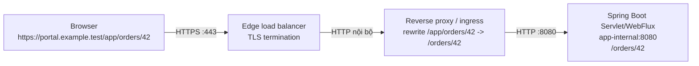
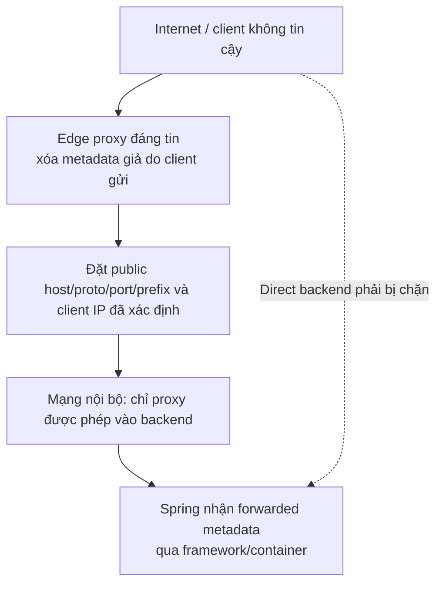

# Reverse proxy, load balancer và địa chỉ client nhìn thấy

> **Chương:** Proxy và nguồn gốc  
> **Module:** `SPRING_SECURITY_HTTP_PROTECTION` — áp dụng các lớp phòng vệ HTTP và trình duyệt bằng Spring Security, từ CSRF, CORS, security headers, CSP, HSTS đến HTTP firewall và session, trên Servlet lẫn Reactive.  
> **Trọng tâm:** Khi ứng dụng chạy sau reverse proxy hoặc load balancer, **URL bên ngoài mà trình duyệt nhìn thấy** có thể khác hẳn scheme, host, port, path và địa chỉ IP mà ứng dụng Java quan sát. Cần truyền và **chỉ tin** metadata chuyển tiếp từ hạ tầng đáng tin để tránh lỗi bảo mật.

## 1. Kết quả học tập

Sau bài này, người học có thể:

1. Phân biệt **public URL**, **origin của trình duyệt**, **địa chỉ socket đến backend** và **IP client thực tế** khi có một hoặc nhiều proxy.
2. Giải thích các header `Forwarded`, `X-Forwarded-For`, `X-Forwarded-Proto`, `X-Forwarded-Host`, `X-Forwarded-Port`, `X-Forwarded-Prefix` và giới hạn tin cậy của chúng.
3. Thiết lập ranh giới tin cậy: **edge proxy loại bỏ giá trị client tự khai**, bổ sung metadata đúng và chặn truy cập trực tiếp từ Internet đến backend.
4. Cấu hình Spring Boot/Spring MVC (Servlet) với forwarded headers qua framework hoặc container, và Spring WebFlux (Reactive) qua `ForwardedHeaderTransformer`.
5. Phân tích ảnh hưởng tới HTTPS redirect, OAuth2/OIDC callback, cookie `Secure`, HSTS, CSRF, CORS, CSP, session và matcher đường dẫn.
6. Viết kiểm thử phân biệt “đã khôi phục đúng public URL” với “đã chặn giả mạo header từ nguồn không tin cậy”.
7. Chẩn đoán các lỗi redirect về `http://localhost`, lặp redirect HTTP↔HTTPS, sai callback, mất cookie hoặc xác định sai client IP.

## 2. Hai góc nhìn về cùng một request

Hãy xem người dùng mở URL:

```text
https://portal.example.test/app/orders/42
```

Hệ thống có thể triển khai:



Từ phía browser, địa chỉ là `https://portal.example.test/app/orders/42`. Nhưng kết nối TCP đến ứng dụng có thể đến từ IP của ingress và sử dụng HTTP tại port 8080. Request path mà controller nhận có thể là `/orders/42` sau khi proxy bỏ tiền tố `/app`.

Đây **không nhất thiết là lỗi**: TLS termination và path rewriting là kiến trúc phổ biến. Vấn đề là Spring Security và các thành phần tạo URL cần biết **public scheme/host/prefix** khi tạo redirect, callback hoặc áp chính sách phụ thuộc HTTPS, nhưng không được coi mọi header do client gửi là sự thật.

### 2.1. Những “địa chỉ” khác nhau

| Thuộc tính | Browser nhìn thấy | Backend chưa xử lý metadata từ proxy |
|---|---|---|
| Scheme | `https` | Có thể là `http` |
| Host | `portal.example.test` | Có thể là `app-internal` |
| Port | `443` | Có thể là `8080` |
| Path | `/app/orders/42` | Có thể là `/orders/42` |
| Origin của trang | `https://portal.example.test` | Không phải `http://app-internal:8080` |
| Remote IP của socket backend | Không trực tiếp thấy | IP proxy gần nhất, không nhất thiết là client |
| Cookie host scope | `portal.example.test` theo cookie policy | Không được suy từ hostname nội bộ |
| Đường redirect mong muốn | Public HTTPS URL | Dễ bị tạo sai nếu thiếu forwarded metadata |

**Origin** được xác định bởi **scheme + hostname + port**, không bao gồm path. `https://portal.example.test` và `https://portal.example.test:443` là cùng origin theo cổng mặc định; `http://portal.example.test` là origin khác. `https://app.example.test` và `https://api.example.test` cũng khác origin dù có thể cùng site.

### 2.2. “Địa chỉ client nhìn thấy” khác “client IP”

Hai câu hỏi cần xử lý riêng:

- **Public address:** Người dùng/browser thấy ứng dụng tại scheme, host, port và path nào?
- **Client source IP:** Hệ thống quan sát được IP nào của phía gửi, sau các hop proxy/NAT/CDN, với độ tin cậy ra sao?

Header dùng để khôi phục URL công khai và header dùng để xác định IP đều có thể bị giả mạo nếu ranh giới proxy không được bảo vệ. Không dùng `request.getRemoteAddr()` từ kết nối backend như IP người dùng cuối khi trước backend có load balancer, và cũng không tin giá trị đầu tiên trong `X-Forwarded-For` khi chưa xác định chuỗi proxy đáng tin.

## 3. Các header truyền metadata qua proxy

Hai họ header thường gặp là chuẩn `Forwarded` (RFC 7239) và các header `X-Forwarded-*` phổ biến trong hạ tầng triển khai.

### 3.1. Header chuẩn `Forwarded`

Một proxy có thể gửi:

```http
Forwarded: for=198.51.100.24;proto=https;host=portal.example.test
```

Ý nghĩa:

- `for=198.51.100.24`: địa chỉ do proxy mô tả ở phía gửi trước nó; **không mặc định là bằng chứng xác thực IP client**.
- `proto=https`: giao thức public hoặc giao thức phía trước proxy theo cách hạ tầng quy ước.
- `host=portal.example.test`: host mà client bên ngoài dùng theo lời khai của proxy.

Có thể có nhiều phần tử ngăn bằng dấu phẩy khi request đi qua nhiều proxy; các giá trị IPv6 hoặc có port cần cú pháp trích dẫn đúng. **Không tự split sơ sài theo dấu phẩy** để xây logic bảo mật nếu chưa kiểm chứng parser và trust model.

### 3.2. Nhóm `X-Forwarded-*` thường thấy

```http
Host: app-internal:8080
X-Forwarded-For: 198.51.100.24
X-Forwarded-Proto: https
X-Forwarded-Host: portal.example.test
X-Forwarded-Port: 443
X-Forwarded-Prefix: /app
```

| Header | Ý nghĩa kỳ vọng | Bẫy khi tin sai |
|---|---|---|
| `X-Forwarded-For` | Chuỗi IP các hop/client theo chính sách proxy | Client có thể tự đặt IP giả vào đầu chuỗi |
| `X-Real-IP` | IP đã được proxy xác định theo cấu hình | Giá trị cũng có thể bị giả nếu proxy không ghi đè |
| `X-Forwarded-Proto` | Scheme public, ví dụ `https` | Giả mạo `http`/`https` có thể ảnh hưởng redirect, URL, HTTPS detection |
| `X-Forwarded-Host` | Host bên ngoài | Host poisoning có thể tác động liên kết tuyệt đối và callback |
| `X-Forwarded-Port` | Port bên ngoài | Sinh URL sai port nếu không đồng bộ host/proto |
| `X-Forwarded-Prefix` | Tiền tố URL đã bị proxy bỏ đi | Ghép path hai lần hoặc sai route nếu cấu hình rewrite không đúng |
| `Forwarded` | Header chuẩn có `for`, `proto`, `host` | Có thể xung đột với `X-*` hoặc đến từ client không tin cậy |

`X-Forwarded-Prefix` không phải một thành phần của RFC 7239; nó là quy ước phổ biến. Thứ tự ưu tiên khi đồng thời có `Forwarded` và `X-Forwarded-*` có thể khác theo framework/container; tránh phát các giá trị mâu thuẫn và **kiểm thử chính xác stack triển khai**.

### 3.3. Header `Origin` không phải `X-Forwarded-Host`

Ví dụ một SPA đang ở `https://app.example.test` gọi API `https://api.example.test`:

```http
POST /api/web/orders HTTP/1.1
Host: api.example.test
Origin: https://app.example.test
Cookie: SESSION=<session>
X-CSRF-TOKEN: <csrf-token>
```

- `Origin` nói lên **nguồn khởi tạo request theo mô hình web của browser**. Nó được dùng cho CORS và có thể góp phần vào kiểm tra nguồn gốc, nhưng không là cơ chế xác thực người dùng; client không phải browser có thể tự đặt header.
- `Host` hoặc host đáng tin được khôi phục qua proxy mô tả **đích** của request mà browser gọi.
- `X-Forwarded-Host` mô tả host đích bên ngoài **do proxy tin cậy khai báo**, không phải nguồn JavaScript đã gửi request.
- `Referer`, `Sec-Fetch-Site` và các Fetch Metadata headers có thể hỗ trợ phòng vệ theo chính sách, nhưng không thay authorization/CSRF token ở những ứng dụng dựa trên cookie.

Nhầm **origin nguồn** với **host đích** dễ dẫn tới CORS allowlist hoặc chính sách chống CSRF sai.

## 4. Trust boundary: forwarded header không phải dữ liệu đáng tin mặc định

Header HTTP là dữ liệu do phía gửi cung cấp. Nếu backend có thể nhận trực tiếp request từ Internet, client có thể gửi:

```http
GET /admin HTTP/1.1
Host: app-internal:8080
X-Forwarded-For: 127.0.0.1
X-Forwarded-Proto: https
X-Forwarded-Host: admin.example.test
```

Không được vì thấy các header này mà kết luận request đến từ loopback, đã qua HTTPS hoặc đang thuộc host admin được phép.

### 4.1. Mô hình tin cậy an toàn



Các điều kiện cần bảo đảm:

1. **Edge proxy là ranh giới tin cậy:** loại bỏ hoặc ghi đè mọi `Forwarded`/`X-Forwarded-*` do client bên ngoài cung cấp, trừ khi chính sách đã kiểm chứng một chuỗi proxy khác ở trước.
2. **Backend không public trực tiếp:** chặn kết nối trực tiếp tới cổng backend bằng firewall/security group/network policy, hoặc áp cơ chế xác thực mTLS/allowlist hạ tầng tương ứng.
3. **Chỉ tin proxy/hop đã được cấu hình:** phân biệt các IP proxy đáng tin và IP client; khi có CDN/LB/ingress nhiều tầng, mỗi hop phải có trách nhiệm rõ về header.
4. **Host/origin công khai được kiểm soát:** proxy chọn host từ tập hợp domain hợp lệ; không mù quáng phản chiếu `Host` hay `X-Forwarded-Host` do request tùy ý khai báo vào redirect hoặc email.
5. **Framework/container xử lý một cách nhất quán:** không vừa dùng hai cơ chế khác nhau ghi đè metadata không rõ thứ tự; cấu hình nào chuyển headers thành request attributes cần được xác nhận bằng test.
6. **Ghi log và kiểm tra đầu-cuối:** lỗi spoof hoặc hop xung đột cần được phát hiện qua negative test trực tiếp tại edge.

**Quan trọng:** `ForwardedHeaderFilter` hoặc `ForwardedHeaderTransformer` giúp **sử dụng** metadata, nhưng bản thân chúng không biết tất cả header có đến từ proxy được ủy quyền hay không. Đừng bật tin forwarded headers từ nguồn mạng tùy ý.

### 4.2. Vì sao “lấy IP đầu tiên trong X-Forwarded-For” nguy hiểm?

Giả sử client độc hại gửi:

```http
X-Forwarded-For: 127.0.0.1
```

Nếu edge dùng cách **nối tiếp** mà không loại giá trị từ client, backend có thể thấy:

```http
X-Forwarded-For: 127.0.0.1, 198.51.100.24
```

Nếu ứng dụng mù quáng lấy IP đầu tiên sẽ coi request đến từ `127.0.0.1`. Sai lầm này có thể ảnh hưởng IP allowlist, rate limit, audit trail và các quyết định quyền dựa trên IP.

Cách xác định client IP thực sự tùy kiến trúc proxy: bắt đầu từ kết nối TCP tới **hop đáng tin gần nhất** và chỉ xử lý các phần tử chuỗi theo chính sách proxy/trusted CIDRs đã cấu hình; không tự suy “phần tử đầu tiên luôn là client”. Nếu hạ tầng có CDN phía trước, `remote_addr` ở edge có thể chỉ là IP CDN, và cần cơ chế `real_ip`/trusted proxies đúng để lấy địa chỉ đã kiểm chứng.

**Đừng dùng IP forwarding làm authentication chính.** Ngay cả IP có nguồn tin cậy cũng có thể đại diện NAT/VPN hoặc nhiều người dùng; kiểm soát quyền cần principal/session/JWT/mTLS phù hợp.

## 5. TLS termination và tác động đến Spring Security

Trong sơ đồ phần 2, browser dùng HTTPS nhưng backend dùng HTTP nội bộ. Nếu không có xử lý metadata từ proxy, backend có thể thấy:

```text
request.getScheme()      = "http"
request.isSecure()       = false
request.getServerName()  = "app-internal"
request.getServerPort()  = 8080
```

Nhưng URL đúng ở phía người dùng là `https://portal.example.test/app/...`.

### 5.1. Redirect sinh sai scheme và host

Ví dụ ứng dụng trả:

```http
HTTP/1.1 302 Found
Location: http://app-internal:8080/login
```

Browser không truy cập được địa chỉ nội bộ, hoặc request bị redirect vòng, hoặc URL sai scheme lộ ra client. Với metadata tin cậy được xử lý đúng và logic tạo redirect phù hợp, ứng dụng có thể sinh địa chỉ công khai:

```http
HTTP/1.1 302 Found
Location: https://portal.example.test/app/login
```

**Không dùng một Host header chưa được xác minh làm cơ sở tạo URL tuyệt đối nhạy cảm**. Đối với liên kết reset password, activation hoặc SSO callback, cân nhắc dùng một canonical public base URL được cấu hình và allowlist host, không phụ thuộc tùy ý vào request.

### 5.2. OAuth2/OIDC callback và redirect URI

Spring Security OAuth2 Login có thể dùng mẫu redirect URI dựa trên `{baseUrl}`, chẳng hạn:

```text
{baseUrl}/login/oauth2/code/{registrationId}
```

Nếu `{baseUrl}` bị suy từ `http://app-internal:8080` trong khi IdP chỉ cho phép:

```text
https://portal.example.test/app/login/oauth2/code/oidc
```

hệ thống có thể nhận lỗi redirect URI mismatch hoặc không hoàn thành đăng nhập. Cấu hình forwarded metadata đúng và kiểm soát chặt canonical host/prefix là quan trọng. Đồng thời phải giữ kiểm tra `state`/`nonce` phù hợp với OAuth2/OIDC, không chữa mismatch bằng việc nới tùy tiện allowed redirect URIs ở IdP.

### 5.3. Cookie `Secure`, `SameSite` và session

Cookie xác thực do backend phát cần có thuộc tính phù hợp với HTTPS và mô hình browser:

- `Secure` bảo đảm cookie chỉ gửi qua kết nối an toàn theo quy tắc browser; cần kiểm tra cookie thực sự có cờ này trong response bên ngoài.
- `HttpOnly` giảm khả năng JavaScript đọc cookie trực tiếp; **không ngăn browser tự gửi cookie**.
- `SameSite` giảm một số bối cảnh cross-site gửi cookie nhưng không thay CSRF token, nhất là khi có subdomain cùng site hoặc luồng yêu cầu cookie cross-site.
- `Domain`/`Path` quyết định phạm vi cookie; không phải ranh giới authorization. Một `Path` sai với public prefix có thể làm login thành công rồi mất session ở request tiếp theo.
- Session fixation protection, logout, timeout và CSRF token lifecycle vẫn phải hoạt động qua chuỗi proxy.

Với servlet container, việc backend nghĩ request là HTTP có thể ảnh hưởng cơ chế tạo cookie hoặc URL. Có thể đặt chính sách Secure rõ ràng khi toàn bộ public traffic dùng HTTPS, đồng thời cấu hình forwarded headers tin cậy cho các chức năng phụ thuộc scheme.

### 5.4. HSTS và security headers

Spring Security có cơ chế HSTS khi request được xem là HTTPS và chính sách HSTS được bật. Nếu backend chỉ thấy HTTP mà không được chuyển đúng scheme public, header `Strict-Transport-Security` có thể không được phát như kỳ vọng. Có thể cấu hình HSTS tại **TLS edge** hoặc tại backend với metadata HTTPS đáng tin; tránh phát nhiều chính sách mâu thuẫn.

CSP, `X-Content-Type-Options`, `X-Frame-Options` và các header bảo vệ khác có vai trò riêng. CSP không mặc nhiên được tạo chỉ vì bật Spring Security; phải cấu hình và kiểm thử cho HTML/script của ứng dụng. Không tin rằng HSTS/CSP/CORS đã loại hết CSRF hoặc host-header poisoning.

## 6. Public path prefix, proxy rewrite và matcher bảo mật

Giả sử public URL là:

```text
https://portal.example.test/app/api/web/orders
```

Proxy dùng rewrite:

```text
/public /app/api/web/orders  ->  backend /api/web/orders
```

Spring Security có matcher:

```java
http.securityMatcher("/api/m2m/**");

http.authorizeHttpRequests(auth -> auth
    .requestMatchers("/api/web/**").authenticated()
    .anyRequest().denyAll());
```

Điều quan trọng là matcher được đánh giá trên **đường dẫn request trong ứng dụng**, sau những chuyển đổi của container/framework/proxy. Không đơn giản lấy public path `/app/api/web/orders` để suy Spring thấy chuỗi đó; cũng không mặc định nó luôn nhìn thấy `/api/web/orders` nếu container context path, servlet mapping hay forwarded prefix transformer được cấu hình khác.

### 6.1. Tác động bảo mật của một path rewrite sai

| Public request | Backend path thực tế | Điều phải kiểm tra |
|---|---|---|
| `/app/api/web/orders` | `/api/web/orders` | Vào browser chain có CSRF nếu dùng cookie |
| `/app/api/m2m/orders` | `/api/m2m/orders` | Vào bearer-only chain nếu không cookie fallback |
| `/app/integrations/payment-events` | `/integrations/payment-events` | Ngoại lệ CSRF chỉ đúng POST/path, verifier chữ ký |
| `/app/admin/users` | `/admin/users` | Không rơi ngoài authorization vì prefix bị bỏ |
| `/app/assets/site.js` | `/assets/site.js` | Public assets vẫn được header policy phù hợp |
| `/app/api/web/orders/extra` | `/api/web/orders/extra` | Không vô tình khớp ngoại lệ hẹp |

Nếu có `X-Forwarded-Prefix: /app`, một số framework dùng nó để tạo URI hoặc điều chỉnh request path/base path. **Không nối prefix bằng tay ở nhiều tầng** (proxy + framework + controller), vì có thể tạo `/app/app/...`. Cần test từ public URL đến controller và Location header cuối cùng.

### 6.2. Quy tắc chọn chain không thay theo origin browser

Một `SecurityFilterChain` được chọn theo matcher đã khai báo. Header `Origin` hoặc `X-Forwarded-Host` **không tự biến** bearer-only API thành browser-session API. Nếu một endpoint nhận cookie để xác thực, hãy đánh giá CSRF theo credential và route/chain; đừng dùng origin hoặc header tự khai làm điều kiện bỏ CSRF trước khi đã xác minh toàn bộ đường authentication.

## 7. Servlet: cấu hình forwarded headers trong Spring Boot

Spring Boot cung cấp cấu hình để xử lý metadata forwarding phù hợp môi trường. Trong Spring Boot 3.x, các lựa chọn thường thấy gồm:

```yaml
# Chỉ dùng nếu request chỉ có thể đến ứng dụng qua proxy đáng tin,
# và proxy đã xóa/ghi đè Forwarded / X-Forwarded-* từ client ngoài.
server:
  forward-headers-strategy: framework
```

Các giá trị cần phân biệt:

| Giá trị | Ý nghĩa khái quát | Lưu ý |
|---|---|---|
| `none` | Không tự xử lý forwarded headers qua chiến lược này | Dùng khi không có proxy forwarding hoặc không tin headers |
| `framework` | Cho framework Spring xử lý forwarded metadata | Servlet thường qua `ForwardedHeaderFilter`; bảo vệ trust boundary tại proxy |
| `native` | Nhờ container/server xử lý theo khả năng native | Cần cấu hình trusted proxy/IP ranges của container nếu áp dụng |

Tùy phiên bản Boot/container, auto-configuration và hành vi mặc định có thể khác. **Không bật đồng thời nhiều cơ chế rewrite scheme/host mà không kiểm tra tương tác.** Chọn một chiến lược có chủ đích và kiểm chứng trong môi trường thật.

### 7.1. Servlet `ForwardedHeaderFilter`

Trong ứng dụng tự cấu hình Spring MVC/Servlet, nếu chưa có Boot auto-configuration phù hợp, có thể đăng ký:

```java
import org.springframework.context.annotation.Bean;
import org.springframework.web.filter.ForwardedHeaderFilter;

@Bean
ForwardedHeaderFilter forwardedHeaderFilter() {
    return new ForwardedHeaderFilter();
}
```

Filter hỗ trợ thông tin `Forwarded` và `X-Forwarded-*` để điều chỉnh cách ứng dụng quan sát URL công khai và xử lý một số redirect. **Nó không xác minh proxy đáng tin chỉ nhờ tên header.** Chỉ cấu hình filter này khi network boundary đã bảo đảm client không tự gán metadata.

Nếu Spring Boot đã tự đăng ký `ForwardedHeaderFilter` thông qua `server.forward-headers-strategy=framework`, **không thêm bean/filter thứ hai chỉ để “cho chắc”**. Cần kiểm tra thứ tự filter so với các thành phần phụ thuộc scheme/host và request matcher.

### 7.2. Chế độ remove-only khi không muốn tin header

Có thể chọn chỉ loại bỏ forwarded metadata mà không dùng nó để điều chỉnh scheme/host:

```java
ForwardedHeaderFilter filter = new ForwardedHeaderFilter();
filter.setRemoveOnly(true);
```

Đây là lựa chọn hữu ích trong kiến trúc **không tin các header forwarding**, nhưng phải đăng ký filter vào request pipeline thích hợp và không còn bộ xử lý native nào diễn giải cùng header trước đó. `removeOnly` không thể phục hồi public URL nếu đã chọn không tin metadata; khi cần canonical URL, có thể dùng cấu hình base URL tường minh.

### 7.3. Native container forwarding

Ví dụ Tomcat có cơ chế `RemoteIpValve` để xử lý thông tin IP/scheme từ proxies. Nếu chọn `server.forward-headers-strategy=native`, cần xem chính xác container đang chấp nhận IP proxy nào và header nào. Không mặc nhiên mọi nguồn TCP đều là trusted proxy và không coi `X-Forwarded-For` là danh sách IP đã được ký.

Một cấu hình tin toàn bộ các IP internet có thể khiến HTTP client tự giả `X-Forwarded-For`/`X-Forwarded-Proto` mà ứng dụng nhận như sự thật. Đặc biệt kiểm tra settings trusted/internal proxy khi có LB/CDN nhiều tầng.

### 7.4. Spring Security vẫn phải được cấu hình độc lập

Forwarded headers **không thay** security chain, CORS, CSRF hoặc authorization:

```java
import org.springframework.context.annotation.Bean;
import org.springframework.security.config.Customizer;
import org.springframework.security.config.annotation.web.builders.HttpSecurity;
import org.springframework.security.web.SecurityFilterChain;

@Bean
SecurityFilterChain browserSecurity(HttpSecurity http) throws Exception {
    http
        .authorizeHttpRequests(auth -> auth
            .requestMatchers("/login", "/assets/**").permitAll()
            .anyRequest().authenticated())
        .formLogin(Customizer.withDefaults());
    // CSRF vẫn bật mặc định cho session/cookie browser.
    return http.build();
}
```

Khi TLS kết thúc ở edge, backend cần hiểu public HTTPS cho URL/headers, nhưng vẫn phải yêu cầu CSRF token đối với POST thay đổi trạng thái của browser. `permitAll` không tự miễn CSRF, và tắt CSRF để khắc phục redirect/CORS sai là sai phạm vi.

## 8. WebFlux Reactive: `ForwardedHeaderTransformer`

Spring WebFlux có `ForwardedHeaderTransformer` trong pipeline xử lý `ServerHttpRequest`. Với Boot theo chiến lược framework, forwarded metadata được xử lý qua cơ chế của Spring tương ứng với stack Reactive.

```yaml
# Cùng ý tưởng với Servlet, dùng cho Spring Boot WebFlux khi proxy đáng tin.
server:
  forward-headers-strategy: framework
```

Trong ứng dụng WebFlux không được Boot cấu hình tự động, có thể khai báo một transformer thích hợp:

```java
import org.springframework.context.annotation.Bean;
import org.springframework.web.server.adapter.ForwardedHeaderTransformer;

@Bean
ForwardedHeaderTransformer forwardedHeaderTransformer() {
    return new ForwardedHeaderTransformer();
}
```

Tương tự Servlet:

- Chỉ tin forwarded headers sau proxy đáng tin đã sanitize và giới hạn truy cập backend.
- Không đăng ký hai cơ chế cùng biến đổi request metadata một cách thiếu kiểm soát.
- Transformer xử lý metadata HTTP/request; nó **không** cấp quyền cho request hay tự cấu hình `CsrfWebFilter`.
- Khi chỉ muốn xóa header mà không áp dụng, `ForwardedHeaderTransformer` cũng hỗ trợ `setRemoveOnly(true)` trong các phiên bản Spring Framework tương ứng.
- WebFlux dùng `ServerWebExchange` và `pathWithinApplication()`; không bê nguyên `HttpServletRequest.getServletPath()` sang code Reactive.

### 8.1. Đọc thông tin public URL trong WebFlux

Một đoạn handler chỉ dùng trong môi trường test có thể quan sát metadata:

```java
import org.springframework.http.server.reactive.ServerHttpRequest;
import org.springframework.web.server.ServerWebExchange;

static String describeRequest(ServerWebExchange exchange) {
    ServerHttpRequest request = exchange.getRequest();
    return request.getURI().getScheme()
        + "://" + request.getURI().getAuthority()
        + request.getPath().pathWithinApplication().value();
}
```

Nếu proxy gửi `X-Forwarded-Proto`/`Host`/`Prefix` đáng tin và transformer thực sự chạy, URI quan sát có thể phản ánh external address theo cách framework xử lý. **Không dùng chuỗi này làm authorization hay allowlist host mà không có chính sách xác thực nguồn metadata**.

### 8.2. WebFlux security chain vẫn độc lập

```java
import org.springframework.context.annotation.Bean;
import org.springframework.security.config.Customizer;
import org.springframework.security.config.web.server.ServerHttpSecurity;
import org.springframework.security.web.server.SecurityWebFilterChain;

@Bean
SecurityWebFilterChain browserSecurity(ServerHttpSecurity http) {
    return http
        .authorizeExchange(auth -> auth
            .pathMatchers("/login", "/assets/**").permitAll()
            .anyExchange().authenticated())
        .formLogin(Customizer.withDefaults())
        // Không disable CsrfWebFilter của browser chain.
        .build();
}
```

SPA dùng `WebSession` cookie vẫn cần CSRF token với POST/PATCH/DELETE. Một API bearer-only có thể dùng chain riêng nếu **không** nhận cookie fallback. WebFlux có Reactive event loop không làm mất rủi ro CSRF từ cookie browser.

## 9. Ví dụ edge Nginx: ghi đè metadata không đáng tin

Đây là **mẫu minh họa** cho kiến trúc đơn giản: Nginx là edge TLS trực tiếp nhận kết nối client, domain public cố định, backend `app-internal:8080` chỉ mở trong mạng riêng. Chứng chỉ, timeout, logging và cấu hình cache/HTTP2 được quản lý ở phần hạ tầng khác.

```nginx
server {
    listen 443 ssl;
    server_name portal.example.test;

    # SSL certificates và policy TLS được cấu hình riêng.

    location /app/ {
        # /app/orders -> /orders trên backend (trailing slash có ý nghĩa).
        proxy_pass http://app-internal:8080/;

        # Host bên ngoài được kiểm soát, không phản chiếu tùy ý Host client.
        proxy_set_header Host portal.example.test;

        # Ghi đè metadata forwarding do client có thể tự khai.
        proxy_set_header Forwarded "";
        proxy_set_header X-Forwarded-Host portal.example.test;
        proxy_set_header X-Forwarded-Proto https;
        proxy_set_header X-Forwarded-Port 443;
        proxy_set_header X-Forwarded-Prefix /app;

        # Mẫu 1 edge trực tiếp: nguồn TCP là client.
        proxy_set_header X-Forwarded-For $remote_addr;
        proxy_set_header X-Real-IP $remote_addr;
    }
}
```

**Không copy nguyên mẫu để dùng với CDN/LB nhiều hop.** Khi Nginx ở sau một LB/CDN, `$remote_addr` có thể là IP hop trước chứ không phải người dùng. Cần cấu hình tập proxy tin cậy và cơ chế real client IP phù hợp, bảo đảm giá trị từ Internet bị loại bỏ hoặc được xác nhận ở trusted edge.

Các điểm cần kiểm tra:

1. Proxy phải được cấu hình xử lý host không hợp lệ bằng chính sách từ chối/định tuyến rõ, không cho Host header bất kỳ ảnh hưởng URL bảo mật.
2. Cổng backend không cho kết nối trực tiếp từ Internet.
3. Proxy viết giá trị scheme/host/port/prefix **nhất quán** với URL công khai.
4. Cách `proxy_pass` xử lý trailing slash quyết định path rewrite. Thử path thật, không chỉ đọc config.
5. Cần giải quyết rõ cả `Forwarded` chuẩn và `X-Forwarded-*` để tránh mâu thuẫn hoặc giá trị giả lọt vào parser.
6. CORS, CSRF, authentication và authorization vẫn phải được Spring Security áp dụng; proxy forwarding không thay các lớp này.

### 9.1. Nhiều proxy: trách nhiệm từng hop

```text
Browser -> CDN -> Cloud LB -> Ingress -> Spring Boot
```

Trong chuỗi nhiều hop:

- CDN/LB có thể đã thêm `X-Forwarded-For` và metadata TLS.
- Ingress phải biết hop trước có đáng tin hay không; không “tin tất cả”.
- Việc append hay overwrite `X-Forwarded-For` được quyết định theo policy của hạ tầng. Không để đầu chuỗi do client gửi tự do được coi là IP thật.
- Nếu edge và ingress cùng ghi `X-Forwarded-Proto` mâu thuẫn, ứng dụng có thể suy scheme sai. Quy định nguồn authoritative rõ ràng.
- Thông tin phục vụ security decision như allowlist IP, tenant-by-host hoặc callback URL không nên được lấy trực tiếp từ header chưa xác minh.

Nên có sơ đồ trust boundary theo từng môi trường (local/staging/production), gồm nguồn TCP, các CIDR đáng tin, header được strip và header được thêm ở mỗi hop.

## 10. Tác động tới CORS, CSRF và origin checks

### 10.1. CORS đánh giá origin của **caller**, không phải host nội bộ

Giả sử trang `https://app.example.test` gọi API public `https://api.example.test` qua ingress. CORS allowlist thường cần chứa **origin frontend hợp lệ**:

```text
https://app.example.test
```

Không phải:

```text
http://app-internal:8080
```

và cũng không mặc định cho phép bất kỳ origin nào bằng cách lấy `X-Forwarded-Host`. CORS policy phải được thiết lập bằng danh sách origin có chủ đích, phù hợp credential policy.

### 10.2. Servlet: cấu hình CORS có allowlist cụ thể

```java
import java.util.List;
import org.springframework.context.annotation.Bean;
import org.springframework.web.cors.CorsConfiguration;
import org.springframework.web.cors.UrlBasedCorsConfigurationSource;

@Bean
UrlBasedCorsConfigurationSource corsConfigurationSource() {
    CorsConfiguration cors = new CorsConfiguration();
    cors.setAllowedOrigins(List.of("https://app.example.test"));
    cors.setAllowedMethods(
        List.of("GET", "POST", "PUT", "PATCH", "DELETE", "OPTIONS"));
    cors.setAllowedHeaders(
        List.of("Content-Type", "X-CSRF-TOKEN"));
    cors.setAllowCredentials(true);

    UrlBasedCorsConfigurationSource source =
        new UrlBasedCorsConfigurationSource();
    source.registerCorsConfiguration("/api/web/**", cors);
    return source;
}
```

Cấu hình mẫu cần được tích hợp vào `HttpSecurity.cors(...)` hoặc CORS pipeline tương ứng, và điều chỉnh theo API thực. Nếu client sử dụng header `Authorization`, thêm header đó đúng nơi cần thiết, không mở rộng tùy tiện.

**CORS preflight** là `OPTIONS` và thường không có session cookie/bearer auth. CORS cần được xử lý trước những filter đòi authentication nếu chúng sẽ chặn preflight. `permitAll` cho OPTIONS một mình không tạo đầy đủ CORS response và **không thay CSRF**.

### 10.3. CSRF và Origin: hai bằng chứng khác nhau

Với browser dùng session cookie:

- `POST /api/web/orders` phải có CSRF token hợp lệ theo policy, kể cả khi application chạy qua HTTPS proxy.
- Header `Origin`/`Referer` hoặc Fetch Metadata có thể bổ sung phòng vệ khi được cấu hình và đánh giá đúng threat model.
- Không dựa chỉ vào CORS hoặc việc frontend ở một host khác để tắt CSRF.
- `SameSite` là lớp bổ sung; cùng site không đồng nghĩa cùng origin.
- Nếu browser đổi public hostname, CSRF token, cookie scope và redirect có thể cần cập nhật.

Với webhook server-to-server có HMAC hoặc bearer-only API, CSRF có thể không cần theo hợp đồng riêng, nhưng forwarded metadata **không phải credential xác thực** và không thay được chữ ký/JWT.

### 10.4. Host spoofing không chỉ là lỗi redirect

Nếu ứng dụng tạo password reset email, activation link, OAuth2 callback hoặc URL tải file dựa trên host do client có thể giả, kẻ tấn công có thể làm lộ liên kết nhạy cảm sang domain do họ kiểm soát.

Phòng vệ:

1. Chỉ nhận host public trong tập được phê duyệt tại edge.
2. Nếu cần tạo absolute links ngoài request, dùng canonical base URL cấu hình rõ hoặc kiểm tra host whitelist nghiêm ngặt.
3. Không tin `X-Forwarded-Host`/`Forwarded: host=...` từ client trực tiếp.
4. Viết negative test cho host lạ, forwarded host bị giả và request đi vòng edge.
5. Không suy rằng một response có HTTPS là bằng chứng host đã được kiểm soát.

## 11. Kiểm thử: không chỉ đọc cấu hình proxy

Có hai nhóm test khác nhau:

- **Functionality:** Khi request qua trusted edge, ứng dụng nhìn thấy scheme/host/port/prefix công khai đúng, redirect/cookie/security headers hoạt động.
- **Trust boundary:** Khi client cố tự đặt `Forwarded`, `X-Forwarded-*` hoặc `Host` ngoài policy, proxy phải loại bỏ/ghi đè/từ chối; backend không được nhận giá trị giả làm sự thật.

Một bài test `MockMvc` với header forwarding giả lập thường **chỉ chứng minh framework đã diễn giải header**, chưa chứng minh edge đã sanitize header.

### 11.1. Ma trận test public URL và trust boundary

| Trường hợp | Hành vi mong đợi |
|---|---|
| Public GET qua HTTPS edge | Ứng dụng xử lý request, tạo URL/redirect public HTTPS |
| Redirect login | `Location` không chứa `app-internal`, `localhost`, `http://` ngoài dự định |
| OAuth2 Login callback | Redirect URI khớp allowlist IdP và public prefix |
| Request phía ngoài có path `/app/...` | Handler/authorization/CSRF matcher đúng sau rewrite |
| Proxy gửi `X-Forwarded-Proto=https` đáng tin | Scheme/isSecure được hiểu đúng trong stack đã cấu hình |
| Proxy gửi host và port public hợp lệ | URL tuyệt đối không lộ hostname/port nội bộ |
| Proxy gửi prefix đã bỏ | Không mất hoặc lặp `/app` khi redirect |
| Browser login HTTPS | Cookie auth mang `Secure`/`HttpOnly`/`SameSite` theo policy |
| Spring Security HSTS ở HTTPS | Header xuất hiện ở nơi được cấu hình cấp HSTS |
| Browser POST không CSRF token | Bị CSRF từ chối nếu dùng cookie/session, không có side effect |
| Browser POST có CSRF token đúng | Qua CSRF, tiếp tục quyền/nghiệp vụ |
| CORS preflight từ origin cho phép | CORS headers/methods/headers được trả theo allowlist |
| CORS preflight từ origin ngoài allowlist | Không được cấp CORS permission ngoài policy |
| Client giả `X-Forwarded-Host=evil.example` | Bị edge strip/ghi đè/từ chối, không tạo link sang host giả |
| Client giả `X-Forwarded-Proto=https` trên kết nối trái policy | Không thể đánh lừa TLS/security decision |
| Client giả `X-Forwarded-For=127.0.0.1` | Không qua IP allowlist/rate limit dành cho nội bộ |
| Kết nối trực tiếp backend từ mạng ngoài | Bị chặn ở tầng mạng hoặc auth hạ tầng |
| Request path mã hóa/bất thường | HTTP firewall và routing từ chối/chuẩn hóa theo policy |
| CDN/LB/Ingress nhiều tầng | IP/scheme/host chọn đúng theo trust-chain cụ thể |

Không được tuyên bố “an toàn” chỉ vì status là 200/302/403. Phải kiểm tra **đường đi, giá trị Location/Cookie/CORS headers, auth/CSRF side effect và cơ chế chặn spoofing**.

### 11.2. Servlet: ví dụ MockMvc quan sát scheme/host

Một controller **chỉ dành cho kiểm thử**, không công bố công khai trong production:

```java
import java.util.Map;
import jakarta.servlet.http.HttpServletRequest;
import org.springframework.web.bind.annotation.GetMapping;
import org.springframework.web.bind.annotation.RestController;

@RestController
class TestAddressController {
    @GetMapping("/__test/address")
    Map<String, Object> address(HttpServletRequest request) {
        return Map.of(
            "scheme", request.getScheme(),
            "secure", request.isSecure(),
            "host", request.getServerName(),
            "port", request.getServerPort(),
            "path", request.getRequestURI());
    }
}
```

Có thể dùng `MockMvc` cùng `ForwardedHeaderFilter` để kiểm tra **cơ chế biến đổi metadata**:

```java
import org.junit.jupiter.api.Test;
import org.springframework.test.web.servlet.MockMvc;
import org.springframework.test.web.servlet.setup.MockMvcBuilders;
import org.springframework.web.filter.ForwardedHeaderFilter;

import static org.springframework.test.web.servlet.request.MockMvcRequestBuilders.get;
import static org.springframework.test.web.servlet.result.MockMvcResultMatchers.jsonPath;
import static org.springframework.test.web.servlet.result.MockMvcResultMatchers.status;

class ForwardedHeaderFilterTest {
    private final MockMvc mockMvc = MockMvcBuilders
        .standaloneSetup(new TestAddressController())
        .addFilters(new ForwardedHeaderFilter())
        .build();

    @Test
    void trustedForwardedMetadataChangesObservedPublicAddress()
            throws Exception {
        mockMvc.perform(get("/__test/address")
                .header("X-Forwarded-Proto", "https")
                .header("X-Forwarded-Host", "portal.example.test")
                .header("X-Forwarded-Port", "443"))
            .andExpect(status().isOk())
            .andExpect(jsonPath("$.scheme").value("https"))
            .andExpect(jsonPath("$.secure").value(true))
            .andExpect(jsonPath("$.host").value("portal.example.test"))
            .andExpect(jsonPath("$.port").value(443));
    }
}
```

**Giới hạn của test:** Vì test tự đặt forwarding headers trực tiếp, nó chứng minh filter **có thể tin và chuyển đổi các giá trị đó**. Chính vì vậy, nó **không** chứng minh security boundary trước Spring đã chặn spoof. Bắt buộc bổ sung test qua **edge proxy thật** (hoặc môi trường tương đương) gửi forwarded headers giả do client tự khai, để chứng minh proxy ghi đè/loại chúng.

Ngoài test này, test đăng nhập, CSRF token thiếu/sai/đúng, Location header, `Set-Cookie` và HSTS phải đi qua Spring Security chain thật hoặc front door phù hợp. `standaloneSetup` chỉ bao gồm controller + filter được thêm, không tự chạy toàn bộ bảo mật của ứng dụng.

### 11.3. WebFlux: test transformer và security chain

Với `WebTestClient` tích hợp ứng dụng có `ForwardedHeaderTransformer`, tạo endpoint test trả:

- `exchange.getRequest().getURI().getScheme()`;
- `getURI().getHost()`, `getURI().getPort()`;
- `getPath().pathWithinApplication()` hoặc đường dẫn ứng dụng tương ứng;
- dấu hiệu security filter/CSRF đã xử lý.

Ví dụ request thử:

```java
webTestClient.get()
    .uri("/__test/address")
    .header("X-Forwarded-Proto", "https")
    .header("X-Forwarded-Host", "portal.example.test")
    .header("X-Forwarded-Port", "443")
    .exchange()
    .expectStatus().isOk()
    .expectBody()
    .jsonPath("$.scheme").isEqualTo("https")
    .jsonPath("$.host").isEqualTo("portal.example.test");
```

Ví dụ giả định controller test đã trả JSON theo contract. Nó chỉ kiểm chứng cách transformer hoạt động khi header đã có mặt; **không** chứng minh proxy chống giả mạo. Với WebFlux, phần test bảo mật riêng phải qua `SecurityWebFilterChain` và `CsrfWebFilter`, tránh gọi handler trực tiếp rồi coi đó là regression test CSRF.

### 11.4. Kiểm tra giá trị gốc và giá trị đã chuyển đổi

Trong môi trường test có quyền quan sát, ghi lại **không kèm secrets**:

```text
public_url:       https://portal.example.test/app/orders/42
edge_target:      http://app-internal:8080/orders/42
trusted_peer:     <private-ip-of-ingress>
raw_remote_addr:  <private-ip-of-ingress>
observed_scheme:  https
observed_host:    portal.example.test
observed_prefix:  /app
response_location: https://portal.example.test/app/login
```

Không log cookie, access token, authorization header hoặc signed webhook payload thô. Đối với IP người dùng, tuân thủ chính sách bảo mật dữ liệu và giới hạn lưu giữ. Phân biệt `raw_remote_addr` (IP hop TCP) với `effective_client_ip` suy qua trusted chain; không đặt cả hai vào một trường “client_ip” mơ hồ.

## 12. Chẩn đoán các xung đột thường gặp

### 12.1. Redirect về `http://localhost:8080` hoặc tên host nội bộ

**Giả thuyết:** Backend đang dùng scheme/host/port nội bộ khi tạo absolute URL. Kiểm tra proxy có gửi metadata đúng, Spring Boot có chọn framework/native strategy phù hợp và security chain/controller tạo redirect có dùng request/public URL đúng không.

**Không sửa bằng:** mở rộng `allowedOrigins("*")` hoặc tắt CSRF. Đây không phải vấn đề CORS/CSRF mặc định.

### 12.2. Vòng lặp redirect HTTPS ↔ HTTP

Có thể LB terminate TLS rồi gửi HTTP nội bộ, trong khi ứng dụng cứ yêu cầu HTTPS vì không biết public request đã HTTPS. Kiểm tra `X-Forwarded-Proto` đáng tin, request.isSecure, quy tắc redirects ở proxy và Spring Security.

Không tắt HTTPS enforcement/hardening chỉ để “ngắt vòng” mà không xác định chỗ mất thông tin scheme.

### 12.3. OAuth2 redirect URI mismatch

`{baseUrl}` có thể đang dùng scheme, host, port hoặc prefix sai. Kiểm tra URL công khai, forwarded metadata, context path, reverse proxy rewrite và redirect URI đăng ký tại IdP. Đừng nới whitelist redirect toàn cục để workaround.

### 12.4. Login thành công nhưng browser không giữ phiên

Cookie có thể thiếu `Secure`, sai `Domain`, `Path`, `SameSite` hoặc bị browser chặn theo ngữ cảnh cross-site. Kiểm tra `Set-Cookie` ở **public response** và cookie thực sự gửi trong request kế tiếp, cùng session lifecycle và CSRF token. Không tắt CSRF khi không hiểu vì sao session bị mất.

### 12.5. HSTS không xuất hiện

Backend nhận HTTP và không biết public HTTPS, hoặc Spring Security header writer không chạy ở chain được chọn. Cũng có thể HSTS chỉ được cấu hình tại edge. Kiểm tra vị trí sở hữu header và HTTPS boundary; đừng gửi HSTS tùy tiện trên môi trường không đáp ứng HTTPS policy.

### 12.6. CORS 403 dù frontend nằm trên domain công ty

`https://app.example.test` và `https://api.example.test` vẫn là hai origin. Kiểm tra `Origin` của caller và allowlist, preflight OPTIONS, allowed headers/credentials; `X-Forwarded-Host` mô tả host đích, không thay `Origin` caller. Một domain cùng site không mặc nhiên được CORS cho phép.

### 12.7. POST qua proxy 403 CSRF, chạy direct backend lại khác

Path rewrite hoặc security chain selection có thể khiến request đi vào chain khác. Header CSRF token/cookie có thể bị proxy bỏ hoặc cookie scope sai. Kiểm tra public URL → backend path, selected chain, token repository và request handler. **Không** chuyển cả `/api/**` sang CSRF-off.

### 12.8. Log báo mọi request đến từ một IP load balancer

`getRemoteAddr()` thường chỉ thấy hop TCP gần nhất. Cần cấu hình trusted proxy IP chain/real-ip mechanism tại edge/container và kiểm tra spoofing. Không lấy bất kỳ giá trị `X-Forwarded-For` nào làm client IP chính mà chưa xác minh.

### 12.9. Client giả `X-Forwarded-Host` làm đổi link reset password

Edge không sanitize hoặc backend đang tin metadata từ nguồn không đáng tin. Cần chặn direct backend, strip/overwrite forwarding headers, allowlist canonical public hosts, test negative spoofing và đánh giá các link đã phát sinh nếu có sự cố.

### 12.10. HTTP firewall chặn URL có encoding/semicolon bất thường

`StrictHttpFirewall` có thể từ chối request trước khi CSRF matcher đánh giá; URL/path sau proxy rewrite có thể khác như dự đoán. Không mở rộng firewall/matcher chỉ vì muốn xử lý request không chuẩn; xác định nguồn URL, encoding, route và trust boundary.

## 13. Bài tập tình huống

Một ứng dụng Spring Security chạy ở backend `http://10.0.4.20:8080`. Người dùng truy cập:

```text
https://academy.example.test/portal/
```

Load balancer terminate TLS, ingress rewrite `/portal/` thành `/`, và gửi:

```http
X-Forwarded-Proto: https
X-Forwarded-Host: academy.example.test
X-Forwarded-Prefix: /portal
X-Forwarded-For: 198.51.100.24
```

Nhóm phát triển ghi nhận:

- Login redirect đến `http://10.0.4.20:8080/login`.
- OAuth2 provider báo `redirect_uri mismatch`.
- HSTS không có trên response từ backend.
- SPA tại `https://app.example.test` nhận lỗi CORS khi gọi API.
- Security log chỉ có IP ingress.
- Một yêu cầu gửi `X-Forwarded-For: 127.0.0.1` khiến hệ thống allowlist chấp nhận như người nội bộ.
- Một số POST browser đi vào chain `/api/m2m/**` không yêu cầu CSRF sau path rewrite.

**Câu hỏi:** Nguyên nhân và hướng xử lý tương ứng là gì?

**Phân tích tham khảo:**

1. Redirect/IdP callback sai: ứng dụng chưa khôi phục public scheme/host/prefix đúng hoặc logic canonical URL sai. Cấu hình một cơ chế framework/native forwarding phù hợp **sau khi** edge tin cậy sanitize headers; test public Location/callback.
2. HSTS thiếu: backend không thấy HTTPS hoặc header được cấu hình tại edge/chain khác. Quy định rõ bên nào phát HSTS và kiểm tra response công khai.
3. CORS lỗi: `Origin: https://app.example.test` phải được xét theo allowlist CORS của API; `X-Forwarded-Host` không thay origin của caller. Cấu hình preflight và credentials/header thích hợp.
4. Log IP ingress: remote socket IP khác client IP. Dùng trusted proxy chain, bảo vệ spoofing và tách log raw peer/effective client IP.
5. Allowlist nhận `127.0.0.1` từ client: lỗ hổng tin `X-Forwarded-For` do client giả. Edge phải strip/overwrite và backend không được public trực tiếp; cần bỏ logic IP-first không tin cậy.
6. Browser POST lọt chain CSRF-off: phải kiểm tra path rewrite và securityMatcher, đặc biệt sự pha trộn cookie session với bearer-only routes. Phân tách route/chain, giữ CSRF cho browser credential và test cookie fallback.
7. Kiểm thử lại dưới URL public, không chỉ gửi request thẳng vào port 8080, vì direct request không đại diện sơ đồ production.

Đặc biệt, **đừng trộn ba loại kết luận**: sửa forwarded metadata giải quyết URL; sửa CORS giải quyết quyền truy cập script cross-origin; sửa CSRF/security chains giải quyết request có credential browser tự gửi và quyền truy cập.

## 14. Checklist trước khi triển khai

- [ ] Có sơ đồ browser → CDN/LB → ingress/reverse proxy → backend, chỉ rõ TLS termination và path rewrite.
- [ ] Public scheme/host/port/prefix được xác định, không nhầm với backend socket.
- [ ] Đã phân biệt `Origin` nguồn gọi với `Host`/`X-Forwarded-Host` đích request.
- [ ] Edge strip/overwrite các header `Forwarded` và `X-Forwarded-*` từ phía không tin cậy theo policy.
- [ ] Backend không truy cập trực tiếp từ Internet hoặc được bảo vệ bằng network controls tương ứng.
- [ ] Có danh sách trusted proxies/CIDRs, không tin mọi IP và không chọn mù quáng phần tử đầu tiên trong `X-Forwarded-For`.
- [ ] Chọn một chiến lược forwarding framework/native/none phù hợp, không cấu hình biến đổi metadata lặp.
- [ ] Servlet `ForwardedHeaderFilter` hoặc container forwarding đã được kiểm tra đúng phiên bản và thứ tự.
- [ ] WebFlux `ForwardedHeaderTransformer` được dùng khi cần và test với request thật.
- [ ] `X-Forwarded-Prefix` và rewrite không khiến path hoặc redirect bị lặp/mất prefix.
- [ ] Redirect login, OAuth2/OIDC callback và absolute links luôn dùng host public được phép.
- [ ] Negative test Host/Forwarded/X-Forwarded-Host spoof, không tạo link/reset token đến host giả.
- [ ] Cookie session có `Secure`, `HttpOnly`, `SameSite`, `Domain`/`Path` theo yêu cầu và được browser gửi lại.
- [ ] HSTS và CSP/security headers được cấu hình rõ ở edge hoặc Spring Security, test trên response công khai.
- [ ] Browser API dùng cookie vẫn có CSRF token cho method không an toàn; bearer-only chain không có cookie fallback.
- [ ] CORS allowlist theo origin frontend, không dùng host nội bộ hoặc wildcard credentials không phù hợp.
- [ ] OPTIONS preflight được xử lý đúng, không nhầm lỗi CORS với CSRF/authentication.
- [ ] HTTP firewall và security matcher được test với URL sau proxy rewrite và path encoding liên quan.
- [ ] Có test Servlet/Reactive cho trusted forwarding, cùng integration test qua **edge thật** để chứng minh chống spoofing.
- [ ] Không log cookie, raw JWT hoặc dữ liệu nhạy cảm khi chẩn đoán request headers.
- [ ] Kiểm tra 302/401/403/400 bằng dấu vết của proxy, chain/filter và handler, không suy từ status đơn lẻ.

**Ghi nhớ:** Reverse proxy và load balancer tạo **hai góc nhìn hợp lệ nhưng khác nhau** về cùng request: địa chỉ công khai mà trình duyệt nhìn thấy và địa chỉ kết nối nội bộ mà backend nhận. Spring có thể khôi phục URL công khai từ forwarding metadata, nhưng **chỉ được tin metadata sau khi proxy đáng tin kiểm soát và loại giá trị giả mạo**. Kiểm tra host, scheme, prefix và IP theo trust boundary, rồi kiểm thử lại redirect, cookie, CORS, CSRF, headers và security chain trên cả Servlet lẫn Reactive.
