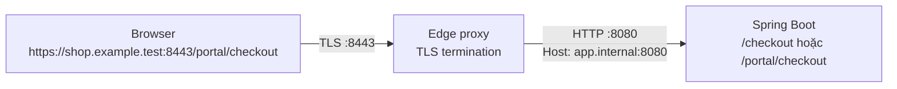
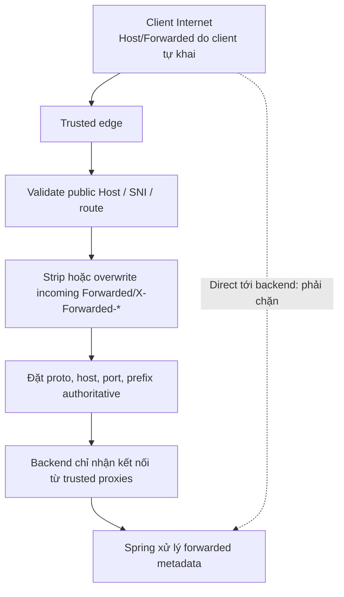

# Forwarded, X-Forwarded-Proto, Host và cổng bên ngoài

> **Chương:** Proxy và nguồn gốc  
> **Module:** `SPRING_SECURITY_HTTP_PROTECTION` — bảo vệ HTTP và trình duyệt bằng Spring Security: CSRF, CORS, security headers, CSP, HSTS, HTTP firewall và session trên Servlet lẫn Reactive.  
> **Trọng tâm:** Khôi phục đúng **scheme + host + port mà client thấy** khi ứng dụng đứng sau reverse proxy/load balancer, đồng thời không tin các header chuyển tiếp do client không đáng tin tự khai.

## 1. Mục tiêu học tập

Hoàn thành bài này, người học có thể:

1. Phân biệt `Host`, `Forwarded: proto/host`, `X-Forwarded-Proto`, `X-Forwarded-Host`, `X-Forwarded-Port` và địa chỉ backend.
2. Tính đúng **external origin** và **external base URL**, kể cả cổng HTTPS không mặc định (`8443`) hoặc path prefix từ reverse proxy.
3. Giải thích vì sao `Forwarded` và `X-Forwarded-*` là **metadata có thể bị giả mạo**, không phải sự thật đã xác thực chỉ vì tên header.
4. Cấu hình Spring Boot, Spring MVC/Servlet và WebFlux/Reactive xử lý forwarded metadata phù hợp ranh giới proxy đáng tin.
5. Phân tích tác động tới redirect, OAuth2/OIDC callback, HSTS, cookie `Secure`, CORS, CSRF, CSP và đường dẫn được Spring Security matcher chọn.
6. Thiết kế test chứng minh **chức năng khôi phục URL đúng** và **edge chặn Host/forwarded-header spoofing** là hai yêu cầu độc lập.
7. Chẩn đoán các sự cố redirect về HTTP/host nội bộ, sai cổng, cổng bị nhân đôi, HTTP↔HTTPS loop và OAuth redirect URI mismatch.

**Ý chính:** Spring có thể đọc header do proxy gửi để mô tả URL bên ngoài, nhưng **chỉ hạ tầng đáng tin mới được phép quyết định các giá trị đó**. Không bật xử lý forwarded headers nếu backend vẫn nhận trực tiếp request từ nguồn bất kỳ mà không được bảo vệ.

## 2. Hai URL cho cùng một request

Giả sử một khách hàng mở:

```text
https://shop.example.test:8443/portal/checkout
```

Cổng `8443` được ghi rõ vì đây không phải cổng mặc định của HTTPS. Hệ thống triển khai:



Ở browser, external origin là:

```text
https://shop.example.test:8443
```

Trong khi backend có thể thấy:

```text
scheme     = http
serverName = app.internal
serverPort = 8080
isSecure   = false
```

Không có gì bất thường khi TLS kết thúc ở proxy và backend giao tiếp HTTP trên mạng nội bộ. Vấn đề phát sinh khi backend cần tạo `Location` redirect, link tuyệt đối hoặc OAuth2 redirect URI nhưng chỉ biết địa chỉ nội bộ.

Proxy có thể cung cấp metadata:

```http
Host: app.internal:8080
X-Forwarded-Proto: https
X-Forwarded-Host: shop.example.test
X-Forwarded-Port: 8443
```

Khi cơ chế forwarding được **cấu hình đúng và đáng tin**, ứng dụng có thể coi external scheme/host/port tương ứng là `https`, `shop.example.test`, `8443` cho những thao tác cần URL công khai.

### 2.1. Phân biệt socket, authority, origin và base URL

| Thuật ngữ | Ví dụ | Dùng để làm gì |
|---|---|---|
| Backend socket | `app.internal:8080` | Nơi proxy kết nối tới Spring Boot |
| External scheme | `https` | Mô tả giao thức browser dùng |
| External host | `shop.example.test` | Tên host công khai sau khi được kiểm soát |
| External port | `8443` | Cổng browser phải dùng |
| External authority | `shop.example.test:8443` | Host + optional port |
| External origin | `https://shop.example.test:8443` | Scheme + host + port, cơ sở để so origin |
| External base URL | `https://shop.example.test:8443/portal` | Gốc công khai có thể gồm prefix triển khai |
| Internal request path | `/checkout` | Path handler nhìn thấy nếu proxy loại `/portal` |

**Origin không bao gồm path**. `https://shop.example.test:8443/portal` và `https://shop.example.test:8443/admin` cùng origin. `https://shop.example.test` (port 443) và `https://shop.example.test:8443` khác origin vì khác port.

### 2.2. Cổng mặc định và cổng không mặc định

| URL | Scheme | Host | Effective port | Origin so sánh |
|---|---|---|---|---|
| `https://shop.example.test` | HTTPS | `shop.example.test` | 443 | `https://shop.example.test` |
| `https://shop.example.test:443` | HTTPS | `shop.example.test` | 443 | Cùng origin với dòng trên |
| `https://shop.example.test:8443` | HTTPS | `shop.example.test` | 8443 | **Khác** origin với port 443 |
| `http://shop.example.test` | HTTP | `shop.example.test` | 80 | Khác HTTPS |
| `http://shop.example.test:8080` | HTTP | `shop.example.test` | 8080 | Khác các dòng trên |

Port mặc định có thể được lược bỏ khi biểu diễn URL, nhưng **không được lược bỏ cổng tùy chỉnh**. Một `Location: https://shop.example.test/login` là sai nếu người dùng chỉ truy cập dịch vụ tại `:8443`.

## 3. Header `Host`: cần thiết nhưng không tự đáng tin

Trong HTTP/1.1, `Host` thể hiện hostname của **đích request** và có thể chứa port:

```http
GET /portal/checkout HTTP/1.1
Host: shop.example.test:8443
```

Với HTTP/2 và HTTP/3, pseudo-header `:authority` giữ vai trò tương ứng trong request protocol. Proxy thường chuyển đổi những biểu diễn này khi giao tiếp với backend HTTP/1.1.

Có hai cấu hình proxy phổ biến:

1. Proxy **giữ Host công khai** khi chuyển tiếp, nên backend nhận `Host: shop.example.test:8443`.
2. Proxy đặt `Host` theo upstream nội bộ, chẳng hạn `app.internal:8080`, và cung cấp host công khai bằng `Forwarded` hoặc `X-Forwarded-Host`.

Cả hai có thể hợp lệ nếu toàn bộ pipeline đồng bộ. Không nên thiết kế ứng dụng dựa trên giả định rằng backend chắc chắn nhận Host công khai hoặc chắc chắn nhận Host nội bộ.

### 3.1. Host-header poisoning

`Host` là dữ liệu client có thể khai báo ở request HTTP ban đầu. Nếu edge chấp nhận mọi host rồi chuyển tiếp hoặc tạo `X-Forwarded-Host` từ đó, kẻ tấn công có thể điều khiển URL tuyệt đối do backend sinh:

```http
GET /forgot-password HTTP/1.1
Host: evil.example
X-Forwarded-Host: evil.example
```

Nếu ứng dụng dùng giá trị chưa kiểm soát để tạo email reset password, activation link hoặc OAuth callback, URL có thể trỏ sang domain của kẻ tấn công.

**Phòng vệ:** Edge chỉ định tuyến/cho phép tập host công khai được phê duyệt, loại Host không hợp lệ, và backend dùng canonical public base URL hoặc host allowlist khi tạo liên kết nhạy cảm. `Host` hay `X-Forwarded-Host` không phải một cơ chế xác thực chủ sở hữu domain.

## 4. Header chuẩn `Forwarded` (RFC 7239)

`Forwarded` có thể diễn đạt các thông tin trên cùng một header:

```http
Forwarded: for=198.51.100.24;proto=https;host="shop.example.test:8443"
```

Các tham số quan trọng:

- `proto=https`: giao thức được một proxy mô tả ở phía client tương ứng với hop đó.
- `host="shop.example.test:8443"`: external authority được proxy ghi nhận, gồm host và port.
- `for=198.51.100.24`: địa chỉ nguồn do hop proxy báo cáo; không mặc định được xác thực.
- `by=...`: thành phần proxy đã nhận request; tùy cấu hình có thể có hoặc không.

Các giá trị này là **lời khai của một proxy**. Nếu client trực tiếp gửi `Forwarded` tới backend hoặc proxy chuyển tiếp nguyên header giả, metadata vẫn không đáng tin.

### 4.1. Host và port trong `Forwarded`

Một số biểu diễn:

```http
Forwarded: proto=https;host=shop.example.test
Forwarded: proto=https;host="shop.example.test:8443"
Forwarded: proto=https;host="[2001:db8::10]:8443"
```

- Không có port và `proto=https` thường biểu thị HTTPS ở cổng mặc định theo ngữ cảnh.
- Với public `:8443`, cần giữ rõ port ở external authority.
- Với IPv6 literal có port, cần dạng dấu ngoặc vuông và cú pháp trích dẫn thích hợp.
- Không tự split host theo dấu hai chấm đầu tiên: IPv6 có nhiều dấu `:`.
- `host` trong `Forwarded` là authority của đích theo hop báo cáo, **không phải `Origin` của trang đã kích hoạt request**.

### 4.2. Nhiều proxy và nhiều phần tử

Một chuỗi ví dụ:

```http
Forwarded: for=198.51.100.24;proto=https;host=shop.example.test,
           for=10.0.0.8;proto=http;host=app.internal
```

Đây là biểu diễn hai phần tử forwarding. Trong một kiến trúc cụ thể, proxy đầu có thể tiếp nhận HTTPS công khai, rồi hop sau giao tiếp HTTP nội bộ.

**Không có quy tắc an toàn toàn cục rằng phần tử đầu tiên luôn đúng**, hoặc phần tử cuối cùng là external origin cần dùng. Điều đó phụ thuộc hop nào đáng tin, header do ai tạo, chain đã bị sanitize ở đâu và parser/container quyết định thế nào.

Thiết kế nên có **một nguồn authoritative** cho external host/proto/port. Nếu nhiều hop có thể sửa các giá trị này, phải quy định rõ precedence và triển khai nhất quán, thay vì đưa nguyên một danh sách mâu thuẫn vào Spring và mong framework suy ra ý định của hạ tầng.

## 5. Các header `X-Forwarded-*` tương ứng

Nhóm header này rất phổ biến, nhưng không phải mọi tên đều thuộc một chuẩn chung có cùng cú pháp như RFC 7239.

```http
X-Forwarded-Proto: https
X-Forwarded-Host: shop.example.test
X-Forwarded-Port: 8443
X-Forwarded-For: 198.51.100.24
X-Forwarded-Prefix: /portal
```

| Header | Giá trị thường gặp | Diễn giải |
|---|---|---|
| `X-Forwarded-Proto` | `https` | Scheme từ phía client public |
| `X-Forwarded-Host` | `shop.example.test` hoặc `shop.example.test:8443` | Host/authority public theo proxy |
| `X-Forwarded-Port` | `8443` | Cổng public riêng |
| `X-Forwarded-For` | Chuỗi IP phân tách bằng dấu phẩy | Dữ liệu IP qua các hop, cần trusted-proxy policy |
| `X-Forwarded-Prefix` | `/portal` | Prefix path ở ngoài có thể đã bị proxy strip |
| `X-Real-IP` | Một địa chỉ IP | Quy ước riêng của proxy, không mặc định đáng tin |

`X-Forwarded-Port` cung cấp số cổng bên ngoài trong những stack chấp nhận header này. Tuy nhiên, có framework coi port nằm ngay trong `X-Forwarded-Host` là authoritative, có framework áp dụng precedence khác. **Đừng cấp đồng thời các giá trị mâu thuẫn.**

### 5.1. Bốn trường hợp liên quan port

| Host/forwarding được gửi | Kỳ vọng nếu external URL đúng | Cạm bẫy |
|---|---|---|
| `X-Forwarded-Proto: https`, `X-Forwarded-Host: shop.example.test`, port không có | HTTPS public mặc định 443 nếu hạ tầng đúng là 443 | Mất port nếu service thật chạy 8443 |
| `X-Forwarded-Proto: https`, `X-Forwarded-Host: shop.example.test`, `X-Forwarded-Port: 8443` | `https://shop.example.test:8443` | Header port bị bỏ qua hoặc nhận sai |
| `X-Forwarded-Proto: https`, `X-Forwarded-Host: shop.example.test:8443` | Authority bao gồm cổng không mặc định | Mã thủ công nối thêm port thành `:8443:8443` |
| `X-Forwarded-Proto: http`, `X-Forwarded-Host: shop.example.test`, `X-Forwarded-Port: 443` | Bộ header **mâu thuẫn** nếu người dùng dùng HTTPS | Redirect và secure-cookie logic dễ sai |

Khi gửi cả `Forwarded` lẫn `X-Forwarded-*`, nên đồng bộ đầy đủ scheme/host/port; cách đơn giản hơn là cấu hình một nguồn metadata thống nhất và kiểm thử stack đang dùng.

### 5.2. `X-Forwarded-Proto` có thể nhiều giá trị

Ví dụ:

```http
X-Forwarded-Proto: https, http
```

Đừng tự lấy `https` bằng `split(",")[0]` rồi coi request đã HTTPS. Header có thể do nhiều hop thêm nối, hoặc do client cố tình gửi trước. Edge/ingress phải biết hop nào chịu trách nhiệm xác nhận scheme public và nên xuất ra giá trị đã được chuẩn hóa cho backend.

Đặc biệt nguy hiểm khi ứng dụng dùng `X-Forwarded-Proto: https` để:
- quyết định request “secure” trong khi client thực tế chỉ gửi HTTP;
- phát hoặc không phát HSTS;
- tạo callback URL;
- quyết định chính sách redirect HTTPS;
- phân biệt môi trường nội bộ với public.

Những quyết định này đòi trust boundary được thực thi, không chỉ một chuỗi header chứa `https`.

## 6. Quy tắc tin cậy: ai được phép đặt external origin?

`Forwarded` và `X-Forwarded-*` **không có chữ ký bảo đảm nguồn gốc theo mặc định**. Một request trực tiếp có thể đặt các header tùy ý. Vì vậy cần cả **kiểm soát network path** và **kiểm soát header ở edge**.



Bốn nguyên tắc cần thành một hợp đồng triển khai:

1. **Chặn đường vào backend trực tiếp:** security group, firewall, Kubernetes network policy, mTLS hoặc giới hạn cổng chỉ cho proxy. Nếu request từ Internet tới được backend và ứng dụng tin header chuyển tiếp, spoofing có thể xảy ra.
2. **Loại bỏ hoặc ghi đè metadata từ client:** gồm `Forwarded` chuẩn và những `X-Forwarded-*` được framework/container xử lý.
3. **Host công khai được kiểm soát:** edge phải biết tập `shop.example.test` và port được phép, không phản chiếu tùy ý `$http_host` hoặc giá trị `X-Forwarded-Host` từ client.
4. **Trust chain của nhiều proxy được tài liệu hóa:** CDN, load balancer, ingress và Spring phải thống nhất hop nào authoritative cho scheme/host/port; cần trusted proxy CIDR khi xác định client IP.

**Bật `ForwardedHeaderFilter` không tự tạo trust boundary.** Nó là thành phần đọc/biến đổi request, không phải bằng chứng rằng các header đã được proxy đáng tin tạo ra.

### 6.1. Ví dụ header injection cần chặn

```http
GET /forgot-password HTTP/1.1
Host: shop.example.test:8443
Forwarded: proto=https;host=evil.example
X-Forwarded-Host: evil.example
X-Forwarded-Port: 443
```

Nếu proxy chuyển tiếp nguyên `Forwarded` hoặc `X-Forwarded-Host`, backend có thể sinh reset link/redirect mang `evil.example`. Việc browser gửi request ban đầu tới host hợp lệ **không làm các header giả trở nên đáng tin**.

### 6.2. Host allowlist và canonical URL

Đối với reset password, activation, OAuth2/OIDC callback hoặc các liên kết được gửi ngoài request, có thể dùng canonical base URL tường minh:

```yaml
# Cấu hình ứng dụng minh họa, dùng như giá trị sở hữu bởi đội vận hành.
app:
  public-base-url: "https://shop.example.test:8443/portal"
```

Dùng giá trị cấu hình đã xác minh để sinh liên kết nhạy cảm; không bắt buộc dùng request host trong mọi trường hợp. Với hệ thống multi-tenant nhiều domain công khai, phải xác thực host ↔ tenant mapping chứ không đơn thuần dùng chuỗi Host làm tenant ID.

Không nên biến canonical URL thành cách bỏ qua các biện pháp edge: cả hai cùng cần thiết khi application còn sinh redirect dựa vào request.

## 7. Điều gì thay đổi trong Spring MVC/Servlet?

Không xử lý forwarded metadata, code Servlet có thể quan sát:

```java
request.getScheme();     // "http"
request.isSecure();      // false
request.getServerName(); // "app.internal"
request.getServerPort(); // 8080
request.getRequestURL(); // nội bộ, tùy host/path thực tế
```

Sau khi metadata từ **trusted proxy** được xử lý đúng, những API này có thể phản ánh public scheme/host/port.

### 7.1. Spring Boot: chọn cách xử lý header

Trong Spring Boot, cấu hình thường gặp:

```yaml
server:
  forward-headers-strategy: framework
```

Các lựa chọn có ý nghĩa khái quát:

| Chiến lược | Ý tưởng | Khi nào dùng |
|---|---|---|
| `none` | Không tự suy lại request từ các forwarding headers qua cơ chế này | Không có proxy trusted hoặc cố ý không tin metadata |
| `framework` | Spring framework xử lý `Forwarded`/`X-Forwarded-*` | Edge đã sanitize header, muốn Spring quản lý |
| `native` | Container/server web xử lý theo khả năng của nó | Cần native trust settings, ví dụ Tomcat/Jetty tùy cấu hình |

Cách Boot auto-configure, các header được ưu tiên và phạm vi xử lý tùy phiên bản/container. Nếu dùng `native`, phải cấu hình chính xác các **trusted/internal proxies** mà container chấp nhận. Không bật đồng thời framework và một native valve biến đổi cùng metadata mà không có thiết kế và test rõ.

### 7.2. `ForwardedHeaderFilter` trong Servlet

Khi không để Boot tự đăng ký và ứng dụng tự quản lý filter, có thể dùng:

```java
import org.springframework.context.annotation.Bean;
import org.springframework.web.filter.ForwardedHeaderFilter;

@Bean
ForwardedHeaderFilter forwardedHeaderFilter() {
    return new ForwardedHeaderFilter();
}
```

`ForwardedHeaderFilter` hỗ trợ cách ứng dụng nhận thấy scheme/host/port public và một số xử lý redirect. Nó **không xác thực nguồn gửi các header**. Dùng nó chỉ khi edge đã tạo trust boundary.

Nếu `server.forward-headers-strategy=framework` đã tự cấu hình filter cho Servlet, không đăng ký thêm một filter giống vậy chỉ “cho chắc”. Cấu hình duplicate có thể tạo hành vi khó dự đoán, đặc biệt với path prefix và thứ tự filters.

Khi **không muốn áp dụng** metadata nhưng cần bỏ các forwarded headers khỏi request cho downstream, có thể dùng remove-only:

```java
ForwardedHeaderFilter filter = new ForwardedHeaderFilter();
filter.setRemoveOnly(true);
```

Với remove-only, không thể mong `getServerName()` tự thành public host; phải có cơ chế canonical URL khác nếu ứng dụng cần tạo redirect tuyệt đối.

### 7.3. Cổng bên ngoài trong servlet request

Một tình huống cần test:

```http
X-Forwarded-Proto: https
X-Forwarded-Host: shop.example.test
X-Forwarded-Port: 8443
```

Kỳ vọng đối với những API cần absolute URL, **nếu framework đang thực thi forwarding đúng**:

```text
scheme     = https
serverName = shop.example.test
serverPort = 8443
secure     = true
baseUrl    = https://shop.example.test:8443
```

Đừng chỉ kiểm tra `getScheme() == "https"`. Nếu `getServerPort()` vẫn là 8080 hoặc bị lược mất 8443, login/OAuth callback có thể hỏng mặc dù scheme đã được sửa.

## 8. WebFlux: `ForwardedHeaderTransformer` và external URI

WebFlux/Reactive có `ForwardedHeaderTransformer` xử lý `ServerHttpRequest` trước khi phần ứng dụng sử dụng metadata.

Với Spring Boot WebFlux, cấu hình framework cũng có thể dùng:

```yaml
server:
  forward-headers-strategy: framework
```

Khi tự cấu hình bên ngoài Boot:

```java
import org.springframework.context.annotation.Bean;
import org.springframework.web.server.adapter.ForwardedHeaderTransformer;

@Bean
ForwardedHeaderTransformer forwardedHeaderTransformer() {
    return new ForwardedHeaderTransformer();
}
```

Transformer có thể cập nhật URI mà `exchange.getRequest().getURI()` phản ánh dựa vào `Forwarded`/`X-Forwarded-*`. Cơ chế đó **không tự kiểm tra** header có được tạo từ proxy đáng tin hay không. Có lựa chọn `setRemoveOnly(true)` nếu mục tiêu chỉ loại bỏ header mà không áp metadata trong các phiên bản Spring Framework hỗ trợ.

Ví dụ code đọc metadata ở WebFlux (chỉ dùng tại test/diagnostic có kiểm soát):

```java
import java.net.URI;
import org.springframework.web.server.ServerWebExchange;

static String describeAddress(ServerWebExchange exchange) {
    URI uri = exchange.getRequest().getURI();
    return uri.getScheme() + "://"
        + uri.getRawAuthority()
        + exchange.getRequest().getPath().value();
}
```

Lưu ý:

- `uri.getPort()` có thể là `-1` nếu URL không ghi port tường minh; điều này không đồng nghĩa cổng hiệu dụng là `-1`.
- Khi public port là 8443, URI hoặc authority phục hồi phải giữ 8443.
- WebFlux path/matcher và security chain là cơ chế riêng; forwarded host/proto không tự thay `securityMatcher` hoặc `authorizeExchange`.
- Đừng sao chép `HttpServletRequest` vào WebFlux. Ở WebFlux dùng `ServerWebExchange`/`ServerHttpRequest` và các bộ lọc Reactive tương ứng.

## 9. Reverse proxy Nginx: ví dụ thống nhất external port 8443

Giả sử Nginx là **edge TLS trực tiếp**, chỉ nhận hostname `shop.example.test` tại cổng HTTPS 8443, backend `app.internal:8080` chỉ nằm trong mạng riêng.

```nginx
server {
    listen 8443 ssl;
    server_name shop.example.test;

    # Certificate, key, TLS policy và vhost mặc định từ chối host lạ
    # phải được đội hạ tầng cấu hình đầy đủ ở ngoài ví dụ này.

    location /portal/ {
        # Không dùng trailing slash để giữ nguyên path /portal/... bên trong.
        proxy_pass http://app.internal:8080;

        # Không dùng giá trị Host tùy ý từ client làm upstream authority.
        proxy_set_header Host shop.example.test:8443;

        # Loại RFC Forwarded do client tự khai (không tạo 2 họ mâu thuẫn).
        proxy_set_header Forwarded "";

        # Giá trị authoritative cho public URL.
        proxy_set_header X-Forwarded-Proto https;
        proxy_set_header X-Forwarded-Host shop.example.test;
        proxy_set_header X-Forwarded-Port 8443;

        # Ví dụ edge trực tiếp: không tin chuỗi XFF đến từ client.
        proxy_set_header X-Forwarded-For $remote_addr;
    }
}
```

Cấu hình là minh họa **trust boundary**, không phải một Nginx config production hoàn chỉnh. Vhost mặc định và chính sách host/SNI không được mô tả chi tiết trong snippet; cần có vhost từ chối host không hợp lệ. Cổng backend phải bị giới hạn ở network layer.

Trong ví dụ này Nginx **không strip `/portal`**. Nếu đổi thành `proxy_pass http://app.internal:8080/;` (có dấu `/` cuối), quy tắc xử lý URI của Nginx có thể thay đổi path upstream. Khi đó phải cập nhật route/context path và kiểm thử, thay vì chỉ thay `X-Forwarded-Prefix` và hy vọng matcher bảo mật tự đổi theo.

### 9.1. Vì sao không dùng `$http_x_forwarded_proto` hoặc `$http_host` mù quáng?

Các biến dựa trên HTTP header client là dữ liệu do client cung cấp. Ví dụ:

```nginx
# PHẢN VÍ DỤ: rủi ro nếu edge chưa xác minh/canonicalize nguồn.
proxy_set_header X-Forwarded-Proto $http_x_forwarded_proto;
proxy_set_header X-Forwarded-Host  $http_host;
```

Nếu client tự gửi những header giả, backend có thể được cấp metadata do kẻ tấn công quyết định. Có thể dùng biến an toàn của Nginx sau chính sách vhost/host validation thích hợp, nhưng ví dụ ở đây chọn **giá trị public cố định** để dễ thấy ranh giới tin cậy.

### 9.2. Nếu edge nằm sau CDN/load balancer?

`$remote_addr` có thể là IP CDN/LB, không phải client thật. Khi đó cần cấu hình trusted proxy chain/real-ip module theo CIDR thực tế và thống nhất hop nào chịu trách nhiệm phát canonical proto/host/port. Không tự append `X-Forwarded-For` của client rồi tin phần tử đầu tiên.

Với chuỗi `Browser → CDN → LB → Ingress → Spring`, quyết định external scheme/authority có thể thuộc CDN hoặc edge đầu tiên chấm dứt TLS. Ingress cuối không nên tự gán `X-Forwarded-Proto=http` chỉ vì kết nối nội bộ đến nó là HTTP, nếu browser thật dùng HTTPS.

## 10. Những lỗi thường gặp khi authority/port không khớp

### 10.1. Redirect về host nội bộ

Triệu chứng:

```http
HTTP/1.1 302 Found
Location: http://app.internal:8080/login
```

Khả năng: framework chưa xử lý forwarding hoặc proxy không cung cấp external metadata. Cần kiểm tra `request.getScheme()`, `getServerName()`, `getServerPort()`, filter/transformer, và nguồn sinh `Location`. Một controller có thể tự hardcode URL sai dù forwarding đã hoạt động.

### 10.2. Đúng HTTPS nhưng thiếu port 8443

Triệu chứng:

```http
HTTP/1.1 302 Found
Location: https://shop.example.test/login
```

Browser sẽ dùng 443, khác cổng 8443 mà dịch vụ yêu cầu. Kiểm tra `Forwarded: host="shop.example.test:8443"` hoặc `X-Forwarded-Port: 8443`, precedence, URL builder và canonical base URL. Đừng kết luận chính sách forwarding đã đúng chỉ vì redirect bắt đầu bằng `https://`.

### 10.3. Port trùng hoặc mâu thuẫn

```text
https://shop.example.test:8443:8443/login  (sai)
https://shop.example.test:8080/login      (sai)
```

Lỗi có thể do code ứng dụng nối cổng thủ công, hoặc proxy gửi Host chứa `:8443` rồi một lớp khác tiếp tục nối port. Sử dụng URI builder/API HTTP framework thay vì string concatenation; kiểm tra effective authority sau normalization.

### 10.4. Lặp redirect HTTP↔HTTPS

Nếu Spring Security yêu cầu HTTPS nhưng backend thấy `http` dù browser đã kết nối qua `https`, request có thể bị chuyển hướng liên tục. Kiểm tra `X-Forwarded-Proto`/`Forwarded: proto` và HTTPS policy ở edge + backend; tránh “sửa” bằng cách tắt `requiresSecure` hoặc HSTS.

### 10.5. OAuth2/OIDC redirect URI mismatch

Spring Security OAuth2 Login có thể tạo redirect URI từ public base URL, chẳng hạn:

```text
{baseUrl}/login/oauth2/code/{registrationId}
```

Nếu proxy public chạy `:8443` mà framework sinh `https://shop.example.test/login/oauth2/code/oidc`, IdP có thể từ chối vì redirect URI không khớp. Kiểm tra scheme, host, **port**, prefix, URL đăng ký tại IdP và cách sinh `{baseUrl}`. Không nới redirect URI allowlist một cách vô kiểm soát.

### 10.6. HSTS không xuất hiện khi backend dùng HTTP

HSTS là chính sách HTTPS browser. Spring Security có thể ghi `Strict-Transport-Security` khi request được coi là HTTPS theo cấu hình; backend chỉ thấy HTTP có thể không ghi như dự kiến. Có thể chọn phát HSTS ở TLS edge hoặc Spring Security sau trusted forwarding, nhưng phải rõ tầng sở hữu và kiểm thử response công khai. Không giả định HSTS đồng nghĩa đã khắc phục CSRF.

### 10.7. Cookie/session bị mất sau redirect

Cookie `Secure`, `Domain`, `Path` và `SameSite` phải phù hợp **public URL và cách browser gọi request**, không phải chỉ URL nội bộ. Nếu backend phát cookie sai Path khi proxy rewrite `/portal`, browser có thể không gửi cookie vào request tiếp theo. Điều này dễ bị nhầm với lỗi CSRF hoặc login.

`HttpOnly` giúp JS không đọc trực tiếp cookie; nó không ngăn browser tự gửi credential và không thay CSRF token.

## 11. `Origin`, `Host` và `Forwarded` không cùng một vai trò

Giả sử SPA tại:

```text
https://app.example.test
```

gửi POST tới API public:

```text
https://shop.example.test:8443/api/web/orders
```

Request qua edge có thể mang:

```http
POST /api/web/orders HTTP/1.1
Host: shop.example.test:8443
Origin: https://app.example.test
Cookie: SESSION=<session-value>
X-CSRF-TOKEN: <csrf-value>
```

| Giá trị | Mô tả |
|---|---|
| `Origin: https://app.example.test` | Nguồn web đã khởi tạo request |
| `Host: shop.example.test:8443` | Đích request |
| `X-Forwarded-Host` | Host đích public do proxy đáng tin báo |
| `X-Forwarded-Proto` | Scheme đích public do proxy báo |
| `X-Forwarded-Port` | Port đích public do proxy báo |
| Backend `request.getServerName()` | Giá trị Spring quan sát sau container/framework forwarding |

CORS allowlist xét **origin của caller**, không phải host nội bộ hay `X-Forwarded-Host`. Ví dụ CORS cho SPA trên `app.example.test` cần cho phép origin đó nếu nghiệp vụ cho phép; không lấy một host đích bất kỳ làm `Access-Control-Allow-Origin`.

**Đừng đồng nhất “same-site” và “same-origin”**: hai subdomain có thể cùng site nhưng khác origin; SameSite cookie không thay CORS hoặc CSRF. Một origin browser cũng không phải danh tính đã xác thực — script hoặc client khác vẫn có thể đặt header tương tự trong những ngữ cảnh không bị browser ràng buộc.

### 11.1. CORS không chữa được forwarding

Nếu browser báo CORS lỗi, cần kiểm tra preflight OPTIONS, `Access-Control-Allow-Origin`, allowed headers và credential policy. Lỗi redirect qua host/port sai **có thể dẫn đến biểu hiện CORS**, nhưng không nên “sửa” bằng wildcard origin.

Nếu redirect đưa client từ `https://shop.example.test:8443` sang `https://shop.example.test`, đó là **đổi origin**, không chỉ thay URL hiển thị. Xử lý nguyên nhân sai port trước.

### 11.2. CSRF không phụ thuộc label “HTTPS qua proxy”

Với browser dùng session/JWT cookie, unsafe methods cần được bảo vệ CSRF theo hợp đồng. TLS, HSTS, CORS và host validation giúp giảm các lớp rủi ro khác nhưng không chứng minh ý định user ở request.

Với bearer-only API không dùng cookie fallback, có thể tắt CSRF trong chain riêng sau khi xác minh hợp đồng đó. Không dùng giá trị `X-Forwarded-Proto=https` hoặc `Origin` làm lý do miễn token CSRF trước khi authentication và chain selection được bảo đảm.

### 11.3. CSP, HTTP firewall và session

- **CSP:** bảo vệ một số đường thực thi/tải script, cần cấu hình chủ động; một redirect sang host/port khác cũng có thể vi phạm `connect-src` hoặc `form-action` đã thiết lập.
- **HTTP firewall:** `StrictHttpFirewall` trên Servlet có thể chặn path/method/encoding bất thường trước CSRF matcher; đừng nới firewall để “sửa” header forwarding sai.
- **Session:** path/scheme/host có thể làm cookie không gửi đúng; CSRF token repository và session lifecycle phải được test qua public URL.
- **Security headers:** chúng vẫn được cấu hình bởi chain hoặc edge độc lập với forwarding. Đừng coi sự tồn tại của một header do proxy phát là bằng chứng security chain đã chạy.

## 12. Kiểm thử Servlet: chứng minh framework thấy đúng port public

Bài kiểm thử có **hai tầng**, tránh lẫn lộn:

1. **Framework test**: Với metadata đã có, `ForwardedHeaderFilter` có biến đổi request thành external URL đúng không?
2. **Edge/integration test**: Nếu client gửi metadata giả, proxy có loại/ghi đè hay chặn nó trước khi Spring nhận không?

Chỉ tầng thứ hai mới chứng minh ranh giới chống header spoofing. Tầng thứ nhất vẫn rất hữu ích để phát hiện URL sinh thiếu port.

### 12.1. Controller quan sát scheme/host/port (test-only)

```java
import java.util.Map;
import jakarta.servlet.http.HttpServletRequest;
import org.springframework.web.bind.annotation.GetMapping;
import org.springframework.web.bind.annotation.RestController;

@RestController
class AddressProbeController {

    @GetMapping("/__test/address")
    Map<String, Object> address(HttpServletRequest request) {
        return Map.of(
            "scheme", request.getScheme(),
            "secure", request.isSecure(),
            "host", request.getServerName(),
            "port", request.getServerPort());
    }
}
```

Controller chỉ dành cho test/diagnostic có quyền truy cập phù hợp; không công bố probe cấu hình mạng công khai trên production.

### 12.2. MockMvc với `ForwardedHeaderFilter`

```java
import org.junit.jupiter.api.Test;
import org.springframework.test.web.servlet.MockMvc;
import org.springframework.test.web.servlet.setup.MockMvcBuilders;
import org.springframework.web.filter.ForwardedHeaderFilter;

import static org.springframework.test.web.servlet.request.MockMvcRequestBuilders.get;
import static org.springframework.test.web.servlet.result.MockMvcResultMatchers.jsonPath;
import static org.springframework.test.web.servlet.result.MockMvcResultMatchers.status;

class PublicAddressTest {

    private final MockMvc mvc = MockMvcBuilders
        .standaloneSetup(new AddressProbeController())
        .addFilters(new ForwardedHeaderFilter())
        .build();

    @Test
    void forwardedHeadersRestoreHttpsAndExternalPort() throws Exception {
        mvc.perform(get("/__test/address")
                .header("X-Forwarded-Proto", "https")
                .header("X-Forwarded-Host", "shop.example.test")
                .header("X-Forwarded-Port", "8443"))
            .andExpect(status().isOk())
            .andExpect(jsonPath("$.scheme").value("https"))
            .andExpect(jsonPath("$.secure").value(true))
            .andExpect(jsonPath("$.host").value("shop.example.test"))
            .andExpect(jsonPath("$.port").value(8443));
    }
}
```

**Giới hạn rất quan trọng:** Test đã tự đưa forwarding headers vào HTTP request và cho filter đọc chúng. Nó chứng minh **khả năng diễn giải**, chứ **không chứng minh** client Internet không thể làm điều đó trong production. Nó cũng không chạy đầy đủ Spring Security filter chain của ứng dụng vì dùng `standaloneSetup`. Test CSRF/authorization cần tích hợp toàn chain ở bước riêng.

### 12.3. Kiểm thử `Forwarded` chuẩn

Tùy stack/phiên bản, bổ sung request:

```http
Forwarded: proto=https;host="shop.example.test:8443"
```

Kiểm tra scheme = HTTPS, host = `shop.example.test` và port = 8443 sau khi filter xử lý. Đối với host IPv6, test cú pháp trích dẫn đúng để tránh parser tự cắt sai. Không dùng `Forwarded` và `X-Forwarded-*` mâu thuẫn làm dữ liệu test “hợp lệ”; hãy tạo negative test cho xung đột và quy định policy fail-safe từ edge.

## 13. Kiểm thử WebFlux: URI của `ServerHttpRequest`

WebFlux có thể nhận public URI sau `ForwardedHeaderTransformer`. Một handler test trong ứng dụng test:

```java
import java.util.Map;
import org.springframework.web.bind.annotation.GetMapping;
import org.springframework.web.bind.annotation.RestController;
import org.springframework.web.server.ServerWebExchange;

@RestController
class ReactiveAddressProbe {

    @GetMapping("/__test/address")
    Map<String, Object> address(ServerWebExchange exchange) {
        var uri = exchange.getRequest().getURI();
        return Map.of(
            "scheme", uri.getScheme(),
            "host", uri.getHost(),
            "port", uri.getPort());
    }
}
```

Một test có gắn transformer thực tế:

```java
webTestClient.get()
    .uri("/__test/address")
    .header("X-Forwarded-Proto", "https")
    .header("X-Forwarded-Host", "shop.example.test")
    .header("X-Forwarded-Port", "8443")
    .exchange()
    .expectStatus().isOk()
    .expectBody()
    .jsonPath("$.scheme").isEqualTo("https")
    .jsonPath("$.host").isEqualTo("shop.example.test")
    .jsonPath("$.port").isEqualTo(8443);
```

Đây là mã minh họa giả định `WebTestClient` chạy trong application test có `ForwardedHeaderTransformer` đã được đăng ký. Kiểm tra kết quả từ loại server và Boot/Spring Framework version thực tế. Khi kiểm thử security, phải chạy `SecurityWebFilterChain`/`CsrfWebFilter`, không chỉ gọi handler.

### 13.1. Test khác biệt giữa port 443 và 8443

Nên có test đối chiếu:

- `X-Forwarded-Proto=https`, host public, port 443 ⇒ origin hiệu dụng HTTPS mặc định.
- Cùng cấu hình nhưng port 8443 ⇒ absolute redirect/URI có **:8443**.
- Host kèm `:8443` và `X-Forwarded-Port=8443` ⇒ không nhân đôi port.
- Port khác giữa `Forwarded` và `X-Forwarded-*` ⇒ edge phải normalize hoặc từ chối; không để ý nghĩa tùy parser.

Khi tạo absolute URLs ở production, nên dùng `UriComponentsBuilder`/URI APIs hoặc cơ chế tương đương thay vì nối chuỗi dựa vào headers.

## 14. Kiểm thử bảo mật qua proxy thật: chống spoofing

Các test quan trọng nhất không thể được thay thế bằng một test unit gọi filter. Hãy chạy chúng ở staging với **cấu hình edge tương đương production**.

### 14.1. Ma trận kiểm thử

| Kịch bản | Kỳ vọng |
|---|---|
| Browser gọi đúng `https://shop.example.test:8443` | URI và redirect giữ HTTPS + 8443 |
| External Host không nằm trong allowlist | Edge từ chối hoặc xử lý theo vhost deny có chủ đích |
| Client gửi `X-Forwarded-Host: evil.example` | Header bị edge ghi đè/xóa; không sinh link sang evil.example |
| Client gửi `Forwarded: proto=http;host=evil.example` | Bị xóa/ghi đè, không ảnh hưởng URL backend |
| Client gửi `X-Forwarded-Proto: https` trên đường không đáng tin | Không thể giả tình trạng HTTPS đã được xác nhận |
| Client gửi `X-Forwarded-Port: 443` trong khi public port 8443 | Spring vẫn được cấp 8443 authoritative |
| Host có port 8443, forwarded port lại 443 | Edge normalize/từ chối cấu hình mâu thuẫn |
| Direct request tới `app.internal:8080` từ Internet | Bị network boundary chặn |
| Header `Forwarded` nhiều phần tử không rõ hop | Không tự chọn phần tử tùy ý; có policy/normalization |
| Redirect login/OAuth2 callback | `Location` chứa canonical external host/port/prefix |
| Set-Cookie sau login | Flags và scope đúng external HTTPS/browser path |
| HSTS khi HTTPS | Được phát ở tầng đã cấu hình, không do header client giả điều khiển |
| CORS preflight từ origin được phép | Chính sách origin/method/header/credentials phù hợp |
| CORS preflight từ origin lạ | Không cấp CORS permission sai |
| Browser POST cookie thiếu CSRF token | Bị chặn trong browser security chain |
| Browser POST cookie + CSRF token đúng | Đi tiếp nếu quyền/nghiệp vụ hợp lệ |
| API bearer-only qua proxy | Không có cookie fallback; JWT/scope được xác minh |
| Path sau rewrite | Vào đúng Spring Security chain, không lọt ngoại lệ CSRF |
| IPv6 literal host/port | Parser/URI builder không cắt sai authority |

Tách **functional correctness** và **security boundary** thành kết quả test riêng. Response 302 có thể hợp lệ nhưng trỏ sai domain/port; status 403 có thể là authorization hoặc CSRF; header HSTS có thể do proxy thêm chứ không phải Spring Security.

### 14.2. Lệnh thử thủ công ở staging

Ví dụ chỉ thực hiện với endpoint/staging có quyền thử nghiệm:

```bash
# Kiểm tra Location có giữ scheme/host/port công khai hay không.
curl -k -I 'https://shop.example.test:8443/portal/login'

# Giả mạo header forwarding từ PHÍA CLIENT ngoài edge:
# response tuyệt đối không được chuyển sang evil.example.
curl -k -I \
  -H 'X-Forwarded-Host: evil.example' \
  -H 'X-Forwarded-Proto: http' \
  -H 'X-Forwarded-Port: 443' \
  -H 'Forwarded: proto=http;host=evil.example' \
  'https://shop.example.test:8443/portal/login'
```

Trong staging nên dùng chứng chỉ TLS hợp lệ thay vì `-k`; `-k` ở đây chỉ biểu diễn trường hợp môi trường test chưa có CA đáng tin, không phải lời khuyên bỏ kiểm tra chứng chỉ khi vận hành. `curl -I` gửi HEAD, và route có thể phản hồi khác GET; cần thử GET/POST thật cùng body/credential phù hợp để đánh giá đầy đủ redirect và security filters.

**Không sử dụng header-spoofing tests trên hệ thống không thuộc quyền quản lý.** Những test này nhằm xác minh proxy do chính dự án vận hành.

## 15. Chẩn đoán theo triệu chứng

| Triệu chứng | Giả thuyết ưu tiên | Bằng chứng cần kiểm tra |
|---|---|---|
| Redirect về `http://app.internal:8080` | Chưa áp metadata public | Filter/transformer + trusted edge headers |
| Redirect `https://shop.example.test` thay vì `:8443` | Mất external port | `Forwarded: host` / `X-Forwarded-Port` / URI builder |
| Redirect chứa port hai lần | Nối authority bằng chuỗi thủ công hoặc cấu hình mâu thuẫn | Host vs Forwarded Host/Port |
| HTTP↔HTTPS redirect loop | Backend hiểu nhầm scheme hoặc proxy/requireHttps lặp | `proto`, `isSecure`, Location chain |
| OAuth redirect URI mismatch | Scheme/host/port/prefix không khớp IdP | Redirect thực và allowlist IdP |
| Cookie login không giữ phiên | `Secure`/`Path`/`Domain`/`SameSite` sai | Browser devtools + Set-Cookie public |
| HSTS vắng mặt | HTTPS detection hoặc header owner khác | HSTS tại edge/backend và `isSecure` |
| HSTS bất ngờ trên HTTP | Header injection/proxy HSTS sai/ngộ nhận môi trường | TLS entry, proxy route, security config |
| CSP chặn request sau redirect | Redirect đổi origin hoặc CSP `connect-src` | Console/CSP reports và Location |
| CORS lỗi dù domain “đúng” | Port khác origin hoặc allowlist thiếu | `Origin`, preflight, allowed headers |
| Request 403 CSRF qua proxy | Cookie/token/path/security chain lệch | Token repository, proxy path, matcher |
| Password reset link sang host lạ | Host/forwarded-host poisoning | Edge sanitize + canonical host |
| Client IP/allowlist sai | Tin `X-Forwarded-For` tùy ý | Trusted proxy chain; raw socket IP |
| Path lạ 400/403 từ firewall | URL encoding sau proxy rewrite | `StrictHttpFirewall` logs, request URI |

Quy trình chẩn đoán ngắn:

1. **Ghi URL public** mà user đang mở, bao gồm scheme, host, port, path.
2. **Ghi nguồn TCP và URL backend** ở hop cuối; phân biệt với public URL.
3. **Xác nhận edge sanitize** và đặt canonical `proto/host/port`; không log token/cookie.
4. **Kiểm tra framework observe** request ở Servlet/WebFlux sau forwarding.
5. **Đối chiếu response**: Location, Set-Cookie, HSTS, CORS, CSP.
6. **Kiểm tra security chain** nếu có 401/403/CSRF hoặc route matching khác nhau.
7. **Chạy negative tests** host/port spoofing, không chỉ positive tests đúng URL.

## 16. Bài tập tổng hợp

Một dịch vụ có public entry:

```text
https://identity.example.test:9443/auth/
```

Nginx ở edge chuyển tiếp HTTP tới `identity-svc:8080`, còn backend tạo `Location: https://identity.example.test/login`. OAuth2 provider từ chối callback và đội frontend báo CORS. Một developer đề xuất:

```text
(1) csrf.disable() toàn ứng dụng
(2) allowedOrigins("*")
(3) lấy X-Forwarded-Host do client gửi rồi thêm ":9443" thủ công
```

### Câu hỏi

1. Vì sao redirect về `https://identity.example.test/login` chưa đúng?
2. Cần cấp metadata scheme/host/port nào cho Spring?
3. Có thể sử dụng `Host` trực tiếp từ client để tạo callback không?
4. Những đề xuất (1), (2), (3) sai ở đâu?
5. Bộ test tối thiểu cần có trước khi deploy gồm gì?

### Phân tích đáp án

1. Public URL sử dụng **port 9443** và prefix `/auth`; redirect thiếu cả cổng và có thể thiếu prefix. Đúng scheme `https` chưa đủ.
2. Proxy đáng tin cần gửi external origin tương ứng: `proto=https`, `host=identity.example.test` và `port=9443` (hoặc `Forwarded: proto=https;host="identity.example.test:9443"`). Prefix cần được xử lý nhất quán nếu proxy strip `/auth`.
3. Không. Host/Forwarded headers do client có thể giả; edge phải allowlist host và sanitize metadata trước khi Spring sử dụng. Với OAuth callback có thể dùng canonical base URL tường minh.
4. `csrf.disable()` không giải quyết redirect và còn hạ mức bảo vệ browser session. `allowedOrigins("*")` không sửa port, đồng thời không phù hợp khi client gửi credentials nếu thiếu policy đúng. Nối `:9443` thủ công dễ làm port bị lặp và vẫn tin đầu vào có thể giả.
5. Test scheme/host/port/prefix public, 302 Location, callback URI với IdP, cookie `Secure`/`SameSite`/`Path`, CORS preflight từ đúng origin/port, CSRF POST cookie thiếu/đúng token, và negative Host/Forwarded/X-Forwarded-Host/Port spoofing qua edge.

**Bài học rút ra:** Lỗi external URL và lỗi CSRF/CORS có thể cùng xuất hiện sau proxy, nhưng **không được chữa lỗi sai origin bằng cách tắt lớp bảo mật khác**.

## 17. Checklist review

- [ ] Đã ghi external scheme, host, **port**, prefix và backend socket tách biệt.
- [ ] Phân biệt origin (`scheme+host+port`) với base URL có path prefix.
- [ ] Không mất port HTTPS tùy chỉnh `8443`/`9443` trong redirect và OAuth callback.
- [ ] Không tự nối port vào Host chứa port; URI builder/API framework xử lý authority.
- [ ] `Host`/`:authority` được hiểu là request target, không phải Origin caller.
- [ ] Phân biệt `Forwarded` chuẩn với `X-Forwarded-Proto`, `X-Forwarded-Host`, `X-Forwarded-Port`.
- [ ] Không cấp các header chuẩn và X-* với thông tin scheme/host/port mâu thuẫn.
- [ ] Có quy định authoritative hop khi có nhiều proxy và nhiều phần tử forwarded.
- [ ] Edge allowlist public hosts, loại/ghi đè Host/Forwarded giả từ client.
- [ ] Backend không mở trực tiếp cho nguồn Internet không tin cậy.
- [ ] Không dùng `X-Forwarded-For` hoặc `X-Real-IP` chưa xác minh làm bằng chứng quyền.
- [ ] Spring Boot chọn `none`/`framework`/`native` có chủ đích; không dùng hai transformer trùng chức năng.
- [ ] Servlet `ForwardedHeaderFilter` hoặc native container handling đã được test với cổng công khai.
- [ ] WebFlux `ForwardedHeaderTransformer` đã được test với external URI và port.
- [ ] Kiểm thử `Forwarded: host` có cổng, IPv6, host/port mâu thuẫn khi cần.
- [ ] Redirect login, logout, OAuth2/OIDC callback và absolute links không lộ hostname/port nội bộ.
- [ ] Cookie session có `Secure`/`HttpOnly`/`SameSite`/`Path`/`Domain` đúng policy public.
- [ ] HSTS và CSP được kiểm tra trên response public, theo tầng sở hữu đã thiết kế.
- [ ] CORS allowlist dựa vào **Origin caller**, kể cả port; không lấy external Host làm allowlist động.
- [ ] CSRF vẫn bảo vệ unsafe browser requests sử dụng ambient cookie credentials.
- [ ] Security chain/matcher kiểm thử với path thực sau proxy rewrite và prefix.
- [ ] Có integration test **qua proxy thật** chứng minh header spoofing bị chặn, không chỉ MockMvc/WebTestClient.
- [ ] Có test cho port mặc định và không mặc định, cùng path prefix khi hạ tầng sử dụng.
- [ ] Log troubleshooting không ghi secrets, access token hoặc session cookie.
- [ ] Không xử lý lỗi redirect/CORS bằng việc vô hiệu hóa CSRF, firewall hoặc HTTPS enforcement.

**Ghi nhớ:** **`Host` mô tả đích HTTP request, `Forwarded` và `X-Forwarded-*` có thể khôi phục scheme/host/port công khai, còn `Origin` mô tả nguồn web gửi request.** External origin phải được xác định từ **proxy đã được xác thực bằng ranh giới hạ tầng**, không phải từ header client bất kỳ. Đừng bỏ quên **cổng bên ngoài**: chỉ một redirect thiếu `:8443` cũng có thể làm hỏng login, OAuth2, cookie hoặc CORS. Hãy kiểm thử cả Servlet lẫn Reactive và cả hai chiều: khôi phục đúng URL, từ chối metadata giả.
