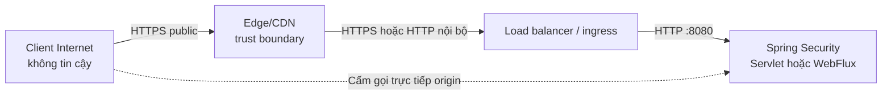
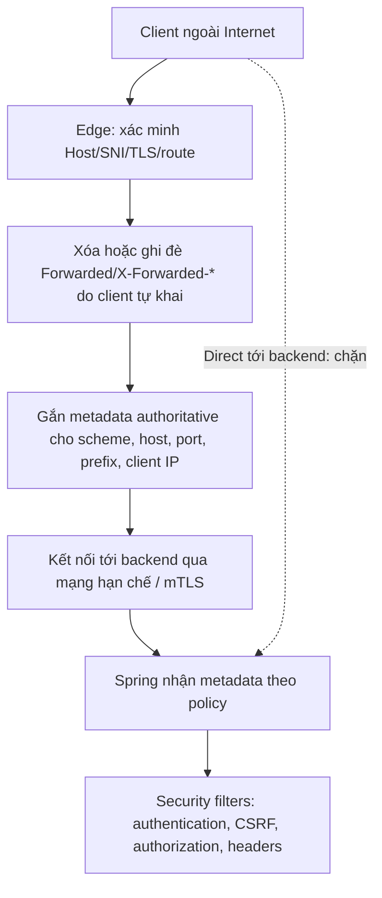

# Ranh giới tin cậy khi tiếp nhận forwarded headers

> **Chương:** Proxy và nguồn gốc  
> **Module:** `SPRING_SECURITY_HTTP_PROTECTION` — phòng vệ HTTP và trình duyệt bằng Spring Security, gồm CSRF, CORS, security headers, CSP, HSTS, HTTP firewall và session, trên cả Servlet và Reactive.  
> **Trọng tâm:** Thiết lập và kiểm chứng **trust boundary** cho `Forwarded`, `X-Forwarded-*` khi request đi qua CDN, load balancer, ingress và reverse proxy. Biết sử dụng metadata để khôi phục URL/IP công khai mà **không trao quyền khai báo danh tính, host hoặc HTTPS cho client không đáng tin**.

## 1. Mục tiêu học tập

Sau bài này, người học có thể:

1. Phân biệt **HTTP peer gần nhất** với **client thực tế**, **URL công khai** với **URL backend**, và **metadata chuyển tiếp** với **dữ kiện đã được xác thực**.
2. Trình bày cơ chế giả mạo `Forwarded`, `X-Forwarded-For`, `X-Forwarded-Proto`, `X-Forwarded-Host`, `X-Forwarded-Port` và `X-Forwarded-Prefix`.
3. Thiết kế trust boundary tại edge: xác minh host, xóa/ghi đè header từ client, chỉ cho các trusted proxies kết nối backend và quy định nguồn authoritative cho từng thuộc tính.
4. Lý giải cách chọn client IP khi có nhiều proxy, vì sao không được “lấy IP đầu tiên” và vì sao địa chỉ private/loopback trong header không tự đáng tin.
5. Sử dụng `ForwardedHeaderFilter`/native container trên Servlet và `ForwardedHeaderTransformer` trên WebFlux mà không nhầm chức năng biến đổi request với kiểm tra độ tin cậy.
6. Xác định các hậu quả bảo mật đối với redirect/login, OAuth2/OIDC, host-based routing, IP allowlist, CORS, CSRF, security headers, HSTS, HTTP firewall và session.
7. Xây dựng test dương xác minh public URL đúng và test âm chứng minh giá trị client giả không tới được thành phần tin forwarded metadata.
8. Đưa kiểm tra trust chain vào review khi thêm CDN, đổi ingress, bật proxy protocol, đổi hostname hoặc thay cách định tuyến.

**Nguyên tắc nền tảng:** Forwarded headers không “đúng” chỉ vì được đặt tên `Forwarded`. Chúng chỉ có thể được tin **trong phạm vi một chuỗi proxy đã được kiểm soát**, với bằng chứng ở lớp mạng và chính sách header ở từng hop.

## 2. Tại sao cần trust boundary?

Một ứng dụng chạy sau proxy thường không quan sát cùng thông tin HTTP mà browser thấy.



Ví dụ browser gọi:

```text
https://portal.example.test/app/profile
```

Nhưng backend có thể nhận HTTP nội bộ:

```http
GET /profile HTTP/1.1
Host: app-service:8080
Forwarded: for=198.51.100.25;proto=https;host=portal.example.test
X-Forwarded-Proto: https
X-Forwarded-Host: portal.example.test
X-Forwarded-Prefix: /app
```

Một **trusted proxy** có thể tạo metadata này sau khi đã biết HTTPS public và public host thật. Nhưng chính các chuỗi trên cũng có thể được **client tự gửi** nếu backend mở trực tiếp hoặc edge chuyển tiếp header chưa được làm sạch.

### 2.1. Bốn thực thể cần tách bạch

| Thực thể | Có thể biết gì? | Cần tin đến mức nào? |
|---|---|---|
| Browser/client | Host, đường dẫn, mọi header tự khai có thể gửi | **Không tin** về danh tính IP, host hợp lệ hay TLS của hop trước |
| CDN/edge | Kết nối client tới edge, TLS, vhost và IP kết nối tại edge | Có thể là **điểm xác lập sự thật**, nếu cấu hình/vận hành đúng |
| LB/ingress nội bộ | Hop trước, đường định tuyến, metadata do upstream để lại | Chỉ tin **upstream cụ thể** trong trusted chain |
| Spring backend | Remote socket peer, HTTP request và forwarding metadata | Chỉ chấp nhận metadata đã đi qua ranh giới đáng tin |

**Không phải cứ nằm trong mạng nội bộ thì đáng tin.** Một service nội bộ bị xâm nhập hoặc một pod khác có thể gửi HTTP request và tự khai forwarding headers. Quyền kết nối tới backend phải được giới hạn theo service identity, firewall/network policy hoặc mTLS/allowlist hợp lý.

### 2.2. Ba loại “sự thật” độc lập

- **Sự thật của kết nối:** IP peer TCP mà backend nhận, trạng thái TLS trên hop hiện tại, transport đã được kiểm tra.
- **Sự thật về URL public:** Scheme/host/port/prefix mà edge xác định từ request đã kiểm soát; browser nhìn thấy địa chỉ này.
- **Sự thật về người dùng:** Identity/session/JWT/mTLS và authorization do hệ thống xác thực. **Không được suy ra người dùng đã đăng nhập chỉ từ IP, Host hoặc forwarded headers**.

Trust forwarding giúp khôi phục **metadata về request**, không thay authentication hoặc authorization.

## 3. Những header nào nằm trong ranh giới này?

### 3.1. `Forwarded` chuẩn

Header `Forwarded` theo RFC 7239 dùng các tham số như `for`, `by`, `proto`, `host`:

```http
Forwarded: for=198.51.100.25;proto=https;host=portal.example.test
```

Nó có thể chứa nhiều phần tử:

```http
Forwarded: for=198.51.100.25;proto=https;host=portal.example.test,
           for=10.3.0.7;proto=http;host=app-service
```

Việc có nhiều phần tử chỉ phản ánh **các lời khai trong chuỗi proxy**. Giá trị nào đại diện request public phụ thuộc proxy chain đáng tin và cách từng hop ghi hoặc chuẩn hóa metadata. Không coi phần tử đầu tiên/mới nhất là mặc định an toàn.

Các đặc điểm cần nhớ:

- `host` có thể chứa port; IPv6 literal cần cú pháp dấu ngoặc vuông/trích dẫn đúng.
- `for` có thể là địa chỉ IPv4, IPv6 hoặc giá trị obfuscated theo chuẩn; **không phải lúc nào cũng parse thành một IP thông thường**.
- Các giá trị có thể được quote hoặc xuất hiện nhiều lần; đừng tự viết parser đơn giản rồi dùng cho chính sách bảo mật.
- Header `Forwarded` không có chữ ký hoặc bằng chứng nguồn gốc mặc định.

### 3.2. `X-Forwarded-*` thông dụng

```http
X-Forwarded-For: 198.51.100.25, 10.3.0.7
X-Forwarded-Proto: https
X-Forwarded-Host: portal.example.test
X-Forwarded-Port: 443
X-Forwarded-Prefix: /app
```

| Header | Mục đích | Nếu bị giả mạo |
|---|---|---|
| `X-Forwarded-For` | Danh sách IP các hop theo chính sách hạ tầng | Né rate limit/IP allowlist; sai audit và abuse detection |
| `X-Real-IP` | Một IP do proxy xác định theo quy ước | Giả danh client, bypass logic tin IP |
| `X-Forwarded-Proto` | Scheme public, thường `http`/`https` | Sinh URL sai, đánh lừa HTTPS detection/redirect/HSTS |
| `X-Forwarded-Host` | Host/authority public | Host poisoning, link reset mật khẩu, callback/tenant sai |
| `X-Forwarded-Port` | Port public | Sai origin, redirect URI hoặc port không mặc định |
| `X-Forwarded-Prefix` | Path prefix public khi proxy rewrite | Sai path, ghép prefix lặp, chọn sai route/URL |
| `Forwarded` | Tham số chuẩn `for/by/proto/host` | Những tác động tương ứng, có thêm vấn đề nhiều hop |

`X-Forwarded-Prefix` không thuộc RFC 7239; đó là quy ước phổ biến. Không mặc định mọi proxy/framework diễn giải các header theo cùng một thứ tự ưu tiên.

### 3.3. `Origin` và `Host` không tương đương forwarded metadata

Ví dụ SPA từ `https://app.example.test` gửi request tới `https://api.example.test`:

```http
POST /api/web/orders HTTP/1.1
Host: api.example.test
Origin: https://app.example.test
Cookie: SESSION=<session>
X-CSRF-TOKEN: <token>
```

- `Origin` thể hiện **nguồn web** của request theo mô hình browser; hữu ích cho CORS và một số phòng vệ bổ sung, không phải bằng chứng authentication.
- `Host`/`:authority` là **đích HTTP** mà request định hướng tới.
- `Forwarded: host` hoặc `X-Forwarded-Host` mô tả **host đích bên ngoài do proxy báo**.
- `X-Forwarded-For` mô tả thông tin IP phía trước proxy, không phải origin URL.

Không dùng `X-Forwarded-Host` thay cho `Origin` trong CORS allowlist; cũng không coi `Origin` là nguồn xác thực client IP.

## 4. Bốn kiểu vượt trust boundary điển hình

### 4.1. Client giả `X-Forwarded-For` để được coi là mạng nội bộ

Client gửi tới edge:

```http
GET /admin HTTP/1.1
Host: portal.example.test
X-Forwarded-For: 127.0.0.1
```

Một proxy cấu hình thiếu an toàn **nối thêm** IP thực:

```http
X-Forwarded-For: 127.0.0.1, 198.51.100.25
```

Nếu backend lấy phần tử đầu tiên và coi là client IP, request có thể bị đánh giá nhầm là loopback. Đây là lỗi điển hình khi dùng header làm dữ liệu quyết định IP allowlist, rate limit hay audit.

**Không có chính sách “lấy phần tử đầu tiên” nào đúng cho mọi chuỗi proxy.** Cần trusted chain và thuật toán xác định hop rõ ràng; nếu edge trực tiếp là nguồn đầu tiên tin cậy thì có thể **thay thế** giá trị XFF từ client thay vì giữ nó.

### 4.2. Client giả host để poison redirect/reset link

```http
GET /forgot-password HTTP/1.1
Host: portal.example.test
Forwarded: proto=https;host=evil.example
X-Forwarded-Host: evil.example
```

Nếu `ForwardedHeaderFilter` hoặc handler tạo URL đọc header đã lọt qua edge, ứng dụng có thể dùng `https://evil.example` để sinh absolute redirect, email activation, link reset password hoặc callback.

Hậu quả có thể nghiêm trọng hơn một redirect xấu nếu token nhạy cảm được chèn vào link. Cần host allowlist/canonical base URL và edge header sanitation.

### 4.3. Client giả `proto=https` để khiến backend “tin là HTTPS”

```http
GET /profile HTTP/1.1
Host: portal.example.test
X-Forwarded-Proto: https
```

Nếu request đến backend qua đường không đáng tin và framework coi nó là HTTPS public, `request.isSecure()` có thể bị hiểu sai, redirect và header HSTS/cookie processing có thể phụ thuộc một giá trị giả.

**Không được dùng `X-Forwarded-Proto=https` làm bằng chứng TLS đã được thiết lập an toàn**, cũng không coi đó là authentication factor. TLS cần được chứng minh ở hop do edge kiểm soát và chính sách backend chỉ tin metadata từ hop đó.

### 4.4. Client giả prefix/port để điều khiển đường dẫn và URL

```http
X-Forwarded-Port: 8443
X-Forwarded-Prefix: /admin
```

Nếu backend tin những giá trị này, nó có thể tạo redirect hoặc link sai origin/path. Với ứng dụng có nhiều context path hoặc reverse proxy rewrite, sai prefix còn có thể gây nhầm matcher đường dẫn và khó chẩn đoán CSRF/security chain.

Tuy nhiên, không nên tuyên bố `X-Forwarded-Prefix` **luôn** thay đổi `securityMatcher`: hành vi phụ thuộc framework/container, loại path mà matcher sử dụng và cách proxy rewrite. Phải kiểm chứng path thực sau biến đổi.

## 5. Thiết kế ranh giới tin cậy tại edge

### 5.1. Mô hình đề xuất



Bảng phân quyền khai báo:

| Thuộc tính | Ai được xác định? | Ai **không** được quyết định? |
|---|---|---|
| Public scheme | TLS edge/CDN đã xác thực trạng thái HTTPS public | HTTP header do client gửi |
| Public host | Vhost/host allowlist của edge, mapping tenant được xác minh | `Host` tùy ý hoặc `X-Forwarded-Host` từ Internet |
| Public port | Listener/virtual host public của edge | `X-Forwarded-Port` không đáng tin |
| Public prefix | Ingress rule/rewrite đã phê duyệt | `X-Forwarded-Prefix` do client tự khai |
| Client IP hiệu dụng | Policy trusted proxies, thông tin kết nối và chain hợp lệ | Phần tử XFF tùy ý do client đặt |
| Principal và quyền | Spring Security authentication/authorization hoặc hệ thống IAM đã xác thực | Forwarded headers, IP nội bộ, domain hoặc CORS Origin |

Edge nên ghi đè các trường mà Spring sẽ sử dụng. Nếu muốn hỗ trợ chuỗi `Forwarded` qua nhiều trusted hops, phải quy định rõ **mỗi hop có quyền thêm, sửa hoặc giữ phần tử nào**, không chỉ cấu hình chung “preserve original headers”.

### 5.2. “Xóa” và “ghi đè” là hai thao tác khác nhau

- **Xóa (strip):** Không cho backend thấy giá trị do client tự cung cấp.
- **Ghi đè (overwrite):** Phát một giá trị mới do proxy đã xác minh.
- **Append:** Giữ các phần tử hiện có rồi thêm hop mới — **chỉ an toàn** khi đã phân định rõ phần nào có thể đến từ client không tin cậy, hoặc edge đầu tiên đã chuẩn hóa nguồn và downstream chỉ xử lý trusted-chain đúng.

Một triển khai có thể chọn **một họ header duy nhất** (chẳng hạn `X-Forwarded-*`) hoặc xuất đồng thời `Forwarded`/`X-Forwarded-*` nhưng phải hoàn toàn nhất quán. Giá trị mâu thuẫn tạo cơ hội “parser differential”: gateway hiểu host A, application hiểu host B.

### 5.3. Kiểm soát đường truy cập backend là bắt buộc

Nếu backend port 8080 vẫn public, client có thể bỏ qua edge và gửi forwarded headers trực tiếp. Vì thế:

1. Chỉ cho listener backend nhận kết nối từ security group/network identity của proxy.
2. Với Kubernetes, xem xét ingress, Service type, NetworkPolicy và khả năng truy cập trực tiếp tới Pod/Service từ workload khác.
3. Với hệ thống nhiều vùng mạng, cân nhắc mTLS/service identity giữa proxies và backend thay cho chỉ dựa IP.
4. Không đưa debug endpoint hoặc management port có quyền cao ra cùng đường public ngoài dự kiến.
5. Test cả tình huống **direct-origin bypass** lẫn qua edge; một edge cấu hình tốt không bảo vệ request đi vòng nó.

**Lưu ý:** Xác minh TLS giữa client và edge khác với TLS giữa edge và backend. Có thể terminate TLS ở edge rồi dùng HTTP nội bộ được bảo vệ bởi mạng, nhưng phải đánh giá threat model; không suy truyền thông nội bộ là an toàn chỉ vì IP thuộc dải riêng.

## 6. Nhiều hop: CDN → load balancer → ingress → Spring

Một chuỗi thực tế:

```text
Browser
  -> CDN (TLS ngoài)
  -> Cloud load balancer (TLS/mTLS/HTTP)
  -> Kubernetes ingress
  -> Spring Boot (Servlet/WebFlux)
```

Mỗi hop có thể nhận metadata đã được hop trước tạo, hoặc có thể nhận request từ nguồn mà nó **không** kiểm soát. Phải ghi rõ:

| Hop | Peer trực tiếp | Tin điều gì? | Hành động đề xuất |
|---|---|---|---|
| CDN public | Browser/Internet | Chính kết nối và host/TLS mà CDN xác minh | Xóa header client giả, đặt nguồn authoritative |
| LB | IP/identity CDN đã được cho phép | Chỉ metadata CDN theo hợp đồng | Giữ hoặc chuẩn hóa theo policy; từ chối nguồn ngoài CDN |
| Ingress | LB đã xác thực | Chỉ metadata public đã chuẩn hóa | Chuyển tiếp nhất quán, không tự đổi `https` thành `http` vì hop nội bộ |
| Spring backend | Ingress/service identity | Metadata qua hop trusted đã được làm sạch | Framework/native xử lý và ứng dụng dùng theo phạm vi |

Nếu LB còn nhận trực tiếp request từ Internet ngoài CDN, không thể mặc định mọi `Forwarded` từ LB đều do CDN đáng tin tạo. Cần thiết kế hai listener/tuyến tách biệt hoặc chính sách xử lý thích hợp.

### 6.1. Tránh ghi đè mất HTTPS public

Giả sử CDN nhận HTTPS, nhưng LB gọi ingress bằng HTTP. Nếu ingress tự đặt:

```http
X-Forwarded-Proto: http
```

chỉ vì socket LB→ingress dùng HTTP, backend có thể sinh `http://...` redirect và không phát HSTS như mong đợi. Cần xác định **hop nào có trách nhiệm phản ánh giao thức client public**, đồng thời chỉ giữ giá trị đó khi request thật sự đi qua trusted upstream.

### 6.2. Tránh tin header cũ khi đổi CDN/LB

Khi chuyển nhà cung cấp CDN hoặc thêm proxy, có thể phát sinh:

- `X-Forwarded-For` được append thêm một hop, làm sai code lấy IP cố định theo vị trí.
- Giá trị `Forwarded` được thêm song song với `X-Forwarded-*` và mâu thuẫn.
- `X-Forwarded-Host` không có port 8443 trong khi header `Forwarded` có port.
- Edge không còn loại header do client gửi.
- `X-Forwarded-Prefix` thay đổi sau path rewrite.
- IP ranges của trusted proxy thay đổi nhưng `RemoteIpValve` hoặc firewall chưa cập nhật.

Vì vậy, **đổi hạ tầng proxy là một thay đổi bảo mật** cần chạy lại regression tests, ngay cả khi controller/security config không đổi.

## 7. Xác định client IP từ chuỗi proxy một cách có kiểm soát

### 7.1. Ba địa chỉ khác nhau

- `remote socket IP` tại Spring: IP của **proxy gần nhất**.
- `reported client IP` trong `Forwarded: for` hoặc `X-Forwarded-For`: giá trị do header tuyên bố.
- `effective client IP`: kết quả mà tầng tin cậy xác định bằng **policy trusted proxies** và peer đã xác thực.

Không đặt cả ba vào một biến `clientIp` rồi dùng nó cho mọi mục đích. Với audit, nên lưu nguồn/độ tin cậy của IP (theo chính sách bảo vệ dữ liệu), đặc biệt khi có CDN/VPN/NAT.

### 7.2. Quy tắc duyệt từ trusted peer

Một cách tiếp cận phổ biến cho chuỗi XFF:

1. Đọc **IP peer của kết nối trực tiếp** đến lớp đang xác định IP.
2. Chỉ xét XFF nếu peer này thuộc danh sách proxy đã được cấu hình tin cậy.
3. Xét các hop từ **phía gần backend về phía client** theo cấu trúc header và policy của những proxy thực tế.
4. Bỏ qua các hop **được xác minh** là trusted; **phần tử không tin cậy gần nhất** có thể được coi là IP client hiệu dụng cho purpose hạ tầng này.
5. Nếu chuỗi thiếu, sai cú pháp hoặc không khớp topology, **fail closed** với những quyết định quyền dựa IP; có thể tiếp tục phục vụ request theo authentication độc lập.
6. Không biến “IP private/loopback” thành “proxy đáng tin” chỉ vì nằm trong RFC1918/loopback; cần danh sách/identity thực sự cho từng hop.

Đây là **mô hình tư duy**, không phải lời khuyên tự viết parser Java cho `Forwarded`/XFF. Cấu hình real-ip/trusted-proxies của proxy hoặc container đã được đánh giá sẽ phù hợp hơn.

### 7.3. Ví dụ vì sao phần tử đầu tiên có thể là giả

Giả sử:

- Client thật có IP `203.0.113.44`.
- Client cố ý tự gửi `X-Forwarded-For: 127.0.0.1`.
- Một hop edge không sanitize mà append IP client thật.
- Proxy trung gian/trusted hops tiếp tục append theo policy.

Backend có thể nhìn thấy:

```http
X-Forwarded-For: 127.0.0.1, 203.0.113.44, 10.2.0.8
```

Kết nối trực tiếp tới backend đến từ ingress `10.2.0.9`. Nếu chỉ `10.2.0.9` và `10.2.0.8` là trusted proxies đã xác nhận, khi xét chain từ phía backend, `203.0.113.44` là địa chỉ đầu tiên không tin cậy; **`127.0.0.1` không được coi là IP thật chỉ vì đứng đầu**.

Tốt hơn nữa, nếu edge là điểm đầu tiên đáng tin và biết client IP từ TCP/TLS, edge nên **xóa chuỗi XFF giả** trước khi ghi thông tin mới, giảm khả năng downstream parse nhầm.

### 7.4. Không dùng XFF làm chứng chỉ truy cập nội bộ

Đoạn logic sau sai về security boundary:

```java
// PHẢN VÍ DỤ: không làm IP allowlist bằng dữ liệu raw từ client.
String ip = request.getHeader("X-Forwarded-For");
if (ip != null && ip.startsWith("127.0.0.1")) {
    allowAdminAction();
}
```

Ngay cả `getRemoteAddr()` sau khi container đã tin forwarded IP cũng cần biết trust configuration. **Bảo vệ endpoint quản trị bằng authentication/authorization hoặc mTLS**, không bằng chuỗi XFF. IP allowlist chỉ nên là một lớp bổ sung, với IP được xác định tại mạng/proxy đáng tin.

### 7.5. `Forwarded: for` không phải một CSV IP đơn giản

RFC `Forwarded` có thể dùng quoted-string, IPv6, token obfuscated hoặc giá trị không đại diện IP trực tiếp. Dấu phẩy phân cách các phần tử proxy; dấu chấm phẩy phân cách tham số. Vì vậy:

- Đừng tách chuỗi theo dấu phẩy rồi lấy phần tử cố định mà không xét quoting/cú pháp.
- Đừng cắt IPv6 literal theo dấu hai chấm.
- Không coi `for=unknown`, giá trị obfuscated hoặc IP không hợp lệ là trusted.
- Khi parser lỗi hoặc thiếu hop, không nâng đặc quyền dựa vào IP.

## 8. `Host` và `proto`: xác thực public URL trước khi Spring sử dụng

Một ứng dụng có external URL:

```text
https://portal.example.test:8443/app/orders
```

Backend có thể dùng:

```http
Forwarded: proto=https;host="portal.example.test:8443"
```

hoặc:

```http
X-Forwarded-Proto: https
X-Forwarded-Host: portal.example.test
X-Forwarded-Port: 8443
X-Forwarded-Prefix: /app
```

Các giá trị trên phải phù hợp **listener, vhost và rewrite rule mà proxy đã xác nhận**.

### 8.1. Tập public host cho phép

Ở edge, có thể có các vhost `portal.example.test` và `api.example.test`. Chỉ những host đó mới được chuyển tới backend tương ứng; yêu cầu mang `Host: evil.example` phải bị từ chối hoặc đưa tới default-vhost deny, không được phản chiếu thành forwarded host.

Với hệ thống nhiều tenant/domain:

- Host có thể tham gia tenant routing, nhưng phải có **mapping hostname đã được đăng ký/xác minh**.
- Không lấy `X-Forwarded-Host` từ request ngoài tin cậy làm tenant identity.
- Các URL reset password/invite/activation nên dùng canonical domain theo tenant đã xác nhận hoặc application config.
- Tránh nhầm SNI/TLS certificate routing với HTTP Host allowlist: cần xác thực sự kết hợp phù hợp theo thiết kế edge.

### 8.2. External port và origin

`https://portal.example.test` (port 443) và `https://portal.example.test:8443` là **hai origin khác nhau**. Nếu `X-Forwarded-Port` bị giả hoặc mất:

- Redirect có thể trỏ sai port.
- OAuth2/OIDC redirect URI có thể không khớp allowlist IdP.
- Origin-sensitive flows và CORS có thể lỗi.
- Cookie có thể không gửi theo scheme/host/path như mong đợi (cookie không được scope theo port, nhưng URL/redirect sai port khiến luồng bị chuyển sai origin).

Đừng nối port bằng string concatenation kiểu `host + ":" + port` nếu `host` đã chứa `:8443`; hãy dùng API URI và kiểm chứng kết quả.

### 8.3. Mâu thuẫn `Forwarded` và `X-Forwarded-*`

Ví dụ không nên chuyển vào backend:

```http
Forwarded: proto=https;host=portal.example.test
X-Forwarded-Proto: http
X-Forwarded-Host: evil.example
```

Các lớp proxy/framework có thể ưu tiên header khác nhau. Một lớp xác thực host A nhưng lớp xây URL chọn host B tạo rủi ro parser differential.

Chính sách đúng là **normalize/strip và phát thông tin đồng nhất tại trust boundary**, không yêu cầu từng controller tự quyết header nào đáng tin.

## 9. Ví dụ cấu hình Nginx làm trusted edge trực tiếp

Giả định:

- Nginx là **edge TLS trực tiếp** nhận request từ browser/Internet.
- Public hostname duy nhất: `portal.example.test`, public HTTPS port 443.
- Backend `spring.internal:8080` chỉ truy cập được từ mạng/proxy này.
- Proxy chuyển `/app/orders` thành backend `/orders`.
- Hạ tầng đã có certificate/TLS policy và vhost mặc định từ chối host không hợp lệ.

```nginx
server {
    listen 443 ssl;
    server_name portal.example.test;

    # SSL, default-server reject và network policies
    # được định nghĩa riêng trong cấu hình hạ tầng.

    location /app/ {
        # Với URI / ở proxy_pass, Nginx thay prefix /app/ đã match.
        proxy_pass http://spring.internal:8080/;

        # Public authority do vhost tin cậy quyết định.
        proxy_set_header Host portal.example.test;

        # Không chuyển Forwarded chuẩn giả từ client.
        proxy_set_header Forwarded "";

        # Ghi đè X-Forwarded-* thay vì giữ dữ liệu client đưa.
        proxy_set_header X-Forwarded-Proto https;
        proxy_set_header X-Forwarded-Host portal.example.test;
        proxy_set_header X-Forwarded-Port 443;
        proxy_set_header X-Forwarded-Prefix /app;

        # Mô hình một edge trực tiếp: TCP peer là client.
        # KHÔNG dùng $proxy_add_x_forwarded_for khi chưa có
        # chính sách tin cậy cho incoming XFF.
        proxy_set_header X-Forwarded-For $remote_addr;
        proxy_set_header X-Real-IP $remote_addr;
    }
}
```

Tác dụng:

1. Proxy không sử dụng `$http_x_forwarded_host` hay `$http_x_forwarded_proto` do client có thể tự khai.
2. Header `Forwarded` được đặt giá trị rỗng để không đưa header client vào upstream (theo hành vi Nginx khi giá trị rỗng).
3. `X-Forwarded-Proto/Host/Port/Prefix` lấy từ **cấu hình vhost** chứ không từ client.
4. `X-Forwarded-For` là IP từ kết nối tới Nginx trong **mô hình direct edge**; nếu Nginx nằm sau CDN/LB thì `$remote_addr` có thể chỉ là IP proxy trước đó.
5. `proxy_pass` có dấu `/` cuối sẽ thay prefix `/app/` theo URI mapping mẫu; nếu không giữ thiết kế này, path Spring nhìn thấy có thể đổi.
6. HSTS/cookie flags, CORS, CSRF và Spring Security chain vẫn phải được cấu hình độc lập.
7. Vhost mặc định xử lý host lạ, chặn direct-origin và TLS hardening **không được xem là hoàn thiện chỉ nhờ snippet này**.

### 9.1. Phản ví dụ dễ xảy ra

```nginx
# KHÔNG NÊN dùng ở public edge nếu input chưa được kiểm chứng:
proxy_set_header X-Forwarded-Host $http_x_forwarded_host;
proxy_set_header X-Forwarded-Proto $http_x_forwarded_proto;
proxy_set_header X-Forwarded-For $proxy_add_x_forwarded_for;
```

`$http_x_forwarded_host` và `$http_x_forwarded_proto` phản ánh header client gửi; chúng có thể mang dữ liệu tùy ý. `$proxy_add_x_forwarded_for` nối thêm remote IP vào incoming XFF, có thể giữ phần tiền tố giả.

**Không phải dùng append luôn sai:** Trong mạng nhiều proxy đã có trusted-hop policy, append có thể đúng; vấn đề là **nối tiếp dữ liệu chưa được tin rồi đọc như danh tính thật**. Ở public edge trực tiếp, hãy bắt đầu bằng giá trị đã xác minh.

### 9.2. Khi Nginx ở sau CDN hoặc load balancer

Nếu Nginx chỉ nhận từ các IP CDN đáng tin, cần định nghĩa real-IP/trusted-proxy policy tương ứng và xác định IP client theo đúng nguồn được nhà cung cấp CDN/LB xuất ra. Không chấp nhận danh sách IP bất kỳ do client tự khai.

Bên cạnh đó, edge đầu tiên terminate TLS mới là nơi có bằng chứng scheme public. Ingress nội bộ nhận HTTP không nên tự ghi đè `X-Forwarded-Proto=http` nếu chuỗi trusted đã xác nhận browser dùng HTTPS. Quy tắc bảo toàn metadata phải được mô tả thành hợp đồng giữa hai hop.

## 10. Servlet: Spring nhận forwarded headers thế nào?

Spring MVC/Servlet có thể xử lý forwarded metadata qua `ForwardedHeaderFilter` hoặc một cơ chế native do servlet container cung cấp.

### 10.1. Spring Boot `server.forward-headers-strategy`

Cấu hình thường gặp:

```yaml
# Chỉ bật khi edge đáng tin đã sanitize metadata và backend
# không nhận trực tiếp request từ các nguồn không tin cậy.
server:
  forward-headers-strategy: framework
```

| Chiến lược | Ý nghĩa | Cần chú ý |
|---|---|---|
| `none` | Không bật biến đổi forwarded metadata theo chiến lược này | Dùng khi không có proxy tin cậy hoặc không muốn trust headers |
| `framework` | Dùng cơ chế Spring Framework cho forwarded metadata | **Không tự xác thực IP proxy**; edge phải thực hiện trust boundary |
| `native` | Container/server xử lý theo cơ chế native | Kiểm tra trusted proxy/internal-proxy settings của container |

Hành vi mặc định và các header được hỗ trợ có thể khác theo phiên bản Boot và container. Không cấu hình đồng thời native + framework biến đổi cùng metadata mà không có kế hoạch và integration test để tránh URL bị biến đổi hai lần.

### 10.2. `ForwardedHeaderFilter`

Nếu dự án không để Boot tự đăng ký filter và muốn dùng trực tiếp:

```java
import org.springframework.context.annotation.Bean;
import org.springframework.web.filter.ForwardedHeaderFilter;

@Bean
ForwardedHeaderFilter forwardedHeaderFilter() {
    return new ForwardedHeaderFilter();
}
```

Filter có thể điều chỉnh cách Servlet request/response nhìn thấy scheme, host, port và redirect tương ứng theo forwarded headers. Nhưng nó **không thể xác minh chỉ bằng tên header rằng đây là request qua proxy được ủy quyền**.

Nếu Boot với `framework` đã đăng ký filter, không thêm bean thứ hai chỉ để “bảo mật hơn”. Điều quan trọng là **trust boundary nằm trước Spring**, không phải số lượng filters.

### 10.3. Chế độ remove-only

Khi không muốn dùng forwarding metadata nhưng muốn ngăn những header đó ảnh hưởng downstream, có thể dùng:

```java
ForwardedHeaderFilter filter = new ForwardedHeaderFilter();
filter.setRemoveOnly(true);
```

Chế độ này chỉ loại các header theo chức năng filter, không khôi phục public scheme/host. Khi cần absolute URL, có thể dùng canonical base URL được cấu hình rõ thay vì tin request headers.

Phải bảo đảm không còn container/native component khác **đọc header trước khi filter remove-only chạy**; nếu không, metadata giả có thể đã bị áp dụng vào request attributes. Cần chọn kiến trúc xử lý duy nhất.

### 10.4. Tomcat `RemoteIpValve` và trusted proxies

Ở Servlet với Tomcat, cơ chế native như `RemoteIpValve` có thể xử lý remote IP và protocol dựa trên proxy chain/cấu hình. Nếu chọn `server.forward-headers-strategy=native`, cần kiểm tra các cấu hình proxy nội bộ/tin cậy tương ứng với topology cụ thể.

**Không suy ra “native” tự an toàn**. Nếu trusted-proxy ranges quá rộng, một nguồn không tin cậy vẫn có thể điều khiển scheme hoặc client IP. Mặt khác, việc không khai báo đủ trusted hops có thể khiến Tomcat không nhận forwarded metadata hợp lệ, làm redirect sai host/proto hoặc log chỉ thấy ingress IP.

### 10.5. Không dùng raw forwarded header cho authorization

```java
// PHẢN VÍ DỤ, không dùng raw header làm điều kiện cấp quyền:
boolean internal = request
    .getHeader("X-Forwarded-For")
    .startsWith("10.");
```

Ngoài nguy cơ spoofing, code còn có thể gây NullPointerException khi thiếu header. Ngay cả đã sửa null check, tiêu chí phân quyền dựa raw XFF vẫn không đúng trust model. Hãy thực hiện `authenticated()`, `hasAuthority(...)`, kiểm tra tài nguyên/tenant và/hoặc mTLS; nếu cần IP restriction, áp tại network/edge đã xác minh client IP.

## 11. WebFlux Reactive: `ForwardedHeaderTransformer`

Với Spring WebFlux/Reactive, `ForwardedHeaderTransformer` xử lý thông tin forwarded trong `ServerHttpRequest`.

Spring Boot có thể dùng:

```yaml
server:
  forward-headers-strategy: framework
```

Nếu không có auto-configuration phù hợp:

```java
import org.springframework.context.annotation.Bean;
import org.springframework.web.server.adapter.ForwardedHeaderTransformer;

@Bean
ForwardedHeaderTransformer forwardedHeaderTransformer() {
    return new ForwardedHeaderTransformer();
}
```

Cơ chế này có thể thay đổi URI mà `ServerWebExchange.getRequest().getURI()` phản ánh. **Transformer không kiểm tra liệu header đến từ CIDR/service identity của proxy đáng tin**; nó chỉ làm việc với metadata đã có.

Để chỉ xóa header mà không tin các giá trị:

```java
ForwardedHeaderTransformer transformer =
    new ForwardedHeaderTransformer();
transformer.setRemoveOnly(true);
```

Cũng như Servlet, không nên vừa cấu hình `framework` của Boot vừa đăng ký một transformer khác trùng vai trò mà không có kiểm thử. WebFlux có mô hình reactive nhưng **không khác về nguyên tắc trust boundary**: một HTTP header client giả vẫn là dữ liệu không tin cậy.

### 11.1. Đọc URL sau transformer

```java
import java.net.URI;
import org.springframework.web.server.ServerWebExchange;

static String diagnosticAddress(ServerWebExchange exchange) {
    URI uri = exchange.getRequest().getURI();
    return uri.getScheme() + "://" + uri.getRawAuthority();
}
```

Đoạn trên chỉ phù hợp làm diagnostic/fixture kiểm thử, không được coi chuỗi URI là bằng chứng client đã thật sự kết nối bằng HTTPS hoặc là một domain đáng tin nếu trust boundary phía trước chưa được xác minh.

### 11.2. WebFlux security chain vẫn quyết định quyền

```java
import org.springframework.context.annotation.Bean;
import org.springframework.security.config.Customizer;
import org.springframework.security.config.web.server.ServerHttpSecurity;
import org.springframework.security.web.server.SecurityWebFilterChain;

@Bean
SecurityWebFilterChain browserSecurity(ServerHttpSecurity http) {
    return http
        .authorizeExchange(auth -> auth
            .pathMatchers("/login", "/assets/**").permitAll()
            .anyExchange().authenticated())
        .formLogin(Customizer.withDefaults())
        // Giữ CSRF cho browser/session chain.
        .build();
}
```

`ForwardedHeaderTransformer` **không** cấp quyền, không xác minh bearer token, không tự bật CORS và không thay `CsrfWebFilter`. Nếu có nhiều `SecurityWebFilterChain`, request vẫn phải khớp đúng chain theo matcher đã khai báo.

## 12. Tác động bảo mật khi trust boundary bị sai

### 12.1. OAuth2/OIDC callback và password-reset links

Một ứng dụng xây redirect URI từ public base URL hoặc gửi reset link qua email. Nếu kẻ tấn công điều khiển `Forwarded: host`/`X-Forwarded-Host`, liên kết có thể trỏ tới domain độc hại.

Phòng vệ:

- Chỉ host được phê duyệt mới đi qua edge.
- Redirect URI tại IdP được đăng ký chính xác; không mở wildcard để chữa lỗi mismatch.
- Với liên kết nhạy cảm, ưu tiên canonical public base URL từ cấu hình hoặc tenant-domain mapping đã xác minh.
- Kiểm tra `Location` và nội dung link trong integration tests; không chỉ nhìn status 302.
- Không log reset tokens hoặc callback secrets trong diagnostic.

### 12.2. HTTPS redirect, HSTS và cookie `Secure`

Nếu Spring tin `X-Forwarded-Proto: https` giả, code phụ thuộc `request.isSecure()` có thể xử lý sai. Nếu Spring **không** tin proxy thật khi TLS terminate ở edge, nó có thể coi public HTTPS là HTTP, dẫn tới redirect sai hoặc HSTS không được phát theo chính sách.

- HSTS có thể được cấu hình tại TLS edge hoặc tại Spring Security sau khi request được diễn giải đúng là HTTPS; cần biết tầng nào phát.
- Cookie `Secure` phải phù hợp scheme browser thực sự sử dụng, không chỉ HTTP hop nội bộ.
- `HttpOnly` không chống CSRF; `SameSite` bổ sung nhưng không thay CSRF token.
- Không tắt HTTPS enforcement/HSTS/CSRF chỉ để che vấn đề metadata/proxy.

### 12.3. CORS `Origin` là chuyện riêng

`Origin: https://app.example.test` mô tả source origin của browser; `X-Forwarded-Host: api.example.test` mô tả target host do proxy báo. Một domain cùng site nhưng khác origin vẫn cần CORS policy nếu ứng dụng cho phép JavaScript cross-origin đọc response.

CORS policy phải là allowlist **origin client được phép**, không phải danh sách tự sinh từ `X-Forwarded-Host` hoặc header client tự khai. CORS preflight `OPTIONS` không thay authentication và CSRF; một HTML form cross-site có thể gây request mà không cần đọc response.

### 12.4. CSRF và security chain dưới path rewrite

Giả sử public `/app/api/web/orders` được ingress rewrite thành backend `/api/web/orders`. Nếu ứng dụng phân chain theo path, cần kiểm thử matcher nhìn thấy **đường dẫn sau mọi xử lý proxy/container/framework**.

Rủi ro:

- Browser route dùng cookie vô tình rơi vào chain bearer-only `csrf.disable()` do matcher quá rộng.
- Một ngoại lệ webhook `POST /integrations/payment-events` được cấu hình theo path internal nhưng proxy thay path khác.
- Endpoint mới không khớp fallback chain và đi ngoài Spring Security filters.
- `X-Forwarded-Prefix` không đáng tin ảnh hưởng URL xây dựng hoặc cách framework diễn giải path.

**Không dùng forwarded metadata để tự quyết request được miễn CSRF.** Hãy tách chain theo contract credential đáng tin, dùng CSRF token trên cookie/browser routes, chỉ miễn webhook có xác minh chữ ký hoặc API bearer-only không có cookie fallback.

### 12.5. HTTP firewall không thay xác minh headers

`StrictHttpFirewall` trong Servlet có thể từ chối method/path/encoding bất thường trước khi security filters tiếp tục. Nhưng một request có cú pháp URL hợp lệ với `X-Forwarded-Host` giả **không tự bị phát hiện là giả mạo chỉ nhờ firewall**.

Đừng mở rộng firewall để “sửa” route sau proxy mà chưa hiểu rewrite/trust boundary. Tương tự, CSP giúp hạn chế một số nguy cơ XSS, không xác thực public host hay client IP.

### 12.6. Logging, audit và quyền riêng tư

Nên tách các trường diagnostic:

```text
tcp_peer_ip:       10.2.0.9
trusted_proxy:     ingress-a
effective_client:  203.0.113.44
public_scheme:     https
public_host:       portal.example.test
public_port:       443
policy_source:     trusted-edge-v2
```

Đây là ví dụ về mô hình dữ liệu, không phải giá trị để chép vào production logs. Không log raw `Authorization`, cookie, bearer token, webhook secret, CSRF token hoặc các header nhạy cảm. IP có thể là dữ liệu cá nhân theo chính sách liên quan; giới hạn mục đích và thời hạn lưu.

## 13. Kiểm thử: phân biệt “Spring đọc đúng” với “client không giả được”

Một sai lầm phổ biến là viết test:

```text
MockMvc + X-Forwarded-Proto=https
=> request.isSecure() == true
=> Kết luận hệ thống an toàn.
```

Thực chất test chỉ cho thấy Spring **tin giá trị được cung cấp** trong test. Nó không chứng minh header ngoài Internet được edge sanitize.

Hai loại bằng chứng khác nhau:

| Loại test | Cần chứng minh | Không chứng minh |
|---|---|---|
| Framework-level test | Khi nhận metadata từ trusted edge, Servlet/WebFlux thấy đúng URL public | Edge chặn spoofing |
| Edge/integration test | Client giả forwarding metadata bị strip/overwrite/từ chối | Tự động có CSRF/authentication đúng |
| Spring Security integration test | Route đi qua security chain, CSRF, authentication, authorization như thiết kế | Mọi proxy hop đã an toàn |
| E2E browser test | Login, redirect, cookie, CORS, CSRF thực chạy với public origin | Không thay thế kiểm tra direct-origin bypass |
| Network validation | Backend chỉ nhận kết nối từ proxy/service được phép | Các rule authorization nghiệp vụ đã đúng |

Chỉ đánh dấu trust boundary đạt yêu cầu khi **có ít nhất kiểm chứng edge và network boundary**, cùng kiểm thử framework phù hợp.

### 13.1. Ma trận test dương/âm

| Test case | Đầu vào | Kết quả đúng |
|---|---|---|
| Public URL thông thường | HTTPS `portal.example.test` qua edge | Spring/redirect biết public scheme/host/port |
| Public port 8443 | Listener HTTPS :8443 được phép | Redirect giữ `:8443` |
| Đổi prefix | `/app/orders` → `/orders` nội bộ | Handler, security matcher và redirect đúng |
| XFF giả loopback | Client gửi `X-Forwarded-For: 127.0.0.1` | Không được coi là admin/internal |
| Forwarded host giả | `Forwarded: host=evil.example` từ client | Edge loại/ghi đè hoặc từ chối |
| X-Forwarded-Host giả | `X-Forwarded-Host: evil.example` | Không xuất hiện trong reset link/Location |
| Proto giả | Client gửi `X-Forwarded-Proto: https` trên request không hợp lệ | Không điều khiển HTTPS/security decisions |
| Port giả | Client gửi `X-Forwarded-Port: 8443` | Backend vẫn nhận port authoritative |
| Prefix giả | Client gửi `X-Forwarded-Prefix: /admin` | Không điều khiển URL/routing sai |
| Header chuẩn và X-* mâu thuẫn | `Forwarded=host A`; `X-Forwarded-Host=B` | Edge chuẩn hóa hoặc từ chối, không mơ hồ |
| Nhiều XFF hop | Có trusted/untrusted hops đúng topology | Effective IP không lấy từ tiền tố giả |
| Direct backend từ Internet | Kết nối tới origin IP:8080 | Network boundary chặn |
| Browser POST cookie thiếu CSRF | Session hợp lệ, POST thay đổi trạng thái | CSRF từ chối |
| Browser POST cookie có CSRF | Session + token + quyền hợp lệ | Tới nghiệp vụ |
| Bearer-only API với cookie-only | Session cookie hợp lệ, không bearer | Từ chối authentication |
| Webhook chữ ký sai | POST callback không CSRF, chữ ký giả | Verifier từ chối, không side effect |
| CORS origin ngoài allowlist | Browser preflight từ origin lạ | Không cấp CORS permission |
| OAuth2 redirect URI | Login qua public URL | URI đúng host/scheme/port/prefix đã đăng ký |
| Security headers | HTTPS public qua chain đúng | HSTS/CSP/headers theo policy sở hữu |
| URL encoding lạ | Path bị mã hóa không hợp lệ | Firewall/routing phản hồi theo policy |

**Kết quả 403 không tự chứng minh CSRF** (có thể là authorization) và response 200 không tự chứng minh headers đã được sanitize. Phải kiểm tra **nguyên nhân và side effect**.

## 14. Servlet: test xử lý forwarded headers

Một controller chỉ dành cho test, không expose public production:

```java
import java.util.Map;
import jakarta.servlet.http.HttpServletRequest;
import org.springframework.web.bind.annotation.GetMapping;
import org.springframework.web.bind.annotation.RestController;

@RestController
class RequestAddressProbe {

    @GetMapping("/__test/request-address")
    Map<String, Object> address(HttpServletRequest request) {
        return Map.of(
            "scheme", request.getScheme(),
            "secure", request.isSecure(),
            "host", request.getServerName(),
            "port", request.getServerPort());
    }
}
```

Test framework-level:

```java
import org.junit.jupiter.api.Test;
import org.springframework.test.web.servlet.MockMvc;
import org.springframework.test.web.servlet.setup.MockMvcBuilders;
import org.springframework.web.filter.ForwardedHeaderFilter;

import static org.springframework.test.web.servlet.request.MockMvcRequestBuilders.get;
import static org.springframework.test.web.servlet.result.MockMvcResultMatchers.jsonPath;
import static org.springframework.test.web.servlet.result.MockMvcResultMatchers.status;

class ForwardedHeaderSemanticsTest {

    private final MockMvc mvc = MockMvcBuilders
        .standaloneSetup(new RequestAddressProbe())
        .addFilters(new ForwardedHeaderFilter())
        .build();

    @Test
    void trustedProxyMetadataRestoresExternalAddress() throws Exception {
        mvc.perform(get("/__test/request-address")
                .header("X-Forwarded-Proto", "https")
                .header("X-Forwarded-Host", "portal.example.test")
                .header("X-Forwarded-Port", "8443"))
            .andExpect(status().isOk())
            .andExpect(jsonPath("$.scheme").value("https"))
            .andExpect(jsonPath("$.secure").value(true))
            .andExpect(jsonPath("$.host").value("portal.example.test"))
            .andExpect(jsonPath("$.port").value(8443));
    }
}
```

**Diễn giải giới hạn:** `MockMvc` được cho phép gửi header giả trong test, nên test này **không phải phép thử chống spoofing**. `standaloneSetup` cũng không tự gắn toàn bộ Spring Security chain. Muốn kiểm tra CSRF/authorization, dùng integration test với security filters thực; muốn kiểm tra boundary, gọi request **qua public edge** với header giả.

### 14.1. Test remove-only

Trong một cấu hình chủ động không tin forwarding metadata, kiểm tra `ForwardedHeaderFilter` với `setRemoveOnly(true)`: request có `X-Forwarded-Proto: https` do client tự đặt không được biến `request.isSecure()` từ false thành true trong pipeline chỉ dùng remove-only.

Nếu container đã xử lý header trước đó, test remove-only **phải chạy trong pipeline thực** để phát hiện metadata đã bị áp dụng trước Spring filter. Không lấy kết quả unit test riêng lẻ làm đủ bằng chứng an toàn.

## 15. Reactive: kiểm thử transformer và security filter chain

WebFlux có thể dùng controller probe:

```java
import java.util.Map;
import org.springframework.web.bind.annotation.GetMapping;
import org.springframework.web.bind.annotation.RestController;
import org.springframework.web.server.ServerWebExchange;

@RestController
class ReactiveAddressProbe {

    @GetMapping("/__test/request-address")
    Map<String, Object> address(ServerWebExchange exchange) {
        var uri = exchange.getRequest().getURI();
        return Map.of(
            "scheme", uri.getScheme(),
            "host", uri.getHost(),
            "port", uri.getPort());
    }
}
```

Với `ForwardedHeaderTransformer` đã được đăng ký trong application test:

```java
webTestClient.get()
    .uri("/__test/request-address")
    .header("X-Forwarded-Proto", "https")
    .header("X-Forwarded-Host", "portal.example.test")
    .header("X-Forwarded-Port", "8443")
    .exchange()
    .expectStatus().isOk()
    .expectBody()
    .jsonPath("$.scheme").isEqualTo("https")
    .jsonPath("$.host").isEqualTo("portal.example.test")
    .jsonPath("$.port").isEqualTo(8443);
```

Test minh họa **biến đổi URI**, không chứng minh proxy sanitize. Và để kiểm thử CSRF trên WebFlux phải chạy qua `SecurityWebFilterChain`/`CsrfWebFilter`, với session cookie hợp lệ và token thiếu/sai/đúng.

### 15.1. Reactive bearer-only không có cookie fallback

Một API WebFlux dùng `Authorization: Bearer` có thể tắt CSRF trong chain riêng khi server **chỉ** chấp nhận bearer header. Cần test:

1. JWT hợp lệ/đủ scope nhưng không CSRF token → có thể tới nghiệp vụ.
2. JWT thiếu/sai → từ chối authentication.
3. Session cookie browser **hợp lệ**, không bearer → từ chối.
4. JWT sai kết hợp session cookie hợp lệ → vẫn từ chối, không fallback.
5. POST browser dùng cookie vào web chain không CSRF → bị từ chối.

Đừng dùng `mockUser()` để kết luận không cookie fallback: nó giả lập security context. Cần test với session/browser credential thật và đúng filter chain.

## 16. Kiểm thử trực tiếp qua edge: bằng chứng chống giả mạo

Thử nghiệm chỉ trong staging/hạ tầng có quyền kiểm tra.

### 16.1. Ví dụ curl qua public endpoint

```bash
# Positive: truy cập đúng hostname do hạ tầng sở hữu.
curl -I 'https://portal.example.test/app/login'

# Negative: giả RFC Forwarded / X-* từ phía Internet.
curl -I \
  -H 'Forwarded: for=127.0.0.1;proto=http;host=evil.example' \
  -H 'X-Forwarded-For: 127.0.0.1' \
  -H 'X-Forwarded-Proto: http' \
  -H 'X-Forwarded-Host: evil.example' \
  -H 'X-Forwarded-Port: 8080' \
  -H 'X-Forwarded-Prefix: /admin' \
  'https://portal.example.test/app/login'
```

Điều cần kiểm tra:

- Response `Location`/absolute URL không chứa `evil.example`, `:8080` hay `/admin` do client khai.
- Quy tắc IP allowlist không coi request là loopback.
- Header `Strict-Transport-Security`/`Set-Cookie` đúng policy của public HTTPS (nếu các lớp đó được cấu hình phát).
- Log chẩn đoán không nhận `127.0.0.1` là IP client đã xác minh.
- Nếu proxy từ chối request header mâu thuẫn, đó cũng có thể là hành vi đúng theo chính sách đã công bố.

`curl -I` sử dụng HEAD, có thể có routing khác GET/POST. Với test các hành động thay đổi trạng thái, gửi phương thức và payload thích hợp cùng dữ liệu kiểm thử; không thử trên hệ thống bên ngoài quyền quản lý.

### 16.2. Kiểm thử direct-origin bypass

Trong môi trường kiểm thử có quyền kiểm soát network, thử kết nối tới **địa chỉ backend nội bộ từ mạng không được phép**. Kỳ vọng kết nối bị chặn hoặc bị kiểm soát bằng service identity/mTLS phù hợp.

Không nhất thiết cần biết origin IP public; mục tiêu là chứng minh cấu hình firewall/security group/NetworkPolicy đã làm việc. Nếu backend vẫn truy cập trực tiếp được từ Internet, phải coi trust boundary chưa hoàn tất, dù edge test spoofing đạt.

### 16.3. Test nhiều hop và thay đổi hạ tầng

Nếu có CDN → LB → ingress:

- Gửi request hợp lệ qua tuyến chuẩn và xác minh external host/proto/port.
- Thử gửi từ nguồn không nằm trong danh sách IP/identity của CDN vào LB; tuyến đó không được có cùng quyền tin forwarded metadata.
- Thử request với XFF nhiều phần tử, bao gồm một phần tử loopback giả ở đầu; IP hiệu dụng không được lấy từ phần không tin cậy.
- So sánh forwarded metadata ở mỗi hop trong log/test có kiểm soát (không log bí mật).
- Lặp test sau khi đổi CDN ranges, version ingress hoặc path rewriting.
- Khi framework/native xử lý header theo cách khác sau nâng cấp, phải kiểm tra lại ý nghĩa của URL và remote IP.

## 17. Quy trình chẩn đoán khi có sự cố

### 17.1. Redirect về `http://internal:8080`

Có thể chưa truyền `X-Forwarded-Proto`/`Host` đúng, Boot chưa bật forwarding strategy hoặc request không đi qua expected proxy. Kiểm tra public URL, trusted header tại ingress, request được Servlet/WebFlux quan sát và thành phần xây `Location`. Không sửa bằng tắt CSRF hoặc mở CORS wildcard.

### 17.2. Redirect sang domain lạ hoặc email reset bị đổi host

Nghi ngờ host poisoning: kiểm tra default vhost/host allowlist, `Forwarded`/`X-Forwarded-Host` có bị client giả lọt qua không, backend có direct exposure không. Với liên kết nhạy cảm, dùng canonical base URL được kiểm soát và cân nhắc đánh giá tác động bảo mật nếu đã phát hành liên kết sai.

### 17.3. HSTS không được phát trên public HTTPS

Có thể backend nhìn thấy HTTP vì không khôi phục scheme công khai, hoặc HSTS được sở hữu ở edge chứ không phải chain Spring Security. Phân biệt response backend với response browser thực nhận, kiểm tra `isSecure` và header writer. Không coi thiếu HSTS là bằng chứng CSRF bị tắt.

### 17.4. IP trong log luôn là ingress hoặc đột nhiên là `127.0.0.1`

Nếu chỉ thấy ingress IP, có thể chưa có trusted proxy real-IP config. Nếu thấy loopback từ Internet, nghi ngờ code lấy `X-Forwarded-For` chưa xác minh hoặc trusted ranges quá rộng. Kiểm tra remote socket, trust list và chuỗi XFF; không thay thế bằng lấy phần tử đầu tiên.

### 17.5. CORS preflight 403 nhưng POST bằng curl hoạt động

`Origin` là nguồn caller, không phải `X-Forwarded-Host`. CORS preflight thường gửi OPTIONS và không có bearer/session. Kiểm tra CORS allowlist, phương thức/header, credential policy và thứ tự CORS so với security filters; không xem CORS là lớp thay thế CSRF.

### 17.6. Browser POST bị 403 CSRF sau khi đổi ingress

Kiểm tra path rewrite, cookie `Domain/Path/SameSite/Secure`, CSRF token repository, `X-Forwarded-Prefix` và security chain matcher. Có thể POST đang đi vào chain khác hoặc cookie/token bị proxy làm mất; không tắt `csrf.disable()` toàn ứng dụng để giải quyết.

### 17.7. URL lạ bị `StrictHttpFirewall` chặn

HTTP firewall có thể từ chối request path/encoding trước khi CSRF matcher xử lý. Đừng nới firewall chỉ để request pass; cần kiểm tra URL gốc, proxy rewrite, normalization và log từ filter thật. Firewall không xác thực client IP/forwarded host dù path hợp lệ.

### 17.8. Một test MockMvc pass nhưng production vẫn có header spoofing

Đây không mâu thuẫn. MockMvc chỉ kiểm tra cách framework **sử dụng** metadata; nó không chạy CDN/LB/ingress. Cần bổ sung negative test qua edge, chặn direct backend và kiểm tra trusted proxy configuration ở môi trường production.

## 18. Bài tập tình huống: CDN mới và lỗi trust chain

Hệ thống ban đầu:

```text
Internet -> Nginx edge TLS -> Spring Boot :8080
```

Nginx gán `X-Forwarded-Host` cố định, `X-Forwarded-Proto=https`, còn backend chỉ mở nội bộ. Sau đó nhóm hạ tầng thêm CDN:

```text
Internet -> CDN TLS -> Nginx ingress -> Spring Boot :8080
```

Nhóm vận hành thay:

```nginx
proxy_set_header X-Forwarded-For $proxy_add_x_forwarded_for;
proxy_set_header X-Forwarded-Host $http_x_forwarded_host;
proxy_set_header X-Forwarded-Proto $http_x_forwarded_proto;
```

và mở origin IP để CDN lẫn Internet có thể kết nối trực tiếp.

Sau triển khai:

- Một request từ Internet giả `X-Forwarded-For: 127.0.0.1` đi qua IP allowlist.
- Password reset link có thể trỏ sang `evil.example`.
- Login redirect đôi khi về HTTP thay vì HTTPS.
- Client từ browser thấy lỗi CORS, và POST đôi khi vào nhầm security chain sau rewrite.

### Câu hỏi

1. Trust boundary đã bị phá vỡ ở những điểm nào?
2. Cần phân chia trách nhiệm xác định scheme/host/IP cho CDN và Nginx ra sao?
3. Có thể chỉ bật `server.forward-headers-strategy=framework` để sửa không?
4. Test nào cần chạy trước khi coi cấu hình mới an toàn?
5. CSRF và CORS có phải cùng một vấn đề với header spoofing không?

### Phân tích đáp án

1. Origin được mở trực tiếp, Nginx dùng header client tự khai làm forwarded host/proto và append XFF chưa kiểm soát. Ứng dụng nhận metadata không đáng tin như dữ kiện đã xác minh.
2. CDN hoặc edge authoritative phải xác minh public TLS/host và nguồn IP, loại header từ Internet; Nginx chỉ nhận traffic từ trusted CDN, sử dụng policy real-IP/trusted upstream và xuất metadata nhất quán cho Spring.
3. Không. `framework` giúp Spring đọc metadata, **không xác thực tính trung thực của nó**. Nếu dùng header giả, cấu hình này còn khiến backend sử dụng dữ liệu độc hại thuận tiện hơn.
4. Test negative XFF loopback, forwarded host/proto/port/prefix spoof, direct-origin bypass; test positive HTTPS redirect/OAuth callback, cookie/HSTS, path rewrite/security chain, CSRF session POST thiếu/sai/đúng và CORS preflight theo origin.
5. Không. Header spoofing là lỗi trust boundary; CORS kiểm soát quyền đọc/gửi request bằng browser theo origin; CSRF kiểm tra ý định request khi có ambient credential. Ba lớp có thể tương tác nhưng không thay thế nhau.

**Kết luận tình huống:** Mở rộng topology proxy là một thay đổi bảo mật. Không chỉ sửa application config; phải khôi phục trust chain tại edge và network boundary, rồi kiểm thử các hệ quả trong Spring Security.

## 19. Checklist đưa vào review/CI

- [ ] Có sơ đồ tất cả hop: Internet → CDN/LB → ingress → backend, rõ nguồn TCP và TLS ở mỗi hop.
- [ ] Xác định một authoritative hop cho public scheme/host/port/prefix.
- [ ] Phân biệt `Host`/`:authority`, `Origin` caller và `Forwarded`/`X-Forwarded-*` metadata.
- [ ] Edge xác thực host/vhost, không phản chiếu host bất kỳ vào absolute links.
- [ ] Edge xóa/ghi đè forwarded metadata do client không đáng tin tự gửi.
- [ ] `Forwarded` và `X-Forwarded-*` không mâu thuẫn; precedence được test theo stack.
- [ ] Không sử dụng `$http_x_forwarded_*` làm authoritative data nếu chưa có nguồn tin cậy.
- [ ] Không append XFF client giả rồi lấy phần tử đầu tiên làm địa chỉ client.
- [ ] Trusted proxies/CIDRs/service identities được cấu hình theo topology thực, không dựa đơn thuần vào IP private.
- [ ] Backend không thể bị Internet truy cập trực tiếp hoặc có cơ chế auth hạ tầng tương ứng.
- [ ] Đã xác minh client IP hiệu dụng và remote socket IP là hai trường khác nhau.
- [ ] Không dùng raw XFF/Forwarded header làm authentication hoặc điều kiện cấp quyền quản trị.
- [ ] Public HTTPS/host/port/prefix được dùng đúng cho redirect và OAuth2/OIDC callback.
- [ ] Có negative test Host poisoning, forwarded host/proto/port/prefix và XFF spoofing qua edge.
- [ ] Có negative test direct-origin bypass bằng network controls được phép.
- [ ] Có test multi-hop/real-IP khi thêm hoặc đổi CDN/load balancer.
- [ ] Spring Boot `framework`/`native`/`none` được chọn có chủ đích, không biến đổi metadata hai lần.
- [ ] Servlet `ForwardedHeaderFilter` hoặc container native handling đã được kiểm thử đúng.
- [ ] WebFlux `ForwardedHeaderTransformer` đã được kiểm thử đúng.
- [ ] Remove-only không bị đặt sau một native component đã xử lý metadata giả.
- [ ] Có test URL public cổng mặc định và cổng tùy chỉnh nếu hệ thống sử dụng.
- [ ] Cookie `Secure/HttpOnly/SameSite/Domain/Path` phù hợp URL browser và chính sách session.
- [ ] CSRF vẫn bắt buộc cho unsafe browser requests dùng session/JWT cookie.
- [ ] CORS allowlist dựa trên caller `Origin` hợp lệ, không tự suy từ `X-Forwarded-Host`.
- [ ] HSTS/CSP/security headers được kiểm tra tại tầng sở hữu, không giả định chúng thay trust boundary.
- [ ] HTTP firewall/path rewrite/security matcher được test với request URI thực.
- [ ] MockMvc/WebTestClient framework tests **không** bị mô tả thành bằng chứng edge chống spoof.
- [ ] Log chẩn đoán có nguồn/độ tin cậy IP và không ghi token, cookie hay secrets.
- [ ] Có trigger review lại khi đổi host, certificate, CDN, LB, ingress, service mesh, proxy trust ranges hoặc Spring version.

**Ghi nhớ:** **Forwarded headers là dữ liệu do proxy chuyển tiếp, không phải bằng chứng bảo mật tự thân.** Hãy xác minh request đã đi qua đúng trusted edge, loại/ghi đè giá trị không đáng tin, bảo vệ backend khỏi truy cập trực tiếp và có quy tắc rõ cho từng hop. Chỉ sau đó mới cho Servlet `ForwardedHeaderFilter` hay WebFlux `ForwardedHeaderTransformer` sử dụng metadata để khôi phục public URL và client IP. Kiểm thử **cả chức năng đọc đúng lẫn khả năng chống giả mạo** là điều kiện để tin cậy các quyết định bảo mật phía sau Spring Security.
