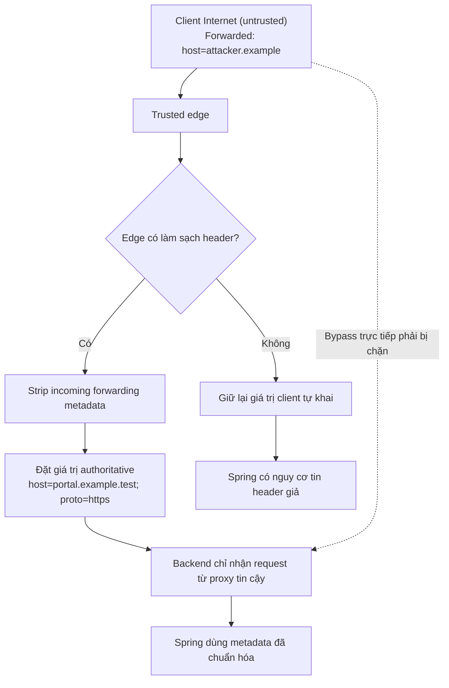

# Loại bỏ header giả mạo trước khi chuyển vào ứng dụng

> **Chương:** Proxy và nguồn gốc  
> **Module:** `SPRING_SECURITY_HTTP_PROTECTION` — bảo vệ HTTP và trình duyệt bằng Spring Security, gồm CSRF, CORS, security headers, CSP, HSTS, HTTP firewall và session, cho cả Servlet lẫn Reactive.  
> **Trọng tâm:** Khi có reverse proxy, CDN, load balancer hoặc ingress, phải **loại bỏ hoặc ghi đè các header do client không đáng tin tự khai** trước khi Spring Boot sử dụng `Forwarded`, `X-Forwarded-*`, `Host` và metadata định tuyến. Không dùng filter xử lý forwarded headers của Spring thay thế cho trust boundary ở hạ tầng.

## 1. Mục tiêu học tập

Sau bài này, người học có thể:

1. Chỉ ra tại sao một client bất kỳ có thể giả mạo `Forwarded`, `X-Forwarded-For`, `X-Forwarded-Proto`, `X-Forwarded-Host`, `X-Forwarded-Port` và `X-Forwarded-Prefix`.
2. Phân biệt chính xác ba thao tác **strip**, **overwrite** và **append**; biết thao tác nào hợp lý tại Internet edge và thao tác nào chỉ nên dùng giữa các trusted proxies.
3. Thiết kế hợp đồng sanitization giữa browser → CDN → LB → ingress → Spring, gồm **ai có quyền đặt metadata nào**, xử lý nhiều hop và chặn kết nối đi vòng edge.
4. Viết cấu hình reverse proxy minh họa cho HTTP/HTTPS công khai, host allowlist, canonical forwarded scheme/host/port/prefix và IP client đã kiểm soát.
5. Hiểu rằng `ForwardedHeaderFilter` (Servlet), `ForwardedHeaderTransformer` (WebFlux) và native forwarding là **bộ xử lý dữ liệu**, không phải cơ chế tự xác minh nguồn gửi.
6. Phân tích ảnh hưởng của header giả tới password-reset link, OAuth callback, HTTPS redirect, HSTS, cookie/session, CORS, CSRF, HTTP firewall, phân quyền theo IP và logging.
7. Kiểm thử cả **đường hợp lệ** lẫn **đường tấn công giả mạo** qua proxy thật, phân biệt phép thử edge với phép thử MockMvc/WebTestClient.
8. Xây dựng checklist và quy trình thay đổi an toàn khi nâng cấp proxy, thêm CDN hoặc thay kiến trúc triển khai.

**Nguyên tắc:** Metadata từ `Forwarded`/`X-Forwarded-*` phải là **kết quả xác minh của proxy tin cậy**, không phải bản sao từ header client Internet gửi lên.

## 2. Tấn công bắt đầu bằng một HTTP header rất bình thường

Giả sử ứng dụng ở `http://spring.internal:8080`, client truy cập qua `https://portal.example.test`. Edge biết được hostname và HTTPS public, rồi gửi vào backend:

```http
GET /account HTTP/1.1
Host: spring.internal:8080
X-Forwarded-Proto: https
X-Forwarded-Host: portal.example.test
X-Forwarded-Port: 443
X-Forwarded-For: 198.51.100.24
```

Nếu chính edge tạo các giá trị này từ kết nối đã được kiểm soát, Spring có thể dùng chúng để xây URL công khai, redirect hoặc ghi log nguồn request.

Nhưng một HTTP client bất kỳ cũng có thể thử gửi:

```http
GET /forgot-password HTTP/1.1
Host: portal.example.test
Forwarded: proto=https;host=attacker.example
X-Forwarded-Host: attacker.example
X-Forwarded-For: 127.0.0.1
X-Forwarded-Proto: https
```

Nếu edge chỉ **chuyển tiếp** những header này, backend không phân biệt được phần nào do edge xác minh, phần nào do client tự đặt. Các hậu quả có thể gồm:

- Link reset mật khẩu được sinh sang host do kẻ tấn công kiểm soát.
- Request Internet bị ghi nhận thành `127.0.0.1`, ảnh hưởng IP allowlist hoặc rate limiting.
- Ứng dụng hiểu request là HTTPS dù TLS chưa hề được xác minh tại điểm tin cậy.
- Redirect, OAuth2/OIDC callback, cookie, HSTS hoặc origin check có hành vi sai.
- Security matcher bị nhầm phạm vi khi prefix/path rewrite khác điều dự kiến.

**Không phải cứ có header là đã có lỗ hổng.** Lỗ hổng xuất hiện khi thành phần có đặc quyền **tin hoặc phản chiếu** một giá trị chưa được làm sạch.

### 2.1. Đường đi đúng và sai



Mục tiêu không phải chặn mọi request có `X-Forwarded-*`, mà là bảo đảm **header đến ứng dụng chỉ chứa những gì kiến trúc đã cho phép tin**.

## 3. Trước tiên phải xác định ranh giới tin cậy

### 3.1. Client, proxy và ứng dụng tin điều gì?

| Điểm trên đường đi | Có thể chứng minh | Không được mặc định |
|---|---|---|
| Client Internet | Gửi request HTTP; tự chọn nhiều header | Không được tự chứng nhận IP nội bộ, HTTPS hay hostname hợp lệ |
| Internet edge | IP peer đến edge, kết nối TLS, SNI/vhost và rule ingress đã áp dụng | Không tự tin những header forwarding client gửi |
| CDN/LB ở giữa | Peer thuộc IP/identity trusted upstream, metadata theo hợp đồng hop trước | Không tin mọi request chỉ vì đến từ mạng private |
| Ingress gần Spring | Địa chỉ/identity proxy được phép, route và rewrite của ingress | Không coi mọi XFF/Forwarded là sự thật khi có đường đi ngoài trusted chain |
| Spring backend | Socket peer, headers đã qua các tầng và request attributes sau transformer | Không tự xác minh giá trị header bằng tên gọi của nó |

Tập proxy đáng tin cần được cấu hình bằng **địa chỉ mạng/service identity có kiểm soát**. `10.0.0.0/8` hay `127.0.0.1` trong header không tự chứng minh request đáng tin. Trong Kubernetes, một pod khác trên mạng nội bộ cũng có thể phát HTTP request giả.

### 3.2. Ba lớp phòng vệ bắt buộc

1. **Lớp vào edge:** Kiểm tra host/SNI/listener, loại dữ liệu forwarded do Internet khai, gắn metadata công khai đã xác minh.
2. **Lớp kết nối backend:** Chỉ cho proxy đã được ủy quyền kết nối (firewall, security group, NetworkPolicy, service identity/mTLS hoặc chính sách tương đương).
3. **Lớp xử lý tại Spring:** Chọn chính xác một chiến lược đọc metadata đáng tin; không dùng raw headers cho authentication/authorization, vẫn giữ CSRF/CORS/security headers.

Thiếu bất kỳ lớp nào cũng có thể phá hợp đồng. Một edge hoàn hảo không giúp ích nếu backend mở trực tiếp; ngược lại, backend chặn direct access vẫn có nguy cơ nếu edge chuyển tiếp nguyên header do client tự khai.

## 4. Danh mục header phải kiểm soát

Không chỉ có mỗi `X-Forwarded-For`. Khi kiểm kê, xét **tất cả header mà proxy, container, framework hoặc custom filter thực sự sử dụng**.

| Header/nguồn | Tác dụng thường gặp | Nguy cơ khi phản chiếu nguyên giá trị |
|---|---|---|
| `Forwarded` | `for`, `by`, `proto`, `host` theo RFC 7239 | Host/proto/IP giả; nhiều phần tử mâu thuẫn |
| `X-Forwarded-For` | Chuỗi IP qua proxy | Giả loopback/internal IP, bypass hạn mức hoặc audit |
| `X-Real-IP` | IP client theo proxy cụ thể | Giả IP nếu edge tin header đầu vào |
| `X-Forwarded-Proto` | Public `http`/`https` | HTTPS detection, HSTS và redirect sai |
| `X-Forwarded-Host` | Host hoặc authority bên ngoài | Host poisoning, reset link/callback sai |
| `X-Forwarded-Port` | Port công khai | Sai origin hoặc redirect tới port không được phép |
| `X-Forwarded-Prefix` | Prefix URL đã bị reverse proxy strip | Sai redirect/path, rơi nhầm matcher |
| `X-Forwarded-Ssl`, `Front-End-Https`, `X-Url-Scheme` | Biến thể vendor/custom cho scheme | Bộ lọc tùy chỉnh có thể tin đường khác ngoài policy |
| `X-Forwarded-Server` | Thông tin proxy server | Rò rỉ/nhầm danh tính máy chủ khi dùng sai |
| `Host`, HTTP/2 `:authority` | Đích HTTP request | Header/authority poisoning nếu vhost không kiểm tra |
| `X-Original-URL`, `X-Rewrite-URL` | Một số proxy/framework dùng để định tuyến | Path override nguy hiểm nếu ứng dụng/hạ tầng hỗ trợ |
| PROXY protocol (L4, nếu dùng) | IP/port peer do proxy L4 thông báo | Nguy hiểm nếu listener nhận PROXY protocol từ client không tin cậy |

**Không phải mọi header trên đều được Spring Boot/Spring Security xử lý mặc định.** Các header vendor-specific được nêu để yêu cầu kiểm kê **stack thực tế**, nhất là custom code. Không “bật hỗ trợ” cho một header không cần dùng chỉ để dễ tích hợp.

### 4.1. `Host` khác với các forwarding headers

`Host` hoặc HTTP/2 `:authority` là metadata **đích request** do client gửi đến edge. Không thể đơn giản loại bỏ hoàn toàn vì HTTP routing cần nó; thay vào đó:

1. Edge kiểm tra Host/SNI/port theo vhost hoặc danh sách domain được chấp thuận.
2. Host ngoài danh sách bị từ chối/đưa tới default deny route.
3. Proxy đặt `Host` và `X-Forwarded-Host` **theo vhost đã xác minh**, không lấy từ header khác chưa tin.
4. Backend dùng canonical base URL hoặc tenant-host mapping đã xác minh cho các URL nhạy cảm.

Host header có thể được định tuyến hợp lệ mà vẫn độc hại nếu ứng dụng xây absolute URL từ host tùy ý. Vì vậy **kiểm tra domain + canonical URL** là hai biện pháp bổ sung.

### 4.2. `Origin` là header khác nhiệm vụ

`Origin` mô tả nguồn web khởi tạo request theo mô hình browser, còn `Forwarded: host`/`X-Forwarded-Host` mô tả host đích do proxy báo. CORS dựa vào **origin của caller**, không lấy host đích làm allowlist động.

Không tự xóa `Origin` như một “forwarded header giả” nếu ứng dụng cần CORS/Origin validation. Browser đặt `Origin` theo quy tắc của nó, nhưng non-browser clients vẫn có thể tự đặt; `Origin` không phải yếu tố xác thực. Bảo vệ CSRF cho request dùng cookie vẫn cần thiết theo threat model.

## 5. Strip, overwrite và append: khác nhau từ gốc

### 5.1. Strip — loại bỏ giá trị từ đầu vào không tin cậy

Ví dụ edge nhận:

```http
Forwarded: proto=https;host=attacker.example
X-Forwarded-For: 127.0.0.1
X-Forwarded-Proto: http
X-Forwarded-Host: attacker.example
```

Sau bước strip, các giá trị này **không còn được đưa nguyên trạng** vào upstream. Edge có thể bỏ hoàn toàn `Forwarded` và tạo nhóm `X-Forwarded-*` mới, hoặc tạo `Forwarded` mới theo chính sách.

Strip đặc biệt quan trọng ở **điểm đầu tiên tin cậy** nhận kết nối từ Internet. Nếu đã không tin client, không nên giữ tiền tố XFF của client rồi hy vọng downstream sẽ biết đâu là giả.

### 5.2. Overwrite — thay bằng dữ kiện edge đã xác minh

Ví dụ một edge TLS trực tiếp phục vụ `portal.example.test` và nghe cổng 443:

```http
X-Forwarded-Proto: https
X-Forwarded-Host: portal.example.test
X-Forwarded-Port: 443
X-Forwarded-For: 198.51.100.24
```

Các giá trị đến từ **TLS listener/vhost và remote socket peer** đã được xác nhận, không từ `$http_x_forwarded_proto` hay `$http_x_forwarded_host`.

Đối với `X-Forwarded-Prefix`, edge phải lấy từ rule mapping đã định nghĩa, ví dụ `/app`, không từ header do client tự chọn.

### 5.3. Append — chỉ sử dụng khi có trusted chain rõ

Một số proxy nối IP vào `X-Forwarded-For`. Điều đó có thể hợp lệ **sau khi điểm đầu tiên đã làm sạch input** và mỗi hop sau chỉ nhận lưu lượng từ proxy được tin.

Ví dụ được kiểm soát:

```text
Browser 198.51.100.24
  -> Edge đặt XFF: 198.51.100.24
  -> Ingress trusted append: 198.51.100.24, 10.0.1.4
  -> Spring kết nối từ ingress 10.0.2.9
```

Ngược lại, tại Internet edge nếu nối tiếp giá trị client:

```http
X-Forwarded-For: 127.0.0.1, 198.51.100.24
```

thì `127.0.0.1` vẫn có thể bị code lấy “IP đầu tiên” tin nhầm.

**Không kết luận mọi append đều sai**. Điều sai là dùng append **không có ranh giới đầu tiên** hoặc dùng XFF **không xét trusted hops**.

### 5.4. Bảng quyết định tại từng hop

| Trường hợp | Hành động |
|---|---|
| Internet → edge | Strip các forwarding headers chưa tin, tạo giá trị authoritative |
| Client gửi `Host` lạ | Từ chối/định tuyến về deny vhost; không phản chiếu host lạ |
| Edge → trusted ingress | Chuyển metadata đã xác minh, chỉ append nếu hợp đồng nhiều hop yêu cầu |
| Nguồn không thuộc trusted CDN gửi vào LB | Không cấp quyền tin forwarded metadata; tốt nhất từ chối đường đó |
| Ingress nhận cả `Forwarded` và `X-*` mâu thuẫn | Chuẩn hóa/từ chối theo policy, không để Spring tùy parser chọn |
| Backend nhận direct request từ Internet | Bị chặn ở lớp mạng hoặc xác thực service identity trước khi xử lý metadata |
| Ứng dụng không cần forwarded metadata | Không áp dụng; strip/remove-only theo pipeline phù hợp |

## 6. Một trường hợp giả mạo X-Forwarded-For điển hình

Giả sử backend có logic kiểm soát quản trị sai:

```java
// PHẢN VÍ DỤ: không dùng dữ liệu raw header để cấp quyền.
String claimed = request.getHeader("X-Forwarded-For");
boolean local = claimed != null && claimed.startsWith("127.0.0.1");
if (local) {
    runAdministrativeAction();
}
```

Client có thể gửi:

```http
POST /admin/rebuild HTTP/1.1
Host: portal.example.test
X-Forwarded-For: 127.0.0.1
```

Nếu edge không strip XFF, request có thể bị phân loại thành local. Vấn đề không chỉ là giá trị IP sai; hệ thống đã trao **quyền nghiệp vụ** cho một chuỗi HTTP header không đáng tin.

Cách sửa gồm hai mức:

- **Nguồn dữ liệu:** Để proxy/container xác định effective IP qua trusted proxy policy; không parse XFF tùy tiện ở controller.
- **Quyền nghiệp vụ:** Dùng Spring Security authentication, `hasAuthority(...)`/`hasRole(...)`, mTLS hoặc authorization phù hợp; IP allowlist chỉ là lớp bổ sung sau khi đã xác minh IP.

Ngay cả IP thật có thể đại diện NAT/VPN hoặc nhiều người dùng. Không coi IP đồng nghĩa principal.

### 6.1. Mô hình xác định client IP theo trusted hop

Một mô hình tư duy phổ biến:

1. Bắt đầu từ IP peer TCP mà lớp xác định IP **thực sự kết nối** tới.
2. Nếu peer không thuộc tập trusted proxies, **không tin** chuỗi XFF của nó.
3. Nếu peer đáng tin, xét các địa chỉ được báo theo đúng cú pháp và quy tắc hop của hạ tầng.
4. Di chuyển từ các hop gần backend về phía client, bỏ qua những hop **được xác minh** là trusted.
5. Một địa chỉ không tin cậy gần nhất có thể là nguồn được báo cho mục đích audit/rate limiting, nhưng không là user identity.
6. Nếu dữ liệu thiếu, sai cú pháp hoặc không khớp topology, không nâng đặc quyền dựa vào IP.

Đây **không phải yêu cầu tự viết parser Java**. Hãy dùng cấu hình trusted proxy/real IP của edge hoặc servlet container phù hợp phiên bản/triển khai. Với RFC `Forwarded`, cú pháp IPv6 quoted-string và giá trị obfuscated khiến parser tự chế càng dễ sai.

## 7. Những xung đột không giải quyết bằng regex

### 7.1. Hai họ header mâu thuẫn

```http
Forwarded: proto=https;host=portal.example.test
X-Forwarded-Proto: http
X-Forwarded-Host: attacker.example
```

Nếu gateway dùng `Forwarded` nhưng Spring/container lại ưu tiên `X-Forwarded-Host`, hai tầng hiểu khác nhau về request. Đây là rủi ro **parser differential**.

Giải pháp là thiết kế **một nguồn authoritative tại proxy**, xóa trường không dùng hoặc chuẩn hóa chúng để nhất quán. Không để mỗi controller tự chọn header mà nó “thích”.

### 7.2. Header lặp, khác chữ hoa–thường và nhiều giá trị

Các tên HTTP header thường không phân biệt hoa–thường. Một client có thể thử:

```http
X-Forwarded-Host: portal.example.test
x-forwarded-host: attacker.example
X-Forwarded-Proto: https, http
```

Một số thành phần có thể gộp hoặc xử lý trùng lặp theo cách khác. Sanitization phải dựa trên **HTTP parser và cấu hình proxy**, không chỉ dựa trên regex tìm đúng cách viết `X-Forwarded-Host` trong một chuỗi log.

Cần negative test với header lặp/multi-value nếu hạ tầng cho phép request kiểu đó. Lựa chọn an toàn thường là **loại hoặc chuẩn hóa ở edge** trước khi chuyển cho application.

### 7.3. IPv6, port và host hợp lệ về cú pháp

`Forwarded` có thể chứa host dạng IPv6 literal:

```http
Forwarded: proto=https;host="[2001:db8::20]:8443"
```

Không tự cắt chuỗi theo dấu `:` để tìm port; địa chỉ IPv6 có nhiều dấu hai chấm. Với host public nhiều tenant, cần kiểm tra **hostname/authority hợp lệ theo danh sách phê duyệt**, không chấp nhận mọi chuỗi có dạng URI hợp lệ.

### 7.4. Giá trị không hợp lệ hoặc bất thường

Khi header chứa dấu phân tách lạ, `for=unknown`, obfuscated token, port không hợp lệ, hostname rỗng hoặc chuỗi nhiều hop ngoài dự kiến, không nên tự “làm sạch” rồi mặc định coi là trusted. Tùy policy, **từ chối request ở edge** hoặc bỏ header và sử dụng dữ liệu canonical đã xác minh.

Một thư viện/HTTP parser thường đã ngăn header chứa CR/LF thô; tuy vậy, cần test cấu hình front door chống request smuggling/normalization khác nhau giữa proxies nếu hạ tầng có nhiều bộ phân tích HTTP. Đó là lớp rủi ro bổ sung, **không đồng nghĩa** CSRF hay Host poisoning.

## 8. Cấu hình Nginx minh họa: edge trực tiếp nhận HTTPS

Giả định cụ thể:

- Nginx là **edge cuối cùng nhận kết nối Internet trực tiếp**, không đứng sau CDN/LB.
- Public hostname duy nhất là `portal.example.test` và HTTPS cổng 443.
- Backend `spring.internal:8080` chỉ có thể kết nối từ Nginx/mạng đáng tin.
- Public `/app/**` được rewrite thành backend `/**`.
- TLS certificate, cấu hình chống Host lạ, timeout, bảo vệ origin và rate limit đã được quản lý ở hạ tầng; snippet này chỉ minh họa sanitization forwarding metadata.

```nginx
server {
    listen 443 ssl;
    server_name portal.example.test;

    # Chứng chỉ TLS và default vhost từ chối Host lạ
    # phải được cấu hình riêng trong hạ tầng thực tế.

    location /app/ {
        # /app/orders -> /orders trên upstream.
        proxy_pass http://spring.internal:8080/;

        # Host public do vhost được kiểm soát quyết định.
        proxy_set_header Host portal.example.test;

        # Không chuyển RFC Forwarded giả do client gửi.
        # Nginx bỏ header upstream nếu giá trị là chuỗi rỗng.
        proxy_set_header Forwarded "";

        # Metadata public authoritative được tạo mới.
        proxy_set_header X-Forwarded-Proto https;
        proxy_set_header X-Forwarded-Host portal.example.test;
        proxy_set_header X-Forwarded-Port 443;
        proxy_set_header X-Forwarded-Prefix /app;

        # Edge trực tiếp: TCP peer là client.
        # GHI ĐÈ XFF đầu vào, không append tiền tố giả.
        proxy_set_header X-Forwarded-For $remote_addr;
        proxy_set_header X-Real-IP $remote_addr;

        # Các biến thể chỉ strip nếu đã xác nhận stack
        # không cần chúng và chúng có thể bị downstream đọc.
        proxy_set_header X-Forwarded-Ssl "";
        proxy_set_header X-Url-Scheme "";
        proxy_set_header Front-End-Https "";
        proxy_set_header X-Forwarded-Server "";
    }
}
```

### 8.1. Cấu hình này bảo vệ được gì?

- `X-Forwarded-Host`/`Proto`/`Port`/`Prefix` không lấy từ `$http_x_forwarded_*` do client có thể tự gửi.
- `X-Forwarded-For`/`X-Real-IP` không lấy giá trị client tự khai; chúng sử dụng peer IP mà Nginx thấy trong **mô hình edge trực tiếp**.
- `Forwarded` từ client bị loại trước khi Spring diễn giải.
- `Host` gửi vào backend là giá trị đã chọn từ vhost public được kiểm soát.
- Các header biến thể không cần thiết được loại, giúp giảm khả năng custom library dùng đường tín hiệu khác.

**Giới hạn:** Đây không phải cấu hình Nginx production hoàn chỉnh. Chỉ một `server_name` không tự bảo đảm Host lạ luôn bị chặn: cần default server/vhost policy từ chối đúng, cả với HTTP/2 `:authority`. Network policy chặn direct-origin cũng nằm ngoài snippet.

### 8.2. Vì sao `proxy_set_header Forwarded "";` cần đi kèm kiểm kê?

Nginx có thể chuyển tiếp các request headers **không được ghi đè** theo mặc định. Việc strip `Forwarded` là cần nếu Spring/container ưu tiên RFC header này. Nhưng nếu một thư viện còn đọc `X-Original-URL` hoặc `X-Forwarded-Ssl`, chỉ strip các header phổ biến vẫn chưa đủ.

Hãy kiểm kê cả ứng dụng và hạ tầng:

- Front proxy có phát các header vendor-specific không?
- Container/native valve đang đọc tên header nào?
- Custom authentication/authorization filter có đọc trực tiếp header nào không?
- Có API gateway dùng `X-Original-URL` hoặc path override không?
- Có proxy protocol ở tầng TCP không, và listener có bị truy cập ngoài trusted network không?

Không nên xóa `Origin`/`Authorization` hay các header nghiệp vụ tùy tiện dưới nhãn “sanitize forwarding”; việc strip cần **đúng nhóm metadata có thể được tin nhầm**.

### 8.3. Hai phản ví dụ nguy hiểm

```nginx
# PHẢN VÍ DỤ 1: phản chiếu giá trị client tự khai.
proxy_set_header X-Forwarded-Host $http_x_forwarded_host;
proxy_set_header X-Forwarded-Proto $http_x_forwarded_proto;

# PHẢN VÍ DỤ 2: tại Internet edge chưa làm sạch XFF.
proxy_set_header X-Forwarded-For $proxy_add_x_forwarded_for;
```

`$proxy_add_x_forwarded_for` không phải lúc nào cũng nguy hiểm: nó có thể đúng ở **trusted internal hop** sau khi incoming XFF đã được canonicalized. Vấn đề trong ví dụ là edge trực tiếp để lại phần client đã viết ở đầu chuỗi, rồi backend có thể dùng sai.

### 8.4. Khi public HTTPS chạy port tùy chỉnh

Nếu public URL là `https://portal.example.test:8443/app`, đổi đồng bộ:

```nginx
listen 8443 ssl;
proxy_set_header Host portal.example.test:8443;
proxy_set_header X-Forwarded-Host portal.example.test;
proxy_set_header X-Forwarded-Port 8443;
proxy_set_header X-Forwarded-Proto https;
```

Đây là một **mảnh cấu hình minh họa**, phải đặt trong đúng vhost `server`. Không để `Forwarded: host` và `X-Forwarded-Port` mâu thuẫn; đừng nối port thủ công vào host đã có port. Kiểm thử absolute `Location`, OAuth2 redirect URI và origin với cổng 8443.

## 9. CDN → LB → ingress: không được làm sạch sai tầng

Với chuỗi nhiều hop:

```text
Browser
  -> CDN HTTPS edge
  -> Cloud load balancer
  -> Ingress
  -> Spring Boot
```

Có hai quyết định tách biệt:

1. **Ai xác minh request public?** Thường là CDN/edge đầu tiên tiếp xúc với Internet, có TLS, host, IP kết nối thực.
2. **Ai được phép chuyển tiếp metadata đó đến Spring?** Chỉ các downstream hops được kết nối với upstream đáng tin và có hợp đồng preservation/normalization.

### 9.1. Hợp đồng mẫu giữa các hop

| Hop | Nguồn được phép | Xử lý metadata |
|---|---|---|
| CDN edge | Internet | Strip mọi incoming forwarding metadata không đáng tin; đặt public proto/host/port/client IP được xác minh |
| LB | Chỉ CDN ranges hoặc service identity được phép | Tin metadata CDN theo hợp đồng; từ chối nguồn ngoài trusted upstream |
| Ingress | Chỉ LB đã được xác thực | Bảo toàn hoặc chuẩn hóa metadata authoritative; không ghi đè public HTTPS thành HTTP do hop nội bộ |
| Spring | Chỉ ingress/service identity | Dùng một chiến lược framework/native để diễn giải; không đọc raw headers để cấp quyền |

**Không được** chỉ cấu hình load balancer có thể nhận traffic từ CDN **và** trực tiếp Internet rồi lại tin cùng loại forwarded headers từ cả hai nguồn. Nếu có nhiều đường vào, phải có chính sách phân biệt nguồn và mức độ tin tương ứng.

### 9.2. Bẫy ghi đè `X-Forwarded-Proto`

Browser → CDN dùng HTTPS; CDN → LB và LB → ingress dùng HTTP nội bộ. Ingress không được tự động coi “HTTP trên hop cuối” là public scheme `http` nếu metadata từ trusted edge đã xác nhận `https`.

Nhưng nếu request **không** đến từ trusted upstream, ingress cũng không được tin `X-Forwarded-Proto=https` mà caller tự gửi. Vì thế không có quy tắc đơn giản “luôn giữ header cũ” hay “luôn ghi đè bằng scheme hop cuối” cho mọi topology. Phải gắn hành vi với **nguồn kết nối đáng tin**.

### 9.3. Bẫy IP khi thêm CDN

Trong cấu hình Nginx edge trực tiếp, `$remote_addr` là client peer. Khi thêm CDN, `$remote_addr` có thể thành IP CDN. Muốn lấy IP người dùng, cần thực thi cấu hình real-IP/trusted-proxy cụ thể của CDN, với IP ranges cập nhật và header do CDN bảo đảm.

Nếu CDN có một header proprietary báo client IP, **không nhận giá trị đó khi request có thể bypass CDN**. Hạ tầng phải chống direct access và xác định rõ header nào là authoritative cho topology mới.

### 9.4. Đổi topology là thay đổi bảo mật

Thêm Cloudflare/CDN, đổi ingress controller, chuyển L4 → L7 load balancer, bật service mesh hoặc đổi TLS termination đều có thể thay đổi:

- Ý nghĩa `X-Forwarded-For` và số phần tử chuỗi.
- Nguồn authoritative cho `proto/host/port`.
- Cách xử lý `Forwarded` chuẩn so với `X-Forwarded-*`.
- Path rewrite/`X-Forwarded-Prefix` và cách Spring Security matcher thấy request.
- IP/identity nguồn được phép truy cập backend.

Vì vậy, cần **regression test trust boundary** mỗi khi cấu hình hạ tầng thay đổi, kể cả khi Java controller không đổi.

## 10. Spring MVC/Servlet: chỉ đọc forwarded headers sau khi đã làm sạch

Spring Boot có thể dùng:

```yaml
# Chỉ bật khi hạ tầng đã chặn direct-origin
# và proxy tin cậy đã sanitize incoming headers.
server:
  forward-headers-strategy: framework
```

Các chiến lược được Spring Boot hỗ trợ thường gồm `none`, `framework` và `native`; hành vi cụ thể phụ thuộc phiên bản Boot/container và cấu hình triển khai.

### 10.1. `ForwardedHeaderFilter`

Nếu ứng dụng tự quản lý Servlet filter thay vì để Boot đăng ký:

```java
import org.springframework.context.annotation.Bean;
import org.springframework.web.filter.ForwardedHeaderFilter;

@Bean
ForwardedHeaderFilter forwardedHeaderFilter() {
    return new ForwardedHeaderFilter();
}
```

Filter giúp các API Servlet thấy scheme/host/port đã chuyển tiếp và hỗ trợ một số redirect behavior. **Nó không xác minh tính tin cậy của IP proxy**. Khi client có thể gửi metadata giả tới filter, filter vẫn có thể diễn giải metadata đó.

Nếu Boot đã đăng ký `ForwardedHeaderFilter` theo `framework`, không thêm filter thứ hai trùng vai trò. Tương tự, không bật native rewrite và framework rewrite chồng lên nhau mà không có kế hoạch và test rõ.

### 10.2. Chế độ remove-only

Nếu chủ đích **không tin forwarded headers** bên trong application, một defense-in-depth là:

```java
ForwardedHeaderFilter filter = new ForwardedHeaderFilter();
filter.setRemoveOnly(true);
```

Ở chế độ này, filter loại các forwarded headers theo cơ chế của nó mà không dùng chúng để điều chỉnh scheme/host/port. **Không** mong `request.getServerName()` tự thành public hostname trong remove-only. Ứng dụng có thể dùng một canonical base URL cố định nếu cần tạo link công khai.

**Giới hạn thứ tự:** Nếu Tomcat/native valve hoặc proxy trước đó đã biến header giả thành request attributes, đặt `removeOnly` sau bước đó không thể “quay ngược thời gian” để xác minh lại nguồn. **Bảo vệ sớm nhất phải ở edge**, trước bất kỳ trusted consumer nào.

### 10.3. Native container và danh sách trusted proxies

Tomcat có cơ chế như `RemoteIpValve` để diễn giải forwarded client IP/protocol. Nếu dùng `server.forward-headers-strategy=native`, phải xem chính xác container đang tin các proxy/hop nào. Không mặc định “native = an toàn” nếu proxy CIDR quá rộng hoặc request Internet đi thẳng tới backend.

Cấu hình native cần được test với topology thật: một proxy, nhiều hop, CDN IP thay đổi, đường request bất thường và header giả từ nguồn không tin cậy.

### 10.4. Đừng sửa trust boundary bằng một custom servlet filter quá muộn

Một filter tự viết:

```java
// PHẢN VÍ DỤ tư duy: xóa X-Forwarded-For trong controller/filter
// sau khi container đã parse và tin remoteIp.
String rawXff = request.getHeader("X-Forwarded-For");
```

Không giải quyết được nếu component trước đó đã sử dụng XFF để tạo `getRemoteAddr()` hay redirect. Với Java Servlet, `HttpServletRequest` còn không có một API phổ quát “xóa mọi header tùy ý” không qua wrapper/filter thích hợp.

Thứ tự và phạm vi xử lý phải do kiến trúc định nghĩa; **không xây an toàn dựa trên việc mỗi controller nhớ xóa vài header**.

## 11. WebFlux/Reactive: `ForwardedHeaderTransformer` không phải trusted-proxy validator

Spring WebFlux có `ForwardedHeaderTransformer`. Khi Boot cấu hình `server.forward-headers-strategy=framework`, stack tương ứng có thể đăng ký cơ chế xử lý forwarding này.

Nếu tự tạo bean trong ứng dụng không có auto-configuration:

```java
import org.springframework.context.annotation.Bean;
import org.springframework.web.server.adapter.ForwardedHeaderTransformer;

@Bean
ForwardedHeaderTransformer forwardedHeaderTransformer() {
    return new ForwardedHeaderTransformer();
}
```

Transformer có thể thay đổi URI mà `ServerHttpRequest.getURI()` trả về dựa trên forwarding metadata. Nhưng nó **không hỏi xem request có đến từ một CDN CIDR được phê duyệt hay không** trước khi tin thông tin.

Nếu chỉ muốn loại bỏ header:

```java
ForwardedHeaderTransformer transformer =
    new ForwardedHeaderTransformer();
transformer.setRemoveOnly(true);
```

Ý nghĩa tương tự Servlet: strip metadata trước khi downstream sử dụng, **không khôi phục external URL**. Nếu cần cả public URL đúng lẫn anti-spoof, xử lý đúng ở trusted edge và cho transformer đọc **giá trị authoritative**.

### 11.1. Phân biệt request URI và authentication

Một handler WebFlux có thể đọc:

```java
import java.net.URI;
import org.springframework.web.server.ServerWebExchange;

static URI requestUri(ServerWebExchange exchange) {
    return exchange.getRequest().getURI();
}
```

URI này phản ánh những biến đổi của pipeline, không phải bằng chứng user đã đăng nhập hoặc đã dùng TLS thật nếu metadata trước transformer không đáng tin.

Spring Security `SecurityWebFilterChain` vẫn phải xác thực/phân quyền. Browser dùng cookie vẫn cần `CsrfWebFilter`; bearer-only API có thể tắt CSRF trong chain riêng nếu **không** có cookie fallback.

### 11.2. Bảo vệ body/path/header ở Reactive

WebFlux không xử lý request theo Servlet API, nhưng nguyên tắc proxy sanitization vẫn như nhau. Đừng đưa raw forwarding headers trực tiếp vào reactive `SecurityWebFilterChain` matcher để cấp đặc quyền; nếu routing theo host/tenant, host phải được xác thực tại edge và kiểm chứng mapping trong ứng dụng.

Với reverse proxy rewrite `/app/**` thành `/**`, cần test path mà matcher thực tế quan sát và `X-Forwarded-Prefix` đã được canonicalized; không suy rằng transformer luôn thay đổi authorization matcher theo cùng một quy tắc giữa các phiên bản/framework.

## 12. Khi một header giả gây hậu quả bảo mật thực tế

### 12.1. Password reset/activation link

Ứng dụng tạo URL tuyệt đối từ `getServerName()` hoặc forwarded host. Nếu một attacker khiến host trở thành `attacker.example`, email gửi cho người dùng có thể chứa link dẫn tới domain sai, làm lộ token reset nếu hệ thống nhúng token vào URL.

**Phòng vệ:** Edge allowlist Host, strip/overwrite forwarded host, cân nhắc canonical base URL cấu hình tường minh hoặc tenant domain mapping đã xác minh. Test negative phải kiểm tra **URL được sinh**, không chỉ status 200/302.

### 12.2. OAuth2/OIDC redirect URI

Login flow có thể xây `{baseUrl}` từ scheme/host/port/prefix. Header `X-Forwarded-Proto` giả hoặc host sai khiến redirect URI không khớp IdP hoặc trỏ sang origin không mong muốn.

Đừng mở rộng redirect URI allowlist tùy tiện để “cứu” cấu hình proxy sai. Giữ `state`/`nonce` và chính sách redirect của OAuth2/OIDC, bên cạnh việc fix forwarding trust boundary.

### 12.3. HTTP vs HTTPS, HSTS và redirect loop

Nếu public HTTPS terminate tại LB nhưng Spring thấy HTTP nội bộ, có thể phát sinh redirect tới HTTP hoặc thiếu HSTS từ Spring Security. Nếu tin `X-Forwarded-Proto=https` giả do client đặt, application cũng có thể hiểu nhầm request là HTTPS.

Giải pháp **không phải** tắt HTTPS enforcement hay HSTS. Cần bảo đảm edge xác nhận TLS public, xuất `proto` authoritative, backend chỉ tin traffic từ edge và kiểm thử response public.

### 12.4. Cookie/session và `Secure`/`SameSite`

Cookie đăng nhập mang `Secure`, `HttpOnly`, `SameSite`, `Domain` và `Path` cần phù hợp public URL và browser semantics. Sai scheme/prefix có thể khiến cookie không được gửi, session “mất” hoặc login/logout hoạt động thất thường.

`HttpOnly` và `SameSite` **không thay CSRF token** nếu server nhận ambient credential. Cookie không scope theo TCP port như origin, nhưng URL redirect sang port khác vẫn có thể làm hỏng luồng ứng dụng, CORS hoặc origin-sensitive logic.

### 12.5. IP allowlist, rate limit và audit

Nếu `X-Forwarded-For` giả được coi là IP thật:

- Người ngoài có thể né IP restriction.
- Rate limit tính sai theo IP giả, vừa gây abuse vừa ảnh hưởng người dùng khác.
- Audit trail mất tính đáng tin.
- Công cụ detection có thể phân loại sai nguồn tấn công.

Giải pháp là tin IP từ trusted proxy chain và không dựa IP đơn lẻ để cấp quyền nghiệp vụ. Log nên tách `tcp_peer_ip`, `effective_client_ip` và policy source (nếu cần và phù hợp quy định dữ liệu), không lưu secrets.

### 12.6. CORS và CSRF là các cơ chế riêng

CORS xét `Origin` của browser caller, không suy allowlist từ `X-Forwarded-Host`. CORS cho script không bảo vệ mọi cross-site form POST, vì trình duyệt có thể gửi request mà không cần JavaScript đọc response.

Với browser-session hoặc JWT cookie, unsafe methods vẫn cần CSRF theo chính sách. Đổi reverse proxy hoặc xóa forwarded headers giả không làm CSRF tự xuất hiện; cần giữ đúng `SecurityFilterChain`/`SecurityWebFilterChain` và CSRF matcher.

### 12.7. HTTP firewall không làm nhiệm vụ thay edge

`StrictHttpFirewall` trên Servlet có thể từ chối path/method/encoding bất thường. Nó không mặc nhiên xác minh giá trị `X-Forwarded-Host` hay tập proxy CIDR. Một URL hợp lệ với forwarded host độc hại vẫn cần được edge sanitize.

Ngược lại, firewall có thể chặn URL đã bị proxy rewrite bất thường; phải xác định source của lỗi 400/403, không nới firewall để vượt qua các đường dẫn không an toàn.

## 13. Mô hình kiểm thử: tách ba tầng bằng chứng

Một bộ test đúng cần chứng minh:

| Tầng | Câu hỏi | Công cụ/kiểm thử |
|---|---|---|
| **A. Edge sanitize** | Client giả header có bị chặn/ghi đè trước upstream không? | HTTP request qua Nginx/CDN/LB staging, inspect forwarded metadata an toàn |
| **B. Network boundary** | Client có thể bypass edge và nói chuyện trực tiếp với Spring không? | Network policy/security group validation, direct-origin negative test |
| **C. Spring behavior** | Với metadata đáng tin, Servlet/WebFlux hiểu URL đúng và security chain có chạy không? | MockMvc/WebTestClient và integration tests với filters |

**Sai lầm cần tránh:** Một test `MockMvc` tự gắn `X-Forwarded-Host: attacker.example` rồi thấy Spring biến đổi host đúng **không chứng minh proxy an toàn**. Nó chỉ chứng minh Spring sẽ tin header nếu header được đưa đến đó — chính vì thế tầng A và B rất quan trọng.

### 13.1. Ma trận positive/negative tests

| Request/điều kiện | Kỳ vọng |
|---|---|
| HTTPS public qua edge, không header giả | Redirect/URI dùng scheme/host/port công khai |
| Public host không trong allowlist | Edge từ chối/deny vhost |
| Client giả `X-Forwarded-Host: attacker.example` | Backend/Location/link không mang host giả |
| Client giả `Forwarded: host=attacker.example` | RFC header bị strip hoặc thay bằng authoritative metadata |
| Client giả `X-Forwarded-Proto: http` qua HTTPS edge | Spring vẫn thấy public HTTPS |
| Client giả `X-Forwarded-Port: 8080` | Redirect vẫn dùng public port thực |
| Client giả `X-Forwarded-Prefix: /admin` | URL/routing không sử dụng prefix giả |
| Client giả `X-Forwarded-For: 127.0.0.1` | Không được coi là IP loopback/admin |
| Client giả `X-Real-IP: 10.0.0.1` | Không thay IP đã xác minh |
| Client gửi `Forwarded` và `X-*` mâu thuẫn | Edge loại/chuẩn hóa/từ chối theo policy |
| Header lặp/mixed-case/multiple values | Không tạo đường bypass khác |
| Gửi trực tiếp vào origin từ mạng ngoài | Bị network controls chặn |
| CDN/LB nhiều hop hợp lệ | IP/proto/host/port nhận đúng theo trust contract |
| Nguồn không phải CDN gọi LB | Không được cùng quyền tin forwarding metadata |
| Browser POST cookie không CSRF token | Spring Security từ chối, không thay đổi dữ liệu |
| Browser POST có token đúng và đủ quyền | Handler thực thi theo nghiệp vụ |
| Bearer-only API chỉ có cookie session hợp lệ | Không được xác thực bằng cookie fallback |
| Webhook chữ ký sai nhưng có cookie session | Verifier từ chối, không side effect |
| CORS preflight origin ngoài allowlist | Không được cấp CORS permission ngoài policy |
| OAuth callback/reset links qua HTTPS | Đúng canonical external origin, không lộ host nội bộ |
| HSTS/CSP/security headers | Đúng chính sách, không do forwarded values giả quyết định |

Status 200, 302, 400 hay 403 riêng lẻ không đủ: kiểm tra **Location, Set-Cookie, origin, metadata quan sát sau proxy, filter từ chối và side effects**.

## 14. Thử trực tiếp qua proxy ở staging

Các request bên dưới chỉ dành cho **hạ tầng do dự án sở hữu và được phép kiểm thử**.

### 14.1. Test dương: URL công khai bình thường

```bash
curl -i 'https://portal.example.test/app/login'
```

Kiểm tra URL `Location` nếu có redirect, giá trị HSTS và cookie theo policy, không lộ hostname backend.

### 14.2. Test âm: giả forwarding headers từ phía client

```bash
curl -i \
  -H 'Forwarded: for=127.0.0.1;proto=http;host=attacker.example' \
  -H 'X-Forwarded-For: 127.0.0.1' \
  -H 'X-Real-IP: 127.0.0.1' \
  -H 'X-Forwarded-Proto: http' \
  -H 'X-Forwarded-Host: attacker.example' \
  -H 'X-Forwarded-Port: 8080' \
  -H 'X-Forwarded-Prefix: /admin' \
  'https://portal.example.test/app/login'
```

Nếu policy là **overwrite**, backend vẫn phải nhận public scheme/host/port/prefix đúng; nếu policy là **reject suspicious request**, response từ chối cũng hợp lệ. Không được để giá trị attacker trở thành nguồn quyết định redirect, IP allowlist hoặc bypass quyền.

Thử thêm:

```bash
# Header chuẩn và X-* mâu thuẫn.
curl -i \
  -H 'Forwarded: proto=https;host=attacker.example' \
  -H 'X-Forwarded-Host: portal.example.test' \
  'https://portal.example.test/app/login'

# XFF có nhiều giá trị, phần tử loopback đứng trước.
curl -i \
  -H 'X-Forwarded-For: 127.0.0.1, 192.0.2.55' \
  'https://portal.example.test/app/login'
```

Khi cần thử Host không hợp lệ, dùng một môi trường staging/hostname test có quyền và xác minh edge từ chối vhost lạ; không gửi tới hệ thống bên ngoài phạm vi kiểm thử.

### 14.3. Kiểm chứng direct-origin bypass

Đây là test **hạ tầng**, không phải test endpoint GET:

- Từ nguồn không được phép, kiểm tra đường kết nối tới cổng ứng dụng/container có bị chặn không.
- Từ trusted ingress, xác nhận kết nối vẫn hoạt động.
- Nếu backend cần mTLS/service identity, kiểm tra client không có identity phù hợp bị từ chối.
- Với Kubernetes, xác minh cả ingress public, Service exposure và NetworkPolicy theo topology thực tế.

Không yêu cầu lộ IP nội bộ ra log công khai hoặc mở tạm backend để thử. Test ở môi trường staging đã được cấp quyền.

### 14.4. Đừng quên âm tính khi có nhiều hop

Một test qua CDN hợp lệ không chứng minh LB từ chối traffic đi vòng CDN. Nếu hạ tầng có nhiều ingress, health check, admin port hoặc internal service mesh, mỗi đường vào cần được phân loại mức độ tin metadata.

## 15. Test Servlet bằng MockMvc: xác nhận cơ chế diễn giải, không xác nhận edge

Một controller **chỉ cho test**:

```java
import java.util.Map;
import jakarta.servlet.http.HttpServletRequest;
import org.springframework.web.bind.annotation.GetMapping;
import org.springframework.web.bind.annotation.RestController;

@RestController
class AddressDiagnosticController {

    @GetMapping("/__test/observed-address")
    Map<String, Object> address(HttpServletRequest request) {
        return Map.of(
            "scheme", request.getScheme(),
            "secure", request.isSecure(),
            "host", request.getServerName(),
            "port", request.getServerPort());
    }
}
```

Test `ForwardedHeaderFilter` (nếu không phải Boot đã đăng ký trong test):

```java
import org.junit.jupiter.api.Test;
import org.springframework.test.web.servlet.MockMvc;
import org.springframework.test.web.servlet.setup.MockMvcBuilders;
import org.springframework.web.filter.ForwardedHeaderFilter;

import static org.springframework.test.web.servlet.request.MockMvcRequestBuilders.get;
import static org.springframework.test.web.servlet.result.MockMvcResultMatchers.jsonPath;
import static org.springframework.test.web.servlet.result.MockMvcResultMatchers.status;

class ForwardedMetadataSemanticsTest {

    private final MockMvc mvc = MockMvcBuilders
        .standaloneSetup(new AddressDiagnosticController())
        .addFilters(new ForwardedHeaderFilter())
        .build();

    @Test
    void frameworkUsesCanonicalForwardedMetadata() throws Exception {
        mvc.perform(get("/__test/observed-address")
                .header("X-Forwarded-Proto", "https")
                .header("X-Forwarded-Host", "portal.example.test")
                .header("X-Forwarded-Port", "8443"))
            .andExpect(status().isOk())
            .andExpect(jsonPath("$.scheme").value("https"))
            .andExpect(jsonPath("$.secure").value(true))
            .andExpect(jsonPath("$.host").value("portal.example.test"))
            .andExpect(jsonPath("$.port").value(8443));
    }
}
```

**Giới hạn:** Vì test tự đặt headers, nó chứng minh **Spring hiểu các giá trị khi được cung cấp**. Nó không chứng minh nguồn đã qua proxy, không chứng minh `Forwarded` giả sẽ bị strip ở edge, và `standaloneSetup` không gắn toàn bộ Spring Security chain.

### 15.1. Test remove-only khi ứng dụng không tin forwarding metadata

```java
ForwardedHeaderFilter filter = new ForwardedHeaderFilter();
filter.setRemoveOnly(true);
```

Trong fixture có filter này, request thử với `X-Forwarded-Proto=https` nhưng socket test HTTP sẽ **không** được transformer cập nhật thành secure chỉ vì header. Tuy nhiên, cần xác minh pipeline thực tế nếu container native đã đọc headers **trước** filter.

### 15.2. CSRF integration test là bộ kiểm thử khác

Một `POST /api/web/orders` dùng session cookie phải có test thiếu/sai/đúng CSRF token qua toàn bộ security filters; header forwarding không tự bảo vệ chống CSRF. Với `POST /api/m2m/orders` chỉ nhận bearer, test cookie-only hợp lệ phải thất bại; đừng dùng `with(user())` để chứng minh không fallback vì helper này đưa authentication trực tiếp vào test context.

## 16. Test WebFlux bằng WebTestClient

Trong WebFlux, `ForwardedHeaderTransformer` có thể ảnh hưởng URI mà controller quan sát.

Fixture test:

```java
import java.util.Map;
import org.springframework.web.bind.annotation.GetMapping;
import org.springframework.web.bind.annotation.RestController;
import org.springframework.web.server.ServerWebExchange;

@RestController
class ReactiveAddressDiagnostic {

    @GetMapping("/__test/observed-address")
    Map<String, Object> address(ServerWebExchange exchange) {
        var uri = exchange.getRequest().getURI();
        return Map.of(
            "scheme", uri.getScheme(),
            "host", uri.getHost(),
            "port", uri.getPort());
    }
}
```

Trong application test có `ForwardedHeaderTransformer` được đăng ký:

```java
webTestClient.get()
    .uri("/__test/observed-address")
    .header("X-Forwarded-Proto", "https")
    .header("X-Forwarded-Host", "portal.example.test")
    .header("X-Forwarded-Port", "8443")
    .exchange()
    .expectStatus().isOk()
    .expectBody()
    .jsonPath("$.scheme").isEqualTo("https")
    .jsonPath("$.host").isEqualTo("portal.example.test")
    .jsonPath("$.port").isEqualTo(8443);
```

Vẫn phải có integration test đi qua `SecurityWebFilterChain`/`CsrfWebFilter` nếu muốn đánh giá CSRF/authorization. Một phép thử URI với WebTestClient không đi qua CDN, Nginx hoặc ingress thật nên không thể thay negative test spoofing ở edge.

## 17. Bộ điều kiện nghiệm thu cho mỗi thay đổi hạ tầng

Để tránh “làm xong rồi quên”, đặt tiêu chí rõ cho Pull Request hoặc infrastructure change:

### 17.1. Chứng cứ cấu hình

- Sơ đồ traffic path và danh sách hop được phép.
- Vhost/hostname/port public và TLS termination.
- Danh sách forwarding header được **strip** và được **tạo lại** ở edge.
- Policy tin IP/identity của upstream/downstream, cùng cơ chế chặn direct-origin.
- Cấu hình Spring Boot `none/framework/native` và lý do chọn.
- Cấu hình route rewrite, `X-Forwarded-Prefix` và tác động tới Spring Security matcher.
- Ghi nhận các header vendor-specific được custom filters hoặc gateway sử dụng.
- Chủ sở hữu và trigger review khi hạ tầng thay đổi.

### 17.2. Chứng cứ test

- Positive test qua public URL: scheme/host/port/prefix/redirect/cookie đúng.
- Negative tests chống `Forwarded` và `X-Forwarded-*` giả, nhiều giá trị và xung đột.
- Negative test direct-origin bypass và nguồn không thuộc trusted CDN.
- Security tests: CSRF session routes, bearer-only không cookie fallback, webhook signature.
- Tests HSTS/CSP/CORS theo chính sách, không dùng một status 403 để kết luận tất cả.
- Trace/log không chứa secret hoặc raw session/JWT, phân biệt peer IP và client IP đã xác minh.

### 17.3. Quy tắc khi test thất bại

Nếu header giả tới được Spring, hãy ưu tiên **sửa edge/network boundary**. Không “chữa” bằng một regex controller hoặc `csrf.disable()`. Nếu proxy đã sanitize đúng nhưng URL vẫn sai, sửa cấu hình framework/native/canonical URL. Nếu CSRF hoặc authorization sai, sửa security chains và token flow — đó là lớp khác.

Một bản vá đúng phải có test chứng minh **nguyên nhân gốc đã được loại bỏ** và không làm suy yếu các lớp bảo mật khác.

## 18. Tình huống thực hành: mở CDN rồi lộ link reset

Dịch vụ có cấu trúc ban đầu:

```text
Browser -> Nginx HTTPS edge -> Spring Boot:8080
```

Nginx đặt `X-Forwarded-Host=portal.example.test` và `X-Forwarded-Proto=https`. Backend không public; link reset được sinh từ canonical public origin.

Sau một lần mở rộng, nhóm hạ tầng thêm CDN:

```text
Browser -> CDN -> LB -> Nginx ingress -> Spring Boot
```

Một người thay cấu hình thành:

```nginx
# PHẢN VÍ DỤ: sao chép các header đầu vào mà không xác minh.
proxy_set_header X-Forwarded-Host $http_x_forwarded_host;
proxy_set_header X-Forwarded-Proto $http_x_forwarded_proto;
proxy_set_header X-Forwarded-For $proxy_add_x_forwarded_for;
```

Đồng thời LB cho phép cả request đi qua CDN **và** request trực tiếp từ Internet, và ứng dụng dùng `X-Forwarded-Host` trong link email.

### 18.1. Triệu chứng

- Client gửi `X-Forwarded-Host: attacker.example` làm link reset trỏ sang domain không thuộc dự án.
- IP trong log có thể được giả thành `127.0.0.1`.
- Một số redirect quay về HTTP khi ingress nhận hop nội bộ HTTP.
- Browser POST gặp 403 vì cookie/token sai path sau rewrite, trong khi người vận hành cho rằng “Spring Security bị lỗi”.

### 18.2. Phân tích nguyên nhân

1. **Edge authority bị phá:** Host/proto được lấy từ request client, không từ vhost/TLS đã kiểm soát.
2. **Network boundary bị phá:** LB cho phép bypass CDN nhưng vẫn tin forwarding metadata như traffic từ CDN.
3. **XFF append không an toàn:** Incoming XFF từ client không được strip; parser downstream có thể lấy IP giả.
4. **Header và URL không nhất quán:** Internal HTTP hop có thể làm ghi đè `proto` public HTTPS.
5. **Security layers bị trộn:** Lỗi cookie/CSRF sau rewrite cần giải quyết bằng correct path/session policy, không phải tắt CSRF.

### 18.3. Hướng khắc phục

- CDN/edge đầu tiên xác minh host/TLS và strip các forwarding headers client tự khai.
- LB chỉ chấp nhận nguồn CDN được phê duyệt; nếu còn cần direct path, phân tuyến và trust model riêng.
- Ingress chỉ tin metadata của LB/CDN theo hợp đồng; xuất host/proto/port/prefix nhất quán cho Spring.
- Backend chỉ nhận connection từ ingress; dùng canonical public base URL/host allowlist cho reset links.
- Loại code phân quyền theo raw XFF; kiểm tra JWT/session/mTLS và quyền nghiệp vụ.
- Chạy negative test spoofing, direct-origin, origin/redirect; bổ sung test CSRF/token/cookie theo URL public.

### 18.4. Bài tập cho người học

Hãy mô tả các request và kết quả mong đợi cho:

1. `Forwarded: host=attacker.example` gửi từ browser ngoài edge.
2. `X-Forwarded-For: 127.0.0.1` gửi từ browser ngoài edge.
3. Request trực tiếp tới backend IP không qua ingress.
4. Request hợp lệ qua CDN có public port 8443.
5. `POST /api/web/orders` dùng cookie session nhưng thiếu CSRF token.
6. `POST /api/m2m/orders` có cookie browser hợp lệ nhưng không bearer.
7. Request qua hai hop có `Forwarded` và `X-*` không nhất quán.

**Đáp án kỳ vọng:** (1)(2) bị loại/ghi đè hoặc bị từ chối tại edge, (3) bị network boundary chặn, (4) URI/redirect đúng HTTPS:8443, (5) CSRF chặn, (6) bearer-only authentication từ chối, (7) policy chuẩn hóa hoặc từ chối trước Spring — không để mỗi parser chọn một kết quả.

## 19. Checklist triển khai và review

- [ ] Có sơ đồ Internet → CDN/LB → ingress/reverse proxy → Spring và các điểm TLS termination.
- [ ] Đã xác định edge nào chịu trách nhiệm khẳng định public scheme/host/port và client peer IP.
- [ ] Host/`:authority` được allowlist tại vhost/edge, host lạ không được proxy như hợp lệ.
- [ ] Edge strip `Forwarded` do client không đáng tin gửi trước khi tạo metadata mới.
- [ ] Edge overwrite `X-Forwarded-Proto`, `X-Forwarded-Host`, `X-Forwarded-Port` theo thông tin authoritative.
- [ ] Edge xử lý `X-Forwarded-Prefix` từ routing rule, không nhận prefix client tùy ý.
- [ ] `X-Forwarded-For`/`X-Real-IP` được tạo từ nguồn IP xác minh; không tin tiền tố XFF giả.
- [ ] Các biến thể header như `Front-End-Https`/`X-Forwarded-Ssl` và header URL override được kiểm kê theo stack.
- [ ] Không chuyển đồng thời `Forwarded` và `X-*` mâu thuẫn vào Spring.
- [ ] Duplicate/mixed-case/multi-value forwarding headers được normalize hoặc reject theo policy.
- [ ] Không tự parse RFC `Forwarded` bằng split dấu phẩy/dấu hai chấm không xét quoted string/IPv6.
- [ ] Append XFF chỉ khi từng hop đã có trusted-chain policy; không dùng “IP đầu tiên” thiếu xác minh.
- [ ] Danh sách trusted proxy CIDR/service identity được duy trì khi CDN/LB thay đổi.
- [ ] Backend, admin port và các direct-origin paths được network controls bảo vệ.
- [ ] Không dùng raw forwarded headers làm authentication hoặc quyền admin.
- [ ] Spring Boot `none/framework/native` có chủ đích, không biến đổi cùng metadata ở nhiều tầng.
- [ ] Servlet `ForwardedHeaderFilter`/Tomcat native handling được kiểm chứng đúng nguồn và thứ tự.
- [ ] WebFlux `ForwardedHeaderTransformer` được kiểm chứng đúng; remove-only không bị diễn giải nhầm.
- [ ] Host/proto/port/prefix được khôi phục đúng khi dùng HTTPS và port không mặc định.
- [ ] URL reset password, activation, redirect và OAuth2/OIDC callback không phụ thuộc host chưa xác minh.
- [ ] Cookie `Secure`/`HttpOnly`/`SameSite`/`Domain`/`Path` theo public URL và session flow.
- [ ] HSTS/CSP/security headers được cấu hình tại tầng chủ sở hữu và test ở browser-facing response.
- [ ] CORS dùng allowlist `Origin` của caller, không suy từ `X-Forwarded-Host`.
- [ ] CSRF còn được áp dụng cho unsafe browser requests dùng session/cookie; không tắt vì lỗi proxy.
- [ ] Bearer-only chain không có cookie/session fallback và có regression tests tương ứng.
- [ ] Route sau proxy rewrite chọn đúng Spring Security chain/matcher, không lọt ngoại lệ rộng.
- [ ] MockMvc/WebTestClient được dùng kiểm tra framework, **không** coi là test edge chống spoof.
- [ ] Có negative integration test qua edge cho `Forwarded`, XFF, Host, proto, port, prefix và header mâu thuẫn.
- [ ] Có kiểm thử direct-origin bypass và nguồn ngoài trusted CDN/LB khi triển khai hỗ trợ nhiều đường vào.
- [ ] Audit/observability ghi rõ peer IP và effective client IP theo policy, không log secrets.
- [ ] Có trigger review/CI khi đổi CDN, LB, ingress, TLS termination, host/port, proxy ranges hoặc Spring version.

**Ghi nhớ:** **Header giả mạo phải bị loại bỏ tại ranh giới tin cậy, trước khi bất kỳ thành phần nào của ứng dụng dựa vào chúng.** Edge cần xác minh Host/TLS/peer IP, strip hoặc overwrite `Forwarded` và `X-Forwarded-*` theo hợp đồng; backend cần chặn direct access và chỉ sử dụng metadata đã được xác thực bởi hạ tầng. `ForwardedHeaderFilter` và `ForwardedHeaderTransformer` có thể khôi phục URL công khai, nhưng không tự phân biệt header thật với header client giả. Kiểm thử ở **edge, network và Spring Security** là ba bằng chứng bổ sung, không thể thay thế lẫn nhau.
