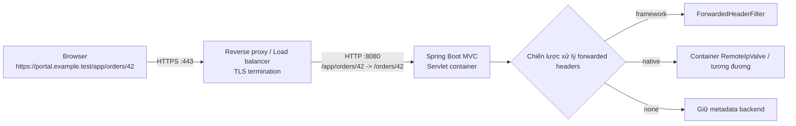
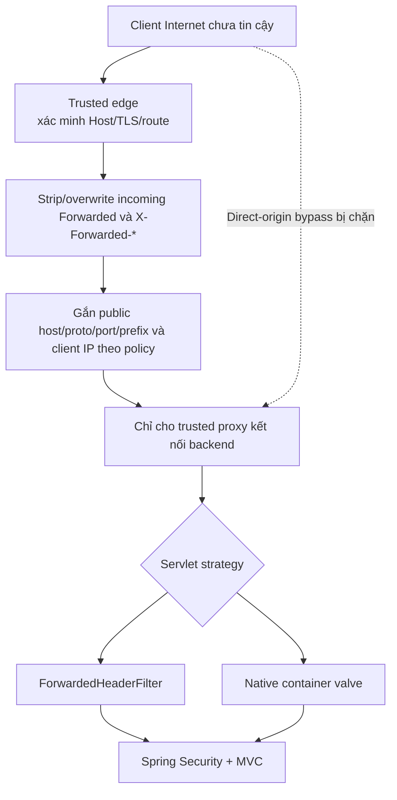

# ForwardedHeaderFilter hoặc cấu hình container trong Servlet

> **Chương:** Proxy và nguồn gốc  
> **Module:** `SPRING_SECURITY_HTTP_PROTECTION` — áp dụng CSRF, CORS, security headers, CSP, HSTS, HTTP firewall và bảo vệ session trong Spring Security, với các góc nhìn Servlet và Reactive.  
> **Trọng tâm bài:** Lựa chọn và cấu hình **một cách xử lý forwarded headers đáng tin cho Spring MVC/Servlet**: dùng Spring Framework `ForwardedHeaderFilter` hay cơ chế native của servlet container, điển hình là Tomcat `RemoteIpValve`. Đánh giá hậu quả đối với URL công khai, redirect, login, OAuth2, HSTS, cookie, CSRF và chọn security chain.

## 1. Mục tiêu học tập

Sau bài học, người học có thể:

1. Giải thích vì sao `HttpServletRequest` ở backend thường thấy `http://app.internal:8080` trong khi browser truy cập `https://portal.example.test`.
2. Phân biệt tác dụng của **`ForwardedHeaderFilter`**, **`RemoteIpValve`/cơ chế native container** và **các bộ lọc Spring Security**.
3. Chọn `server.forward-headers-strategy: framework`, `native` hoặc `none` theo topology và cấu hình trust boundary.
4. Biết lúc nào cần `ForwardedHeaderFilter#setRemoveOnly(true)`, cấu hình thứ tự filter và tránh biến đổi metadata hai lần.
5. Đánh giá `Forwarded` RFC 7239, `X-Forwarded-Proto`, `X-Forwarded-Host`, `X-Forwarded-Port`, `X-Forwarded-Prefix`, `X-Forwarded-For` theo mức hỗ trợ từng chiến lược.
6. Thiết lập trusted proxies/container settings thay vì lấy IP từ header tự khai rồi cấp quyền.
7. Viết test Servlet kiểm tra scheme, host, port, `isSecure()` và redirect, đồng thời biết vì sao test đó **không thay thế** test chống header spoofing qua edge.
8. Chẩn đoán lỗi HSTS, CSRF, login redirect, OAuth2 redirect URI, cookie, CORS hoặc security matcher khi dùng reverse proxy.

**Điều kiện an toàn tiên quyết:** Bất kể chọn framework hay native, **chỉ trusted proxy mới được cung cấp forwarding metadata tới ứng dụng**. `ForwardedHeaderFilter` và `RemoteIpValve` không thay thế host validation, network boundary hoặc xác thực người dùng.

## 2. Vấn đề: request thật và request backend thấy khác nhau

Giả sử người dùng mở:

```text
https://portal.example.test/app/orders/42
```

Sơ đồ triển khai:



Trên socket backend, một request có thể có:

```http
GET /orders/42 HTTP/1.1
Host: app.internal:8080
X-Forwarded-Proto: https
X-Forwarded-Host: portal.example.test
X-Forwarded-Port: 443
X-Forwarded-Prefix: /app
X-Forwarded-For: 198.51.100.25
```

Nếu **chưa** có xử lý metadata chuyển tiếp, một số phương thức Servlet có thể trả về:

```text
request.getScheme()     = "http"
request.isSecure()      = false
request.getServerName() = "app.internal"
request.getServerPort() = 8080
request.getRemoteAddr() = địa chỉ của proxy cuối
```

Điều người dùng thực sự thấy:

```text
scheme      = https
public host = portal.example.test
public port = 443
base path   = /app
```

Cần khôi phục thông tin public cho **đúng mục đích**, như tạo `Location`, OAuth callback hoặc phát HSTS. Nhưng đồng thời phải **không tin header do client Internet có thể tự gán**.

### 2.1. Những khái niệm dễ bị trộn

| Khái niệm | Ví dụ | Cần lưu ý |
|---|---|---|
| Public origin | `https://portal.example.test` | Scheme + hostname + port; **không gồm path** |
| Public base URL | `https://portal.example.test/app` | Có thể gồm prefix triển khai |
| Backend origin | `http://app.internal:8080` | Không được rò vào redirect/email/callback |
| Remote TCP peer | IP proxy kết nối tới backend | Không mặc nhiên là IP người dùng cuối |
| `X-Forwarded-For` | `198.51.100.25` hoặc chuỗi nhiều hop | Chỉ đáng tin qua trusted-proxy policy |
| `Host` | Host/authority request gửi tới hop hiện tại | Phải được edge xác thực và ánh xạ vhost |
| `Origin` | Nguồn trang web khởi tạo request | Dùng cho CORS/nguồn gốc, **khác target host** |

Origin `https://portal.example.test` khác `http://portal.example.test`. `https://portal.example.test:8443` cũng khác origin cổng 443; cookie không được scope theo TCP port nhưng redirect, CORS và OAuth callback có thể phụ thuộc cổng.

## 3. Hai con đường chính trong Servlet

### 3.1. `ForwardedHeaderFilter` của Spring Framework

`ForwardedHeaderFilter` là **Servlet Filter** bọc request/response để các thành phần phía sau quan sát scheme, host, port, security state và xử lý một số redirect theo thông tin forwarded.

Đặc điểm:

- Chạy trong **Servlet filter chain**, nên vị trí của filter trước các thành phần sử dụng scheme/host là quan trọng.
- Có hỗ trợ header chuẩn `Forwarded` và các header `X-Forwarded-*` theo Spring Framework; chi tiết `X-Forwarded-Prefix` cần được kiểm thử với mapping thực tế.
- Không tự nhận biết mọi IP/proxy nào đáng tin; chỉ xử lý dữ liệu **đã qua hạ tầng kiểm soát**.
- Có chế độ **remove-only** để xóa header khỏi pipeline downstream mà không áp dụng giá trị.
- Không thay `SecurityFilterChain`, `CsrfFilter`, authorization hoặc authentication.

### 3.2. Cơ chế native của container, ví dụ Tomcat `RemoteIpValve`

`RemoteIpValve` là thành phần **Tomcat Valve**, hoạt động trong pipeline container, trước hoặc bên ngoài nhiều Servlet Filter. Nó có thể:

- Sử dụng `X-Forwarded-For` để điều chỉnh địa chỉ remote theo chính sách trusted/internal proxies.
- Sử dụng protocol header để phản ánh HTTPS/HTTP public theo cấu hình container.
- Tùy phiên bản và cấu hình, xử lý host/port forwarding liên quan.
- Tích hợp tốt với những yêu cầu ghi log remote IP hoặc xử lý ở tầng container.

**Không được suy “native” hỗ trợ đầy đủ mọi loại header giống framework.** Tomcat có cấu hình header/trusted proxies riêng; `Forwarded` theo RFC 7239, `X-Forwarded-Prefix` và cách xử lý host/port có thể khác. Cần kiểm chứng bằng test thay vì chỉ nhìn tên property.

### 3.3. Bảng so sánh để ra quyết định

| Tiêu chí | Spring `ForwardedHeaderFilter` | Container native / Tomcat `RemoteIpValve` |
|---|---|---|
| Tầng chạy | Servlet Filter | Pipeline container / Valve |
| Tích hợp Spring Boot | `forward-headers-strategy: framework` | `forward-headers-strategy: native` |
| Nguồn metadata | `Forwarded`, nhiều `X-Forwarded-*` | Header theo cấu hình và container |
| Trust proxy IP ngay trong thành phần | **Không phải cơ chế kiểm tra trusted CIDR** | Có thể cấu hình internal/trusted proxy patterns |
| Xử lý client IP hiệu dụng | Không dùng filter như một trusted-client-IP resolver | Là một chức năng của Tomcat RemoteIpValve |
| Path prefix public | Có hỗ trợ framework với các quy ước phù hợp | Không mặc định hỗ trợ giống Spring |
| Trình tự áp dụng | Phải đủ sớm trước Spring Security/handler cần URL | Container xử lý trước Servlet filters tương ứng |
| Remove-only | Có `setRemoveOnly(true)` | Không cùng API; xử lý theo container/proxy |
| Hành vi redirect | Có wrapper xử lý một số redirect | Dựa vào giá trị container và response logic |
| Rủi ro lớn | Tin header giả nếu edge chưa sanitize; filter đăng ký sai thứ tự | Trusted-proxy config sai; container/header support khác giả định |
| Phù hợp khi | Spring kiểm soát URL/public prefix, hạ tầng đã sanitize | Muốn native remote IP handling và trust setup rõ ở container |

**Lựa chọn an toàn:** Chọn **một** chiến lược chịu trách nhiệm biến đổi request metadata, thống nhất với edge, rồi kiểm chứng trên environment thực. Không bật cả filter lẫn valve cho cùng metadata chỉ vì muốn “tăng bảo mật”.

## 4. Trust boundary là điều kiện trước khi chọn chiến lược

Một HTTP client bên ngoài hoàn toàn có thể thử:

```http
GET /reset HTTP/1.1
Host: portal.example.test
Forwarded: for=127.0.0.1;proto=https;host=evil.example
X-Forwarded-For: 127.0.0.1
X-Forwarded-Proto: https
X-Forwarded-Host: evil.example
```

Nếu proxy chuyển tiếp nguyên header hoặc backend cho phép gọi trực tiếp, một thành phần xử lý forwarding có thể chấp nhận thông tin **chưa được xác thực**.

### 4.1. Chuỗi xử lý đúng



Bốn điều kiện kiểm chứng:

1. **Edge kiểm soát public Host** bằng vhost/allowlist và xử lý SNI theo thiết kế; không phản chiếu tùy ý `Host` hoặc `X-Forwarded-Host` từ Internet.
2. **Edge strip hoặc overwrite** mọi forwarding metadata mà backend dùng, gồm `Forwarded` chuẩn, `X-Forwarded-*` và các biến thể vendor/custom thực tế.
3. **Backend chặn direct-origin access** bằng firewall/security group, Kubernetes NetworkPolicy, service identity hoặc mTLS nếu cần.
4. **Các proxy nhiều hop có hợp đồng rõ** về bên nào authoritative cho external scheme/host/port/client IP và cách mỗi hop thêm/sửa/giữ giá trị.

Một filter chỉ làm biến đổi request **không bảo đảm** bốn điều kiện này.

### 4.2. Nhiều proxy: không “lấy XFF đầu tiên” một cách mù quáng

```text
Browser -> CDN -> LB -> ingress -> Tomcat
```

`X-Forwarded-For` có thể chứa nhiều phần tử. Nếu client gửi sẵn `X-Forwarded-For: 127.0.0.1` và edge không strip mà append, Tomcat có thể thấy một chuỗi chứa IP giả.

Khi xác định client IP, cần bắt đầu từ **remote TCP peer đáng tin**, xét các hop theo policy trusted/internal proxies và nguồn header đã được xác nhận. Trong cơ chế Tomcat, quy tắc nội bộ và trusted proxies được cấu hình theo regex/IP, không thể thay bằng việc tìm `127.0.0.1`/`10.` trong chuỗi rồi cấp quyền admin.

**Ngay cả effective client IP đáng tin vẫn không phải danh tính người dùng.** Authentication/authorization phải dựa vào principal và quyền thích hợp; IP restriction chỉ là lớp bổ sung.

## 5. Cấu hình Spring Boot: `framework`, `native`, `none`

Spring Boot cung cấp property:

```yaml
server:
  forward-headers-strategy: framework
```

Trong Spring Boot 3.x, các giá trị sử dụng phổ biến là:

| Giá trị | Khi nào cân nhắc | Phải kiểm chứng |
|---|---|---|
| `none` | Không có forwarded metadata đáng tin hoặc muốn tự xác định canonical URL | Ứng dụng không vô tình tin header ở thành phần khác |
| `framework` | Proxy đã sanitize, Spring Framework cần khôi phục scheme/host/port/prefix | Filter/Transformer đăng ký đúng; forwarded semantics & redirect |
| `native` | Container có cơ chế đáng tin phù hợp và cần native remote IP/protocol handling | Container config, trusted-proxy policy, header/port/host support |

Đây là **lựa chọn chiến lược**, không phải ba lớp cần bật cùng lúc. Tùy phiên bản Spring Boot, web server, môi trường cloud và auto-configuration, giá trị mặc định có thể khác; đừng dựa vào một giả định “Boot luôn bật forwarding”.

### 5.1. Cấu hình cho ứng dụng Servlet dùng `ForwardedHeaderFilter`

```yaml
# application.yml - minh họa khi edge đã sanitize headers.
server:
  forward-headers-strategy: framework
```

Spring Boot sẽ áp dụng cơ chế framework tương ứng cho Servlet; thông thường là `ForwardedHeaderFilter`. **Không khai báo thêm cùng một filter** nếu auto-configuration đã đăng ký nó.

Ví dụ chuỗi proxy cấp:

```http
X-Forwarded-Proto: https
X-Forwarded-Host: portal.example.test
X-Forwarded-Port: 443
X-Forwarded-Prefix: /app
```

Bạn cần kiểm chứng:

- Servlet thấy `getScheme() == "https"` và `isSecure() == true`.
- `getServerName()` là host public đã được proxy xác minh.
- `getServerPort()` nhận cổng public đúng, kể cả 8443 nếu dịch vụ dùng cổng tùy chỉnh.
- Redirect `Location` không lộ `app.internal:8080` hoặc nhân đôi `/app`.
- Security matcher và CSRF token flow không bị ảnh hưởng ngoài thiết kế.

### 5.2. Cấu hình cho Tomcat native

Ví dụ Spring Boot dùng Tomcat nhúng:

```yaml
# application.yml - minh họa native container.
server:
  forward-headers-strategy: native
  tomcat:
    remoteip:
      remote-ip-header: x-forwarded-for
      protocol-header: x-forwarded-proto
      protocol-header-https-value: https
```

Cấu hình này **chưa đủ để chứng minh an toàn trong production**. Cần kiểm tra `internal-proxies`/`trusted-proxies` và cơ chế hạn chế network sources theo topology thực tế. Các property host/port/header khác phụ thuộc phiên bản Boot và container; nếu dùng cổng public không mặc định hoặc prefix rewrite, cần xác minh giá trị cuối thay vì tin cấu hình đã bao phủ.

Điểm cần nhớ:

- `RemoteIpValve` xử lý remote address/protocol theo cấu hình, không phải một `CsrfFilter`.
- Hành vi có thể khác `ForwardedHeaderFilter` đối với `Forwarded` chuẩn hoặc `X-Forwarded-Prefix`.
- Trusted-proxy regex sai rộng có thể khiến nguồn không tin cậy được nâng lên thành proxy.
- Nếu đường đi là CDN → LB → ingress, hãy đối chiếu chuỗi XFF thực và peer IP ở từng hop khi viết chính sách trusted proxies.
- Không đặt `forward-headers-strategy: framework` song song với native valve trùng chức năng mà không có lý do và test.

### 5.3. Ví dụ native trusted proxy cần gắn với hạ tầng

Tomcat `RemoteIpValve` có các thuộc tính như `internalProxies` và `trustedProxies`; đây là **regex biểu diễn địa chỉ proxy đáng tin theo cú pháp Tomcat**, không phải một danh sách CIDR tùy ý. Nếu đặt chúng quá rộng, có thể chấp nhận proxy giả. Nếu quá hẹp, forwarded headers hợp lệ không được xử lý.

Ví dụ mô tả (không phải chuỗi regex dùng ngay):

```text
Trusted inbound source to Tomcat: ingress service identity or exact ingress IP set
Trusted upstream hops:         LB/CDN IP ranges được vận hành xác minh
Untrusted clients:             không được kết nối trực tiếp Tomcat
Incoming XFF:                 được sanitize ở internet edge
```

**Không chép regex tin toàn bộ `10.*` hoặc “mọi proxy” mà chưa xác minh deployment.** Trong cluster, một workload nội bộ không thuộc ingress cũng có thể nằm trong dải RFC1918. Đối với những quyết định quyền nhạy cảm, bảo vệ ở network/service identity là bắt buộc.

### 5.4. Khi chọn `none`

```yaml
server:
  forward-headers-strategy: none
```

Không có forwarded transformation theo chiến lược này, nên ứng dụng có thể vẫn thấy host/port nội bộ. Nếu application cần tạo URL tuyệt đối, có thể cấu hình một **canonical public base URL** đã phê duyệt, ví dụ:

```yaml
app:
  public-base-url: "https://portal.example.test/app"
```

Đây là giải pháp hợp lý cho một số tác vụ email/callback, nhưng không tự sửa toàn bộ redirect tự sinh hoặc các component dựa trên `isSecure()`. Đồng thời phải chắc rằng container/filter/custom code khác không còn tin header chưa được làm sạch.

## 6. Tự đăng ký `ForwardedHeaderFilter`: làm sao tránh sai thứ tự?

Ở Spring Boot, **ưu tiên property** `server.forward-headers-strategy: framework` nếu đáp ứng nhu cầu. Chỉ tự đăng ký filter khi môi trường yêu cầu kiểm soát rõ việc tạo và thứ tự, và **không có một filter forwarding trùng chức năng đã đăng ký**.

### 6.1. Ví dụ cho ứng dụng Servlet Boot tự quản lý filter

```java
import org.springframework.boot.web.servlet.FilterRegistrationBean;
import org.springframework.context.annotation.Bean;
import org.springframework.core.Ordered;
import org.springframework.web.filter.ForwardedHeaderFilter;

@Bean
FilterRegistrationBean<ForwardedHeaderFilter>
    trustedForwardedHeaderFilter() {

    ForwardedHeaderFilter filter = new ForwardedHeaderFilter();
    FilterRegistrationBean<ForwardedHeaderFilter> registration =
        new FilterRegistrationBean<>(filter);

    // Minh họa: xử lý trước các filters dùng scheme/host.
    registration.setOrder(Ordered.HIGHEST_PRECEDENCE);
    return registration;
}
```

**Điều kiện dùng ví dụ:**

- Giả định đây là **cách đăng ký forwarding duy nhất** trong Servlet pipeline; không đồng thời dùng Boot `framework` auto-registration hoặc native valve cùng chức năng.
- `Ordered.HIGHEST_PRECEDENCE` là yêu cầu thứ tự trong ví dụ; khi đưa vào hệ thống thật phải xác minh filter registration, dispatcher types và tương tác với các filter của Spring Security.
- Filter tự đăng ký **không phân biệt IP proxy đáng tin**. Edge vẫn phải sanitize headers và backend phải chặn request đi vòng.
- Không đăng ký filter ở controller-level; Servlet filters cần chạy trước những component sử dụng URL metadata.

### 6.2. Một tình huống sai thứ tự

Nếu một filter/`DelegatingFilterProxy` đã sử dụng `request.isSecure()` hoặc `request.getServerName()` **trước khi** `ForwardedHeaderFilter` bọc request, thành phần đó có thể tạo redirect hoặc đánh giá HTTPS sai dù handler phía sau nhìn thấy host đúng.

Cần kiểm tra **thứ tự thực trong ứng dụng**, không chỉ thứ tự khai báo `@Bean`. Đặc biệt:

- Filter do servlet container đăng ký khác filter được Boot đăng ký.
- Spring Security có `DelegatingFilterProxy` dẫn tới `FilterChainProxy`.
- Error/async dispatch có thể có đường thực thi khác.
- Native valve chạy ở tầng khác với Servlet filters.

### 6.3. Trường hợp không nên tự thêm filter

Nếu application dùng:

```yaml
server:
  forward-headers-strategy: framework
```

mà lại tự khai báo một `ForwardedHeaderFilter` khác, các component có thể chạy hai lần hoặc phụ thuộc nhau khó chẩn đoán. Hãy chọn **property framework hoặc manual registration**, không dùng cả hai trừ khi có lý do được kiểm chứng.

Nếu đang dùng `native`, một filter framework sau đó có thể diễn giải lại metadata và sinh host/port/prefix không khớp với kết quả native. Không dùng cách “kết hợp để tăng an toàn”.

## 7. `setRemoveOnly(true)` dùng khi nào?

`ForwardedHeaderFilter` có chế độ chỉ **loại header forwarded**, không sử dụng chúng để sửa scheme/host/port:

```java
ForwardedHeaderFilter filter = new ForwardedHeaderFilter();
filter.setRemoveOnly(true);
```

Tình huống phù hợp:

- Ứng dụng **không muốn tin** bất kỳ forwarded metadata nào từ request này.
- Đã có canonical public URL/transport policy được cấu hình theo cách khác.
- Muốn phòng ngừa downstream components đọc raw `Forwarded`/`X-*` sau filter.

Tuy nhiên, `removeOnly` có giới hạn nghiêm trọng:

1. Nó **không tự xác minh upstream** và không chặn TCP direct-origin bypass.
2. Nó **không khôi phục external URL** nếu bạn vẫn cần tạo absolute redirect theo request.
3. Nếu **native valve hoặc filter khác đã đọc metadata trước đó**, giá trị giả có thể đã ảnh hưởng request attributes/redirect trước khi bị xóa.
4. Nó chỉ loại nhóm header mà implementation nhận diện; custom code đọc một header vendor-specific khác vẫn cần đánh giá riêng.
5. Nếu bạn chọn chiến lược native trusted proxies, không đặt một remove-only filter sau đó với giả định nó sẽ sửa sai cấu hình trusted range của native.

**Khuyến nghị thiết kế:** Xử lý strip/overwrite tại trusted edge **trước mọi lớp tiêu thụ header**. `removeOnly` là lựa chọn ứng dụng có chủ đích, không phải thay thế ranh giới hạ tầng.

## 8. Thực hành Nginx: sản xuất metadata đáng tin cho Servlet

Giả sử:

- Browser truy cập `https://portal.example.test/app/**` trên HTTPS 443.
- Nginx là edge trực tiếp nhận Internet, terminate TLS và rewrite `/app/**` thành `/**`.
- Tomcat/Spring Boot nằm trên `spring.internal:8080`, **không public trực tiếp**.
- Chứng chỉ, default-vhost deny cho host lạ, firewall/security group và rate limit được cấu hình bởi đội vận hành.

```nginx
server {
    listen 443 ssl;
    server_name portal.example.test;

    # TLS config và default vhost deny phải có riêng.

    location /app/ {
        # /app/orders -> /orders khi gửi tới upstream.
        proxy_pass http://spring.internal:8080/;

        # Giá trị từ vhost đã xác minh, không từ header client.
        proxy_set_header Host portal.example.test;

        # Loại header Forwarded chuẩn nếu dùng X-* authoritative.
        proxy_set_header Forwarded "";

        proxy_set_header X-Forwarded-Proto https;
        proxy_set_header X-Forwarded-Host portal.example.test;
        proxy_set_header X-Forwarded-Port 443;
        proxy_set_header X-Forwarded-Prefix /app;

        # Edge trực tiếp: thay giá trị XFF do client tự gửi.
        proxy_set_header X-Forwarded-For $remote_addr;
        proxy_set_header X-Real-IP $remote_addr;
    }
}
```

**Phạm vi ví dụ:** Cấu hình chỉ minh họa cách cấp metadata. `server_name` đơn lẻ không chứng minh host lạ đã bị từ chối; cần có default server/vhost policy tương ứng. Không copy nguyên mẫu khi Nginx ở sau CDN vì `$remote_addr` khi ấy có thể là IP CDN.

### 8.1. Khi thêm CDN hoặc LB trước Nginx

```text
Browser -> CDN TLS -> Load balancer -> Nginx -> Tomcat
```

Thay đổi cần thiết:

1. Xác minh IP/identity của CDN và các hop trung gian; LB không tự tin mọi request từ Internet.
2. Cấu hình real-IP/trusted-proxy policy tại hop phù hợp.
3. Chỉ giữ `X-Forwarded-Proto=https` **từ upstream trusted**; không ghi đè nó thành HTTP chỉ vì kết nối nội bộ không mã hóa.
4. Không dùng `$proxy_add_x_forwarded_for` tại edge đầu tiên khi incoming XFF chưa được làm sạch.
5. Tránh vừa giữ RFC `Forwarded` từ một hop vừa tạo `X-*` mâu thuẫn.
6. Test lại filter/valve và security chain sau thay đổi infrastructure.

Mỗi lần chuyển CDN/Ingress hoặc thay đổi TLS termination có thể đổi **nguồn đáng tin của metadata**. Đây là security-relevant change, không chỉ là chuyện DevOps.

### 8.2. Cổng ngoài 8443

Nếu public URL là `https://portal.example.test:8443/app`, cần xuất đúng public port:

```nginx
# Mảnh cấu hình bên trong vhost HTTPS :8443:
proxy_set_header Host portal.example.test:8443;
proxy_set_header X-Forwarded-Host portal.example.test;
proxy_set_header X-Forwarded-Proto https;
proxy_set_header X-Forwarded-Port 8443;
```

Framework hoặc container có thể ưu tiên port trong host theo cách khác; không gửi các header mâu thuẫn. Kiểm thử `Location` và OAuth2 redirect URI thực tế. `https://portal.example.test:8443` **khác origin** với HTTPS port 443.

## 9. Khi nào `Forwarded` chuẩn và `X-*` khác nhau?

`Forwarded` theo RFC 7239 có tham số như:

```http
Forwarded: for=198.51.100.25;proto=https;host="portal.example.test:8443"
```

Trong khi họ `X-*` có thể tách thành:

```http
X-Forwarded-For: 198.51.100.25
X-Forwarded-Proto: https
X-Forwarded-Host: portal.example.test
X-Forwarded-Port: 8443
```

Những khác biệt cần quan tâm:

| Thuộc tính | Lưu ý đối với strategy |
|---|---|
| RFC `Forwarded` có dấu chấm phẩy và quoting | Parser chuẩn khác cách split các header X-* |
| `host` có thể gồm cổng | Đừng tự nối port hai lần |
| IPv6 literal | Cú pháp host/for có thể gồm dấu ngoặc vuông/quoted string |
| Nhiều proxies | Có thể có các phần tử phân tách bằng dấu phẩy |
| `X-Forwarded-Prefix` | Header quy ước, không phải phần RFC 7239; container native có thể xử lý khác |
| `X-Forwarded-For` | Dùng nhiều trong container native remote-IP handling; cần trust proxy config |
| Header mâu thuẫn | Component/framework có thể chọn precedence khác nhau |

**Không để edge pass cả hai họ với nội dung không nhất quán.** Lớp A có thể kiểm Host theo `Forwarded` trong khi lớp B sinh redirect từ `X-Forwarded-Host` — đó là nguồn host poisoning hoặc parser differential.

### 9.1. Một lỗi parsing thủ công

```java
// PHẢN VÍ DỤ: không dùng cách này để xác định client IP đáng tin.
String clientIp = request.getHeader("X-Forwarded-For")
    .split(",")[0].trim();
```

Sai vì phần tử đầu có thể do client đặt, và mã còn lỗi khi header thiếu. Dùng trusted-proxy mechanism của container/proxy với các hop được xác minh; không tự parse RFC `Forwarded` hoặc XFF rồi dùng làm authentication factor.

## 10. Tác động đến Spring Security

Forwarded handling là phần **giao tiếp với hạ tầng**, nhưng lựa chọn framework/native có thể ảnh hưởng những cơ chế bảo vệ browser phía sau.

### 10.1. Redirect login và OAuth2/OIDC callback

Browser mở `https://portal.example.test/app/private`. Nếu Tomcat chỉ biết `http://spring.internal:8080/private`, form-login entry point hoặc OAuth2 redirect generation có thể tạo:

```http
Location: http://spring.internal:8080/login
```

Kỳ vọng là URL public đúng:

```http
Location: https://portal.example.test/app/login
```

Với OAuth2/OIDC, redirect URI thường được suy từ base URL, ví dụ:

```text
{baseUrl}/login/oauth2/code/{registrationId}
```

Sai scheme/host/port/prefix có thể gây `redirect_uri mismatch` tại identity provider. **Không sửa bằng mở wildcard redirect URIs**; cần xác định trusted external URL và đăng ký callback chính xác. Với liên kết reset password/activation, có thể ưu tiên canonical base URL tường minh để tránh Host poisoning.

### 10.2. HTTPS detection và HSTS

Spring Security có thể phát `Strict-Transport-Security` khi request được xem là HTTPS theo cấu hình headers. Nếu backend chỉ thấy HTTP vì không xử lý proxy metadata, HSTS có thể không xuất hiện tại nơi mong đợi. Ngược lại, nếu tin `X-Forwarded-Proto: https` giả, việc request bị hiểu là HTTPS có thể sai.

HSTS có thể được sở hữu tại **TLS edge** hoặc bởi Spring Security trên request HTTPS đã được nhận diện chính xác. Kiểm thử public response và xác định một chính sách rõ. Không dùng HSTS thay CSRF, và không tắt HTTPS enforcement chỉ để loại redirect loop.

### 10.3. Cookie/session sau TLS termination

Browser chỉ nhìn thấy HTTPS public; backend có thể chạy HTTP nội bộ. Cookie auth cần các thuộc tính phù hợp:

- `Secure`: cookie chỉ được gửi qua kết nối an toàn theo browser policy.
- `HttpOnly`: giảm việc JavaScript đọc cookie trực tiếp.
- `SameSite`: hạn chế một số request cross-site; không thay CSRF token.
- `Domain`/`Path`: kiểm soát phạm vi browser gửi cookie; prefix public `/app` có thể ảnh hưởng Path cần thiết.
- Session fixation protection, logout và CSRF token lifecycle vẫn cần kiểm thử.

Không đồng nhất `isSecure()` với cấu hình cookie trong mọi framework: có thể có chính sách Secure explicit. Kiểm tra `Set-Cookie` **trên response công khai**, không chỉ giá trị request tại controller.

### 10.4. CSRF và browser cookie

**`ForwardedHeaderFilter` không phải `CsrfFilter`.** Dù public URL là HTTPS và `isSecure()` trả true, POST/PUT/PATCH/DELETE sử dụng session cookie hoặc JWT cookie vẫn cần CSRF token phù hợp.

Ví dụ:

| Request | Forwarding đúng có giải quyết CSRF không? |
|---|---|
| `POST /web/orders` với session cookie và thiếu CSRF token | **Không**; CSRF phải chặn |
| `POST /auth/logout` dùng browser session | **Không**; kiểm tra CSRF theo cấu hình |
| `POST /api/m2m/orders` bearer-only, không cookie fallback | Có thể miễn CSRF trong chain riêng, độc lập forwarding |
| `POST /integrations/webhook` có chữ ký HMAC | Có thể miễn hẹp khi verifier hoạt động, độc lập forwarding |

Một POST web 403 CSRF sau khi đổi proxy có thể do cookie Path sai, token bị mất, proxy rewrite làm route vào chain khác, hoặc token lifecycle thay đổi. Đừng tắt CSRF để “chữa” metadata.

### 10.5. CORS `Origin` không phải forwarded host

SPA ở `https://app.example.test` gọi API `https://api.example.test`:

```http
Origin: https://app.example.test
Host: api.example.test
```

`Origin` là **nguồn web** dùng cho CORS; `Host`/`X-Forwarded-Host` là **đích request**. Không làm CORS allowlist động từ forwarded host. OPTIONS preflight có thể không kèm credential; cần CORS processing đúng trước authentication nơi phù hợp.

CORS không thay CSRF với session cookie: một trang không đọc được response vẫn có thể gây một số request cross-site làm thay đổi trạng thái.

### 10.6. HTTP firewall và security matchers

Servlet `StrictHttpFirewall` có thể từ chối path/method/encoding bất thường trước khi các bước bảo vệ khác xử lý. Nhưng nó **không tự xác minh nguồn forwarded headers**.

Path rewrite `/app/api/web/orders` → `/api/web/orders` có thể ảnh hưởng matcher trong `SecurityFilterChain`; `X-Forwarded-Prefix` còn có thể được framework sử dụng cho URL generation. Hãy kiểm chứng path mà Spring Security matcher thấy theo servlet mapping/context path, không suy từ URL public hoặc tên header.

`SecurityFilterChain` chọn **chain đầu tiên khớp**, bất kể chiến lược forwarded handling. Đừng để route browser cookie đi vào bearer-only chain có `csrf.disable()` vì matcher quá rộng.

## 11. Kiểm thử Servlet: phải kiểm tra cả filter behavior lẫn edge

Có ba lớp test cần tách:

1. **Framework test:** `ForwardedHeaderFilter` khôi phục scheme/host/port từ metadata đã có đúng không?
2. **Container integration:** Embedded/external Tomcat `RemoteIpValve` có xử lý remote address/protocol và trusted proxies đúng không?
3. **Edge/network:** Client Internet giả forwarding headers có bị loại/ghi đè/từ chối, và backend có bị chặn direct access không?

**Một test MockMvc với header do test tự gắn không chứng minh proxy đã sanitize header.** Nó chứng minh framework sẽ tin header khi được cung cấp.

### 11.1. Controller quan sát request (chỉ dành cho test)

```java
import java.util.Map;
import jakarta.servlet.http.HttpServletRequest;
import org.springframework.web.bind.annotation.GetMapping;
import org.springframework.web.bind.annotation.RestController;

@RestController
class ServletRequestProbe {

    @GetMapping("/__test/public-address")
    Map<String, Object> address(HttpServletRequest request) {
        return Map.of(
            "scheme", request.getScheme(),
            "secure", request.isSecure(),
            "host", request.getServerName(),
            "port", request.getServerPort(),
            "remoteAddr", request.getRemoteAddr());
    }
}
```

**Không expose probe công khai ở production.** Remote IP và hạ tầng nội bộ có thể là thông tin nhạy cảm; fixture nên chạy trong môi trường test hoặc chịu authorization phù hợp.

### 11.2. Test `ForwardedHeaderFilter` bằng MockMvc

```java
import org.junit.jupiter.api.Test;
import org.springframework.test.web.servlet.MockMvc;
import org.springframework.test.web.servlet.setup.MockMvcBuilders;
import org.springframework.web.filter.ForwardedHeaderFilter;

import static org.springframework.test.web.servlet.request.MockMvcRequestBuilders.get;
import static org.springframework.test.web.servlet.result.MockMvcResultMatchers.jsonPath;
import static org.springframework.test.web.servlet.result.MockMvcResultMatchers.status;

class ForwardedHeaderFilterTest {
    private final MockMvc mvc = MockMvcBuilders
        .standaloneSetup(new ServletRequestProbe())
        .addFilters(new ForwardedHeaderFilter())
        .build();

    @Test
    void frameworkRestoresPublicSchemeHostAndPort() throws Exception {
        mvc.perform(get("/__test/public-address")
                .header("X-Forwarded-Proto", "https")
                .header("X-Forwarded-Host", "portal.example.test")
                .header("X-Forwarded-Port", "8443"))
            .andExpect(status().isOk())
            .andExpect(jsonPath("$.scheme").value("https"))
            .andExpect(jsonPath("$.secure").value(true))
            .andExpect(jsonPath("$.host").value("portal.example.test"))
            .andExpect(jsonPath("$.port").value(8443));
    }
}
```

Kết quả kỳ vọng minh họa behavior của filter trong phiên bản tương thích. Test dùng `standaloneSetup` với **filter được gắn thủ công**; nó không kiểm chứng auto-configuration của Boot, không thực thi tất cả Spring Security filters và không mô phỏng một trusted proxy thật.

### 11.3. Test remove-only

Với test riêng mà mục tiêu là **không tin** forwarded headers:

```java
ForwardedHeaderFilter filter = new ForwardedHeaderFilter();
filter.setRemoveOnly(true);
```

Kiểm thử gửi `X-Forwarded-Proto: https` vào request HTTP và xác minh downstream không bị chuyển thành secure chỉ vì header. Đồng thời xác minh forwarded headers đã bị filter loại khỏi request downstream theo implementation.

Nếu native valve đã xử lý header trước filter, remove-only **không sửa được** metadata đã bị áp dụng. Vì vậy test remove-only trong MockMvc không thay kiểm chứng toàn pipeline.

### 11.4. Test Tomcat native bằng embedded server thật

`MockMvc` chạy kiểu standalone không thực thi Tomcat `RemoteIpValve`. Với `server.forward-headers-strategy=native`, phải dùng integration test khởi động web server thực:

```java
import org.junit.jupiter.api.Test;
import org.springframework.boot.test.context.SpringBootTest;
import org.springframework.boot.test.web.server.LocalServerPort;

@SpringBootTest(
    webEnvironment = SpringBootTest.WebEnvironment.RANDOM_PORT,
    properties = {
        "server.forward-headers-strategy=native",
        "server.tomcat.remoteip.remote-ip-header=x-forwarded-for",
        "server.tomcat.remoteip.protocol-header=x-forwarded-proto"
    })
class TomcatNativeForwardingIT {

    @LocalServerPort
    int port;

    @Test
    void proxyForwardingIsValidatedThroughActualTomcat() {
        // Dùng HTTP client test gửi request tới cổng 'port';
        // xác minh ServletRequestProbe nhận scheme/isSecure/remoteAddr
        // theo remote IP thật và trusted/internal proxy config.
        // Test thêm: header giả từ nguồn không trusted không có hiệu lực.
    }
}
```

Đây là **khung integration test**, chưa chứa HTTP client hoặc network fixture thực. Không thể chứng minh trusted ranges chỉ bằng cách gửi request từ loopback, vì môi trường loopback có thể được Tomcat coi là proxy internal. Cần test với source/topology đại diện staging hoặc proxy container thực.

Các assert tối thiểu:

- Trusted proxy đưa `proto=https` và external port đúng → request metadata được diễn giải theo thiết kế.
- Peer không thuộc trusted list đưa header giả → không được tin như proxy.
- `X-Forwarded-For` có phần tử giả `127.0.0.1` → effective client IP không bị kéo về loopback.
- `Forwarded` RFC 7239 hoặc `X-Forwarded-Prefix` chỉ được kỳ vọng nếu native stack thực sự hỗ trợ.
- Kết quả không thay đổi bất ngờ khi đổi Tomcat/Boot version.

### 11.5. Test security chain và CSRF là test riêng

Ví dụ POST browser dùng session cookie:

```java
import static org.springframework.security.test.web.servlet.request.SecurityMockMvcRequestPostProcessors.csrf;
import static org.springframework.security.test.web.servlet.request.SecurityMockMvcRequestPostProcessors.user;
import static org.springframework.test.web.servlet.request.MockMvcRequestBuilders.post;
import static org.springframework.test.web.servlet.result.MockMvcResultMatchers.status;

@Test
void browserPostWithoutCsrfMustBeRejected() throws Exception {
    securityMockMvc.perform(post("/web/orders")
            .with(user("alice").roles("USER"))
            .contentType("application/json")
            .content("{\"sku\":\"A42\",\"quantity\":1}"))
        .andExpect(status().isForbidden());
}

@Test
void browserPostWithValidCsrfCanProceed() throws Exception {
    securityMockMvc.perform(post("/web/orders")
            .with(user("alice").roles("USER"))
            .with(csrf())
            .contentType("application/json")
            .content("{\"sku\":\"A42\",\"quantity\":1}"))
        .andExpect(status().isCreated());
}
```

`securityMockMvc` ở đây giả định được tạo với Spring Security filters và handler nghiệp vụ phù hợp; status 201 là hợp đồng giả định của handler. `with(user())` dùng để kiểm tra CSRF/authorization, **không chứng minh cookie fallback ở API bearer-only**. Nếu cần test fallback, tạo session thực hợp lệ rồi gọi bearer route chỉ với cookie, không dùng security test helper chèn principal trực tiếp.

## 12. Kiểm thử qua proxy thật: chứng minh trust boundary

Ví dụ chỉ dùng staging/hạ tầng thuộc quyền quản lý:

```bash
# Dương: kiểm tra URL public, Location, Set-Cookie, HSTS.
curl -i 'https://portal.example.test/app/login'

# Âm: client cố giả nguồn và scheme/host public.
curl -i \
  -H 'Forwarded: for=127.0.0.1;proto=http;host=evil.example' \
  -H 'X-Forwarded-For: 127.0.0.1' \
  -H 'X-Forwarded-Proto: http' \
  -H 'X-Forwarded-Host: evil.example' \
  -H 'X-Forwarded-Port: 8080' \
  -H 'X-Forwarded-Prefix: /admin' \
  'https://portal.example.test/app/login'
```

Một proxy có thể **từ chối** request có forwarding headers đáng ngờ hoặc **ghi đè** chúng bằng dữ liệu authoritative; cả hai đều là kết quả có thể hợp lệ theo policy. Không được để:

- `Location` hoặc reset link trỏ đến `evil.example`.
- Spring hiểu public scheme là `http` chỉ vì client gửi proto giả.
- Rate limiter/IP allowlist coi request là `127.0.0.1`.
- Prefix giả làm đổi URL hoặc dẫn request vào vùng security chain sai.
- Port public bị thay thành 8080 do client khai.
- Request bỏ qua edge và vào thẳng Tomcat từ Internet.

### 12.1. Kiểm thử đúng nguồn IP quan trọng hơn giá trị XFF đẹp

Để test native trust policy, cần có topology cho phép quan sát:

```text
Trusted ingress IP -> Tomcat
Untrusted test source -> Tomcat (chỉ trong mạng test có kiểm soát)
```

Khi nguồn trusted gửi metadata hợp lệ, container có thể dùng nó. Khi nguồn untrusted cố gửi cùng metadata, container không được nâng nguồn đó thành trusted proxy. Không tự nhận rằng hai request từ cùng loopback IP đã chứng minh được phân biệt nguồn.

### 12.2. Ma trận hồi quy

| Tình huống | Kết quả kỳ vọng |
|---|---|
| Framework filter + header trusted | Scheme/host/port public đúng |
| Native Tomcat + proxy trusted | Protocol/remote IP theo policy |
| `Forwarded` và `X-*` mâu thuẫn | Edge chuẩn hóa/từ chối, không parser differential |
| Client giả `X-Forwarded-Host` | Không tạo redirect/reset link tới host giả |
| Client giả `X-Forwarded-Proto` | Không ảnh hưởng HTTPS/security decision |
| Client giả `X-Forwarded-For` | Không bypass allowlist/rate-limit |
| Direct access tới backend | Network controls chặn |
| OAuth2 callback qua proxy | Redirect URI đúng public host, port, prefix |
| Browser cookie `Secure` qua TLS edge | `Set-Cookie` đúng, phiên hoạt động |
| HSTS ở public HTTPS | Header được phát ở tầng đã thiết kế |
| Browser POST thiếu CSRF token | Bị CSRF chặn, không thay đổi dữ liệu |
| Browser POST có token đúng | Qua CSRF, tới nghiệp vụ khi có quyền |
| Bearer-only API chỉ có session cookie hợp lệ | Không fallback xác thực bằng cookie |
| OPTIONS CORS preflight | Theo allowlist origin/method/header phù hợp |
| Request URL encoding bất thường | HTTP firewall/routing chặn hoặc xử lý theo chính sách |
| Path rewrite `/app/**` | Authorization và CSRF matcher nhìn thấy đúng path |
| Thay Boot/Tomcat/Ingress version | Tất cả test trên tiếp tục đạt |

## 13. Những lỗi chẩn đoán hay gặp

### 13.1. Vẫn redirect về HTTP dù đã bật `framework`

Kiểm tra:

1. App thật sự là Servlet hay đang chạy stack Reactive?
2. Property được nạp ở profile/environment đúng chưa?
3. Auto-config có đăng ký filter đúng không, hay có filter trùng?
4. Edge có gửi `Forwarded: proto` hoặc `X-Forwarded-Proto` nhất quán?
5. Request có qua trusted edge hay gọi backend trực tiếp?
6. Filter tạo redirect có chạy trước `ForwardedHeaderFilter` không?

Không bật `csrf.disable()` hoặc nới HTTPS enforcement để chữa sai scheme.

### 13.2. Native Tomcat xác định sai client IP

Kiểm tra `RemoteIpValve`, `remoteIpHeader`, `internalProxies`/`trustedProxies`, nguồn TCP và XFF sau khi edge sanitize. Nếu toàn bộ request bị ghi nhận là ingress IP có thể là thiếu trust; nếu Internet bị ghi là loopback có thể là tin quá rộng hoặc parser sai.

Không dùng `X-Forwarded-For.split(",")[0]` trong controller để “bù” cho native setup.

### 13.3. `ForwardedHeaderFilter` và `RemoteIpValve` cùng chạy

Biểu hiện có thể là scheme/port bị áp hai lần, host/URI không nhất quán hoặc chỉ một phần metadata được biến đổi. Kiểm tra cả Boot property, bean/filter registrations, container valves và custom configuration; chọn một path sở hữu metadata có chủ đích.

### 13.4. OAuth redirect URI thiếu `:8443` hoặc `/app`

Có thể framework/native không hỗ trợ hoặc không nhận đúng port/prefix, hoặc proxy rewrite không tương ứng. Kiểm tra `Forwarded: host="portal.example.test:8443"`/`X-Forwarded-Port`, `X-Forwarded-Prefix`, URI builder và callback registered ở IdP.

Không thêm `:8443`/`/app` thủ công vào chuỗi đã có prefix; có thể sinh `:8443:8443` hoặc `/app/app`.

### 13.5. Login được nhưng session cookie không gửi lại

Kiểm tra browser request URL public, `Set-Cookie` response, `Secure`/`HttpOnly`/`SameSite`/`Domain`/`Path`, context path, TLS termination và login/logout/CSRF token lifecycle. `ForwardedHeaderFilter` đúng không bảo đảm mọi cookie flags đều đúng; chính sách cookie cần cấu hình và test riêng.

### 13.6. HSTS không có mặc dù browser thấy HTTPS

HSTS có thể chỉ được cấu hình ở edge, hoặc Spring Security không thấy `isSecure()==true`, hoặc header writer không chạy ở chain được chọn. Kiểm tra public response và tầng sở hữu HSTS, không chỉ header trả từ port nội bộ.

### 13.7. Browser nhận CORS error khi đổi reverse proxy

Origin của frontend có thể thay đổi scheme/port sau redirect, hoặc preflight bị chặn. CORS allowlist cần dùng `Origin` thực của caller; `X-Forwarded-Host` không phải Origin. CORS và CSRF là hai vấn đề khác nhau, dù có thể xảy ra cùng lúc.

### 13.8. CSRF 403 chỉ xuất hiện qua đường public

Có thể browser cookie không gửi vì path/scheme, CSRF header bị proxy làm mất, hoặc path rewrite đổi security matcher/chain. Xác minh filter từ chối, token repository và request path tại Servlet; không tắt CSRF cả chain để né lỗi proxy.

## 14. Bài tập tình huống

Một dự án Spring Boot Servlet chạy Tomcat sau Nginx:

```text
Browser -> HTTPS Nginx -> HTTP Tomcat :8080
```

Nhóm A cấu hình:

```yaml
server:
  forward-headers-strategy: native
```

Nhóm B lại thêm:

```java
@Bean
ForwardedHeaderFilter forwardedHeaderFilter() {
    return new ForwardedHeaderFilter();
}
```

Nginx vừa dùng:

```nginx
proxy_set_header X-Forwarded-For $proxy_add_x_forwarded_for;
proxy_set_header X-Forwarded-Host $http_x_forwarded_host;
proxy_set_header X-Forwarded-Proto $http_x_forwarded_proto;
```

Tomcat có direct port được test từ mạng Internet. Các triệu chứng:

- OAuth2 redirect URI có khi dùng HTTP, có khi dùng HTTPS.
- Email reset password có thể trỏ tới host không được cho phép.
- IP allowlist có thể bị bypass với `X-Forwarded-For: 127.0.0.1`.
- Người dùng thỉnh thoảng bị logout do cookie path/redirect sai.

### 14.1. Câu hỏi

1. Có mấy lớp đang diễn giải forwarding metadata và vì sao rủi ro?
2. Cấu hình Nginx sai ở đâu?
3. `native` có tự đảm bảo rằng forwarded headers đến từ proxy đáng tin không?
4. Các lỗi OAuth, host poisoning, IP và cookie cần kiểm thử như thế nào?
5. Nên chọn một chiến lược nào và đảm bảo điều kiện gì trước khi triển khai?

### 14.2. Phân tích tham khảo

1. Container native và `ForwardedHeaderFilter` đều có thể diễn giải forwarded metadata. Không nên để chúng chồng chức năng khi không có thiết kế/kiểm thử.
2. Nginx phản chiếu `$http_x_forwarded_host`/`$http_x_forwarded_proto` do client tự khai, và append XFF đầu vào chưa sanitize. Cần strip/overwrite tại edge.
3. `native` là lựa chọn xử lý container, không tự hoàn thành network trust boundary. Trusted/internal proxies cần cấu hình đúng và backend phải không public trực tiếp.
4. Test âm Host/XFF/proto spoofing qua edge; test dương public redirect/OAuth URI, cookie `Secure/Path`, HSTS, IP hiệu dụng theo trusted chain và CSRF browser POST thiếu/sai/đúng token. Test direct-origin bypass tại network layer.
5. Chọn **framework** nếu Spring cần xử lý `Forwarded`/prefix và edge đã sanitize; hoặc **native** nếu Tomcat remote-IP/trusted proxy handling phù hợp hơn. Không có lựa chọn chung cho mọi deployment. Dù chọn gì, phải chặn direct access và kiểm tra public scheme/host/port/path trong production-like test.

**Bài học:** “Có filter” không đồng nghĩa “đã xác minh header”. Quy tắc tin cậy nằm ở **đường đi và quyền đặt metadata**, không nằm ở việc một lớp Java đọc nó trước hay sau.

## 15. Checklist trước khi merge và triển khai

- [ ] Đã ghi rõ public URL và backend URL, TLS termination, proxy path rewrite.
- [ ] Đã phân biệt `Host`/`Origin`/`Forwarded`/`X-Forwarded-*`, remote IP và principal.
- [ ] Edge xác minh Host/vhost, strip/overwrite forwarding metadata do client không tin cậy.
- [ ] Backend không nhận kết nối direct-origin không được phép; có firewall/NetworkPolicy/service identity phù hợp.
- [ ] Chuỗi trusted proxies rõ khi có CDN/LB/ingress nhiều hop.
- [ ] Không lấy IP đầu tiên trong `X-Forwarded-For` làm authentication/authorization.
- [ ] Chọn đúng một `server.forward-headers-strategy`: `none`, `framework` hoặc `native` theo deployment.
- [ ] `ForwardedHeaderFilter` không bị đăng ký trùng với Boot auto-config/native valve.
- [ ] Nếu tự đăng ký Servlet filter, đã kiểm tra thứ tự so với Spring Security và các filters tạo redirect.
- [ ] Nếu dùng `setRemoveOnly(true)`, hiểu rằng filter **không khôi phục external URL** và không sửa metadata đã được native đọc trước.
- [ ] Nếu dùng Tomcat native, đã cấu hình/test `internalProxies`/`trustedProxies` và remote-IP/protocol headers đúng topology.
- [ ] Đã kiểm chứng mức hỗ trợ `Forwarded`, `X-Forwarded-Host`/`Port`/`Prefix` ở chiến lược/container thực tế.
- [ ] Header chuẩn và X-* không mâu thuẫn; không tự parse IPv6/quoted strings bằng split đơn giản.
- [ ] External HTTPS và port 443/8443 được nhận đúng; redirect không chứa host/port nội bộ.
- [ ] Prefix public `/app` không bị mất hoặc lặp, security matcher nhìn thấy đúng path.
- [ ] Login redirect, OAuth2/OIDC callback và absolute reset links dùng public host đã được kiểm soát.
- [ ] HSTS và các security headers được kiểm tra tại tầng sở hữu, không mặc định được phát.
- [ ] Cookie session có `Secure`/`HttpOnly`/`SameSite`/`Domain`/`Path` theo policy và được browser gửi đúng.
- [ ] Browser dùng cookie vẫn có CSRF cho unsafe requests; `permitAll` không tự miễn token.
- [ ] CORS preflight xử lý theo caller `Origin` và allowlist, không dựa vào forwarded host.
- [ ] HTTP firewall/path rewrite/chain selection đã được kiểm tra với request thực.
- [ ] MockMvc kiểm tra framework filter semantics; **integration Tomcat thật** kiểm tra native valve.
- [ ] Đã có test âm qua edge cho spoofing `Forwarded`, host/proto/port/prefix/XFF.
- [ ] Đã có test âm chặn bypass backend và nguồn không trusted.
- [ ] Chưa dùng 200/302/403 đơn lẻ làm bằng chứng; đã kiểm tra Location, Set-Cookie, source filter và side effects.
- [ ] Log/traces không chứa cookie, raw access token, CSRF token hoặc secrets.
- [ ] Đã định nghĩa trigger review lại khi nâng Boot/Tomcat/Spring Framework, thêm CDN hoặc đổi ingress/TLS.

**Ghi nhớ:** `ForwardedHeaderFilter` và container-native `RemoteIpValve` đều giúp Servlet ứng dụng hiểu request **được proxy chuyển tiếp**, nhưng chúng hoạt động ở những tầng khác nhau và có giới hạn khác nhau. **Không chạy trùng, không tin header từ Internet và không bỏ qua trusted-proxy configuration.** Hãy chọn một chiến lược, bảo vệ ranh giới mạng, chuẩn hóa metadata tại edge, rồi kiểm thử public URL, login/OAuth, cookie, HSTS, CORS, CSRF và authorization ở đường đi thật.
